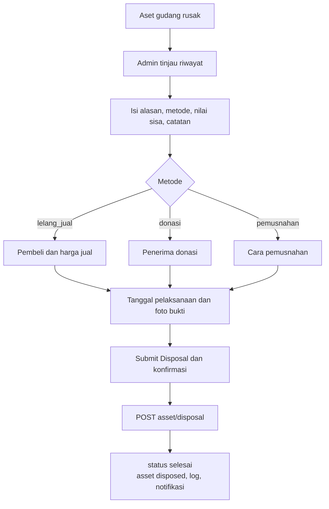
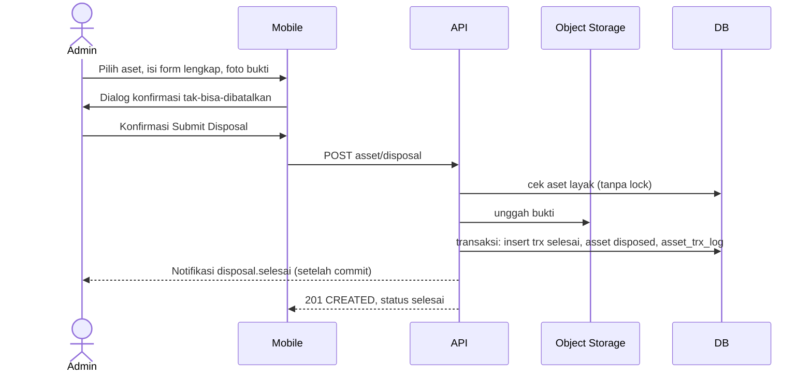
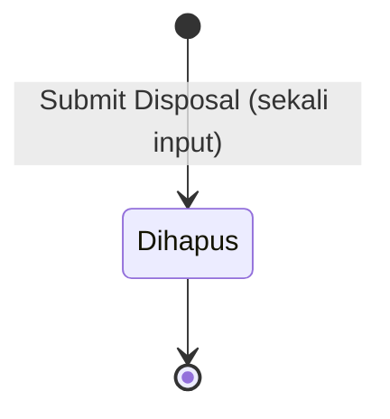
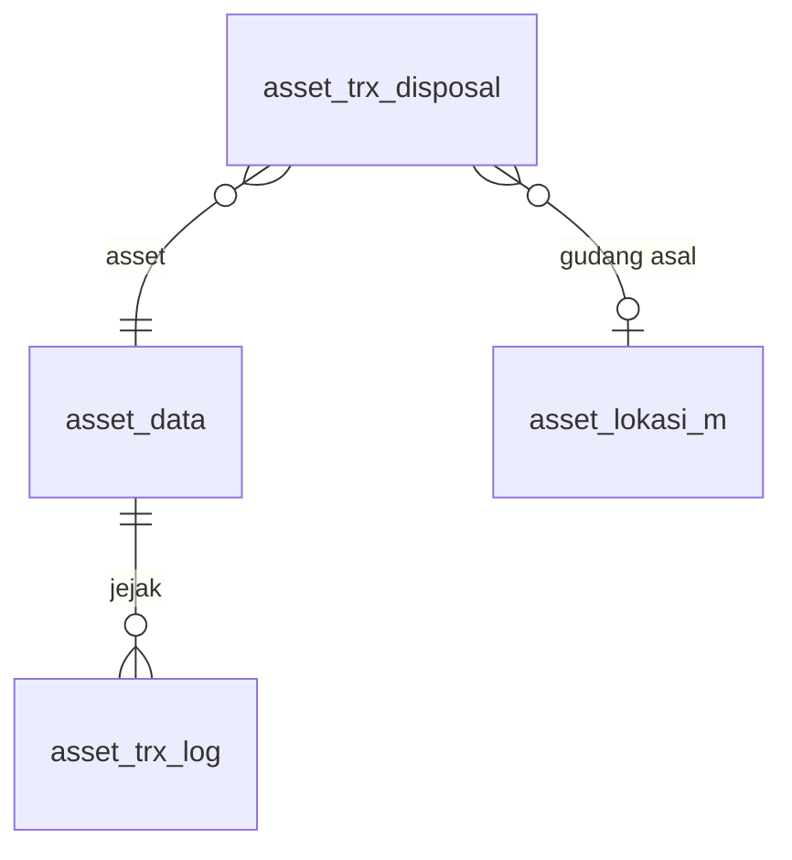

# Dokumentasi Teknis & Manual Book — Disposal Asset (PML04)

> Dokumen ini disusun **dari source code lokal** (`API/` Lumen dan `MOBILE/` Flutter) per 11 November 2026, dibandingkan dengan dokumen bisnis **"4.4 Pemeliharaan - Disposal Aset (PML04)"** (v1.0, 2026-08-07).
> Cakupan implementasi: **aset gudang berstatus `rusak`**, ditangani **Admin/HR saja** tanpa approval. Satu transaksi = satu aset, dan **sekali input**: satu form lengkap, satu `POST`, langsung selesai. Bagian yang tidak ditemukan ditandai **⚠️ Belum ditemukan**, asumsi ditandai **⚠️ Asumsi**.
> Contoh ID/nama pada payload adalah **data sintetis**.

---

## 1. Informasi Dokumen

| Informasi | Nilai |
|---|---|
| Nama Fitur | Disposal Asset (penghapusan aset dari registri aktif) |
| Kode Fitur | **PML04** (nomor transaksi `PML04-YYYYMMNNN`) |
| Modul | Asset Management — Pemeliharaan Aset |
| Backend | Laravel **Lumen ^10.0**, PHP ^8.1, JWT, Query Builder |
| Database | `API/diagram-asset.dbml` (tanda `[REVISI PML04]` / `[NEW PML04]`) + SQL manual `Claude outputs/sql-pml04-disposal.sql`. Alur sekali input **tidak mengubah skema**: kolom fase, enum `status` (`proses`), dan nilai `menunggu_disposal` tetap ada tetapi tidak lagi dipakai alur baru. ⚠️ SQL harus dijalankan manual (belum dijalankan saat dokumen ditulis) |
| Mobile | Flutter (`professional_flutter_3_35`), `flutter_bloc`, `dio`, `image_picker` |
| Web | ⚠️ Belum ditemukan: tidak ada source web di workspace |
| Test otomatis | API `tests/Asset/AssetDisposalTest.php` (7 test) · Mobile `test/asset/asset_disposal_test.dart` (11 test) |
| Versi dokumen | 1.3 — 11 November 2026 |
| Dokumen terkait | Perbaikan (PML02), Klaim Garansi (PML03), Pemeliharaan (PML01) |

## 2. Daftar Isi

Lihat panel navigasi di samping.

## 3. Quick Overview

Aset gudang yang rusak dan tidak layak dipertahankan dihapus dari daftar aset aktif lewat **satu kali input**. Admin meninjau riwayat aset (usia, harga perolehan, jumlah perbaikan dan klaim garansi), lalu mengisi **satu form lengkap**: alasan, **metode** (lelang/jual, donasi, pemusnahan), nilai sisa, catatan, data pelaksanaan sesuai metode (pembeli dan harga, penerima donasi, atau cara pemusnahan), tanggal pelaksanaan, dan **bukti wajib**. Setelah dialog konfirmasi "tidak dapat dibatalkan", satu `POST /asset/disposal` langsung menyelesaikan disposal: transaksi berstatus `selesai`, aset `rusak` menjadi `disposed` dan tidak muncul lagi di daftar aktif, sementara datanya tetap tersimpan sebagai arsip audit.

| Aspek | Ringkasan |
|---|---|
| Aktor | Admin/HR saja (tanpa approval) |
| Status transaksi | Hanya `selesai` (dihapus/disposed); dibuat langsung saat submit |
| Status asset | `rusak` → `disposed` (tanpa status perantara) |
| Metode | `lelang_jual`, `donasi`, `pemusnahan` |
| Endpoint | 4 (semua admin) |
| Notifikasi | 1 event (`disposal.selesai`) ke admin, dikirim setelah commit |

## 4. Ringkasan Fitur

| No | Fitur | Aktor |
|---|---|---|
| 1 | Pilih aset gudang rusak dengan riwayatnya | Admin |
| 2 | Isi satu form lengkap (keputusan, pelaksanaan per metode, bukti) | Admin |
| 3 | Submit Disposal dengan dialog konfirmasi tak-bisa-dibatalkan; langsung selesai | Admin |
| 4 | Daftar disposal selesai (filter tanggal) dan detail read-only | Admin |

## 5. Tujuan Fitur

### 5.1 Tujuan Bisnis (dari dokumen bisnis dan kode)

- Penghapusan aset punya keputusan, alasan, dan bukti yang dapat diaudit.
- Tidak ada disposal tanpa bukti pelaksanaan: semua data dan bukti dikirim sekaligus, dan transaksi baru terbentuk bila lengkap.
- Data historis aset tidak dihapus, hanya dikeluarkan dari daftar aktif.

### 5.2 Tujuan Sistem

- Menjaga aset yang sudah di-disposal tidak bisa dipakai alur lain.
- Memvalidasi field wajib per metode dan bukti sebelum apa pun disimpan.
- Menulis transaksi, status aset, dan `asset_trx_log` secara atomik dalam satu transaksi database, lalu mengirim notifikasi penyelesaian setelah commit.

## 6. Aktor

| Aktor | Peran |
|---|---|
| Admin/HR (admin asset) | Memilih aset, mengisi form lengkap, dan men-submit disposal |
| Sistem | Memvalidasi, mengunci status aset, menulis log, dan mengirim notifikasi |

## 7. Hak Akses

Seluruh endpoint hanya untuk admin asset (`Asset_m::isAdmin`). Non-admin menerima 403. Tidak ada endpoint karyawan/PIC. Catatan: pada `POST /asset/disposal`, validasi request dijalankan **sebelum** cek akses, sehingga non-admin yang mengirim payload tidak valid menerima 422 (bukan 403).

## 8. Terminologi

| Istilah | Arti |
|---|---|
| Disposal | Penghapusan aset dari registri aktif |
| Sekali input | Keputusan, pelaksanaan, dan penyelesaian dicatat dalam satu `POST` |
| DIHAPUS (DISPOSED) | Disposal selesai (`status = selesai`, aset `disposed`); satu-satunya status yang dibuat alur baru |
| Data lama | Transaksi `status = proses` dan aset `menunggu_disposal` buatan alur tiga fase sebelum v1.3; tidak dibuat lagi (lihat RISK-006) |
| Nilai sisa | Book value aset (opsional) |
| Bukti | Satu foto/scan kwitansi, berita acara, atau foto pemusnahan |

## 9. Business Rules

### BR-001 — Aset yang boleh di-disposal
Hanya `pemegang_asset = gudang` dan `status_asset = rusak`. Karena proses lain mengubah status (`dalam_perbaikan`, `dalam_proses_klaim`, menunggu serah terima), syarat "tidak ada proses aktif" terpenuhi otomatis. Tidak boleh masih dalam onboarding aktif. Pesan: *"Hanya asset rusak di gudang yang dapat di-disposal."*

### BR-002 — Sekali input
Keputusan, pelaksanaan, dan penyelesaian adalah **satu langkah**: satu `POST /asset/disposal` membuat transaksi langsung `selesai` dan mengubah aset menjadi `disposed`. Tidak ada status perantara dan tidak ada endpoint pelaksanaan atau penyelesaian terpisah. `alasan_disposal` wajib (maks 255); `metode_disposal` ∈ tiga nilai; `nilai_sisa` opsional dan tidak negatif; `catatan` opsional (maks 1000).

### BR-003 — Field wajib menurut metode

| Metode | Field wajib |
|---|---|
| `lelang_jual` | `pembeli`, `harga_jual`, `tgl_pelaksanaan`, bukti |
| `donasi` | `penerima_donasi`, `tgl_pelaksanaan`, bukti |
| `pemusnahan` | `metode_pemusnahan`, `tgl_pelaksanaan`, bukti |

`tgl_pelaksanaan` berformat `Y-m-d` dan tidak boleh setelah hari ini. Field milik metode lain dikosongkan.

### BR-004 — Bukti wajib
Semua metode wajib satu bukti gambar (multipart atau base64). Tanpa bukti, request ditolak sebelum menyimpan apa pun.

### BR-005 — Tidak dapat diubah atau dibatalkan
Setelah submit berhasil, transaksi langsung `selesai`. Tidak ada endpoint ubah, batal, atau koreksi; mengirim ulang untuk aset yang sama ditolak karena aset sudah `disposed`. Dialog konfirmasi di mobile adalah satu-satunya pengaman sebelum submit.

### BR-006 — Arsip, bukan hapus
Baris transaksi dan baris `asset_data` (status `disposed`) tetap ada. Daftar aset admin dan total ringkasan mengecualikan `disposed` bila filter status kosong; filter status `disposed` eksplisit tetap menampilkannya.

### BR-007 — Penomoran
`id` = `id_company` + `YYYYMM` + 3 digit; `no_trx` = `PML04-YYYYMMNNN`; maksimum 999 per bulan per perusahaan.

### BR-008 — Skema harus sudah diterapkan
Endpoint gagal bila `sql-pml04-disposal.sql` belum dijalankan (lihat RISK-001).

**Catatan:** BR lama "Status perantara" (`menunggu_disposal`) dan "Pelaksanaan dapat diperbarui" **tidak berlaku** sejak v1.3 dan dihapus; penomoran BR dirapikan.

## 10. Business Flow

1. Admin membuka Disposal → **+** → memilih satu aset gudang rusak dan meninjau riwayatnya.
2. Admin mengisi form lengkap: alasan, metode, nilai sisa, catatan, field pelaksanaan sesuai metode, tanggal pelaksanaan, dan foto bukti.
3. Admin menekan **Submit Disposal** dan mengonfirmasi dialog "tidak dapat dibatalkan".
4. API memvalidasi, mengunggah bukti, lalu dalam satu transaksi membuat disposal `selesai`, mengubah aset menjadi `disposed`, dan menulis `asset_trx_log`.
5. Notifikasi ringkasan dikirim ke admin; mobile kembali ke daftar dengan pesan sukses.

## 11. Flow Berdasarkan Role

### 11.1 Admin/HR
Seluruh alur di atas.

### 11.2 System
Validasi, cek kelayakan aset, unggah bukti, transaksi atomik, log, notifikasi, penyaringan daftar aktif.

## 12. Flow Diagram



## 13. Sequence Diagram



## 14. Status Transaksi

| `status` | Kondisi | Label di aplikasi | Tab |
|---|---|---|---|
| `selesai` | Dibuat langsung saat submit | Dihapus (Disposed) | Selesai |

Hanya satu status efektif. Nilai enum `proses` tetap ada di skema tetapi tidak lagi dibuat; baris `proses` buatan alur lama (jika ada) tampil dengan label yang sama karena `statusMeta` tidak membedakan, dan tidak punya jalur selesai (RISK-006). Kolom fase (`tgl_pelaksanaan`, `tgl_selesai`, dan lain-lain) tetap ada, tetapi semuanya terisi sekaligus.

## 15. State Transition



## 16. Struktur Database

| Tabel | Fungsi |
|---|---|
| `asset_trx_disposal` | Satu baris per disposal (keputusan, pelaksanaan, penyelesaian; semua terisi saat insert) |
| `asset_data` | Status aset (`disposed`); nilai `menunggu_disposal` tetap ada di enum tetapi tidak lagi dipakai |
| `asset_trx_log` | Jejak `disposal_gudang` |

Tabel lama `asset_trx_disposal_item` dan kolom approval dihapus (struktur lama berbasis approval, belum dipakai API). Alur sekali input tidak mengubah skema.

## 17. Relasi Database



## 18. Data Dictionary

### 18.1 asset_trx_disposal

Kolom bertanda fase tetap ada seperti sebelumnya, tetapi pada alur sekali input **semuanya terisi bersamaan saat insert**.

| Kolom | Tipe | Keterangan |
|---|---|---|
| `id_asset_trx_disposal` | varchar(50) PK | `id_company`+`YYYYMM`+3 digit |
| `no_trx` | varchar(50) | `PML04-YYYYMMNNN` |
| `id_asset_data` | varchar(50) FK | Aset |
| `nama_asset`, `deskripsi_asset`, `kategori_asset` | varchar | Snapshot saat submit |
| `id_asset_lokasi_m_asal` | varchar(50) FK null | Gudang asal |
| `alasan_disposal` | varchar(255) | Wajib |
| `metode_disposal` | enum | `lelang_jual`, `donasi`, `pemusnahan` |
| `nilai_sisa` | decimal(18,2) null | Book value, opsional |
| `catatan` | text null | Opsional |
| `tgl_pelaksanaan` | date | Wajib, tidak setelah hari ini |
| `pembeli`, `harga_jual` | varchar, decimal(18,2) | Metode lelang/jual |
| `penerima_donasi` | varchar(255) | Metode donasi |
| `metode_pemusnahan` | varchar(255) | Metode pemusnahan |
| `file_bukti` | varchar(255) | Key object bukti (wajib semua metode) |
| `tgl_selesai`, `user_selesai` | timestamp, varchar | Waktu dan pelaku submit (sama dengan `tgl_input`/`user_input`) |
| `status` | enum proses/selesai | Selalu `selesai` pada alur baru; `proses` hanya data lama |
| `id_company`, `tgl_input`, `user_input`, `tgl_update`, `user_update` | | Audit; `tgl_update` NULL dan `user_update` kosong karena tidak ada pembaruan |

### 18.2 asset_trx_log (`jenis_log = disposal_gudang`)

Ditulis saat submit: posisi gudang → gudang, `kondisi_awal`/`kondisi_akhir` = kondisi aset, `user_input` = pelaksana.

## 19. Database Index

| Index | Kolom | Fungsi |
|---|---|---|
| `atd_company_status_idx` | `id_company, status, tgl_input, id` | Daftar per status |
| `atd_company_asset_status_idx` | `id_company, id_asset_data, status` | Riwayat per aset |
| FK | `id_asset_data`, `id_asset_lokasi_m_asal` | Integritas |

## 20. Backend Architecture

| Lapisan | File |
|---|---|
| Route | `RouteAsset.php` (grup `disposal`: `options`, `/` GET dan POST, `{id}`) |
| Controller | `Asset/Admin/AssetAdminDisposal_c.php` |
| Model | `Models/Asset/AssetDisposal_m.php` |
| Notifikasi | `Support/Asset/AssetNotification.php` (`disposal.selesai`, placeholder `{aset}`, `{metode}`) |
| Pendukung | `Asset_c::uploadAssetImage`, `releaseTrackedObjects`, `cleanupAssetObjects` + `AssetImageStorage` (object storage) |
| Dashboard | `AssetAdmin_m` hanya mengecualikan aset `disposed` dari daftar dan total; kartu/ringkasan disposal dihapus (lihat changelog v1.3) |

## 21. Backend Business Logic

### 21.1 Submit — `storeDisposal` dan `store`

Controller (`storeDisposal`) menjalankan urutan berikut:

1. Validasi request (aturan per metode, §31.2), lalu cek akses admin.
2. `AssetDisposal_m::assertDisposable`: admin valid dan aset layak (cek **tanpa lock**) agar bukti tidak diunggah untuk aset yang tidak layak.
3. `buktiPath`: bukti diunggah ke object storage; file tidak valid → "File bukti tidak valid.".
4. `AssetDisposal_m::store` dalam satu `DB::transaction` (3 percobaan): kunci perusahaan; validasi ulang alasan, metode, nilai sisa; `pelaksanaanFields` (tanggal, bukti, field per metode, field metode lain dikosongkan); kunci aset (`lockForUpdate`) dan cek ulang BR-001; nomor urut; insert transaksi **langsung `selesai`** (`tgl_selesai`, `user_selesai` terisi, snapshot aset dan gudang asal); aset → `disposed`; insert `asset_trx_log`.
5. Setelah commit: `releaseTrackedObjects()` lalu `AssetNotification::send('disposal.selesai')`. Bila gagal: `cleanupAssetObjects()` membersihkan bukti yang sempat terunggah, `InvalidArgumentException` menjadi 422 `BUSINESS_RULE_VIOLATION`, kegagalan lain 500 `SYSTEM_ERROR` (dicatat di log).

### 21.2 Query baca
`getPage` (tab hanya `selesai` atau kosong, filter rentang tanggal `tgl_input`, paginasi limit+1), `getDetail` (aset + riwayat, keputusan, pelaksanaan, penyelesaian; tanpa blok aksi), `getAdminOptions` (aset gudang rusak + metode).

### 21.3 Riwayat aset
`riwayat()` menghitung usia (bulan) dari `tgl_perolehan`, `harga_perolehan`, serta jumlah baris di `asset_trx_perbaikan_item` dan `asset_trx_garansi_item` untuk aset tersebut (0 bila tabel belum ada). Biaya perbaikan tidak dicatat sistem.

## 22. Dampak terhadap asset_data

| Kejadian | `status_asset` | Kolom lain |
|---|---|---|
| Disposal disubmit (sekali input) | `rusak` → `disposed` | `tgl_update`, `user_update` |

Aset `disposed` tidak muncul di daftar aset admin bawaan dan tidak dihitung pada `total_asset`. Nilai `menunggu_disposal` tidak lagi dihasilkan alur baru.

## 23. API Documentation

| Kode | Method | Path | Fungsi |
|---|---|---|---|
| API-001 | GET | `asset/disposal/options` | Aset gudang rusak + metode |
| API-002 | GET | `asset/disposal` | Daftar disposal selesai |
| API-003 | POST | `asset/disposal` | Submit disposal sekali input (langsung selesai) |
| API-004 | GET | `asset/disposal/{id}` | Detail (read-only) |

Dihapus sejak v1.3: `POST asset/disposal/{id}/pelaksanaan` dan `POST asset/disposal/{id}/selesai` (kini 404/405; dijaga test). Kode API-004 sebelumnya (pelaksanaan), API-005 (selesai), dan API-006 (detail) dinomori ulang; detail kini API-004.

## 24. Detail Setiap API

### API-001 — Opsi
```json
{"asset": [{"id_asset_data": "LP-1", "kode_asset": "KD-LP-1", "nama_asset": "Laptop Lama",
  "kategori_asset": "Laptop", "merek": "", "keterangan_rusak": "Mati total", "lokasi_gudang": "Gudang Utama",
  "riwayat": {"tgl_perolehan": "2019-10-01", "usia_bulan": 85, "harga_perolehan": 15000000,
              "jumlah_perbaikan": 2, "jumlah_klaim_garansi": 1}}],
 "metode": [{"value": "lelang_jual", "label": "Lelang / Jual"}]}
```

### API-002 — Daftar
Query `tab` (hanya `selesai`, atau kosong; nilai lain termasuk `proses` ditolak 422 "Filter disposal tidak valid."), `limit` (1–50, default 20), `offset`, dan pasangan `range_tanggal_mulai`/`range_tanggal_selesai` (`Y-m-d`, harus berpasangan; menyaring `tgl_input`). Respons `{filters, records[], pagination}`; `filters` hanya berisi `selesai`; record: `id`, `no_trx`, `status`, `status_label`, `tab`, `id_asset_data`, `nama_asset`, `kategori_asset`, `metode_disposal`, `metode_label`, `alasan_disposal`, `tgl_input`. Field `pelaksanaan_tercatat` sudah dihapus.

### API-003 — Submit disposal
Admin saja. Multipart atau JSON; `file_bukti` berupa file multipart atau string base64 (satu gambar). Contoh (metode donasi):
```json
{"id_asset_data": "LP-1", "alasan_disposal": "Motherboard rusak total",
 "metode_disposal": "donasi", "nilai_sisa": 250000, "catatan": "Data sudah dihapus",
 "tgl_pelaksanaan": "2026-11-10", "penerima_donasi": "Yayasan Pendidikan",
 "file_bukti": "<base64 atau file multipart>"}
```
Field wajib: `id_asset_data`, `alasan_disposal`, `metode_disposal`, `tgl_pelaksanaan` (`Y-m-d`, `before_or_equal:today`), `file_bukti`, ditambah satu field menurut metode (`pembeli` dan `harga_jual` / `penerima_donasi` / `metode_pemusnahan`). `nilai_sisa` dan `catatan` opsional. Hanya field milik metode terpilih yang disimpan. Bukti disimpan di object storage dengan key `<company>/asset/disposal/<id_karyawan>/<hex>.<ext>`; kolom `file_bukti` menyimpan key tersebut.

Respons 201 `CREATED`, pesan "Disposal berhasil diselesaikan.":
```json
{"code": "CREATED", "message": "Disposal berhasil diselesaikan.",
 "data": {"id": "CMP001202611001", "no_trx": "PML04-202611001", "status": "selesai",
          "status_label": "Dihapus (Disposed)", "tab": "selesai"}}
```

### API-004 — Detail
Grup `asset` (dengan `riwayat` dan `status_asset`), `keputusan` (`alasan_disposal`, `metode_disposal`, `metode_label`, `nilai_sisa`, `catatan`, `tgl_keputusan`, `user_keputusan`), `pelaksanaan` (`tgl_pelaksanaan`, `pembeli`, `harga_jual`, `penerima_donasi`, `metode_pemusnahan`, `file_bukti`, `file_bukti_url`), dan `penyelesaian` (`tgl_selesai`, `user_selesai`). Blok `aksi` dan `pelaksanaan.tercatat` sudah dihapus. ID tidak ditemukan → 404.

## 25. Mobile Architecture

| Lapisan | File |
|---|---|
| Model | `lib/Repository/Model/Asset/mAssetDisposal.dart` (`AssetDisposalForm` menggantikan dua form lama: keputusan dan pelaksanaan) |
| API client | `lib/Repository/Service/assetDisposalApi.dart` (`getList`, `getDetail`, `getOptions`, `store`) |
| Bloc | `lib/Bloc/Asset/AssetDisposalBloc.dart` |
| UI | `lib/UI/Modul/Asset/Pemeliharaan/Disposal/*` (`HalamanAssetDisposal`, `HalamanBuatDisposal`, `HalamanDetailAssetDisposal`, `AssetDisposalWidgets`, `AssetDisposalProsesWidgets`; pratinjau foto layar penuh memakai `Pemeliharaan/AssetFotoPreview.dart`) |
| Teks | grup `disposal` di `assets/{id,en}/asset.json` (63 kunci per bahasa) |
| Navigasi | `NavigatorBloc` (`NavigateToAssetAdminDisposal`, `NavigateToAssetDetailDisposal`, `NavigateToAssetBuatDisposal`), `Setting/router.dart` |

## 26. Mobile Screen

### 26.1 Daftar — `HalamanAssetDisposal`
Satu daftar disposal selesai (tab filter tidak ditampilkan), `AssetDisposalRecordCard`, tombol **+**, dan filter rentang tanggal.

### 26.2 Buat — `HalamanBuatDisposal` (form terpadu)
Satu form: pilih satu aset (radio; aset terpilih menampilkan kartu riwayat), alasan, metode (chip), nilai sisa, catatan, field menurut metode, tanggal pelaksanaan (picker, tidak boleh melewati hari ini), dan foto bukti dari kamera/galeri. Tombol **Submit Disposal** memvalidasi seluruh form, lalu menampilkan dialog konfirmasi bahwa aset akan langsung berstatus DIHAPUS dan tindakan ini tidak dapat dibatalkan. Setelah konfirmasi, form dikirim lewat `AssetDisposalForm` (bukti sebagai base64). Daftar form memakai `cacheExtent` besar agar state dan validasi tidak hilang saat field di luar layar.

### 26.3 Detail — `HalamanDetailAssetDisposal` (read-only)
Hero status, stepper satu langkah (`AssetDisposalProsesStepper`, label "Selesai"), `AssetDisposalDetailCard` (aset + riwayat, data disposal, foto bukti, diinput oleh dan tanggal input). Tidak ada tombol aksi. Sheet pelaksanaan dan dialog selesaikan sudah dihapus.

### 26.4 Entry point
Beranda admin: menu **Disposal** (kartu "perlu diproses" dihapus). Notifikasi membuka `asset_admin_detail_disposal`.

## 27. Mobile → API

| Aksi UI | Method | Endpoint |
|---|---|---|
| Muat daftar | GET | `asset/disposal?tab=selesai` |
| Muat opsi | GET | `asset/disposal/options` |
| Muat detail | GET | `asset/disposal/{id}` |
| Submit Disposal | POST | `asset/disposal` |

## 28. API → Mobile

Respons dipetakan ke `AssetDisposalRecord`, `Page`, `Options`. Daftar mengirim data datar, detail mengirim grup; model menangani keduanya. 422 tampil snackbar warning, lainnya error; submit sukses menutup halaman dengan pesan, lalu daftar dimuat ulang. Model ringkasan (`mAssetSummary`) mengabaikan field dashboard disposal yang sudah dihapus.

## 29. Mapping Mobile → API → Database

| Field UI | Field API | Kolom DB |
|---|---|---|
| Aset terpilih | `id_asset_data` | `id_asset_data` |
| Alasan | `alasan_disposal` | `alasan_disposal` |
| Metode | `metode_disposal` | `metode_disposal` |
| Nilai sisa | `nilai_sisa` | `nilai_sisa` |
| Catatan | `catatan` | `catatan` |
| Tanggal pelaksanaan | `tgl_pelaksanaan` | `tgl_pelaksanaan` |
| Pembeli / Harga jual | `pembeli` / `harga_jual` | `pembeli` / `harga_jual` |
| Penerima donasi | `penerima_donasi` | `penerima_donasi` |
| Cara pemusnahan | `metode_pemusnahan` | `metode_pemusnahan` |
| Foto bukti | `file_bukti` | `file_bukti` (key object) |

## 30. Mapping Database → API → Mobile

| Kolom DB | Field API | Tampil di |
|---|---|---|
| `status` | `status`, `status_label` | Badge "Dihapus (Disposed)" |
| `file_bukti` | `pelaksanaan.file_bukti_url` | Gambar bukti di detail |
| `user_input`, `tgl_input` | `keputusan.user_keputusan`, `keputusan.tgl_keputusan` | Diinput oleh, tanggal input |
| `user_selesai`, `tgl_selesai` | `penyelesaian.*` | Bagian data disposal |
| `harga_perolehan`, `tgl_perolehan` | `asset.riwayat.*` | Kartu riwayat |

## 31. Validation

### 31.1 Mobile
Aset, alasan, dan metode wajib; nilai sisa dan harga jual angka valid (koma dinormalisasi menjadi titik); field menurut metode, tanggal, dan foto bukti wajib. Semua divalidasi sebelum dialog konfirmasi muncul.

### 31.2 Backend
Aturan Laravel pada `storeDisposal`: `id_asset_data` wajib ≤50, `alasan_disposal` wajib ≤255, `metode_disposal` ∈ tiga nilai, `nilai_sisa` numerik ≥ 0, `catatan` ≤1000, `tgl_pelaksanaan` wajib `Y-m-d` dan `before_or_equal:today`, `file_bukti` wajib, `pembeli`/`harga_jual` wajib untuk `lelang_jual`, `penerima_donasi` wajib untuk `donasi`, `metode_pemusnahan` wajib untuk `pemusnahan` (`harga_jual` numerik ≥ 0). Aturan bisnis di model (§9) diperiksa ulang di dalam transaksi.

### 31.3 Database
Enum `metode_disposal`, `status`; FK aset dan gudang.

## 32. Error Handling

| Kondisi | Kode | Contoh pesan |
|---|---|---|
| Validasi request | 422 | "Data disposal belum lengkap." + `errors` per field (mis. "Alasan disposal wajib diisi.") |
| Aturan bisnis | 422 `BUSINESS_RULE_VIOLATION` | "Hanya asset rusak di gudang yang dapat di-disposal." |
| Filter daftar tidak valid | 422 | "Filter disposal tidak valid." |
| Bukan admin | 403 | "Pengguna tidak memiliki akses admin asset." |
| Tidak ditemukan (detail) | 404 | "Disposal tidak ditemukan." |
| Sistem | 500 `SYSTEM_ERROR` | "Terjadi kesalahan saat membuat disposal." |

Pesan tersedia dalam bahasa Indonesia dan Inggris mengikuti header `locale`.

## 33. Audit Trail

`user_input`/`tgl_input` dan `user_selesai`/`tgl_selesai` berisi pelaku dan waktu submit yang sama (format `nik - nama`); `tgl_update` NULL dan `user_update` kosong karena transaksi tidak pernah diperbarui. `asset_trx_log` `disposal_gudang` ditulis pada submit yang sama.

## 34. Notification

| Event | Penerima | Isi | Rute mobile |
|---|---|---|---|
| `disposal.selesai` | Seluruh admin asset | "Disposal {no_trx} selesai: {aset} ({metode}) telah dihapus dari daftar asset aktif." | `asset_admin_detail_disposal` |

Notifikasi dikirim **setelah** transaksi commit; bila transaksi gagal tidak ada notifikasi (dijaga test).

## 35. Security

JWT; semua endpoint admin-only; filter `id_company`; transaksi + `lockForUpdate`; bukti diunggah ke bucket MinIO privat lewat `Asset_c::uploadAssetImage` (`AssetImageStorage`): hanya JPEG/PNG/WebP valid, maks 5 MB dan 25 megapiksel; key memuat `id_company` dan `id_karyawan` dari JWT; URL bukti berupa presigned URL berumur singkat (lihat `dokumentasi-minio-object-storage.md`). Bukti yang terunggah dibersihkan bila transaksi gagal.

## 36. Manual Book User/Admin

### Membuat disposal (sekali input)
1. Beranda Asset → **Disposal** → tombol **+**.
2. Pilih aset; tinjau usia, harga perolehan, jumlah perbaikan dan klaim.
3. Isi alasan, pilih metode, (opsional) nilai sisa dan catatan.
4. Isi field sesuai metode (pembeli dan harga jual, penerima donasi, atau cara pemusnahan), pilih tanggal pelaksanaan, dan lampirkan foto bukti.
5. Tekan **Submit Disposal**, baca konfirmasi, lalu konfirmasi. Aset langsung berstatus DIHAPUS dan hilang dari daftar aktif; tindakan ini tidak dapat dibatalkan.
6. Hasil dapat dilihat di daftar disposal dan detailnya (read-only).

## 37. Kondisi Button

| Tombol | Syarat |
|---|---|
| **+** (daftar) | Selalu tampil untuk admin |
| Submit Disposal | Form valid (aset dipilih, alasan, metode, field metode, tanggal, bukti); tampil bila ada aset gudang rusak; memicu dialog konfirmasi |
| Submit (dialog konfirmasi) | Mengirim `POST asset/disposal`; Batal menutup dialog tanpa mengirim |
| Detail | Tidak ada tombol aksi (read-only) |

## 38. Testing Scenario

| No | Skenario | Hasil |
|---|---|---|
| T-01 | Aset karyawan / tersedia / tidak ada | Ditolak |
| T-02 | Alasan kosong, metode salah, nilai sisa negatif | Ditolak |
| T-03 | Aset dalam onboarding aktif | Ditolak |
| T-04 | Submit valid | `PML04-…`, status `selesai`, aset `disposed`, `asset_trx_log`, `tgl_selesai`/`user_selesai` terisi; aset hilang dari opsi; tidak bisa di-disposal ulang |
| T-05 | Tanpa pembeli/harga/penerima/cara/bukti/tanggal; tanggal besok | Ditolak sesuai metode |
| T-06 | Field metode lain ikut dikirim | Dikosongkan |
| T-07 | Penulisan log gagal (tabel hilang) | Rollback penuh, aset tetap `rusak`; via endpoint 500, bukti terunggah dibersihkan, tanpa notifikasi |
| T-08 | Daftar (tab `selesai` dan kosong) dan detail | Tanpa `pelaksanaan_tercatat`, `aksi`, `tercatat`; detail id lain atau company lain `null` |
| T-09 | Endpoint `pelaksanaan`/`selesai` dan method lama | 404/405; method lama tidak ada |
| T-10 | Alur penuh via route | Non-admin 403; payload kosong 422; validasi per metode; aset non-gudang ditolak sebelum bukti terunggah; sukses 201 dengan notifikasi (rute, nama aset, metode); `tab=proses` 422; kirim ulang 422 |
| T-11 | Pesan validasi 422 menurut `locale` (id/en) | Sesuai bahasa |

Cakupan otomatis: API 7 test di `AssetDisposalTest.php` (T-01 sampai T-10) ditambah satu test lokalisasi disposal di `AssetGaransiDisposalLocaleTest.php` (T-11, tidak termasuk hitungan 7); mobile 11 test (teks id/en dan kunci teks, parsing detail, baris daftar dan opsi, ringkasan tanpa field disposal, payload per metode, helper format, bloc, detail read-only 320 dan 400 px, form buat dengan validasi, konfirmasi, dan submit).

## 39. Temuan Ketidaksesuaian

| ID | Temuan |
|---|---|
| INC-01 | Dokumen bisnis tidak menyebut batasan "hanya aset gudang"; implementasi menegakkannya |
| INC-02 | Dokumen bisnis menyebut keputusan, tahap pelaksanaan per metode, dan penyelesaian sebagai langkah berurutan; implementasi menggabungkannya menjadi satu input dengan satu tabel dan kolom per metode |
| INC-03 | Dokumen menyebut "memindahkan data ke arsip"; implementasi mengarsipkan lewat status `disposed` (tanpa tabel arsip terpisah) |
| INC-04 | PML01 (hasil 5), PML02 (tidak bisa diperbaiki/unit lama diganti), dan PML03 (ditolak) hanya mencatat nama tabel `asset_trx_disposal`; **transaksi disposal tidak dibuat otomatis** |
| INC-05 | Tidak ada pembatalan atau koreksi disposal setelah submit |
| INC-06 | Bukti hanya gambar; dokumen PDF belum didukung |

## 40. Edge Case

- Dua admin memilih aset yang sama: yang kedua gagal karena aset sudah `disposed` (cek ulang setelah lock).
- Aset berubah status antara cek awal (tanpa lock) dan lock di `store`: disposal ditolak dan bukti yang sudah terunggah dibersihkan.
- Respons hilang setelah commit lalu pengguna mengirim ulang: ditolak karena aset sudah `disposed`, tidak ada duplikasi.
- Harga jual berformat koma (`1500,50`): dinormalisasi di mobile sebelum dikirim.
- Tabel PML02/PML03 belum ada: riwayat menampilkan 0 tanpa error.
- Data lama berstatus `proses` atau aset `menunggu_disposal`: tidak ada jalur selesai lagi (RISK-006).

## 41. Potential Bug / Technical Risk

### RISK-001 — Skema dari SQL manual (TINGGI)
Endpoint gagal bila `sql-pml04-disposal.sql` belum dijalankan. Jalankan setelah SQL PML01 gudang, PML03, dan PML02 (blok enum menulis ulang daftar penuh).

### RISK-002 — Tidak ada pembatalan atau koreksi (SEDANG)
Disposal langsung `selesai`; kesalahan input (aset, metode, harga, bukti) tidak dapat dikoreksi lewat aplikasi atau API, sehingga perbaikan membutuhkan intervensi manual di database.

### RISK-003 — Penyelesaian tidak dapat dibatalkan (SEDANG)
Dialog konfirmasi memitigasi di UI; di API tidak ada rollback setelah commit, dan kini tidak ada langkah penyelesaian terpisah sebagai jeda sebelum aset menjadi `disposed`.

### RISK-004 — Bukti lama di disk lokal (RENDAH)
Bukti baru disimpan di object storage. Bukti lama di `UPLOAD_DIR` tetap terbaca lewat fallback URL lokal. Object baru yang yatim dibersihkan otomatis bila transaksi gagal.

### RISK-005 — Kapasitas penomoran 999/bulan (RENDAH)
Batas 999 transaksi per bulan per perusahaan.

### RISK-006 — Data lama tanpa jalur selesai (SEDANG-TINGGI)
Transaksi berstatus `proses` dan aset `menunggu_disposal` buatan alur tiga fase tidak punya jalur selesai: endpoint pelaksanaan dan selesai dihapus, dan aset `menunggu_disposal` tidak lagi muncul di opsi (bukan `rusak`). Aset tersebut terkunci di status perantara. Diperlukan SQL pemulihan (menyelesaikan transaksi dan mengubah aset menjadi `disposed`, atau mengembalikan ke `rusak`); SQL ini **butuh persetujuan user dan belum dibuat**. Periksa dulu apakah ada baris `status = proses` di environment.

### RISK-007 — Zona waktu validasi tanggal (RENDAH)
`before_or_equal:today` dan pembanding di model memakai zona waktu server (`APP_TIMEZONE`, default UTC), sedangkan picker mobile membatasi tanggal pada jam perangkat. Pada selisih zona waktu, admin yang memilih "hari ini" dapat ditolak 422 "Tanggal pelaksanaan tidak boleh setelah hari ini." dekat pergantian hari.

### RISK-008 — Cek kelayakan tanpa lock sebelum unggah (RENDAH)
`assertDisposable` berjalan tanpa lock sebelum bukti diunggah, sedangkan lock baru diambil di `store`. Pada race dua submit untuk aset yang sama, bukti sempat terunggah lalu dibersihkan saat salah satu ditolak; tidak ada data yatim, hanya unggahan sia-sia.

## 42. Dependency

`Asset_m`/`Asset_c`, `AssetImageStorage`, `AssetNotification`, `AssetPemeliharaanKaryawan_m` (format tanggal), tabel `asset_data`, `asset_kategori_m`, `asset_lokasi_m`, `asset_trx_log`; `asset_trx_perbaikan_item` dan `asset_trx_garansi_item` (riwayat, opsional).

## 43. Source Code Reference

| Area | Lokasi |
|---|---|
| Model | `API/app/Models/Asset/AssetDisposal_m.php` |
| Controller | `API/app/Http/Controllers/Asset/Admin/AssetAdminDisposal_c.php` |
| Route | `API/routes/modules/asset/RouteAsset.php` |
| Ringkasan admin | `API/app/Models/Asset/AssetAdmin_m.php` (pengecualian `disposed`) |
| SQL | `Claude outputs/sql-pml04-disposal.sql` |
| Test API | `API/tests/Asset/AssetDisposalTest.php`, `API/tests/Asset/AssetGaransiDisposalLocaleTest.php` |
| Mobile UI | `MOBILE/lib/UI/Modul/Asset/Pemeliharaan/Disposal/` |
| Mobile bloc, API, model | `MOBILE/lib/Bloc/Asset/AssetDisposalBloc.dart`, `MOBILE/lib/Repository/Service/assetDisposalApi.dart`, `MOBILE/lib/Repository/Model/Asset/mAssetDisposal.dart` |
| Navigasi, teks | `MOBILE/lib/Bloc/NavigatorBloc.dart`, `MOBILE/lib/Setting/router.dart`, `MOBILE/assets/{id,en}/asset.json` |
| Test mobile | `MOBILE/test/asset/asset_disposal_test.dart` |

## 44. Developer Notes

- Desain disederhanakan dari struktur header+item: satu aset per transaksi, satu tabel; sejak v1.3 juga satu langkah.
- `pelaksanaanFields` kini hanya dipanggil dari `store`.
- `assertDisposable` dipanggil controller sebelum unggah bukti; `store` memeriksa ulang dengan lock.
- Teks UI memakai `AssetDisposalText.t(key)`; kunci dinamis: `metode_*`, `bukti_*`, `tgl_pelaksanaan_*`.

## 45. End-to-End Traceability

| Kebutuhan | Rule | API | Mobile | DB |
|---|---|---|---|---|
| Hanya aset rusak di gudang | BR-001 | API-003 | Halaman buat | `asset_data.status_asset`, `pemegang_asset` |
| Sekali input, langsung selesai | BR-002 | API-003 | Submit Disposal + konfirmasi | `status = selesai`, `asset_data.status_asset = disposed` |
| Bukti wajib | BR-004 | API-003 | Form buat (foto bukti) | `file_bukti` |
| Arsip bukan hapus | BR-006 | API-002, API-004 | Daftar dan detail | `status = selesai`, `disposed` |

### 45.4 Walkthrough Lengkap dengan Contoh Data

Bagian ini mengikuti **satu disposal dari form sampai asset dihapus dari daftar aktif**, langkah demi langkah: apa yang dilakukan admin di mobile, apa yang dikirim, apa yang diproses API, dan apa yang tersimpan di database. Data bersifat **sintetis**, tetapi format ID, nama kolom, urutan proses, label status, dan pesan diambil dari kode (`AssetDisposal_m`, `AssetAdminDisposal_c`, `AssetNotification`). Disposal hanya dilakukan **admin** (tanpa approval) dan **tidak ada PIC**.

**Skenario:** Laptop lama di gudang rusak total dan tidak layak dipertahankan. Laptop sudah dijual kemarin. Admin meninjau riwayatnya lalu mengisi satu form lengkap (metode **Lelang / Jual**, pembeli, harga, tanggal, foto kwitansi) dan menyubmitnya sekali; disposal langsung selesai.

| Langkah | Pelaku | Aksi | Endpoint |
|:---:|---|---|---|
| 0 | Admin | Memuat asset gudang rusak beserta riwayat | API-001 `GET /asset/disposal/options` |
| 1 | Admin | Mengisi form lengkap lalu **Submit Disposal** | API-003 `POST /asset/disposal` |
| 2 | Admin | Melihat hasil (read-only) | API-004 `GET /asset/disposal/{id}` |

#### Data awal

Company `CMP001`. Disposal disubmit 11 November 2026, periode ID `202611`. Belum ada transaksi disposal, log, atau notifikasi pada periode ini.

**`asset_data`** A70: `CMP00120260100070` (LPT-0070), Laptop Lama, kategori Laptop, `pemegang_asset = gudang`, `status_asset = rusak`, `kondisi_awal = rusak`, `ket_rusak = Mati total`, `id_asset_lokasi_m = CMP001202601001` (Gudang Pusat), `tgl_perolehan = 2019-10-01`, `harga_perolehan = 15000000`. Asset ini pernah 2 kali masuk Perbaikan dan 1 kali Klaim Garansi.

**Admin:** KRY0099 (ADM-001, Siti Admin) sebagai pelaksana, KRY0100 (ADM-002, Rudi Admin).

Penomoran: `id_company + YYYYMM + 3 digit`, `no_trx = PML04-YYYYMMNNN`; log dan notifikasi 5 digit. **Satu transaksi = satu asset**; tidak ada tabel item terpisah, dan semua kolom fase terisi sekaligus saat insert.

---

#### Langkah 0 — Admin memuat opsi dan riwayat

**Mobile:** Pemeliharaan (admin) → **Disposal** → buat → `AssetDisposalApi.getOptions` memuat opsi.

**Dikirim**
```http
GET /asset/disposal/options
Authorization: Bearer <access_token_admin>
```

**Diproses API** (`AssetDisposal_m::getAdminOptions`): asset `gudang` berstatus `rusak` (asset yang sudah `disposed` tidak muncul lagi), masing-masing dengan **riwayat**: usia dalam bulan dari `tgl_perolehan`, `harga_perolehan`, jumlah baris di `asset_trx_perbaikan_item`, dan jumlah baris di `asset_trx_garansi_item` (0 bila tabel belum ada). Biaya perbaikan tidak dicatat sistem. Ditambah daftar `metode`.

**Database:** hanya `SELECT`.

**Diterima mobile** (ringkas)
```json
{ "asset": [ { "id_asset_data": "CMP00120260100070", "kode_asset": "LPT-0070", "nama_asset": "Laptop Lama",
    "kategori_asset": "Laptop", "keterangan_rusak": "Mati total", "lokasi_gudang": "Gudang Pusat",
    "riwayat": { "tgl_perolehan": "2019-10-01", "usia_bulan": 85, "harga_perolehan": 15000000,
                 "jumlah_perbaikan": 2, "jumlah_klaim_garansi": 1 } } ],
  "metode": [ { "value": "lelang_jual", "label": "Lelang / Jual" }, { "value": "donasi", "label": "Donasi" },
              { "value": "pemusnahan", "label": "Pemusnahan" } ] }
```

#### Langkah 1 — Admin mengisi form lengkap dan men-submit

**Mobile:** admin memilih laptop, meninjau riwayat, mengisi alasan, memilih metode **Lelang / Jual**, mengisi nilai sisa, catatan, pembeli, harga jual, memilih tanggal pelaksanaan, dan memotret kwitansi → **Submit Disposal** → dialog konfirmasi "Submit disposal?" (aset langsung DIHAPUS, tidak dapat dibatalkan) → **Submit** → `AssetDisposalApi.store(AssetDisposalForm)`.

**Dikirim** (JSON dengan bukti base64; multipart juga diterima)
```http
POST /asset/disposal
```
```json
{ "id_asset_data": "CMP00120260100070", "alasan_disposal": "Motherboard rusak total",
  "metode_disposal": "lelang_jual", "nilai_sisa": "250000", "catatan": "Data sudah dihapus",
  "tgl_pelaksanaan": "2026-11-10", "pembeli": "PT Pembeli Sejahtera", "harga_jual": "1500000",
  "file_bukti": "<base64 gambar kwitansi>" }
```

**Diproses API** (`AssetAdminDisposal_c::storeDisposal` → `AssetDisposal_m::assertDisposable` → unggah bukti → `store`)

1. Validasi request: field wajib, `tgl_pelaksanaan` `Y-m-d` dan tidak setelah hari ini, field wajib sesuai metode (`pembeli` dan `harga_jual` untuk `lelang_jual`). Kegagalan → 422 "Data disposal belum lengkap." dengan `errors` per field; belum ada yang disimpan.
2. Cek akses admin, lalu `assertDisposable` (tanpa lock): aset harus ada, `gudang`, `rusak`, dan tidak dalam onboarding aktif. Aset tidak layak ditolak **sebelum** bukti diunggah.
3. `buktiPath` mengunggah bukti dengan key `CMP001/asset/disposal/KRY0099/<hex>.<ext>`. File tidak valid → "File bukti tidak valid.".
4. `store` dalam satu `DB::transaction`: `lockCompany`; cek admin; validasi ulang alasan, metode, nilai sisa; `pelaksanaanFields` (tanggal tidak setelah hari ini, bukti, `pembeli` dan `harga_jual`; field metode lain dikosongkan); asset dikunci `FOR UPDATE` dan dicek ulang BR-001.
5. Generate ID: `CMP001202611001`, `no_trx = PML04-202611001`.
6. INSERT transaksi **langsung `status = selesai`** (snapshot asset dan gudang asal, `tgl_selesai` dan `user_selesai` terisi), UPDATE `asset_data` → **`disposed`**, INSERT `asset_trx_log` (`jenis_log = disposal_gudang`, posisi gudang → gudang, kondisi tidak berubah).
7. Setelah commit: `releaseTrackedObjects()` dan notifikasi `disposal.selesai` ke **seluruh admin**.

**Hasil database**

`asset_trx_disposal`

| Kolom | Nilai |
|---|---|
| id_asset_trx_disposal / no_trx | CMP001202611001 / PML04-202611001 |
| id_asset_data / nama_asset / deskripsi_asset / kategori_asset | A70 / Laptop Lama / `''` / Laptop |
| id_asset_lokasi_m_asal | CMP001202601001 |
| alasan_disposal | Motherboard rusak total |
| metode_disposal | **lelang_jual** |
| nilai_sisa | 250000.00 |
| catatan | Data sudah dihapus |
| tgl_pelaksanaan | 2026-11-10 |
| pembeli / harga_jual | PT Pembeli Sejahtera / 1500000.00 |
| penerima_donasi / metode_pemusnahan | `''` / `''` |
| file_bukti | `CMP001/asset/disposal/KRY0099/9f3a1c2e.jpg` |
| status | **selesai** |
| tgl_selesai / user_selesai | 2026-11-11 09:00:00 / ADM-001 - Siti Admin |
| tgl_input / user_input | 2026-11-11 09:00:00 / ADM-001 - Siti Admin |
| tgl_update / user_update | NULL / `''` |

`asset_data` A70: `status_asset` **rusak → disposed**, `tgl_update` = 09:00:00, `user_update` = ADM-001 - Siti Admin.

`asset_trx_log` (1 baris)

| Kolom | Nilai |
|---|---|
| id_asset_trx_log | CMP00120261100001 |
| id_asset_data / jenis_log | A70 / disposal_gudang |
| id_transaksi / nama_tabel_transaksi | CMP001202611001 / asset_trx_disposal |
| kondisi_awal / kondisi_akhir | rusak / rusak |
| posisi_awal / posisi_akhir | gudang / gudang |
| id_pemegang / nama_pemegang | `''` / `''` |
| user_input | ADM-001 - Siti Admin |

`notif_data` (2 baris, satu per admin)

| id_notif | id_karyawan | id_ref | rute | ket_notif_id |
|---|---|---|---|---|
| CMP00120261100001 | KRY0099 | CMP001202611001 | asset_admin_detail_disposal | Disposal PML04-202611001 selesai: Laptop Lama (Lelang / Jual) telah dihapus dari daftar asset aktif. |
| CMP00120261100002 | KRY0100 | CMP001202611001 | asset_admin_detail_disposal | Disposal PML04-202611001 selesai: Laptop Lama (Lelang / Jual) telah dihapus dari daftar asset aktif. |

**Diterima mobile** (HTTP 201)
```json
{ "code": "CREATED", "message": "Disposal berhasil diselesaikan.",
  "data": { "id": "CMP001202611001", "no_trx": "PML04-202611001", "status": "selesai",
            "status_label": "Dihapus (Disposed)", "tab": "selesai" } }
```
Mobile menutup form, memuat ulang daftar, dan menampilkan snackbar sukses. Asset kini hilang dari opsi sehingga **tidak dapat diajukan dua kali**.

#### Langkah 2 — Admin melihat hasil

**Dikirim:** `GET /asset/disposal/CMP001202611001`.

**Diterima mobile** (ringkas): `asset` (nama, kategori, `status_asset = disposed`, lokasi gudang, `riwayat`), `keputusan` (alasan, `metode_label = "Lelang / Jual"`, `nilai_sisa = 250000`, `tgl_keputusan`, `user_keputusan`), `pelaksanaan` (`tgl_pelaksanaan = 2026-11-10`, `pembeli`, `harga_jual = 1500000`, `file_bukti_url` presigned), dan `penyelesaian` (`tgl_selesai`, `user_selesai`). Halaman detail read-only: tidak ada tombol aksi.

---

#### Kondisi akhir data

`asset_trx_disposal`: `CMP001202611001` / `PML04-202611001`, `status = selesai`, `metode_disposal = lelang_jual`, `harga_jual = 1500000.00`, `tgl_pelaksanaan = 2026-11-10`, bukti tersimpan sebagai key object storage.

`asset_data` A70: `status_asset = disposed`. Baris asset **tidak dihapus** (arsip): daftar asset admin dan total ringkasan mengecualikan `disposed` bila filter status kosong, tetapi filter status `disposed` eksplisit tetap menampilkannya. `asset_trx_log`: 1 baris. `notif_data`: 2 baris.

---

#### Variasi

**Donasi.** `metode_disposal = donasi`: form wajib `penerima_donasi` ("Penerima donasi wajib diisi."), tanggal, dan bukti; `pembeli`, `harga_jual`, dan `metode_pemusnahan` dikosongkan. Notifikasi menyebut "(Donasi)".

**Pemusnahan.** `metode_disposal = pemusnahan`: form wajib `metode_pemusnahan` ("Metode pemusnahan wajib diisi."), tanggal, dan bukti; field metode lain dikosongkan. Notifikasi menyebut "(Pemusnahan)".

**Disposal sebagai tindak lanjut modul lain.** Asset `rusak` di gudang yang berasal dari Pemeliharaan (hasil 4–5), Perbaikan ("diganti unit baru" atau "tidak bisa diperbaiki"), atau Klaim Garansi (ditolak dengan tindak lanjut disposal) hanya **ditandai** `nama_tabel_tindak_lanjut = asset_trx_disposal`; transaksi Disposal tetap harus dibuat manual lewat langkah 1.

---

#### Kasus gagal yang umum

| Situasi | Langkah | HTTP | Pesan | Perubahan database |
|---|---|:---:|---|---|
| Asset belum dipilih, alasan kosong, atau metode kosong/tidak dikenal | 1 | 422 | Data disposal belum lengkap. (errors: Asset wajib dipilih. / Alasan disposal wajib diisi. / Metode disposal wajib dipilih. / Metode disposal tidak valid.) | Tidak ada |
| Nilai sisa negatif atau bukan angka | 1 | 422 | Nilai sisa tidak boleh negatif. / Nilai sisa harus berupa angka. | Tidak ada |
| Tanggal pelaksanaan kosong atau format salah | 1 | 422 | Tanggal pelaksanaan wajib diisi. / Format tanggal pelaksanaan harus YYYY-MM-DD. | Tidak ada |
| Tanggal pelaksanaan setelah hari ini | 1 | 422 | Tanggal pelaksanaan tidak boleh setelah hari ini. | Tidak ada |
| Bukti tidak dikirim | 1 | 422 | Bukti pelaksanaan wajib diunggah. | Tidak ada |
| Pembeli atau harga jual kosong (lelang/jual) | 1 | 422 | Nama pembeli wajib diisi. / Harga jual wajib diisi. / Harga jual tidak boleh negatif. | Tidak ada |
| Penerima donasi kosong (donasi) | 1 | 422 | Penerima donasi wajib diisi. | Tidak ada |
| Metode pemusnahan kosong (pemusnahan) | 1 | 422 | Metode pemusnahan wajib diisi. | Tidak ada |
| Asset tidak ditemukan | 1 | 422 | Asset tidak ditemukan. | Tidak ada (bukti belum diunggah) |
| Asset bukan `rusak` di gudang (mis. sudah `disposed`) | 1 | 422 | Hanya asset rusak di gudang yang dapat di-disposal. | Tidak ada (bukti belum diunggah) |
| Asset di onboarding aktif | 1 | 422 | Asset sedang diproses pada onboarding. | Tidak ada (bukti belum diunggah) |
| File bukti tidak valid | 1 | 422 | File bukti tidak valid. | Tidak ada (file tidak tersimpan) |
| Asset berubah status setelah cek awal (race) | 1 | 422 | Hanya asset rusak di gudang yang dapat di-disposal. | Tidak ada; bukti yang sempat terunggah dibersihkan |
| Penulisan database gagal (mis. log) | 1 | 500 | Terjadi kesalahan saat membuat disposal. | Rollback penuh; bukti dibersihkan; tanpa notifikasi |
| Filter daftar `tab=proses` | 2 | 422 | Filter disposal tidak valid. | Tidak ada |
| Disposal tidak ditemukan (detail) | 2 | 404 | Disposal tidak ditemukan. | Tidak ada |
| Pengguna bukan admin asset | semua | 403 / 422 | Pengguna tidak memiliki akses admin asset. / Pengguna tidak terdaftar sebagai admin asset. | Tidak ada |
| Token kedaluwarsa | semua | 401 | Token telah expired. Mobile me-refresh token sekali lalu mengulang request. | Tidak ada |

Semua pelanggaran aturan bisnis dilempar sebagai `InvalidArgumentException` di dalam `DB::transaction`, sehingga seluruh perubahan request itu dibatalkan. Pesan tersedia dalam bahasa Indonesia dan Inggris mengikuti header `locale`.

#### Ringkasan siapa mengerjakan apa

| Tahap | Mobile | API | Database |
|---|---|---|---|
| Opsi | Daftar asset gudang rusak dengan riwayat | Hitung usia, jumlah perbaikan dan klaim | `SELECT` saja |
| Submit (sekali input) | Form lengkap, foto bukti, dialog konfirmasi | Validasi, cek kelayakan, unggah bukti, transaksi atomik, notifikasi setelah commit | `asset_trx_disposal` (`selesai`), `asset_data → disposed`, `asset_trx_log`, `notif_data` |
| Tampilan | JSON → model → widget read-only | `statusMeta` (Dihapus (Disposed)) | `SELECT` saja |

## 46. Ringkasan Database Impact

Tabel `asset_trx_disposal` dibuat ulang (tabel lama `asset_trx_disposal` dan `_item` di-drop bila kosong). `asset_trx_log.jenis_log` +`disposal_gudang`. Nilai enum `asset_data.status_asset` `menunggu_disposal` dan `status` `proses` tetap ada di skema tetapi tidak dipakai alur sekali input; v1.3 tidak mengubah skema.

## 47. Checklist Implementasi

### Database
- [x] DBML diperbarui (komentar sekali input; definisi kolom/enum tidak berubah)
- [x] SQL manual + guard + rollback
- [ ] SQL dijalankan di setiap environment
- [ ] SQL pemulihan data lama (`proses` / `menunggu_disposal`) belum dibuat, butuh persetujuan user

### Backend
- [x] Model, controller, route, notifikasi, pengecualian aset `disposed`
- [x] Endpoint pelaksanaan dan selesai dihapus
- [x] Test otomatis

### Mobile
- [x] Daftar, form terpadu dengan konfirmasi, detail read-only
- [x] Rute notifikasi, teks id/en
- [x] Test otomatis

### Documentation
- [x] Dokumen ini

## 48. Changelog

| Versi | Tanggal | Perubahan |
|---|---|---|
| 1.0 | 8 Okt 2026 | Dokumen awal PML04 |
| 1.1 | 12 Okt 2026 | Sinkronisasi dengan kode: bukti kini disimpan di object storage MinIO (RISK-004 diturunkan ke RENDAH); path UI/model mobile mengikuti struktur folder baru; berkas `AssetDisposalProsesWidgets` dan `AssetFotoPreview` dicatat. Perbaikan 422 vs 500 pada controller Asset (import `InvalidArgumentException`/`Throwable`) tidak mengubah kontrak API |
| 1.2 | 22 Okt 2026 | Menambah §45.4 *Walkthrough Lengkap dengan Contoh Data* (keputusan dengan riwayat asset, pelaksanaan lelang/jual dengan bukti, pembaruan pelaksanaan, penyelesaian dan notifikasi; variasi donasi, pemusnahan, disposal sebagai tindak lanjut modul lain; kasus gagal). Sinkronisasi kode: tabel log ternyata `asset_trx_log` (`id_asset_trx_log`), bukan `asset_log`. |
| 1.3 | 11 Nov 2026 | Alur diubah menjadi **sekali input**: satu form lengkap dan satu `POST /asset/disposal` langsung menyelesaikan disposal (transaksi `selesai`, aset `rusak` → `disposed` tanpa `menunggu_disposal`). Dihapus: `POST disposal/{id}/pelaksanaan`, `POST disposal/{id}/selesai`, tab `proses` (`tab=proses` kini 422), blok `aksi` dan `pelaksanaan.tercatat` di detail, `pelaksanaan_tercatat` di daftar, ringkasan dashboard `disposal_perlu_proses`/`disposal_pending`, BR status perantara dan pelaksanaan dapat diperbarui. Endpoint 6 → 4 (detail kini API-004); test mobile 13 → 11. Mobile: form terpadu `AssetDisposalForm` dengan dialog konfirmasi, detail read-only, stepper satu langkah, sheet pelaksanaan dihapus. Skema tidak berubah. Risiko baru: RISK-006 (data lama tanpa jalur selesai), RISK-007 (zona waktu), RISK-008 (cek tanpa lock). |
