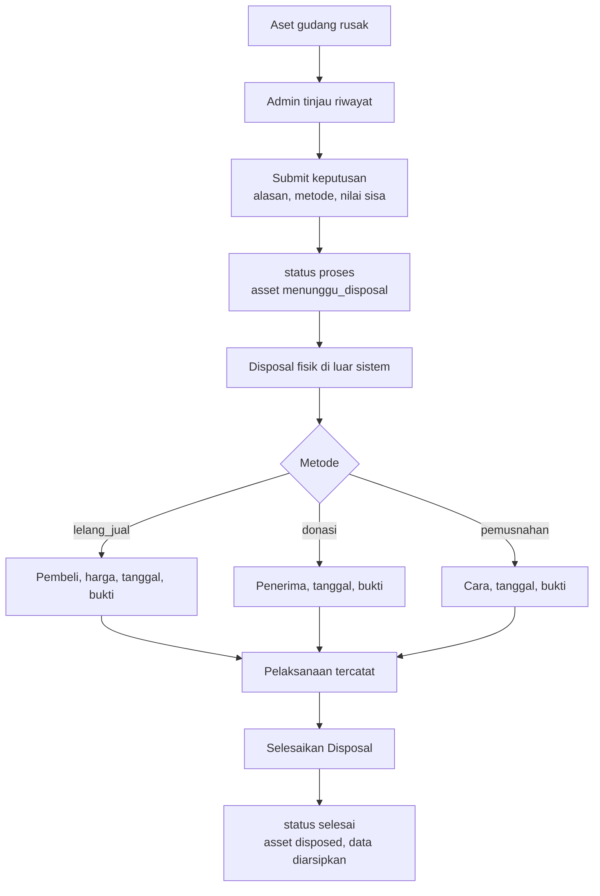
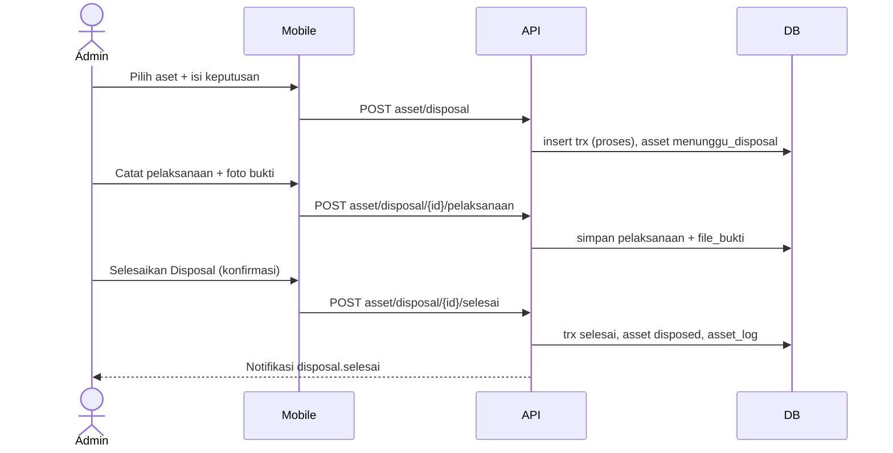
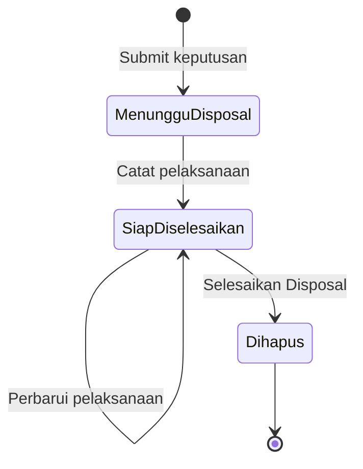
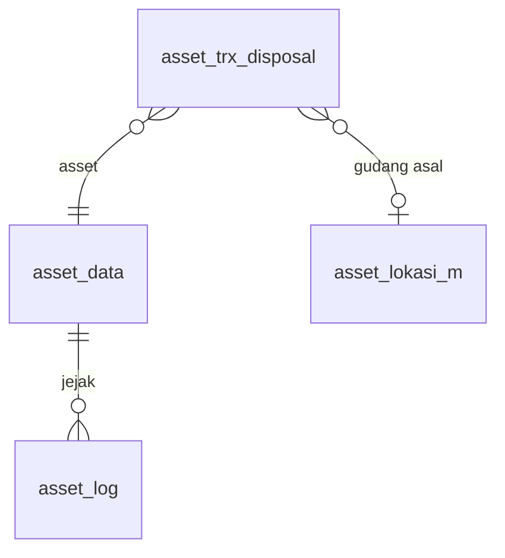

# Dokumentasi Teknis & Manual Book — Disposal Asset (PML04)

> Dokumen ini disusun **dari source code lokal** (`API/` Lumen dan `MOBILE/` Flutter) per 8 Oktober 2026, dibandingkan dengan dokumen bisnis **"4.4 Pemeliharaan - Disposal Aset (PML04)"** (v1.0, 2026-08-07).
> Cakupan implementasi: **aset gudang berstatus `rusak`**, ditangani **Admin/HR saja** tanpa approval. Satu transaksi = satu aset. Bagian yang tidak ditemukan ditandai **⚠️ Belum ditemukan**, asumsi ditandai **⚠️ Asumsi**.
> Contoh ID/nama pada payload adalah **data sintetis**.

---

## 1. Informasi Dokumen

| Informasi | Nilai |
|---|---|
| Nama Fitur | Disposal Asset (penghapusan aset dari registri aktif) |
| Kode Fitur | **PML04** (nomor transaksi `PML04-YYYYMMNNN`) |
| Modul | Asset Management — Pemeliharaan Aset |
| Backend | Laravel **Lumen ^10.0**, PHP ^8.1, JWT, Query Builder |
| Database | `API/diagram-asset.dbml` (tanda `[REVISI PML04]` / `[NEW PML04]`) + SQL manual `Claude outputs/sql-pml04-disposal.sql`. ⚠️ SQL harus dijalankan manual (belum dijalankan saat dokumen ditulis) |
| Mobile | Flutter (`professional_flutter_3_35`), `flutter_bloc`, `dio`, `image_picker` |
| Web | ⚠️ Belum ditemukan: tidak ada source web di workspace |
| Test otomatis | API `tests/Asset/AssetDisposalTest.php` (7 test) · Mobile `test/asset/asset_disposal_test.dart` (13 test) |
| Versi dokumen | 1.1 — 12 Oktober 2026 |
| Dokumen terkait | Perbaikan (PML02), Klaim Garansi (PML03), Pemeliharaan (PML01) |

## 2. Daftar Isi

Lihat panel navigasi di samping.

## 3. Quick Overview

Aset gudang yang rusak dan tidak layak dipertahankan dihapus dari daftar aset aktif lewat tiga langkah. **Fase 1**: admin meninjau riwayat aset (usia, harga perolehan, jumlah perbaikan dan klaim garansi) lalu menyubmit keputusan: alasan, **metode** (lelang/jual, donasi, pemusnahan), nilai sisa, catatan; aset menjadi `menunggu_disposal`. **Fase 2**: disposal fisik terjadi di luar sistem; admin mencatat hasilnya (pembeli dan harga, penerima donasi, atau cara pemusnahan) beserta **bukti wajib**. **Fase 3**: admin menekan **Selesaikan Disposal**; aset menjadi `disposed` dan tidak muncul lagi di daftar aktif, sementara datanya tetap tersimpan sebagai arsip audit.

| Aspek | Ringkasan |
|---|---|
| Aktor | Admin/HR saja (tanpa approval) |
| Status transaksi | `proses` (menunggu disposal) → `selesai` (dihapus/disposed) |
| Status asset | `rusak` → `menunggu_disposal` → `disposed` |
| Metode | `lelang_jual`, `donasi`, `pemusnahan` |
| Endpoint | 6 (semua admin) |
| Notifikasi | 1 event (`disposal.selesai`) ke admin |

## 4. Ringkasan Fitur

| No | Fitur | Aktor |
|---|---|---|
| 1 | Pilih aset gudang rusak dengan riwayatnya | Admin |
| 2 | Submit keputusan disposal | Admin |
| 3 | Catat pelaksanaan sesuai metode + bukti (dapat diperbarui) | Admin |
| 4 | Selesaikan disposal (dengan konfirmasi) | Admin |
| 5 | Daftar (Menunggu/Selesai) dan detail | Admin |
| 6 | Kartu "perlu diproses" di beranda admin | Admin |

## 5. Tujuan Fitur

### 5.1 Tujuan Bisnis (dari dokumen bisnis dan kode)

- Penghapusan aset punya keputusan, alasan, dan bukti yang dapat diaudit.
- Status perantara `menunggu_disposal` mencegah penghapusan tanpa bukti pelaksanaan.
- Data historis aset tidak dihapus, hanya dikeluarkan dari daftar aktif.

### 5.2 Tujuan Sistem

- Menjaga aset yang sedang di-disposal tidak bisa dipakai alur lain.
- Memvalidasi field wajib per metode dan bukti.
- Mencatat pelaksana, waktu, `asset_log`, dan notifikasi penyelesaian.

## 6. Aktor

| Aktor | Peran |
|---|---|
| Admin/HR (admin asset) | Memutuskan, memilih metode, mencatat pelaksanaan, menyelesaikan |
| Sistem | Mengunci status aset, memvalidasi, menulis log dan notifikasi |

## 7. Hak Akses

Seluruh endpoint hanya untuk admin asset (`Asset_m::isAdmin`). Non-admin menerima 403. Tidak ada endpoint karyawan/PIC.

## 8. Terminologi

| Istilah | Arti |
|---|---|
| Disposal | Penghapusan aset dari registri aktif |
| MENUNGGU DISPOSAL | Keputusan sudah disubmit, penyelesaian belum dilakukan (`status = proses`, aset `menunggu_disposal`) |
| DIHAPUS (DISPOSED) | Disposal selesai (`status = selesai`, aset `disposed`) |
| Nilai sisa | Book value aset (opsional) |
| Bukti | Satu foto/scan kwitansi, berita acara, atau foto pemusnahan |

## 9. Business Rules

### BR-001 — Aset yang boleh di-disposal
Hanya `pemegang_asset = gudang` dan `status_asset = rusak`. Karena proses lain mengubah status (`dalam_perbaikan`, `dalam_proses_klaim`, menunggu serah terima), syarat "tidak ada proses aktif" terpenuhi otomatis. Tidak boleh masih dalam onboarding aktif. Pesan: *"Hanya asset rusak di gudang yang dapat di-disposal."*

### BR-002 — Keputusan
`alasan_disposal` wajib; `metode_disposal` ∈ tiga nilai; `nilai_sisa` opsional dan tidak negatif; catatan opsional.

### BR-003 — Status perantara
Setelah keputusan, aset menjadi `menunggu_disposal` dan keluar dari daftar pilihan aset gudang rusak (tidak bisa diajukan dua kali).

### BR-004 — Pelaksanaan menurut metode

| Metode | Field wajib |
|---|---|
| `lelang_jual` | `pembeli`, `harga_jual`, `tgl_pelaksanaan`, bukti |
| `donasi` | `penerima_donasi`, `tgl_pelaksanaan`, bukti |
| `pemusnahan` | `metode_pemusnahan`, `tgl_pelaksanaan`, bukti |

Tanggal pelaksanaan tidak boleh setelah hari ini. Field milik metode lain dikosongkan.

### BR-005 — Bukti wajib
Semua metode wajib bukti. Pembaruan tanpa bukti baru mempertahankan bukti lama; bila belum pernah ada bukti, ditolak.

### BR-006 — Pelaksanaan dapat diperbarui
Selama `status = proses`, admin boleh memperbarui data pelaksanaan. Setelah `selesai`, tidak dapat diubah.

### BR-007 — Penyelesaian
Hanya bila pelaksanaan sudah dicatat (`tgl_pelaksanaan` terisi) dan data masih lengkap sesuai metode. Aset harus masih di gudang dengan status `menunggu_disposal`. Hasil: aset `disposed`, transaksi `selesai`, `asset_log` `disposal_gudang`.

### BR-008 — Arsip, bukan hapus
Baris transaksi dan baris `asset_data` (status `disposed`) tetap ada. Daftar aset admin dan total ringkasan mengecualikan `disposed` bila filter status kosong; filter status `disposed` eksplisit tetap menampilkannya.

### BR-009 — Penomoran
`id` = `id_company` + `YYYYMM` + 3 digit; `no_trx` = `PML04-YYYYMMNNN`; maksimum 999 per bulan per perusahaan.

### BR-010 — Skema harus sudah diterapkan
`skemaSiap()` menjaga dashboard tetap berjalan sebelum SQL diterapkan.

## 10. Business Flow

1. Admin membuka Disposal → **+** → memilih satu aset gudang rusak dan meninjau riwayatnya.
2. Admin mengisi alasan, metode, nilai sisa, catatan → **Submit Keputusan**. Aset `menunggu_disposal`.
3. Disposal fisik dilakukan di luar sistem.
4. Admin membuka detail → **Catat Pelaksanaan** (field sesuai metode + tanggal + bukti).
5. Admin menekan **Selesaikan Disposal** dan mengonfirmasi.
6. Aset `disposed`; notifikasi ringkasan dikirim ke admin.

## 11. Flow Berdasarkan Role

### 11.1 Admin/HR
Seluruh alur di atas.

### 11.2 System
Validasi, kunci status, log, notifikasi, penyaringan daftar aktif.

## 12. Flow Diagram



## 13. Sequence Diagram



## 14. Status Transaksi

| `status` | Kondisi | Label di aplikasi | Tab |
|---|---|---|---|
| `proses` | `tgl_pelaksanaan` kosong | Menunggu Disposal | Menunggu |
| `proses` | `tgl_pelaksanaan` terisi | Siap Diselesaikan | Menunggu |
| `selesai` | — | Dihapus (Disposed) | Selesai |

Tidak ada kolom fase terpisah; tahap pelaksanaan ditandai terisinya `tgl_pelaksanaan`.

## 15. State Transition



## 16. Struktur Database

| Tabel | Fungsi |
|---|---|
| `asset_trx_disposal` | Satu baris per disposal (keputusan, pelaksanaan, penyelesaian) |
| `asset_data` | Status aset (`menunggu_disposal`, `disposed`) |
| `asset_log` | Jejak `disposal_gudang` |

Tabel lama `asset_trx_disposal_item` dan kolom approval dihapus (struktur lama berbasis approval, belum dipakai API).

## 17. Relasi Database



## 18. Data Dictionary

### 18.1 asset_trx_disposal

| Kolom | Tipe | Keterangan |
|---|---|---|
| `id_asset_trx_disposal` | varchar(50) PK | `id_company`+`YYYYMM`+3 digit |
| `no_trx` | varchar(50) | `PML04-YYYYMMNNN` |
| `id_asset_data` | varchar(50) FK | Aset |
| `nama_asset`, `deskripsi_asset`, `kategori_asset` | varchar | Snapshot saat keputusan |
| `id_asset_lokasi_m_asal` | varchar(50) FK null | Gudang asal |
| `alasan_disposal` | varchar(255) | Wajib |
| `metode_disposal` | enum | `lelang_jual`, `donasi`, `pemusnahan` |
| `nilai_sisa` | decimal(18,2) null | Book value, opsional |
| `catatan` | text null | Opsional |
| `tgl_pelaksanaan` | date null | NULL = pelaksanaan belum dicatat |
| `pembeli`, `harga_jual` | varchar, decimal(18,2) | Metode lelang/jual |
| `penerima_donasi` | varchar(255) | Metode donasi |
| `metode_pemusnahan` | varchar(255) | Metode pemusnahan |
| `file_bukti` | varchar(255) | Key object bukti (wajib semua metode) |
| `tgl_selesai`, `user_selesai` | timestamp, varchar | Klik Selesaikan Disposal |
| `status` | enum proses/selesai | Status transaksi |
| `id_company`, `tgl_input`, `user_input`, `tgl_update`, `user_update` | | Audit; `tgl_input`/`user_input` = keputusan |

### 18.2 asset_log (`jenis_log = disposal_gudang`)

Ditulis saat penyelesaian: posisi gudang → gudang, `kondisi_awal`/`kondisi_akhir` = kondisi aset, `user_input` = pelaksana.

## 19. Database Index

| Index | Kolom | Fungsi |
|---|---|---|
| `atd_company_status_idx` | `id_company, status, tgl_input, id` | Daftar per tab |
| `atd_company_asset_status_idx` | `id_company, id_asset_data, status` | Cek disposal aktif dan riwayat per aset |
| FK | `id_asset_data`, `id_asset_lokasi_m_asal` | Integritas |

## 20. Backend Architecture

| Lapisan | File |
|---|---|
| Route | `RouteAsset.php` (`disposal/*`) |
| Controller | `Asset/Admin/AssetAdminDisposal_c.php` |
| Model | `Models/Asset/AssetDisposal_m.php` |
| Notifikasi | `Support/Asset/AssetNotification.php` (`disposal.selesai`, placeholder `{aset}`, `{metode}`) |
| Pendukung | `Asset_c::mutateAssetTrx` (event `null` = tanpa notifikasi), `Asset_c::uploadAssetImage` + `AssetImageStorage` (object storage) |
| Dashboard | `AssetAdmin_m` (`disposal_perlu_proses`, `disposal_pending`; pengecualian `disposed`) |

## 21. Backend Business Logic

### 21.1 Keputusan — `store`
Kunci perusahaan; validasi alasan, metode, nilai sisa; kunci aset (`lockForUpdate`), cek BR-001; nomor urut; insert transaksi (snapshot aset dan gudang asal); aset → `menunggu_disposal`.

### 21.2 Pelaksanaan — `pelaksanaan`
Hanya `status = proses`. `pelaksanaanFields` memvalidasi tanggal, bukti, dan field sesuai metode; kolom metode lain dikosongkan; `harga_jual` dinormalisasi.

### 21.3 Penyelesaian — `selesai`
Validasi ulang kelengkapan pelaksanaan, cek aset masih `menunggu_disposal` di gudang; aset → `disposed`; `asset_log`; transaksi `selesai` dengan `tgl_selesai`/`user_selesai`.

### 21.4 Query baca
`getPage` (tab `proses|selesai`, paginasi limit+1), `getDetail` (aset + riwayat, keputusan, pelaksanaan, penyelesaian, `aksi`), `getAdminOptions` (aset gudang rusak + metode), `getPendingForAdmin`, `countPendingForAdmin`.

### 21.5 Riwayat aset
`riwayat()` menghitung usia (bulan) dari `tgl_perolehan`, `harga_perolehan`, serta jumlah baris di `asset_trx_perbaikan_item` dan `asset_trx_garansi_item` untuk aset tersebut (0 bila tabel belum ada). Biaya perbaikan tidak dicatat sistem.

## 22. Dampak terhadap asset_data

| Kejadian | `status_asset` | Kolom lain |
|---|---|---|
| Keputusan disubmit | `rusak` → `menunggu_disposal` | — |
| Disposal selesai | → `disposed` | `tgl_update`, `user_update` |

Aset `disposed` tidak muncul di daftar aset admin bawaan dan tidak dihitung pada `total_asset`.

## 23. API Documentation

| Kode | Method | Path | Fungsi |
|---|---|---|---|
| API-001 | GET | `asset/disposal/options` | Aset gudang rusak + metode |
| API-002 | GET | `asset/disposal` | Daftar |
| API-003 | POST | `asset/disposal` | Submit keputusan |
| API-004 | POST | `asset/disposal/{id}/pelaksanaan` | Catat/perbarui pelaksanaan |
| API-005 | POST | `asset/disposal/{id}/selesai` | Selesaikan disposal |
| API-006 | GET | `asset/disposal/{id}` | Detail |

## 24. Detail Setiap API

### API-001 — Opsi
```json
{"asset": [{"id_asset_data": "LP-1", "kode_asset": "KD-LP-1", "nama_asset": "Laptop Lama",
  "kategori_asset": "Laptop", "merek": "", "keterangan_rusak": "Mati total", "lokasi_gudang": "Gudang Utama",
  "riwayat": {"tgl_perolehan": "2019-10-01", "usia_bulan": 85, "harga_perolehan": 15000000,
              "jumlah_perbaikan": 2, "jumlah_klaim_garansi": 1}}],
 "metode": [{"value": "lelang_jual", "label": "Lelang / Jual"}]}
```

### API-002 — Daftar
Query `tab` (`proses|selesai`), `limit` (1–50, default 20), `offset`. Respons `{filters, records[], pagination}`; record: `id`, `no_trx`, `status`, `status_label`, `tab`, `id_asset_data`, `nama_asset`, `kategori_asset`, `metode_disposal`, `metode_label`, `alasan_disposal`, `pelaksanaan_tercatat`, `tgl_input`.

### API-003 — Keputusan
```json
{"id_asset_data": "LP-1", "alasan_disposal": "Motherboard rusak total",
 "metode_disposal": "donasi", "nilai_sisa": 250000, "catatan": "Data sudah dihapus"}
```
Respons `CREATED` `{id, no_trx, status, status_label, tab}`.

### API-004 — Pelaksanaan
```json
{"tgl_pelaksanaan": "2026-10-09", "pembeli": "PT Pembeli", "harga_jual": 1500000,
 "penerima_donasi": "", "metode_pemusnahan": "", "file_bukti": "<base64 atau file multipart>"}
```
Hanya field milik metode transaksi yang dipakai. `file_bukti` kosong = bukti lama dipertahankan. Bukti disimpan di object storage dengan key `<company>/asset/disposal/<id_karyawan>/<hex>.<ext>`; kolom `file_bukti` menyimpan key tersebut.

### API-005 — Selesai
Tanpa body. Respons `{id, no_trx, status: "selesai", status_label: "Dihapus (Disposed)"}`.

### API-006 — Detail
Grup `asset` (dengan `riwayat`), `keputusan`, `pelaksanaan` (`tercatat`, `file_bukti_url`), `penyelesaian`, dan `aksi: {pelaksanaan, selesai}`.

## 25. Mobile Architecture

| Lapisan | File |
|---|---|
| Model | `lib/Repository/Model/Asset/mAssetDisposal.dart` |
| API client | `lib/Repository/Service/assetDisposalApi.dart` |
| Bloc | `lib/Bloc/Asset/AssetDisposalBloc.dart` |
| UI | `lib/UI/Modul/Asset/Pemeliharaan/Disposal/*` (termasuk `AssetDisposalProsesWidgets`; pratinjau foto layar penuh memakai `Pemeliharaan/AssetFotoPreview.dart`) |
| Teks | grup `disposal` di `assets/{id,en}/asset.json` (81 kunci) |
| Navigasi | `NavigatorBloc` (`NavigateToAssetAdminDisposal`, `…DetailDisposal`, `…BuatDisposal`), `router.dart` |

## 26. Mobile Screen

### 26.1 Daftar — `HalamanAssetDisposal`
Tab Menunggu/Selesai, `AssetDisposalRecordCard`, tombol **+**.

### 26.2 Buat — `HalamanBuatDisposal`
Pilih satu aset (radio); aset terpilih menampilkan kartu riwayat; **Lanjut** membuka sheet keputusan (alasan, metode chip, nilai sisa, catatan).

### 26.3 Detail — `HalamanDetailAssetDisposal`
Kartu status, petunjuk langkah berikutnya, aset + riwayat, keputusan, pelaksanaan (dengan foto bukti), penyelesaian. Tombol bawah: **Catat/Ubah Data Pelaksanaan** dan **Selesaikan Disposal** (dialog konfirmasi).

### 26.4 Sheet pelaksanaan
Field mengikuti metode, picker tanggal (tidak boleh melewati hari ini), foto bukti dari kamera/galeri.

### 26.5 Entry point
Beranda admin: menu **Disposal** dan kartu "perlu diproses" (langkah berikutnya: Catat pelaksanaan / Selesaikan disposal). Notifikasi membuka `asset_admin_detail_disposal`.

## 27. Mobile → API

| Aksi UI | Method | Endpoint |
|---|---|---|
| Muat daftar | GET | `asset/disposal?tab=` |
| Muat opsi | GET | `asset/disposal/options` |
| Muat detail | GET | `asset/disposal/{id}` |
| Submit keputusan | POST | `asset/disposal` |
| Simpan pelaksanaan | POST | `asset/disposal/{id}/pelaksanaan` |
| Selesaikan | POST | `asset/disposal/{id}/selesai` |

## 28. API → Mobile

Respons dipetakan ke `AssetDisposalRecord`, `Page`, `Options`. Daftar mengirim data datar, detail mengirim grup; model menangani keduanya. 422 tampil snackbar warning, lainnya error; sukses menutup halaman dengan pesan dan memuat ulang daftar/ringkasan.

## 29. Mapping Mobile → API → Database

| Field UI | Field API | Kolom DB |
|---|---|---|
| Aset terpilih | `id_asset_data` | `id_asset_data` |
| Alasan | `alasan_disposal` | `alasan_disposal` |
| Metode | `metode_disposal` | `metode_disposal` |
| Nilai sisa | `nilai_sisa` | `nilai_sisa` |
| Tanggal pelaksanaan | `tgl_pelaksanaan` | `tgl_pelaksanaan` |
| Pembeli / Harga jual | `pembeli` / `harga_jual` | `pembeli` / `harga_jual` |
| Penerima donasi | `penerima_donasi` | `penerima_donasi` |
| Cara pemusnahan | `metode_pemusnahan` | `metode_pemusnahan` |
| Foto bukti | `file_bukti` | `file_bukti` (key object) |

## 30. Mapping Database → API → Mobile

| Kolom DB | Field API | Tampil di |
|---|---|---|
| `status`, `tgl_pelaksanaan` | `status`, `pelaksanaan_tercatat` | Badge fase |
| `file_bukti` | `pelaksanaan.file_bukti_url` | Gambar bukti di detail |
| `user_selesai`, `tgl_selesai` | `penyelesaian.*` | Bagian penyelesaian |
| `harga_perolehan`, `tgl_perolehan` | `asset.riwayat.*` | Kartu riwayat |

## 31. Validation

### 31.1 Mobile
Alasan dan metode wajib; nilai sisa angka tidak negatif; pada pelaksanaan: field metode, tanggal, dan bukti wajib.

### 31.2 Backend
Aturan Laravel: `id_asset_data` wajib, `alasan_disposal` wajib ≤255, `metode_disposal` ∈ tiga nilai, `nilai_sisa` numerik ≥ 0, `tgl_pelaksanaan` `Y-m-d`, `harga_jual` numerik ≥ 0. Aturan bisnis di model (§9).

### 31.3 Database
Enum `metode_disposal`, `status`; FK aset dan gudang.

## 32. Error Handling

| Kondisi | Kode | Contoh pesan |
|---|---|---|
| Validasi request | 422 | "Alasan disposal wajib diisi." |
| Aturan bisnis | 422 `BUSINESS_RULE_VIOLATION` | "Data pelaksanaan disposal belum dicatat." |
| Bukan admin | 403 | "Pengguna tidak memiliki akses admin asset." |
| Tidak ditemukan | 404 | "Disposal tidak ditemukan." |
| Sistem | 500 `SYSTEM_ERROR` | Pesan umum |

## 33. Audit Trail

`user_input`/`tgl_input` = keputusan, `user_update`/`tgl_update` = pelaksanaan terakhir, `user_selesai`/`tgl_selesai` = penyelesaian (format `nik - nama`). `asset_log` `disposal_gudang` saat selesai.

## 34. Notification

| Event | Penerima | Isi | Rute mobile |
|---|---|---|---|
| `disposal.selesai` | Seluruh admin asset | "Disposal {no_trx} selesai: {aset} ({metode}) telah dihapus dari daftar asset aktif." | `asset_admin_detail_disposal` |

Pencatatan pelaksanaan tidak mengirim notifikasi. Notifikasi dikirim setelah transaksi commit.

## 35. Security

JWT; semua endpoint admin-only; filter `id_company`; transaksi + `lockForUpdate`; bukti diunggah ke bucket MinIO privat lewat `Asset_c::uploadAssetImage` (`AssetImageStorage`): hanya JPEG/PNG/WebP valid, maks 5 MB dan 25 megapiksel; key memuat `id_company` dan `id_karyawan` dari JWT; URL bukti berupa presigned URL berumur singkat (lihat `dokumentasi-minio-object-storage.md`).

## 36. Manual Book User/Admin

### A. Membuat keputusan disposal
1. Beranda Asset → **Disposal** → tombol **+**.
2. Pilih aset; tinjau usia, harga perolehan, jumlah perbaikan dan klaim.
3. **Lanjut** → isi alasan, pilih metode, (opsional) nilai sisa dan catatan → **Submit Keputusan**.

### B. Mencatat pelaksanaan
1. Setelah disposal fisik selesai, buka transaksi di tab **Menunggu**.
2. **Catat Pelaksanaan**: isi field sesuai metode, tanggal, dan foto bukti → **Simpan**.
3. Data dapat diubah lagi lewat **Ubah Data Pelaksanaan** sebelum diselesaikan.

### C. Menyelesaikan disposal
**Selesaikan Disposal** → baca konfirmasi → konfirmasi. Aset berstatus DIHAPUS dan hilang dari daftar aktif.

## 37. Kondisi Button

| Tombol | Syarat |
|---|---|
| Catat / Ubah Data Pelaksanaan | `status = proses` (`aksi.pelaksanaan`) |
| Selesaikan Disposal | `status = proses` dan pelaksanaan tercatat (`aksi.selesai`) |
| Lanjut (halaman buat) | Satu aset dipilih |

## 38. Testing Scenario

| No | Skenario | Hasil |
|---|---|---|
| T-01 | Aset karyawan / tersedia / tidak ada | Ditolak |
| T-02 | Alasan kosong, metode salah, nilai sisa negatif | Ditolak |
| T-03 | Keputusan valid | `PML04-…`, aset `menunggu_disposal`, hilang dari opsi |
| T-04 | Pelaksanaan tanpa pembeli/harga/penerima/cara/bukti/tanggal | Ditolak sesuai metode |
| T-05 | Tanggal pelaksanaan besok | Ditolak |
| T-06 | Perbarui tanpa bukti baru | Bukti lama dipertahankan |
| T-07 | Field metode lain ikut dikirim | Dikosongkan |
| T-08 | Selesai sebelum pelaksanaan | Ditolak |
| T-09 | Selesai valid | Aset `disposed`, `asset_log`, transaksi `selesai` |
| T-10 | Ubah/selesai ulang setelah selesai | Ditolak |
| T-11 | Status aset berubah di luar alur | Ditolak |
| T-12 | Alur penuh via route; non-admin | 200; 403 |

Cakupan otomatis: API 7 test, mobile 13 test (teks id/en, parsing, payload, bloc, detail 320/400 px, konfirmasi selesai, validasi sheet, alur buat).

## 39. Temuan Ketidaksesuaian

| ID | Temuan |
|---|---|
| INC-01 | Dokumen bisnis tidak menyebut batasan "hanya aset gudang"; implementasi menegakkannya |
| INC-02 | Dokumen bisnis menyebut tahap pelaksanaan per metode sebagai langkah; implementasi memakai satu tabel dengan kolom per metode dan penanda `tgl_pelaksanaan` |
| INC-03 | Dokumen menyebut "memindahkan data ke arsip"; implementasi mengarsipkan lewat status `disposed` (tanpa tabel arsip terpisah) |
| INC-04 | PML01 (hasil 5), PML02 (tidak bisa diperbaiki/unit lama diganti), dan PML03 (ditolak) hanya mencatat nama tabel `asset_trx_disposal`; **transaksi disposal tidak dibuat otomatis** |
| INC-05 | Tidak ada pembatalan disposal dari `menunggu_disposal` |
| INC-06 | Bukti hanya gambar; dokumen PDF belum didukung |

## 40. Edge Case

- Dua admin memilih aset yang sama: yang kedua gagal karena aset sudah `menunggu_disposal`.
- Status aset berubah antara keputusan dan penyelesaian: penyelesaian ditolak.
- Harga jual berformat koma (`1500,50`): dinormalisasi di mobile sebelum dikirim.
- Tabel PML02/PML03 belum ada: riwayat menampilkan 0 tanpa error.

## 41. Potential Bug / Technical Risk

### RISK-001 — Skema dari SQL manual (TINGGI)
Endpoint gagal bila `sql-pml04-disposal.sql` belum dijalankan. Jalankan setelah SQL PML01 gudang, PML03, dan PML02 (blok enum menulis ulang daftar penuh).

### RISK-002 — Tidak ada pembatalan (SEDANG)
Keputusan yang salah mengunci aset di `menunggu_disposal`; perbaikan membutuhkan intervensi manual di database.

### RISK-003 — Penyelesaian tidak dapat dibatalkan (SEDANG)
Dialog konfirmasi memitigasi di UI; di API tidak ada rollback.

### RISK-004 — Bukti lama di disk lokal (RENDAH)
Bukti baru disimpan di object storage. Bukti lama di `UPLOAD_DIR` tetap terbaca lewat fallback URL lokal. Object lama tidak dihapus saat bukti diganti; object baru yang yatim dibersihkan otomatis bila transaksi gagal.

### RISK-005 — Kapasitas penomoran 999/bulan (RENDAH)
Batas 999 transaksi per bulan per perusahaan.

## 42. Dependency

`Asset_m`/`Asset_c`, `AssetImageStorage`, `AssetNotification`, `AssetPemeliharaanKaryawan_m` (format tanggal), tabel `asset_data`, `asset_kategori_m`, `asset_lokasi_m`, `asset_log`; `asset_trx_perbaikan_item` dan `asset_trx_garansi_item` (riwayat, opsional).

## 43. Source Code Reference

| Area | Lokasi |
|---|---|
| Model | `API/app/Models/Asset/AssetDisposal_m.php` |
| Controller | `API/app/Http/Controllers/Asset/Admin/AssetAdminDisposal_c.php` |
| Route | `API/routes/modules/asset/RouteAsset.php` |
| SQL | `Claude outputs/sql-pml04-disposal.sql` |
| Test API | `API/tests/Asset/AssetDisposalTest.php` |
| Mobile UI | `MOBILE/lib/UI/Modul/Asset/Pemeliharaan/Disposal/` |
| Test mobile | `MOBILE/test/asset/asset_disposal_test.dart` |

## 44. Developer Notes

- Desain disederhanakan dari struktur header+item: satu aset per transaksi, satu tabel.
- `mutateAssetTrx` menerima event `null` untuk langkah tanpa notifikasi.
- `pelaksanaanFields` dipakai ulang oleh `selesai` untuk memastikan data tetap lengkap.
- Teks UI memakai `AssetDisposalText.t(key)`; kunci dinamis: `fase_*`, `hint_*`, `metode_*`, `bukti_*`, `tgl_pelaksanaan_*`, `aksi_*`.

## 45. End-to-End Traceability

| Kebutuhan | Rule | API | Mobile | DB |
|---|---|---|---|---|
| Hanya aset rusak di gudang | BR-001 | API-003 | Halaman buat | `asset_data.status_asset`, `pemegang_asset` |
| Bukti wajib | BR-005 | API-004 | Sheet pelaksanaan | `file_bukti` |
| Status perantara | BR-003 | API-003 | Badge Menunggu | `asset_data.status_asset = menunggu_disposal` |
| Arsip bukan hapus | BR-008 | API-005 | Tab Selesai | `status = selesai`, `disposed` |

## 46. Ringkasan Database Impact

Tabel `asset_trx_disposal` dibuat ulang (tabel lama `asset_trx_disposal` dan `_item` di-drop bila kosong). `asset_data.status_asset` +`menunggu_disposal`; `asset_log.jenis_log` +`disposal_gudang`.

## 47. Checklist Implementasi

### Database
- [x] DBML diperbarui
- [x] SQL manual + guard + rollback
- [ ] SQL dijalankan di setiap environment

### Backend
- [x] Model, controller, route, notifikasi, pengecualian aset `disposed`
- [x] Test otomatis

### Mobile
- [x] Daftar, buat, detail, sheet keputusan dan pelaksanaan
- [x] Kartu beranda admin, rute notifikasi, teks id/en
- [x] Test otomatis

### Documentation
- [x] Dokumen ini

## 48. Changelog

| Versi | Tanggal | Perubahan |
|---|---|---|
| 1.0 | 8 Okt 2026 | Dokumen awal PML04 |
| 1.1 | 12 Okt 2026 | Sinkronisasi dengan kode: bukti kini disimpan di object storage MinIO (RISK-004 diturunkan ke RENDAH); path UI/model mobile mengikuti struktur folder baru; berkas `AssetDisposalProsesWidgets` dan `AssetFotoPreview` dicatat. Perbaikan 422 vs 500 pada controller Asset (import `InvalidArgumentException`/`Throwable`) tidak mengubah kontrak API |
