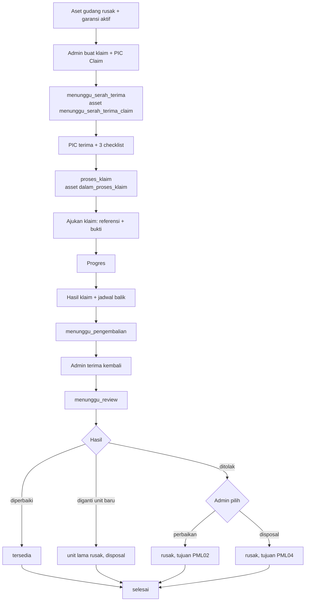
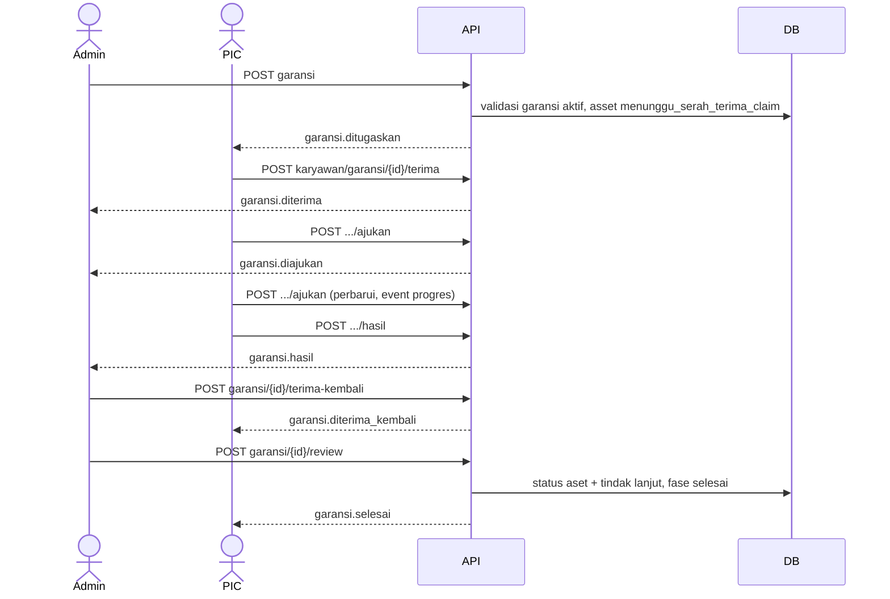
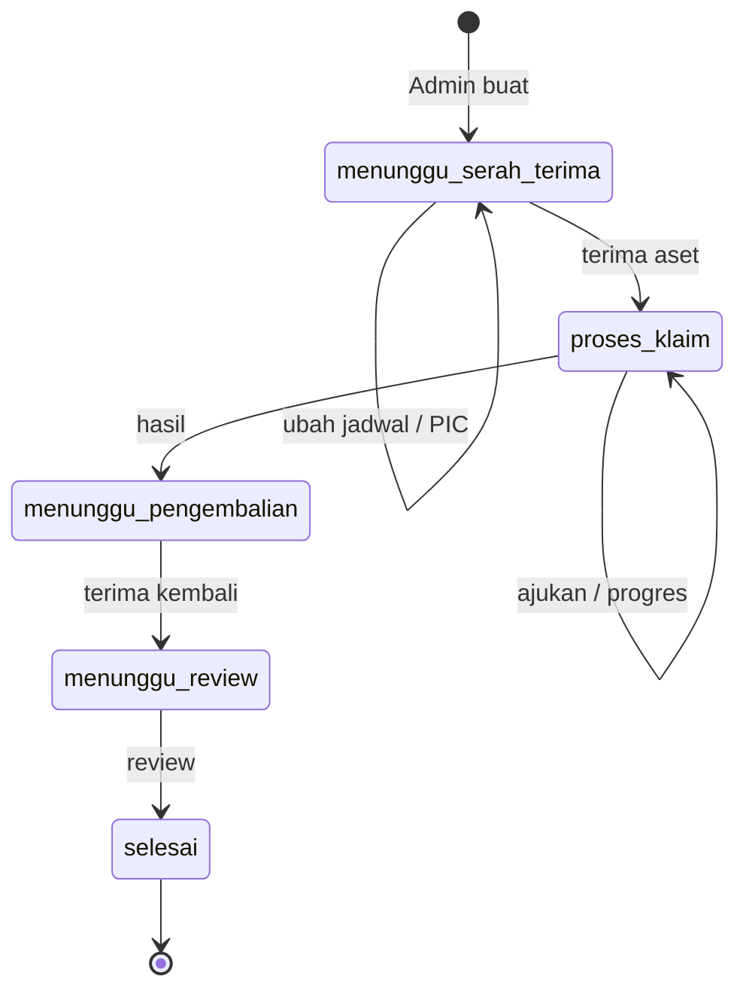
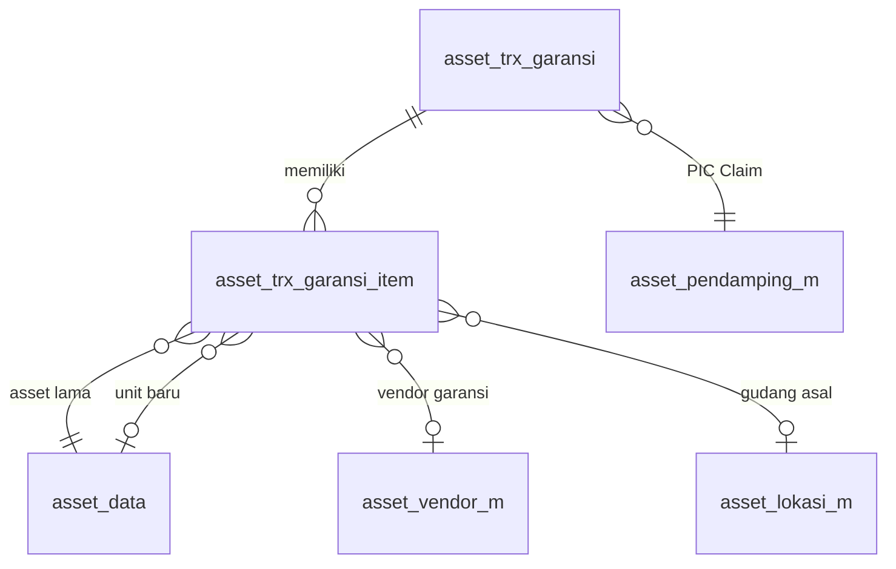

# Dokumentasi Teknis & Manual Book — Klaim Garansi Asset (PML03)

> Dokumen ini disusun **dari source code lokal** (`API/` Lumen dan `MOBILE/` Flutter) per 8 Oktober 2026, dibandingkan dengan dokumen bisnis **"4.3 Pemeliharaan - Warranty Claim (PML03)"**.
> Cakupan implementasi: **aset gudang berstatus `rusak` yang masih bergaransi aktif**. Dokumen bisnis masih menyebut "Ruangan/Karyawan asal"; implementasi sengaja dibatasi ke gudang karena aset rusak selalu sudah ditarik ke gudang. Bagian yang tidak ditemukan ditandai **⚠️ Belum ditemukan**, asumsi ditandai **⚠️ Asumsi**.
> Contoh ID/nama pada payload adalah **data sintetis**.

---

## 1. Informasi Dokumen

| Informasi | Nilai |
|---|---|
| Nama Fitur | Klaim Garansi Asset (UI: **"Klaim Garansi"**; menu PIC: **"Tugas PIC Claim"**) |
| Kode Fitur | **PML03** (nomor transaksi `PML03-YYYYMMNNN`) |
| Modul | Asset Management — Pemeliharaan Aset |
| Backend | Laravel **Lumen ^10.0**, PHP ^8.1, JWT, Query Builder |
| Database | `API/diagram-asset.dbml` (tanda `[NEW PML03]`) + SQL manual `Claude outputs/sql-pml03-klaim-garansi.sql`. ⚠️ SQL harus dijalankan manual (belum dijalankan saat dokumen ditulis) |
| Mobile | Flutter (`professional_flutter_3_35`), `flutter_bloc`, `dio`, `image_picker` |
| Web | ⚠️ Belum ditemukan: tidak ada source web di workspace |
| Test otomatis | API `tests/Asset/AssetGaransiTest.php` (13 test) · Mobile `test/asset/asset_garansi_test.dart` (25 test) |
| Versi dokumen | 1.3 — 22 Oktober 2026 |
| Dokumen terkait | Perbaikan (PML02), Disposal (PML04), Pemeliharaan Gudang (PML01), Master Pendamping & Tugas PIC |

## 2. Daftar Isi

Lihat panel navigasi di samping.

## 3. Quick Overview

Aset gudang yang rusak **selama masa garansi** diklaim ke vendor garansi. Admin membuat transaksi klaim (dipilih satu atau banyak aset sekaligus; sistem membuat satu transaksi per aset dengan jadwal dan PIC masing-masing), menunjuk **PIC Claim** dari master pendamping, dan menetapkan jadwal serah terima. PIC menerima aset dengan checklist (kondisi, **dokumen garansi**, kelengkapan), mengajukan klaim ke vendor (nomor referensi tiket dan bukti pengajuan wajib), memantau progres, lalu mengisi **hasil klaim**: diperbaiki, diganti unit baru, atau **ditolak**. Admin menerima aset kembali dan menentukan tindak lanjut; klaim ditolak diarahkan ke **Perbaikan (PML02)** atau **Disposal (PML04)**.

| Aspek | Ringkasan |
|---|---|
| Aktor | Admin Asset, PIC Claim, Sistem |
| Fase | `menunggu_serah_terima` → `proses_klaim` → `menunggu_pengembalian` → `menunggu_review` → `selesai` |
| Status asset | `rusak` → `menunggu_serah_terima_claim` → `dalam_proses_klaim` → `tersedia` / tetap `rusak` |
| Hasil klaim | `diperbaiki`, `diganti_unit_baru`, `ditolak` |
| Endpoint | 11 admin + 6 PIC |
| Notifikasi | 10 event (`garansi.*`) |

## 4. Ringkasan Fitur

| No | Fitur | Aktor |
|---|---|---|
| 1 | Buat klaim dari aset gudang rusak bergaransi aktif (pilih banyak aset, 1 transaksi per aset) | Admin |
| 2 | Ubah jadwal/PIC sebelum aset diterima | Admin |
| 3 | Terima aset (checklist kondisi, dokumen garansi, kelengkapan) | PIC (admin cadangan) |
| 4 | Ajukan klaim ke vendor (nomor referensi, bukti) | PIC (admin cadangan) |
| 5 | Perbarui data pengajuan/estimasi (ajukan ulang, tercatat sebagai progres) | PIC (admin cadangan) |
| 6 | Isi hasil klaim dan jadwal serah terima balik | PIC (admin cadangan) |
| 7 | Atur jadwal balik, terima aset kembali | Admin |
| 8 | Review dan tindak lanjut | Admin |

## 5. Tujuan Fitur

### 5.1 Tujuan Bisnis (diturunkan dari kode)

- Memanfaatkan garansi vendor sebelum mengeluarkan biaya perbaikan.
- Dokumen garansi dan bukti pengajuan terdokumentasi.
- Klaim ditolak punya jalur lanjutan yang jelas (perbaikan berbayar atau disposal).

### 5.2 Tujuan Sistem

- Hanya aset bergaransi aktif yang bisa diklaim.
- Mengunci status aset sepanjang klaim dan menautkan unit pengganti.
- Mencatat `asset_trx_log` (`klaim_garansi_gudang`) dan notifikasi.

## 6. Aktor

| Aktor | Peran |
|---|---|
| Admin Asset | Membuat, mengubah, menetapkan jadwal balik, menerima kembali, mereview; cadangan PIC |
| PIC Claim | Pendamping aktif; menerima aset, mengajukan klaim (dan memperbarui), hasil |
| Sistem | Validasi garansi, kunci status, tautan unit baru, log dan notifikasi |

## 7. Hak Akses

| Aksi | Admin | PIC Claim |
|---|---|---|
| Opsi, daftar semua, buat, ubah, jadwal balik, terima kembali, review | ✅ | ❌ |
| Daftar dan detail | ✅ (semua) | ✅ (hanya yang ditugaskan) |
| Terima, ajukan (termasuk pembaruan), hasil | ✅ (cadangan) | ✅ (hanya PIC transaksi) |

## 8. Terminologi

| Istilah | Arti |
|---|---|
| Garansi aktif | `flag_garansi = 1` dan `tgl_akhir_garansi` ≥ hari ini |
| PIC Claim | Pendamping yang ditunjuk untuk satu klaim |
| Nomor referensi | Nomor tiket/klaim dari vendor |
| Hasil klaim | `diperbaiki`, `diganti_unit_baru`, `ditolak` |
| Tindak lanjut ditolak | `perbaikan` (→ `asset_trx_perbaikan`) atau `disposal` (→ `asset_trx_disposal`) |

## 9. Business Rules

### BR-001 — Aset yang boleh diklaim
`pemegang_asset = gudang`, `status_asset = rusak`, garansi aktif, dan tidak dalam onboarding aktif. Pesan: *"Hanya asset rusak di gudang yang dapat diklaim garansi."* / *"…tidak memiliki garansi aktif."*

### BR-002 — PIC Claim
Dari pendamping aktif; dapat berubah hanya selama `menunggu_serah_terima`.

### BR-003 — Penerimaan aset
Tiga checklist `ya`/`tidak` per aset: `status_kesesuaian_item`, `status_dokumen_garansi_lengkap`, `status_kelengkapan_aset`. Bila ada `tidak`, keterangan wajib. Aset → `dalam_proses_klaim`.

### BR-004 — Pengajuan klaim
Per aset wajib: tanggal pengajuan (`tgl_mulai_klaim_garansi`), **nomor referensi**, dan **foto tanda terima/bukti pengajuan**. Vendor penerima klaim default dari `id_asset_vendor_garansi` aset, bisa vendor terdaftar atau teks bebas. Boleh diperbarui berulang.

### BR-005 — Progres
Tidak ada endpoint progres terpisah. Pembaruan dilakukan dengan memanggil **ajukan** lagi selama `proses_klaim` (perbarui estimasi, referensi, vendor). Pembaruan setelah pengajuan pertama mengirim event `garansi.progres` ke admin; pengajuan pertama mengirim `garansi.diajukan`.

### BR-006 — Hasil klaim
Seluruh aset wajib diisi. Keterangan hasil wajib; `diperbaiki` wajib komponen; `ditolak` wajib alasan penolakan. PIC sekaligus mengajukan jadwal serah terima balik.

### BR-007 — Terima kembali
Admin mengisi checklist kondisi; `tidak` memerlukan keterangan. Fase → `menunggu_review`.

### BR-008 — Review per aset
- `diperbaiki`: aset `tersedia`, `kondisi_awal = normal`, `ket_rusak`/`status_rusak` kosong.
- `diganti_unit_baru`: admin memilih unit baru (gudang, `tersedia`, belum dipakai klaim/perbaikan lain); unit lama tetap `rusak`, tindak lanjut disposal.
- `ditolak`: admin **wajib** memilih `perbaikan` atau `disposal`; aset tetap `rusak`; hanya nama tabel tujuan yang dicatat.

### BR-009 — Penomoran
`PML03-YYYYMMNNN`; maksimum 999 per bulan per perusahaan.

### BR-010 — Skema harus sudah diterapkan
`skemaSiap()` menjaga dashboard tetap berjalan sebelum SQL diterapkan.

## 10. Business Flow

1. Admin memilih aset gudang rusak bergaransi aktif, mengisi jadwal serah terima dan PIC Claim → `menunggu_serah_terima`.
2. PIC menerima aset dengan checklist → `proses_klaim`.
3. PIC mengajukan klaim ke vendor (referensi + bukti), lalu memperbarui data pengajuan bila ada perkembangan.
4. PIC mengisi hasil klaim dan jadwal balik → `menunggu_pengembalian`.
5. Admin menerima aset kembali → `menunggu_review`.
6. Admin menentukan tindak lanjut → `selesai`.

## 11. Flow Berdasarkan Role

### 11.1 Admin Asset
Buat → (ubah) → jadwal balik → terima kembali → review (pilih unit baru / tindak lanjut ditolak).

### 11.2 PIC Claim
Terima aset → ajukan klaim (ulangi bila ada perubahan) → hasil.

### 11.3 System
Validasi garansi aktif, kunci status, log, notifikasi.

## 12. Flow Diagram



## 13. Sequence Diagram



## 14. Status Transaksi

| `fase_garansi` | Label | Tab | `status` |
|---|---|---|---|
| `menunggu_serah_terima` | Menunggu Serah Terima | jadwal | proses |
| `proses_klaim` | Proses Klaim | proses | proses |
| `menunggu_pengembalian` | Menunggu Pengembalian | proses | proses |
| `menunggu_review` | Menunggu Review | proses | proses |
| `selesai` | Selesai | selesai | selesai |

Status per item (`status_garansi`): `proses` → `selesai` saat review.

## 15. State Transition



## 16. Struktur Database

| Tabel | Fungsi |
|---|---|
| `asset_trx_garansi` | Header transaksi |
| `asset_trx_garansi_item` | Satu baris per aset (snapshot garansi, penerimaan, pengajuan, hasil, tindak lanjut) |
| `asset_pendamping_m` | Master PIC Claim |
| `asset_data` | Status aset dan data garansi |
| `asset_trx_log` | Jejak `klaim_garansi_gudang` |

## 17. Relasi Database



## 18. Data Dictionary

### 18.1 asset_trx_garansi

| Kolom | Tipe | Keterangan |
|---|---|---|
| `id_asset_trx_garansi` | varchar(50) PK | `id_company`+`YYYYMM`+3 digit |
| `no_trx` | varchar(50) | `PML03-YYYYMMNNN` |
| `fase_garansi` | enum | 5 fase |
| `id_asset_pendamping_m` | varchar(50) FK | PIC Claim |
| `id_pic_pendamping`, `nama_pic_pendamping`, `nik_pic_pendamping` | varchar | Snapshot PIC |
| `tgl_serah_terima`, `jam_serah_terima`, `keterangan_serah_terima` | date, time, varchar | Jadwal admin → PIC |
| `tgl_terima`, `user_terima` | timestamp, varchar | Penerimaan oleh PIC |
| `tgl_pengembalian`, `jam_pengembalian`, `user_ajukan_pengembalian` | date, time, varchar | Jadwal balik PIC → admin |
| `tgl_terima_kembali`, `user_terima_kembali` | timestamp, varchar | Admin menerima kembali |
| `tgl_review`, `user_review`, `keterangan_review` | timestamp, varchar, text | Review |
| `status` | enum | proses/selesai |
| Audit | `id_company`, `tgl_input`, `user_input`, `tgl_update`, `user_update` | |

### 18.2 asset_trx_garansi_item

| Kelompok | Kolom |
|---|---|
| Identitas | `id_asset_trx_garansi_item`, `id_asset_trx_garansi`, `id_asset_data`, snapshot `nama_asset`/`deskripsi_asset`/`kategori_asset`/`keterangan_rusak`, `id_asset_lokasi_m` (gudang asal) |
| Snapshot garansi | `tgl_awal_garansi`, `tgl_akhir_garansi`, `no_dokumen_garansi`, `foto_dokumen_garansi` |
| Penerimaan | `status_kesesuaian_item`, `status_dokumen_garansi_lengkap`, `status_kelengkapan_aset`, `keterangan_garansi_pendamping` |
| Pengajuan | `id_asset_vendor_m`, `nama_vendor`, `keterangan_vendor`, `tgl_mulai_klaim_garansi`, `tgl_estimasi_selesai_klaim_garansi`, `nomor_referensi_klaim_garansi`, `foto_tanda_terima` |
| Hasil | `hasil_klaim`, `keterangan_hasil_klaim`, `komponen_klaim`, `alasan_penolakan`, `id_asset_data_baru` |
| Kembali | `status_kesesuaian_kembali`, `ket_kesesuaian_kembali` |
| Tindak lanjut | `id_trx_tindak_lanjut`, `nama_tabel_tindak_lanjut`, `status_garansi` |

## 19. Database Index

| Index | Kolom | Fungsi |
|---|---|---|
| `atg_company_fase_idx` | `id_company, fase_garansi, tgl_input, id` | Daftar per tab |
| `atg_company_pic_fase_idx` | `id_company, id_pic_pendamping, fase_garansi, tgl_input` | Tugas PIC |
| `atgi_trx_asset_uq` | `id_trx, id_asset_data` | Unik per transaksi |
| `atgi_company_asset_status_idx` | `id_company, id_asset_data, status_garansi` | Cek klaim aktif dan riwayat |

## 20. Backend Architecture

| Lapisan | File |
|---|---|
| Route | `RouteAsset.php` (`garansi/*`, `karyawan/garansi/*`) |
| Controller | `Asset/Admin/AssetAdminGaransi_c.php`, `Asset/Karyawan/AssetKaryawanGaransi_c.php` |
| Model | `Models/Asset/AssetGaransi_m.php` |
| Aturan bersama | `Asset_c` (`GARANSI_*_RULES`, helper foto `garansiAssetsPayload`) |
| Notifikasi | `Support/Asset/AssetNotification.php` |

## 21. Backend Business Logic

### 21.1 Buat — `store`
Menerima daftar `garansi[]` (1–50 elemen). Semua aset dikunci dan seluruh elemen divalidasi lebih dulu (BR-001 termasuk garansi aktif, PIC, jadwal per aset); lalu per aset dibuat satu header + satu item dengan nomor urut sendiri, snapshot data garansi; aset → `menunggu_serah_terima_claim` + log.

### 21.2 Ubah — `ubah`
Hanya `menunggu_serah_terima`; mengembalikan `pic_berubah`.

### 21.3 Terima — `terima`
Tiga checklist; aset → `dalam_proses_klaim`; fase `proses_klaim`.

### 21.4 Ajukan — `ajukan`
Per aset: vendor, tanggal pengajuan, nomor referensi, foto bukti; boleh berulang.

### 21.5 Hasil
Hasil per aset dengan validasi BR-006; fase `menunggu_pengembalian`. `ajukan` mengembalikan `baru = true` pada pengajuan pertama (menentukan event).

### 21.6 Jadwal balik dan terima kembali
Admin mengubah jadwal balik atau menerima aset dengan checklist; fase `menunggu_review`.

### 21.7 Review — `review`
Sesuai BR-008; unit baru divalidasi (`assertUnitBaru`: gudang, `tersedia`, tidak dipakai klaim/perbaikan lain); fase `selesai`.

### 21.8 Query baca
`getPage`, `getDetail` (dengan `aksi` per peran), `getAdminOptions`, `getPendingForPic/Admin`, `countByTabForPic`, `countPendingForAdmin`, `hasActivePic`.

## 22. Dampak terhadap asset_data

| Kejadian | `status_asset` | Kolom lain |
|---|---|---|
| Klaim dibuat | `rusak` → `menunggu_serah_terima_claim` | — |
| PIC menerima | → `dalam_proses_klaim` | — |
| Review `diperbaiki` | → `tersedia` | `kondisi_awal=normal`, `ket_rusak`/`status_rusak` kosong |
| Review `diganti_unit_baru` / `ditolak` | → `rusak` | Tidak berubah; tindak lanjut dicatat |

## 23. API Documentation

| Kode | Method | Path | Aktor |
|---|---|---|---|
| API-001 | GET | `asset/garansi/options` | Admin |
| API-002 | GET | `asset/garansi` | Admin |
| API-003 | POST | `asset/garansi` | Admin |
| API-004 | PUT | `asset/garansi/{id}` | Admin |
| API-005 | POST | `asset/garansi/{id}/terima` | Admin (cadangan) |
| API-006 | POST | `asset/garansi/{id}/ajukan` | Admin (cadangan) |
| API-007 | POST | `asset/garansi/{id}/hasil` | Admin (cadangan) |
| API-008 | POST | `asset/garansi/{id}/jadwal-kembali` | Admin |
| API-009 | POST | `asset/garansi/{id}/terima-kembali` | Admin |
| API-010 | POST | `asset/garansi/{id}/review` | Admin |
| API-011 | GET | `asset/garansi/{id}` | Admin |
| API-012 | GET | `asset/karyawan/garansi/options` | PIC |
| API-013 | GET | `asset/karyawan/garansi` | PIC |
| API-014 | POST | `asset/karyawan/garansi/{id}/terima` | PIC |
| API-015 | POST | `asset/karyawan/garansi/{id}/ajukan` | PIC |
| API-016 | POST | `asset/karyawan/garansi/{id}/hasil` | PIC |
| API-017 | GET | `asset/karyawan/garansi/{id}` | PIC |

⚠️ Tidak ada endpoint progres terpisah seperti PML02: `ajukan` boleh dipanggil berulang selama `proses_klaim` untuk memperbarui data.

## 24. Detail Setiap API

### API-001/012 — Opsi
Admin: vendor, pendamping aktif, aset gudang rusak bergaransi aktif, aset gudang tersedia (calon unit baru), hasil. PIC: vendor.

### API-002/013 — Daftar
Query `tab` (`jadwal|proses|selesai`), `limit` (1–50), `offset`. Respons `{filters, records[], pagination}`.

### API-003 — Buat
```json
{"garansi": [
  {"id_asset_data": "LP-1", "tgl_jadwal": "2026-10-12", "jam_jadwal": "09:00",
   "id_asset_pendamping_m": "PDM-1", "keterangan_serah_terima": "Bawa kartu garansi"},
  {"id_asset_data": "LP-2", "tgl_jadwal": "2026-10-13", "jam_jadwal": "10:00",
   "id_asset_pendamping_m": "PDM-2", "keterangan_serah_terima": ""}
]}
```

Array `garansi` berisi 1–50 elemen dengan `id_asset_data` unik; jadwal, PIC Claim, dan keterangan diisi **per aset**. Server membuat **satu transaksi (header + satu item) per aset** dalam satu transaksi database: bila satu elemen gagal validasi, tidak ada yang tersimpan. Field lama `asset_ids` sudah dihapus (request lama → 422). Respons sukses `201 CREATED`: `{"records": [{id, no_trx, fase_garansi, status_label, tab, id_asset_data}], "jumlah": N}`. Pesan error aturan bisnis diawali nama aset, mis. *"Asset Laptop A: …"*. Notifikasi `garansi.ditugaskan` dikirim per transaksi.

### API-004 — Ubah
Body satu objek: `tgl_jadwal`, `jam_jadwal`, `id_asset_pendamping_m`, `keterangan_serah_terima` (tanpa `garansi[]` dan `id_asset_data`).

### API-005/014 — Terima
```json
{"assets": [{"id_asset_data": "LP-1", "status_kesesuaian_item": "ya",
  "status_dokumen_garansi_lengkap": "tidak", "status_kelengkapan_aset": "ya",
  "keterangan": "Kartu garansi hilang"}]}
```

### API-006/015 — Ajukan
```json
{"assets": [{"id_asset_data": "LP-1", "id_asset_vendor_m": "VND-1", "nama_vendor": "",
  "keterangan_vendor": "0812-0000", "tgl_mulai_klaim_garansi": "2026-10-13",
  "tgl_estimasi_selesai_klaim_garansi": "2026-10-20",
  "nomor_referensi_klaim_garansi": "TKT-001", "foto_tanda_terima": "<base64 atau multipart>"}]}
```
Foto disimpan di object storage dengan key `<company>/asset/garansi/<id_karyawan>/<hex>.<ext>`; kolom menyimpan key. Foto lama tidak dihapus saat diganti; object baru yang yatim dibersihkan bila transaksi gagal; foto lama di disk lokal tetap terbaca lewat fallback URL.

### API-007/016 — Hasil
```json
{"tgl_pengembalian": "2026-10-26", "jam_pengembalian": "13:00",
 "assets": [{"id_asset_data": "LP-1", "hasil_klaim": "ditolak",
   "keterangan_hasil_klaim": "Kerusakan karena pemakaian", "komponen_klaim": "",
   "alasan_penolakan": "Garansi tidak mencakup kerusakan fisik"}]}
```

### API-008 — Jadwal balik
`{tgl_pengembalian, jam_pengembalian}`.

### API-009 — Terima kembali
`{assets: [{id_asset_data, status_kesesuaian_kembali: ya|tidak, ket_kesesuaian_kembali}]}`.

### API-010 — Review
```json
{"keterangan_review": "Tindak lanjut ditetapkan",
 "items": [{"id_asset_data": "LP-1", "tindak_lanjut": "perbaikan"},
           {"id_asset_data": "LP-2", "id_asset_data_baru": "LP-NEW"}]}
```
`tindak_lanjut` ∈ `perbaikan|disposal` wajib untuk hasil `ditolak`; `id_asset_data_baru` wajib untuk `diganti_unit_baru`.

### API-011/017 — Detail
Header, PIC, jadwal, `assets[]` (garansi, penerimaan, pengajuan, hasil, kembali, tindak lanjut), dan `aksi`.

## 25. Mobile Architecture

| Lapisan | File |
|---|---|
| Model | `lib/Repository/Model/Asset/mAssetGaransi.dart` |
| API client | `lib/Repository/Service/assetGaransiApi.dart` (`admin: true/false`) |
| Bloc | `lib/Bloc/Asset/AssetGaransiBloc.dart` |
| UI | `lib/UI/Modul/Asset/Pemeliharaan/Garansi/*` (termasuk `AssetGaransiProsesWidgets`; pratinjau foto layar penuh memakai `Pemeliharaan/AssetFotoPreview.dart`) |
| Teks | grup `garansi` di `assets/{id,en}/asset.json` (`AssetGaransiText.t(key)` berbasis peta) |

## 26. Mobile Screen

### 26.1 Daftar
`HalamanAssetGaransi` (admin dan PIC): tab Serah Terima/Proses/Selesai.

### 26.2 Buat Klaim (admin)
`HalamanBuatGaransi`: pilih satu atau banyak aset rusak bergaransi aktif (checkbox, maks. 50), lalu **Lanjut** membuka `HalamanFormBuatGaransi` dengan satu kartu per aset (tanggal, jam, PIC Claim, keterangan). Submit mengirim satu request `garansi[]`; server membuat satu transaksi per aset.

### 26.3 Detail
`HalamanDetailAssetGaransi` dengan stepper (`AssetGaransiProsesWidgets`) dan tombol sesuai `aksi`.

### 26.4 Sheet aksi
`AssetGaransiActionSheets`: terima (3 checklist), ajukan (vendor, referensi, foto), hasil, terima kembali, review.

### 26.5 Entry point
Admin: menu **Klaim Garansi** dan kartu beranda. PIC: kartu Tugas PIC.

## 27. Mobile → API

Prefix `asset/garansi` (admin) atau `asset/karyawan/garansi` (PIC). Aksi UI memanggil endpoint pada §23 dengan bentuk body §24.

## 28. API → Mobile

Dipetakan ke model garansi; `aksi` menentukan tombol; 422 tampil snackbar warning, lainnya error; sukses menutup halaman dengan pesan.

## 29. Mapping Mobile → API → Database

| Field UI | Field API | Kolom DB |
|---|---|---|
| Jadwal | `tgl_jadwal`/`jam_jadwal` | `tgl_serah_terima`/`jam_serah_terima` |
| PIC Claim | `id_asset_pendamping_m` | `id_asset_pendamping_m` + snapshot |
| Checklist dokumen garansi | `status_dokumen_garansi_lengkap` | kolom sama |
| Nomor referensi | `nomor_referensi_klaim_garansi` | kolom sama |
| Foto bukti | `foto_tanda_terima` | `foto_tanda_terima` |
| Hasil | `hasil_klaim` | `hasil_klaim` |
| Tindak lanjut ditolak | `tindak_lanjut` | `nama_tabel_tindak_lanjut` |

## 30. Mapping Database → API → Mobile

| Kolom DB | Field API | Tampil di |
|---|---|---|
| `fase_garansi` | `fase_garansi`, `status_label` | Badge, stepper |
| `tgl_akhir_garansi` | `assets[].garansi.tgl_akhir` | Detail aset |
| `hasil_klaim` | `assets[].hasil` | Tahap hasil |
| `foto_tanda_terima` | `…_url` | Tahap pengajuan |

## 31. Validation

### 31.1 Mobile
Form sheet memvalidasi wajib-isi sesuai BR-003 sampai BR-008.

### 31.2 Backend
Aturan Laravel di `Asset_c` (`GARANSI_TERIMA_RULES`, `GARANSI_AJUKAN_RULES`, `GARANSI_HASIL_RULES`) + aturan bisnis model.

### 31.3 Database
Enum fase/status/hasil; FK; unik `(trx, asset)`.

## 32. Error Handling

| Kondisi | Kode | Contoh pesan |
|---|---|---|
| Validasi request | 422 | "Nomor referensi klaim wajib diisi." |
| Aturan bisnis | 422 `BUSINESS_RULE_VIOLATION` | "Asset Laptop A: Satu atau beberapa asset tidak memiliki garansi aktif." |
| Bukan admin | 403 | "Pengguna tidak memiliki akses admin asset." |
| Tidak ditemukan | 404 | "Klaim garansi tidak ditemukan." |
| Sistem | 500 `SYSTEM_ERROR` | Pesan umum |

## 33. Audit Trail

`user_terima`, `user_ajukan_pengembalian`, `user_terima_kembali`, `user_review` + timestamp; `asset_trx_log` pada pembuatan dan review.

## 34. Notification

| Event | Penerima | Rute mobile |
|---|---|---|
| `garansi.ditugaskan`, `garansi.diubah` | PIC | `asset_detail_garansi` |
| `garansi.diterima` | Admin | `asset_admin_detail_garansi` |
| `garansi.diterima_admin` | PIC | `asset_detail_garansi` |
| `garansi.diajukan`, `garansi.progres`, `garansi.hasil` | Admin | `asset_admin_detail_garansi` |
| `garansi.jadwal_kembali`, `garansi.diterima_kembali`, `garansi.selesai` | PIC | `asset_detail_garansi` |

## 35. Security

JWT; admin diperiksa per request; PIC dibatasi ke transaksinya dan harus karyawan aktif; foto diunggah ke bucket MinIO privat lewat `Asset_c::uploadAssetImage` (`AssetImageStorage`): hanya JPEG/PNG/WebP valid, maks 5 MB dan 25 megapiksel; key memuat `id_company` dan `id_karyawan` dari JWT; URL foto berupa presigned URL berumur singkat (lihat `dokumentasi-minio-object-storage.md`); filter `id_company`; transaksi + `lockForUpdate`.

## 36. Manual Book User/Admin

### A. Admin — Membuat klaim
Klaim Garansi → **+** → centang satu atau banyak aset rusak bergaransi → **Lanjut** → isi tanggal, jam, PIC Claim, dan keterangan **untuk tiap aset** → **Buat Klaim**. Setiap aset menjadi satu transaksi klaim sendiri.

### B. PIC — Menerima dan mengajukan
Tugas PIC → **Terima Aset** (3 checklist) → **Ajukan Klaim** (vendor, nomor referensi, foto bukti) → ulangi **Ajukan Klaim** bila ada perubahan (mis. estimasi).

### C. PIC — Hasil
**Isi Hasil Klaim** + jadwal serah terima balik.

### D. Admin — Terima kembali dan review
**Terima Aset Kembali** → **Review**: unit baru untuk aset diganti; tindak lanjut Perbaikan/Disposal untuk klaim ditolak.

## 37. Kondisi Button

| Tombol | Syarat |
|---|---|
| Ubah | admin, `menunggu_serah_terima` |
| Terima Aset | `menunggu_serah_terima` |
| Ajukan (termasuk pembaruan) / Hasil | `proses_klaim` |
| Jadwal Balik, Terima Kembali | admin, `menunggu_pengembalian` |
| Review | admin, `menunggu_review` |

## 38. Testing Scenario

| No | Skenario | Hasil |
|---|---|---|
| T-01 | Aset non-gudang / tidak rusak / garansi habis | Ditolak |
| T-02 | Buat valid | `PML03-…`, aset `menunggu_serah_terima_claim` |
| T-03 | Ajukan tanpa nomor referensi/foto | Ditolak |
| T-04 | Alur penuh: diperbaiki dan diganti unit baru | Status aset sesuai |
| T-05 | Ditolak tanpa tindak lanjut | Ditolak |
| T-06 | Ubah setelah aset diterima | Ditolak |
| T-07 | Route admin dan PIC | 200/403 sesuai peran |

## 39. Temuan Ketidaksesuaian

| ID | Temuan |
|---|---|
| INC-01 | Dokumen bisnis menyebut Ruangan/Karyawan asal; implementasi hanya gudang |
| INC-02 | Klaim ditolak baru mencatat **nama tabel** PML02/PML04; transaksi tujuan tidak dibuat otomatis |
| INC-03 | Tidak ada pembatalan klaim |
| INC-04 | Tidak ada pengingat otomatis garansi hampir habis |

## 40. Edge Case

- Garansi habis setelah klaim dibuat: klaim tetap berjalan (validasi hanya saat dibuat).
- Unit baru sama dengan unit lama atau dipakai dua kali: ditolak.
- Unit baru sudah dipakai perbaikan atau klaim lain: ditolak.
- Aset berubah status di luar alur: ditolak "Status asset sudah berubah…".

## 41. Potential Bug / Technical Risk

### RISK-001 — Skema dari SQL manual (TINGGI)
Jalankan setelah SQL PML01 gudang; SQL PML02 dan PML04 harus menyusul.

### RISK-002 — Tidak ada pembatalan (SEDANG)
Klaim yang tertahan mengunci aset.

### RISK-003 — Foto lama di disk lokal (RENDAH)
### RISK-004 — Notifikasi di luar transaksi (RENDAH)
### RISK-005 — Kapasitas penomoran 999/bulan (RENDAH)

## 42. Dependency

`Asset_m/Asset_c`, `AssetPendamping_m`, `AssetPemeliharaanKaryawan_m` (vendor), `AssetImageStorage`, `AssetNotification`, `asset_vendor_m`, `asset_lokasi_m`, `asset_data`.

## 43. Source Code Reference

| Area | Lokasi |
|---|---|
| Model | `API/app/Models/Asset/AssetGaransi_m.php` |
| Controller | `API/app/Http/Controllers/Asset/Admin/AssetAdminGaransi_c.php`, `Karyawan/AssetKaryawanGaransi_c.php` |
| SQL | `Claude outputs/sql-pml03-klaim-garansi.sql` |
| Test API | `API/tests/Asset/AssetGaransiTest.php` |
| Mobile UI | `MOBILE/lib/UI/Modul/Asset/Pemeliharaan/Garansi/` |
| Test mobile | `MOBILE/test/asset/asset_garansi_test.dart` |

## 44. Developer Notes

- Struktur identik dengan PML02; perbedaan: garansi aktif, tiga checklist, hasil `ditolak`, pengajuan klaim menggantikan "kirim ke service".
- Pelajaran dari PML03: `Asset_c` harus meng-import `InvalidArgumentException`/`Throwable` agar `mutateAssetTrx` memetakan error bisnis (sudah diperbaiki, berlaku untuk semua modul).
- `TINDAK_LANJUT_DITOLAK` memetakan pilihan admin ke nama tabel.

## 45. End-to-End Traceability

| Kebutuhan | Rule | API | Mobile | DB |
|---|---|---|---|---|
| Hanya garansi aktif | BR-001 | API-003 | Daftar aset buat | `asset_data.flag_garansi`, `tgl_akhir_garansi` |
| Bukti pengajuan | BR-004 | API-006 | Sheet ajukan | `nomor_referensi_klaim_garansi`, `foto_tanda_terima` |
| Klaim ditolak | BR-008 | API-010 | Sheet review | `nama_tabel_tindak_lanjut` |

### 45.4 Walkthrough Lengkap dengan Contoh Data

Bagian ini mengikuti **satu permintaan klaim garansi untuk dua asset gudang rusak**; alur lengkap diikuti pada transaksi pertama sampai **klaim ditolak vendor** dan admin menetapkan tindak lanjut Perbaikan. Setiap langkah menjelaskan apa yang dilakukan pengguna di mobile, apa yang dikirim, apa yang diproses API, dan apa yang tersimpan di database. Data bersifat **sintetis**, tetapi format ID, nama kolom, urutan proses, label status, dan pesan diambil dari kode (`AssetGaransi_m`, `AssetAdminGaransi_c`, `AssetKaryawanGaransi_c`, `AssetNotification`).

**Skenario:** Dua asset gudang rusak masih dalam masa garansi: laptop dan printer. Admin membuat klaim untuk keduanya (satu transaksi per asset). PIC Claim laptop menerima asset dengan checklist, mengajukan klaim ke vendor, memperbarui estimasi, lalu mengisi hasil "Klaim Ditolak". Admin menerima asset kembali dan menetapkan tindak lanjut **Perbaikan**, sehingga laptop tetap `rusak`.

| Langkah | Pelaku | Aksi | Endpoint |
|:---:|---|---|---|
| 0 | Admin | Memuat opsi | API-001 `GET /asset/garansi/options` |
| 1 | Admin | **Buat Klaim** untuk 2 asset | API-003 `POST /asset/garansi` |
| 2 | PIC Claim | **Terima Aset** + 3 checklist | API-014 `POST /asset/karyawan/garansi/{id}/terima` |
| 3 | PIC Claim | **Ajukan Klaim** ke vendor | API-015 `POST /asset/karyawan/garansi/{id}/ajukan` |
| 4 | PIC Claim | **Perbarui** pengajuan (ajukan lagi) | API-015 |
| 5 | PIC Claim | **Isi Hasil** + jadwal balik | API-016 `POST /asset/karyawan/garansi/{id}/hasil` |
| 6 | Admin | **Terima Kembali** + checklist | API-009 `POST /asset/garansi/{id}/terima-kembali` |
| 7 | Admin | **Review & Tindak Lanjut** | API-010 `POST /asset/garansi/{id}/review` |

#### Data awal

Company `CMP001`. Klaim dibuat 22 Oktober 2026, periode ID `202610`. Belum ada transaksi garansi, log, atau notifikasi pada periode ini.

**`asset_data`** (semua `pemegang_asset = gudang`, `status_asset = rusak`, `kondisi_awal = rusak`, `flag_garansi = 1`, `id_asset_lokasi_m = CMP001202601001` = Gudang Pusat, `id_asset_vendor_garansi = CMP001VND002` = PT Garansi Laptop)

| Kode | id_asset_data | nama_asset | ket_rusak | tgl_awal / tgl_akhir garansi | no_dokumen_garansi |
|---|---|---|---|---|---|
| A60 | CMP00120260100060 (LPT-0060) | Laptop Pro 14 | Layar berkedip | 2026-03-01 / 2027-03-01 | GRN-2026-001 |
| A61 | CMP00120260100061 (PRN-0061) | Printer Warna | Tinta bocor | 2026-04-01 / 2027-04-01 | GRN-2026-002 |

**`asset_pendamping_m`** (PIC Claim): `CMP001202601001` = Tono Pendamping (KRY0020, EMP-020) untuk laptop; `CMP001202601002` = Rina Pendamping (KRY0021, EMP-021) untuk printer. **Admin:** KRY0099 (ADM-001, Siti Admin), KRY0100 (ADM-002, Rudi Admin).

Penomoran: header, item `id_company + YYYYMM + 3 digit`, `no_trx = PML03-YYYYMMNNN`; log dan notifikasi 5 digit. **Satu transaksi = tepat satu asset**: aksi pada transaksi (terima, ajukan, hasil, terima kembali) menolak `assets[]` yang tidak berisi tepat satu elemen.

---

#### Langkah 0 — Admin memuat opsi

**Dikirim**
```http
GET /asset/garansi/options
Authorization: Bearer <access_token_admin>
```

**Diproses API** (`AssetGaransi_m::getAdminOptions`): `vendor`, `pendamping` (aktif), asset gudang `rusak` dengan **garansi aktif**, asset gudang `tersedia` (calon unit baru), dan `hasil`. Untuk PIC, opsi hanya memuat vendor. **Database:** hanya `SELECT`.

#### Langkah 1 — Admin membuat klaim untuk dua asset

**Mobile:** Pemeliharaan (admin) → **Klaim Garansi** → buat; untuk **setiap asset** diisi jadwal serah terima, PIC Claim, dan keterangan.

**Dikirim**
```http
POST /asset/garansi
```
```json
{
  "garansi": [
    { "id_asset_data": "CMP00120260100060", "tgl_jadwal": "2026-10-23", "jam_jadwal": "09:00",
      "id_asset_pendamping_m": "CMP001202601001", "keterangan_serah_terima": "Bawa kartu garansi" },
    { "id_asset_data": "CMP00120260100061", "tgl_jadwal": "2026-10-23", "jam_jadwal": "10:00",
      "id_asset_pendamping_m": "CMP001202601002", "keterangan_serah_terima": "" }
  ]
}
```

**Diproses API** (`AssetAdminGaransi_c::storeGaransi…` → `AssetGaransi_m::store`, **satu** `DB::transaction` untuk semua elemen)
1. Validasi: `garansi` 1–50 elemen, `id_asset_data` unik. Field lama `asset_ids` ditolak (422).
2. `lockCompany`; cek admin; asset dikunci `FOR UPDATE`.
3. **Seluruh elemen divalidasi sebelum ada yang ditulis:** asset `gudang` dan `rusak` ("Hanya asset rusak di gudang yang dapat diklaim garansi."), `flag_garansi = 1` **dan** `tgl_akhir_garansi` belum lewat ("Satu atau beberapa asset tidak memiliki garansi aktif."), tidak ada di onboarding aktif, PIC dari pendamping aktif, jadwal tidak sebelum hari ini. Pesan error diawali `Asset <nama>:`.
4. Nomor urut dihitung sekali untuk N transaksi: `…001` dan `…002`.
5. Per asset: INSERT header (`fase_garansi = menunggu_serah_terima`, snapshot PIC, jadwal), INSERT item (snapshot asset, `keterangan_rusak`, gudang asal, **snapshot garansi**: `tgl_awal_garansi`, `tgl_akhir_garansi`, `no_dokumen_garansi`, `foto_dokumen_garansi`, vendor garansi sebagai vendor awal), UPDATE `asset_data` → **`menunggu_serah_terima_claim`**, INSERT `asset_trx_log` (gudang → gudang).
6. Notifikasi `garansi.ditugaskan` ke PIC tiap transaksi. Bila satu asset gagal, **tidak ada** transaksi yang tersimpan.

**Hasil database**

`asset_trx_garansi` (2 baris)

| Kolom | Transaksi 1 | Transaksi 2 |
|---|---|---|
| id_asset_trx_garansi / no_trx | CMP001202610001 / PML03-202610001 | CMP001202610002 / PML03-202610002 |
| fase_garansi / status | **menunggu_serah_terima** / proses | **menunggu_serah_terima** / proses |
| id_asset_pendamping_m | CMP001202601001 | CMP001202601002 |
| id_pic_pendamping / nama_pic_pendamping / nik_pic_pendamping | KRY0020 / Tono Pendamping / EMP-020 | KRY0021 / Rina Pendamping / EMP-021 |
| tgl_serah_terima / jam_serah_terima | 2026-10-23 / 09:00:00 | 2026-10-23 / 10:00:00 |
| keterangan_serah_terima | Bawa kartu garansi | `''` |
| tgl_input / user_input | 2026-10-22 09:00:00 / ADM-001 - Siti Admin | sama |

`asset_trx_garansi_item` (transaksi 1; transaksi 2 serupa)

| Kolom | Nilai |
|---|---|
| id_asset_trx_garansi_item / id_asset_trx_garansi | CMP001202610001 / CMP001202610001 |
| id_asset_data / nama_asset / keterangan_rusak | A60 / Laptop Pro 14 / Layar berkedip |
| id_asset_lokasi_m | CMP001202601001 |
| tgl_awal_garansi / tgl_akhir_garansi / no_dokumen_garansi | 2026-03-01 / 2027-03-01 / GRN-2026-001 |
| id_asset_vendor_m / nama_vendor | CMP001VND002 / PT Garansi Laptop |

`asset_data`: A60 dan A61 `status_asset` **rusak → menunggu_serah_terima_claim**.

`asset_trx_log` (2 baris, `jenis_log = klaim_garansi_gudang`): `CMP00120261000001` (A60) dan `CMP00120261000002` (A61), rusak → rusak, gudang → gudang, `user_input` = ADM-001 - Siti Admin.

`notif_data`: `CMP00120261000001` ke KRY0020 ("Anda ditunjuk sebagai PIC klaim garansi PML03-202610001. Silakan terima aset sesuai jadwal.") dan `CMP00120261000002` ke KRY0021 (PML03-202610002), rute `asset_detail_garansi`.

**Diterima mobile** (HTTP 201): `data.records[]` berisi `id`, `no_trx`, `fase_garansi = menunggu_serah_terima`, `status_label = "Menunggu Serah Terima"`, `tab = "jadwal"`, `id_asset_data` untuk tiap transaksi, dan `jumlah = 2`. Selama fase ini admin dapat **Ubah** jadwal dan PIC (API-004, `PUT /asset/garansi/{id}`); PIC berganti → `garansi.ditugaskan`, selain itu `garansi.diubah`.

#### Langkah 2 — PIC menerima asset dengan tiga checklist

**Dikirim**
```http
POST /asset/karyawan/garansi/CMP001202610001/terima
```
```json
{ "assets": [ { "id_asset_data": "CMP00120260100060", "status_kesesuaian_item": "ya",
                "status_dokumen_garansi_lengkap": "tidak", "status_kelengkapan_aset": "ya",
                "keterangan": "Kartu garansi hilang" } ] }
```

**Diproses API** (`terima`): aktor PIC (header miliknya) atau admin sebagai cadangan; fase `menunggu_serah_terima` ("Klaim garansi tidak menunggu serah terima."); `assets[]` harus tepat satu asset ("Setiap transaksi klaim garansi harus berisi tepat satu asset."); tiga checklist `ya`/`tidak`; bila ada `tidak`, keterangan wajib. UPDATE item, UPDATE `asset_data` → `dalam_proses_klaim`, header `fase_garansi = proses_klaim`, `tgl_terima`, `user_terima`. Notifikasi `garansi.diterima` ke admin.

**Hasil database**

| Tabel | Perubahan |
|---|---|
| item `…001` | status_kesesuaian_item = ya; status_dokumen_garansi_lengkap = tidak; status_kelengkapan_aset = ya; keterangan_garansi_pendamping = Kartu garansi hilang |
| asset_data A60 | status_asset `menunggu_serah_terima_claim → dalam_proses_klaim` |
| header `…001` | fase `menunggu_serah_terima → proses_klaim`; tgl_terima = 2026-10-23 09:10:00; user_terima = EMP-020 - Tono Pendamping |
| notif_data | + `CMP00120261000003` (KRY0099) dan `CMP00120261000004` (KRY0100), rute `asset_admin_detail_garansi`, "Tono Pendamping telah menerima aset klaim garansi PML03-202610001." |

#### Langkah 3 — PIC mengajukan klaim ke vendor

**Dikirim** (multipart karena ada foto)
```http
POST /asset/karyawan/garansi/CMP001202610001/ajukan
```
```json
{ "assets": [ { "id_asset_data": "CMP00120260100060", "id_asset_vendor_m": "CMP001VND002", "nama_vendor": "",
    "keterangan_vendor": "0812-0000-0000", "tgl_mulai_klaim_garansi": "2026-10-24",
    "tgl_estimasi_selesai_klaim_garansi": "2026-10-31", "nomor_referensi_klaim_garansi": "TKT-001",
    "foto_tanda_terima": "<file multipart atau base64>" } ] }
```

**Diproses API** (`prepareImageUpload` lalu `ajukan`): fase harus `proses_klaim` ("Klaim garansi belum berada pada tahap proses klaim."); validasi dilakukan **sebelum** foto diunggah. Wajib per asset: tanggal pengajuan dan nomor referensi ("Tanggal pengajuan dan nomor referensi klaim wajib diisi."), serta foto tanda terima ("Foto tanda terima / bukti pengajuan wajib diunggah."; foto lama dipertahankan bila tidak mengunggah baru). Vendor dari master atau teks bebas. Foto disimpan dengan key `CMP001/asset/garansi/<id_karyawan>/<hex>.<ext>`. `baru = true` pada pengajuan pertama. Notifikasi `garansi.diajukan` ke admin. Fase tidak berubah.

**Hasil database**

| Tabel | Perubahan |
|---|---|
| item `…001` | id_asset_vendor_m = CMP001VND002; nama_vendor = PT Garansi Laptop; keterangan_vendor = 0812-0000-0000; tgl_mulai_klaim_garansi = 2026-10-24; tgl_estimasi_selesai_klaim_garansi = 2026-10-31; nomor_referensi_klaim_garansi = TKT-001; foto_tanda_terima = `CMP001/asset/garansi/KRY0020/ef56ab78.jpg` |
| notif_data | + `CMP00120261000005` (KRY0099) dan `CMP00120261000006` (KRY0100), "Tono Pendamping telah mengajukan klaim garansi PML03-202610001 ke vendor." |

#### Langkah 4 — PIC memperbarui pengajuan

**Tidak ada endpoint progres terpisah** (berbeda dari Perbaikan): PIC memanggil **ajukan lagi** selama `proses_klaim`, misalnya untuk memperbarui estimasi.

**Dikirim:** `POST /asset/karyawan/garansi/CMP001202610001/ajukan` dengan body sama dan `tgl_estimasi_selesai_klaim_garansi = 2026-11-05`, tanpa foto baru.

**Diproses API:** `baru = false` karena `tgl_mulai_klaim_garansi` sudah terisi, sehingga event menjadi **`garansi.progres`**. Item diperbarui (estimasi), foto lama tetap.

**Hasil database:** item `tgl_estimasi_selesai_klaim_garansi 2026-10-31 → 2026-11-05`; notifikasi `CMP00120261000007` (KRY0099) dan `CMP00120261000008` (KRY0100), "Tono Pendamping memperbarui progres klaim garansi PML03-202610001.".

#### Langkah 5 — PIC mengisi hasil klaim

**Dikirim**
```http
POST /asset/karyawan/garansi/CMP001202610001/hasil
```
```json
{ "tgl_pengembalian": "2026-11-06", "jam_pengembalian": "13:00",
  "assets": [ { "id_asset_data": "CMP00120260100060", "hasil_klaim": "ditolak",
    "keterangan_hasil_klaim": "Kerusakan karena pemakaian", "komponen_klaim": "",
    "alasan_penolakan": "Garansi tidak mencakup kerusakan fisik" } ] }
```

**Diproses API** (`hasil`): fase `proses_klaim`; pengajuan klaim sudah terisi ("Pengajuan klaim seluruh asset harus diisi sebelum hasil klaim."); `assets[]` tepat satu asset ("Hasil klaim seluruh asset wajib diisi."). `hasil_klaim` ∈ diperbaiki/diganti_unit_baru/ditolak ("Hasil klaim tidak valid."); **keterangan hasil wajib**; `diperbaiki` wajib `komponen_klaim`; `ditolak` wajib `alasan_penolakan`. Jadwal serah terima balik wajib dan tidak boleh sebelum hari ini. Header → `menunggu_pengembalian` dengan `user_ajukan_pengembalian`. Notifikasi `garansi.hasil` ke admin.

**Hasil database**

| Tabel | Perubahan |
|---|---|
| item `…001` | hasil_klaim = ditolak; keterangan_hasil_klaim = Kerusakan karena pemakaian; komponen_klaim `''`; alasan_penolakan = Garansi tidak mencakup kerusakan fisik |
| header | fase `proses_klaim → menunggu_pengembalian`; tgl_pengembalian = 2026-11-06; jam_pengembalian = 13:00:00; user_ajukan_pengembalian = EMP-020 - Tono Pendamping |
| notif_data | + `CMP00120261000009` (KRY0099) dan `CMP00120261000010` (KRY0100), "Hasil klaim garansi PML03-202610001 telah diisi. Jadwal serah terima balik menunggu konfirmasi." |

Admin dapat **Atur Jadwal Balik** (API-008, `POST …/jadwal-kembali`) selama `menunggu_pengembalian` ("Jadwal pengembalian hanya dapat diubah sebelum aset diterima kembali."); notifikasi `garansi.jadwal_kembali` ke PIC.

#### Langkah 6 — Admin menerima asset kembali

**Dikirim**
```http
POST /asset/garansi/CMP001202610001/terima-kembali
```
```json
{ "assets": [ { "id_asset_data": "CMP00120260100060", "status_kesesuaian_kembali": "ya", "ket_kesesuaian_kembali": "" } ] }
```

**Diproses API** (`terimaKembali`): fase `menunggu_pengembalian` ("Klaim garansi tidak menunggu serah terima balik."); asset masih `dalam_proses_klaim`; `status_kesesuaian_kembali` `ya`/`tidak`, `tidak` wajib keterangan. Header → `menunggu_review`; `asset_data` belum berubah. Notifikasi `garansi.diterima_kembali` ke PIC.

**Hasil database:** item `status_kesesuaian_kembali = ya`; header `fase_garansi menunggu_pengembalian → menunggu_review`, `tgl_terima_kembali = 2026-11-06 13:20:00`, `user_terima_kembali = ADM-001 - Siti Admin`; notifikasi `CMP00120261000011` ke KRY0020 ("Admin telah menerima kembali aset klaim garansi PML03-202610001.").

#### Langkah 7 — Admin mereview dan menetapkan tindak lanjut

**Dikirim**
```http
POST /asset/garansi/CMP001202610001/review
```
```json
{ "keterangan_review": "Tindak lanjut ditetapkan",
  "items": [ { "id_asset_data": "CMP00120260100060", "tindak_lanjut": "perbaikan" } ] }
```

**Diproses API** (`review`): `items[]` paling banyak satu elemen; fase `menunggu_review` ("Aset belum diterima kembali dari PIC Claim."). Untuk hasil **`ditolak`**, `tindak_lanjut` wajib `perbaikan` atau `disposal` ("Tindak lanjut klaim yang ditolak wajib dipilih (perbaikan atau disposal)."). Asset menjadi/tetap **`rusak`**, INSERT `asset_trx_log` (kondisi akhir rusak), item `nama_tabel_tindak_lanjut = asset_trx_perbaikan`, `status_garansi = selesai`; header `selesai`. Transaksi Perbaikan **tidak dibuat otomatis**. Notifikasi `garansi.selesai` ke PIC.

**Hasil database**

| Tabel | Perubahan |
|---|---|
| asset_data A60 | status_asset `dalam_proses_klaim → rusak` |
| item `…001` | status_garansi `proses → selesai`; nama_tabel_tindak_lanjut = asset_trx_perbaikan |
| header `…001` | fase `menunggu_review → selesai`; status `proses → selesai`; tgl_review = 2026-11-06 14:00:00; user_review = ADM-001 - Siti Admin; keterangan_review = Tindak lanjut ditetapkan |
| asset_trx_log | + `CMP00120261000003`: A60, `klaim_garansi_gudang`, id_transaksi `CMP001202610001`, kondisi rusak → **rusak**, gudang → gudang |
| notif_data | + `CMP00120261000012` ke KRY0020, "Klaim garansi PML03-202610001 telah direview dan selesai." |

---

#### Kondisi akhir data

`asset_trx_garansi`: `CMP001202610001` / `PML03-202610001` `selesai`; `CMP001202610002` / `PML03-202610002` masih `menunggu_serah_terima`. `asset_data`: A60 → `rusak` (lanjut ke Perbaikan atau Disposal), A61 → `menunggu_serah_terima_claim`. `asset_trx_log`: 3 baris. `notif_data`: 12 baris.

---

#### Variasi

**Diperbaiki.** `hasil_klaim = diperbaiki` (komponen wajib). Review: `asset_data` → `tersedia`, `kondisi_awal = normal`, `ket_rusak = ''`, `status_rusak = ''`; log kondisi akhir **normal**. Berbeda dari Perbaikan, lokasi gudang tidak diubah dan tidak ada pilihan gudang tujuan.

**Diganti unit baru.** Review wajib `id_asset_data_baru` (berbeda dari asset lama dan asset lain pada review, bukan asset transaksi ini, lolos `assertUnitBaru`: gudang, `tersedia`, belum dipakai klaim atau perbaikan lain). Unit lama tetap `rusak` (log kondisi akhir rusak), item `id_asset_data_baru` terisi, `nama_tabel_tindak_lanjut = asset_trx_disposal`. Unit baru hanya ditautkan, statusnya tidak diubah.

**Tindak lanjut Disposal.** Pada hasil `ditolak`, `tindak_lanjut = disposal` mengisi `nama_tabel_tindak_lanjut = asset_trx_disposal`; asset tetap `rusak`.

**Admin sebagai cadangan.** API-005 sampai API-007 (`POST /asset/garansi/{id}/terima|ajukan|hasil`) memakai logika yang sama.

---

#### Kasus gagal yang umum

| Situasi | Langkah | HTTP | Pesan | Perubahan database |
|---|---|:---:|---|---|
| `garansi` kosong atau > 50 | 1 | 422 | Minimal satu asset wajib dipilih. / Maksimal 50 asset dalam satu pengajuan. | Tidak ada |
| Asset duplikat | 1 | 422 | Asset yang sama tidak boleh dipilih lebih dari sekali. | Tidak ada |
| Asset bukan `rusak` di gudang | 1 | 422 | Asset <nama>: Hanya asset rusak di gudang yang dapat diklaim garansi. | Tidak ada (seluruh request) |
| Garansi tidak aktif atau sudah lewat | 1 | 422 | Asset <nama>: Satu atau beberapa asset tidak memiliki garansi aktif. | Tidak ada |
| Asset di onboarding aktif | 1 | 422 | Asset <nama>: Satu atau beberapa asset sedang diproses pada onboarding. | Tidak ada |
| PIC bukan pendamping aktif | 1 | 422 | PIC Claim wajib dipilih dari daftar pendamping aktif. | Tidak ada |
| Terima di luar fase | 2 | 422 | Klaim garansi tidak menunggu serah terima. | Tidak ada |
| `assets[]` bukan tepat satu asset | 2, 3, 5, 6 | 422 | Setiap transaksi klaim garansi harus berisi tepat satu asset. | Tidak ada |
| Checklist `tidak` tanpa keterangan | 2, 6 | 422 | Keterangan wajib diisi jika ada checklist yang tidak sesuai. / …kondisi asset tidak sesuai. | Tidak ada |
| Ajukan di luar fase `proses_klaim` | 3, 4, 5 | 422 | Klaim garansi belum berada pada tahap proses klaim. | Tidak ada |
| Tanggal pengajuan atau nomor referensi kosong | 3 | 422 | Tanggal pengajuan dan nomor referensi klaim wajib diisi. | Tidak ada |
| Foto bukti tidak ada | 3 | 422 | Foto tanda terima / bukti pengajuan wajib diunggah. | Tidak ada |
| Hasil sebelum pengajuan klaim | 5 | 422 | Pengajuan klaim seluruh asset harus diisi sebelum hasil klaim. | Tidak ada |
| Hasil tidak valid atau keterangan kosong | 5 | 422 | Hasil klaim tidak valid. / Keterangan hasil klaim wajib diisi. | Tidak ada |
| Diperbaiki tanpa komponen / ditolak tanpa alasan | 5 | 422 | Komponen yang diperbaiki wajib diisi. / Alasan penolakan wajib diisi. | Tidak ada |
| Ubah jadwal balik di luar fase | – | 422 | Jadwal pengembalian hanya dapat diubah sebelum aset diterima kembali. | Tidak ada |
| Terima kembali di luar fase | 6 | 422 | Klaim garansi tidak menunggu serah terima balik. | Tidak ada |
| Review sebelum asset diterima kembali | 7 | 422 | Aset belum diterima kembali dari PIC Claim. | Tidak ada |
| Tindak lanjut ditolak tidak dipilih | 7 | 422 | Tindak lanjut klaim yang ditolak wajib dipilih (perbaikan atau disposal). | Tidak ada |
| Unit baru tidak dipilih atau tidak valid | 7 | 422 | Unit baru pengganti wajib dipilih untuk setiap asset yang diganti. / Unit baru harus sudah diregistrasi dan tersedia di gudang. | Tidak ada |
| Asset pada review bukan bagian transaksi | 7 | 422 | Asset pada review tidak termasuk transaksi ini. | Tidak ada |
| Asset sudah berubah status | 2–7 | 422 | Status asset sudah berubah atau tidak lagi berada di gudang. | Tidak ada |
| Transaksi tidak ditemukan atau bukan milik PIC | semua | 422 | Klaim garansi tidak ditemukan. | Tidak ada |
| Pengguna bukan admin asset | semua | 403 / 422 | Pengguna tidak memiliki akses admin asset. / Pengguna tidak terdaftar sebagai admin asset. | Tidak ada |
| Token kedaluwarsa | semua | 401 | Token telah expired. Mobile me-refresh token sekali lalu mengulang request. | Tidak ada |

Semua pelanggaran aturan dilempar sebagai `InvalidArgumentException` di dalam `DB::transaction`, sehingga seluruh perubahan request itu dibatalkan. Pesan tersedia dalam bahasa Indonesia dan Inggris mengikuti header `locale`.

#### Ringkasan siapa mengerjakan apa

| Tahap | Mobile | API | Database |
|---|---|---|---|
| Buat | Pilih asset bergaransi aktif, jadwal dan PIC per asset | Validasi semua elemen, snapshot garansi, satu transaksi per asset | header (N), item (N), `asset_data → menunggu_serah_terima_claim`, `asset_trx_log`, `notif_data` |
| Terima aset | Tiga checklist | Validasi checklist, asset → `dalam_proses_klaim` | item, `asset_data`, header, `notif_data` |
| Ajukan / perbarui | Vendor, tanggal, nomor referensi, foto | Unggah foto setelah validasi; `baru` menentukan event | item, `notif_data` |
| Hasil | Hasil klaim dan jadwal balik | Validasi per jenis hasil | item, header, `notif_data` |
| Terima kembali | Checklist admin | Validasi fase dan checklist | item, header, `notif_data` |
| Review | Tindak lanjut atau unit baru | Asset → `tersedia` atau `rusak`, catat tabel tujuan | `asset_data`, item, header, `asset_trx_log`, `notif_data` |
| Tampilan | JSON → model → widget; objek `aksi` per peran | `statusFase`, `peran`, foto sebagai URL | `SELECT` saja |

## 46. Ringkasan Database Impact

Tabel baru `asset_trx_garansi`, `_item`. `asset_data.status_asset` +`menunggu_serah_terima_claim`; `asset_trx_log.jenis_log` +`klaim_garansi_gudang`.

## 47. Checklist Implementasi

### Database
- [x] DBML diperbarui
- [x] SQL manual + guard + rollback
- [ ] SQL dijalankan di setiap environment

### Backend
- [x] Model, controller, route, notifikasi, test

### Mobile
- [x] Daftar, buat, detail, sheet aksi, teks id/en, test

### Documentation
- [x] Dokumen ini

## 48. Changelog

| Versi | Tanggal | Perubahan |
|---|---|---|
| 1.0 | 8 Okt 2026 | Dokumen awal PML03 |
| 1.1 | 12 Okt 2026 | Sinkronisasi dengan kode: foto tanda terima kini disimpan di object storage MinIO (RISK-003 diturunkan ke RENDAH); path UI/model mobile mengikuti struktur folder baru; `AssetGaransiProsesWidgets` dan `AssetFotoPreview` dicatat |
| 1.2 | 22 Okt 2026 | Buat klaim multi-aset: `POST asset/garansi` memakai `garansi[]` (1–50 elemen, jadwal/PIC/keterangan per aset), server membuat satu transaksi per aset secara atomik, respons `{records, jumlah}`; field `asset_ids` dihapus. Mobile: pilih banyak aset (checkbox) lalu form per aset (`HalamanFormBuatGaransi`); error validasi form tidak menempel setelah nilai diisi. Pesan batas nomor urut dilokalisasi. Test: API 13 test, mobile 25 test |
| 1.3 | 22 Okt 2026 | Menambah §45.4 *Walkthrough Lengkap dengan Contoh Data* (buat klaim untuk dua asset, terima dengan tiga checklist, ajukan dan perbarui klaim, hasil ditolak, terima kembali, review dengan tindak lanjut Perbaikan; variasi diperbaiki, diganti unit baru, tindak lanjut Disposal; kasus gagal). Sinkronisasi kode: tabel log ternyata `asset_trx_log` (`id_asset_trx_log`), bukan `asset_log`; jenis log `klaim_garansi_gudang`; aksi pada transaksi menolak `assets[]` yang bukan tepat satu asset. |
