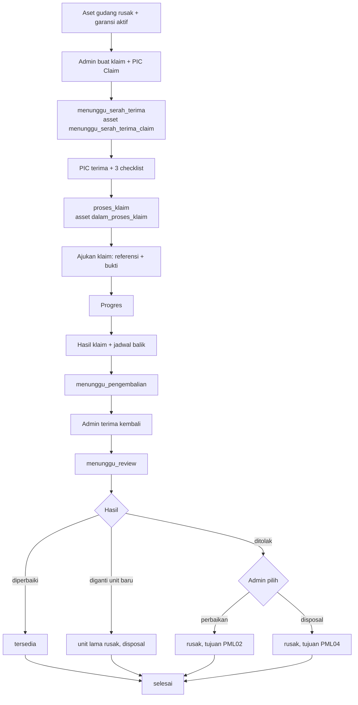
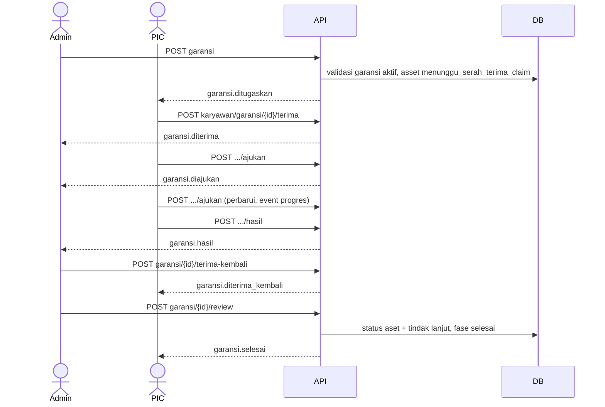
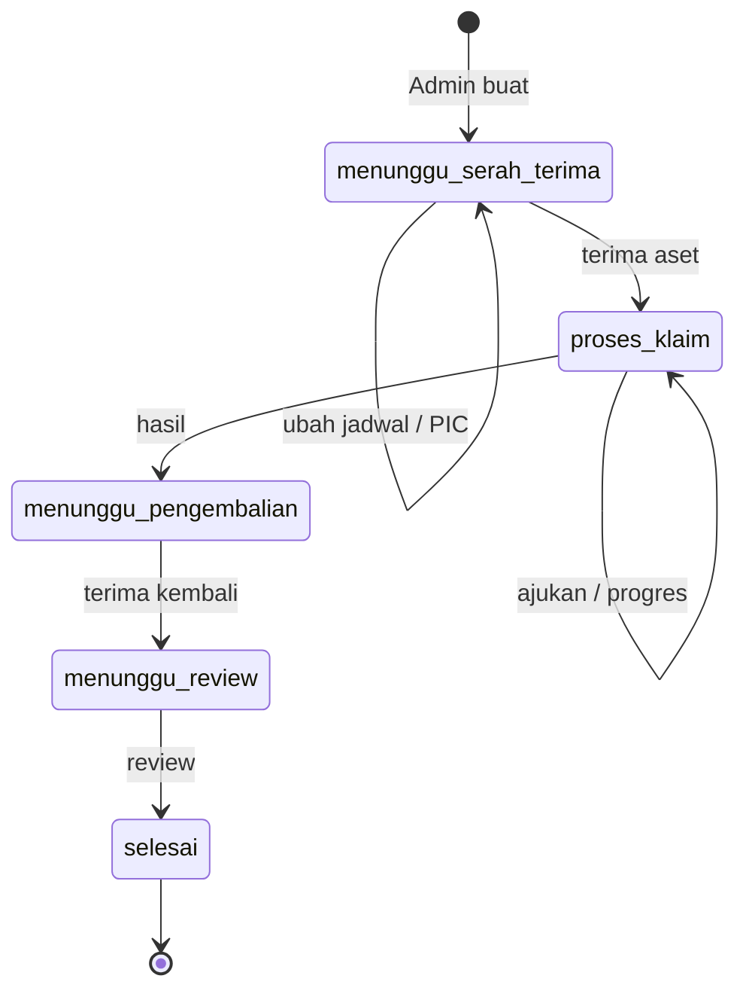
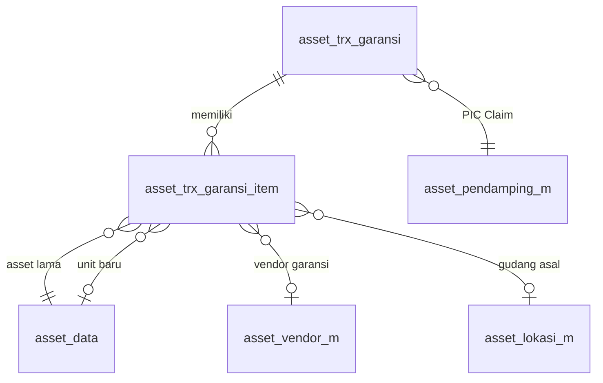

# Dokumentasi Teknis & Manual Book — Klaim Garansi Asset (PML03)

> Dokumen ini disusun **dari source code lokal** (`API/` Lumen dan `MOBILE/` Flutter) per 8 Oktober 2026, dibandingkan dengan dokumen bisnis **"4.3 Pemeliharaan - Warranty Claim (PML03)"**.
> Cakupan implementasi: **aset gudang berstatus `rusak` yang masih bergaransi aktif**. Dokumen bisnis masih menyebut "Ruangan/Karyawan asal"; implementasi sengaja dibatasi ke gudang karena aset rusak selalu sudah ditarik ke gudang. Bagian yang tidak ditemukan ditandai **⚠️ Belum ditemukan**, asumsi ditandai **⚠️ Asumsi**.
> Contoh ID/nama pada payload adalah **data sintetis**.

---

## 1. Informasi Dokumen

| Informasi | Nilai |
|---|---|
| Nama Fitur | Klaim Garansi Asset (UI: **"Klaim Garansi"**; menu PIC: **"Tugas PIC Claim"**) |
| Kode Fitur | **PML03** (nomor transaksi `PML03-YYYYMMNNN`) |
| Modul | Asset Management — Pemeliharaan Aset |
| Backend | Laravel **Lumen ^10.0**, PHP ^8.1, JWT, Query Builder |
| Database | `API/diagram-asset.dbml` (tanda `[NEW PML03]`) + SQL manual `Claude outputs/sql-pml03-klaim-garansi.sql`. ⚠️ SQL harus dijalankan manual (belum dijalankan saat dokumen ditulis) |
| Mobile | Flutter (`professional_flutter_3_35`), `flutter_bloc`, `dio`, `image_picker` |
| Web | ⚠️ Belum ditemukan: tidak ada source web di workspace |
| Test otomatis | API `tests/Asset/AssetGaransiTest.php` (5 test) · Mobile `test/asset/asset_garansi_test.dart` (17 test) |
| Versi dokumen | 1.1 — 12 Oktober 2026 |
| Dokumen terkait | Perbaikan (PML02), Disposal (PML04), Pemeliharaan Gudang (PML01), Master Pendamping & Tugas PIC |

## 2. Daftar Isi

Lihat panel navigasi di samping.

## 3. Quick Overview

Aset gudang yang rusak **selama masa garansi** diklaim ke vendor garansi. Admin membuat transaksi klaim (satu atau banyak aset), menunjuk **PIC Claim** dari master pendamping, dan menetapkan jadwal serah terima. PIC menerima aset dengan checklist (kondisi, **dokumen garansi**, kelengkapan), mengajukan klaim ke vendor (nomor referensi tiket dan bukti pengajuan wajib), memantau progres, lalu mengisi **hasil klaim**: diperbaiki, diganti unit baru, atau **ditolak**. Admin menerima aset kembali dan menentukan tindak lanjut; klaim ditolak diarahkan ke **Perbaikan (PML02)** atau **Disposal (PML04)**.

| Aspek | Ringkasan |
|---|---|
| Aktor | Admin Asset, PIC Claim, Sistem |
| Fase | `menunggu_serah_terima` → `proses_klaim` → `menunggu_pengembalian` → `menunggu_review` → `selesai` |
| Status asset | `rusak` → `menunggu_serah_terima_claim` → `dalam_proses_klaim` → `tersedia` / tetap `rusak` |
| Hasil klaim | `diperbaiki`, `diganti_unit_baru`, `ditolak` |
| Endpoint | 11 admin + 6 PIC |
| Notifikasi | 10 event (`garansi.*`) |

## 4. Ringkasan Fitur

| No | Fitur | Aktor |
|---|---|---|
| 1 | Buat klaim dari aset gudang rusak bergaransi aktif | Admin |
| 2 | Ubah jadwal/PIC sebelum aset diterima | Admin |
| 3 | Terima aset (checklist kondisi, dokumen garansi, kelengkapan) | PIC (admin cadangan) |
| 4 | Ajukan klaim ke vendor (nomor referensi, bukti) | PIC (admin cadangan) |
| 5 | Perbarui data pengajuan/estimasi (ajukan ulang, tercatat sebagai progres) | PIC (admin cadangan) |
| 6 | Isi hasil klaim dan jadwal serah terima balik | PIC (admin cadangan) |
| 7 | Atur jadwal balik, terima aset kembali | Admin |
| 8 | Review dan tindak lanjut | Admin |

## 5. Tujuan Fitur

### 5.1 Tujuan Bisnis (diturunkan dari kode)

- Memanfaatkan garansi vendor sebelum mengeluarkan biaya perbaikan.
- Dokumen garansi dan bukti pengajuan terdokumentasi.
- Klaim ditolak punya jalur lanjutan yang jelas (perbaikan berbayar atau disposal).

### 5.2 Tujuan Sistem

- Hanya aset bergaransi aktif yang bisa diklaim.
- Mengunci status aset sepanjang klaim dan menautkan unit pengganti.
- Mencatat `asset_log` (`klaim_garansi_gudang`) dan notifikasi.

## 6. Aktor

| Aktor | Peran |
|---|---|
| Admin Asset | Membuat, mengubah, menetapkan jadwal balik, menerima kembali, mereview; cadangan PIC |
| PIC Claim | Pendamping aktif; menerima aset, mengajukan klaim (dan memperbarui), hasil |
| Sistem | Validasi garansi, kunci status, tautan unit baru, log dan notifikasi |

## 7. Hak Akses

| Aksi | Admin | PIC Claim |
|---|---|---|
| Opsi, daftar semua, buat, ubah, jadwal balik, terima kembali, review | ✅ | ❌ |
| Daftar dan detail | ✅ (semua) | ✅ (hanya yang ditugaskan) |
| Terima, ajukan (termasuk pembaruan), hasil | ✅ (cadangan) | ✅ (hanya PIC transaksi) |

## 8. Terminologi

| Istilah | Arti |
|---|---|
| Garansi aktif | `flag_garansi = 1` dan `tgl_akhir_garansi` ≥ hari ini |
| PIC Claim | Pendamping yang ditunjuk untuk satu klaim |
| Nomor referensi | Nomor tiket/klaim dari vendor |
| Hasil klaim | `diperbaiki`, `diganti_unit_baru`, `ditolak` |
| Tindak lanjut ditolak | `perbaikan` (→ `asset_trx_perbaikan`) atau `disposal` (→ `asset_trx_disposal`) |

## 9. Business Rules

### BR-001 — Aset yang boleh diklaim
`pemegang_asset = gudang`, `status_asset = rusak`, garansi aktif, dan tidak dalam onboarding aktif. Pesan: *"Hanya asset rusak di gudang yang dapat diklaim garansi."* / *"…tidak memiliki garansi aktif."*

### BR-002 — PIC Claim
Dari pendamping aktif; dapat berubah hanya selama `menunggu_serah_terima`.

### BR-003 — Penerimaan aset
Tiga checklist `ya`/`tidak` per aset: `status_kesesuaian_item`, `status_dokumen_garansi_lengkap`, `status_kelengkapan_aset`. Bila ada `tidak`, keterangan wajib. Aset → `dalam_proses_klaim`.

### BR-004 — Pengajuan klaim
Per aset wajib: tanggal pengajuan (`tgl_mulai_klaim_garansi`), **nomor referensi**, dan **foto tanda terima/bukti pengajuan**. Vendor penerima klaim default dari `id_asset_vendor_garansi` aset, bisa vendor terdaftar atau teks bebas. Boleh diperbarui berulang.

### BR-005 — Progres
Tidak ada endpoint progres terpisah. Pembaruan dilakukan dengan memanggil **ajukan** lagi selama `proses_klaim` (perbarui estimasi, referensi, vendor). Pembaruan setelah pengajuan pertama mengirim event `garansi.progres` ke admin; pengajuan pertama mengirim `garansi.diajukan`.

### BR-006 — Hasil klaim
Seluruh aset wajib diisi. Keterangan hasil wajib; `diperbaiki` wajib komponen; `ditolak` wajib alasan penolakan. PIC sekaligus mengajukan jadwal serah terima balik.

### BR-007 — Terima kembali
Admin mengisi checklist kondisi; `tidak` memerlukan keterangan. Fase → `menunggu_review`.

### BR-008 — Review per aset
- `diperbaiki`: aset `tersedia`, `kondisi_awal = normal`, `ket_rusak`/`status_rusak` kosong.
- `diganti_unit_baru`: admin memilih unit baru (gudang, `tersedia`, belum dipakai klaim/perbaikan lain); unit lama tetap `rusak`, tindak lanjut disposal.
- `ditolak`: admin **wajib** memilih `perbaikan` atau `disposal`; aset tetap `rusak`; hanya nama tabel tujuan yang dicatat.

### BR-009 — Penomoran
`PML03-YYYYMMNNN`; maksimum 999 per bulan per perusahaan.

### BR-010 — Skema harus sudah diterapkan
`skemaSiap()` menjaga dashboard tetap berjalan sebelum SQL diterapkan.

## 10. Business Flow

1. Admin memilih aset gudang rusak bergaransi aktif, mengisi jadwal serah terima dan PIC Claim → `menunggu_serah_terima`.
2. PIC menerima aset dengan checklist → `proses_klaim`.
3. PIC mengajukan klaim ke vendor (referensi + bukti), lalu memperbarui data pengajuan bila ada perkembangan.
4. PIC mengisi hasil klaim dan jadwal balik → `menunggu_pengembalian`.
5. Admin menerima aset kembali → `menunggu_review`.
6. Admin menentukan tindak lanjut → `selesai`.

## 11. Flow Berdasarkan Role

### 11.1 Admin Asset
Buat → (ubah) → jadwal balik → terima kembali → review (pilih unit baru / tindak lanjut ditolak).

### 11.2 PIC Claim
Terima aset → ajukan klaim (ulangi bila ada perubahan) → hasil.

### 11.3 System
Validasi garansi aktif, kunci status, log, notifikasi.

## 12. Flow Diagram



## 13. Sequence Diagram



## 14. Status Transaksi

| `fase_garansi` | Label | Tab | `status` |
|---|---|---|---|
| `menunggu_serah_terima` | Menunggu Serah Terima | jadwal | proses |
| `proses_klaim` | Proses Klaim | proses | proses |
| `menunggu_pengembalian` | Menunggu Pengembalian | proses | proses |
| `menunggu_review` | Menunggu Review | proses | proses |
| `selesai` | Selesai | selesai | selesai |

Status per item (`status_garansi`): `proses` → `selesai` saat review.

## 15. State Transition



## 16. Struktur Database

| Tabel | Fungsi |
|---|---|
| `asset_trx_garansi` | Header transaksi |
| `asset_trx_garansi_item` | Satu baris per aset (snapshot garansi, penerimaan, pengajuan, hasil, tindak lanjut) |
| `asset_pendamping_m` | Master PIC Claim |
| `asset_data` | Status aset dan data garansi |
| `asset_log` | Jejak `klaim_garansi_gudang` |

## 17. Relasi Database



## 18. Data Dictionary

### 18.1 asset_trx_garansi

| Kolom | Tipe | Keterangan |
|---|---|---|
| `id_asset_trx_garansi` | varchar(50) PK | `id_company`+`YYYYMM`+3 digit |
| `no_trx` | varchar(50) | `PML03-YYYYMMNNN` |
| `fase_garansi` | enum | 5 fase |
| `id_asset_pendamping_m` | varchar(50) FK | PIC Claim |
| `id_pic_pendamping`, `nama_pic_pendamping`, `nik_pic_pendamping` | varchar | Snapshot PIC |
| `tgl_serah_terima`, `jam_serah_terima`, `keterangan_serah_terima` | date, time, varchar | Jadwal admin → PIC |
| `tgl_terima`, `user_terima` | timestamp, varchar | Penerimaan oleh PIC |
| `tgl_pengembalian`, `jam_pengembalian`, `user_ajukan_pengembalian` | date, time, varchar | Jadwal balik PIC → admin |
| `tgl_terima_kembali`, `user_terima_kembali` | timestamp, varchar | Admin menerima kembali |
| `tgl_review`, `user_review`, `keterangan_review` | timestamp, varchar, text | Review |
| `status` | enum | proses/selesai |
| Audit | `id_company`, `tgl_input`, `user_input`, `tgl_update`, `user_update` | |

### 18.2 asset_trx_garansi_item

| Kelompok | Kolom |
|---|---|
| Identitas | `id_asset_trx_garansi_item`, `id_asset_trx_garansi`, `id_asset_data`, snapshot `nama_asset`/`deskripsi_asset`/`kategori_asset`/`keterangan_rusak`, `id_asset_lokasi_m` (gudang asal) |
| Snapshot garansi | `tgl_awal_garansi`, `tgl_akhir_garansi`, `no_dokumen_garansi`, `foto_dokumen_garansi` |
| Penerimaan | `status_kesesuaian_item`, `status_dokumen_garansi_lengkap`, `status_kelengkapan_aset`, `keterangan_garansi_pendamping` |
| Pengajuan | `id_asset_vendor_m`, `nama_vendor`, `keterangan_vendor`, `tgl_mulai_klaim_garansi`, `tgl_estimasi_selesai_klaim_garansi`, `nomor_referensi_klaim_garansi`, `foto_tanda_terima` |
| Hasil | `hasil_klaim`, `keterangan_hasil_klaim`, `komponen_klaim`, `alasan_penolakan`, `id_asset_data_baru` |
| Kembali | `status_kesesuaian_kembali`, `ket_kesesuaian_kembali` |
| Tindak lanjut | `id_trx_tindak_lanjut`, `nama_tabel_tindak_lanjut`, `status_garansi` |

## 19. Database Index

| Index | Kolom | Fungsi |
|---|---|---|
| `atg_company_fase_idx` | `id_company, fase_garansi, tgl_input, id` | Daftar per tab |
| `atg_company_pic_fase_idx` | `id_company, id_pic_pendamping, fase_garansi, tgl_input` | Tugas PIC |
| `atgi_trx_asset_uq` | `id_trx, id_asset_data` | Unik per transaksi |
| `atgi_company_asset_status_idx` | `id_company, id_asset_data, status_garansi` | Cek klaim aktif dan riwayat |

## 20. Backend Architecture

| Lapisan | File |
|---|---|
| Route | `RouteAsset.php` (`garansi/*`, `karyawan/garansi/*`) |
| Controller | `Asset/Admin/AssetAdminGaransi_c.php`, `Asset/Karyawan/AssetKaryawanGaransi_c.php` |
| Model | `Models/Asset/AssetGaransi_m.php` |
| Aturan bersama | `Asset_c` (`GARANSI_*_RULES`, helper foto `garansiAssetsPayload`) |
| Notifikasi | `Support/Asset/AssetNotification.php` |

## 21. Backend Business Logic

### 21.1 Buat — `store`
Kunci aset, validasi BR-001 termasuk garansi aktif, PIC, jadwal; snapshot data garansi; aset → `menunggu_serah_terima_claim` + log.

### 21.2 Ubah — `ubah`
Hanya `menunggu_serah_terima`; mengembalikan `pic_berubah`.

### 21.3 Terima — `terima`
Tiga checklist; aset → `dalam_proses_klaim`; fase `proses_klaim`.

### 21.4 Ajukan — `ajukan`
Per aset: vendor, tanggal pengajuan, nomor referensi, foto bukti; boleh berulang.

### 21.5 Hasil
Hasil per aset dengan validasi BR-006; fase `menunggu_pengembalian`. `ajukan` mengembalikan `baru = true` pada pengajuan pertama (menentukan event).

### 21.6 Jadwal balik dan terima kembali
Admin mengubah jadwal balik atau menerima aset dengan checklist; fase `menunggu_review`.

### 21.7 Review — `review`
Sesuai BR-008; unit baru divalidasi (`assertUnitBaru`: gudang, `tersedia`, tidak dipakai klaim/perbaikan lain); fase `selesai`.

### 21.8 Query baca
`getPage`, `getDetail` (dengan `aksi` per peran), `getAdminOptions`, `getPendingForPic/Admin`, `countByTabForPic`, `countPendingForAdmin`, `hasActivePic`.

## 22. Dampak terhadap asset_data

| Kejadian | `status_asset` | Kolom lain |
|---|---|---|
| Klaim dibuat | `rusak` → `menunggu_serah_terima_claim` | — |
| PIC menerima | → `dalam_proses_klaim` | — |
| Review `diperbaiki` | → `tersedia` | `kondisi_awal=normal`, `ket_rusak`/`status_rusak` kosong |
| Review `diganti_unit_baru` / `ditolak` | → `rusak` | Tidak berubah; tindak lanjut dicatat |

## 23. API Documentation

| Kode | Method | Path | Aktor |
|---|---|---|---|
| API-001 | GET | `asset/garansi/options` | Admin |
| API-002 | GET | `asset/garansi` | Admin |
| API-003 | POST | `asset/garansi` | Admin |
| API-004 | PUT | `asset/garansi/{id}` | Admin |
| API-005 | POST | `asset/garansi/{id}/terima` | Admin (cadangan) |
| API-006 | POST | `asset/garansi/{id}/ajukan` | Admin (cadangan) |
| API-007 | POST | `asset/garansi/{id}/hasil` | Admin (cadangan) |
| API-008 | POST | `asset/garansi/{id}/jadwal-kembali` | Admin |
| API-009 | POST | `asset/garansi/{id}/terima-kembali` | Admin |
| API-010 | POST | `asset/garansi/{id}/review` | Admin |
| API-011 | GET | `asset/garansi/{id}` | Admin |
| API-012 | GET | `asset/karyawan/garansi/options` | PIC |
| API-013 | GET | `asset/karyawan/garansi` | PIC |
| API-014 | POST | `asset/karyawan/garansi/{id}/terima` | PIC |
| API-015 | POST | `asset/karyawan/garansi/{id}/ajukan` | PIC |
| API-016 | POST | `asset/karyawan/garansi/{id}/hasil` | PIC |
| API-017 | GET | `asset/karyawan/garansi/{id}` | PIC |

⚠️ Tidak ada endpoint progres terpisah seperti PML02: `ajukan` boleh dipanggil berulang selama `proses_klaim` untuk memperbarui data.

## 24. Detail Setiap API

### API-001/012 — Opsi
Admin: vendor, pendamping aktif, aset gudang rusak bergaransi aktif, aset gudang tersedia (calon unit baru), hasil. PIC: vendor.

### API-002/013 — Daftar
Query `tab` (`jadwal|proses|selesai`), `limit` (1–50), `offset`. Respons `{filters, records[], pagination}`.

### API-003 — Buat
```json
{"asset_ids": ["LP-1"], "tgl_jadwal": "2026-10-12", "jam_jadwal": "09:00",
 "id_asset_pendamping_m": "PDM-1", "keterangan_serah_terima": "Bawa kartu garansi"}
```

### API-004 — Ubah
Body sama tanpa `asset_ids`.

### API-005/014 — Terima
```json
{"assets": [{"id_asset_data": "LP-1", "status_kesesuaian_item": "ya",
  "status_dokumen_garansi_lengkap": "tidak", "status_kelengkapan_aset": "ya",
  "keterangan": "Kartu garansi hilang"}]}
```

### API-006/015 — Ajukan
```json
{"assets": [{"id_asset_data": "LP-1", "id_asset_vendor_m": "VND-1", "nama_vendor": "",
  "keterangan_vendor": "0812-0000", "tgl_mulai_klaim_garansi": "2026-10-13",
  "tgl_estimasi_selesai_klaim_garansi": "2026-10-20",
  "nomor_referensi_klaim_garansi": "TKT-001", "foto_tanda_terima": "<base64 atau multipart>"}]}
```
Foto disimpan di object storage dengan key `<company>/asset/garansi/<id_karyawan>/<hex>.<ext>`; kolom menyimpan key. Foto lama tidak dihapus saat diganti; object baru yang yatim dibersihkan bila transaksi gagal; foto lama di disk lokal tetap terbaca lewat fallback URL.

### API-007/016 — Hasil
```json
{"tgl_pengembalian": "2026-10-26", "jam_pengembalian": "13:00",
 "assets": [{"id_asset_data": "LP-1", "hasil_klaim": "ditolak",
   "keterangan_hasil_klaim": "Kerusakan karena pemakaian", "komponen_klaim": "",
   "alasan_penolakan": "Garansi tidak mencakup kerusakan fisik"}]}
```

### API-008 — Jadwal balik
`{tgl_pengembalian, jam_pengembalian}`.

### API-009 — Terima kembali
`{assets: [{id_asset_data, status_kesesuaian_kembali: ya|tidak, ket_kesesuaian_kembali}]}`.

### API-010 — Review
```json
{"keterangan_review": "Tindak lanjut ditetapkan",
 "items": [{"id_asset_data": "LP-1", "tindak_lanjut": "perbaikan"},
           {"id_asset_data": "LP-2", "id_asset_data_baru": "LP-NEW"}]}
```
`tindak_lanjut` ∈ `perbaikan|disposal` wajib untuk hasil `ditolak`; `id_asset_data_baru` wajib untuk `diganti_unit_baru`.

### API-011/017 — Detail
Header, PIC, jadwal, `assets[]` (garansi, penerimaan, pengajuan, hasil, kembali, tindak lanjut), dan `aksi`.

## 25. Mobile Architecture

| Lapisan | File |
|---|---|
| Model | `lib/Repository/Model/Asset/mAssetGaransi.dart` |
| API client | `lib/Repository/Service/assetGaransiApi.dart` (`admin: true/false`) |
| Bloc | `lib/Bloc/Asset/AssetGaransiBloc.dart` |
| UI | `lib/UI/Modul/Asset/Pemeliharaan/Garansi/*` (termasuk `AssetGaransiProsesWidgets`; pratinjau foto layar penuh memakai `Pemeliharaan/AssetFotoPreview.dart`) |
| Teks | grup `garansi` di `assets/{id,en}/asset.json` (`AssetGaransiText.t(key)` berbasis peta) |

## 26. Mobile Screen

### 26.1 Daftar
`HalamanAssetGaransi` (admin dan PIC): tab Serah Terima/Proses/Selesai.

### 26.2 Buat Klaim (admin)
`HalamanBuatGaransi`: pilih aset rusak bergaransi aktif, lalu sheet jadwal + PIC.

### 26.3 Detail
`HalamanDetailAssetGaransi` dengan stepper (`AssetGaransiProsesWidgets`) dan tombol sesuai `aksi`.

### 26.4 Sheet aksi
`AssetGaransiActionSheets`: terima (3 checklist), ajukan (vendor, referensi, foto), hasil, terima kembali, review.

### 26.5 Entry point
Admin: menu **Klaim Garansi** dan kartu beranda. PIC: kartu Tugas PIC.

## 27. Mobile → API

Prefix `asset/garansi` (admin) atau `asset/karyawan/garansi` (PIC). Aksi UI memanggil endpoint pada §23 dengan bentuk body §24.

## 28. API → Mobile

Dipetakan ke model garansi; `aksi` menentukan tombol; 422 tampil snackbar warning, lainnya error; sukses menutup halaman dengan pesan.

## 29. Mapping Mobile → API → Database

| Field UI | Field API | Kolom DB |
|---|---|---|
| Jadwal | `tgl_jadwal`/`jam_jadwal` | `tgl_serah_terima`/`jam_serah_terima` |
| PIC Claim | `id_asset_pendamping_m` | `id_asset_pendamping_m` + snapshot |
| Checklist dokumen garansi | `status_dokumen_garansi_lengkap` | kolom sama |
| Nomor referensi | `nomor_referensi_klaim_garansi` | kolom sama |
| Foto bukti | `foto_tanda_terima` | `foto_tanda_terima` |
| Hasil | `hasil_klaim` | `hasil_klaim` |
| Tindak lanjut ditolak | `tindak_lanjut` | `nama_tabel_tindak_lanjut` |

## 30. Mapping Database → API → Mobile

| Kolom DB | Field API | Tampil di |
|---|---|---|
| `fase_garansi` | `fase_garansi`, `status_label` | Badge, stepper |
| `tgl_akhir_garansi` | `assets[].garansi.tgl_akhir` | Detail aset |
| `hasil_klaim` | `assets[].hasil` | Tahap hasil |
| `foto_tanda_terima` | `…_url` | Tahap pengajuan |

## 31. Validation

### 31.1 Mobile
Form sheet memvalidasi wajib-isi sesuai BR-003 sampai BR-008.

### 31.2 Backend
Aturan Laravel di `Asset_c` (`GARANSI_TERIMA_RULES`, `GARANSI_AJUKAN_RULES`, `GARANSI_HASIL_RULES`) + aturan bisnis model.

### 31.3 Database
Enum fase/status/hasil; FK; unik `(trx, asset)`.

## 32. Error Handling

| Kondisi | Kode | Contoh pesan |
|---|---|---|
| Validasi request | 422 | "Nomor referensi klaim wajib diisi." |
| Aturan bisnis | 422 `BUSINESS_RULE_VIOLATION` | "Satu atau beberapa asset tidak memiliki garansi aktif." |
| Bukan admin | 403 | "Pengguna tidak memiliki akses admin asset." |
| Tidak ditemukan | 404 | "Klaim garansi tidak ditemukan." |
| Sistem | 500 `SYSTEM_ERROR` | Pesan umum |

## 33. Audit Trail

`user_terima`, `user_ajukan_pengembalian`, `user_terima_kembali`, `user_review` + timestamp; `asset_log` pada pembuatan dan review.

## 34. Notification

| Event | Penerima | Rute mobile |
|---|---|---|
| `garansi.ditugaskan`, `garansi.diubah` | PIC | `asset_detail_garansi` |
| `garansi.diterima` | Admin | `asset_admin_detail_garansi` |
| `garansi.diterima_admin` | PIC | `asset_detail_garansi` |
| `garansi.diajukan`, `garansi.progres`, `garansi.hasil` | Admin | `asset_admin_detail_garansi` |
| `garansi.jadwal_kembali`, `garansi.diterima_kembali`, `garansi.selesai` | PIC | `asset_detail_garansi` |

## 35. Security

JWT; admin diperiksa per request; PIC dibatasi ke transaksinya dan harus karyawan aktif; foto diunggah ke bucket MinIO privat lewat `Asset_c::uploadAssetImage` (`AssetImageStorage`): hanya JPEG/PNG/WebP valid, maks 5 MB dan 25 megapiksel; key memuat `id_company` dan `id_karyawan` dari JWT; URL foto berupa presigned URL berumur singkat (lihat `dokumentasi-minio-object-storage.md`); filter `id_company`; transaksi + `lockForUpdate`.

## 36. Manual Book User/Admin

### A. Admin — Membuat klaim
Klaim Garansi → **+** → pilih aset rusak bergaransi → jadwal dan PIC Claim → simpan.

### B. PIC — Menerima dan mengajukan
Tugas PIC → **Terima Aset** (3 checklist) → **Ajukan Klaim** (vendor, nomor referensi, foto bukti) → ulangi **Ajukan Klaim** bila ada perubahan (mis. estimasi).

### C. PIC — Hasil
**Isi Hasil Klaim** + jadwal serah terima balik.

### D. Admin — Terima kembali dan review
**Terima Aset Kembali** → **Review**: unit baru untuk aset diganti; tindak lanjut Perbaikan/Disposal untuk klaim ditolak.

## 37. Kondisi Button

| Tombol | Syarat |
|---|---|
| Ubah | admin, `menunggu_serah_terima` |
| Terima Aset | `menunggu_serah_terima` |
| Ajukan (termasuk pembaruan) / Hasil | `proses_klaim` |
| Jadwal Balik, Terima Kembali | admin, `menunggu_pengembalian` |
| Review | admin, `menunggu_review` |

## 38. Testing Scenario

| No | Skenario | Hasil |
|---|---|---|
| T-01 | Aset non-gudang / tidak rusak / garansi habis | Ditolak |
| T-02 | Buat valid | `PML03-…`, aset `menunggu_serah_terima_claim` |
| T-03 | Ajukan tanpa nomor referensi/foto | Ditolak |
| T-04 | Alur penuh: diperbaiki dan diganti unit baru | Status aset sesuai |
| T-05 | Ditolak tanpa tindak lanjut | Ditolak |
| T-06 | Ubah setelah aset diterima | Ditolak |
| T-07 | Route admin dan PIC | 200/403 sesuai peran |

## 39. Temuan Ketidaksesuaian

| ID | Temuan |
|---|---|
| INC-01 | Dokumen bisnis menyebut Ruangan/Karyawan asal; implementasi hanya gudang |
| INC-02 | Klaim ditolak baru mencatat **nama tabel** PML02/PML04; transaksi tujuan tidak dibuat otomatis |
| INC-03 | Tidak ada pembatalan klaim |
| INC-04 | Tidak ada pengingat otomatis garansi hampir habis |

## 40. Edge Case

- Garansi habis setelah klaim dibuat: klaim tetap berjalan (validasi hanya saat dibuat).
- Unit baru sama dengan unit lama atau dipakai dua kali: ditolak.
- Unit baru sudah dipakai perbaikan atau klaim lain: ditolak.
- Aset berubah status di luar alur: ditolak "Status asset sudah berubah…".

## 41. Potential Bug / Technical Risk

### RISK-001 — Skema dari SQL manual (TINGGI)
Jalankan setelah SQL PML01 gudang; SQL PML02 dan PML04 harus menyusul.

### RISK-002 — Tidak ada pembatalan (SEDANG)
Klaim yang tertahan mengunci aset.

### RISK-003 — Foto lama di disk lokal (RENDAH)
### RISK-004 — Notifikasi di luar transaksi (RENDAH)
### RISK-005 — Kapasitas penomoran 999/bulan (RENDAH)

## 42. Dependency

`Asset_m/Asset_c`, `AssetPendamping_m`, `AssetPemeliharaanKaryawan_m` (vendor), `AssetImageStorage`, `AssetNotification`, `asset_vendor_m`, `asset_lokasi_m`, `asset_data`.

## 43. Source Code Reference

| Area | Lokasi |
|---|---|
| Model | `API/app/Models/Asset/AssetGaransi_m.php` |
| Controller | `API/app/Http/Controllers/Asset/Admin/AssetAdminGaransi_c.php`, `Karyawan/AssetKaryawanGaransi_c.php` |
| SQL | `Claude outputs/sql-pml03-klaim-garansi.sql` |
| Test API | `API/tests/Asset/AssetGaransiTest.php` |
| Mobile UI | `MOBILE/lib/UI/Modul/Asset/Pemeliharaan/Garansi/` |
| Test mobile | `MOBILE/test/asset/asset_garansi_test.dart` |

## 44. Developer Notes

- Struktur identik dengan PML02; perbedaan: garansi aktif, tiga checklist, hasil `ditolak`, pengajuan klaim menggantikan "kirim ke service".
- Pelajaran dari PML03: `Asset_c` harus meng-import `InvalidArgumentException`/`Throwable` agar `mutateAssetTrx` memetakan error bisnis (sudah diperbaiki, berlaku untuk semua modul).
- `TINDAK_LANJUT_DITOLAK` memetakan pilihan admin ke nama tabel.

## 45. End-to-End Traceability

| Kebutuhan | Rule | API | Mobile | DB |
|---|---|---|---|---|
| Hanya garansi aktif | BR-001 | API-003 | Daftar aset buat | `asset_data.flag_garansi`, `tgl_akhir_garansi` |
| Bukti pengajuan | BR-004 | API-006 | Sheet ajukan | `nomor_referensi_klaim_garansi`, `foto_tanda_terima` |
| Klaim ditolak | BR-008 | API-010 | Sheet review | `nama_tabel_tindak_lanjut` |

## 46. Ringkasan Database Impact

Tabel baru `asset_trx_garansi`, `_item`. `asset_data.status_asset` +`menunggu_serah_terima_claim`; `asset_log.jenis_log` +`klaim_garansi_gudang`.

## 47. Checklist Implementasi

### Database
- [x] DBML diperbarui
- [x] SQL manual + guard + rollback
- [ ] SQL dijalankan di setiap environment

### Backend
- [x] Model, controller, route, notifikasi, test

### Mobile
- [x] Daftar, buat, detail, sheet aksi, teks id/en, test

### Documentation
- [x] Dokumen ini

## 48. Changelog

| Versi | Tanggal | Perubahan |
|---|---|---|
| 1.0 | 8 Okt 2026 | Dokumen awal PML03 |
| 1.1 | 12 Okt 2026 | Sinkronisasi dengan kode: foto tanda terima kini disimpan di object storage MinIO (RISK-003 diturunkan ke RENDAH); path UI/model mobile mengikuti struktur folder baru; `AssetGaransiProsesWidgets` dan `AssetFotoPreview` dicatat |
