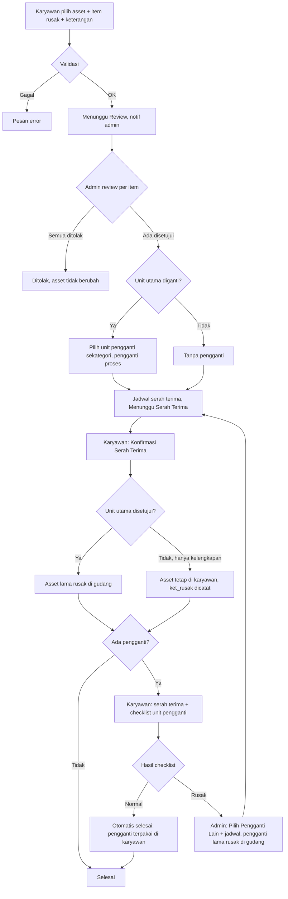
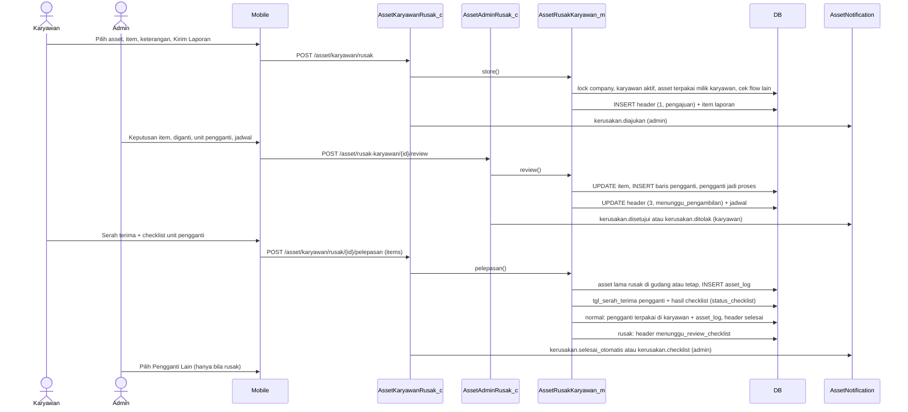
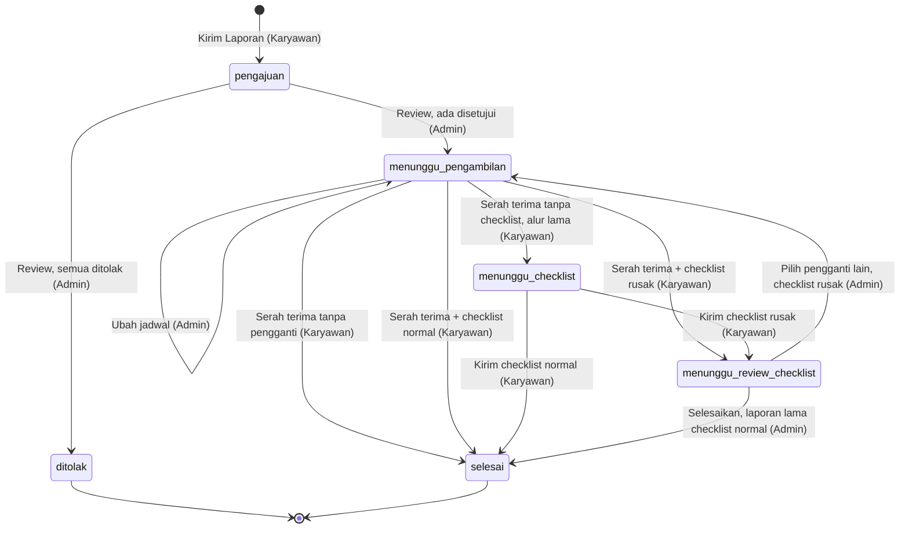
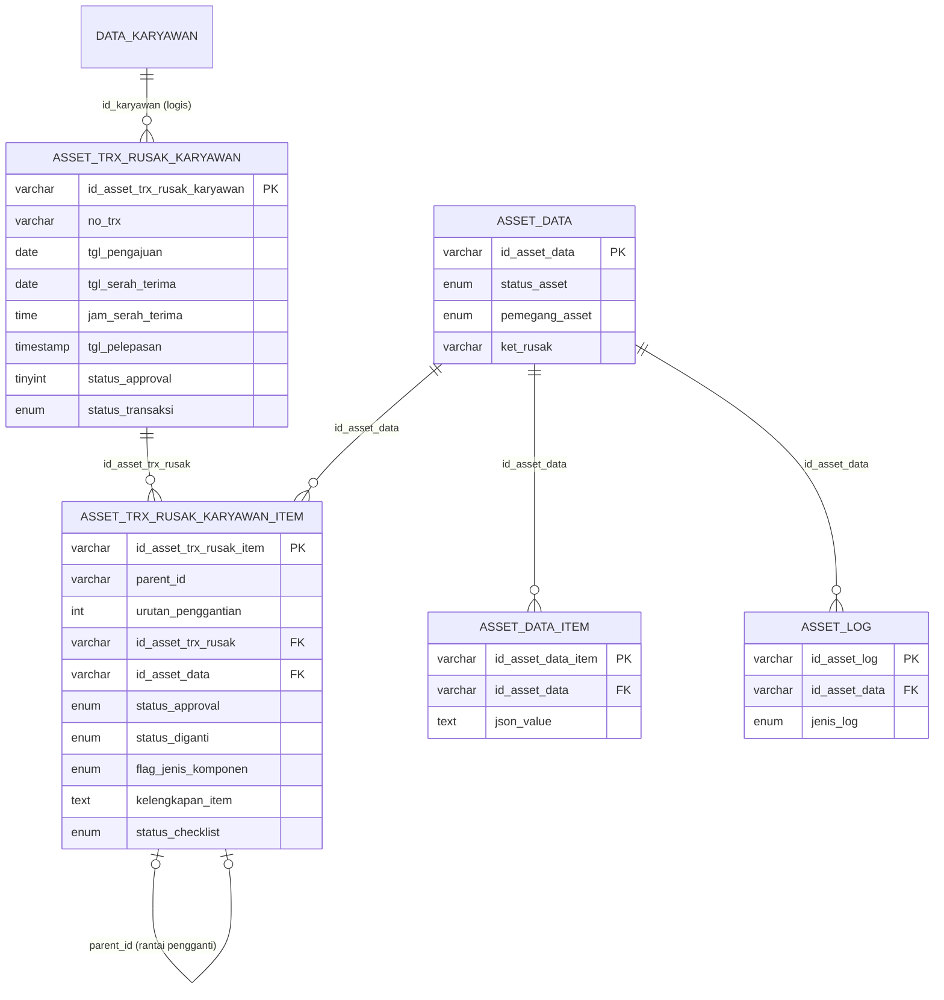

# Dokumentasi Teknis & Manual Book — Laporan Kerusakan Asset Karyawan

> Dokumen ini disusun **murni dari source code lokal** (`API/` Lumen dan `MOBILE/` Flutter) per 28 September 2026.
> Business requirement dan kode fitur **diturunkan dari kode**. Bagian yang tidak ditemukan ditandai **⚠️ Belum ditemukan**, asumsi ditandai **⚠️ Asumsi**.
> Contoh ID/nama pada payload adalah **data sintetis**.

---

## 1. Informasi Dokumen

| Informasi | Nilai |
|---|---|
| Nama Fitur | Laporan Kerusakan Asset Karyawan (UI: **"Laporan Kerusakan Asset"**; menu **"Kerusakan"**) |
| Kode Fitur | **KRY06** (nomor transaksi `KRY06-YYYYMMNNN`; docblock model menyebut `ALK-KRY06`) |
| Modul | Asset Management |
| Backend | Laravel **Lumen ^10.0**, PHP ^8.1, JWT, Query Builder |
| Database | `API/diagram-asset.dbml` + migration `2026_09_25_000001_add_workflow_fields_to_asset_rusak_karyawan.php`. ⚠️ Asumsi: MySQL/MariaDB |
| Mobile | Flutter (`professional_flutter_3_35`), `flutter_bloc`, `dio` |
| Web | ⚠️ Belum ditemukan: tidak ada source web di workspace |
| Test otomatis | `API/tests/Asset/AssetRusakKaryawanTest.php` (15 test) |
| Versi Dokumen | 1.4 |
| Tanggal Dokumentasi | 2026-10-12 |
| Dokumen terkait | Onboarding (KRY01), Offboarding (KRY02), Upgrade (KRY03), Retur (KRY04), Peminjaman (KRY05), Request/Penambahan |

---

## 2. Daftar Isi

1. Informasi Dokumen · 3. Quick Overview · 4. Ringkasan Fitur · 5. Tujuan · 6. Aktor · 7. Hak Akses · 8. Terminologi · 9. Business Rules · 10. Business Flow · 11. Flow per Role · 12. Flow Diagram · 13. Sequence Diagram · 14. Status Transaksi · 15. State Transition · 16. Struktur Database · 17. Relasi · 18. Data Dictionary · 19. Index · 20. Backend Architecture · 21. Backend Logic · 22. Dampak asset_data · 23. API · 24. Detail API · 25. Mobile Architecture · 26. Mobile Screen · 27. Mobile → API · 28. API → Mobile · 29. Mapping Mobile→API→DB · 30. Mapping DB→API→Mobile · 31. Validation · 32. Error Handling · 33. Audit Trail · 34. Notification · 35. Security · 36. Manual Book · 37. Kondisi Button · 38. Testing · 39. Temuan Ketidaksesuaian · 40. Edge Case · 41. Risk · 42. Dependency · 43. Source Reference · 44. Developer Notes · 45. Traceability · 46. DB Impact · 47. Checklist · 48. Changelog

---

## 3. Quick Overview

| Item | Informasi |
|---|---|
| Feature | Pelaporan kerusakan **satu asset** milik karyawan, per komponen (unit utama / kelengkapan) |
| Module | Asset Management |
| Actor | Karyawan (pelapor, serah terima, checklist), Admin Asset (review, jadwal, pengganti; penyelesaian otomatis bila checklist normal), System |
| Main Transaction | `asset_trx_rusak_karyawan` |
| Detail Transaction | `asset_trx_rusak_karyawan_item` — item laporan (`urutan_penggantian = 0`) + **histori unit pengganti** (`urutan_penggantian ≥ 1`, `parent_id` ke baris sebelumnya) |
| Sumber komponen | `asset_data_item` (`json_value.flag_spesifikasi` 1 = unit utama, 2 = kelengkapan) |
| Asset Master | `asset_data` |
| Log | `asset_log` `jenis_log = rusak_karyawan` |
| Status | `status_approval` (int: 1 proses, 2 ditolak, 3 disetujui) + `status_transaksi` (`pengajuan → menunggu_pengambilan → menunggu_checklist → menunggu_review_checklist → selesai`) |
| Keputusan admin | Per item: Setujui/Tolak; item disetujui: **Diganti / Tidak Diganti**; unit utama diganti → pilih **Unit Pengganti** sekategori |
| Siklus pengganti | Unit pengganti dicek karyawan **saat serah terima (satu langkah)**. Normal → laporan **selesai otomatis**. Rusak → admin **Pilih Pengganti Lain** (berulang) |
| API | 7 endpoint admin + 6 endpoint karyawan |
| Mobile Screen | Karyawan: Laporan Kerusakan Asset (list), Lapor Kerusakan Asset (form), Detail Laporan Kerusakan. Admin: list & detail |

```text
Karyawan: pilih 1 asset terpakai → pilih Unit Utama ATAU Kelengkapan → centang item + keterangan → Kirim Laporan
                                                           proses(1) / pengajuan · asset TIDAK berubah
Admin: per item Setujui/Tolak (+alasan); disetujui → Diganti / Tidak Diganti
       unit utama diganti → Pilih Unit Pengganti (sekategori, tersedia @gudang) → pengganti = proses
       → Jadwal Serah Terima (tanggal, jam, catatan)
       ├─ semua ditolak ─────────────────────────────────────── ditolak(2) / selesai
       └─ ada disetujui ─────────────────────────────────────── disetujui(3) / menunggu_pengambilan
Karyawan: Konfirmasi Serah Terima
   • unit utama disetujui → asset lama = rusak @gudang      • hanya kelengkapan → asset tetap @karyawan (ket_rusak dicatat)
   ├─ tanpa pengganti ──────────────────────────────────────── selesai
   └─ ada pengganti ────────────────────────────────────────── checklist unit pengganti diisi bersamaan
Karyawan: Serah Terima & Kirim Checklist Unit Pengganti (Normal/Rusak per item)
   • semua normal → pengganti = terpakai @karyawan ─────────── selesai (otomatis, admin hanya dinotifikasi)
   • ada yang rusak ────────────────────────────────────────── menunggu_review_checklist
Admin: Pilih Pengganti Lain + jadwal → pengganti lama = rusak @gudang  menunggu_pengambilan (ulang)
```

---

## 4. Ringkasan Fitur

Karyawan melaporkan kerusakan pada **satu asset** yang sedang dipakainya (`status_asset = terpakai`). Laporan bersifat **per komponen**: unit utama dan/atau kelengkapan (misalnya charger, adaptor) yang diambil dari `asset_data_item`. Setiap item wajib diberi keterangan kerusakan.

Admin meninjau setiap item. Untuk item yang disetujui admin menentukan apakah item **diganti**. Hanya **unit utama** yang diganti yang memicu penukaran unit: admin memilih unit pengganti dari gudang dengan **kategori sama**. Kelengkapan yang "diganti" hanya dicatat.

Serah terima dikonfirmasi **karyawan**. Jika ada unit pengganti, karyawan wajib mengecek kondisi setiap komponen unit pengganti (checklist) pada saat serah terima yang sama. Bila semua normal, laporan selesai otomatis. Bila ada yang rusak, admin memilih unit pengganti lain dan siklus berulang sampai unit pengganti dinyatakan normal — seluruh percobaan tersimpan sebagai histori.

---

## 5. Tujuan Fitur

### 5.1 Tujuan Bisnis (diturunkan dari kode)
- Karyawan dapat melaporkan kerusakan asset secara terstruktur per komponen.
- Admin memutuskan penarikan dan penggantian unit secara terkontrol.
- Unit pengganti dipastikan dalam kondisi baik sebelum menjadi milik karyawan.
- Riwayat penggantian berulang dapat ditelusuri.

### 5.2 Tujuan Sistem
- Menyimpan laporan per komponen dengan snapshot data komponen (JSON).
- Mereservasi unit pengganti (`proses`) hingga lolos checklist.
- Memperbarui `asset_data` dan mencatat `asset_log` pada setiap perpindahan.
- Mencegah asset diproses di laporan kerusakan lain, retur, upgrade, atau offboarding saat laporan dibuat.

---

## 6. Aktor

| Aktor | Role | Fungsi |
|---|---|---|
| Karyawan | User login, pemegang asset | Melapor, konfirmasi serah terima, checklist unit pengganti |
| Admin Asset | `asset_admin` + karyawan aktif | Review, jadwal, pilih/ganti unit pengganti, selesaikan laporan |
| System | Backend + FCM | Validasi, lock, penomoran, update asset, log, notifikasi |

---

## 7. Hak Akses

| Action | Admin Asset | Karyawan | Keterangan |
|---|:---:|:---:|---|
| Melihat semua laporan | ✅ | ❌ | `/asset/rusak-karyawan` |
| Melihat laporan sendiri | – | ✅ | Tanpa cek karyawan aktif (INC-05) |
| Melapor kerusakan | – | ✅ | Karyawan aktif, asset miliknya, `terpakai` |
| Edit / batalkan laporan | ❌ | ❌ | ⚠️ Belum ditemukan (RISK-003) |
| Review (setujui/tolak, diganti, pengganti, jadwal) | ✅ | ❌ | `status_approval = 1` |
| Ubah jadwal | ✅ | ❌ | `menunggu_pengambilan` |
| Konfirmasi serah terima | ❌ | ✅ | `menunggu_pengambilan`, karyawan aktif |
| Checklist unit pengganti | ❌ | ✅ | `menunggu_pengambilan` (bersama serah terima) atau `menunggu_checklist` (alur lama), karyawan aktif |
| Selesaikan laporan | ✅ | ❌ | Hanya laporan lama: `menunggu_review_checklist` + checklist normal (checklist normal baru selesai otomatis) |
| Pilih pengganti lain | ✅ | ❌ | `menunggu_review_checklist` + checklist rusak |

---

## 8. Terminologi

| Istilah | Arti di sistem |
|---|---|
| Unit Utama (`aset_utama`) | Komponen `asset_data_item` dengan `flag_spesifikasi = 1`; bila tidak ada, sistem menambahkan baris sintetis dengan `id_item = id_asset_data` |
| Kelengkapan (`kelengkapan`) | Komponen dengan `flag_spesifikasi = 2` |
| Item laporan | Baris item `urutan_penggantian = 0` |
| Unit pengganti | Baris item `urutan_penggantian ≥ 1`; `parent_id` = baris sebelumnya |
| `status_diganti` | '1' diganti, '0' tidak diganti (diisi saat disetujui) |
| Pelepasan / Serah terima | Karyawan menyerahkan item rusak (dan menerima pengganti) — `tgl_pelepasan` |
| Checklist | Pemeriksaan kondisi setiap komponen unit pengganti oleh karyawan |
| Unit ditarik | Minimal satu **unit utama** disetujui → asset lama ditarik ke gudang saat serah terima |

---

## 9. Business Rules

### BR-001 — Asset yang boleh dilaporkan
Milik karyawan login (`pemegang_asset = karyawan`, `id_pemegang_asset = id_karyawan`) dan `status_asset = terpakai` → "Asset bukan milik karyawan atau tidak ditemukan." / "Hanya asset berstatus terpakai yang dapat dilaporkan rusak." Asset **pinjaman** (`dipinjam`) tidak bisa dilaporkan di sini. Karyawan harus aktif.

### BR-002 — Asset tidak sedang di flow lain (`assetBlockMessage`)
Dicek saat opsi dan simpan: laporan kerusakan aktif, retur aktif, upgrade aktif, offboarding aktif, pemeliharaan terjadwal (PML01) aktif → "Asset sedang diproses pada laporan kerusakan lain." / "…pada retur." / "…pada upgrade." / "…pada offboarding." / "…pada pemeliharaan."

### BR-003 — Item laporan
Minimal 1; setiap `id_item` harus komponen asset tersebut; tanpa duplikat; keterangan wajib → "Minimal satu item rusak wajib dipilih." / "Item rusak harus berupa unit utama atau kelengkapan asset." / "Item yang sama tidak boleh dipilih lebih dari sekali." / "Keterangan kerusakan setiap item wajib diisi." Snapshot komponen disimpan di `kelengkapan_item` (JSON). Mobile membatasi satu jenis per laporan (INC-01).

### BR-004 — Laporan tidak mengubah asset
Saat laporan dikirim, `asset_data` tetap `terpakai` @karyawan.

### BR-005 — Review seluruh item
Semua item wajib diputuskan → "Seluruh item kerusakan wajib direview."; tolak wajib alasan; disetujui wajib `status_diganti` 0/1. Asset harus masih dipegang karyawan → "Asset sudah tidak dipegang oleh karyawan."

### BR-006 — Unit pengganti
Hanya bila ada **unit utama** disetujui dan diganti. Pengganti wajib dipilih, belum pernah dipakai di laporan ini, `tersedia` @gudang, **kategori sama** dengan asset rusak → "Asset pengganti wajib dipilih." / "Asset pengganti hanya dipilih jika unit utama diganti." / "Asset pengganti sudah pernah dipakai pada laporan ini." / "Aset sudah tidak tersedia. Silakan pilih unit lain." / "Kategori asset pengganti harus sama dengan asset yang rusak." Pengganti → `status_asset = proses`.

### BR-007 — Jadwal serah terima
Wajib bila ada item disetujui (review), dan pada pilih pengganti lain; tanggal ≥ tanggal pengajuan → "Tanggal dan jam serah terima wajib diisi." / "Format jadwal serah terima tidak valid." / "Tanggal serah terima tidak boleh sebelum tanggal pengajuan." Satu jadwal untuk pengambilan item rusak **dan** kedatangan pengganti (docblock: "SOP: hari yang sama").

### BR-008 — Hasil review
Semua ditolak → `status_approval = 2`, `selesai` (asset tidak berubah). Ada disetujui → `3`, `menunggu_pengambilan`.

### BR-009 — Serah terima pertama (karyawan)
- Unit utama disetujui (diganti atau tidak) → asset lama `rusak`, `pemegang = gudang`.
- Hanya kelengkapan disetujui → asset **tetap** dipegang karyawan (status tetap), hanya `ket_rusak` diisi.
- `ket_rusak` asset = ringkasan "nama: keterangan; …" (maks 255).
- Log `rusak_karyawan`. Ada pengganti → `tgl_serah_terima` pengganti + checklist unit pengganti (BR-011) pada langkah yang sama; tanpa pengganti → `selesai`.

### BR-010 — Serah terima pengganti berikutnya
Bila `tgl_pelepasan` sudah terisi, konfirmasi serah terima hanya mencatat penerimaan pengganti terbaru → "Tidak ada unit pengganti yang perlu diserahterimakan." bila tidak ada.

### BR-011 — Checklist pengganti (karyawan)
Dikirim bersama serah terima (`items` opsional pada `pelepasan`) atau lewat endpoint checklist (alur lama, `menunggu_checklist`); semua komponen unit pengganti wajib dicek; kondisi normal/rusak; rusak wajib keterangan → "Seluruh item unit pengganti wajib dicek." Hasil disimpan sebagai JSON di `kelengkapan_item`; `status_checklist` = `rusak` bila ada satu saja rusak. Normal → laporan `selesai` otomatis (pengganti `terpakai` @karyawan + log; admin hanya dinotifikasi). Rusak → `menunggu_review_checklist`. Bila checklist tidak lengkap, seluruh serah terima dibatalkan.

### BR-012 — Keputusan setelah checklist (admin)
- Checklist `normal` → selesai otomatis (tanpa langkah admin): pengganti `terpakai` @karyawan + log → `selesai`. **Selesaikan Laporan** hanya tersisa untuk laporan lama yang sudah menunggu review.
- Checklist `rusak` → **Pilih Pengganti Lain**: pengganti lama `rusak` @gudang (+`ket_rusak`) + log; baris pengganti baru (`urutan + 1`); jadwal baru → `menunggu_pengambilan`.
- Tombol salah → "Unit pengganti masih memiliki item rusak. Pilih unit pengganti lain." / "Seluruh item unit pengganti normal. Selesaikan laporan." Pengganti harus masih `proses` @gudang → "Status asset pengganti sudah berubah."

### BR-013 — Penomoran
Header & item `id_company + YYYYMM + 3 digit`; `no_trx = KRY06-YYYYMMNNN`; log 5 digit.

---

## 10. Business Flow

```text
1. Karyawan: Asset Saya → Kerusakan → (+) Lapor Kerusakan Asset
   → Pilih Asset yang Rusak → Unit Utama / Kelengkapan → centang item + Keterangan Kerusakan
   → Atribut Lainnya / Keterangan Umum → Kirim Laporan               [Menunggu Review · notif admin]
2. Admin: Asset Karyawan → Kerusakan → Detail
   → per item Setujui/Tolak; disetujui: Diganti / Tidak Diganti
   → (unit utama diganti) Pilih Unit Pengganti
   → Simpan Review → Jadwal Serah Terima                               [Menunggu Serah Terima / Ditolak · notif karyawan]
3. Karyawan: serahkan item rusak, terima pengganti, isi Checklist Unit Pengganti → Serah Terima & Kirim Checklist
                                                                      [Selesai bila normal / Menunggu Review Checklist bila rusak · notif admin]
4. Admin (hanya bila checklist rusak): Pilih Pengganti Lain + jadwal → kembali ke langkah 3 [notif karyawan]
```

---

## 11. Flow Berdasarkan Role

### 11.1 Karyawan
1. **Asset Saya** → menu **Kerusakan** → **Laporan Kerusakan Asset** → tombol **Lapor Kerusakan**.
2. Banner di Asset Saya: **Serah Terima Asset Rusak** ("{asset}: serahkan item rusak sesuai jadwal, lalu konfirmasi.") dan **Checklist Unit Pengganti** ("Cek kondisi unit pengganti untuk {asset}.").
3. Detail → **Serah Terima & Kirim Checklist** (bila ada unit pengganti) atau **Konfirmasi Serah Terima**.

### 11.2 Admin Asset
1. **Asset Karyawan** → aksi **Kerusakan**, atau panel **Kerusakan Perlu Diproses** (laporan baru + checklist yang perlu direview).
2. Detail → review → **Simpan Review**; **Ubah Jadwal**; **Selesaikan Laporan** / **Pilih Pengganti Lain**.

### 11.3 System
Deteksi komponen, cek flow lain, reservasi pengganti, update asset & log, notifikasi.

---

## 12. Flow Diagram



---

## 13. Sequence Diagram



---

## 14. Status Transaksi

Dua kolom: `status_approval` (tinyint, konstanta `Asset_m`) dan `status_transaksi` (enum, dari migration).

| status_approval | status_transaksi | Label API | Tab | Arti | Aksi berikutnya |
|---|---|---|---|---|---|
| 1 (proses) | pengajuan | Menunggu Review | pengajuan | Menunggu admin | Admin: review |
| 2 (ditolak) | selesai | Ditolak | selesai | Semua item ditolak | – |
| 3 (disetujui) | menunggu_pengambilan | Menunggu Serah Terima | proses | Menunggu serah terima | Karyawan: serah terima; Admin: ubah jadwal |
| 3 | menunggu_checklist | Menunggu Checklist | proses | Pengganti sudah diterima tanpa checklist (alur lama) | Karyawan: checklist |
| 3 | menunggu_review_checklist | Menunggu Review Checklist | proses | Checklist rusak terkirim (atau laporan lama dengan checklist normal) | Admin: pilih pengganti lain (rusak) / selesaikan (laporan lama normal) |
| 3 | selesai | Selesai | selesai | Laporan tuntas | – |

Status item: laporan `status_approval` NULL → `disetujui`/`ditolak`; pengganti `status_checklist` `belum_dicek` → `normal`/`rusak`.

Detail API juga mengembalikan objek `aksi` (review, ubah_jadwal, pelepasan, checklist, pelepasan_checklist, selesai, ganti_pengganti) sebagai penentu tombol.

---

## 15. State Transition



Status `asset_data`:
| Asset | Dari | Ke | Trigger |
|---|---|---|---|
| Asset dilaporkan | terpakai @karyawan | tidak berubah | Lapor, review |
| Asset dilaporkan (unit utama disetujui) | terpakai @karyawan | rusak @gudang | Serah terima pertama |
| Asset dilaporkan (hanya kelengkapan) | terpakai @karyawan | tetap, `ket_rusak` diisi | Serah terima pertama |
| Unit pengganti | tersedia @gudang | proses @gudang | Review / pilih pengganti lain |
| Unit pengganti (checklist normal) | proses @gudang | terpakai @karyawan | Checklist normal (otomatis) |
| Unit pengganti (checklist rusak) | proses @gudang | rusak @gudang | Pilih pengganti lain |

---

## 16. Struktur Database

| Table | Type | Fungsi |
|---|---|---|
| `asset_trx_rusak_karyawan` | Transaction Header | Laporan, jadwal, status, pelepasan |
| `asset_trx_rusak_karyawan_item` | Transaction Detail | Item laporan + histori unit pengganti + hasil checklist |
| `asset_data` | Master | Status & pemegang asset |
| `asset_data_item` | Master komponen | Unit utama / kelengkapan (`json_value`) |
| `asset_kategori_m` | Master | Kategori (syarat pengganti) |
| `asset_log` | Log | `rusak_karyawan` (enum ditambah oleh migration) |
| `data_karyawan`, `master_cabang`, `master_departemen` | Master HR | Karyawan, cabang, divisi |
| `asset_admin`, `master_company` | Akses / lock | |
| `notif_data`, `users` | Notifikasi | |

> ⚠️ Belum ditemukan: migration `CREATE TABLE` untuk kedua tabel; migration `2026_09_25_000001` hanya menambah kolom workflow & index.

---

## 17. Relasi Database



---

## 18. Data Dictionary

### 18.1 asset_trx_rusak_karyawan
| Field | Type | Null | Default | Key | Description |
|---|---|:---:|---|---|---|
| id_asset_trx_rusak_karyawan | varchar(50) | No | – | PK | `id_company + YYYYMM + 3 digit` |
| no_trx | varchar(50) | No | '' | – | `KRY06-YYYYMMNNN` |
| keterangan | text | Yes | – | – | Atribut Lainnya / Keterangan Umum (maks 1000 di API) |
| id_karyawan, nik_karyawan, nama_karyawan | varchar | – | '' | IDX | Snapshot pelapor |
| tgl_pengajuan | date | No | CURRENT_DATE | – | |
| flag_jadwalkan | kondisi_on_off ('0'/'1') | – | – | – | '1' bila jadwal diisi |
| tgl_serah_terima / jam_serah_terima | date / time | No | 0000-00-00 / 00:00:00 | – | Jadwal serah terima |
| keterangan_serah_terima | varchar(255) | – | '' | – | Catatan jadwal |
| tgl_pelepasan / user_pelepasan | timestamp / varchar(255) | Yes | NULL / '' | – | Serah terima pertama (migration) |
| status_approval | tinyint(1) | No | 1 | IDX | 1 proses, 2 ditolak, 3 disetujui |
| status_transaksi | enum(pengajuan, menunggu_pengambilan, menunggu_checklist, menunggu_review_checklist, selesai) | No | pengajuan | IDX | Progres (migration) |
| user_approval / tgl_approval | varchar / timestamp | – | '' / NULL | – | Admin peninjau |
| id_company, tgl_input, user_input, tgl_update, user_update | – | – | – | IDX | Audit |

### 18.2 asset_trx_rusak_karyawan_item
| Field | Type | Default | Description |
|---|---|---|---|
| id_asset_trx_rusak_item | varchar(50) PK | – | `id_company + YYYYMM + 3 digit` |
| parent_id | varchar(50) | NULL | Item laporan: NULL; pengganti: baris sebelumnya |
| urutan_penggantian | int unsigned | 0 | 0 = item laporan; 1, 2, … = pengganti ke-n (migration) |
| id_asset_trx_rusak | varchar(50) | – | → header |
| id_asset_data | varchar(50) | – | Asset dilaporkan / unit pengganti |
| nama_asset, deskripsi_asset, kategori_asset | varchar(255) | '' | Snapshot |
| status_approval | enum(disetujui, ditolak) | NULL | Keputusan admin (pengganti langsung `disetujui`) |
| ket_tolak | varchar(255) | '' | Alasan penolakan |
| status_diganti | '0'/'1' | '0' | Diganti atau tidak |
| ket_rusak | varchar(255) | '' | Keterangan item / ringkasan hasil checklist rusak |
| status_checklist | enum(normal, rusak, belum_dicek) | NULL | Hanya baris pengganti (migration) |
| tgl_serah_terima | timestamp | NULL | Pengganti diterima karyawan (migration) |
| tgl_checklist | timestamp | NULL | Checklist dikirim (migration) |
| flag_jenis_komponen | '0'/'1' | '0' | 0 unit utama, 1 kelengkapan |
| kelengkapan_item | text (JSON) | '' | Item laporan: `{id_item, nama_item, jenis, detail}`; pengganti: array hasil checklist `[{id_item, nama_item, jenis, kondisi, ket_rusak}]` |
| id_company, tgl_input, user_input | – | – | – |

### 18.3 asset_log (`jenis_log = rusak_karyawan`)
| Kejadian | kondisi awal → akhir | posisi |
|---|---|---|
| Serah terima, unit utama | kondisi_awal → rusak | karyawan → gudang |
| Serah terima, hanya kelengkapan | kondisi_awal → rusak | karyawan → karyawan |
| Selesaikan (pengganti normal) | kondisi_awal → normal | gudang → karyawan |
| Pilih pengganti lain (pengganti rusak) | kondisi_awal → rusak | gudang → gudang |

---

## 19. Database Index

| Index | Table | Columns | Tujuan |
|---|---|---|---|
| `atrsk_admin_list_idx` | header | (id_company, status_approval, status_transaksi, tgl_input, id_asset_trx_rusak_karyawan) | List admin |
| `atrsk_employee_list_idx` | header | (id_company, id_karyawan, status_approval, status_transaksi, tgl_input, id_asset_trx_rusak_karyawan) | List karyawan |
| `atrski_report_idx` | item | (id_asset_trx_rusak, id_company, urutan_penggantian, id_asset_data) | Item per laporan & cek asset aktif |

---

## 20. Backend Architecture

```text
RouteAsset.php (prefix /asset, jwt.api + jwt.ctx)
   ↓
AssetAdminRusak_c (validateRequest → mutateAssetTrx: accessError + notifikasi)
AssetKaryawanRusak_c (validateRequest → store / mutateTrxSaya)
   ↓
AssetRusakKaryawan_m ← Asset_m (lockCompany, nextSequence, komponenAssets, parseJadwalValue,
   ↓                             insertAssetLog, getLockedAssets, findActiveKaryawan, findAssetAdmin)
   ↓   ↔ AssetReturKaryawan_m / AssetUpgradeKaryawan_m / AssetOffboardingKaryawan_m (cek flow lain)
DB::transaction (retry 3) → ApiResponse + AssetNotification
```

| Layer | File/Class | Function |
|---|---|---|
| Controller | `AssetAdminRusak_c` | getRusakKaryawan, getDetailRusakKaryawan, getRusakPenggantiOptions, reviewRusakKaryawan, updateJadwalRusakKaryawan, selesaiRusakKaryawan, gantiPenggantiRusakKaryawan |
| Controller | `AssetKaryawanRusak_c` | getRusakOptions, getRusakSaya, storeRusakSaya, getDetailRusakSaya, pelepasanRusakSaya, checklistRusakSaya |
| Model | `AssetRusakKaryawan_m` | getOptions, getPage, getDetail, getPenggantiOptions, store, review, updateJadwal, pelepasan, submitChecklist, selesai, gantiPengganti, getPendingForEmployee, getPendingForAdmin, countPendingForAdmin, hasActiveRusakAsset + helper |
| Support | `AssetNotification` | `kerusakan.*` |

---

## 21. Backend Business Logic

### 21.1 Lapor — `store`
Lock → karyawan aktif → asset milik karyawan (FOR UPDATE), `terpakai` → `assetBlockMessage` → `komponenAssets` → `normalizeReportItems` → ID + `KRY06-…` → INSERT header (1, `pengajuan`, jadwal nol) → INSERT item (`urutan 0`, snapshot JSON, `flag_jenis_komponen`) → notifikasi `kerusakan.diajukan`.

### 21.2 Review — `review`
Admin → header `status_approval = 1` → item laporan (FOR UPDATE) → semua diputuskan → validasi keputusan → asset masih dipegang karyawan → jadwal (bila ada disetujui) → pengganti (bila unit utama diganti; `lockReplacementCandidate`) → UPDATE item → `insertReplacement` (urutan 1, pengganti `proses`) → UPDATE header (2/selesai atau 3/menunggu_pengambilan + jadwal) → notifikasi. Response +`jumlah_disetujui`, `jumlah_ditolak`, `perlu_pengganti`.

### 21.3 Ubah jadwal — `updateJadwal`
Status `menunggu_pengambilan` → "Jadwal hanya dapat diubah sebelum serah terima dilakukan." → update jadwal → `kerusakan.dijadwalkan`.

### 21.4 Serah terima — `pelepasan` (karyawan)
Karyawan aktif, laporan miliknya, `menunggu_pengambilan` → pengganti terbaru yang belum diterima → bila `tgl_pelepasan` kosong: `releaseOriginalAsset` → set `tgl_serah_terima` pengganti → bila `items` dikirim: simpan checklist (`applyChecklist`), normal → selesai otomatis (`completeReplacement`), rusak → `menunggu_review_checklist`; tanpa `items`: `menunggu_checklist` (alur lama) atau `selesai` bila tanpa pengganti → `tgl/user_pelepasan` (hanya pertama kali) → notifikasi `kerusakan.selesai_otomatis` / `kerusakan.checklist` / `kerusakan.diserahkan`. `items` tanpa unit pengganti ditolak; checklist tidak lengkap membatalkan seluruh transaksi.

### 21.5 Checklist — `submitChecklist` (karyawan)
`menunggu_checklist` → pengganti terbaru sudah diterima & `belum_dicek` → komponen pengganti (`komponenAssets`) harus lengkap → simpan hasil JSON, `status_checklist`, ringkasan `ket_rusak`, `tgl_checklist` → normal: selesai otomatis (pengganti `terpakai` @karyawan + log); rusak: header `menunggu_review_checklist` → `kerusakan.checklist`. Response +`status_checklist`.

### 21.6 Selesaikan — `selesai` (admin)
Hanya laporan lama (checklist normal baru selesai otomatis): `menunggu_review_checklist` + checklist `normal` → pengganti masih `proses` @gudang → pengganti `terpakai` @karyawan + log → header `selesai` → `kerusakan.selesai`.

### 21.7 Pilih pengganti lain — `gantiPengganti` (admin)
`menunggu_review_checklist` + checklist `rusak` → jadwal baru → pengganti baru (sekategori, belum dipakai di laporan) → pengganti lama `rusak` @gudang + log → INSERT baris pengganti (`urutan + 1`, `parent_id` = pengganti lama) → header `menunggu_pengambilan` → `kerusakan.pengganti_ulang`. Response +`urutan_penggantian`.

### 21.8 Query baca
- **Opsi karyawan**: asset `terpakai` miliknya yang tidak diblokir flow lain, beserta komponen (`items`).
- **Opsi pengganti (admin)**: asset `tersedia` @gudang, kategori sama dengan asset dilaporkan, belum dipakai di laporan ini.
- **List**: tab `pengajuan` (approval 1), `proses` (approval 3 & belum selesai), `selesai` (status_transaksi selesai — termasuk ditolak). `jumlah_item` = item laporan.
- **Detail**: header, karyawan, asset, `items`, `pengganti` (histori; komponen hanya untuk pengganti terbaru yang belum dicek), `perlu_pengganti`, `unit_ditarik`, `aksi`.
- **Pending**: karyawan (`menunggu_pengambilan` → aksi `pelepasan`, `menunggu_checklist` → `checklist`) di Asset Saya; admin (approval 1 atau `menunggu_review_checklist`) di summary.

---

## 22. Dampak terhadap asset_data

| Field | Sebelum | Sesudah | Trigger |
|---|---|---|---|
| (asset dilaporkan) semua | terpakai @karyawan | tidak berubah | Lapor, review, ubah jadwal |
| status_asset / pemegang (unit utama disetujui) | terpakai / karyawan | rusak / gudang, `id_pemegang_asset = ''` | Serah terima pertama |
| ket_rusak (asset dilaporkan) | – | ringkasan item disetujui (≤255) | Serah terima pertama |
| status_asset (pengganti) | tersedia | proses | Review / pilih pengganti lain |
| status_asset / pemegang (pengganti normal) | proses / gudang | terpakai / karyawan | Selesaikan |
| status_asset / ket_rusak (pengganti rusak) | proses / – | rusak / ringkasan checklist | Pilih pengganti lain |
| tgl_update / user_update | – | now / pelaku | Setiap update |

---

## 23. API Documentation

| ID | Method | Endpoint | Function | Auth |
|---|---|---|---|---|
| API-001 | GET | `/asset/rusak-karyawan` | List laporan | Admin |
| API-002 | GET | `/asset/rusak-karyawan/{id}` | Detail | Admin |
| API-003 | GET | `/asset/rusak-karyawan/{id}/options` | Opsi unit pengganti | Admin |
| API-004 | POST | `/asset/rusak-karyawan/{id}/review` | Review | Admin |
| API-005 | PUT | `/asset/rusak-karyawan/{id}/jadwal` | Ubah jadwal | Admin |
| API-006 | POST | `/asset/rusak-karyawan/{id}/selesai` | Selesaikan (laporan lama, checklist normal) | Admin |
| API-007 | POST | `/asset/rusak-karyawan/{id}/ganti-pengganti` | Pilih pengganti lain (checklist rusak) | Admin |
| API-008 | GET | `/asset/karyawan/rusak/options` | Asset & komponen yang bisa dilaporkan | JWT |
| API-009 | GET | `/asset/karyawan/rusak` | List laporan saya | JWT |
| API-010 | POST | `/asset/karyawan/rusak` | Kirim laporan | JWT |
| API-011 | GET | `/asset/karyawan/rusak/{id}` | Detail laporan saya | JWT, pemilik |
| API-012 | POST | `/asset/karyawan/rusak/{id}/pelepasan` | Konfirmasi serah terima (+ checklist opsional) | JWT, pemilik |
| API-013 | POST | `/asset/karyawan/rusak/{id}/checklist` | Checklist unit pengganti | JWT, pemilik |

Terkait: `GET /asset/karyawan/onboarding` (Asset Saya, key `kerusakan`) dan `GET /asset/summary` (`kerusakan_perlu_proses`, `kerusakan_pending`).

---

## 24. Detail Setiap API

Header umum: `Authorization: Bearer <token>`, `Content-Type: application/json`, `Accept`, `locale`, `versi-app`. Format `{ code, message, data }`.

### API-008 — Opsi Laporan (Karyawan)
```http
GET /asset/karyawan/rusak/options
```
```json
{
  "code": "SUCCESS",
  "message": "Opsi laporan kerusakan berhasil ditemukan.",
  "data": {
    "assets": [
      {
        "id_asset_data": "CMP00120260100012",
        "kode_asset": "LPT-0012",
        "nama_asset": "Laptop 14 inch",
        "kategori_asset": "Laptop",
        "merek": "MerekX",
        "deskripsi": "",
        "status_asset": "terpakai",
        "items": [
          {"id_item": "CMP001ITEM0101", "nama_item": "Laptop 14 inch", "jenis": "aset_utama", "detail": "RAM: 16 GB, SSD: 512 GB"},
          {"id_item": "CMP001ITEM0102", "nama_item": "Charger", "jenis": "kelengkapan", "detail": "Daya: 65 W"}
        ]
      }
    ]
  }
}
```

### API-010 — Kirim Laporan
```http
POST /asset/karyawan/rusak
```
```json
{
  "id_asset_data": "CMP00120260100012",
  "keterangan": "Terjadi setelah update sistem",
  "items": [
    {"id_item": "CMP001ITEM0101", "ket_rusak": "Ada garis pada layar"}
  ]
}
```
| Field | Rule | Message |
|---|---|---|
| id_asset_data | required\|string\|max:50 | Asset wajib dipilih. |
| keterangan | nullable\|string\|max:1000 | – |
| items | required\|array\|min:1 | Minimal satu item rusak wajib dipilih. |
| items.*.id_item | required\|string\|max:50\|distinct | Item yang sama tidak boleh dipilih lebih dari sekali. |
| items.*.ket_rusak | required\|string\|max:255 | Keterangan kerusakan setiap item wajib diisi. / Keterangan kerusakan maksimal 255 karakter. |

Pesan umum: "Data laporan kerusakan belum lengkap." Database impact: INSERT header, INSERT item, INSERT notif (asset tidak berubah).
```json
{ "code": "CREATED", "message": "Laporan kerusakan asset berhasil dikirim.",
  "data": { "id": "CMP001202609005", "no_trx": "KRY06-202609005", "status_approval": 1,
            "status_transaksi": "pengajuan", "status_label": "Menunggu Review", "tab": "pengajuan" } }
```
422: "Karyawan tidak ditemukan atau tidak aktif.", "Asset bukan milik karyawan atau tidak ditemukan.", "Hanya asset berstatus terpakai yang dapat dilaporkan rusak.", "Asset sedang diproses pada laporan kerusakan lain." / "…retur." / "…upgrade." / "…offboarding." / "…pemeliharaan.", "Item rusak harus berupa unit utama atau kelengkapan asset." 500: "Terjadi kesalahan saat menyimpan laporan kerusakan."

### API-001 / API-009 — List
```http
GET /asset/rusak-karyawan?tab=proses&limit=20&offset=0
GET /asset/karyawan/rusak?tab=pengajuan
```
`tab`: `pengajuan` | `proses` | `selesai` ("Filter laporan kerusakan tidak valid.").
```json
{
  "filters": [
    {"value": "pengajuan", "label": "Pengajuan"},
    {"value": "proses", "label": "Proses"},
    {"value": "selesai", "label": "Selesai"}
  ],
  "records": [
    {
      "id": "CMP001202609005",
      "no_trx": "KRY06-202609005",
      "tgl_pengajuan": "2026-09-28",
      "flag_jadwalkan": "1",
      "tgl_serah_terima": "2026-09-30",
      "jam_serah_terima": "10:00:00",
      "status_approval": 3,
      "status_transaksi": "menunggu_pengambilan",
      "status_label": "Menunggu Serah Terima",
      "tab": "proses",
      "jumlah_item": 1,
      "asset": {"id_asset_data": "CMP00120260100012", "nama_asset": "Laptop 14 inch", "kategori_asset": "Laptop"},
      "karyawan": {"id_karyawan": "KRY0009", "nik": "EMP-009", "nama_karyawan": "Sari Contoh"}
    }
  ],
  "pagination": {"limit": 20, "offset": 0, "next_offset": 1, "has_more": false}
}
```

### API-002 / API-011 — Detail
```json
{
  "id": "CMP001202609005",
  "no_trx": "KRY06-202609005",
  "tgl_pengajuan": "2026-09-28",
  "keterangan": "Terjadi setelah update sistem",
  "flag_jadwalkan": "1",
  "tgl_serah_terima": "2026-09-30",
  "jam_serah_terima": "10:00:00",
  "keterangan_serah_terima": "Ambil di ruang IT",
  "tgl_pelepasan": "",
  "status_approval": 3,
  "status_transaksi": "menunggu_pengambilan",
  "status_label": "Menunggu Serah Terima",
  "tab": "proses",
  "perlu_pengganti": true,
  "unit_ditarik": true,
  "karyawan": {"id_karyawan": "KRY0009", "nik": "EMP-009", "nama_karyawan": "Sari Contoh", "cabang": "Kantor Pusat", "divisi": "Marketing"},
  "asset": {"id_asset_data": "CMP00120260100012", "kode_asset": "LPT-0012", "nama_asset": "Laptop 14 inch", "kategori_asset": "Laptop", "merek": "MerekX", "deskripsi": ""},
  "items": [
    {"id_item": "CMP001202609011", "id_asset_data_item": "CMP001ITEM0101", "nama_item": "Laptop 14 inch", "jenis": "aset_utama",
     "detail": "RAM: 16 GB, SSD: 512 GB", "ket_rusak": "Ada garis pada layar", "status_item": "disetujui", "ket_tolak": "", "status_diganti": true}
  ],
  "pengganti": [
    {"id_item": "CMP001202609012", "urutan": 1, "id_asset_data": "CMP00120260100020", "kode_asset": "LPT-0020", "nama_asset": "Laptop 14 inch",
     "kategori_asset": "Laptop", "merek": "MerekX", "deskripsi": "", "status_checklist": "belum_dicek", "tgl_serah_terima": "",
     "tgl_checklist": "", "ket_rusak": "", "checklist": [],
     "komponen": [{"id_item": "CMP001ITEM0201", "nama_item": "Laptop 14 inch", "jenis": "aset_utama", "detail": ""}]}
  ],
  "aksi": {"review": false, "ubah_jadwal": true, "pelepasan": true, "checklist": false, "selesai": false, "ganti_pengganti": false}
}
```
Karyawan tidak menerima `karyawan.id_karyawan`. 404: "Laporan kerusakan tidak ditemukan."

### API-003 — Opsi Unit Pengganti (Admin)
```http
GET /asset/rusak-karyawan/{id}/options
```
`data.assets[]`: `id_asset_data, kode_asset, nama_asset, kategori_asset, merek, deskripsi, status_asset, id_asset_kategori_m` (tersedia @gudang, kategori sama, belum dipakai di laporan). 404 bila laporan tidak punya item.

### API-004 — Review
```http
POST /asset/rusak-karyawan/{id}/review
```
```json
{
  "items": [
    {"id_item": "CMP001202609011", "status_item": "disetujui", "ket_tolak": "", "status_diganti": "1"}
  ],
  "id_asset_pengganti": "CMP00120260100020",
  "tgl_serah_terima": "2026-09-30",
  "jam_serah_terima": "10:00",
  "keterangan_serah_terima": "Ambil di ruang IT"
}
```
| Field | Rule | Message |
|---|---|---|
| items | required\|array\|min:1 | Keputusan item kerusakan wajib diisi. |
| items.*.id_item | required\|max:50\|distinct | Item yang sama tidak boleh dikirim lebih dari sekali. |
| items.*.status_item | required\|in:disetujui,ditolak | Keputusan item harus disetujui atau ditolak. |
| items.*.ket_tolak | nullable\|max:255\|required_if ditolak | Alasan penolakan item wajib diisi. |
| items.*.status_diganti | nullable\|in:0,1\|required_if disetujui | Item yang disetujui wajib memilih diganti atau tidak. |
| id_asset_pengganti | nullable\|max:50 | – |
| tgl_serah_terima | nullable\|date_format:Y-m-d | Format tanggal serah terima harus YYYY-MM-DD. |
| jam_serah_terima | nullable\|date_format:H:i | Format jam serah terima harus HH:MM. |
| keterangan_serah_terima | nullable\|max:255 | – |

Database impact: UPDATE item, INSERT item pengganti, UPDATE asset pengganti → proses, UPDATE header, INSERT notif.
```json
{ "code": "UPDATED", "message": "Review laporan kerusakan berhasil disimpan.",
  "data": { "id": "CMP001202609005", "no_trx": "KRY06-202609005", "status_approval": 3,
            "status_transaksi": "menunggu_pengambilan", "status_label": "Menunggu Serah Terima", "tab": "proses",
            "jumlah_disetujui": 1, "jumlah_ditolak": 0, "perlu_pengganti": true } }
```
422: "Laporan kerusakan sudah direview.", "Seluruh item kerusakan wajib direview.", "Asset sudah tidak dipegang oleh karyawan.", "Asset pengganti hanya dipilih jika unit utama diganti.", "Asset pengganti wajib dipilih.", "Aset sudah tidak tersedia. Silakan pilih unit lain.", "Kategori asset pengganti harus sama dengan asset yang rusak.", "Tanggal dan jam serah terima wajib diisi.", "Tanggal serah terima tidak boleh sebelum tanggal pengajuan.", "Pengguna tidak terdaftar sebagai admin asset." 500: "Terjadi kesalahan saat memproses transaksi asset."

### API-005 — Ubah Jadwal
```http
PUT /asset/rusak-karyawan/{id}/jadwal
```
```json
{ "tgl_serah_terima": "2026-10-01", "jam_serah_terima": "14:00", "keterangan_serah_terima": "" }
```
"Jadwal serah terima berhasil diperbarui." 422: "Jadwal hanya dapat diubah sebelum serah terima dilakukan."

### API-012 — Konfirmasi Serah Terima (Karyawan)
```http
POST /asset/karyawan/rusak/{id}/pelepasan
```
Body opsional `items` (format sama dengan API-013; kirim bila `aksi.pelepasan_checklist` true): checklist unit pengganti dikirim bersama serah terima. Normal → laporan `selesai` otomatis, rusak → `menunggu_review_checklist`; response +`status_checklist` bila `items` dikirim. Database impact: asset dilaporkan (rusak @gudang atau `ket_rusak` saja), asset_log, item pengganti `tgl_serah_terima`, header. "Serah terima asset rusak berhasil dikonfirmasi." 422: "Laporan kerusakan belum siap diserahterimakan.", "Tidak ada unit pengganti yang perlu diserahterimakan.", "Tidak ada unit pengganti yang perlu dicek.", "Seluruh item unit pengganti wajib dicek.", "Asset sudah tidak dipegang oleh karyawan.", "Karyawan tidak ditemukan atau tidak aktif."

### API-013 — Checklist Unit Pengganti (Karyawan)
```http
POST /asset/karyawan/rusak/{id}/checklist
```
```json
{
  "items": [
    {"id_item": "CMP001ITEM0201", "kondisi": "normal", "ket_rusak": ""},
    {"id_item": "CMP001ITEM0202", "kondisi": "rusak", "ket_rusak": "Kabel charger terkelupas"}
  ]
}
```
| Field | Rule | Message |
|---|---|---|
| items | required\|array\|min:1 | Kondisi unit pengganti wajib diisi. |
| items.*.id_item | required\|max:50\|distinct | Item yang sama tidak boleh dikirim lebih dari sekali. |
| items.*.kondisi | required\|in:normal,rusak | Kondisi item harus normal atau rusak. |
| items.*.ket_rusak | nullable\|max:255\|required_if rusak | Keterangan kerusakan wajib diisi. |

Response +`status_checklist`; checklist normal langsung menyelesaikan laporan (`status_transaksi` = `selesai`). "Checklist unit pengganti berhasil dikirim." 422: "Unit pengganti belum siap dicek.", "Unit pengganti belum diserahterimakan.", "Seluruh item unit pengganti wajib dicek."

### API-006 — Selesaikan (Admin)
```http
POST /asset/rusak-karyawan/{id}/selesai
```
Tanpa body. Hanya untuk laporan lama yang menunggu review dengan checklist normal. "Laporan kerusakan berhasil diselesaikan." 422: "Checklist unit pengganti belum dikirim karyawan.", "Unit pengganti masih memiliki item rusak. Pilih unit pengganti lain.", "Status asset pengganti sudah berubah."

### API-007 — Pilih Pengganti Lain (Admin)
```http
POST /asset/rusak-karyawan/{id}/ganti-pengganti
```
```json
{ "id_asset_pengganti": "CMP00120260100021", "tgl_serah_terima": "2026-10-02", "jam_serah_terima": "09:00", "keterangan_serah_terima": "" }
```
`id_asset_pengganti` required ("Asset pengganti wajib dipilih."). Response +`urutan_penggantian`. "Unit pengganti baru berhasil dipilih." 422: "Seluruh item unit pengganti normal. Selesaikan laporan.", "Asset pengganti sudah pernah dipakai pada laporan ini.", "Kategori asset pengganti harus sama dengan asset yang rusak.", "Tanggal dan jam serah terima wajib diisi."

---

## 25. Mobile Architecture

```text
Page → AssetKerusakanBloc / AssetKerusakanAdminBloc → AssetKerusakanApi / AssetKerusakanAdminApi → ApiClient → Backend
```

| Layer | File | Function |
|---|---|---|
| Api | `Repository/Service/assetKerusakanApi.dart` | Karyawan: getList, getOptions, store, getDetail, pelepasan, checklist. Admin: getList, getDetail, getPenggantiOptions, review, updateJadwal, selesai, gantiPengganti |
| Model | `Repository/Model/Asset/mAssetKerusakan.dart` | AssetKerusakanTrx, …Komponen, …Asset, …Item, …ChecklistHasil, …Pengganti, …Aksi, …Karyawan, …Record, …Page, …ReportItem, …Request, …Jadwal, …Decision, …ReviewRequest, …ChecklistItem |
| Bloc | `Bloc/Asset/AssetKerusakanBloc.dart` | LoadAssetKerusakanList, LoadMore…, LoadAssetKerusakanOptions, LoadAssetKerusakanDetail, SubmitAssetKerusakan, PelepasanAssetKerusakan, ChecklistAssetKerusakan |
| Bloc | `Bloc/Asset/AssetKerusakanAdminBloc.dart` | LoadAssetKerusakanAdminList, LoadMore…, LoadAssetKerusakanAdminDetail, LoadAssetKerusakanPengganti, ReviewAssetKerusakan, UbahJadwalAssetKerusakan, SelesaiAssetKerusakan, GantiPenggantiAssetKerusakan |
| UI | `UI/Modul/Asset/AssetSaya/Kerusakan/*`, `AssetAdmin/AssetAdminKaryawan/Kerusakan/*`, `UI/Modul/Asset/Shared/Widgets/AssetKerusakanWidgets.dart` | List, form, detail, sheet jadwal, kartu |

| Route | Page | Event awal |
|---|---|---|
| `/asset_kerusakan` | Laporan Kerusakan Asset (karyawan) | LoadAssetKerusakanList |
| `/asset_tambah_kerusakan` | Lapor Kerusakan Asset | LoadAssetKerusakanOptions |
| `/asset_detail_kerusakan` | Detail (karyawan) | LoadAssetKerusakanDetail(id) |
| `/asset_admin_kerusakan` | List admin | LoadAssetKerusakanAdminList |
| `/asset_admin_detail_kerusakan` | Detail admin | LoadAssetKerusakanAdminDetail(id) + LoadAssetKerusakanPengganti(id) |

---

## 26. Mobile Screen

### 26.1 Laporan Kerusakan Asset — list (karyawan & admin)
Tab Pengajuan / Proses / Selesai; kartu: nomor, asset, "{jumlah} item rusak", status (Menunggu Review, Menunggu Serah Terima, Menunggu Checklist, Menunggu Review Checklist, Selesai, Ditolak), jadwal. Karyawan: tombol **Lapor Kerusakan**. Kosong: "Belum ada laporan kerusakan asset."

### 26.2 Lapor Kerusakan Asset (karyawan)
| Field UI | Widget | Required | Source |
|---|---|:---:|---|
| Pilih Asset yang Rusak | Picker ("Ketuk untuk memilih asset", cari nama/kode/merek) | Ya | `options.assets` ("Tidak ada aset aktif yang dapat dilaporkan.") |
| Jenis | Segmented **Unit Utama / Kelengkapan** (berpindah jenis mengosongkan pilihan) | Ya | `items[].jenis` |
| Item Rusak | Checkbox per komponen + **Keterangan Kerusakan** ("Contoh: Ada garis pada layar") | Min 1 ("Pilih minimal satu item yang rusak.") | `items[]` |
| Atribut Lainnya / Keterangan Umum | Text, maks 1000 | Tidak | → `keterangan` |
| Tombol | **Kirim Laporan** | – | – |

### 26.3 Detail Laporan Kerusakan (karyawan)
Info laporan, **Jadwal Serah Terima** ("Serah terima dijadwalkan pada {tanggal}, jam {jam}."), item (Disetujui Admin / Ditolak Admin, Diganti / Tidak Diganti, Alasan Penolakan), info "Unit akan ditarik ke gudang saat serah terima." atau "Unit tetap digunakan karyawan; hanya kelengkapan rusak yang diserahkan.", **Histori Unit Pengganti** ("Pengganti ke-{urutan}").
- `aksi.pelepasan` → **Konfirmasi Serah Terima** (info serah terima + dialog "Pastikan item rusak sudah diserahkan kepada Admin/HR.").
- `aksi.pelepasan_checklist` (bersama `aksi.pelepasan`) → **Checklist Unit Pengganti** tampil di bawah histori pengganti dan tombol menjadi **Serah Terima & Kirim Checklist** (satu langkah; checklist dikirim lewat `pelepasan`). `aksi.checklist` (alur lama) → **Checklist Unit Pengganti** (Normal/Rusak per komponen + keterangan) → **Terima & Kirim Checklist**.

**Alur status**: di bawah header tampil `AssetAlurStepper.kerusakan` (Laporan → Review → Serah Terima → Selesai; disembunyikan bila laporan ditolak) dan kartu aset `AssetKerusakanTimelineCard` berisi timeline vertikal: Laporan (tanggal, jumlah item, keterangan) · Review (jumlah item disetujui/ditolak, jadwal; chip **Ditolak**) · Serah Terima (tanggal diserahkan, status unit utama, unit pengganti + hasil checklist; chip **Checklist Rusak**) · Selesai (unit pengganti). Checklist unit pengganti memakai komponen bersama `AssetKondisiChecklist` (kartu berikon, pilihan **Normal / Rusak** berwarna hijau/merah, keterangan muncul saat Rusak). File: `Shared/Widgets/AssetAlurWidgets.dart`, `Shared/Widgets/AssetKerusakanTimeline.dart`, `Shared/Widgets/AssetFormWidgets.dart`.

### 26.4 Detail admin
- `aksi.review`: per item **Tolak** (+Alasan Penolakan) / **Setujui** → **Diganti / Tidak Diganti**; bila unit utama diganti → **Pilih Unit Pengganti** ("Tidak ada unit pengganti yang tersedia untuk kategori ini."); **Simpan Review** → sheet **Jadwal Serah Terima** (tanggal mulai hari ini, jam, catatan) bila ada yang disetujui.
- `aksi.ubah_jadwal` → **Ubah Jadwal**.
- `aksi.selesai` (hanya laporan lama) → info "Seluruh item unit pengganti normal." + **Selesaikan Laporan** (dialog "Unit pengganti akan menjadi asset aktif karyawan.").
- `aksi.ganti_pengganti` → info "Unit pengganti masih memiliki item rusak. Pilih unit pengganti lain." + **Pilih Pengganti Lain** → pilih unit + jadwal.

Stepper dan kartu timeline sama seperti §26.3.

### 26.5 Entry point
Asset Saya: menu **Kerusakan** + banner **Serah Terima Asset Rusak** / **Checklist Unit Pengganti**. Asset Karyawan (admin): aksi **Kerusakan** + panel **Kerusakan Perlu Diproses**.

---

## 27. Mobile → API

| UI Field | Mobile Variable | JSON Field | Type | Required |
|---|---|---|---|:---:|
| Asset dipilih | `AssetKerusakanRequest.idAssetData` | `id_asset_data` | string | Ya |
| Item dicentang | `AssetKerusakanReportItem.idItem` | `items[].id_item` | string | Min 1 |
| Keterangan Kerusakan | `ketRusak` | `items[].ket_rusak` | string | Ya |
| Keterangan Umum | `keterangan` | `keterangan` | string | Tidak |
| Setujui / Tolak | `AssetKerusakanDecision.statusItem` | `items[].status_item` | string | Ya |
| Alasan Penolakan | `ketTolak` | `items[].ket_tolak` | string | Bila tolak |
| Diganti / Tidak Diganti | `diganti` | `items[].status_diganti` | '1'/'0' | Bila setuju |
| Unit Pengganti | `idAssetPengganti` | `id_asset_pengganti` | string | Bila unit utama diganti |
| Jadwal (sheet) | `AssetKerusakanJadwal` | `tgl_serah_terima`, `jam_serah_terima`, `keterangan_serah_terima` | Y-m-d, H:i, string | Bila ada disetujui |
| Checklist | `AssetKerusakanChecklistItem` | `items[].id_item`, `kondisi`, `ket_rusak` | – | Semua komponen |

---

## 28. API → Mobile

| API JSON | Mobile Model | UI |
|---|---|---|
| `records[]` | AssetKerusakanPage / AssetKerusakanRecord | Kartu list |
| `status_label`, `tab` | AssetKerusakanRecord | Badge, tab |
| `items[]` | AssetKerusakanItem | Item rusak & keputusan |
| `pengganti[]` | AssetKerusakanPengganti | Histori Unit Pengganti |
| `pengganti[].komponen` | AssetKerusakanKomponen | Form checklist |
| `pengganti[].checklist` | AssetKerusakanChecklistHasil | Hasil checklist |
| `aksi` | AssetKerusakanAksi | Tombol |
| `perlu_pengganti`, `unit_ditarik` | AssetKerusakanRecord | Info unit ditarik / tetap |
| `assets[].items` (options) | AssetKerusakanAsset / Komponen | Pilihan item |

---

## 29. Mapping Mobile → API → Database

| UI | JSON | Backend | Table | Column |
|---|---|---|---|---|
| Asset | `id_asset_data` | `store()` | item | id_asset_data + snapshot |
| Item | `items[].id_item` | `normalizeReportItems` | item | kelengkapan_item (JSON), flag_jenis_komponen |
| Keterangan Kerusakan | `items[].ket_rusak` | trim | item | ket_rusak |
| Keterangan Umum | `keterangan` | trim | header | keterangan |
| Setujui/Tolak | `items[].status_item` | `review()` | item | status_approval |
| Alasan Penolakan | `items[].ket_tolak` | trim | item | ket_tolak |
| Diganti | `items[].status_diganti` | `review()` | item | status_diganti |
| Unit Pengganti | `id_asset_pengganti` | `insertReplacement` | item (baru) / asset_data | urutan_penggantian, parent_id / status_asset = proses |
| Jadwal | `tgl/jam/keterangan_serah_terima` | `parseJadwal` | header | tgl_serah_terima, jam_serah_terima, flag_jadwalkan, keterangan_serah_terima |
| Konfirmasi Serah Terima (+ checklist) | `items[].kondisi`, `ket_rusak` (opsional) | `pelepasan()` | header / asset_data / asset_log / item | tgl_pelepasan / status & pemegang / log / tgl_serah_terima, kelengkapan_item, status_checklist |
| Checklist | `items[].kondisi`, `ket_rusak` | `submitChecklist()` | item pengganti | kelengkapan_item (JSON), status_checklist, ket_rusak, tgl_checklist |

---

## 30. Mapping Database → API → Mobile

| Table | Column | API JSON | Mobile | UI |
|---|---|---|---|---|
| header | status_approval + status_transaksi | `status_label`, `tab`, `aksi` | Record | Badge, tab, tombol |
| header | tgl/jam_serah_terima (nol → '') | idem | Record | Jadwal |
| item (urutan 0) | kelengkapan_item | `items[].nama_item`, `jenis`, `detail` | Item | Nama komponen |
| item (urutan 0) | status_diganti | `items[].status_diganti` (bool) | Item | Diganti / Tidak Diganti |
| item (urutan ≥1) | urutan_penggantian, status_checklist, kelengkapan_item | `pengganti[]` | Pengganti | Histori, hasil checklist |
| asset_data_item | json_value | `pengganti[].komponen` (hanya terbaru & belum dicek) | Komponen | Form checklist |

---

## 31. Validation

### 31.1 Mobile
| Lokasi | Aturan | Pesan |
|---|---|---|
| Form lapor | Asset wajib, min 1 item | "Pilih minimal satu item yang rusak." |
| Form lapor | Keterangan per item | "Keterangan kerusakan wajib diisi." |
| Form lapor | Satu jenis per laporan (unit utama **atau** kelengkapan) | Pilihan dikosongkan saat ganti jenis |
| Form lapor | Keterangan umum maks 1000 | – |
| Review | Semua item diputuskan; tolak wajib alasan; setuju wajib diganti/tidak; pengganti wajib bila unit utama diganti | "Pilih keputusan untuk seluruh asset." / "Alasan penolakan wajib diisi." / "Pilih diganti atau tidak untuk item yang disetujui." / "Asset pengganti wajib dipilih." |
| Sheet jadwal | Tanggal (mulai hari ini) & jam wajib | "Tanggal serah terima wajib dipilih." / "Jam serah terima wajib dipilih." |
| Checklist | Semua komponen; rusak wajib keterangan | "Pilih kondisi untuk seluruh asset." / "Keterangan kerusakan wajib diisi." |

### 31.2 Backend — §9 & §24.
### 31.3 Database — enum `status_transaksi`, `status_checklist`, `approval_item`; `jenis_log` enum ditambah `rusak_karyawan`.

---

## 32. Error Handling

| Error | HTTP | Backend | Mobile |
|---|---:|---|---|
| Field tidak valid | 422 | VALIDATION_ERROR | Pesan field |
| Aturan bisnis | 422 | BUSINESS_RULE_VIOLATION | Snackbar |
| Tidak ditemukan | 404 | NOT_FOUND | Halaman error ("Detail laporan kerusakan tidak dapat dimuat.") |
| Token / bukan admin | 401 / 403 | UNAUTHORIZED / FORBIDDEN | Pesan |
| Exception | 500 | SYSTEM_ERROR ("Terjadi kesalahan saat memproses transaksi asset.") + log | Snackbar |

---

## 33. Audit Trail

| Data | Disimpan? | Lokasi |
|---|:---:|---|
| Pelapor & waktu | ✅ | `user_input`, `tgl_input`, `tgl_pengajuan` |
| Admin peninjau | ✅ | `user_approval`, `tgl_approval` |
| Keputusan per item | ✅ | item `status_approval`, `ket_tolak`, `status_diganti` |
| Serah terima pertama | ✅ | `tgl_pelepasan`, `user_pelepasan` |
| Histori unit pengganti & checklist | ✅ | item `urutan ≥ 1` (`user_input` admin, `tgl_serah_terima`, `tgl_checklist`, hasil JSON) |
| Perubahan asset | ✅ | `asset_log rusak_karyawan` |
| Riwayat perubahan jadwal | ❌ | ⚠️ Belum ditemukan (tertimpa) |

---

## 34. Notification

| Event | Trigger | Penerima | Judul | Pesan | Rute |
|---|---|---|---|---|---|
| `kerusakan.diajukan` | Kirim laporan | Admin | Laporan Kerusakan Asset | {nama} melaporkan kerusakan asset {no_trx}. | `asset_admin_detail_kerusakan` |
| `kerusakan.ditolak` | Review semua ditolak | Karyawan | Laporan Kerusakan Ditolak | Laporan kerusakan {no_trx} ditolak admin. | `asset_detail_kerusakan` |
| `kerusakan.disetujui` | Review ada disetujui | Karyawan | Jadwal Pengambilan Asset Rusak | Laporan kerusakan {no_trx} disetujui. Cek jadwal pengambilan. | `asset_detail_kerusakan` |
| `kerusakan.dijadwalkan` | Ubah jadwal | Karyawan | Jadwal Pengambilan Diperbarui | Jadwal pengambilan laporan kerusakan {no_trx} telah diperbarui. | `asset_detail_kerusakan` |
| `kerusakan.diserahkan` | Konfirmasi serah terima | Admin | Asset Rusak Diserahkan | {nama} telah menyerahkan asset rusak {no_trx}. | `asset_admin_detail_kerusakan` |
| `kerusakan.checklist` | Kirim checklist rusak (bersama serah terima atau alur lama) | Admin | Checklist Unit Pengganti | {nama} telah mengirim checklist unit pengganti {no_trx}. | `asset_admin_detail_kerusakan` |
| `kerusakan.selesai_otomatis` | Checklist normal terkirim | Admin | Laporan Kerusakan Selesai | Unit pengganti {no_trx} normal dan telah diterima {nama}. Laporan selesai. | `asset_admin_detail_kerusakan` |
| `kerusakan.pengganti_ulang` | Pilih pengganti lain | Karyawan | Unit Pengganti Baru | Unit pengganti baru untuk {no_trx} telah dijadwalkan. | `asset_detail_kerusakan` |
| `kerusakan.selesai` | Selesaikan (laporan lama) | Karyawan | Laporan Kerusakan Selesai | Laporan kerusakan {no_trx} telah selesai. | `asset_detail_kerusakan` |

---

## 35. Security

| Aspek | Implementasi |
|---|---|
| Autentikasi | Bearer JWT |
| Isolasi company | `id_company` dari token di semua query |
| Otorisasi admin | `accessError` (controller) + `actorAdmin` (model) |
| Kepemilikan | Karyawan: filter `id_karyawan` pada list/detail/mutasi; asset harus miliknya |
| Karyawan aktif | Dicek di simpan, serah terima, checklist; **tidak** di opsi/list/detail |
| Integritas | Lock company, FOR UPDATE header/item/asset, cek status pengganti |

---

## 36. Manual Book User/Admin

> Label dari `assets/id/asset.json` (`menu_asset`). Screenshot menyusul.

### A. Karyawan — Melapor Kerusakan
1. **Asset Saya** → **Kerusakan** → **Lapor Kerusakan**.
2. **Pilih Asset yang Rusak** (hanya asset aktif yang tidak sedang diproses).
3. Pilih **Unit Utama** atau **Kelengkapan**, centang item yang rusak, isi **Keterangan Kerusakan** setiap item.
4. Isi **Atribut Lainnya / Keterangan Umum** bila perlu → **Kirim Laporan**.

### B. Admin — Review
1. **Asset Karyawan** → **Kerusakan** → pilih laporan (tab Pengajuan).
2. Setiap item: **Tolak** (isi alasan) atau **Setujui** lalu **Diganti / Tidak Diganti**.
3. Bila unit utama diganti → **Pilih Unit Pengganti** (kategori sama).
4. **Simpan Review** → isi **Jadwal Serah Terima** (tanggal, jam, catatan).

### C. Karyawan — Serah Terima
1. Pada jadwal, serahkan item rusak ke Admin/HR (dan terima unit pengganti bila ada).
2. Detail → **Konfirmasi Serah Terima**.

### D. Karyawan — Serah Terima + Checklist Unit Pengganti
Detail → isi kondisi **Normal/Rusak** tiap komponen unit pengganti → **Serah Terima & Kirim Checklist** (satu langkah dengan serah terima).

### E. Admin — Menyelesaikan
- Checklist normal → laporan selesai otomatis: unit pengganti menjadi asset karyawan (admin hanya mendapat notifikasi).
- Checklist rusak → **Pilih Pengganti Lain** + jadwal baru; ulangi C–E.
- Sebelum serah terima, jadwal dapat diubah dengan **Ubah Jadwal**.

---

## 37. Kondisi Button

| Button | Role | Condition (`aksi`) | Action |
|---|---|---|---|
| Lapor Kerusakan | Karyawan | Selalu | Form |
| Kirim Laporan | Karyawan | Tidak submitting | POST laporan |
| Setujui / Tolak / Diganti / Pilih Unit Pengganti / Simpan Review | Admin | `review` (approval 1) | POST review |
| Ubah Jadwal | Admin | `ubah_jadwal` (menunggu_pengambilan) | PUT jadwal |
| Konfirmasi Serah Terima | Karyawan | `pelepasan` (menunggu_pengambilan) | POST pelepasan |
| Serah Terima & Kirim Checklist | Karyawan | `pelepasan` + `pelepasan_checklist` (menunggu_pengambilan, ada pengganti) | POST pelepasan (items) |
| Terima & Kirim Checklist (alur lama) | Karyawan | `checklist` (menunggu_checklist) | POST checklist |
| Selesaikan Laporan | Admin | `selesai` (laporan lama: review checklist + normal) | POST selesai |
| Pilih Pengganti Lain | Admin | `ganti_pengganti` (review checklist + rusak) | POST ganti-pengganti |
| Batalkan laporan | – | ⚠️ Belum ditemukan | – |

---

## 38. Testing Scenario

Test otomatis yang ada (`AssetRusakKaryawanTest`): `test_options_only_list_used_assets_with_unit_and_kelengkapan_items`, `test_submit_stores_snapshot_without_changing_asset_status`, `test_submit_rejects_foreign_asset_invalid_item_and_duplicate_report`, `test_rejecting_every_item_closes_report_without_touching_asset`, `test_replacement_must_be_available_and_same_category`, `test_full_replacement_loop_until_replacement_is_normal`, `test_kelengkapan_replaced_needs_no_replacement_unit`, `test_kelengkapan_without_replacement_keeps_unit_with_employee`, `test_unit_utama_without_replacement_is_withdrawn`, `test_employee_routes_submit_report_and_notify_admin`.

| TC | Scenario | Expected |
|---|---|---|
| TC-01 | Lapor unit utama | 201; Menunggu Review; asset tetap terpakai; notif admin |
| TC-02 | Lapor asset milik orang lain / dipinjam | 422 |
| TC-03 | Lapor asset yang sudah ada laporan aktif | 422 "…laporan kerusakan lain." |
| TC-04 | Lapor asset dalam retur / upgrade / offboarding / pemeliharaan | 422 |
| TC-05 | Item bukan komponen asset / duplikat / tanpa keterangan | 422 |
| TC-06 | Review semua ditolak | Ditolak/selesai; asset tidak berubah |
| TC-07 | Unit utama disetujui, tidak diganti → serah terima | Asset rusak @gudang; selesai |
| TC-08 | Hanya kelengkapan disetujui → serah terima | Asset tetap @karyawan, `ket_rusak` terisi; selesai |
| TC-09 | Kelengkapan disetujui + diganti | Tidak butuh unit pengganti; selesai setelah serah terima |
| TC-10 | Unit utama diganti tanpa pengganti | 422 "Asset pengganti wajib dipilih." |
| TC-11 | Pengganti beda kategori / tidak tersedia | 422 |
| TC-12 | Review ada disetujui tanpa jadwal | 422 |
| TC-13 | Unit utama diganti → serah terima + checklist | Asset lama rusak @gudang; checklist ikut tersimpan |
| TC-14 | Checklist sebagian komponen | 422 |
| TC-15 | Checklist normal | Selesai otomatis; pengganti terpakai @karyawan + log |
| TC-16 | Checklist rusak → Selesaikan | 422 "…Pilih unit pengganti lain." |
| TC-17 | Checklist rusak → Pilih Pengganti Lain | Pengganti lama rusak @gudang; pengganti ke-2; Menunggu Serah Terima |
| TC-18 | Serah terima ke-2 | Hanya menerima pengganti; checklist dikirim bersamaan |
| TC-19 | Pilih pengganti yang sudah dipakai | 422 |
| TC-20 | Ubah jadwal setelah serah terima | 422 |
| TC-21 | Asset dalam laporan aktif lalu diajukan Retur / Offboarding | Keduanya ditolak "…sedang diproses pada laporan kerusakan." |
| TC-22 | Asset dalam laporan aktif lalu diajukan Upgrade | Ditolak Upgrade |
| TC-23 | Tanpa token / bukan admin | 401 / 403 |
| TC-24 | Serah terima + checklist normal | Laporan selesai otomatis; pengganti terpakai @karyawan |
| TC-25 | Serah terima + checklist rusak | `menunggu_review_checklist`; pengganti tetap `proses`; admin Pilih Pengganti Lain |
| TC-26 | Serah terima + checklist tidak lengkap | 422; seluruh transaksi dibatalkan (unit rusak tetap di karyawan) |
| TC-27 | `items` dikirim tanpa unit pengganti | 422 "Tidak ada unit pengganti yang perlu dicek." |
| TC-28 | Route pelepasan + checklist normal | 200 `selesai`; notifikasi `kerusakan.selesai_otomatis` ke admin |

---

## 39. Temuan Ketidaksesuaian

| ID | Component | Finding | Impact | Recommendation |
|---|---|---|---|---|
| INC-01 | Mobile ↔ Backend | Mobile membatasi satu jenis (unit utama **atau** kelengkapan) per laporan; backend menerima campuran | Aturan hanya di UI | Tegaskan di backend atau izinkan di UI |
| INC-02 | Backend | Kelengkapan "Diganti" hanya dicatat (`status_diganti = 1`); tidak ada proses penggantian kelengkapan | Harapan pengguna vs sistem berbeda | Dokumentasikan SOP / tambah alur |
| INC-03 | DBML ↔ Migration | DBML tidak memuat kolom workflow (`status_transaksi`, `tgl_pelepasan`, `user_pelepasan`, `urutan_penggantian`, `status_checklist`, `tgl_serah_terima`, `tgl_checklist`); catatan `parent_id` "grouping item" tidak sesuai (rantai pengganti) | Skema tidak akurat | Perbarui DBML |
| INC-04 | Backend (lintas modul) | `status_approval` header berupa angka (1/2/3), modul lain memakai enum string | Inkonsisten, rawan salah baca | Samakan |
| INC-05 | Backend | Endpoint karyawan (opsi, list, detail) tidak mengecek karyawan aktif | Karyawan nonaktif masih bisa membaca | Tambah cek aktif bila perlu |
| INC-06 | Backend | Validasi request sebelum cek admin (review, jadwal, ganti pengganti) | 422 bukan 403 | Pindahkan cek |
| INC-07 | Backend | Opsi unit pengganti tetap tersedia untuk laporan berstatus apa pun | Data tidak relevan | Batasi status |
| INC-08 | Backend | `ket_rusak` asset berupa ringkasan yang dipotong 255 karakter | Informasi terpotong | Tampilkan detail dari tabel transaksi |
| INC-09 | Backend | Tab `selesai` mencampur Ditolak dan Selesai | Riwayat tercampur | Pisahkan filter |

---

## 40. Edge Case

| Edge Case | Current Behavior | Impact | Recommendation |
|---|---|---|---|
| Laporan disetujui tapi karyawan tidak pernah konfirmasi serah terima | Menunggu Serah Terima selamanya; pengganti `proses` | Unit pengganti terkunci | Admin dapat konfirmasi / batal |
| Karyawan nonaktif sebelum serah terima/checklist | `actorKaryawan` gagal | Transaksi macet | Aksi admin pengganti |
| Pengganti sudah dipegang fisik karyawan (setelah serah terima, hanya saat checklist rusak atau laporan lama) tapi laporan belum diselesaikan | `asset_data` pengganti masih `proses` @gudang | Tidak terlihat sebagai milik karyawan; tidak ikut offboarding | Pindahkan pemegang saat serah terima |
| Unit utama disetujui "Tidak Diganti" | Asset ditarik ke gudang, karyawan tanpa unit | Sesuai test; perlu SOP | Konfirmasi ke bisnis |
| Retur dibuat saat laporan aktif | Ditolak "…pada laporan kerusakan." | Aman | – |
| Offboarding dibuat saat laporan aktif | Ditolak (v1.1) | Aman | – |
| Tidak ada unit pengganti sekategori | Admin tidak bisa menyetujui "diganti" | Harus pilih "Tidak Diganti" atau menunggu stok | – |

---

## 41. Potential Bug / Technical Risk

### RISK-001 — Laporan kerusakan aktif dicek Retur dan Offboarding (SELESAI)
**Lokasi:** `AssetRusakKaryawan_m::hasActiveRusakAsset` dipanggil oleh `AssetUpgradeKaryawan_m`, `AssetPemeliharaanKaryawan_m`, dan — sejak v1.1 — `AssetOffboardingKaryawan_m::assertNoCrossFlow` ("Satu atau beberapa asset sedang diproses pada laporan kerusakan."). `AssetReturKaryawan_m::store` kini juga memanggilnya ("Satu atau beberapa asset sedang diproses pada laporan kerusakan."). Pengajuan pengembalian peminjaman tidak memerlukannya karena asset `dipinjam` tidak bisa dilaporkan rusak (BR-001).
**Masalah:** Sebelumnya asset yang sedang dalam laporan kerusakan masih bisa diretur; kini ditolak saat ajukan retur.
**Recommendation:** Tidak ada; risiko ditutup (terverifikasi 12 Okt 2026).

### RISK-002 — Unit pengganti "mengambang" antara serah terima dan penyelesaian (SEDANG)
Setelah karyawan menerima pengganti dengan checklist rusak (`menunggu_review_checklist`; alur lama juga `menunggu_checklist`), `asset_data` pengganti masih `proses` @gudang. Offboarding tidak akan menarik unit itu, dan transaksi lain tidak melihatnya sebagai milik karyawan.

### RISK-003 — Tidak ada pembatalan / kedaluwarsa (SEDANG)
Laporan tidak bisa dibatalkan karyawan maupun admin setelah dikirim/disetujui; pengganti yang direservasi tetap `proses`.

### RISK-004 — Serah terima hanya oleh karyawan (SEDANG)
Admin tidak punya aksi untuk mencatat serah terima; karyawan nonaktif menghentikan alur.

### RISK-005 — Tanggal nol `0000-00-00` (SEDANG)
Header memakai tanggal nol untuk jadwal kosong. ⚠️ Asumsi: bermasalah pada MySQL strict mode.

### RISK-006 — Notifikasi di luar transaksi (RENDAH)
Dikirim setelah commit; kegagalan tidak membatalkan transaksi.

### RISK-007 — Kapasitas penomoran (RENDAH)
3 digit/bulan untuk header & item; setiap pengganti ulang memakai satu nomor item.

---

## 42. Dependency

```text
Asset terpakai milik karyawan (Onboarding / Penambahan / Retur pengganti / Upgrade)
      ↓ komponen dari asset_data_item
Laporan Kerusakan (review → serah terima + checklist ↺ pengganti ulang → selesai otomatis) ──► Notifikasi
      ↓
asset_data (rusak @gudang / tetap / pengganti terpakai) + asset_log rusak_karyawan

Aturan silang:
  - Kerusakan mengecek: kerusakan lain, Retur, Upgrade, Offboarding, Pemeliharaan PML01 (assetBlockMessage)
  - Dicek oleh: Upgrade, Offboarding, Pemeliharaan PML01, Retur (hasActiveRusakAsset)
  - Summary admin: kerusakan_perlu_proses / kerusakan_pending; Asset Saya: kerusakan[]
```

---

## 43. Source Code Reference

| File | Layer | Function |
|---|---|---|
| `API/routes/modules/asset/RouteAsset.php` (baris 44–50, 88–93) | Route | 13 endpoint |
| `API/app/Http/Controllers/Asset/Admin/AssetAdminRusak_c.php` | Controller | Admin kerusakan, `mutateAssetTrx`, `RUSAK_JADWAL_RULES` |
| `API/app/Http/Controllers/Asset/Karyawan/AssetKaryawanRusak_c.php` | Controller | Karyawan kerusakan, `mutateTrxSaya` |
| `API/app/Models/Asset/AssetRusakKaryawan_m.php` | Model | Seluruh logika |
| `API/app/Models/Asset/Asset_m.php` | Model | `komponenAssets`, `parseJadwalValue`, `insertAssetLog`, `getLockedAssets`, konstanta status |
| `API/app/Models/Asset/AssetUpgradeKaryawan_m.php`, `AssetOffboardingKaryawan_m.php`, `AssetPemeliharaanKaryawan_m.php` | Model | Pemakai `hasActiveRusakAsset` |
| `API/app/Models/Asset/AssetKaryawan_m.php`, `AssetAdmin_m.php` | Model | Pending karyawan & summary |
| `API/app/Support/Asset/AssetNotification.php` | Support | `kerusakan.*` |
| `API/database/migrations/2026_09_25_000001_add_workflow_fields_to_asset_rusak_karyawan.php` | Migration | Kolom workflow, index, enum log |
| `API/tests/Asset/AssetRusakKaryawanTest.php` | Test | 15 test |
| `MOBILE/lib/Repository/Service/assetKerusakanApi.dart` | Api | – |
| `MOBILE/lib/Repository/Model/Asset/mAssetKerusakan.dart` | Model | – |
| `MOBILE/lib/Bloc/Asset/AssetKerusakanBloc.dart`, `AssetKerusakanAdminBloc.dart` | Bloc | – |
| `MOBILE/lib/UI/Modul/Asset/AssetSaya/Kerusakan/*`, `AssetAdmin/AssetAdminKaryawan/Kerusakan/*`, `UI/Modul/Asset/Shared/Widgets/AssetKerusakanWidgets.dart` | UI | – |

---

## 44. Developer Notes

- **Satu laporan = satu asset**; `id_asset_data` sama untuk semua item laporan (`urutan 0`).
- **Komponen** berasal dari `asset_data_item.json_value` (`flag_spesifikasi` 1/2); asset tanpa unit utama mendapat baris sintetis `id_item = id_asset_data`.
- **`kelengkapan_item` berfungsi ganda**: snapshot komponen (item laporan) dan hasil checklist (baris pengganti).
- **Rantai pengganti**: `urutan_penggantian` naik 1 tiap penggantian, `parent_id` menunjuk baris sebelumnya.
- **Objek `aksi`** di detail adalah sumber kebenaran tombol di mobile.
- **Satu jadwal** dipakai untuk pengambilan item rusak dan kedatangan pengganti.

---

## 45. End-to-End Traceability

```text
Karyawan: Laptop → Unit Utama → "Ada garis pada layar" → Kirim Laporan
  → AssetKerusakanRequest(idAssetData, items[{idItem, ketRusak}])
  → POST /asset/karyawan/rusak → store() → header KRY06-… (1, pengajuan) + item urutan 0
Admin: Setujui + Diganti + unit LPT-0020 + jadwal 30 Sep 10:00 → Simpan Review
  → review() → item disetujui/diganti, item pengganti urutan 1 (belum_dicek), LPT-0020 = proses, header 3/menunggu_pengambilan
Karyawan: Serah Terima & Kirim Checklist (semua Normal) → pelepasan(items)
  → LPT-0012 rusak @gudang + log; pengganti tgl_serah_terima; status_checklist normal
  → LPT-0020 terpakai @karyawan + log; header selesai (otomatis)
Admin: hanya menerima notifikasi kerusakan.selesai_otomatis
  → Mobile: badge "Selesai", Histori Unit Pengganti "Pengganti ke-1"
```

---

## 46. Ringkasan Database Impact

| Event | INSERT | UPDATE | DELETE |
|---|---|---|---|
| Kirim laporan | header, item, notif | – | – |
| Review (ditolak semua) | notif | item, header | – |
| Review (ada disetujui) | item pengganti (opsional), notif | item, header, asset pengganti → proses | – |
| Ubah jadwal | notif | header | – |
| Serah terima | asset_log (pertama), notif | asset dilaporkan (pertama), item pengganti, header | – |
| Checklist | notif | item pengganti, header | – |
| Selesaikan | asset_log, notif | asset pengganti, header | – |
| Pilih pengganti lain | item pengganti, asset_log, notif | asset pengganti lama → rusak, asset pengganti baru → proses, header | – |

---

## 47. Checklist Implementasi

### Database
- [x] Kolom workflow & index (migration)
- [x] Enum `jenis_log` `rusak_karyawan`
- [ ] Selaraskan DBML
- [ ] Migration CREATE TABLE baseline

### Backend
- [x] Lapor per komponen, review, jadwal, serah terima, checklist, penggantian berulang
- [x] Cek flow lain saat lapor
- [x] Test otomatis (10)
- [x] Cek laporan kerusakan aktif di Offboarding (v1.1)
- [ ] Cek laporan kerusakan aktif di Retur, Pengembalian Peminjaman
- [ ] Pembatalan / kedaluwarsa laporan
- [ ] Aksi admin untuk serah terima
- [ ] Pindahkan pemegang pengganti saat serah terima

### Mobile
- [x] List, form, detail, review, jadwal, checklist, pengganti ulang
- [x] Banner Asset Saya & panel admin
- [ ] Selaraskan aturan satu jenis per laporan dengan backend

### Documentation
- [x] Business Flow, DB, API, Mobile, Mapping, Manual Book, Testing
- [ ] Screenshot

---

## 48. Changelog

| Version | Date | Changes |
|---|---|---|
| 1.4 | 2026-10-12 | Mobile: stepper alur status (`AssetAlurStepper.kerusakan`) dan kartu timeline vertikal `AssetKerusakanTimelineCard` di detail karyawan dan admin (§26.3-26.4); checklist unit pengganti memakai `AssetKondisiChecklist` dengan pilihan Normal/Rusak berwarna. Field `tgl_pelepasan` kini dibaca mobile. Teks langkah di grup JSON `alur`. Tidak ada perubahan API. |
| 1.3 | 2026-10-12 | Alur dipangkas: checklist unit pengganti dikirim bersama serah terima (`pelepasan` menerima `items`, flag `aksi.pelepasan_checklist`), dan checklist normal menyelesaikan laporan otomatis tanpa langkah admin (notifikasi `kerusakan.selesai_otomatis`). Checklist rusak tetap menunggu admin (Pilih Pengganti Lain). Endpoint `checklist` dan `selesai` dipertahankan untuk aplikasi lama dan laporan yang sudah menunggu review. 15 test API. |
| 1.2 | 2026-10-12 | RISK-001 ditutup: Retur kini menolak asset dalam laporan kerusakan aktif (TC-21, edge case). Sinkronisasi dengan kode 12 Okt 2026: path file mobile mengikuti struktur folder baru (`UI/Modul/Asset/<Fitur>/` berhuruf kapital, model di `Repository/Model/Asset/`). `AssetKerusakanWidgets` kini di `Shared/Widgets/`. |
| 1.1 | 2026-09-28 | Offboarding kini menolak asset dalam laporan kerusakan aktif (RISK-001 sebagian selesai, turun ke SEDANG). BR-002 & error 422 menambah blokir Pemeliharaan (PML01). TC-04, TC-21, edge case, dependency, checklist disesuaikan |
| 1.0 | 2026-09-28 | Initial documentation — disusun dari source lokal API & MOBILE |
