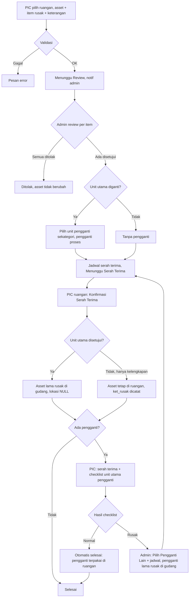
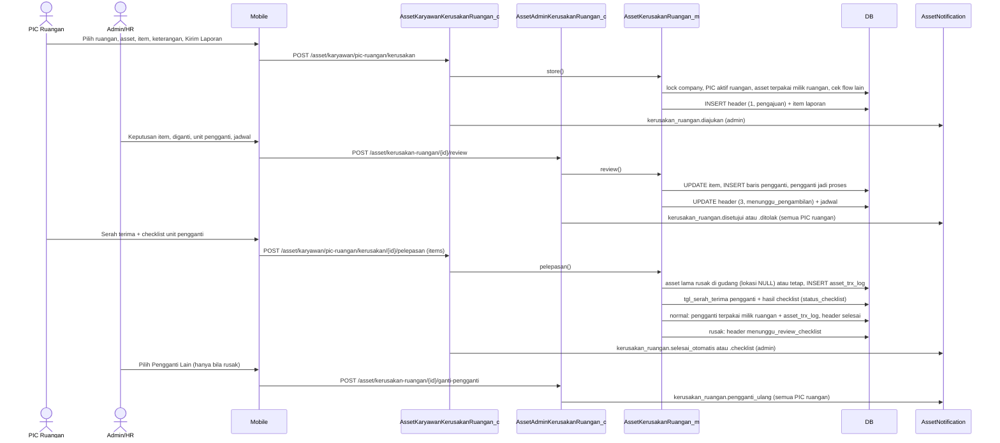
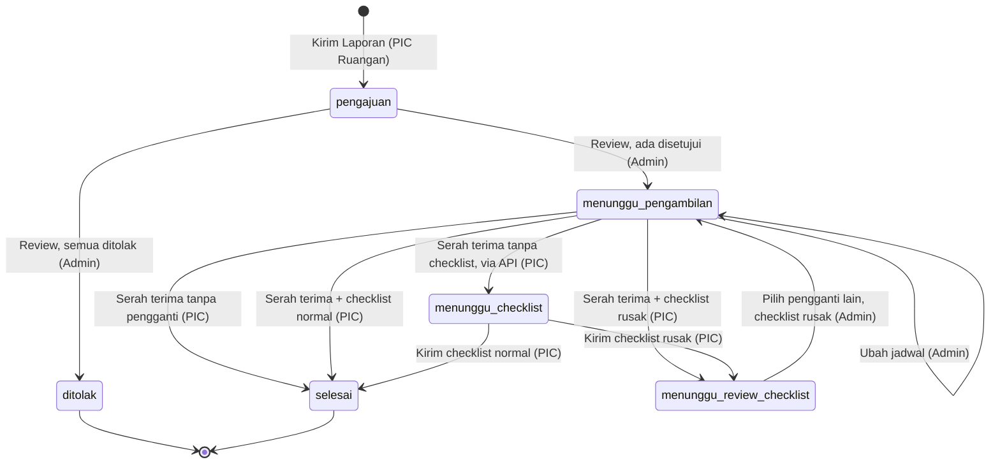
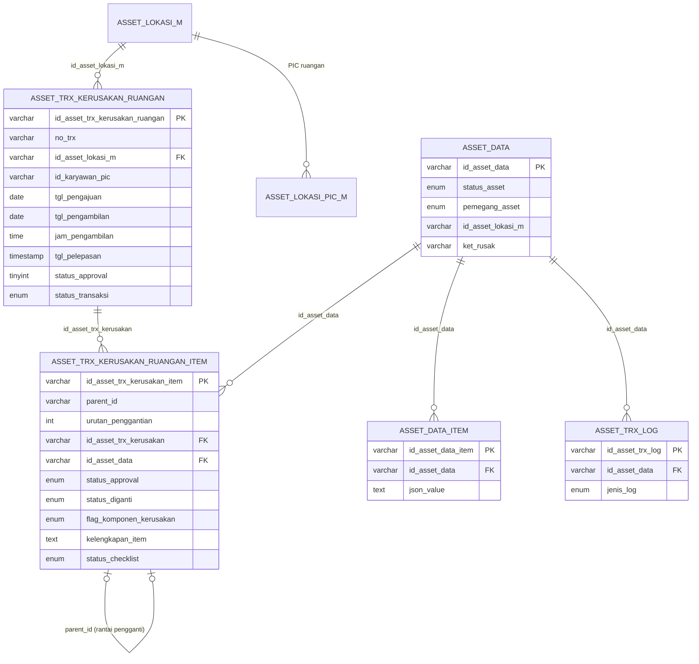

# Dokumentasi Teknis & Manual Book — Kerusakan Asset Ruangan (ALK-RGN05)

> Dokumen ini disusun **dari source code lokal** (`API/` Lumen dan `MOBILE/` Flutter) per 4 November 2026 (v1.0). Alurnya meniru **Laporan Kerusakan Asset Karyawan (KRY06)**; pembeda utamanya, pengaju adalah **PIC Ruangan**, pemegang asset adalah **ruangan**, dan unit pengganti yang lolos checklist akhirnya dipegang **ruangan**, bukan karyawan.
> Business requirement dan kode fitur **diturunkan dari kode**. Bagian yang tidak ditemukan ditandai **⚠️ Belum ditemukan**, asumsi ditandai **⚠️ Asumsi**.
> Contoh ID/nama pada payload adalah **data sintetis**.

---

## 1. Informasi Dokumen

| Informasi | Nilai |
|---|---|
| Nama Fitur | Kerusakan Asset Ruangan (UI PIC: menu **"Kerusakan"** pada halaman **"PIC Ruangan"**, layar **"Kerusakan Asset Ruangan"**, **"Lapor Kerusakan Asset Ruangan"**, **"Detail Kerusakan Asset Ruangan"**; UI Admin: item **"Kerusakan"** di dashboard Ruangan) |
| Kode Fitur | **ALK-RGN05** (nomor transaksi `RGN05-YYYYMMNNN`, unik per company lewat `uq_kerusakan_rgn_company_no_trx`; RGN06 adalah Retur Ruangan dan RGN07 Upgrade Ruangan, bukan fitur ini) |
| Modul | Asset Management — Ruangan |
| Backend | Laravel **Lumen ^10.0**, PHP ^8.1, JWT, Query Builder |
| Database | `API/diagram-asset.dbml` (tanda `[NEW ALK-RGN05]`) + SQL manual `Claude outputs/sql-alk-rgn05-kerusakan-ruangan.sql` (hanya `ALTER`; kedua tabel sudah ada sebelum RGN05). ⚠️ Belum ditemukan: `CREATE TABLE` kedua tabel di workspace. ⚠️ Asumsi: MariaDB 10.4 (header SQL) |
| Mobile | Flutter (`professional_flutter_3_35`), `flutter_bloc`, `dio` |
| Web | ⚠️ Belum ditemukan: tidak ada source web di workspace |
| Test otomatis | API `tests/Asset/AssetKerusakanRuanganTest.php` (**26 test**, 328 assertion) · Mobile `test/asset/asset_kerusakan_ruangan_test.dart` (**33 test** saat dijalankan; 22 deklarasi `test`/`testWidgets`, sebagian di dalam loop) — total **45 test** mobile bersama `asset_kerusakan_test.dart` (KRY06, 12 test) |
| Versi Dokumen | 1.0 |
| Tanggal Dokumentasi | 2026-11-04 |
| Dokumen terkait | Laporan Kerusakan Asset Karyawan (KRY06), Retur Ruangan (ALK-RGN06), Upgrade Komponen Ruangan (ALK-RGN07), Onboarding Ruangan (ALK-RGN01), Penambahan Ruangan (ALK-RGN04), Master Lokasi & PIC Ruangan |

---

## 2. Daftar Isi

1. Informasi Dokumen · 3. Quick Overview · 4. Ringkasan Fitur · 5. Tujuan · 6. Aktor · 7. Hak Akses · 8. Terminologi · 9. Business Rules · 10. Business Flow · 11. Flow per Role · 12. Flow Diagram · 13. Sequence Diagram · 14. Status Transaksi · 15. State Transition · 16. Struktur Database · 17. Relasi · 18. Data Dictionary · 19. Index · 20. Backend Architecture · 21. Backend Logic · 22. Dampak asset_data · 23. API · 24. Detail API · 25. Mobile Architecture · 26. Mobile Screen · 27. Mobile → API · 28. API → Mobile · 29. Mapping Mobile→API→DB · 30. Mapping DB→API→Mobile · 31. Validation · 32. Error Handling · 33. Audit Trail · 34. Notification · 35. Security · 36. Manual Book · 37. Kondisi Button · 38. Testing · 39. Temuan Ketidaksesuaian · 40. Edge Case · 41. Risk · 42. Dependency · 43. Source Reference · 44. Developer Notes · 45. Traceability · 46. DB Impact · 47. Checklist · 48. Changelog

---

## 3. Quick Overview

| Item | Informasi |
|---|---|
| Feature | Pelaporan kerusakan **satu asset** milik ruangan oleh PIC Ruangan, per komponen (unit utama / kelengkapan) |
| Module | Asset Management — Ruangan |
| Actor | PIC Ruangan (pelapor; **semua PIC aktif ruangan** boleh serah terima dan checklist), Admin/HR Asset (review, jadwal, pengganti), System |
| Main Transaction | `asset_trx_kerusakan_ruangan` |
| Detail Transaction | `asset_trx_kerusakan_ruangan_item` — item laporan (`urutan_penggantian = 0`) + **histori unit pengganti** (`urutan_penggantian ≥ 1`, `parent_id` ke baris sebelumnya) |
| Sumber komponen | `asset_data_item` (`json_value.flag_spesifikasi` 1 = unit utama, 2 = kelengkapan) |
| Asset Master | `asset_data` |
| Log | `asset_trx_log` `jenis_log = kerusakan_ruangan` |
| Status | `status_approval` (int: 1 proses, 2 ditolak, 3 disetujui) + `status_transaksi` (`pengajuan → menunggu_pengambilan → menunggu_checklist → menunggu_review_checklist → selesai`) |
| Keputusan admin | Per item: Setujui/Tolak; item disetujui: **Diganti / Tidak Diganti**; unit utama diganti → pilih **Unit Pengganti** sekategori dari gudang |
| Siklus pengganti | Unit pengganti dicek PIC **saat serah terima (satu langkah)**. Normal → laporan **selesai otomatis** dan pengganti dipegang **ruangan**. Rusak → Admin/HR **Pilih Pengganti Lain** (berulang) |
| Jadwal | Header memakai `tgl_pengambilan` / `jam_pengambilan` (NULL bila belum dijadwalkan); request/response tetap `tgl_serah_terima` / `jam_serah_terima` / `keterangan_serah_terima` |
| API | **13 endpoint** = 7 admin (`/asset/kerusakan-ruangan`) + 6 PIC (`/asset/karyawan/pic-ruangan/kerusakan`) |
| Mobile Screen | PIC: Kerusakan Asset Ruangan (list), Lapor Kerusakan Asset Ruangan (form), Detail. Admin: list & detail. Memakai ulang halaman KRY06 lewat flag `untukRuangan` |

```text
PIC Ruangan: pilih ruangan → pilih 1 asset terpakai di ruangan → Unit Utama ATAU Kelengkapan → centang item + keterangan → Kirim Laporan
                                                  proses(1) / pengajuan · asset TIDAK berubah
Admin/HR: per item Setujui/Tolak (+alasan); disetujui → Diganti / Tidak Diganti
          unit utama diganti → Pilih Unit Pengganti (sekategori, tersedia @gudang) → pengganti = proses
          → Jadwal Serah Terima (tanggal, jam, catatan)
          ├─ semua ditolak ─────────────────────────────────────── ditolak(2) / selesai
          └─ ada disetujui ─────────────────────────────────────── disetujui(3) / menunggu_pengambilan
PIC Ruangan (siapa pun PIC aktif ruangan itu): Konfirmasi Serah Terima
   • unit utama disetujui → asset lama = rusak @gudang, id_asset_lokasi_m = NULL
   • hanya kelengkapan   → asset tetap @ruangan (ket_rusak dicatat)
   ├─ tanpa pengganti ──────────────────────────────────────── selesai
   └─ ada pengganti ────────────────────────────────────────── checklist unit pengganti diisi bersamaan
PIC: Serah Terima & Kirim Checklist Unit Pengganti (Normal/Rusak per unit utama)
   • normal → pengganti = terpakai @ruangan (pemegang_asset='ruangan') ── selesai (otomatis, admin hanya dinotifikasi)
   • ada yang rusak ───────────────────────────────────────────── menunggu_review_checklist
Admin/HR: Pilih Pengganti Lain + jadwal → pengganti lama = rusak @gudang  → menunggu_pengambilan (ulang)
```

### 3.1 Beda utama dengan KRY06

| Aspek | KRY06 (karyawan) | RGN05 (ruangan) |
|---|---|---|
| Pengaju | Karyawan pemegang asset | **PIC Ruangan** (`asset_lokasi_pic_m`, karyawan aktif) |
| Pemegang asset | `pemegang_asset = 'karyawan'` | `pemegang_asset = 'ruangan'`, `id_pemegang_asset` = `id_asset_lokasi_m` = ruangan |
| Pemegang akhir pengganti | Karyawan, `id_asset_lokasi_m = NULL` | **Ruangan**: `pemegang_asset='ruangan'`, `id_pemegang_asset` dan `id_asset_lokasi_m` = ruangan |
| Unit utama yang ditarik | `rusak` @gudang, `id_pemegang_asset = ''` | Sama, ditambah **`id_asset_lokasi_m = NULL`** (lokasi gudang belum ditentukan; keputusan produk menunggu) |
| Kolom jadwal | `tgl_serah_terima`, `jam_serah_terima` (nol `0000-00-00` bila kosong) | **`tgl_pengambilan`, `jam_pengambilan`, `keterangan_pengambilan`** (NULL bila kosong); request/response tetap `*_serah_terima` |
| Hak akses sisi pengaju | Pemilik laporan (`id_karyawan`) | **Semua PIC aktif ruangan** itu, dibaca dari `asset_lokasi_pic_m` saat permintaan (bukan snapshot header) |
| Snapshot | Karyawan | Ruangan, cabang, departemen, PIC (`nama_asset_ruangan`, `nama_cabang`, `nama_departemen`, `id_karyawan_pic`, `nama_pic`, `nik_pic`) |
| Log | `rusak_karyawan` | **`kerusakan_ruangan`** |
| Endpoint | 7 admin + 6 karyawan (`/asset/rusak-karyawan`, `/asset/karyawan/rusak`) | 7 admin + 6 PIC (`/asset/kerusakan-ruangan`, `/asset/karyawan/pic-ruangan/kerusakan`) |
| Checklist pengganti | Hanya unit utama (`komponen` difilter) | Sama: **`pengganti[].komponen` hanya `aset_utama`**; `komponenAssets` menambah baris unit utama sintetis bila asset tak punya, sehingga checklist tidak pernah kosong |
| Blokir antar-flow | Kerusakan lain, retur, upgrade, offboarding, pemeliharaan | Kerusakan ruangan lain, retur, upgrade, onboarding, penambahan ruangan (§9 BR-003) |
| Notifikasi | `kerusakan.*` ke karyawan | `kerusakan_ruangan.*`; penerima PIC = **semua PIC aktif ruangan** (`SEMUA_PIC_RUANGAN`) |
| Rute mobile | `asset_kerusakan`, `asset_tambah_kerusakan`, `asset_detail_kerusakan`, `asset_admin_kerusakan`, `asset_admin_detail_kerusakan` | `asset_pic_ruangan_kerusakan`, `asset_pic_ruangan_tambah_kerusakan`, `asset_pic_ruangan_detail_kerusakan`, `asset_admin_kerusakan_ruangan`, `asset_admin_detail_kerusakan_ruangan` |

---

## 4. Ringkasan Fitur

PIC Ruangan melaporkan kerusakan pada **satu asset** yang sedang terpakai di ruangan yang ia pegang (`status_asset = terpakai`, `pemegang_asset = ruangan`). Laporan bersifat **per komponen**: unit utama dan/atau kelengkapan (misalnya charger, adaptor) yang diambil dari `asset_data_item`. Setiap item wajib diberi keterangan kerusakan. Form PIC meminta **ruangan dipilih dahulu** (otomatis terpilih bila hanya satu), baru asset di ruangan itu.

Admin/HR meninjau setiap item. Untuk item yang disetujui admin menentukan apakah item **diganti**. Hanya **unit utama** yang diganti yang memicu penukaran unit: admin memilih unit pengganti dari gudang dengan **kategori sama**. Kelengkapan yang "diganti" hanya dicatat.

Serah terima dikonfirmasi oleh **salah satu PIC aktif ruangan**. Jika ada unit pengganti, PIC wajib mengecek kondisi unit utama pengganti (checklist) pada saat serah terima yang sama. Bila semua normal, laporan selesai otomatis dan unit pengganti menjadi asset terpakai **milik ruangan**. Bila ada yang rusak, admin memilih unit pengganti lain dan siklus berulang sampai unit pengganti dinyatakan normal — seluruh percobaan tersimpan sebagai histori.

---

## 5. Tujuan Fitur

### 5.1 Tujuan Bisnis (diturunkan dari kode)
- PIC Ruangan dapat melaporkan kerusakan asset ruangan secara terstruktur per komponen.
- Admin/HR memutuskan penarikan dan penggantian unit secara terkontrol.
- Unit pengganti dipastikan dalam kondisi baik sebelum menjadi milik ruangan.
- Riwayat penggantian berulang dapat ditelusuri.

### 5.2 Tujuan Sistem
- Menyimpan laporan per komponen dengan snapshot ruangan, PIC, dan data komponen (JSON).
- Mereservasi unit pengganti (`proses`) hingga lolos checklist.
- Memperbarui `asset_data` dan mencatat `asset_trx_log` pada setiap perpindahan.
- Mencegah asset diproses di laporan kerusakan lain, retur, upgrade, onboarding, atau penambahan ruangan secara bersamaan.

---

## 6. Aktor

| Aktor | Role | Fungsi |
|---|---|---|
| PIC Ruangan | Karyawan aktif yang terdaftar di `asset_lokasi_pic_m` untuk ruangan | Melapor, serah terima, checklist unit pengganti. Satu ruangan boleh punya banyak PIC; semua PIC aktif berhak bertindak dan dinotifikasi |
| Admin/HR Asset | `asset_admin` + karyawan aktif | Review, jadwal, pilih/ganti unit pengganti |
| System | Backend + FCM | Validasi, lock, penomoran, update asset, log, notifikasi |

---

## 7. Hak Akses

| Action | Admin/HR Asset | PIC Ruangan | Keterangan |
|---|:---:|:---:|---|
| Melihat semua laporan | ✅ | ❌ | `/asset/kerusakan-ruangan`; `accessError` memeriksa admin, selain admin `FORBIDDEN` |
| Melihat laporan ruangannya | – | ✅ | `wherePic`: PIC **saat ini** di `asset_lokasi_pic_m`, bukan snapshot `id_karyawan_pic`. Detail ruangan lain: `NOT_FOUND` (404) |
| Melapor kerusakan | – | ✅ | Karyawan aktif, PIC ruangan aktif, asset ruangan itu, `terpakai` |
| Edit / batalkan laporan | ❌ | ❌ | ⚠️ Belum ditemukan (RISK-012) |
| Review (setujui/tolak, diganti, pengganti, jadwal) | ✅ | ❌ | `status_approval = 1` |
| Ubah jadwal | ✅ | ❌ | `menunggu_pengambilan` |
| Konfirmasi serah terima | ❌ | ✅ | `menunggu_pengambilan`; **PIC mana pun** pada ruangan itu, bukan hanya pengaju |
| Checklist unit pengganti | ❌ | ✅ | `menunggu_pengambilan` (bersama serah terima) atau `menunggu_checklist` (alur terpisah via API) |
| Selesaikan laporan | ✅ (terdaftar) | ❌ | Endpoint ada tetapi praktis tak tercapai: syaratnya `menunggu_review_checklist` + checklist `normal`, padahal checklist normal sudah selesai otomatis (RISK-004) |
| Pilih pengganti lain | ✅ | ❌ | `menunggu_review_checklist` + checklist rusak |

---

## 8. Terminologi

| Istilah | Arti di sistem |
|---|---|
| Unit Utama (`aset_utama`) | Komponen `asset_data_item` dengan `flag_spesifikasi = 1`; bila asset tak punya, `komponenAssets` menambahkan baris sintetis dengan `id_item = id_asset_data` |
| Kelengkapan (`kelengkapan`) | Komponen dengan `flag_spesifikasi = 2` |
| Item laporan | Baris item `urutan_penggantian = 0` |
| Unit pengganti | Baris item `urutan_penggantian ≥ 1`; `parent_id` = baris sebelumnya |
| `status_diganti` | '1' diganti, '0' tidak diganti (diisi saat disetujui) |
| Pelepasan / Serah terima | PIC menyerahkan item rusak (dan menerima pengganti) — `tgl_pelepasan`, `user_pelepasan` |
| Checklist | Pemeriksaan kondisi **unit utama** unit pengganti oleh PIC (kelengkapan tidak dicek) |
| Unit ditarik | Minimal satu **unit utama** disetujui → asset lama ditarik ke gudang saat serah terima |
| `SEMUA_PIC_RUANGAN` | Jenis penerima notifikasi: semua PIC aktif ruangan transaksi |
| Snapshot PIC | `id_karyawan_pic`, `nama_pic`, `nik_pic` di header = PIC **pengaju** saat laporan dibuat; dasar tampilan, bukan hak akses |

---

## 9. Business Rules

### BR-001 — Ruangan dan PIC pengaju
`ruanganAktif()`: lokasi `tipe = 'ruangan'`, `status_aktif = '1'`, ada baris `asset_lokasi_pic_m` untuk karyawan login, dan karyawan itu berstatus aktif (`STATUS_KARYAWAN_AKTIF` = 1–4). Pesan: "Ruangan tidak ditemukan, tidak aktif, atau Anda bukan PIC ruangan ini." / "Karyawan tidak ditemukan atau tidak aktif."

### BR-002 — Asset yang boleh dilaporkan
Milik ruangan itu (`pemegang_asset = ruangan`, `id_asset_lokasi_m` = ruangan) dan `status_asset = terpakai` → "Asset bukan milik ruangan atau tidak ditemukan." / "Hanya asset berstatus terpakai yang dapat dilaporkan rusak."

### BR-003 — Asset tidak sedang di flow lain (`assetBlockMessage`)
Dicek saat opsi dan simpan. Pesan saat melapor: "Asset sedang diproses pada laporan kerusakan lain." / "…pada retur." / "…pada upgrade." / "…pada onboarding ruangan." / "…pada penambahan asset ruangan." Arah sebaliknya: Retur Ruangan menolak asset yang ada di kerusakan ruangan aktif ("Satu atau beberapa asset sedang diproses pada laporan kerusakan ruangan.") dan Upgrade Ruangan menolak ("Asset sedang diproses pada laporan kerusakan."); opsi form retur/upgrade menyaring asset itu lewat `lockedAssetIds`. Aktif = header bukan `ditolak` dan `status_transaksi ≠ selesai`, termasuk **unit pengganti yang sedang direservasi**. Onboarding dan Penambahan Ruangan tidak mengecek kerusakan ruangan (⚠️ Belum ditemukan referensi di model keduanya; sumber asset mereka adalah gudang `tersedia`, sehingga unit pengganti `proses` tidak ikut terpilih).

### BR-004 — Item laporan
Minimal 1; setiap `id_item` harus komponen asset tersebut; tanpa duplikat; keterangan wajib → "Minimal satu item rusak wajib dipilih." / "Item rusak harus berupa unit utama atau kelengkapan asset." / "Item yang sama tidak boleh dipilih lebih dari sekali." / "Keterangan kerusakan setiap item wajib diisi." Snapshot komponen disimpan di `kelengkapan_item` (JSON). Mobile membatasi satu jenis per laporan; backend menerima campuran (INC-01).

### BR-005 — Laporan tidak mengubah asset
Saat laporan dikirim, `asset_data` tetap `terpakai` @ruangan.

### BR-006 — Review seluruh item
Semua item wajib diputuskan → "Seluruh item kerusakan wajib direview."; tolak wajib alasan; disetujui wajib `status_diganti` 0/1. Asset harus masih dipegang ruangan transaksi → "Asset sudah tidak dipegang oleh ruangan."

### BR-007 — Unit pengganti
Hanya bila ada **unit utama** disetujui dan diganti (pengganti induk = item unit utama pertama yang diganti). Pengganti wajib dipilih, belum pernah dipakai di laporan ini, `tersedia` @gudang, **kategori sama** dengan asset rusak → "Asset pengganti wajib dipilih." / "Asset pengganti hanya dipilih jika unit utama diganti." / "Asset pengganti sudah pernah dipakai pada laporan ini." / "Aset sudah tidak tersedia. Silakan pilih unit lain." / "Kategori asset pengganti harus sama dengan asset yang rusak." Pengganti → `status_asset = proses`.

### BR-008 — Jadwal serah terima
Wajib bila ada item disetujui (review) dan pada pilih pengganti lain; tanggal ≥ tanggal pengajuan → "Tanggal dan jam serah terima wajib diisi." / "Format jadwal serah terima tidak valid." / "Tanggal serah terima tidak boleh sebelum tanggal pengajuan." Disimpan di `tgl_pengambilan`, `jam_pengambilan`, `keterangan_pengambilan`, `flag_jadwalkan = '1'`. Satu jadwal untuk pengambilan item rusak **dan** kedatangan pengganti (docblock: "SOP: hari yang sama").

### BR-009 — Hasil review
Semua ditolak → `status_approval = 2`, `selesai` (asset tidak berubah; jadwal tidak dibaca, `flag_jadwalkan = '0'`). Ada disetujui → `3`, `menunggu_pengambilan`.

### BR-010 — Serah terima pertama (PIC)
- Unit utama disetujui (diganti atau tidak) → asset lama `rusak`, `pemegang_asset = gudang`, `id_pemegang_asset = ''`, **`id_asset_lokasi_m = NULL`** (komentar kode: "lokasi gudang diatur admin").
- Hanya kelengkapan disetujui → asset **tetap** dipegang ruangan (status dan lokasi tetap), hanya `ket_rusak` diisi.
- `ket_rusak` asset = ringkasan "nama: keterangan; …" (maks 255).
- Log `kerusakan_ruangan`. Ada pengganti → `tgl_serah_terima` pengganti + checklist (BR-012) pada langkah yang sama; tanpa pengganti → `selesai`.
- Pelaku dicatat di `user_pelepasan` (PIC yang menekan, bisa bukan pengaju).

### BR-011 — Serah terima pengganti berikutnya
Bila `tgl_pelepasan` sudah terisi, konfirmasi serah terima hanya mencatat penerimaan pengganti terbaru → "Tidak ada unit pengganti yang perlu diserahterimakan." bila tidak ada.

### BR-012 — Checklist pengganti (PIC)
Dikirim bersama serah terima (`items` opsional pada `pelepasan`) atau lewat endpoint checklist (`menunggu_checklist`). **Hanya unit utama** pengganti yang wajib dicek (kelengkapan difilter di server dan di mobile); `komponenAssets` menjamin ada satu baris unit utama. Kondisi normal/rusak; rusak wajib keterangan → "Seluruh item unit pengganti wajib dicek." Hasil disimpan sebagai JSON di `kelengkapan_item`; `status_checklist = rusak` bila ada satu saja rusak. Normal → laporan `selesai` otomatis (pengganti `terpakai`, **pemegang ruangan**, + log). Rusak → `menunggu_review_checklist`. Checklist tidak lengkap membatalkan seluruh serah terima. `items` tanpa unit pengganti → "Tidak ada unit pengganti yang perlu dicek."

### BR-013 — Keputusan setelah checklist (admin)
- Checklist `normal` → selesai otomatis; endpoint **Selesaikan Laporan** praktis tak tercapai (RISK-004).
- Checklist `rusak` → **Pilih Pengganti Lain**: pengganti lama `rusak` @gudang (+`ket_rusak`) + log; baris pengganti baru (`urutan + 1`); jadwal baru → `menunggu_pengambilan`.
- Tombol salah → "Unit pengganti masih memiliki item rusak. Pilih unit pengganti lain." / "Seluruh item unit pengganti normal. Selesaikan laporan." Belum ada checklist → "Checklist unit pengganti belum dikirim PIC." Pengganti harus masih `proses` @gudang → "Status asset pengganti sudah berubah."

### BR-014 — Hak akses PIC mengikuti PIC ruangan saat ini
`wherePic` menguji `asset_lokasi_pic_m` pada saat permintaan. Semua PIC ruangan itu dapat melihat, serah terima, dan checklist; PIC ruangan lain mendapat 404 (baca) atau "Laporan kerusakan tidak ditemukan." (mutasi). Aksi PIC tetap mensyaratkan karyawan aktif (`actorPic`).

### BR-015 — Penomoran
Header & item `id_company + YYYYMM + 3 digit`; `no_trx = RGN05-YYYYMMNNN`; log dan notifikasi 5 digit.

### BR-016 — Pemegang akhir unit pengganti
Setelah checklist normal: `status_asset = terpakai`, `pemegang_asset = ruangan`, `id_pemegang_asset = id_asset_lokasi_m = ruangan transaksi`; log `gudang → ruangan` dengan `nama_pemegang` = nama ruangan snapshot.

---

## 10. Business Flow

```text
1. PIC Ruangan: Asset Saya → tab Ruangan → Kerusakan → (+) Lapor Kerusakan Asset Ruangan
   → Pilih Ruangan → Pilih Asset yang Rusak → Unit Utama / Kelengkapan → centang item + Keterangan Kerusakan
   → Atribut Lainnya / Keterangan Umum → Kirim Laporan                [Menunggu Review · notif admin]
2. Admin/HR: Ruangan → Kerusakan → Detail
   → per item Setujui/Tolak; disetujui: Diganti / Tidak Diganti
   → (unit utama diganti) Pilih Unit Pengganti
   → Simpan Review → Jadwal Serah Terima                               [Menunggu Serah Terima / Ditolak · notif semua PIC ruangan]
3. PIC Ruangan (PIC mana pun): serahkan item rusak, terima pengganti, isi Checklist Unit Pengganti → Serah Terima & Kirim Checklist
                                                                      [Selesai bila normal / Menunggu Review Checklist bila rusak · notif admin]
4. Admin/HR (hanya bila checklist rusak): Pilih Pengganti Lain + jadwal → kembali ke langkah 3 [notif semua PIC ruangan]
```

---

## 11. Flow Berdasarkan Role

### 11.1 PIC Ruangan
1. **Asset Saya** → tab **Ruangan** → menu **Kerusakan** → **Kerusakan Asset Ruangan** → tombol **Lapor Kerusakan**.
2. Banner di Asset Saya: **Serah Terima Asset Rusak** ("{no_trx} · {ruangan} · {asset}: serahkan item rusak sesuai jadwal, lalu konfirmasi.") dan **Checklist Unit Pengganti** ("{no_trx} · {ruangan} · Cek kondisi unit pengganti untuk {asset}.").
3. Detail → **Serah Terima & Kirim Checklist** (bila ada unit pengganti) atau **Konfirmasi Serah Terima**.

### 11.2 Admin/HR Asset
1. Dashboard **Ruangan** → item **Kerusakan**, atau panel **Kerusakan Ruangan Perlu Diproses** (laporan baru + checklist yang perlu direview).
2. Detail → review → **Simpan Review**; **Ubah Jadwal**; **Pilih Pengganti Lain**.

### 11.3 System
Deteksi komponen, cek flow lain, reservasi pengganti, update asset & log, notifikasi ke semua PIC aktif ruangan.

---

## 12. Flow Diagram



---

## 13. Sequence Diagram



---

## 14. Status Transaksi

Dua kolom: `status_approval` (tinyint, konstanta `Asset_m`) dan `status_transaksi` (enum `status_transaksi_kerusakan_ruangan`). Label dan tab diturunkan oleh `AssetRusakKaryawan_m::rusakStatusMetadata` (public, dipakai bersama KRY06; **hanya bahasa Indonesia**, INC-07).

| status_approval | status_transaksi | Label API | Tab | Arti | Aksi berikutnya |
|---|---|---|---|---|---|
| 1 (proses) | pengajuan | Menunggu Review | pengajuan | Menunggu admin | Admin: review |
| 2 (ditolak) | selesai | Ditolak | selesai | Semua item ditolak | – |
| 3 (disetujui) | menunggu_pengambilan | Menunggu Serah Terima | proses | Menunggu serah terima | PIC: serah terima; Admin: ubah jadwal |
| 3 | menunggu_checklist | Menunggu Checklist | proses | Pengganti sudah diterima tanpa checklist (hanya via API langsung) | PIC: checklist |
| 3 | menunggu_review_checklist | Menunggu Review Checklist | proses | Checklist rusak terkirim | Admin: pilih pengganti lain |
| 3 | selesai | Selesai | selesai | Laporan tuntas | – |

Status item: laporan `status_approval` NULL → `disetujui`/`ditolak`; pengganti `status_checklist` `belum_dicek` → `normal`/`rusak`.

Detail API juga mengembalikan objek `aksi` (review, ubah_jadwal, pelepasan, checklist, pelepasan_checklist, selesai, ganti_pengganti) sebagai penentu tombol. Filter list: `pengajuan` = approval 1; `proses` = approval 3 dan bukan `selesai`; `selesai` = `status_transaksi = selesai` (termasuk Ditolak).

---

## 15. State Transition



Transisi `menunggu_review_checklist → selesai` lewat `POST …/selesai` ada di kode tetapi tidak tercapai (checklist normal tidak pernah berhenti di sana; RISK-004).

Status `asset_data`:

| Asset | Dari | Ke | Trigger |
|---|---|---|---|
| Asset dilaporkan | terpakai @ruangan | tidak berubah | Lapor, review |
| Asset dilaporkan (unit utama disetujui) | terpakai @ruangan | rusak @gudang, `id_asset_lokasi_m = NULL` | Serah terima pertama |
| Asset dilaporkan (hanya kelengkapan) | terpakai @ruangan | tetap, `ket_rusak` diisi | Serah terima pertama |
| Unit pengganti | tersedia @gudang | proses @gudang | Review / pilih pengganti lain |
| Unit pengganti (checklist normal) | proses @gudang | terpakai @ruangan (`id_pemegang_asset` = `id_asset_lokasi_m` = ruangan) | Checklist normal (otomatis) |
| Unit pengganti (checklist rusak) | proses @gudang | rusak @gudang | Pilih pengganti lain |

---

## 16. Struktur Database

| Table | Type | Fungsi |
|---|---|---|
| `asset_trx_kerusakan_ruangan` | Transaction Header | Laporan, snapshot ruangan/PIC, jadwal, status, pelepasan |
| `asset_trx_kerusakan_ruangan_item` | Transaction Detail | Item laporan + histori unit pengganti + hasil checklist |
| `asset_data` | Master | Status, pemegang, dan lokasi asset |
| `asset_data_item` | Master komponen | Unit utama / kelengkapan (`json_value`) |
| `asset_kategori_m` | Master | Kategori (syarat pengganti) |
| `asset_lokasi_m` | Master | Ruangan (`tipe='ruangan'`, `status_aktif='1'`) |
| `asset_lokasi_pic_m` | Master | PIC ruangan; dasar hak akses dan penerima notifikasi |
| `asset_trx_log` | Log | `jenis_log = kerusakan_ruangan` (sudah ada di enum) |
| `data_karyawan`, `master_cabang`, `master_departemen` | Master HR | Karyawan/PIC, cabang, departemen |
| `asset_admin`, `master_company` | Akses / lock | |
| `notif_data`, `users` | Notifikasi | |

> **Skema dibuat lewat `ALTER`**, bukan `CREATE`: SQL `sql-alk-rgn05-kerusakan-ruangan.sql` mengubah dua tabel yang sudah ada sebelum RGN05 (komentar SQL: "Tabel ini belum dipakai kode sebelum RGN05"; guard mensyaratkan keduanya kosong). Blok SQL: (0) guard `SELECT`, (1) header, (2) item, (3) verifikasi `SHOW CREATE TABLE`, lalu rollback opsional.
>
> **Status eksekusi:** SQL dijalankan pengguna (pernyataan pengguna). ⚠️ Hasil di database nyata **belum diverifikasi**; seluruh test API memakai SQLite (`KerusakanRuanganSchema`). Blok 1–2 memakai `AFTER` pada kolom yang bergantung struktur nyata (`id_asset_lokasi_pic_m`, `jam_pengambilan`, `status_approval`, `parent_id`, `kelengkapan_item`) dan `DROP COLUMN status_item`; SQL meminta `SHOW CREATE TABLE` dicocokkan dengan DBML lebih dulu (RISK-001).
>
> ⚠️ Belum ditemukan: `CREATE TABLE` asal kedua tabel di workspace (DBML adalah satu-satunya definisi).

Enum baru di DBML: `status_transaksi_kerusakan_ruangan` (`pengajuan`, `menunggu_pengambilan`, `menunggu_checklist`, `menunggu_review_checklist`, `selesai`; sama dengan KRY06). Enum bersama: `kondisi_on_off`, `approval_item`, `kondisi_awal` (`normal`, `rusak`, `belum_dicek`), dan `jenis_log` yang memuat `kerusakan_ruangan`.

---

## 17. Relasi Database



PIC pada header disimpan sebagai snapshot pengaju (`id_karyawan_pic`, `nama_pic`, `nik_pic`); hak akses dan penerima notifikasi dibaca dari `asset_lokasi_pic_m` saat itu juga.

---

## 18. Data Dictionary

### 18.1 asset_trx_kerusakan_ruangan
| Field | Type | Null | Default | Key | Description |
|---|---|:---:|---|---|---|
| id_asset_trx_kerusakan_ruangan | varchar(50) | No | – | PK | `id_company + YYYYMM + 3 digit` |
| no_trx | varchar(50) | No | '' | UQ | `RGN05-YYYYMMNNN`; unik per company (`uq_kerusakan_rgn_company_no_trx`) |
| id_asset_lokasi_m | varchar(50) | – | – | FK, IDX | Ruangan (→ `asset_lokasi_m`) |
| nama_asset_ruangan, nama_cabang, nama_departemen | varchar(255) | – | – | – | Snapshot saat laporan dibuat |
| id_asset_lokasi_pic_m | varchar(50) | – | – | FK | Ada di DBML, **tidak diisi** oleh `store()` (INC-10) |
| id_karyawan_pic | varchar(150) | No | '' | IDX | **[RGN05]** PIC pengaju; ditambah SQL |
| nama_pic, nik_pic | varchar(255) | – | – | – | Snapshot PIC pengaju |
| keterangan | text | Yes | – | – | Atribut Lainnya / Keterangan Umum (maks 1000 di API) |
| ket_tolak | varchar(255) | – | '' | – | Terkait approval (tidak diisi di header oleh kode RGN05; alasan tolak disimpan per item) |
| id_karyawan, nik_karyawan, nama_karyawan | varchar | – | '' | – | Pembuat transaksi (PIC pengaju) |
| tgl_pengajuan | date | No | CURRENT_DATE | – | |
| tgl_pengambilan / jam_pengambilan | date / time | Yes | **NULL** | – | **[RGN05]** Jadwal serah terima; NULL bila belum dijadwalkan (bukan `0000-00-00`) |
| flag_jadwalkan | kondisi_on_off ('0'/'1') | No | '0' | – | **[RGN05]** '1' bila jadwal diisi |
| keterangan_pengambilan | varchar(255) | – | '' | – | Catatan jadwal terakhir |
| status_approval | tinyint(1) | No | 1 | IDX | 1 proses, 2 ditolak, 3 disetujui |
| tgl_pelepasan | timestamp | Yes | NULL | – | **[RGN05]** Serah terima pertama |
| user_pelepasan | varchar(255) | No | '' | – | **[RGN05]** `nik - nama` PIC yang menekan serah terima |
| status_transaksi | enum(pengajuan, menunggu_pengambilan, menunggu_checklist, menunggu_review_checklist, selesai) | No | pengajuan | IDX | **[RGN05]** Progres |
| user_approval / tgl_approval | varchar / timestamp | – | '' / NULL | – | Admin peninjau |
| id_company, tgl_input, user_input, tgl_update, user_update | – | – | – | IDX | Audit |

### 18.2 asset_trx_kerusakan_ruangan_item
| Field | Type | Default | Description |
|---|---|---|---|
| id_asset_trx_kerusakan_item | varchar(50) PK | – | `id_company + YYYYMM + 3 digit` |
| parent_id | varchar(50) | NULL | Item laporan: NULL; pengganti: baris sebelumnya |
| urutan_penggantian | int(3) | 0 | **[RGN05]** 0 = item laporan; 1, 2, … = pengganti ke-n |
| id_asset_trx_kerusakan | varchar(50) | – | → header (nama kolom FK ini tidak mengikuti nama PK header) |
| id_asset_data | varchar(50) | – | Asset dilaporkan / unit pengganti |
| nama_asset, deskripsi_asset, kategori_asset | varchar(255) | '' | Snapshot |
| status_approval | enum(disetujui, ditolak) | NULL | Keputusan admin (pengganti langsung `disetujui`) |
| ket_tolak | varchar(255) | '' | **[RGN05]** Alasan penolakan |
| status_diganti | '0'/'1' | '0' | **[RGN05]** Diganti atau tidak |
| flag_komponen_kerusakan | '0'/'1' | '0' | 0 unit utama, 1 kelengkapan |
| kelengkapan_item | text (JSON) | '' | Item laporan: `{id_item, nama_item, jenis, detail}`; pengganti: array hasil checklist `[{id_item, nama_item, jenis, kondisi, ket_rusak}]` |
| status_checklist | enum(normal, rusak, belum_dicek) | NULL | **[RGN05]** Hanya baris pengganti; menggantikan kolom `status_item` yang di-DROP |
| tgl_serah_terima | timestamp | NULL | **[RGN05]** Pengganti diterima PIC |
| tgl_checklist | timestamp | NULL | **[RGN05]** Checklist dikirim |
| ket_rusak | varchar(255) | '' | Keterangan item / ringkasan hasil checklist rusak |
| id_company, tgl_input, user_input | – | – | – |

### 18.3 asset_trx_log (`jenis_log = kerusakan_ruangan`)
| Kejadian | kondisi awal → akhir | posisi | id_pemegang / nama_pemegang |
|---|---|---|---|
| Serah terima, unit utama | kondisi_awal → rusak | ruangan → gudang | `''` / `''` |
| Serah terima, hanya kelengkapan | kondisi_awal → rusak | ruangan → ruangan | id ruangan / nama ruangan |
| Checklist normal (otomatis selesai) | kondisi_awal → normal | gudang → ruangan | id ruangan / nama ruangan |
| Pilih pengganti lain (pengganti rusak) | kondisi_awal → rusak | gudang → gudang | `''` / `''` |

`LOG_TRANSAKSI_TABLES` (`AssetAdmin_m`) memuat `asset_trx_kerusakan_ruangan` sehingga riwayat log asset menampilkan `no_trx` RGN05.

---

## 19. Database Index

| Index | Table | Columns | Tujuan |
|---|---|---|---|
| `uq_kerusakan_rgn_company_no_trx` (unik) | header | (id_company, no_trx) | Nomor transaksi unik per company |
| `atkr_admin_list_idx` | header | (id_company, status_approval, status_transaksi, tgl_input, id_asset_trx_kerusakan_ruangan) | List admin |
| `atkr_pic_list_idx` | header | (id_company, id_karyawan_pic, status_approval, status_transaksi) | List PIC (catatan: kueri PIC memakai `asset_lokasi_pic_m`, bukan kolom ini) |
| `atkr_lokasi_idx` | header | (id_company, id_asset_lokasi_m, status_approval, status_transaksi) | Pencarian per ruangan |
| `atkri_status_idx` | item | (id_asset_trx_kerusakan, id_company, urutan_penggantian, id_asset_data) | Item per laporan & cek asset aktif |

---

## 20. Backend Architecture

```text
RouteAsset.php (prefix /asset, jwt.api + jwt.ctx)
   ↓
AssetAdminKerusakanRuangan_c (validateRequest → mutateAssetTrx: accessError + notifikasi)
AssetKaryawanKerusakanRuangan_c (validateRequest → store / mutateTrxSaya)
   ↓
AssetKerusakanRuangan_m ← Asset_m (lockCompany, nextSequence, komponenAssets, parseJadwalValue,
   ↓                                insertAssetLog, getLockedAssets, findActiveKaryawan, findAssetAdmin)
   ↓   ↔ AssetReturRuangan_m / AssetUpgradeRuangan_m (cek flow lain, dua arah) · AssetRusakKaryawan_m (rusakStatusMetadata)
DB::transaction (retry 3) → ApiResponse + AssetNotification
```

| Layer | File/Class | Function |
|---|---|---|
| Controller Admin | `AssetAdminKerusakanRuangan_c` | getKerusakanRuangan, getDetailKerusakanRuangan, getKerusakanPenggantiOptions, reviewKerusakanRuangan, updateJadwalKerusakanRuangan, selesaiKerusakanRuangan, gantiPenggantiKerusakanRuangan |
| Controller PIC | `AssetKaryawanKerusakanRuangan_c` | getKerusakanRuanganOptions, getKerusakanRuanganSaya, storeKerusakanRuangan, getDetailKerusakanRuanganSaya, pelepasanKerusakanRuangan, checklistKerusakanRuangan |
| Model | `AssetKerusakanRuangan_m` | getOptions, getPage, getDetail, getPenggantiOptions, store, review, updateJadwal, pelepasan, submitChecklist, selesai, gantiPengganti, getPendingForPic, getPendingForAdmin, countPendingForAdmin, hasActiveKerusakanRuanganAsset, activeKerusakanRuanganQuery + helper |
| Support | `AssetNotification` | `kerusakan_ruangan.*` (9 event) |

**Perubahan pada modul lain**

| Modul | Perubahan |
|---|---|
| `AssetReturRuangan_m` | `store` menolak asset yang ada di kerusakan ruangan aktif; `lockedAssetIds` ikut menyaring aset itu dari opsi retur |
| `AssetUpgradeRuangan_m` | `assetBlockMessage` dan `lockedAssetIds` mengenali kerusakan ruangan aktif |
| `AssetAdmin_m` | `getSummary` menambah `ruangan_kerusakan_perlu_proses` (jumlah) dan `ruangan_kerusakan_pending` (daftar terlama, default 3); `LOG_TRANSAKSI_TABLES` memuat `asset_trx_kerusakan_ruangan` |
| `AssetLokasiPic_m` | `getAssetRuanganSaya` (beranda PIC) menambah key `kerusakan_ruangan` (aksi `pelepasan` atau `checklist`) |
| `AssetRusakKaryawan_m` | `rusakStatusMetadata` dijadikan `public` agar dipakai bersama |
| `AssetNotification` | 9 event `kerusakan_ruangan.*` dan konstanta tabel `KERUSAKAN_RUANGAN` |
| `RouteAsset.php` | Grup `kerusakan-ruangan` (admin) dan `kerusakan` di dalam `pic-ruangan` (PIC) |
| Skema | Perubahan kolom pada dua tabel + (sudah ada) nilai enum `kerusakan_ruangan` pada `asset_trx_log.jenis_log` |

---

## 21. Backend Business Logic

### 21.1 Lapor — `store`
Lock → karyawan aktif → ruangan milik PIC (`findRuanganPic`) → asset ruangan itu `FOR UPDATE`, `terpakai` → `assetBlockMessage` → `komponenAssets` → `normalizeReportItems` → ID + `RGN05-…` → INSERT header (1, `pengajuan`, `flag_jadwalkan = '0'`, jadwal NULL, snapshot ruangan/PIC) → INSERT item (`urutan 0`, snapshot JSON, `flag_komponen_kerusakan`) → notifikasi `kerusakan_ruangan.diajukan`.

### 21.2 Review — `review`
Admin → header `status_approval = 1` → item laporan (FOR UPDATE) → semua diputuskan → validasi keputusan → asset masih dipegang ruangan → jadwal (bila ada disetujui) → pengganti (bila unit utama diganti; `lockReplacementCandidate`) → UPDATE item → `insertReplacement` (urutan 1, pengganti `proses`) → UPDATE header (2/selesai atau 3/menunggu_pengambilan + jadwal) → notifikasi. Response +`jumlah_disetujui`, `jumlah_ditolak`, `perlu_pengganti`.

### 21.3 Ubah jadwal — `updateJadwal`
Status `menunggu_pengambilan` → "Jadwal hanya dapat diubah sebelum serah terima dilakukan." → update jadwal → `kerusakan_ruangan.dijadwalkan`.

### 21.4 Serah terima — `pelepasan` (PIC)
Karyawan aktif, header pada ruangan yang PIC-nya karyawan itu (`lockHeader` + `wherePic`), `menunggu_pengambilan` → pengganti terbaru yang belum diterima → bila `tgl_pelepasan` kosong: `releaseOriginalAsset` → set `tgl_serah_terima` pengganti → bila `items` dikirim: `applyChecklist`, normal → `completeReplacement`, rusak → `menunggu_review_checklist`; tanpa `items`: `menunggu_checklist` atau `selesai` bila tanpa pengganti → `tgl/user_pelepasan` (hanya pertama kali) → notifikasi `kerusakan_ruangan.selesai_otomatis` / `.checklist` / `.diserahkan` (dipilih `checklistEvent` dari `status_checklist`). `items` tanpa unit pengganti ditolak; checklist tidak lengkap membatalkan seluruh transaksi.

### 21.5 Checklist — `submitChecklist` (PIC)
`menunggu_checklist` → pengganti terbaru sudah diterima & `belum_dicek` → komponen unit utama pengganti harus lengkap → simpan hasil JSON, `status_checklist`, ringkasan `ket_rusak`, `tgl_checklist` → normal: `completeReplacement`; rusak: header `menunggu_review_checklist` → notifikasi. Response +`status_checklist`.

### 21.6 Selesaikan — `selesai` (admin)
`menunggu_review_checklist` + checklist `normal` → pengganti masih `proses` @gudang → `completeReplacement` → `kerusakan_ruangan.selesai`. Kondisi awal ini tidak pernah terbentuk oleh alur RGN05 (RISK-004).

### 21.7 Pilih pengganti lain — `gantiPengganti` (admin)
`menunggu_review_checklist` + checklist `rusak` → jadwal baru → pengganti baru (sekategori, belum dipakai di laporan) → pengganti lama `rusak` @gudang + log → INSERT baris pengganti (`urutan + 1`, `parent_id` = pengganti lama) → header `menunggu_pengambilan` → `kerusakan_ruangan.pengganti_ulang`. Response +`urutan_penggantian`.

### 21.8 Query baca
- **Opsi PIC** (`getOptions`): `data.ruangan[]` = ruangan aktif yang dipegang PIC (satu baris per ruangan, hanya yang punya asset yang bisa dilaporkan), tiap ruangan berisi `pic` dan `assets[]` (asset `terpakai` ruangan itu yang tidak diblokir flow lain, beserta `items` komponen).
- **Opsi pengganti (admin)**: asset `tersedia` @gudang, kategori sama dengan asset dilaporkan, belum dipakai di laporan ini; `null` (404) bila laporan tak punya item.
- **List**: tab `pengajuan`, `proses`, `selesai`. `jumlah_item` = item laporan. PIC: dibatasi ruangan miliknya; admin: semua + filter `range_tanggal_mulai/selesai` pada `tgl_pengajuan`.
- **Detail**: header, `ruangan`, `pic`, asset, `items`, `pengganti` (histori; `komponen` hanya unit utama dan hanya untuk pengganti terbaru yang belum dicek), `perlu_pengganti`, `unit_ditarik`, `jejak` (pengajuan/review/pelepasan), `aksi`.
- **Pending**: PIC (`getPendingForPic`: `menunggu_pengambilan` → aksi `pelepasan`, `menunggu_checklist` → `checklist`) di beranda PIC; admin (approval 1 atau `menunggu_review_checklist`) di summary, tidak dibatasi ruangan.

---

## 22. Dampak terhadap asset_data

| Field | Sebelum | Sesudah | Trigger |
|---|---|---|---|
| (asset dilaporkan) semua | terpakai @ruangan | tidak berubah | Lapor, review, ubah jadwal |
| status_asset / pemegang_asset / id_pemegang_asset / id_asset_lokasi_m (unit utama disetujui) | terpakai / ruangan / id ruangan / id ruangan | rusak / gudang / `''` / **NULL** | Serah terima pertama |
| ket_rusak (asset dilaporkan) | – | ringkasan item disetujui (≤255) | Serah terima pertama |
| status_asset (pengganti) | tersedia | proses | Review / pilih pengganti lain |
| status_asset / pemegang_asset / id_pemegang_asset / id_asset_lokasi_m (pengganti normal) | proses / gudang / `''` / id gudang | terpakai / **ruangan** / id ruangan / id ruangan | Checklist normal (otomatis) |
| status_asset / pemegang_asset / ket_rusak (pengganti rusak) | proses / gudang / – | rusak / gudang / ringkasan checklist | Pilih pengganti lain |
| tgl_update / user_update | – | now / pelaku | Setiap update |

---

## 23. API Documentation

| ID | Method | Endpoint | Function | Auth |
|---|---|---|---|---|
| API-001 | GET | `/asset/kerusakan-ruangan` | List laporan | Admin |
| API-002 | GET | `/asset/kerusakan-ruangan/{id}` | Detail | Admin |
| API-003 | GET | `/asset/kerusakan-ruangan/{id}/options` | Opsi unit pengganti | Admin |
| API-004 | POST | `/asset/kerusakan-ruangan/{id}/review` | Review | Admin |
| API-005 | PUT | `/asset/kerusakan-ruangan/{id}/jadwal` | Ubah jadwal | Admin |
| API-006 | POST | `/asset/kerusakan-ruangan/{id}/selesai` | Selesaikan (praktis tak tercapai, RISK-004) | Admin |
| API-007 | POST | `/asset/kerusakan-ruangan/{id}/ganti-pengganti` | Pilih pengganti lain (checklist rusak) | Admin |
| API-008 | GET | `/asset/karyawan/pic-ruangan/kerusakan/options` | Ruangan, asset & komponen yang bisa dilaporkan | JWT, PIC |
| API-009 | GET | `/asset/karyawan/pic-ruangan/kerusakan` | List laporan ruangan saya | JWT, PIC |
| API-010 | POST | `/asset/karyawan/pic-ruangan/kerusakan` | Kirim laporan | JWT, PIC |
| API-011 | GET | `/asset/karyawan/pic-ruangan/kerusakan/{id}` | Detail laporan ruangan saya | JWT, PIC ruangan itu |
| API-012 | POST | `/asset/karyawan/pic-ruangan/kerusakan/{id}/pelepasan` | Konfirmasi serah terima (+ checklist opsional) | JWT, PIC ruangan itu |
| API-013 | POST | `/asset/karyawan/pic-ruangan/kerusakan/{id}/checklist` | Checklist unit pengganti | JWT, PIC ruangan itu |

Terkait: `GET /asset/karyawan/pic-ruangan` (beranda PIC, key `kerusakan_ruangan`) dan `GET /asset/summary` (`ruangan_kerusakan_perlu_proses`, `ruangan_kerusakan_pending`). Total **13 endpoint baru** (7 + 6); rute `routes/modules/asset/RouteAsset.php` baris 102–109 dan 284–291.

---

## 24. Detail Setiap API

Header umum: `Authorization: Bearer <token>`, `Content-Type: application/json`, `Accept`, `locale`, `versi-app`. Format `{ code, message, data }`.

### API-008 — Opsi Laporan (PIC)
```http
GET /asset/karyawan/pic-ruangan/kerusakan/options
```
```json
{
  "code": "SUCCESS",
  "message": "Opsi laporan kerusakan asset ruangan berhasil ditemukan.",
  "data": {
    "ruangan": [
      {
        "id_asset_lokasi_m": "RGN0005",
        "nama_ruangan": "Ruang Finance Lt.2",
        "cabang": "Kantor Pusat",
        "divisi": "Finance",
        "pic": {"id_karyawan": "KRY0031", "nik": "EMP-031", "nama": "Budi Contoh"},
        "assets": [
          {
            "id_asset_data": "CMP00120260100012",
            "kode_asset": "LPT-0012",
            "nama_asset": "Laptop 14 inch",
            "kategori_asset": "Laptop",
            "merek": "MerekX",
            "deskripsi": "",
            "status_asset": "terpakai",
            "items": [
              {"id_item": "CMP001ITEM0101", "nama_item": "Laptop 14 inch", "jenis": "aset_utama", "detail": "RAM: 16 GB, SSD: 512 GB"},
              {"id_item": "CMP001ITEM0102", "nama_item": "Charger", "jenis": "kelengkapan", "detail": "Daya: 65 W"}
            ]
          }
        ]
      }
    ]
  }
}
```
Bila PIC tidak memegang ruangan aktif, `data = {"ruangan": []}`.

### API-010 — Kirim Laporan
```http
POST /asset/karyawan/pic-ruangan/kerusakan
```
```json
{
  "id_asset_lokasi_m": "RGN0005",
  "id_asset_data": "CMP00120260100012",
  "keterangan": "Terjadi setelah update sistem",
  "items": [
    {"id_item": "CMP001ITEM0101", "ket_rusak": "Layar bergaris"}
  ]
}
```
| Field | Rule | Message |
|---|---|---|
| id_asset_lokasi_m | required\|string\|max:50 | Ruangan wajib dipilih. |
| id_asset_data | required\|string\|max:50 | Asset wajib dipilih. |
| keterangan | nullable\|string\|max:1000 | – |
| items | required\|array\|min:1 | Minimal satu item rusak wajib dipilih. |
| items.*.id_item | required\|string\|max:50\|distinct | Item yang sama tidak boleh dipilih lebih dari sekali. |
| items.*.ket_rusak | required\|string\|max:255 | Keterangan kerusakan setiap item wajib diisi. / Keterangan kerusakan maksimal 255 karakter. |

Pesan umum: "Data laporan kerusakan belum lengkap." Database impact: INSERT header, INSERT item, INSERT notif (asset tidak berubah).
```json
{ "code": "CREATED", "message": "Laporan kerusakan asset ruangan berhasil dikirim.",
  "data": { "id": "CMP001202611001", "no_trx": "RGN05-202611001", "status_approval": 1,
            "status_transaksi": "pengajuan", "status_label": "Menunggu Review", "tab": "pengajuan" } }
```
422: "Karyawan tidak ditemukan atau tidak aktif.", "Ruangan tidak ditemukan, tidak aktif, atau Anda bukan PIC ruangan ini.", "Asset bukan milik ruangan atau tidak ditemukan.", "Hanya asset berstatus terpakai yang dapat dilaporkan rusak.", "Asset sedang diproses pada laporan kerusakan lain." / "…retur." / "…upgrade." / "…onboarding ruangan." / "…penambahan asset ruangan.", "Item rusak harus berupa unit utama atau kelengkapan asset." 500: "Terjadi kesalahan saat menyimpan laporan kerusakan."

### API-001 / API-009 — List
```http
GET /asset/kerusakan-ruangan?tab=proses&limit=20&offset=0&range_tanggal_mulai=2026-11-01&range_tanggal_selesai=2026-11-30
GET /asset/karyawan/pic-ruangan/kerusakan?tab=pengajuan
```
`tab`: `pengajuan` | `proses` | `selesai` ("Filter laporan kerusakan tidak valid." / PIC: "Filter laporan kerusakan asset ruangan tidak valid."). `limit` 1–50. `range_tanggal_*` (`Y-m-d`, saling mewajibkan, selesai ≥ mulai) **hanya diproses endpoint admin**; endpoint PIC tidak memvalidasi maupun memakainya (INC-08).
```json
{
  "filters": [
    {"value": "pengajuan", "label": "Pengajuan"},
    {"value": "proses", "label": "Proses"},
    {"value": "selesai", "label": "Selesai"}
  ],
  "records": [
    {
      "id": "CMP001202611001",
      "no_trx": "RGN05-202611001",
      "tgl_pengajuan": "2026-11-04",
      "flag_jadwalkan": "1",
      "tgl_serah_terima": "2026-11-05",
      "jam_serah_terima": "10:00:00",
      "status_approval": 3,
      "status_transaksi": "menunggu_pengambilan",
      "status_label": "Menunggu Serah Terima",
      "tab": "proses",
      "jumlah_item": 1,
      "asset": {"id_asset_data": "CMP00120260100012", "nama_asset": "Laptop 14 inch", "kategori_asset": "Laptop"},
      "ruangan": {"id_asset_lokasi_m": "RGN0005", "nama_ruangan": "Ruang Finance Lt.2", "cabang": "Kantor Pusat", "divisi": "Finance"},
      "pic": {"id_karyawan": "KRY0031", "nik": "EMP-031", "nama": "Budi Contoh"}
    }
  ],
  "pagination": {"limit": 20, "offset": 0, "next_offset": 1, "has_more": false}
}
```
Tanggal/jam bernilai `''` bila NULL (belum dijadwalkan).

### API-002 / API-011 — Detail
```json
{
  "id": "CMP001202611001",
  "no_trx": "RGN05-202611001",
  "tgl_pengajuan": "2026-11-04",
  "keterangan": "Terjadi setelah update sistem",
  "flag_jadwalkan": "1",
  "tgl_serah_terima": "2026-11-05",
  "jam_serah_terima": "10:00:00",
  "keterangan_serah_terima": "Ambil di ruang IT",
  "tgl_pelepasan": "",
  "status_approval": 3,
  "status_transaksi": "menunggu_pengambilan",
  "status_label": "Menunggu Serah Terima",
  "tab": "proses",
  "perlu_pengganti": true,
  "unit_ditarik": true,
  "jejak": {
    "pengajuan": {"waktu": "2026-11-04 09:00:00", "pelaku": "Budi Contoh"},
    "review": {"waktu": "2026-11-04 11:00:00", "pelaku": "Siti Admin"}
  },
  "ruangan": {"id_asset_lokasi_m": "RGN0005", "nama_ruangan": "Ruang Finance Lt.2", "cabang": "Kantor Pusat", "divisi": "Finance"},
  "pic": {"id_karyawan": "KRY0031", "nik": "EMP-031", "nama": "Budi Contoh"},
  "asset": {"id_asset_data": "CMP00120260100012", "kode_asset": "LPT-0012", "nama_asset": "Laptop 14 inch", "kategori_asset": "Laptop", "merek": "MerekX", "deskripsi": ""},
  "items": [
    {"id_item": "CMP001202611001", "id_asset_data_item": "CMP001ITEM0101", "nama_item": "Laptop 14 inch", "jenis": "aset_utama",
     "detail": "RAM: 16 GB, SSD: 512 GB", "ket_rusak": "Layar bergaris", "status_item": "disetujui", "ket_tolak": "", "status_diganti": true}
  ],
  "pengganti": [
    {"id_item": "CMP001202611002", "urutan": 1, "id_asset_data": "CMP00120260100020", "kode_asset": "LPT-0020", "nama_asset": "Laptop 14 inch",
     "kategori_asset": "Laptop", "merek": "MerekX", "deskripsi": "", "status_checklist": "belum_dicek", "tgl_serah_terima": "",
     "tgl_checklist": "", "ket_rusak": "", "checklist": [],
     "komponen": [{"id_item": "CMP001ITEM0201", "nama_item": "Laptop 14 inch", "jenis": "aset_utama", "detail": ""}]}
  ],
  "aksi": {"review": false, "ubah_jadwal": true, "pelepasan": true, "checklist": false, "pelepasan_checklist": true, "selesai": false, "ganti_pengganti": false}
}
```
Tidak ada key `karyawan` (diganti `ruangan` + `pic`). `komponen` hanya berisi `aset_utama`. 404 (`NOT_FOUND`): "Laporan kerusakan tidak ditemukan." — juga untuk PIC ruangan lain.

### API-003 — Opsi Unit Pengganti (Admin)
```http
GET /asset/kerusakan-ruangan/{id}/options
```
`data.assets[]`: `id_asset_data, kode_asset, nama_asset, kategori_asset, merek, deskripsi, status_asset, id_asset_kategori_m` (tersedia @gudang, kategori sama, belum dipakai di laporan). 404 bila laporan tidak punya item.

### API-004 — Review
```http
POST /asset/kerusakan-ruangan/{id}/review
```
```json
{
  "items": [
    {"id_item": "CMP001202611001", "status_item": "disetujui", "ket_tolak": "", "status_diganti": "1"}
  ],
  "id_asset_pengganti": "CMP00120260100020",
  "tgl_serah_terima": "2026-11-05",
  "jam_serah_terima": "10:00",
  "keterangan_serah_terima": "Ambil di ruang IT"
}
```
| Field | Rule | Message |
|---|---|---|
| items | required\|array\|min:1 | Keputusan item kerusakan wajib diisi. |
| items.*.id_item | required\|string\|max:50\|distinct | Item yang sama tidak boleh dikirim lebih dari sekali. |
| items.*.status_item | required\|in:disetujui,ditolak | Keputusan item harus disetujui atau ditolak. |
| items.*.ket_tolak | nullable\|max:255\|required_if ditolak | Alasan penolakan item wajib diisi. |
| items.*.status_diganti | nullable\|in:0,1\|required_if disetujui | Item yang disetujui wajib memilih diganti atau tidak. |
| id_asset_pengganti | nullable\|string\|max:50 | – |
| tgl_serah_terima | nullable\|date_format:Y-m-d | Format tanggal serah terima harus YYYY-MM-DD. |
| jam_serah_terima | nullable\|date_format:H:i | Format jam serah terima harus HH:MM. |
| keterangan_serah_terima | nullable\|string\|max:255 | – |

Database impact: UPDATE item, INSERT item pengganti, UPDATE asset pengganti → proses, UPDATE header, INSERT notif.
```json
{ "code": "UPDATED", "message": "Review laporan kerusakan berhasil disimpan.",
  "data": { "id": "CMP001202611001", "no_trx": "RGN05-202611001", "status_approval": 3,
            "status_transaksi": "menunggu_pengambilan", "status_label": "Menunggu Serah Terima", "tab": "proses",
            "jumlah_disetujui": 1, "jumlah_ditolak": 0, "perlu_pengganti": true } }
```
422: "Laporan kerusakan sudah direview.", "Seluruh item kerusakan wajib direview.", "Asset sudah tidak dipegang oleh ruangan.", "Asset pengganti hanya dipilih jika unit utama diganti.", "Asset pengganti wajib dipilih.", "Aset sudah tidak tersedia. Silakan pilih unit lain.", "Kategori asset pengganti harus sama dengan asset yang rusak.", "Tanggal dan jam serah terima wajib diisi.", "Format jadwal serah terima tidak valid.", "Tanggal serah terima tidak boleh sebelum tanggal pengajuan.", "Pengguna tidak terdaftar sebagai admin asset." Id laporan tidak ada: 422 "Laporan kerusakan tidak ditemukan." (bukan 404, INC-08). 500: "Terjadi kesalahan saat memproses transaksi asset."

### API-005 — Ubah Jadwal
```http
PUT /asset/kerusakan-ruangan/{id}/jadwal
```
```json
{ "tgl_serah_terima": "2026-11-06", "jam_serah_terima": "14:00", "keterangan_serah_terima": "" }
```
"Jadwal serah terima berhasil diperbarui." 422: "Jadwal hanya dapat diubah sebelum serah terima dilakukan."

### API-012 — Konfirmasi Serah Terima (PIC)
```http
POST /asset/karyawan/pic-ruangan/kerusakan/{id}/pelepasan
```
Body opsional `items` (format sama dengan API-013; kirim bila `aksi.pelepasan_checklist` true): checklist unit utama pengganti dikirim bersama serah terima. Normal → laporan `selesai` otomatis, rusak → `menunggu_review_checklist`; response +`status_checklist` bila `items` dikirim. Database impact: asset dilaporkan (rusak @gudang atau `ket_rusak` saja), asset_trx_log, item pengganti `tgl_serah_terima`, header. "Serah terima asset rusak berhasil dikonfirmasi." 422: "Laporan kerusakan tidak ditemukan." (PIC ruangan lain / id tak ada), "Laporan kerusakan belum siap diserahterimakan.", "Tidak ada unit pengganti yang perlu diserahterimakan.", "Tidak ada unit pengganti yang perlu dicek.", "Seluruh item unit pengganti wajib dicek.", "Asset sudah tidak dipegang oleh ruangan.", "Karyawan tidak ditemukan atau tidak aktif."

### API-013 — Checklist Unit Pengganti (PIC)
```http
POST /asset/karyawan/pic-ruangan/kerusakan/{id}/checklist
```
```json
{
  "items": [
    {"id_item": "CMP001ITEM0201", "kondisi": "rusak", "ket_rusak": "Engsel layar patah"}
  ]
}
```
| Field | Rule | Message |
|---|---|---|
| items | required\|array\|min:1 | Kondisi unit pengganti wajib diisi. |
| items.*.id_item | required\|string\|max:50\|distinct | Item yang sama tidak boleh dikirim lebih dari sekali. |
| items.*.kondisi | required\|string\|in:normal,rusak | Kondisi item harus normal atau rusak. |
| items.*.ket_rusak | nullable\|string\|max:255\|required_if rusak | Keterangan kerusakan wajib diisi. |

Response +`status_checklist`; checklist normal langsung menyelesaikan laporan (`status_transaksi` = `selesai`). "Checklist unit pengganti berhasil dikirim." 422: "Unit pengganti belum siap dicek.", "Unit pengganti belum diserahterimakan.", "Seluruh item unit pengganti wajib dicek."

### API-006 — Selesaikan (Admin)
```http
POST /asset/kerusakan-ruangan/{id}/selesai
```
Tanpa body. Syarat: `menunggu_review_checklist` dan checklist `normal` — kombinasi yang tidak dihasilkan alur saat ini. "Laporan kerusakan berhasil diselesaikan." 422: "Checklist unit pengganti belum dikirim PIC.", "Unit pengganti masih memiliki item rusak. Pilih unit pengganti lain.", "Status asset pengganti sudah berubah."

### API-007 — Pilih Pengganti Lain (Admin)
```http
POST /asset/kerusakan-ruangan/{id}/ganti-pengganti
```
```json
{ "id_asset_pengganti": "CMP00120260100021", "tgl_serah_terima": "2026-11-06", "jam_serah_terima": "09:00", "keterangan_serah_terima": "" }
```
`id_asset_pengganti` required ("Asset pengganti wajib dipilih."). Response +`urutan_penggantian`. "Unit pengganti baru berhasil dipilih." 422: "Seluruh item unit pengganti normal. Selesaikan laporan.", "Asset pengganti sudah pernah dipakai pada laporan ini.", "Kategori asset pengganti harus sama dengan asset yang rusak.", "Tanggal dan jam serah terima wajib diisi.", "Status asset pengganti sudah berubah."

---

## 25. Mobile Architecture

```text
Page(untukRuangan: true) → AssetKerusakanBloc / AssetKerusakanAdminBloc → AssetKerusakanApi(ruangan: true) / AssetKerusakanAdminApi(ruangan: true) → ApiClient → Backend
```

RGN05 **tidak** membuat halaman, bloc, atau API baru: seluruh komponen KRY06 dipakai ulang lewat flag `untukRuangan` (halaman) atau `ruangan` (API). Flag memilih prefix endpoint, teks (grup `menu_asset.pic_ruangan` kunci `kerusakan_*`), dan bentuk data (ruangan + PIC menggantikan karyawan).

| Layer | File | Function |
|---|---|---|
| Api | `Repository/Service/assetKerusakanApi.dart` | `AssetKerusakanApi(ruangan)` → `asset/karyawan/pic-ruangan/kerusakan`, `AssetKerusakanAdminApi(ruangan)` → `asset/kerusakan-ruangan`; tanpa flag tetap `asset/karyawan/rusak` dan `asset/rusak-karyawan` |
| Model | `Repository/Model/Asset/mAssetKerusakan.dart` | Baru: `AssetKerusakanPic`, `AssetKerusakanRuangan` (id, nama, cabang, divisi, pic, assets), `AssetKerusakanRuanganPending`, `parseAssetKerusakanRuangan`; `AssetKerusakanRecord` + `ruangan`, `pic`; `AssetKerusakanRequest.idAssetLokasi` (dikirim sebagai `id_asset_lokasi_m` hanya bila terisi) |
| Model | `Repository/Model/Asset/mAssetSummary.dart` | `ruanganKerusakanPerluProses`, `ruanganKerusakanPending` |
| Model | `Repository/Model/Asset/mAssetPicRuangan.dart` | `AssetPicRuanganHome.kerusakanRuangan` (list `AssetKerusakanRuanganPending`) |
| Bloc | `Bloc/Asset/AssetKerusakanBloc.dart` | State `ruangan` (opsi ruangan PIC; kosong pada KRY06) |
| Bloc | `Bloc/Asset/AssetKerusakanAdminBloc.dart` | Tanpa perubahan struktur; diberi `AssetKerusakanAdminApi(ruangan: true)` |
| Navigasi | `Bloc/NavigatorBloc.dart` | `NavigateToAssetPicRuanganKerusakan`, `…TambahKerusakan`, `…DetailKerusakan(fromHome)`, `NavigateToAssetAdminKerusakanRuangan`, `…AdminDetailKerusakanRuangan(fromAdminHome)` |
| Router | `Setting/router.dart` | 5 konstanta rute baru + daftar rute notifikasi asset |
| UI PIC | `UI/Modul/Asset/AssetSaya/Kerusakan/HalamanAssetKerusakan.dart`, `HalamanTambahAssetKerusakan.dart`, `HalamanDetailAssetKerusakan.dart` | `untukRuangan` |
| UI Admin | `UI/Modul/Asset/AssetAdmin/AssetAdminKaryawan/Kerusakan/HalamanAssetAdminKerusakan.dart`, `HalamanAssetAdminDetailKerusakan.dart` | `untukRuangan` |
| UI bersama | `UI/Modul/Asset/Shared/Widgets/AssetKerusakanWidgets.dart` (`AssetKerusakanRuanganCard`, kartu daftar `showKaryawan`/`showRuangan`), `AssetKerusakanTimeline.dart` (`untukRuangan`) | Teks ruangan tanpa kata "karyawan" |
| UI entry | `UI/Modul/Asset/PicRuangan/PicRuanganSection.dart` (menu, banner, `adalahPicRuangan`, `tindakanPicRuangan`), `UI/Modul/Asset/AssetAdmin/AssetAdminRuangan/HalamanAssetAdminRuangan.dart` (panel + item menu) | |
| Teks | `assets/id/asset.json`, `assets/en/asset.json` grup `menu_asset.pic_ruangan` | 25 kunci mengandung "kerusakan" (23 berawalan `kerusakan_` + 2 `hint_kerusakan_…`), sama di id dan en |

| Route | Page | Event awal |
|---|---|---|
| `/asset_pic_ruangan_kerusakan` | Kerusakan Asset Ruangan (PIC). Bila dibuka dari notifikasi dengan argumen `id` (String tak kosong) → langsung ke detail | LoadAssetKerusakanList / LoadAssetKerusakanDetail(id) |
| `/asset_pic_ruangan_tambah_kerusakan` | Lapor Kerusakan Asset Ruangan | LoadAssetKerusakanOptions |
| `/asset_pic_ruangan_detail_kerusakan` | Detail (PIC); tanpa `id` valid → daftar | LoadAssetKerusakanDetail(id) |
| `/asset_admin_kerusakan_ruangan` | List admin | LoadAssetKerusakanAdminList |
| `/asset_admin_detail_kerusakan_ruangan` | Detail admin; tanpa `id` valid → daftar | LoadAssetKerusakanAdminDetail(id) + LoadAssetKerusakanPengganti(id) |

`asset_pic_ruangan_kerusakan` dan `asset_admin_detail_kerusakan_ruangan` didaftarkan sebagai rute notifikasi asset (dibuka dari push/notif_data).

---

## 26. Mobile Screen

### 26.1 Kerusakan Asset Ruangan — list (PIC & admin)
Tab Pengajuan / Proses / Selesai; kartu: nomor, asset, "{jumlah} item rusak", ruangan dan PIC (menggantikan karyawan), status (Menunggu Review, Menunggu Serah Terima, Menunggu Checklist, Menunggu Review Checklist, Selesai, Ditolak), jadwal. PIC: tombol **Lapor Kerusakan**; halaman PIC tanpa filter tanggal. Kosong: "Belum ada laporan kerusakan asset ruangan."

### 26.2 Lapor Kerusakan Asset Ruangan (PIC)
| Field UI | Widget | Required | Source |
|---|---|:---:|---|
| Pilih Ruangan | Picker ("Ketuk untuk memilih ruangan", cari ruangan; tombol **Ganti Ruangan**). Terpilih otomatis bila hanya satu ruangan | Ya | `options.ruangan` ("Tidak ada ruangan dengan asset aktif yang dapat dilaporkan.") |
| Pilih Asset yang Rusak | Picker, hanya asset ruangan terpilih ("Tidak ada asset aktif di ruangan ini yang dapat dilaporkan.") | Ya | `ruangan.assets` |
| Jenis | Segmented **Unit Utama / Kelengkapan** (berpindah jenis mengosongkan pilihan) | Ya | `items[].jenis` |
| Item Rusak | Checkbox per komponen + **Keterangan Kerusakan** | Min 1 ("Pilih minimal satu item yang rusak.") | `items[]` |
| Atribut Lainnya / Keterangan Umum | Text, maks 1000 | Tidak | → `keterangan` |
| Tombol | **Kirim Laporan** | – | – |

Berganti ruangan mengosongkan asset dan komponen terpilih. Judul: "Lapor Kerusakan Asset Ruangan".

### 26.3 Detail Kerusakan Asset Ruangan (PIC)
Info laporan, **Jadwal Serah Terima**, item (Disetujui Admin / Ditolak Admin, Diganti / Tidak Diganti, Alasan Penolakan), info "Unit akan ditarik ke gudang saat serah terima." atau "Unit tetap berada di ruangan; hanya kelengkapan rusak yang diserahkan.", **Histori Unit Pengganti** ("Pengganti ke-{urutan}").
- `aksi.pelepasan` → **Konfirmasi Serah Terima** (dialog konfirmasi).
- `aksi.pelepasan_checklist` (bersama `aksi.pelepasan`) → **Checklist Unit Pengganti** tampil di bawah histori pengganti dan tombol menjadi **Serah Terima & Kirim Checklist** (satu langkah; checklist dikirim lewat `pelepasan`). Hanya komponen **unit utama** yang ditampilkan (`!item.isKelengkapan`). `aksi.checklist` (alur terpisah) → **Checklist Unit Pengganti** → **Terima & Kirim Checklist**.
- Tanpa `aksi.*` tidak ada tombol aksi sama sekali.

**Alur status**: di bawah header tampil `AssetAlurStepper.kerusakan` dan kartu `AssetKerusakanTimelineCard` (`untukRuangan: true`): Laporan · Review · Serah Terima (petunjuk "Sesuai jadwal; bila ada unit pengganti, PIC ruangan mengisi checklist kondisi" / "Sesuai jadwal; PIC ruangan konfirmasi pelepasan"; chip "Tetap berada di ruangan") · Selesai. Teks varian ruangan dijamin tanpa kata "karyawan"/"employee" oleh tes.

### 26.4 Detail admin
- Kartu **Data Ruangan** (`AssetKerusakanRuanganCard`): nama ruangan, PIC (nama · NIK), Cabang, Departemen — menggantikan kartu Data Karyawan.
- `aksi.review`: per item **Tolak** (+Alasan Penolakan) / **Setujui** → **Diganti / Tidak Diganti**; bila unit utama diganti → **Pilih Unit Pengganti**; **Simpan Review** → sheet **Jadwal Serah Terima** bila ada yang disetujui.
- `aksi.ubah_jadwal` → **Ubah Jadwal**.
- `aksi.selesai` → **Selesaikan Laporan** (dialog "Unit pengganti akan menjadi asset aktif di ruangan."). Tidak pernah aktif pada data RGN05 normal (RISK-004).
- `aksi.ganti_pengganti` → info + **Pilih Pengganti Lain** → pilih unit + jadwal.

### 26.5 Entry point
- **PIC**: Asset Saya → tab **Ruangan**: item menu **Kerusakan** (ikon `build_circle_outlined`) muncul bila PIC punya ruangan atau ada laporan berjalan; banner **Serah Terima Asset Rusak** / **Checklist Unit Pengganti** dengan chip asal "Ruangan · {nama}". Menu PIC kini dapat berisi **4 item**: Pengajuan, Retur, Upgrade, Kerusakan (INC-12).
- **Admin**: dashboard **Ruangan** → item **Kerusakan** + panel **Kerusakan Ruangan Perlu Diproses** (label aksi "Menunggu Review" untuk approval 1, "Menunggu Review Checklist" untuk lainnya).

---

## 27. Mobile → API

| UI Field | Mobile Variable | JSON Field | Type | Required |
|---|---|---|---|:---:|
| Ruangan dipilih | `AssetKerusakanRequest.idAssetLokasi` | `id_asset_lokasi_m` | string | Ya (RGN05) |
| Asset dipilih | `idAssetData` | `id_asset_data` | string | Ya |
| Item dicentang | `AssetKerusakanReportItem.idItem` | `items[].id_item` | string | Min 1 |
| Keterangan Kerusakan | `ketRusak` | `items[].ket_rusak` | string | Ya |
| Keterangan Umum | `keterangan` | `keterangan` | string | Tidak |
| Setujui / Tolak | `AssetKerusakanDecision.statusItem` | `items[].status_item` | string | Ya |
| Alasan Penolakan | `ketTolak` | `items[].ket_tolak` | string | Bila tolak |
| Diganti / Tidak Diganti | `diganti` | `items[].status_diganti` | '1'/'0' | Bila setuju |
| Unit Pengganti | `idAssetPengganti` | `id_asset_pengganti` | string | Bila unit utama diganti |
| Jadwal (sheet) | `AssetKerusakanJadwal` | `tgl_serah_terima`, `jam_serah_terima`, `keterangan_serah_terima` | Y-m-d, H:i, string | Bila ada disetujui |
| Checklist | `AssetKerusakanChecklistItem` | `items[].id_item`, `kondisi`, `ket_rusak` | – | Semua unit utama pengganti |

---

## 28. API → Mobile

| API JSON | Mobile Model | UI |
|---|---|---|
| `data.ruangan[]` (options) | AssetKerusakanRuangan (+ `assets`) | Pilihan ruangan & asset |
| `records[]` | AssetKerusakanPage / AssetKerusakanRecord | Kartu list |
| `ruangan`, `pic` | AssetKerusakanRuangan / AssetKerusakanPic (di record) | Kartu ruangan, judul, list |
| `status_label`, `tab` | AssetKerusakanRecord | Badge, tab |
| `items[]` | AssetKerusakanItem | Item rusak & keputusan |
| `pengganti[]` | AssetKerusakanPengganti | Histori Unit Pengganti |
| `pengganti[].komponen` | AssetKerusakanKomponen | Form checklist |
| `pengganti[].checklist` | AssetKerusakanChecklistHasil | Hasil checklist |
| `aksi` | AssetKerusakanAksi | Tombol |
| `perlu_pengganti`, `unit_ditarik` | AssetKerusakanRecord | Info unit ditarik / tetap |
| beranda PIC `kerusakan_ruangan[]` | AssetKerusakanRuanganPending | Banner |
| summary `ruangan_kerusakan_*` | mAssetSummary | Panel admin |

---

## 29. Mapping Mobile → API → Database

| UI | JSON | Backend | Table | Column |
|---|---|---|---|---|
| Ruangan | `id_asset_lokasi_m` | `findRuanganPic` | header | id_asset_lokasi_m + snapshot `nama_asset_ruangan`, `nama_cabang`, `nama_departemen`, `id_karyawan_pic`, `nama_pic`, `nik_pic` |
| Asset | `id_asset_data` | `store()` | item | id_asset_data + snapshot |
| Item | `items[].id_item` | `normalizeReportItems` | item | kelengkapan_item (JSON), flag_komponen_kerusakan |
| Keterangan Kerusakan | `items[].ket_rusak` | trim | item | ket_rusak |
| Keterangan Umum | `keterangan` | trim | header | keterangan |
| Setujui/Tolak | `items[].status_item` | `review()` | item | status_approval |
| Alasan Penolakan | `items[].ket_tolak` | trim | item | ket_tolak |
| Diganti | `items[].status_diganti` | `review()` | item | status_diganti |
| Unit Pengganti | `id_asset_pengganti` | `insertReplacement` | item (baru) / asset_data | urutan_penggantian, parent_id / status_asset = proses |
| Jadwal | `tgl/jam/keterangan_serah_terima` | `parseJadwal` + `jadwalColumns` | header | **tgl_pengambilan, jam_pengambilan**, flag_jadwalkan, keterangan_pengambilan |
| Konfirmasi Serah Terima (+ checklist) | `items[].kondisi`, `ket_rusak` (opsional) | `pelepasan()` | header / asset_data / asset_trx_log / item | tgl_pelepasan, user_pelepasan / status, pemegang, lokasi / log / tgl_serah_terima, kelengkapan_item, status_checklist |
| Checklist | `items[].kondisi`, `ket_rusak` | `submitChecklist()` | item pengganti | kelengkapan_item (JSON), status_checklist, ket_rusak, tgl_checklist |

---

## 30. Mapping Database → API → Mobile

| Table | Column | API JSON | Mobile | UI |
|---|---|---|---|---|
| header | status_approval + status_transaksi | `status_label`, `tab`, `aksi` | Record | Badge, tab, tombol |
| header | tgl_pengambilan / jam_pengambilan (NULL → '') | `tgl_serah_terima` / `jam_serah_terima` | Record | Jadwal |
| header | keterangan_pengambilan | `keterangan_serah_terima` | Record | Catatan jadwal |
| header | nama_asset_ruangan, nama_cabang, nama_departemen | `ruangan.nama_ruangan`, `cabang`, `divisi` | AssetKerusakanRuangan | Kartu Data Ruangan |
| header | id_karyawan_pic, nik_pic, nama_pic | `pic.id_karyawan`, `nik`, `nama` | AssetKerusakanPic | PIC |
| header | tgl_input/user_input, tgl_approval/user_approval, tgl_pelepasan/user_pelepasan | `jejak` | Record | Timeline |
| item (urutan 0) | kelengkapan_item | `items[].nama_item`, `jenis`, `detail` | Item | Nama komponen |
| item (urutan 0) | status_diganti | `items[].status_diganti` (bool) | Item | Diganti / Tidak Diganti |
| item (urutan ≥1) | urutan_penggantian, status_checklist, kelengkapan_item | `pengganti[]` | Pengganti | Histori, hasil checklist |
| asset_data_item | json_value | `pengganti[].komponen` (hanya aset_utama, terbaru & belum dicek) | Komponen | Form checklist |

---

## 31. Validation

### 31.1 Mobile
| Lokasi | Aturan | Pesan |
|---|---|---|
| Form lapor | Ruangan dan asset wajib, min 1 item | "Pilih minimal satu item yang rusak." |
| Form lapor | Keterangan per item | "Keterangan kerusakan wajib diisi." |
| Form lapor | Satu jenis per laporan (unit utama **atau** kelengkapan) | Pilihan dikosongkan saat ganti jenis |
| Form lapor | Keterangan umum maks 1000 | – |
| Review | Semua item diputuskan; tolak wajib alasan; setuju wajib diganti/tidak; pengganti wajib bila unit utama diganti | "Pilih keputusan untuk seluruh asset." / "Alasan penolakan wajib diisi." / "Pilih diganti atau tidak untuk item yang disetujui." / "Asset pengganti wajib dipilih." |
| Sheet jadwal | Tanggal (mulai hari ini) & jam wajib | "Tanggal serah terima wajib dipilih." / "Jam serah terima wajib dipilih." |
| Checklist | Semua unit utama pengganti; rusak wajib keterangan | "Pilih kondisi untuk seluruh asset." / "Keterangan kerusakan wajib diisi." |

### 31.2 Backend — §9 & §24.
Catatan: `jam_serah_terima` dibatasi `date_format:H:i` di controller sehingga "25:99" ditolak di sana; `Asset_m::parseJadwalValue` sendiri menerima nilai seperti itu karena `Carbon::createFromFormat` meluapkan jam (INC-09).
### 31.3 Database — enum `status_transaksi`, `status_checklist`, `approval_item`; `jenis_log` memuat `kerusakan_ruangan`; unique `(id_company, no_trx)`.

---

## 32. Error Handling

| Error | HTTP | Backend | Mobile |
|---|---:|---|---|
| Field tidak valid | 422 | VALIDATION_ERROR | Pesan field |
| Aturan bisnis (termasuk id mutasi tak ditemukan / PIC ruangan lain) | 422 | BUSINESS_RULE_VIOLATION | Snackbar |
| Detail/opsi tak ditemukan atau ruangan lain | 404 | NOT_FOUND | Halaman error ("Detail kerusakan asset ruangan tidak dapat dimuat.") |
| Token / bukan admin | 401 / 403 | UNAUTHORIZED / FORBIDDEN | Pesan |
| Exception | 500 | SYSTEM_ERROR ("Terjadi kesalahan saat memproses transaksi asset.") + log | Snackbar |

---

## 33. Audit Trail

| Data | Disimpan? | Lokasi |
|---|:---:|---|
| Pelapor & waktu | ✅ | `user_input`, `tgl_input`, `tgl_pengajuan`, snapshot `id_karyawan_pic`/`nama_pic` |
| Admin peninjau | ✅ | `user_approval`, `tgl_approval` |
| Keputusan per item | ✅ | item `status_approval`, `ket_tolak`, `status_diganti` |
| Serah terima pertama (PIC pelaku sebenarnya) | ✅ | `tgl_pelepasan`, `user_pelepasan` |
| Histori unit pengganti & checklist | ✅ | item `urutan ≥ 1` (`user_input` admin, `tgl_serah_terima`, `tgl_checklist`, hasil JSON) |
| Perubahan asset | ✅ | `asset_trx_log kerusakan_ruangan` |
| Ringkasan langkah di detail | ✅ | `jejak` (pengajuan, review, pelepasan) |
| Pelaku serah terima ke-2 dst. | ❌ | `user_pelepasan` hanya mencatat serah terima pertama; `user_update` menimpa |
| Riwayat perubahan jadwal | ❌ | ⚠️ Belum ditemukan (tertimpa) |

---

## 34. Notification

Penerima `ADMIN` = semua admin asset company; `SEMUA_PIC_RUANGAN` = semua baris `asset_lokasi_pic_m` ruangan transaksi dengan karyawan berstatus aktif (1–4), dibaca saat notifikasi dikirim. Placeholder `{pic}` diisi **`nama_pic` snapshot (PIC pengaju)**, bukan pelaku aksi (INC-11).

| Event | Trigger | Penerima | Judul | Pesan | Rute |
|---|---|---|---|---|---|
| `kerusakan_ruangan.diajukan` | Kirim laporan | Admin | Laporan Kerusakan Asset Ruangan | {pic} melaporkan kerusakan asset pada {ruangan} ({no_trx}). | `asset_admin_detail_kerusakan_ruangan` |
| `kerusakan_ruangan.ditolak` | Review semua ditolak | Semua PIC ruangan | Laporan Kerusakan Ditolak | Laporan kerusakan {no_trx} untuk {ruangan} ditolak admin. | `asset_pic_ruangan_kerusakan` |
| `kerusakan_ruangan.disetujui` | Review ada disetujui | Semua PIC ruangan | Jadwal Pengambilan Asset Rusak | Laporan kerusakan {no_trx} untuk {ruangan} disetujui. Cek jadwal pengambilan. | `asset_pic_ruangan_kerusakan` |
| `kerusakan_ruangan.dijadwalkan` | Ubah jadwal | Semua PIC ruangan | Jadwal Pengambilan Diperbarui | Jadwal pengambilan laporan kerusakan {no_trx} telah diperbarui. | `asset_pic_ruangan_kerusakan` |
| `kerusakan_ruangan.diserahkan` | Konfirmasi serah terima (tanpa checklist) | Admin | Asset Rusak Diserahkan | {pic} telah menyerahkan asset rusak {no_trx} dari {ruangan}. | `asset_admin_detail_kerusakan_ruangan` |
| `kerusakan_ruangan.checklist` | Kirim checklist rusak | Admin | Checklist Unit Pengganti | {pic} telah mengirim checklist unit pengganti {no_trx} untuk {ruangan}. | `asset_admin_detail_kerusakan_ruangan` |
| `kerusakan_ruangan.selesai_otomatis` | Checklist normal terkirim | Admin | Laporan Kerusakan Selesai | Unit pengganti {no_trx} normal dan telah diterima {pic} untuk {ruangan}. Laporan selesai. | `asset_admin_detail_kerusakan_ruangan` |
| `kerusakan_ruangan.pengganti_ulang` | Pilih pengganti lain | Semua PIC ruangan | Unit Pengganti Baru | Unit pengganti baru untuk {no_trx} telah dijadwalkan. | `asset_pic_ruangan_kerusakan` |
| `kerusakan_ruangan.selesai` | Selesaikan (praktis tak tercapai) | Semua PIC ruangan | Laporan Kerusakan Selesai | Laporan kerusakan {no_trx} untuk {ruangan} telah selesai. | `asset_pic_ruangan_kerusakan` |

Notifikasi dikirim **setelah** transaksi commit; PIC pengaju tidak mendapat notifikasi saat melapor (hanya admin).

---

## 35. Security

| Aspek | Implementasi |
|---|---|
| Autentikasi | Bearer JWT |
| Isolasi company | `id_company` dari token di semua query (diuji lintas company) |
| Otorisasi admin | `accessError` (controller) + `actorAdmin` (model) |
| Kepemilikan | PIC: `wherePic` pada `asset_lokasi_pic_m` (PIC **saat ini**) di list/detail/mutasi; asset harus milik ruangan itu |
| PIC aktif | Dicek di simpan, serah terima, checklist (`actorPic`); **tidak** di opsi/list/detail baca |
| Integritas | Lock company, FOR UPDATE header/item/asset, cek status pengganti |
| Pemisahan tugas | ⚠️ Belum ada: admin asset yang juga PIC ruangan dapat melapor sekaligus mereview (RISK-006) |

---

## 36. Manual Book User/Admin

> Label dari `assets/id/asset.json` (`menu_asset`, grup `pic_ruangan`). Screenshot menyusul.

### A. PIC Ruangan — Melapor Kerusakan
1. **Asset Saya** → tab **Ruangan** → **Kerusakan** → **Lapor Kerusakan**.
2. **Pilih Ruangan** (otomatis bila hanya satu), lalu **Pilih Asset yang Rusak** (hanya asset aktif ruangan itu yang tidak sedang diproses).
3. Pilih **Unit Utama** atau **Kelengkapan**, centang item yang rusak, isi **Keterangan Kerusakan** setiap item.
4. Isi **Atribut Lainnya / Keterangan Umum** bila perlu → **Kirim Laporan**.

### B. Admin/HR — Review
1. Dashboard **Ruangan** → **Kerusakan** → pilih laporan (tab Pengajuan).
2. Setiap item: **Tolak** (isi alasan) atau **Setujui** lalu **Diganti / Tidak Diganti**.
3. Bila unit utama diganti → **Pilih Unit Pengganti** (kategori sama).
4. **Simpan Review** → isi **Jadwal Serah Terima** (tanggal, jam, catatan).

### C. PIC Ruangan — Serah Terima
1. Pada jadwal, serahkan item rusak ke Admin/HR (dan terima unit pengganti bila ada). **PIC mana pun** pada ruangan itu dapat menekan tombol.
2. Detail → **Konfirmasi Serah Terima**.

### D. PIC Ruangan — Serah Terima + Checklist Unit Pengganti
Detail → isi kondisi **Normal/Rusak** unit utama pengganti → **Serah Terima & Kirim Checklist** (satu langkah dengan serah terima).

### E. Admin/HR — Menyelesaikan
- Checklist normal → laporan selesai otomatis: unit pengganti menjadi asset ruangan (admin hanya mendapat notifikasi).
- Checklist rusak → **Pilih Pengganti Lain** + jadwal baru; ulangi C–E.
- Sebelum serah terima, jadwal dapat diubah dengan **Ubah Jadwal**.
- Unit utama yang ditarik berada di gudang tanpa lokasi (`id_asset_lokasi_m` kosong); penentuan lokasi gudang dilakukan di luar fitur ini.

---

## 37. Kondisi Button

| Button | Role | Condition (`aksi`) | Action |
|---|---|---|---|
| Lapor Kerusakan | PIC Ruangan | Selalu | Form |
| Kirim Laporan | PIC Ruangan | Tidak submitting | POST laporan |
| Setujui / Tolak / Diganti / Pilih Unit Pengganti / Simpan Review | Admin | `review` (approval 1) | POST review |
| Ubah Jadwal | Admin | `ubah_jadwal` (menunggu_pengambilan) | PUT jadwal |
| Konfirmasi Serah Terima | PIC Ruangan | `pelepasan` (menunggu_pengambilan) | POST pelepasan |
| Serah Terima & Kirim Checklist | PIC Ruangan | `pelepasan` + `pelepasan_checklist` (menunggu_pengambilan, ada pengganti belum dicek) | POST pelepasan (items) |
| Terima & Kirim Checklist (alur terpisah) | PIC Ruangan | `checklist` (menunggu_checklist) | POST checklist |
| Selesaikan Laporan | Admin | `selesai` (review checklist + normal; tak tercapai) | POST selesai |
| Pilih Pengganti Lain | Admin | `ganti_pengganti` (review checklist + rusak) | POST ganti-pengganti |
| Batalkan laporan | – | ⚠️ Belum ditemukan | – |

---

## 38. Testing Scenario

### 38.1 Test otomatis API — `AssetKerusakanRuanganTest` (26 test, 328 assertion, SQLite in-memory)

`test_options_list_reportable_assets_of_rooms_the_pic_holds`, `test_submit_stores_room_snapshot_without_changing_asset`, `test_submit_rejects_foreign_asset_non_pic_invalid_item_and_duplicate_report`, `test_active_report_blocks_other_room_flows`, `test_asset_locked_by_other_room_flow_cannot_be_reported`, `test_rejecting_every_item_closes_report_without_touching_asset`, `test_replacement_must_be_available_and_same_category`, `test_full_replacement_loop_until_replacement_is_normal`, `test_checklist_sent_with_handover_completes_report_when_normal`, `test_checklist_sent_with_handover_waits_for_admin_when_rusak`, `test_handover_with_incomplete_checklist_changes_nothing`, `test_handover_rejects_checklist_when_no_replacement_is_pending`, `test_kelengkapan_replaced_needs_no_replacement_unit`, `test_kelengkapan_without_replacement_keeps_unit_in_room`, `test_unit_utama_without_replacement_is_withdrawn`, `test_replacement_without_main_component_row_still_completes`, `test_other_company_cannot_read_or_touch_report_items_or_replacement`, `test_every_active_pic_of_the_room_can_process_but_other_room_pic_cannot`, `test_review_rejects_foreign_or_missing_items`, `test_asset_locked_by_onboarding_or_request_room_cannot_be_reported`, `test_review_with_invalid_schedule_leaves_replacement_and_report_untouched`, `test_controller_validation_and_business_messages_follow_english_locale`, `test_pic_routes_submit_report_and_notify_admin`, `test_admin_review_and_pic_handover_routes_send_notifications`, `test_pic_checklist_route_notifies_admin_and_admin_replaces_unit`, `test_admin_pending_and_pic_home_include_kerusakan_ruangan`.

Dijalankan pada penyusunan dokumen ini: `php vendor/bin/phpunit tests/Asset/AssetKerusakanRuanganTest.php` → **OK (26 tests, 328 assertions)**. Skema uji: `tests/Asset/KerusakanRuanganSchema.php` (SQLite; dipanggil dari `ReturRuanganSchema`).

### 38.2 Test otomatis Mobile — `asset_kerusakan_ruangan_test.dart` (33 test saat dijalankan)

Grup: lokalisasi (kunci `kerusakan_*` ada di id dan en) · model (record ruangan/PIC, KRY06 tetap aman, opsi ruangan, request `id_asset_lokasi_m` hanya untuk ruangan, banner beranda, ringkasan admin) · rute notifikasi · review admin (setuju+diganti, tolak, semua ditolak) · rute RGN05 (argumen `id` tidak valid → daftar) · teks ruangan tanpa kata "karyawan" (id dan en) · API (prefix PIC, prefix admin, KRY06 tak berubah) · bloc (opsi ruangan, gagal kirim) · halaman PIC (list, form, detail per `aksi`, checklist rusak tanpa keterangan ditolak) · detail admin. Dijalankan bersama `asset_kerusakan_test.dart` (KRY06, 12 test): `flutter test --no-pub test/asset/asset_kerusakan_ruangan_test.dart test/asset/asset_kerusakan_test.dart` → **All tests passed (45)**.

### 38.3 Skenario

| TC | Scenario | Expected |
|---|---|---|
| TC-01 | PIC lapor unit utama | 201; Menunggu Review; asset tetap terpakai; snapshot ruangan/PIC; jadwal NULL; notif admin |
| TC-02 | Lapor asset ruangan lain / PIC bukan PIC ruangan / ruangan nonaktif | 422 |
| TC-03 | Lapor asset yang sudah ada laporan aktif | 422 "…laporan kerusakan lain." |
| TC-04 | Lapor asset dalam retur / upgrade / onboarding / penambahan ruangan | 422 |
| TC-05 | Item bukan komponen asset / duplikat / tanpa keterangan | 422 |
| TC-06 | Review semua ditolak | Ditolak/selesai; asset tidak berubah |
| TC-07 | Unit utama disetujui, tidak diganti → serah terima | Asset rusak @gudang, lokasi NULL; selesai |
| TC-08 | Hanya kelengkapan disetujui → serah terima | Asset tetap @ruangan, `ket_rusak` terisi; selesai |
| TC-09 | Kelengkapan disetujui + diganti | Tidak butuh unit pengganti; pemilihan pengganti ditolak |
| TC-10 | Unit utama diganti tanpa pengganti | 422 "Asset pengganti wajib dipilih." |
| TC-11 | Pengganti beda kategori / tidak tersedia / sudah dipakai | 422 |
| TC-12 | Review ada disetujui tanpa jadwal / jadwal tak valid | 422; report dan pengganti tidak berubah |
| TC-13 | Unit utama diganti → serah terima + checklist | Asset lama rusak @gudang; checklist ikut tersimpan |
| TC-14 | Checklist sebagian / tidak lengkap | 422; seluruh transaksi dibatalkan |
| TC-15 | Checklist normal | Selesai otomatis; pengganti terpakai @ruangan (`pemegang_asset='ruangan'`) + log gudang→ruangan |
| TC-16 | Checklist rusak → Selesaikan | 422 "…Pilih unit pengganti lain." |
| TC-17 | Checklist rusak → Pilih Pengganti Lain | Pengganti lama rusak @gudang; pengganti ke-2; Menunggu Serah Terima |
| TC-18 | Serah terima ke-2 | Hanya menerima pengganti; unit utama tidak ditarik lagi |
| TC-19 | Pilih pengganti yang sudah dipakai | 422 |
| TC-20 | Ubah jadwal setelah serah terima | 422 |
| TC-21 | PIC ruangan lain membaca / memproses | Detail 404; mutasi 422 "Laporan kerusakan tidak ditemukan." |
| TC-22 | PIC kedua ruangan yang sama menyerahterimakan | Berhasil; `user_pelepasan` = PIC kedua |
| TC-23 | Tanpa token / bukan admin | 401 / 403 |
| TC-24 | Company lain membaca / mengubah | Tidak terlihat / ditolak |
| TC-25 | Retur / Upgrade ruangan pada asset yang sedang dilaporkan | Ditolak dua arah |
| TC-26 | `items` dikirim tanpa unit pengganti | 422 "Tidak ada unit pengganti yang perlu dicek." |
| TC-27 | Pengganti tanpa baris unit utama di `asset_data_item` | Tetap ada satu komponen sintetis; selesai normal |
| TC-28 | Locale `en` | Pesan validasi dan bisnis berbahasa Inggris |

---

## 39. Temuan Ketidaksesuaian

Temuan berikut dicatat apa adanya dari pembacaan kode, hasil review/QA, dan eksekusi test saat penyusunan dokumen. Tingkat keparahan risiko ada di §41.

| ID | Component | Finding | Impact | Recommendation |
|---|---|---|---|---|
| INC-01 | Mobile ↔ Backend | Mobile membatasi satu jenis (unit utama **atau** kelengkapan) per laporan; backend menerima campuran | Aturan hanya di UI (sama dengan KRY06) | Tegaskan di backend atau izinkan di UI |
| INC-02 | Backend | Kelengkapan "Diganti" hanya dicatat (`status_diganti = 1`); tidak ada proses penggantian kelengkapan, dan memilih pengganti untuk kelengkapan ditolak | Harapan pengguna vs sistem berbeda | Dokumentasikan SOP / tambah alur |
| INC-03 | Model ↔ DBML | Kolom FK item bernama `id_asset_trx_kerusakan` (bukan `id_asset_trx_kerusakan_ruangan`), sehingga tidak mengikuti pola nama PK header yang dipakai tabel lain | Rawan salah saat menulis kueri/join baru | Dokumentasikan; ubah hanya bila ada migrasi lain |
| INC-04 | Backend (lintas modul) | `status_approval` header berupa angka (1/2/3) seperti KRY06, sementara modul ruangan lain (mis. upgrade ruangan) memakai enum string | Inkonsisten, rawan salah baca | Samakan |
| INC-05 | Backend | Validasi request sebelum cek admin (review, jadwal, ganti pengganti): `422` bukan `403` bagi non-admin | Pesan menyesatkan | Pindahkan cek |
| INC-06 | Backend | `ket_rusak` asset berupa ringkasan yang dipotong 255 karakter | Informasi terpotong | Tampilkan detail dari tabel transaksi |
| INC-07 | Backend | `rusakStatusMetadata` (warisan KRY06) hanya mengembalikan label **bahasa Indonesia**; `status_label` tidak mengikuti header `locale` | Pengguna `en` melihat label Indonesia pada badge (pesan error tetap dua bahasa) | Terjemahkan di sisi API atau petakan `status_transaksi` di mobile |
| INC-08 | Backend | (a) Mutasi PIC/admin dengan id laporan yang tidak ada (atau milik ruangan lain) mengembalikan **422** "Laporan kerusakan tidak ditemukan.", sedangkan GET detail memberi **404**. (b) Daftar PIC (`GET …/pic-ruangan/kerusakan`) tidak memvalidasi maupun memakai `range_tanggal_mulai/selesai`; hanya daftar admin yang menyaring tanggal | Klien perlu menangani dua kode; filter tanggal PIC diabaikan diam-diam (mobile PIC memang tanpa filter tanggal) | Samakan menjadi 404 / tambah atau tolak parameter |
| INC-09 | Backend | `Asset_m::parseJadwalValue` memakai `Carbon::createFromFormat('H:i')` yang meluapkan nilai seperti `25:99` menjadi jam valid; dalam alur normal tertutup oleh rule `date_format:H:i` di controller, tetapi model tidak membela diri sendiri | Aman selama semua jalur lewat controller | Validasi ketat di model bila dipanggil dari luar controller |
| INC-10 | Backend ↔ DBML | Kolom `asset_trx_kerusakan_ruangan.id_asset_lokasi_pic_m` (FK ke `asset_lokasi_pic_m`) ada di DBML tetapi **tidak pernah diisi** `store()`; PIC dicatat lewat `id_karyawan_pic` | Kolom FK mubazir; join ke baris PIC tidak mungkin | Isi atau hapus dari DBML |
| INC-11 | Notifikasi / audit | `{pic}` pada pesan notifikasi diambil dari `nama_pic` snapshot (PIC **pengaju**), bukan pelaku aksi; `user_pelepasan` hanya mencatat serah terima pertama (serah terima ke-2 dst. hanya tercermin di `user_update`) | Bila PIC lain yang menyerahterimakan, pesan admin menyebut nama pengaju; jejak pelaku ke-2 hilang | Isi `{pic}` dari pelaku; simpan pelaku per serah terima |
| INC-12 | Mobile test | Menu PIC Ruangan sekarang dapat berisi **4 item** (Pengajuan, Retur, Upgrade, Kerusakan), sedangkan komentar `asset_saya_ruangan_tab_test.dart` masih berbunyi "menu 3 item" | Komentar usang; assertion hanya memeriksa teks menu tertentu, bukan jumlah item | Perbarui komentar |
| INC-13 | API test | `tests/Routing` (4 dari 15 tes gagal; salah satunya `RoutesListCommandTest` mengharapkan "550 route" sedangkan daftar route kini 565); bukan bagian fitur ini | Test usang menyamarkan sinyal CI | Perbarui angka/ekspektasi (di luar scope RGN05) |
| INC-14 | Dokumentasi KRY06 | Dokumen KRY06 (BR-011) menyebut "semua komponen unit pengganti wajib dicek", padahal `AssetRusakKaryawan_m::applyChecklist` (dan RGN05) hanya mewajibkan **unit utama** | Dokumen KRY06 kurang akurat | Koreksi pada revisi KRY06 (tidak diubah di sini) |
| INC-15 | Backend | Tab `selesai` mencampur Ditolak dan Selesai | Riwayat tercampur | Pisahkan filter |
| INC-16 | Backend | Opsi unit pengganti admin tetap tersedia untuk laporan berstatus apa pun (selama punya item) | Data tidak relevan | Batasi status |
| INC-17 | Backend (lintas modul) | Pengecekan Onboarding/Penambahan Ruangan ↔ kerusakan hanya satu arah (kerusakan memeriksa keduanya; keduanya tidak memeriksa kerusakan) | Aman karena sumber asset mereka `tersedia` @gudang dan unit pengganti berstatus `proses` | Dokumentasikan; tambahkan cek bila sumber asset berubah |

---

## 40. Edge Case

| Edge Case | Current Behavior | Impact | Recommendation |
|---|---|---|---|
| Laporan disetujui tapi PIC tidak pernah konfirmasi serah terima | Menunggu Serah Terima selamanya; pengganti `proses` | Unit pengganti terkunci | Admin dapat konfirmasi / batal |
| Semua PIC dicopot dari `asset_lokasi_pic_m` atau ruangan dinonaktifkan di tengah proses | `wherePic` / `actorPic` gagal; **tidak ada fallback admin** | Laporan macet (yatim); pengganti `proses` terkunci | Aksi admin pengganti (RISK-005) |
| PIC nonaktif sebelum serah terima/checklist | `actorPic` gagal ("Karyawan tidak ditemukan atau tidak aktif.") | Transaksi macet bila ia satu-satunya PIC aktif | Aksi admin pengganti |
| PIC pengaju dicopot, PIC lain masih ada | PIC lain dapat melihat dan memproses; notifikasi mengikuti PIC saat ini | Alur berlanjut | – |
| Admin asset yang juga PIC ruangan | Dapat melapor sekaligus mereview | Tidak ada pemisahan tugas (RISK-006) | Larang review atas laporan sendiri |
| Pengganti sudah dipegang fisik PIC (checklist rusak) tapi laporan belum diganti | `asset_data` pengganti masih `proses` @gudang | Tidak terlihat sebagai milik ruangan | Pindahkan pemegang saat serah terima |
| Unit utama disetujui "Tidak Diganti" | Asset ditarik ke gudang, `id_asset_lokasi_m` NULL; ruangan tanpa unit | Sesuai test; perlu SOP | Konfirmasi ke bisnis |
| Asset yang ditarik punya lokasi NULL | Tidak ada lokasi gudang; admin menentukan di luar fitur | Asset tak terlacak di gudang mana (RISK-007) | Putuskan lokasi gudang |
| Retur / Upgrade ruangan dibuat saat laporan aktif | Ditolak dua arah | Aman | – |
| Tidak ada unit pengganti sekategori | Admin tidak bisa menyetujui "diganti" | Harus pilih "Tidak Diganti" atau menunggu stok | – |
| Asset tidak punya baris unit utama di `asset_data_item` | `komponenAssets` menambah baris sintetis (`id_item = id_asset_data`) | Checklist tidak pernah kosong | – |
| Hanya kelengkapan rusak | Laporan selesai tanpa pengganti; asset tetap di ruangan dengan `ket_rusak` | Kelengkapan tidak diganti di sistem | Lihat INC-02 |

---

## 41. Potential Bug / Technical Risk

Hasil review dan QA dicatat apa adanya.

### RISK-001 — Skema database nyata belum diverifikasi (TINGGI)
Skema berubah lewat `ALTER` manual yang menurut pengguna sudah dijalankan, tetapi hasil di MariaDB/MySQL nyata belum diperiksa (`SHOW CREATE TABLE`), dan **semua test API memakai SQLite**. SQL bergantung pada struktur nyata (`AFTER` kolom tertentu, `DROP COLUMN status_item`; menurut blok rollback, `tgl_pengambilan`/`jam_pengambilan` sebelumnya `NOT NULL DEFAULT '0000-00-00'`). Perilaku enum, FK, `NULL` pada tanggal, dan unique key di server nyata tidak terbukti.
**Recommendation:** jalankan `SHOW CREATE TABLE` kedua tabel dan cocokkan dengan DBML; jalankan skenario §45.4 di staging.

### RISK-002 — Belum ada uji manual perangkat/staging (SEDANG)
Tidak ada pengujian pada perangkat atau lingkungan staging: alur lapor → review → serah terima → selesai, push notifikasi ke banyak PIC, pembukaan rute dari notifikasi, dan tampilan form dua langkah (ruangan → asset) hanya diuji lewat widget test.

### RISK-003 — Test lama yang gagal, tanpa baseline (SEDANG)
Menurut hasil review/QA: **5 tes API `AssetRusakKaryawanTest` (KRY06)** dan **9 tes mobile lama** gagal; keduanya diklasifikasikan **pra-ada** (bukan akibat RGN05), tetapi **tanpa baseline git** untuk membuktikannya. Pada penyusunan dokumen ini hanya sisi API yang dijalankan ulang: `AssetRusakKaryawanTest` → 15 test, 3 error + 2 failure (5 gagal, cocok); sisi mobile 9 tes tidak dijalankan ulang di sini. Test RGN05 sendiri hijau (API 26/26; mobile 45/45 bersama `asset_kerusakan_test.dart`).

### RISK-004 — `POST {id}/selesai` dan `aksi.selesai` masih terdaftar, praktis tak tercapai (RENDAH)
Syarat endpoint/aksi: `menunggu_review_checklist` **dan** checklist `normal`. Karena checklist normal selalu menyelesaikan laporan otomatis (`settleChecklist`) dan tabel RGN05 tidak punya data lama, kombinasi itu tidak terbentuk. Kode, route, notifikasi `kerusakan_ruangan.selesai`, dan teks UI tetap ada. **Keputusan produk menunggu** (hapus atau pertahankan).

### RISK-005 — Laporan yatim bila semua PIC dicopot / ruangan nonaktif (SEDANG)
Serah terima dan checklist hanya bisa dilakukan PIC aktif ruangan; admin tidak punya aksi pengganti. Bila semua PIC dicopot atau ruangan dinonaktifkan di tengah proses, laporan macet dan unit pengganti tetap `proses`.

### RISK-006 — Pengaju sekaligus reviewer (SEDANG)
Tidak ada pemisahan tugas: admin asset yang juga PIC ruangan dapat melapor lalu mereview laporannya sendiri (termasuk memilih unit pengganti).

### RISK-007 — Keputusan produk: lokasi gudang NULL (SEDANG)
Unit utama yang ditarik diberi `id_asset_lokasi_m = NULL` ("lokasi gudang diatur admin"), tanpa mekanisme memilih gudang di fitur ini. **Belum dijawab:** apakah cukup NULL, atau PIC/admin harus memilih gudang tujuan (seperti retur ruangan).

### RISK-008 — Keputusan produk: hak akses semua PIC aktif ruangan (RENDAH)
Semua PIC aktif ruangan dapat melihat dan menyerahterimakan laporan, tidak hanya pengaju, dan semuanya menerima notifikasi. **Belum dijawab:** apakah cukup, atau hanya pengaju yang boleh serah terima. Efek samping: jejak pelaku ke-2 tidak lengkap (INC-11).

### RISK-009 — Keputusan produk: jadwal wajib bila ada item disetujui (RENDAH)
Review dengan item disetujui selalu mewajibkan tanggal dan jam serah terima (satu jadwal untuk pengambilan dan kedatangan pengganti). **Belum dijawab:** apakah serah langsung (`flag_jadwalkan = '0'`) perlu diizinkan.

### RISK-010 — `tests/Routing` usang (RENDAH)
4 dari 15 tes di `tests/Routing` gagal (sedikitnya satu karena angka rute 565 vs 550 yang usang); tidak terkait fitur ini tetapi mengotori hasil `phpunit` penuh.

### RISK-011 — Unit pengganti "mengambang" antara serah terima dan penyelesaian (SEDANG)
Setelah PIC menerima pengganti dengan checklist rusak, `asset_data` pengganti masih `proses` @gudang sampai admin memilih pengganti lain. Tidak terlihat sebagai milik ruangan.

### RISK-012 — Tidak ada pembatalan / kedaluwarsa (SEDANG)
Laporan tidak bisa dibatalkan PIC maupun admin setelah dikirim/disetujui; pengganti yang direservasi tetap `proses`.

### RISK-013 — Notifikasi di luar transaksi (RENDAH)
Dikirim setelah commit; kegagalan tidak membatalkan transaksi.

### RISK-014 — Kapasitas penomoran (RENDAH)
3 digit/bulan untuk header & item (`ensureSequenceCapacity`); setiap pengganti ulang memakai satu nomor item. Unique `(id_company, no_trx)` menjaga duplikasi di level DB (bila SQL benar-benar terpasang, RISK-001).

---

## 42. Dependency

```text
Asset terpakai milik ruangan (Onboarding RGN01 / Penambahan RGN04 / Retur pengganti RGN06 / Upgrade RGN07)
      ↓ komponen dari asset_data_item
Kerusakan Ruangan (review → serah terima + checklist ↺ pengganti ulang → selesai otomatis) ──► Notifikasi (admin; semua PIC ruangan)
      ↓
asset_data (rusak @gudang lokasi NULL / tetap / pengganti terpakai milik ruangan) + asset_trx_log kerusakan_ruangan

Aturan silang:
  - Kerusakan mengecek: kerusakan ruangan lain, Retur Ruangan, Upgrade Ruangan, Onboarding Ruangan, Penambahan Ruangan (assetBlockMessage)
  - Dicek oleh: Retur Ruangan, Upgrade Ruangan (hasActiveKerusakanRuanganAsset / activeKerusakanRuanganQuery)
  - Summary admin: ruangan_kerusakan_perlu_proses / ruangan_kerusakan_pending; beranda PIC: kerusakan_ruangan[]
Berbagi kode dengan KRY06: rusakStatusMetadata (AssetRusakKaryawan_m), komponenAssets / parseJadwalValue / insertAssetLog (Asset_m), halaman & bloc mobile
```

---

## 43. Source Code Reference

| File | Layer | Function |
|---|---|---|
| `API/routes/modules/asset/RouteAsset.php` (baris 102–109, 284–291) | Route | 13 endpoint |
| `API/app/Http/Controllers/Asset/Admin/AssetAdminKerusakanRuangan_c.php` | Controller | Admin kerusakan ruangan, `KERUSAKAN_JADWAL_RULES` |
| `API/app/Http/Controllers/Asset/Karyawan/AssetKaryawanKerusakanRuangan_c.php` | Controller | PIC kerusakan ruangan, `CHECKLIST_RULES`, `checklistEvent` |
| `API/app/Models/Asset/AssetKerusakanRuangan_m.php` | Model | Seluruh logika |
| `API/app/Models/Asset/Asset_m.php` | Model | `komponenAssets`, `parseJadwalValue`, `insertAssetLog`, `getLockedAssets`, konstanta status |
| `API/app/Models/Asset/AssetRusakKaryawan_m.php` | Model | `rusakStatusMetadata` (public), konstanta `TRX_*` |
| `API/app/Models/Asset/AssetReturRuangan_m.php`, `AssetUpgradeRuangan_m.php` | Model | Cek kerusakan ruangan aktif (dua arah) |
| `API/app/Models/Asset/AssetAdmin_m.php`, `AssetLokasiPic_m.php` | Model | Summary admin, beranda PIC, `LOG_TRANSAKSI_TABLES` |
| `API/app/Support/Asset/AssetNotification.php` | Support | `kerusakan_ruangan.*` |
| `API/app/Support/Asset/AssetJejak.php` | Support | `jejak` detail |
| `API/diagram-asset.dbml` | Skema | Tabel & enum `[NEW ALK-RGN05]` |
| `Claude outputs/sql-alk-rgn05-kerusakan-ruangan.sql` | SQL manual | ALTER header & item, guard, rollback |
| `API/tests/Asset/AssetKerusakanRuanganTest.php`, `KerusakanRuanganSchema.php` | Test | 26 test, skema SQLite |
| `MOBILE/lib/Repository/Service/assetKerusakanApi.dart` | Api | Flag `ruangan` |
| `MOBILE/lib/Repository/Model/Asset/mAssetKerusakan.dart`, `mAssetSummary.dart`, `mAssetPicRuangan.dart` | Model | Ruangan, PIC, pending, ringkasan |
| `MOBILE/lib/Bloc/Asset/AssetKerusakanBloc.dart`, `AssetKerusakanAdminBloc.dart`, `Bloc/NavigatorBloc.dart` | Bloc | Opsi ruangan, navigasi |
| `MOBILE/lib/Setting/router.dart` | Router | 5 rute RGN05 + rute notifikasi |
| `MOBILE/lib/UI/Modul/Asset/AssetSaya/Kerusakan/*`, `AssetAdmin/AssetAdminKaryawan/Kerusakan/*`, `Shared/Widgets/AssetKerusakanWidgets.dart`, `AssetKerusakanTimeline.dart` | UI | Halaman dipakai ulang (`untukRuangan`) |
| `MOBILE/lib/UI/Modul/Asset/PicRuangan/PicRuanganSection.dart`, `AssetAdmin/AssetAdminRuangan/HalamanAssetAdminRuangan.dart` | UI | Menu, banner, panel admin |
| `MOBILE/assets/id/asset.json`, `assets/en/asset.json` | Teks | `menu_asset.pic_ruangan.kerusakan_*` |
| `MOBILE/test/asset/asset_kerusakan_ruangan_test.dart` | Test | 33 test |

---

## 44. Developer Notes

- **Satu laporan = satu asset**; `id_asset_data` sama untuk semua item laporan (`urutan 0`).
- **Komponen** berasal dari `asset_data_item.json_value` (`flag_spesifikasi` 1/2); asset tanpa unit utama mendapat baris sintetis `id_item = id_asset_data`. Karena checklist hanya mewajibkan unit utama, checklist tidak pernah kosong.
- **`kelengkapan_item` berfungsi ganda**: snapshot komponen (item laporan) dan hasil checklist (baris pengganti).
- **Rantai pengganti**: `urutan_penggantian` naik 1 tiap penggantian, `parent_id` menunjuk baris sebelumnya.
- **Objek `aksi`** di detail adalah sumber kebenaran tombol di mobile.
- **Satu jadwal** dipakai untuk pengambilan item rusak dan kedatangan pengganti.
- **Nama kolom jadwal berbeda dari nama field API**: kolom `tgl_pengambilan`/`jam_pengambilan`/`keterangan_pengambilan`, request/response `tgl_serah_terima`/`jam_serah_terima`/`keterangan_serah_terima`.
- **Tanggal/jam NULL**, bukan `0000-00-00` (konvensi tabel ruangan); API mengembalikan string kosong.
- **Pemegang akhir** pengganti diisi `id_pemegang_asset` **dan** `id_asset_lokasi_m` = ruangan; unit yang ditarik hanya `id_asset_lokasi_m = NULL` (tidak ada gudang tujuan).
- **PIC pengaju vs PIC aksi**: header menyimpan snapshot PIC pengaju; hak akses selalu dibaca dari `asset_lokasi_pic_m` saat ini.
- **Flag mobile `untukRuangan` / `ruangan: true`** adalah satu-satunya pembeda; jangan menduplikasi halaman KRY06.
- **Menjalankan test**: API `php vendor/bin/phpunit tests/Asset/AssetKerusakanRuanganTest.php`; Mobile dari folder `MOBILE` `flutter test --no-pub test/asset/asset_kerusakan_ruangan_test.dart` memakai SDK yang tercatat di `android/local.properties`.

---

## 45. End-to-End Traceability

```text
PIC Ruangan: Ruang Finance Lt.2 → Laptop → Unit Utama → "Layar bergaris" → Kirim Laporan
  → AssetKerusakanRequest(idAssetLokasi, idAssetData, items[{idItem, ketRusak}])
  → POST /asset/karyawan/pic-ruangan/kerusakan → store() → header RGN05-… (1, pengajuan) + item urutan 0
Admin/HR: Setujui + Diganti + unit LPT-0020 + jadwal 5 Nov 10:00 → Simpan Review
  → review() → item disetujui/diganti, item pengganti urutan 1 (belum_dicek), LPT-0020 = proses, header 3/menunggu_pengambilan
PIC Ruangan: Serah Terima & Kirim Checklist (Normal) → pelepasan(items)
  → LPT-0012 rusak @gudang (lokasi NULL) + log; pengganti tgl_serah_terima; status_checklist normal
  → LPT-0020 terpakai @ruangan (pemegang_asset='ruangan') + log; header selesai (otomatis)
Admin: hanya menerima notifikasi kerusakan_ruangan.selesai_otomatis
  → Mobile: badge "Selesai", Histori Unit Pengganti "Pengganti ke-1"
```

### 45.4 Walkthrough Lengkap dengan Contoh Data

Bagian ini mengikuti **satu laporan kerusakan sampai unit pengganti diterima ruangan**, langkah demi langkah: apa yang dilakukan pengguna di mobile, apa yang dikirim, apa yang diproses API, dan apa yang tersimpan di database. Data bersifat **sintetis**, tetapi format ID, nama kolom, urutan proses, label status, dan pesan diambil dari kode (`AssetKerusakanRuangan_m`, `AssetKaryawanKerusakanRuangan_c`, `AssetAdminKerusakanRuangan_c`, `AssetNotification`) dan diverifikasi terhadap alur yang diuji `AssetKerusakanRuanganTest`. Hasil di MariaDB nyata belum diverifikasi (RISK-001).

**Skenario:** Budi (PIC Ruang Finance Lt.2) melaporkan unit utama laptop ruangan rusak. Admin menyetujui dan memilih laptop pengganti. Saat serah terima, **Dewi (PIC kedua ruangan yang sama)** menyerahkan laptop rusak dan mengecek unit pengganti pertama; unit utamanya rusak, sehingga admin memilih pengganti kedua. Budi menerima pengganti kedua yang normal dan laporan selesai otomatis.

| Langkah | Pelaku | Aksi | Endpoint |
|:---:|---|---|---|
| 0 | PIC (Budi) | Memuat ruangan, asset, dan komponen yang bisa dilaporkan | API-008 `GET /asset/karyawan/pic-ruangan/kerusakan/options` |
| 1 | PIC (Budi) | **Kirim Laporan** | API-010 `POST /asset/karyawan/pic-ruangan/kerusakan` |
| 2 | Admin | Memuat opsi unit pengganti | API-003 `GET /asset/kerusakan-ruangan/{id}/options` |
| 3 | Admin | Setujui, **Diganti**, pilih pengganti, jadwal, **Simpan Review** | API-004 `POST /asset/kerusakan-ruangan/{id}/review` |
| 4 | PIC (**Dewi**) | **Serah Terima & Kirim Checklist** (checklist rusak) | API-012 `POST /asset/karyawan/pic-ruangan/kerusakan/{id}/pelepasan` |
| 5 | Admin | **Pilih Pengganti Lain** + jadwal baru | API-007 `POST /asset/kerusakan-ruangan/{id}/ganti-pengganti` |
| 6 | PIC (Budi) | **Serah Terima & Kirim Checklist** (checklist normal) | API-012 |

#### Data awal

Company `CMP001`. Laporan dibuat 4 November 2026, periode ID `202611`. Belum ada laporan, log, atau notifikasi pada periode ini.

**`data_karyawan`**

| id_karyawan | nik | nama_lengkap | Peran |
|---|---|---|---|
| KRY0031 | EMP-031 | Budi Contoh | PIC Ruangan, pengaju |
| KRY0032 | EMP-032 | Dewi Contoh | PIC Ruangan (ruangan yang sama), melakukan serah terima pertama |
| KRY0099 | ADM-001 | Siti Admin | Admin Asset (aktor) |
| KRY0100 | ADM-002 | Rudi Admin | Admin Asset lain (ikut menerima notifikasi) |

**`asset_lokasi_m` / `asset_lokasi_pic_m`**

| id_asset_lokasi_m | nama_lokasi | tipe | status_aktif | cabang / departemen | PIC (`asset_lokasi_pic_m`) |
|---|---|---|---|---|---|
| RGN0005 | Ruang Finance Lt.2 | ruangan | 1 | Kantor Pusat / Finance | KRY0031 dan KRY0032 |
| GDG0001 | Gudang Pusat | gudang | 1 | Kantor Pusat | – |

**`asset_data`** (semua kategori Laptop, `kondisi_awal = normal`)

| Kode | id_asset_data | status_asset | pemegang_asset | id_pemegang_asset | id_asset_lokasi_m | Komponen (`asset_data_item`) |
|---|---|---|---|---|---|---|
| A12 | CMP00120260100012 (LPT-0012) | terpakai | ruangan | RGN0005 | RGN0005 | `CMP001ITEM0101` Laptop 14 inch (aset_utama), `CMP001ITEM0102` Charger (kelengkapan) |
| A20 | CMP00120260100020 (LPT-0020) | tersedia | gudang | `''` | GDG0001 | `CMP001ITEM0201` Laptop 14 inch (aset_utama), `CMP001ITEM0202` Charger (kelengkapan) |
| A21 | CMP00120260100021 (LPT-0021) | tersedia | gudang | `''` | GDG0001 | `CMP001ITEM0301` Laptop 14 inch (aset_utama), `CMP001ITEM0302` Charger (kelengkapan) |

Komponen dibaca dari `asset_data_item.json_value` (`flag_spesifikasi` 1 = unit utama, 2 = kelengkapan). Pada checklist, **hanya komponen unit utama pengganti** (`…0201`, `…0301`) yang wajib dicek; Charger tidak.

Penomoran: header dan item `id_company + YYYYMM + 3 digit`, `no_trx = RGN05-YYYYMMNNN`; log dan notifikasi 5 digit. Satu laporan menyimpan **item laporan** (`urutan_penggantian = 0`) dan **histori unit pengganti** (`urutan_penggantian ≥ 1`) di tabel item yang sama.

---

#### Langkah 0 — PIC membuka form

**Mobile:** Asset Saya → tab **Ruangan** → **Kerusakan** → **+** → form **Lapor Kerusakan Asset Ruangan** → `AssetKerusakanApi(ruangan: true).getOptions()`.

**Dikirim**
```http
GET /asset/karyawan/pic-ruangan/kerusakan/options
Authorization: Bearer <access_token_budi>
```

**Diproses API** (`AssetKerusakanRuangan_m::getOptions`): ruangan aktif yang PIC-nya Budi (karyawan aktif), asset di ruangan itu berstatus **`terpakai`** yang tidak diblokir flow lain (laporan kerusakan lain, retur, upgrade, onboarding, penambahan ruangan), beserta komponennya (`komponenAssets`). Ruangan tanpa asset yang bisa dilaporkan tidak ditampilkan.

**Database:** hanya `SELECT`.

**Diterima mobile:** lihat API-008 (§24); satu ruangan `RGN0005` dengan asset A12. Karena hanya ada satu ruangan, mobile memilihnya otomatis.

#### Langkah 1 — Budi mengirim laporan

**Mobile:** Budi memilih laptop, **Unit Utama**, mencentang "Laptop 14 inch", mengisi "Layar bergaris", **Kirim Laporan** → `AssetKerusakanApi.store` (menyertakan `id_asset_lokasi_m`).

**Dikirim**
```http
POST /asset/karyawan/pic-ruangan/kerusakan
```
```json
{
  "id_asset_lokasi_m": "RGN0005",
  "id_asset_data": "CMP00120260100012",
  "keterangan": "Terjadi setelah update sistem",
  "items": [ { "id_item": "CMP001ITEM0101", "ket_rusak": "Layar bergaris" } ]
}
```

**Diproses API** (`AssetKaryawanKerusakanRuangan_c::storeKerusakanRuangan` → `AssetKerusakanRuangan_m::store`, satu `DB::transaction`)
1. Validasi: `id_asset_lokasi_m` dan `id_asset_data` wajib; `items` minimal 1; `id_item` unik; `ket_rusak` wajib (maks 255); `keterangan` maks 1000.
2. `lockCompany`; karyawan aktif; `findRuanganPic("RGN0005", KRY0031)`: ruangan aktif dan Budi ada di `asset_lokasi_pic_m`.
3. Asset diambil `FOR UPDATE`: `pemegang_asset = ruangan`, `id_asset_lokasi_m = RGN0005`, `terpakai`; `assetBlockMessage` memastikan tidak ada flow lain yang aktif.
4. `komponenAssets` + `normalizeReportItems`: setiap `id_item` harus komponen asset itu.
5. Generate ID: header urutan 1 → `CMP001202611001`, `no_trx = RGN05-202611001`; item mulai urutan 1.
6. INSERT header (`status_approval = 1`, `status_transaksi = pengajuan`, jadwal NULL) dan INSERT item laporan (`urutan_penggantian = 0`, snapshot komponen JSON).
7. **`asset_data` tidak berubah.** Notifikasi `kerusakan_ruangan.diajukan` ke admin.

**Hasil database**

`asset_trx_kerusakan_ruangan`

| Kolom | Nilai |
|---|---|
| id_asset_trx_kerusakan_ruangan | CMP001202611001 |
| no_trx | RGN05-202611001 |
| id_asset_lokasi_m | RGN0005 |
| nama_asset_ruangan / nama_cabang / nama_departemen | Ruang Finance Lt.2 / Kantor Pusat / Finance |
| id_asset_lokasi_pic_m | (tidak diisi, INC-10) |
| id_karyawan_pic / nik_pic / nama_pic | KRY0031 / EMP-031 / Budi Contoh |
| keterangan | Terjadi setelah update sistem |
| id_karyawan / nik_karyawan / nama_karyawan | KRY0031 / EMP-031 / Budi Contoh |
| tgl_pengajuan | 2026-11-04 |
| tgl_pengambilan / jam_pengambilan | **NULL / NULL** |
| flag_jadwalkan / keterangan_pengambilan | 0 / `''` |
| status_approval / status_transaksi | **1** (proses) / **pengajuan** |
| tgl_pelepasan / user_pelepasan | NULL / `''` |
| user_approval / tgl_approval | `''` / NULL |
| tgl_input / user_input | 2026-11-04 09:00:00 / EMP-031 - Budi Contoh |

`asset_trx_kerusakan_ruangan_item`

| Kolom | Nilai |
|---|---|
| id_asset_trx_kerusakan_item | CMP001202611001 |
| parent_id / urutan_penggantian | NULL / 0 |
| id_asset_trx_kerusakan / id_asset_data | CMP001202611001 / A12 |
| nama_asset / kategori_asset | Laptop 14 inch / Laptop |
| status_approval / ket_tolak / status_diganti | NULL / `''` / 0 |
| ket_rusak | Layar bergaris |
| flag_komponen_kerusakan | 0 (unit utama) |
| kelengkapan_item | `{"id_item":"CMP001ITEM0101","nama_item":"Laptop 14 inch","jenis":"aset_utama","detail":"RAM: 16 GB, SSD: 512 GB"}` |
| status_checklist / tgl_serah_terima / tgl_checklist | NULL / NULL / NULL |

`notif_data` (2 baris, satu per admin)

| id_notif | id_karyawan | id_ref | rute | ket_notif_id |
|---|---|---|---|---|
| CMP00120261100001 | KRY0099 | CMP001202611001 | asset_admin_detail_kerusakan_ruangan | Budi Contoh melaporkan kerusakan asset pada Ruang Finance Lt.2 (RGN05-202611001). |
| CMP00120261100002 | KRY0100 | CMP001202611001 | asset_admin_detail_kerusakan_ruangan | (sama) |

**Diterima mobile** (HTTP 201)
```json
{ "code": "CREATED", "message": "Laporan kerusakan asset ruangan berhasil dikirim.",
  "data": { "id": "CMP001202611001", "no_trx": "RGN05-202611001", "status_approval": 1,
            "status_transaksi": "pengajuan", "status_label": "Menunggu Review", "tab": "pengajuan" } }
```

#### Langkah 2 — Admin membuka detail dan memuat opsi pengganti

**Mobile:** notifikasi membuka detail admin (`GET /asset/kerusakan-ruangan/CMP001202611001`, `aksi.review = true`, kartu **Data Ruangan**) lalu `GET /asset/kerusakan-ruangan/CMP001202611001/options`.

**Diproses API** (`getPenggantiOptions`): asset `tersedia` di `gudang` dengan **kategori sama** dengan asset yang dilaporkan dan belum pernah dipakai di laporan ini (A20 dan A21 untuk kategori Laptop). **Database:** hanya `SELECT`.

#### Langkah 3 — Admin mereview dan memilih pengganti

**Mobile:** admin menekan **Setujui** pada item, memilih **Diganti**, memilih LPT-0020 sebagai **Unit Pengganti**, mengisi jadwal 5 Nov 2026 pukul 10:00, lalu **Simpan Review** → `AssetKerusakanAdminApi(ruangan: true).review`.

**Dikirim**
```http
POST /asset/kerusakan-ruangan/CMP001202611001/review
```
```json
{
  "items": [ { "id_item": "CMP001202611001", "status_item": "disetujui", "ket_tolak": "", "status_diganti": "1" } ],
  "id_asset_pengganti": "CMP00120260100020",
  "tgl_serah_terima": "2026-11-05",
  "jam_serah_terima": "10:00",
  "keterangan_serah_terima": "Ambil di ruang IT"
}
```

**Diproses API** (`AssetAdminKerusakanRuangan_c::reviewKerusakanRuangan` → `review`)
1. Validasi `items` (id unik, `status_item` ∈ disetujui/ditolak, `ket_tolak` wajib bila ditolak, `status_diganti` 0/1 wajib bila disetujui); format tanggal `Y-m-d` dan jam `H:i`. Cek admin, `lockCompany`.
2. Header harus `status_approval = 1` ("Laporan kerusakan sudah direview."); **seluruh item** laporan harus diputuskan.
3. Asset yang dilaporkan harus masih dipegang ruangan `RGN0005` ("Asset sudah tidak dipegang oleh ruangan.").
4. Ada item disetujui → jadwal wajib, tanggal tidak boleh sebelum `tgl_pengajuan`.
5. Unit utama **diganti** → `lockReplacementCandidate`: pengganti wajib dipilih, belum dipakai di laporan ini, `tersedia` @gudang, **kategori sama**. Memilih pengganti padahal unit utama tidak diganti ditolak.
6. UPDATE item (`status_approval`, `status_diganti`); `insertReplacement` (urutan 1, `parent_id` = item laporan, `status_approval = disetujui`, `status_checklist = belum_dicek`) dan UPDATE `asset_data` A20 → `proses`.
7. UPDATE header: `status_approval = 3`, `status_transaksi = menunggu_pengambilan`, jadwal (`jadwalColumns`), `flag_jadwalkan = '1'`, approval.
8. Notifikasi `kerusakan_ruangan.disetujui` ke **semua PIC aktif ruangan**.

**Hasil database**

| Tabel | Perubahan |
|---|---|
| item laporan `…001` | status_approval NULL → **disetujui**; status_diganti `0 → 1` |
| item baru (pengganti 1) | `CMP001202611002`: parent_id **CMP001202611001**, urutan_penggantian **1**, id_asset_data A20, nama_asset Laptop 14 inch, status_approval disetujui, status_diganti 0, status_checklist **belum_dicek**, flag_komponen_kerusakan 0, kelengkapan_item `''`, tgl_serah_terima NULL, user_input = ADM-001 - Siti Admin |
| asset_data A20 | status_asset `tersedia → proses`; user_update = ADM-001 - Siti Admin |
| header | status_approval `1 → 3`; status_transaksi `pengajuan → menunggu_pengambilan`; flag_jadwalkan `0 → 1`; **tgl_pengambilan 2026-11-05; jam_pengambilan 10:00:00**; keterangan_pengambilan = Ambil di ruang IT; user_approval = ADM-001 - Siti Admin; tgl_approval = 2026-11-04 11:00:00 |
| asset_data A12 | **Tidak berubah** (masih `terpakai` @ruangan RGN0005) |
| notif_data | + 2 baris ke **semua PIC ruangan**: `CMP00120261100003` (KRY0031) dan `CMP00120261100004` (KRY0032), id_ref `CMP001202611001`, rute `asset_pic_ruangan_kerusakan`, "Laporan kerusakan RGN05-202611001 untuk Ruang Finance Lt.2 disetujui. Cek jadwal pengambilan." |

**Diterima mobile** (HTTP 200)
```json
{ "code": "UPDATED", "message": "Review laporan kerusakan berhasil disimpan.",
  "data": { "id": "CMP001202611001", "no_trx": "RGN05-202611001", "status_approval": 3,
            "status_transaksi": "menunggu_pengambilan", "status_label": "Menunggu Serah Terima", "tab": "proses",
            "jumlah_disetujui": 1, "jumlah_ditolak": 0, "perlu_pengganti": true } }
```
Admin masih bisa **Ubah Jadwal** (API-005) selama status `menunggu_pengambilan`; notifikasi `kerusakan_ruangan.dijadwalkan` ke semua PIC ruangan.

#### Langkah 4 — Dewi menyerahkan laptop rusak dan mengecek pengganti pertama

**Mobile:** banner **Serah Terima Asset Rusak** muncul di beranda Budi **dan** Dewi (chip "Ruangan · Ruang Finance Lt.2"). Dewi membuka detail. Karena `aksi.pelepasan_checklist = true`, tombol **Serah Terima & Kirim Checklist** menampilkan checklist **unit utama** pengganti. Dewi menandai Laptop **Rusak** ("Engsel layar patah") → `AssetKerusakanApi.pelepasan(id, items)`.

**Dikirim**
```http
POST /asset/karyawan/pic-ruangan/kerusakan/CMP001202611001/pelepasan
```
```json
{
  "items": [
    { "id_item": "CMP001ITEM0201", "kondisi": "rusak", "ket_rusak": "Engsel layar patah" }
  ]
}
```

**Diproses API** (`AssetKaryawanKerusakanRuangan_c::pelepasanKerusakanRuangan` → `pelepasan`)
1. `lockCompany`; Dewi karyawan aktif; `lockHeader` + `wherePic`: Dewi ada di `asset_lokasi_pic_m` ruangan `RGN0005`; status harus `menunggu_pengambilan` ("Laporan kerusakan belum siap diserahterimakan.").
2. Pengganti terbaru yang belum diterima = `…002`.
3. Karena `tgl_pelepasan` masih kosong → **`releaseOriginalAsset`**: asset dilaporkan harus masih dipegang ruangan. Unit utama disetujui → A12 menjadi `rusak`, `gudang`, `id_pemegang_asset = ''`, **`id_asset_lokasi_m = NULL`**; `ket_rusak` = ringkasan "nama: keterangan" item disetujui (maks 255); INSERT `asset_trx_log`. (Bila **hanya kelengkapan** yang disetujui, asset tetap dipegang ruangan dan hanya `ket_rusak` yang terisi.)
4. UPDATE `tgl_serah_terima` pengganti `…002` = sekarang.
5. `applyChecklist`: **semua unit utama** pengganti wajib dicek (jumlah dan ID harus sama), `kondisi` ∈ normal/rusak, rusak wajib keterangan. Hasil disimpan sebagai JSON di `kelengkapan_item`; `status_checklist = rusak`; `ket_rusak` = ringkasan komponen rusak; `tgl_checklist`.
6. `settleChecklist`: checklist **rusak** → header `menunggu_review_checklist` (pengganti **tidak** diserahkan ke ruangan). Checklist **normal** akan langsung menyelesaikan laporan (langkah 6).
7. UPDATE header: `tgl_pelepasan` dan `user_pelepasan` (hanya sekali) = **Dewi**, `status_transaksi`.
8. Notifikasi `kerusakan_ruangan.checklist` ke admin. Checklist tidak lengkap membatalkan **seluruh** transaksi, termasuk pelepasan asset lama.

**Hasil database**

| Tabel | Perubahan |
|---|---|
| asset_data A12 (laptop lama) | status_asset `terpakai → rusak`; pemegang_asset `ruangan → gudang`; id_pemegang_asset `RGN0005 → ''`; **id_asset_lokasi_m `RGN0005 → NULL`**; ket_rusak = Laptop 14 inch: Layar bergaris; user_update = EMP-032 - Dewi Contoh |
| item pengganti `…002` | tgl_serah_terima = 2026-11-05 10:15:00; status_checklist `belum_dicek → rusak`; ket_rusak = Laptop 14 inch: Engsel layar patah; tgl_checklist sama; kelengkapan_item = `[{"id_item":"CMP001ITEM0201","nama_item":"Laptop 14 inch","jenis":"aset_utama","kondisi":"rusak","ket_rusak":"Engsel layar patah"}]` |
| header | status_transaksi `menunggu_pengambilan → menunggu_review_checklist`; tgl_pelepasan = 2026-11-05 10:15:00; user_pelepasan = EMP-032 - Dewi Contoh; user_update = EMP-032 - Dewi Contoh |
| asset_data A20 | Tidak berubah (masih `proses` @gudang, lokasi GDG0001) |

`asset_trx_log` (1 baris)

| Kolom | Nilai |
|---|---|
| id_asset_trx_log | CMP00120261100001 |
| id_asset_data / jenis_log | A12 / kerusakan_ruangan |
| id_transaksi / nama_tabel_transaksi | CMP001202611001 / asset_trx_kerusakan_ruangan |
| kondisi_awal / kondisi_akhir | normal / rusak |
| posisi_awal / posisi_akhir | ruangan / gudang |
| pemegang_asset / id_pemegang / nama_pemegang | gudang / `''` / `''` |
| user_input | EMP-032 - Dewi Contoh |

`notif_data` (2 baris ke admin): `CMP00120261100005` (KRY0099) dan `CMP00120261100006` (KRY0100), rute `asset_admin_detail_kerusakan_ruangan`, "**Budi Contoh** telah mengirim checklist unit pengganti RGN05-202611001 untuk Ruang Finance Lt.2." (nama pengaju dari snapshot, bukan Dewi; INC-11).

**Diterima mobile** (HTTP 200): `status_transaksi = menunggu_review_checklist`, `status_label = "Menunggu Review Checklist"`, `status_checklist = "rusak"`, message "Serah terima asset rusak berhasil dikonfirmasi.".

#### Langkah 5 — Admin memilih pengganti lain

**Mobile:** detail admin menampilkan `aksi.ganti_pengganti = true`. Admin memilih **Pilih Pengganti Lain** → LPT-0021, jadwal 6 Nov 2026 pukul 09:00 → `AssetKerusakanAdminApi.gantiPengganti`.

**Dikirim**
```http
POST /asset/kerusakan-ruangan/CMP001202611001/ganti-pengganti
```
```json
{ "id_asset_pengganti": "CMP00120260100021", "tgl_serah_terima": "2026-11-06",
  "jam_serah_terima": "09:00", "keterangan_serah_terima": "" }
```

**Diproses API** (`gantiPengganti`)
1. Cek admin; header harus `menunggu_review_checklist` dan pengganti terbaru harus punya checklist **rusak** ("Seluruh item unit pengganti normal. Selesaikan laporan." bila normal; "Checklist unit pengganti belum dikirim PIC." bila belum menunggu review).
2. Pengganti lama (A20) harus masih `proses` @gudang ("Status asset pengganti sudah berubah.").
3. Jadwal wajib; pengganti baru dipilih dengan `lockReplacementCandidate`: belum dipakai di laporan ini (A12 dan A20 dikecualikan), `tersedia` @gudang, kategori sama.
4. UPDATE A20 → `rusak`, `gudang`, `id_pemegang_asset = ''`, `ket_rusak` = ringkasan checklist; INSERT `asset_trx_log` (gudang → gudang).
5. INSERT item pengganti baru (`urutan_penggantian = 2`, `parent_id` = pengganti sebelumnya) dan UPDATE A21 → `proses`.
6. UPDATE header → `menunggu_pengambilan` dengan jadwal baru.
7. Notifikasi `kerusakan_ruangan.pengganti_ulang` ke semua PIC ruangan.

**Hasil database**

| Tabel | Perubahan |
|---|---|
| asset_data A20 (pengganti 1) | status_asset `proses → rusak`; pemegang_asset gudang; ket_rusak = Laptop 14 inch: Engsel layar patah (id_asset_lokasi_m tetap GDG0001) |
| asset_data A21 | status_asset `tersedia → proses` |
| item baru (pengganti 2) | `CMP001202611003`: parent_id **CMP001202611002**, urutan_penggantian **2**, id_asset_data A21, status_approval disetujui, status_checklist belum_dicek, user_input = ADM-001 - Siti Admin |
| header | status_transaksi `menunggu_review_checklist → menunggu_pengambilan`; tgl_pengambilan 2026-11-06; jam_pengambilan 09:00:00; keterangan_pengambilan `''`; tgl_update 2026-11-05 14:00:00; user_update = ADM-001 - Siti Admin |

`asset_trx_log` (1 baris baru): `CMP00120261100002`, A20, `kerusakan_ruangan`, kondisi normal → **rusak**, posisi **gudang → gudang**, `user_input` = ADM-001 - Siti Admin.

`notif_data`: `CMP00120261100007` (KRY0031) dan `CMP00120261100008` (KRY0032), rute `asset_pic_ruangan_kerusakan`, "Unit pengganti baru untuk RGN05-202611001 telah dijadwalkan."

**Diterima mobile** (HTTP 200): `status_transaksi = menunggu_pengambilan`, `urutan_penggantian = 2`, message "Unit pengganti baru berhasil dipilih.".

#### Langkah 6 — Budi menerima pengganti kedua dan laporan selesai

**Mobile:** banner **Serah Terima Asset Rusak** muncul lagi. Budi mengecek unit utama pengganti kedua: **Normal** → **Serah Terima & Kirim Checklist**.

**Dikirim**
```http
POST /asset/karyawan/pic-ruangan/kerusakan/CMP001202611001/pelepasan
```
```json
{ "items": [ { "id_item": "CMP001ITEM0301", "kondisi": "normal", "ket_rusak": "" } ] }
```

**Diproses API** (`pelepasan`, panggilan kedua)
1. Status `menunggu_pengambilan`; `tgl_pelepasan` sudah terisi, sehingga **tidak ada pelepasan asset lama lagi**; yang diproses hanya pengganti terbaru (`…003`). Bila tidak ada pengganti yang menunggu, 422 "Tidak ada unit pengganti yang perlu diserahterimakan.".
2. UPDATE `tgl_serah_terima` pengganti `…003`; `applyChecklist` → `status_checklist = normal`.
3. `settleChecklist` → `completeReplacement`: `lockReservedReplacement` (A21 harus masih `proses` @gudang), UPDATE A21 → `terpakai`, **`pemegang_asset = ruangan`, `id_pemegang_asset = RGN0005`, `id_asset_lokasi_m = RGN0005`**; INSERT `asset_trx_log`; header → `selesai`.
4. `tgl_pelepasan` dan `user_pelepasan` **tidak ditimpa** (tetap Dewi).
5. Notifikasi `kerusakan_ruangan.selesai_otomatis` ke admin (admin hanya diberi tahu; tidak ada langkah Selesaikan).

**Hasil database**

| Tabel | Perubahan |
|---|---|
| item pengganti `…003` | tgl_serah_terima dan tgl_checklist = 2026-11-06 09:20:00; status_checklist `belum_dicek → normal`; ket_rusak `''`; kelengkapan_item = `[{"id_item":"CMP001ITEM0301","nama_item":"Laptop 14 inch","jenis":"aset_utama","kondisi":"normal","ket_rusak":""}]` |
| asset_data A21 | status_asset `proses → terpakai`; pemegang_asset `gudang → ruangan`; id_pemegang_asset `'' → RGN0005`; id_asset_lokasi_m `GDG0001 → RGN0005` |
| header | status_transaksi `menunggu_pengambilan → selesai`; tgl_update = 2026-11-06 09:20:00; user_update = EMP-031 - Budi Contoh |

`asset_trx_log` (1 baris baru): `CMP00120261100003`, A21, `kerusakan_ruangan`, kondisi_awal → **normal**, posisi **gudang → ruangan**, pemegang_asset `ruangan`, id_pemegang RGN0005, nama_pemegang Ruang Finance Lt.2, `user_input` = EMP-031 - Budi Contoh.

`notif_data`: `CMP00120261100009` (KRY0099) dan `CMP00120261100010` (KRY0100), rute `asset_admin_detail_kerusakan_ruangan`, "Unit pengganti RGN05-202611001 normal dan telah diterima Budi Contoh untuk Ruang Finance Lt.2. Laporan selesai."

**Diterima mobile** (HTTP 200): `status_approval = 3`, `status_transaksi = selesai`, `status_label = "Selesai"`, `tab = "selesai"`, `status_checklist = "normal"`. Laptop pengganti kini tercatat sebagai asset ruangan Ruang Finance Lt.2.

---

#### Kondisi akhir data

`asset_trx_kerusakan_ruangan`: `CMP001202611001` / `RGN05-202611001`, `status_approval = 3`, `status_transaksi = selesai`, `tgl_pelepasan = 2026-11-05 10:15:00`, `user_pelepasan = EMP-032 - Dewi Contoh`.

`asset_trx_kerusakan_ruangan_item`

| id | parent_id | urutan | asset | status_checklist | Catatan |
|---|---|:---:|---|---|---|
| CMP001202611001 | NULL | 0 | A12 laptop lama | – | Item laporan, disetujui dan diganti |
| CMP001202611002 | CMP001202611001 | 1 | A20 | rusak | Engsel patah, dikembalikan sebagai rusak |
| CMP001202611003 | CMP001202611002 | 2 | A21 | normal | Pengganti final |

`asset_data`: A12 → `rusak` @gudang (`id_asset_lokasi_m` NULL); A20 → `rusak` @gudang (`ket_rusak` = Laptop 14 inch: Engsel layar patah); A21 → `terpakai` @ruangan RGN0005. `asset_trx_log`: 3 baris. `notif_data`: 10 baris. Histori seluruh percobaan penggantian tetap tersimpan sebagai item `urutan ≥ 1`.

---

#### Variasi

**Semua item ditolak.** Pada langkah 3, bila semua item `ditolak` (alasan wajib per item): `status_approval = 2`, `status_transaksi = selesai`, tanpa pengganti, jadwal tidak diminta (`flag_jadwalkan = '0'`, `tgl_pengambilan`/`jam_pengambilan` tetap NULL), `asset_data` tidak berubah, notifikasi `kerusakan_ruangan.ditolak` ke semua PIC ruangan.

**Tanpa pengganti.** Bila item disetujui dengan `status_diganti = 0`, atau yang disetujui hanya kelengkapan: tidak ada pengganti. Pada serah terima pertama laporan langsung `selesai` (`items` checklist ditolak karena tidak ada unit pengganti: "Tidak ada unit pengganti yang perlu dicek."). Untuk unit utama, asset menjadi `rusak` @gudang dengan lokasi NULL; untuk kelengkapan saja, asset **tetap dipegang ruangan** dan hanya `ket_rusak` yang diisi (log: kondisi rusak, posisi ruangan → ruangan, `id_pemegang` = ruangan).

**Hanya kelengkapan, diganti.** Bila yang disetujui kelengkapan dengan `status_diganti = 1`: tidak ada unit pengganti (memilih `id_asset_pengganti` ditolak: "Asset pengganti hanya dipilih jika unit utama diganti."); penggantian kelengkapan hanya tercatat (INC-02).

**Checklist normal pada percobaan pertama.** Pada langkah 4, bila unit utama pengganti **Normal**: A20 langsung `terpakai` @ruangan dan laporan `selesai` otomatis; langkah 5–6 tidak terjadi.

**Checklist terpisah (via API).** `pelepasan` tanpa `items` menghasilkan `menunggu_checklist`; PIC lalu memanggil API-013 `POST …/kerusakan/{id}/checklist` dengan format `items` yang sama. Mobile versi ini mengirim checklist bersama serah terima (`aksi.pelepasan_checklist`).

---

#### Kasus gagal yang umum

| Situasi | Langkah | HTTP | Pesan | Perubahan database |
|---|:---:|:---:|---|---|
| Karyawan bukan PIC ruangan / ruangan nonaktif | 1 | 422 | Ruangan tidak ditemukan, tidak aktif, atau Anda bukan PIC ruangan ini. | Tidak ada |
| Asset bukan milik ruangan / tidak ditemukan | 1 | 422 | Asset bukan milik ruangan atau tidak ditemukan. | Tidak ada |
| Asset bukan `terpakai` | 1 | 422 | Hanya asset berstatus terpakai yang dapat dilaporkan rusak. | Tidak ada |
| Asset di flow lain | 1 | 422 | Asset sedang diproses pada laporan kerusakan lain. / …retur. / …upgrade. / …onboarding ruangan. / …penambahan asset ruangan. | Tidak ada |
| Item bukan komponen asset | 1 | 422 | Item rusak harus berupa unit utama atau kelengkapan asset. | Tidak ada |
| Keterangan item kosong | 1 | 422 | Keterangan kerusakan setiap item wajib diisi. | Tidak ada |
| Review dua kali | 3 | 422 | Laporan kerusakan sudah direview. | Tidak ada |
| Item belum diputuskan / item asing | 3 | 422 | Seluruh item kerusakan wajib direview. | Tidak ada |
| Asset sudah tidak dipegang ruangan | 3, 4 | 422 | Asset sudah tidak dipegang oleh ruangan. | Tidak ada |
| Pengganti pada item yang tidak diganti | 3 | 422 | Asset pengganti hanya dipilih jika unit utama diganti. | Tidak ada |
| Pengganti belum dipilih | 3, 5 | 422 | Asset pengganti wajib dipilih. | Tidak ada |
| Pengganti tidak tersedia | 3, 5 | 422 | Aset sudah tidak tersedia. Silakan pilih unit lain. | Tidak ada |
| Pengganti beda kategori | 3, 5 | 422 | Kategori asset pengganti harus sama dengan asset yang rusak. | Tidak ada |
| Pengganti sudah pernah dipakai di laporan ini | 5 | 422 | Asset pengganti sudah pernah dipakai pada laporan ini. | Tidak ada |
| Jadwal kosong, format salah, atau sebelum tanggal pengajuan | 3, 5 | 422 | Tanggal dan jam serah terima wajib diisi. / Format jadwal serah terima tidak valid. / Tanggal serah terima tidak boleh sebelum tanggal pengajuan. | Tidak ada |
| Ubah jadwal setelah serah terima | – | 422 | Jadwal hanya dapat diubah sebelum serah terima dilakukan. | Tidak ada |
| PIC ruangan lain membaca detail | – | 404 | Laporan kerusakan tidak ditemukan. | Tidak ada |
| PIC ruangan lain / id tak ada menekan serah terima atau checklist | 4, 6 | 422 | Laporan kerusakan tidak ditemukan. | Tidak ada |
| Serah terima sebelum siap | 4, 6 | 422 | Laporan kerusakan belum siap diserahterimakan. | Tidak ada |
| Tidak ada pengganti yang menunggu | 6 | 422 | Tidak ada unit pengganti yang perlu diserahterimakan. | Tidak ada |
| `items` dikirim tanpa pengganti | 4 | 422 | Tidak ada unit pengganti yang perlu dicek. | Tidak ada |
| Checklist tidak lengkap | 4, 6 | 422 | Seluruh item unit pengganti wajib dicek. (seluruh serah terima dibatalkan) | Tidak ada |
| Rusak tanpa keterangan | 4, 6 | 422 | Keterangan kerusakan wajib diisi. | Tidak ada |
| Tombol salah (checklist normal / rusak) | 5 | 422 | Seluruh item unit pengganti normal. Selesaikan laporan. / Unit pengganti masih memiliki item rusak. Pilih unit pengganti lain. | Tidak ada |
| Selesaikan/Ganti sebelum menunggu review | 5 | 422 | Checklist unit pengganti belum dikirim PIC. | Tidak ada |
| Pengganti sudah berubah status | 5 | 422 | Status asset pengganti sudah berubah. | Tidak ada |
| Karyawan (PIC) nonaktif | 1, 4, 6 | 422 | Karyawan tidak ditemukan atau tidak aktif. | Tidak ada |
| Pengguna bukan admin asset | 2, 3, 5 | 403 / 422 | Pengguna tidak memiliki akses admin asset. / Pengguna tidak terdaftar sebagai admin asset. | Tidak ada |
| Token kedaluwarsa | semua | 401 | Token telah expired. Mobile me-refresh token sekali lalu mengulang request. | Tidak ada |

Semua pelanggaran aturan dilempar sebagai `InvalidArgumentException` di dalam `DB::transaction`, sehingga seluruh perubahan request itu dibatalkan. Pesan tersedia dalam bahasa Indonesia dan Inggris mengikuti header `locale` (kecuali `status_label`, INC-07).

#### Ringkasan siapa mengerjakan apa

| Tahap | Mobile | API | Database |
|---|---|---|---|
| Lapor | Pilih ruangan, asset, jenis komponen, item, keterangan | Validasi PIC/ruangan/komponen, cek flow lain, insert header dan item laporan | header (snapshot ruangan & PIC), item (urutan 0), `notif_data` (asset tidak berubah) |
| Review | Setujui/tolak, Diganti, pilih pengganti, jadwal | Aturan pengganti sekategori, reservasi pengganti, tentukan status | item, item pengganti, `asset_data` (pengganti → proses), header (jadwal `tgl_pengambilan`), `notif_data` |
| Serah terima + checklist | Checklist unit utama pengganti | Lepas asset lama (lokasi NULL), simpan checklist JSON, selesai otomatis bila normal (pemegang ruangan) | `asset_data`, item, header, `asset_trx_log`, `notif_data` |
| Pilih pengganti lain | Pilih unit baru + jadwal | Tarik pengganti rusak ke gudang, tambah item urutan + 1 | `asset_data`, item, header, `asset_trx_log`, `notif_data` |
| Tampilan | JSON → model → widget; objek `aksi` menentukan tombol | `rusakStatusMetadata`, `aksi`, histori `pengganti[]`, `jejak` | `SELECT` saja |

---

## 46. Ringkasan Database Impact

| Event | INSERT | UPDATE | DELETE |
|---|---|---|---|
| Kirim laporan | header, item, notif | – | – |
| Review (ditolak semua) | notif | item, header | – |
| Review (ada disetujui) | item pengganti (opsional), notif | item, header, asset pengganti → proses | – |
| Ubah jadwal | notif | header | – |
| Serah terima | asset_trx_log (pertama), notif | asset dilaporkan (pertama; lokasi NULL bila unit utama), item pengganti, header | – |
| Checklist | notif | item pengganti, header; normal: asset pengganti → terpakai milik ruangan + asset_trx_log | – |
| Selesaikan (tak tercapai) | asset_trx_log, notif | asset pengganti, header | – |
| Pilih pengganti lain | item pengganti, asset_trx_log, notif | asset pengganti lama → rusak, asset pengganti baru → proses, header | – |

Tidak ada `DELETE` pada alur ini.

---

## 47. Checklist Implementasi

Dicentang hanya bila ada bukti di kode, SQL, atau eksekusi test pada penyusunan dokumen ini.

### Database
- [x] DBML diperbarui (`[NEW ALK-RGN05]`, enum `status_transaksi_kerusakan_ruangan`)
- [x] SQL manual dibuat (`sql-alk-rgn05-kerusakan-ruangan.sql`: guard, ALTER header & item, verifikasi, rollback)
- [x] SQL manual dijalankan pengguna (pernyataan pengguna; tidak dapat dibuktikan dari kode)
- [ ] Verifikasi struktur di MariaDB/MySQL nyata (`SHOW CREATE TABLE`) dan skenario §45.4 di server
- [ ] Putuskan nasib kolom `id_asset_lokasi_pic_m` (tidak diisi, INC-10)

### Backend
- [x] Lapor per komponen oleh PIC Ruangan, review, jadwal, serah terima, checklist, penggantian berulang
- [x] Cek flow lain dua arah dengan Retur dan Upgrade Ruangan; cek onboarding/penambahan ruangan saat lapor
- [x] Hak akses semua PIC aktif ruangan; PIC ruangan lain ditolak
- [x] Notifikasi `kerusakan_ruangan.*`, summary admin, beranda PIC, log `kerusakan_ruangan`
- [x] Test otomatis API (26 test, hijau)
- [ ] Putuskan nasib `POST {id}/selesai` dan `aksi.selesai` (RISK-004)
- [ ] Fallback admin bila semua PIC dicopot / ruangan nonaktif (RISK-005)
- [ ] Pemisahan tugas pengaju vs reviewer (RISK-006)
- [ ] Pembatalan / kedaluwarsa laporan (RISK-012)
- [ ] Label status mengikuti locale (INC-07)
- [ ] Samakan 404 vs 422 pada mutasi dan filter tanggal daftar PIC (INC-08)

### Mobile
- [x] List, form (ruangan → asset), detail, review, jadwal, checklist, pengganti ulang (flag `untukRuangan`)
- [x] Menu PIC, banner Asset Saya, panel dan item admin Ruangan
- [x] 5 rute baru + rute notifikasi
- [x] Teks id/en `menu_asset.pic_ruangan.kerusakan_*`
- [x] Test otomatis mobile (33 test ruangan; 45 bersama KRY06, hijau)
- [ ] Uji perangkat / emulator dan staging (RISK-002)
- [ ] Selaraskan aturan satu jenis per laporan dengan backend (INC-01)
- [ ] Perbarui komentar tes "menu 3 item" (INC-12)

### Keputusan produk (belum dijawab)
- [ ] Lokasi gudang unit yang ditarik: cukup NULL atau dipilih (RISK-007)
- [ ] Hak akses: semua PIC aktif ruangan atau hanya pengaju (RISK-008)
- [ ] Jadwal serah terima wajib bila ada item disetujui (RISK-009)

### Test lama (di luar fitur)
- [ ] Pulihkan 5 tes API `AssetRusakKaryawanTest` dan 9 tes mobile lama yang gagal; buat baseline git (RISK-003)
- [ ] Perbarui `tests/Routing` (RISK-010)

### Documentation
- [x] Business Flow, DB, API, Mobile, Mapping, Manual Book, Testing, Walkthrough
- [ ] Screenshot

---

## 48. Changelog

| Version | Date | Changes |
|---|---|---|
| 1.0 | 2026-11-04 | Initial documentation — disusun dari source lokal API & MOBILE. Mencakup 13 endpoint (7 admin + 6 PIC), skema `ALTER` (header & item), 5 rute mobile baru, notifikasi `kerusakan_ruangan.*`, walkthrough §45.4, serta temuan dan risiko hasil review/QA (§39, §41). Test yang dijalankan saat penyusunan: API `AssetKerusakanRuanganTest` 26 test hijau; mobile `asset_kerusakan_ruangan_test.dart` + `asset_kerusakan_test.dart` 45 test hijau. |
