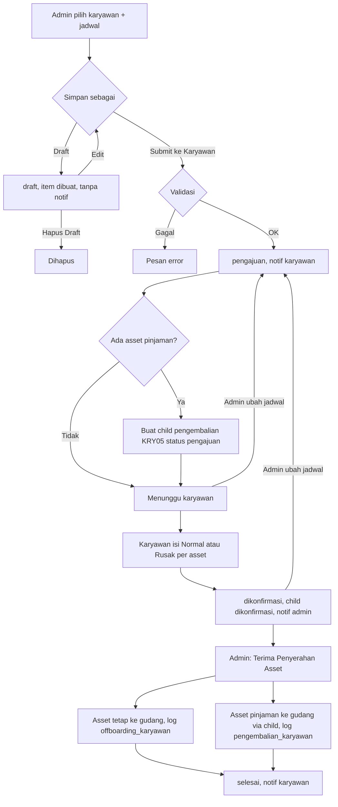
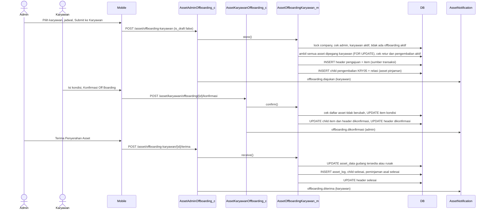
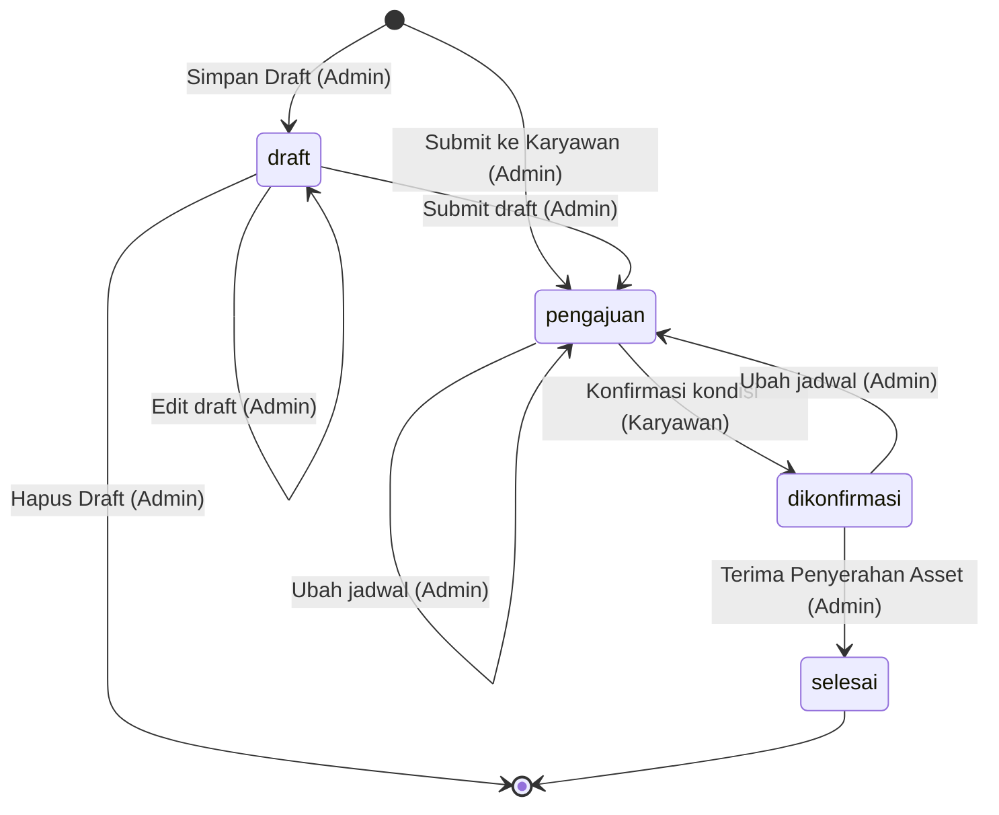
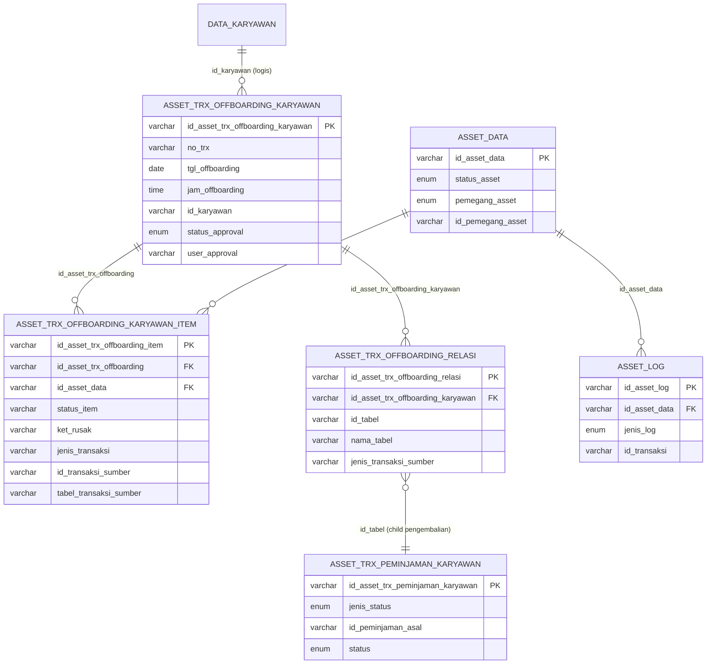

# Dokumentasi Teknis & Manual Book — Off Boarding Asset Karyawan

> Dokumen ini disusun **murni dari source code lokal** (`API/` Lumen dan `MOBILE/` Flutter) per 28 September 2026.
> Business requirement dan kode fitur **diturunkan dari kode**. Bagian yang tidak ditemukan ditandai **⚠️ Belum ditemukan**, asumsi ditandai **⚠️ Asumsi**.
> Contoh ID/nama pada payload adalah **data sintetis**.

---

## 1. Informasi Dokumen

| Informasi | Nilai |
|---|---|
| Nama Fitur | Off Boarding Asset Karyawan (UI: **"Off Boarding Asset"**; menu karyawan **"Off Board"**) |
| Kode Fitur | **KRY02** (nomor transaksi `KRY02-YYYYMMNNN`) |
| Modul | Asset Management |
| Backend | Laravel **Lumen ^10.0**, PHP ^8.1, JWT, Query Builder |
| Database | `API/diagram-asset.dbml` + migration `2026_09_22_000001_create_asset_offboarding_tables.php`. ⚠️ Asumsi: MySQL/MariaDB |
| Mobile | Flutter (`professional_flutter_3_35`), `flutter_bloc`, `dio` |
| Web | ⚠️ Belum ditemukan: tidak ada source web di workspace |
| Test otomatis | `API/tests/Asset/AssetOffboardingModelTest.php`, `AssetOffboardingRouteTest.php`, `OffboardingStatusMigrationTest.php`, `OffboardingLegacyStatusMigrationTest.php` |
| Versi Dokumen | 1.4 |
| Tanggal Dokumentasi | 2026-10-12 |
| Dokumen terkait | Onboarding (KRY01), Request/Penambahan, Retur (KRY04), Peminjaman (KRY05), Kerusakan (KRY06), Upgrade (KRY03) |

---

## 2. Daftar Isi

1. Informasi Dokumen · 3. Quick Overview · 4. Ringkasan Fitur · 5. Tujuan · 6. Aktor · 7. Hak Akses · 8. Terminologi · 9. Business Rules · 10. Business Flow · 11. Flow per Role · 12. Flow Diagram · 13. Sequence Diagram · 14. Status Transaksi · 15. State Transition · 16. Struktur Database · 17. Relasi · 18. Data Dictionary · 19. Index · 20. Backend Architecture · 21. Backend Logic · 22. Dampak asset_data · 23. API · 24. Detail API · 25. Mobile Architecture · 26. Mobile Screen · 27. Mobile → API · 28. API → Mobile · 29. Mapping Mobile→API→DB · 30. Mapping DB→API→Mobile · 31. Validation · 32. Error Handling · 33. Audit Trail · 34. Notification · 35. Security · 36. Manual Book · 37. Kondisi Button · 38. Testing · 39. Temuan Ketidaksesuaian · 40. Edge Case · 41. Risk · 42. Dependency · 43. Source Reference · 44. Developer Notes · 45. Traceability · 46. DB Impact · 47. Checklist · 48. Changelog

---

## 3. Quick Overview

| Item | Informasi |
|---|---|
| Feature | Off Boarding Asset Karyawan — penarikan **seluruh** asset yang dipegang karyawan ke gudang |
| Module | Asset Management |
| Actor | Admin Asset (pembuat & penerima), Karyawan (konfirmasi kondisi), System |
| Main Transaction | `asset_trx_offboarding_karyawan` |
| Detail Transaction | `asset_trx_offboarding_karyawan_item` (satu baris per asset yang dipegang) |
| Relasi child | `asset_trx_offboarding_relasi` → transaksi **pengembalian pinjaman** (`asset_trx_peminjaman_karyawan`, `jenis_status = pengembalian`, KRY05) |
| Asset Master | `asset_data` |
| Log | `asset_log`: `offboarding_karyawan` (asset tetap) dan `pengembalian_karyawan` (asset pinjaman) |
| Status | `draft → pengajuan → dikonfirmasi → selesai` (enum `OffboardingStatus`) |
| Inisiator | **Admin** (bukan karyawan) |
| Konfirmasi kondisi | **Karyawan** mengisi Normal/Rusak per asset |
| Penyelesaian | **Admin** menekan **Terima Penyerahan Asset** |
| API | 8 endpoint admin + 3 endpoint karyawan |
| Mobile Screen | Admin: Off Boarding Asset (list), Tambah Off Boarding Asset (form/draft), Detail. Karyawan: Off Boarding Asset (list), Detail + banner di Asset Saya |

```text
Admin: Pilih Karyawan + Jadwal Penyerahan (tanggal, jam) + Catatan
   ├─ Simpan Draft ─────────────────────────────────────────── draft (item sudah dibuat, asset "terkunci")
   └─ Submit ke Karyawan                                       pengajuan
        • item = SEMUA asset yang dipegang karyawan (tetap + pinjaman)
        • asset pinjaman → dibuatkan transaksi pengembalian KRY05 (child) otomatis
      │
      ▼  (Admin dapat Ubah Jadwal → kembali ke pengajuan)
Karyawan: isi kondisi tiap asset Normal / Rusak (+ keterangan) → Konfirmasi Off Boarding
                                                               dikonfirmasi (child pengembalian → dikonfirmasi)
      │
      ▼
Admin: Terima Penyerahan Asset                                 selesai
   asset → gudang pilihan admin PER ASSET (tersedia / rusak) + asset_log
   child pengembalian → selesai, peminjaman asal → selesai bila semua asset kembali
```

---

## 4. Ringkasan Fitur

Off Boarding dipakai Admin Asset untuk **menarik seluruh asset** yang sedang dipegang seorang karyawan — misalnya saat karyawan berhenti bekerja. Berbeda dengan Retur (dipilih per asset oleh karyawan), Off Boarding:

- **Dimulai admin** dan otomatis mencakup **semua** asset yang `pemegang_asset = karyawan` milik orang tersebut, termasuk asset **pinjaman**.
- Dapat disimpan sebagai **Draft** (jadwal opsional) sebelum dikirim ke karyawan.
- Untuk asset pinjaman, sistem membuat **transaksi pengembalian pinjaman (KRY05) sebagai child** yang ikut bergerak bersama status off boarding, sehingga modul Peminjaman tetap konsisten.
- **Karyawan** yang menilai kondisi tiap asset (Normal/Rusak + keterangan); **admin** menutup transaksi dengan menerima asset secara fisik.

⚠️ Belum ditemukan: keterkaitan dengan proses HR (misalnya perubahan status karyawan menjadi resign). Off Boarding **tidak** mengubah `data_karyawan`.

---

## 5. Tujuan Fitur

### 5.1 Tujuan Bisnis (diturunkan dari kode)
- Memastikan tidak ada asset perusahaan yang tertinggal pada karyawan yang keluar.
- Mendokumentasikan kondisi setiap asset saat diserahkan.
- Menjadwalkan waktu penyerahan yang disepakati.
- Menutup peminjaman aktif karyawan secara otomatis.

### 5.2 Tujuan Sistem
- Membuat snapshot seluruh asset yang dipegang karyawan beserta **sumber transaksinya** (onboarding/request/retur/peminjaman).
- Mencegah asset diproses di flow lain selama off boarding aktif.
- Memindahkan asset ke gudang dan mencatat `asset_log`.
- Menjaga konsistensi dengan modul Peminjaman melalui transaksi child.

---

## 6. Aktor

| Aktor | Role | Fungsi |
|---|---|---|
| Admin Asset | `asset_admin` + karyawan aktif | Membuat/mengubah/menghapus draft, submit, ubah jadwal, menerima penyerahan |
| Karyawan | User login aktif, pemegang asset | Melihat off boarding miliknya, mengisi kondisi asset, konfirmasi |
| System | Backend + FCM | Validasi, lock, penomoran, deteksi sumber asset, transaksi child, update asset, log, notifikasi |

---

## 7. Hak Akses

| Action | Admin Asset | Karyawan | Keterangan |
|---|:---:|:---:|---|
| Melihat semua off boarding (termasuk draft) | ✅ | ❌ | `/asset/offboarding-karyawan` |
| Melihat off boarding sendiri | – | ✅ | Draft **tidak** terlihat karyawan |
| Membuat off boarding / draft | ✅ | ❌ | |
| Mengubah / menghapus draft | ✅ | ❌ | Hanya status `draft` |
| Membatalkan off boarding yang sudah disubmit | ❌ | ❌ | ⚠️ Belum ditemukan (RISK-003) |
| Ubah jadwal penyerahan | ✅ | ❌ | Status `pengajuan` / `dikonfirmasi` |
| Konfirmasi kondisi asset | ❌ | ✅ | Status `pengajuan`, karyawan harus **aktif** |
| Terima Penyerahan Asset | ✅ | ❌ | Status `dikonfirmasi` |
| Mengubah kondisi yang diisi karyawan | ❌ | – | ⚠️ Belum ditemukan (RISK-004) |

---

## 8. Terminologi

| Istilah | Arti di sistem |
|---|---|
| Off Boarding / Off Board | Transaksi penarikan seluruh asset karyawan (KRY02) |
| Jadwal Penyerahan | `tgl_offboarding` + `jam_offboarding` |
| Draft | Off boarding tersimpan, belum dikirim ke karyawan; jadwal boleh kosong |
| Off boarding aktif | Status `draft`, `pengajuan`, atau `dikonfirmasi` |
| `jenis_transaksi` item | `onboarding` (asset tetap — termasuk hasil request/penambahan/retur) atau `peminjaman` |
| Sumber transaksi | `id_transaksi_sumber` + `tabel_transaksi_sumber`: transaksi yang membuat asset dipegang karyawan |
| Transaksi child | Header pengembalian pinjaman KRY05 yang dibuat otomatis oleh off boarding, dicatat di `asset_trx_offboarding_relasi` |
| `status_item` | `belum_dicek` → `normal` / `rusak` |

---

## 9. Business Rules

### BR-001 — Hanya admin yang membuat & menerima
Semua aksi admin memanggil `requireAdmin` → "Pengguna tidak terdaftar sebagai admin asset."

### BR-002 — Karyawan harus aktif dan memegang asset
Saat simpan/submit: "Karyawan tidak ditemukan atau tidak aktif." / "Karyawan tidak memiliki asset yang sedang dipegang." Opsi karyawan hanya menampilkan karyawan aktif yang memegang ≥1 asset dan belum punya off boarding aktif.

### BR-003 — Satu off boarding aktif per karyawan
Status aktif = `draft`, `pengajuan`, `dikonfirmasi` → "Karyawan masih memiliki offboarding aktif."

### BR-004 — Item = seluruh asset yang dipegang
`employeeAssets`: semua `asset_data` dengan `pemegang_asset = karyawan` dan `id_pemegang_asset = id_karyawan` (tanpa filter `status_asset`). Admin **tidak memilih** asset.

### BR-005 — Asset tidak boleh sedang diproses flow lain (`assertNoCrossFlow`)
Ditolak bila ada asset yang:
- berada di **retur aktif** (`status_transaksi = proses` dan `status_approval != ditolak`), atau
- berada di **pengembalian pinjaman** berstatus `pengajuan`/`dikonfirmasi`.

→ "Satu atau beberapa asset sedang diproses pada flow lain."

Selain itu (sejak v1.1) ditolak bila ada asset yang:
- berada di **upgrade aktif** (`hasActiveUpgradeAsset`) → "Satu atau beberapa asset sedang diproses pada upgrade."
- berada di **laporan kerusakan aktif** (`hasActiveRusakAsset`) → "Satu atau beberapa asset sedang diproses pada laporan kerusakan."
- berada di **pemeliharaan terjadwal aktif** PML01 (`hasActivePemeliharaanAsset`, fase ≠ `selesai`) → "Satu atau beberapa asset sedang diproses pada pemeliharaan."

Karena `employeeAssets` tidak memfilter status, asset `dalam_perbaikan` (sedang di teknisi lewat Upgrade atau PML01 mekanisme *diserahkan*) ikut tercek.

### BR-006 — Setiap asset harus punya sumber transaksi
`sourceForAsset` mencari berurutan: peminjaman aktif (bila `dipinjam`) → `asset_log` terakhir ke karyawan → request/penambahan dikonfirmasi → onboarding dikonfirmasi → peminjaman aktif → fallback `asset_data` (data legacy). Pesan bila gagal: "Asset {nama} tidak memiliki sumber transaksi yang valid." (⚠️ praktis tidak terjadi karena ada fallback).

### BR-007 — Jadwal wajib saat submit, opsional saat draft
Controller: `tgl_offboarding` (Y-m-d) & `jam_offboarding` (H:i) `required` bila `is_draft = false`. Model: "Jadwal offboarding wajib diisi saat pengajuan." Backend **tidak** memvalidasi tanggal ≥ hari ini (mobile membatasi mulai hari ini).

### BR-008 — Draft hanya bisa diubah/dihapus saat berstatus draft
→ "Hanya offboarding berstatus draft yang dapat diubah." / "…dapat dihapus." Saat diubah, **seluruh item dibangun ulang** dari asset yang dipegang saat itu.

### BR-009 — Asset pinjaman menjadi transaksi child
Saat submit (bukan draft), per peminjaman sumber dibuat header pengembalian KRY05 (`jenis_status = pengembalian`, `status = pengajuan`, `keterangan_serah_terima = "Dibuat otomatis dari offboarding {id}"`) + item + baris `asset_trx_offboarding_relasi`. Pengembalian child **disembunyikan** dari list/pending admin Peminjaman dan **tidak dapat** dikonfirmasi lewat modul Peminjaman ("Pengembalian ini diproses melalui offboarding.").

### BR-010 — Ubah jadwal mengembalikan status ke pengajuan
Status `pengajuan`/`dikonfirmasi` → update jadwal, status → `pengajuan`, approval dikosongkan, child direset ke `pengajuan` dan kondisi item → `belum_dicek` (lihat INC-04). Status lain → "Jadwal offboarding sudah tidak dapat diubah."

### BR-011 — Konfirmasi karyawan
- Header harus milik karyawan dan berstatus `pengajuan` → "Offboarding tidak menunggu konfirmasi."
- Daftar asset yang dipegang saat ini harus **sama persis** dengan item → "Daftar asset yang dipegang karyawan sudah berubah."
- Semua item wajib diisi → "Seluruh kondisi asset offboarding wajib diisi."
- Kondisi `normal`/`rusak`; rusak wajib keterangan → "Keterangan kerusakan asset wajib diisi."
- Child pengembalian: item `normal → disetujui`, `rusak → ditolak` (+`ket_tolak` = keterangan rusak); header child → `dikonfirmasi`.
- Header → `dikonfirmasi`, `user_approval`/`tgl_approval` = karyawan.

### BR-012 — Penerimaan admin
- Status harus `dikonfirmasi` → "Offboarding belum dikonfirmasi karyawan."
- Daftar asset dipegang harus tetap sama; semua item `normal`/`rusak` → "Kondisi asset belum dikonfirmasi karyawan."
- Asset tetap: `rusak` → `status_asset = rusak` + `ket_rusak`; `normal` → `tersedia`; `pemegang = gudang`; log `offboarding_karyawan`.
- Asset pinjaman: diproses via child → asset ke gudang (tersedia/rusak), log `pengembalian_karyawan`, child → `selesai`.
- **Lokasi gudang tujuan dipilih admin per asset** (v1.2): `items[]` pada request wajib memuat **setiap** item tepat satu kali dengan `id_asset_lokasi_m` bertipe `gudang` pada company yang sama → "Lokasi gudang tujuan setiap asset wajib dipilih." / "Lokasi gudang tujuan tidak valid." Lokasi ditulis ke `asset_data.id_asset_lokasi_m` dan `asset_trx_offboarding_karyawan_item.id_asset_lokasi_m_tujuan`; asset pinjaman memakai pemetaan yang sama lewat child.
- Peminjaman sumber → `selesai` bila tidak ada lagi asset yang dipegang karyawan.
- Header → `selesai`.

### BR-013 — Off boarding aktif mengunci asset di modul lain
`hasActiveOffboardingAsset` (status draft/pengajuan/dikonfirmasi) dipakai oleh: Retur (ajukan), Peminjaman (ajukan pengembalian), Kerusakan, Upgrade → "…sedang diproses pada offboarding." **Draft pun mengunci** (RISK-005).

### BR-014 — Penomoran
Header/item/relasi: `id_company + YYYYMM + 3 digit`; `no_trx = KRY02-YYYYMMNNN` (unique per company). Child pengembalian memakai penomoran KRY05. Log: 5 digit.

---

## 10. Business Flow

```text
1. Admin: Asset Karyawan → Off Boarding → (+) Tambah Off Boarding Asset
   → Pilih Karyawan → Jadwal Serah Terima (Tanggal & Jam Penyerahan) → Catatan Tambahan
   → Simpan Draft                         [draft · tanpa notifikasi]
   → Submit ke Karyawan                   [pengajuan · child pengembalian pinjaman · notif karyawan]
2. (Opsional) Admin: Ubah Jadwal Penyerahan  [kembali ke pengajuan · notif karyawan]
3. Karyawan: banner Asset Saya / menu Off Board → Detail
   → isi kondisi tiap asset Normal / Rusak (+ Keterangan Kerusakan)
   → Konfirmasi Off Boarding               [dikonfirmasi · notif admin]
4. Serah terima fisik sesuai jadwal
5. Admin: Detail → Terima Penyerahan Asset  [selesai · asset ke gudang · asset_log · notif karyawan]
```

---

## 11. Flow Berdasarkan Role

### 11.1 Admin Asset
1. Halaman **Asset Karyawan** → aksi **Off Boarding** atau panel **"Off Boarding Perlu Diproses"** (berisi draft → tombol **Lanjutkan Draft**, dan yang sudah dikonfirmasi → tombol **Terima Asset**).
2. **Tambah Off Boarding Asset** → **Simpan Draft** atau **Submit ke Karyawan**.
3. Draft dapat dibuka lagi (edit) atau dihapus (**Hapus Draft**).
4. Detail: **Ubah Jadwal Penyerahan** (pengajuan/dikonfirmasi), **Terima Penyerahan Asset** (dikonfirmasi).

### 11.2 Karyawan
1. **Asset Saya** menampilkan banner **Off Boarding Asset** ("Periksa jadwal penyerahan dan konfirmasi setelah Anda siap menyerahkan seluruh asset.") atau menu **Off Board**.
2. Detail → pilih kondisi **Normal/Rusak** setiap asset → **Konfirmasi Off Boarding**.

### 11.3 Approver
Tidak ada approval terpisah; "konfirmasi" dilakukan karyawan, "penerimaan" oleh admin.

### 11.4 System
Deteksi asset & sumber, cek flow lain, buat/reset/konfirmasi/finalisasi child pengembalian, update asset & log, notifikasi.

---

## 12. Flow Diagram



---

## 13. Sequence Diagram



---

## 14. Status Transaksi

Enum PHP `App\Models\Asset\OffboardingStatus` (kolom `status_approval`, enum DB `draft`, `pengajuan`, `dikonfirmasi`, `selesai`).

| Status | Label API | Tab | Terlihat karyawan | Arti | Aksi berikutnya |
|---|---|---|:---:|---|---|
| `draft` | Draft | pengajuan (admin saja) | ❌ | Disimpan admin | Admin: edit, submit, hapus |
| `pengajuan` | Menunggu Diterima | pengajuan | ✅ | Menunggu konfirmasi kondisi karyawan | Karyawan: konfirmasi; Admin: ubah jadwal |
| `dikonfirmasi` | Dikonfirmasi Karyawan | dikonfirmasi | ✅ | Kondisi sudah diisi | Admin: terima atau ubah jadwal |
| `selesai` | Selesai | selesai | ✅ | Asset sudah di gudang | – |

Tidak ada status ditolak/dibatalkan (⚠️ Belum ditemukan).

Status item (`status_item`): `belum_dicek` → `normal` / `rusak`.

Status child pengembalian (tabel peminjaman): `pengajuan` → `dikonfirmasi` → `selesai`.

---

## 15. State Transition



| Status Awal | Action | Status Akhir | Actor |
|---|---|---|---|
| – | Simpan Draft | draft | Admin |
| – / draft | Submit ke Karyawan | pengajuan | Admin |
| draft | Hapus Draft | (terhapus) | Admin |
| pengajuan / dikonfirmasi | Ubah Jadwal | pengajuan | Admin |
| pengajuan | Konfirmasi | dikonfirmasi | Karyawan |
| dikonfirmasi | Terima Penyerahan Asset | selesai | Admin |

Status `asset_data`:
| Asset | Dari | Ke | Trigger |
|---|---|---|---|
| Asset tetap (terpakai @karyawan) | – | tidak berubah | Draft, submit, konfirmasi |
| Asset tetap | @karyawan | tersedia / rusak @gudang | Terima |
| Asset pinjaman (dipinjam @karyawan) | @karyawan | tersedia / rusak @gudang | Terima (via child) |

---

## 16. Struktur Database

| Table | Type | Fungsi |
|---|---|---|
| `asset_trx_offboarding_karyawan` | Transaction Header | Off boarding, jadwal, status |
| `asset_trx_offboarding_karyawan_item` | Transaction Detail | Snapshot asset, kondisi, sumber transaksi |
| `asset_trx_offboarding_relasi` | Relation | Transaksi child yang dibuat off boarding |
| `asset_trx_peminjaman_karyawan` / `_item` | Transaksi child | Pengembalian pinjaman otomatis (KRY05) |
| `asset_data` | Master | Status & pemegang asset |
| `asset_log` | Log | `offboarding_karyawan`, `pengembalian_karyawan` |
| `asset_trx_onboarding_karyawan(_item)`, `asset_trx_request_karyawan(_item)`, `asset_trx_retur_karyawan(_item)` | Sumber / cek | Deteksi sumber & cek flow lain |
| `data_karyawan`, `master_cabang`, `master_departemen` | Master HR | Karyawan aktif, cabang, divisi |
| `asset_admin`, `master_company` | Akses / lock | Admin & mutex |
| `notif_data`, `users` | Notifikasi | Inbox & FCM |
| `asset_offboarding_migration_state` | Teknis | Marker rollback migration |

---

## 17. Relasi Database



---

## 18. Data Dictionary

### 18.1 asset_trx_offboarding_karyawan (migration)
| Field | Type | Null | Default | Key | Description |
|---|---|:---:|---|---|---|
| id_asset_trx_offboarding_karyawan | varchar(50) | No | – | PK | `id_company + YYYYMM + 3 digit` |
| no_trx | varchar(50) | No | '' | UNIQUE (id_company, no_trx) | `KRY02-YYYYMMNNN` |
| tgl_offboarding | date | Yes | NULL | IDX | Tanggal Penyerahan (NULL saat draft) |
| jam_offboarding | time | Yes | NULL | IDX | Jam Penyerahan (NULL saat draft) |
| keterangan | text | Yes | – | – | Catatan Tambahan admin |
| id_asset_lokasi_m_tujuan | varchar(50) | No | '' | – | **DEPRECATED (v1.2)**: tidak dipakai lagi; lokasi kini per asset di tabel item |
| id_karyawan | varchar(150) | No | '' | IDX | Karyawan |
| nik_karyawan, nama_karyawan | varchar(255) | No | '' | – | Snapshot |
| status_approval | enum(draft, pengajuan, dikonfirmasi, selesai) | No | pengajuan | IDX | Status |
| user_approval / tgl_approval | varchar / timestamp | – | '' / NULL | – | **Karyawan** yang mengonfirmasi |
| id_company | varchar(50) | No | '' | IDX | |
| tgl_input / user_input | timestamp / varchar | – | now / '' | – | Admin pembuat (`nik - nama`) |
| tgl_update / user_update | timestamp / varchar | Yes | NULL / '' | – | Pelaku terakhir |

### 18.2 asset_trx_offboarding_karyawan_item
| Field | Type | Default | Description |
|---|---|---|---|
| id_asset_trx_offboarding_item | varchar(50) PK | – | `id_company + YYYYMM + 3 digit` |
| id_asset_trx_offboarding | varchar(50) | – | → header |
| id_asset_data | varchar(50) | – | → asset_data |
| nama_asset, deskripsi_asset, kategori_asset | varchar(255) | '' | Snapshot |
| status_item | varchar(30) | `belum_dicek` | `belum_dicek` / `normal` / `rusak` |
| ket_rusak | varchar(255) | '' | Keterangan kerusakan dari karyawan |
| id_asset_lokasi_m_tujuan | varchar(50) | '' | Lokasi gudang tujuan asset ini, dipilih admin saat Terima (v1.2; migration `2026_10_05_000002`, SQL `sql-offboarding-lokasi-per-asset.sql`) |
| jenis_transaksi | varchar(50) | '' | `onboarding` / `peminjaman` |
| id_transaksi_sumber | varchar(50) | '' | ID transaksi asal |
| tabel_transaksi_sumber | varchar(100) | '' | Mis. `asset_trx_onboarding_karyawan`, `asset_trx_request_karyawan`, `asset_trx_retur_karyawan`, `asset_trx_peminjaman_karyawan`, fallback `asset_data` |
| id_company, tgl_input, user_input | – | – | – |

### 18.3 asset_trx_offboarding_relasi
| Field | Type | Description |
|---|---|---|
| id_asset_trx_offboarding_relasi | varchar(50) PK | `id_company + YYYYMM + 3 digit` |
| id_asset_trx_offboarding_karyawan | varchar(50) | → header off boarding |
| id_tabel | varchar(50) | ID header child pengembalian |
| nama_tabel | varchar(255) | `asset_trx_peminjaman_karyawan` |
| jenis_transaksi_sumber | varchar(50) | `peminjaman` |
| id_company, tgl_input, user_input | – | – |

### 18.4 asset_log
| Asset | jenis_log | id_transaksi | kondisi_akhir | posisi |
|---|---|---|---|---|
| Tetap | `offboarding_karyawan` | id off boarding | normal/rusak | karyawan → gudang |
| Pinjaman | `pengembalian_karyawan` | id header child pengembalian | normal/rusak | karyawan → gudang |

---

## 19. Database Index

| Index | Table | Columns | Tujuan |
|---|---|---|---|
| `atok_company_status_schedule_idx` | header | (id_company, status_approval, tgl_offboarding, jam_offboarding) | List admin per status/jadwal |
| `atok_company_employee_status_idx` | header | (id_company, id_karyawan, status_approval) | List karyawan, cek off boarding aktif |
| `atok_company_no_trx_unique` | header | UNIQUE (id_company, no_trx) | Cegah nomor ganda |
| `atoki_company_header_asset_idx` | item | (id_company, id_asset_trx_offboarding, id_asset_data) | Item per header, cek asset aktif |
| `atokr_company_header_source_idx` | relasi | (id_company, id_asset_trx_offboarding_karyawan, nama_tabel, id_tabel) | Cari child |

---

## 20. Backend Architecture

```text
RouteAsset.php (prefix /asset, jwt.api + jwt.ctx)
   ↓
AssetAdminOffboarding_c (validateOffboardingForm / validateRequest → accessError)
AssetKaryawanOffboarding_c (offboardingAccessError: karyawan aktif)
   ↓
AssetOffboardingKaryawan_m ← Asset_m (lockCompany, nextSequence, findActiveKaryawan, findAssetAdmin)
   ↓   ↔ tabel peminjaman (child pengembalian), retur (cek flow), onboarding/request/asset_log (sumber)
DB::transaction (retry 3) → ApiResponse + AssetNotification
```

| Layer | File/Class | Function |
|---|---|---|
| Controller | `AssetAdminOffboarding_c` | offboardingOptions, getOffboardingKaryawan, storeOffboardingKaryawan, getDetailOffboardingKaryawan, updateOffboardingDraft, deleteOffboardingDraft, updateJadwalOffboarding, terimaOffboardingKaryawan, validateOffboardingForm, offboardingPayload |
| Controller | `AssetKaryawanOffboarding_c` | getOffboardingSaya, getDetailOffboardingSaya, konfirmasiOffboardingSaya, offboardingAccessError |
| Model | `AssetOffboardingKaryawan_m` | getOptions, getPage, getDetail, store, updateDraft, deleteDraft, schedule, confirm, receive, getPendingForAdmin, countPendingForAdmin, hasActiveOffboardingAsset + helper (employeeAssets, insertItems, sourceForAsset, create/reset/confirm/finalize/deleteLoanReturnChildren, assertNoCrossFlow, assertCurrentHoldings, completeLoanSources) |
| Enum | `OffboardingStatus` | value, label(), tab() |
| Support | `AssetNotification` | `offboarding.*` |

---

## 21. Backend Business Logic

### 21.1 Simpan / Submit — `store`
Lock company → admin → karyawan aktif → tidak ada off boarding aktif → ambil semua asset dipegang (FOR UPDATE) → minimal 1 → `assertNoCrossFlow` → `assertSchedule` → ID + `KRY02-…` → INSERT header (`draft`/`pengajuan`) → `insertItems` (snapshot + sumber, `status_item = belum_dicek`) → bila submit: `createLoanReturnChildren`. Notifikasi `offboarding.diajukan` hanya bila submit.

### 21.2 Edit draft — `updateDraft`
Header harus `draft` (FOR UPDATE) → validasi sama seperti store (mengecualikan dirinya sendiri) → hapus child, item, relasi lama → insert item baru → update header (karyawan boleh diganti) → bila submit: buat child + notifikasi.

### 21.3 Hapus draft — `deleteDraft`
Header harus `draft` → hapus item, child, relasi, header. Response `{id, no_trx}`.

### 21.4 Ubah jadwal — `schedule`
Header `pengajuan`/`dikonfirmasi` → update jadwal, status `pengajuan`, kosongkan approval → `resetLoanReturnChildren` (child → pengajuan, item child & item off boarding → `belum_dicek`; **hanya bila ada child**) → notifikasi `offboarding.dijadwalkan`.

### 21.5 Konfirmasi karyawan — `confirm`
Karyawan aktif → header miliknya `pengajuan` → `assertCurrentHoldings` → semua item diisi → update item → `confirmLoanReturnChildren` → header `dikonfirmasi` (approval = karyawan) → notifikasi `offboarding.dikonfirmasi`.

### 21.6 Terima admin — `receive`
Admin → header `dikonfirmasi` → `assertCurrentHoldings` → semua item normal/rusak → `resolveItemLocations` (lokasi gudang per item, v1.2) → lock asset → per item non-pinjaman: update asset (gudang, `id_asset_lokasi_m` sesuai pilihan, tersedia/rusak, `ket_rusak`) + log `offboarding_karyawan` → `finalizeLoanReturnChildren` (validasi child `dikonfirmasi`, status item cocok, update asset + log `pengembalian_karyawan`, child `selesai` + `tgl/jam_serah_terima = now`) → insert log → header `selesai` → `completeLoanSources` (peminjaman asal `aktif → selesai` bila tak ada asset tersisa) → notifikasi `offboarding.diterima`.

### 21.7 Query baca
- **Opsi**: karyawan aktif yang memegang asset dan tanpa off boarding aktif.
- **List**: tab `pengajuan` (admin: draft + pengajuan; karyawan: pengajuan), `dikonfirmasi`, `selesai`; tanpa tab = semua. `jumlah_asset` = jumlah item. Key array: `offboardings`.
- **Detail**: header + cabang/divisi + items (dengan `jenis_transaksi` & sumber). Karyawan tidak dapat membuka draft.
- **Summary admin**: `offboarding_perlu_proses` & `offboarding_pending` = status `draft` + `dikonfirmasi`.

---

## 22. Dampak terhadap asset_data

| Field | Sebelum | Sesudah | Trigger |
|---|---|---|---|
| Semua field | @karyawan | tidak berubah | Draft, submit, jadwal, konfirmasi |
| status_asset (tetap) | terpakai | `tersedia` (normal) / `rusak` (rusak) | Terima |
| status_asset (pinjaman) | dipinjam | `tersedia` / `rusak` | Terima (child) |
| pemegang_asset / id_pemegang_asset | karyawan / id | gudang / '' | Terima |
| id_asset_lokasi_m | (kosong / lokasi lama) | lokasi gudang pilihan admin untuk asset itu (v1.2) | Terima |
| ket_rusak | – | keterangan karyawan / '' | Terima |
| tgl_update / user_update | – | now / admin | Terima |

> Selama off boarding aktif, asset **tidak** berubah status; perlindungan dari flow lain dilakukan lewat `hasActiveOffboardingAsset`.

---

## 23. API Documentation

| ID | Method | Endpoint | Function | Auth |
|---|---|---|---|---|
| API-001 | GET | `/asset/offboarding-karyawan/options` | Opsi karyawan | Admin |
| API-002 | GET | `/asset/offboarding-karyawan` | List | Admin |
| API-003 | POST | `/asset/offboarding-karyawan` | Simpan draft / submit | Admin |
| API-004 | GET | `/asset/offboarding-karyawan/{id}` | Detail | Admin |
| API-005 | PUT | `/asset/offboarding-karyawan/{id}` | Edit draft / submit draft | Admin |
| API-006 | DELETE | `/asset/offboarding-karyawan/{id}` | Hapus draft | Admin |
| API-007 | PUT | `/asset/offboarding-karyawan/{id}/jadwal` | Ubah jadwal | Admin |
| API-008 | POST | `/asset/offboarding-karyawan/{id}/terima` | Terima penyerahan | Admin |
| API-009 | GET | `/asset/karyawan/offboarding` | List milik saya | JWT, karyawan aktif |
| API-010 | GET | `/asset/karyawan/offboarding/{id}` | Detail milik saya | JWT, karyawan aktif |
| API-011 | POST | `/asset/karyawan/offboarding/{id}/konfirmasi` | Konfirmasi kondisi | JWT, karyawan aktif |

Terkait: `GET /asset/summary` (`offboarding_perlu_proses`, `offboarding_pending`).

---

## 24. Detail Setiap API

Header umum: `Authorization: Bearer <token>`, `Content-Type: application/json`, `Accept`, `locale`, `versi-app`. Format `{ code, message, data }`.

### API-001 — Opsi
```http
GET /asset/offboarding-karyawan/options
```
```json
{ "code": "SUCCESS", "message": "Opsi offboarding asset berhasil ditemukan.",
  "data": {
    "karyawan": [ {"id_karyawan": "KRY0007", "nik": "EMP-007", "nama_karyawan": "Budi Contoh"} ],
    "lokasi_gudang": [ {"id_asset_lokasi_m": "CMP001202610001", "nama_lokasi": "Gudang Pusat", "id_cabang": "CAB-1"} ]
  } }
```

`lokasi_gudang` (v1.2): lokasi `tipe = gudang` milik company, diurutkan menurut nama; dipakai dropdown **Lokasi Tujuan Asset** saat Terima Penyerahan.

### API-002 / API-009 — List
```http
GET /asset/offboarding-karyawan?tab=pengajuan&limit=20&offset=0
GET /asset/karyawan/offboarding?tab=dikonfirmasi
```
`tab`: `pengajuan` | `dikonfirmasi` | `selesai` ("Filter offboarding tidak valid."); `limit` 1–50 ("Limit maksimal adalah 50 data.").
```json
{
  "code": "SUCCESS",
  "message": "Data offboarding asset berhasil ditemukan.",
  "data": {
    "offboardings": [
      {
        "id": "CMP001202609004",
        "no_trx": "KRY02-202609004",
        "tgl_offboarding": "2026-09-30",
        "jam_offboarding": "09:00:00",
        "id_karyawan": "KRY0007",
        "nik_karyawan": "EMP-007",
        "nama_karyawan": "Budi Contoh",
        "jumlah_asset": 3,
        "status": "pengajuan",
        "status_approval": "pengajuan",
        "status_label": "Menunggu Diterima",
        "tab": "pengajuan"
      }
    ],
    "filters": [
      {"value": "pengajuan", "label": "Pengajuan"},
      {"value": "dikonfirmasi", "label": "Dikonfirmasi"},
      {"value": "selesai", "label": "Selesai"}
    ],
    "pagination": {"limit": 20, "offset": 0, "next_offset": 1, "has_more": false}
  }
}
```

### API-003 / API-005 — Simpan / Submit / Edit Draft
```http
POST /asset/offboarding-karyawan
PUT  /asset/offboarding-karyawan/{id}
```
```json
{
  "id_karyawan": "KRY0007",
  "tgl_offboarding": "2026-09-30",
  "jam_offboarding": "09:00",
  "keterangan": "Karyawan mengakhiri kontrak",
  "is_draft": false
}
```
| Field | Rule | Message |
|---|---|---|
| id_karyawan | required\|string\|max:150 | – |
| tgl_offboarding | draft: nullable\|date_format:Y-m-d; submit: required | Tanggal offboarding wajib diisi saat pengajuan. |
| jam_offboarding | draft: nullable\|date_format:H:i; submit: required | Jam offboarding wajib diisi saat pengajuan. |
| keterangan | nullable\|string | – |
| is_draft | required\|boolean | – |

Pesan umum validasi: "Data offboarding belum lengkap."

Database impact (submit):
```text
INSERT/UPDATE asset_trx_offboarding_karyawan (draft/pengajuan)
INSERT asset_trx_offboarding_karyawan_item (semua asset dipegang)
INSERT asset_trx_peminjaman_karyawan + _item (child pengembalian, bila ada pinjaman)
INSERT asset_trx_offboarding_relasi
INSERT notif_data (submit saja)
```
Response 201/200 = detail (lihat API-004). Pesan: "Draft offboarding berhasil disimpan." / "Draft offboarding berhasil diperbarui." / "Offboarding asset berhasil diajukan."
422: "Pengguna tidak terdaftar sebagai admin asset.", "Karyawan tidak ditemukan atau tidak aktif.", "Karyawan masih memiliki offboarding aktif.", "Karyawan tidak memiliki asset yang sedang dipegang.", "Satu atau beberapa asset sedang diproses pada flow lain.", "Satu atau beberapa asset sedang diproses pada upgrade." / "…laporan kerusakan." / "…pemeliharaan.", "Jadwal offboarding wajib diisi saat pengajuan.", "Hanya offboarding berstatus draft yang dapat diubah.", "Transaksi peminjaman sumber asset tidak ditemukan."
500: "Terjadi kesalahan saat menyimpan offboarding asset." (POST; pesan exception tidak lagi dikirim ke klien sejak v1.3 — INC-01) / "Terjadi kesalahan saat memperbarui offboarding asset." (PUT).

### API-004 / API-010 — Detail
```http
GET /asset/offboarding-karyawan/{id}
GET /asset/karyawan/offboarding/{id}
```
```json
{
  "id": "CMP001202609004",
  "no_trx": "KRY02-202609004",
  "tgl_offboarding": "2026-09-30",
  "jam_offboarding": "09:00:00",
  "keterangan": "Karyawan mengakhiri kontrak",
  "id_karyawan": "KRY0007",
  "nik_karyawan": "EMP-007",
  "nama_karyawan": "Budi Contoh",
  "nama_cabang": "Kantor Pusat",
  "nama_divisi": "Finance",
  "status": "pengajuan",
  "status_approval": "pengajuan",
  "status_label": "Menunggu Diterima",
  "tab": "pengajuan",
  "items": [
    {
      "id_asset_trx_offboarding_item": "CMP001202609010",
      "id_asset_data": "CMP00120260100012",
      "nama_asset": "Laptop 14 inch",
      "deskripsi_asset": "Charger",
      "kategori_asset": "Laptop",
      "status_item": "belum_dicek",
      "ket_rusak": "",
      "jenis_transaksi": "onboarding",
      "id_transaksi_sumber": "CMP001202601002",
      "tabel_transaksi_sumber": "asset_trx_onboarding_karyawan"
    },
    {
      "id_asset_trx_offboarding_item": "CMP001202609011",
      "id_asset_data": "CMP00120260100031",
      "nama_asset": "Proyektor Mini",
      "deskripsi_asset": "",
      "kategori_asset": "Proyektor",
      "status_item": "belum_dicek",
      "ket_rusak": "",
      "jenis_transaksi": "peminjaman",
      "id_transaksi_sumber": "CMP001202609002",
      "tabel_transaksi_sumber": "asset_trx_peminjaman_karyawan"
    }
  ]
}
```
404: "Offboarding asset tidak ditemukan." (termasuk draft untuk karyawan).

Mulai v1.2 detail memuat `id_cabang` karyawan (dipakai mobile untuk default lokasi) dan setiap `items[]` memuat `id_asset_lokasi_m_tujuan` serta `nama_lokasi_tujuan` (kosong sampai asset diterima).

### API-006 — Hapus Draft
```http
DELETE /asset/offboarding-karyawan/{id}
```
Response `DELETED`: `{ "id": "...", "no_trx": "KRY02-..." }`, "Draft offboarding berhasil dihapus." 422: "Hanya offboarding berstatus draft yang dapat dihapus."

### API-007 — Ubah Jadwal
```http
PUT /asset/offboarding-karyawan/{id}/jadwal
```
```json
{ "tgl_offboarding": "2026-10-02", "jam_offboarding": "13:30" }
```
Rule: keduanya `required` + format ("Jadwal offboarding belum lengkap."). Database impact: header (jadwal, status `pengajuan`, approval kosong), child & item (reset), `notif_data`. Response detail, "Jadwal offboarding berhasil diperbarui." 422: "Jadwal offboarding sudah tidak dapat diubah."

### API-008 — Terima Penyerahan
```http
POST /asset/offboarding-karyawan/{id}/terima
```
Body (v1.2): lokasi gudang dipilih **per asset**.
```json
{
  "items": [
    {"id_asset_trx_offboarding_item": "CMP001202609010", "id_asset_lokasi_m": "CMP001202610001"},
    {"id_asset_trx_offboarding_item": "CMP001202609011", "id_asset_lokasi_m": "CMP001202610002"}
  ]
}
```
| Field | Rule | Message |
|---|---|---|
| items | required\|array\|min:1 | Lokasi gudang tujuan setiap asset wajib dipilih. |
| items.*.id_asset_trx_offboarding_item | required\|string\|max:50\|distinct | – |
| items.*.id_asset_lokasi_m | required\|string\|max:50 | Lokasi gudang tujuan wajib dipilih. |

Pesan umum validasi: "Data penerimaan offboarding belum lengkap." Setiap item offboarding wajib muncul tepat satu kali, dan lokasi harus bertipe `gudang` pada company yang sama. Database impact:
```text
UPDATE asset_data (gudang, id_asset_lokasi_m, tersedia/rusak, ket_rusak)
UPDATE asset_trx_offboarding_karyawan_item (id_asset_lokasi_m_tujuan)
INSERT asset_log (offboarding_karyawan / pengembalian_karyawan)
UPDATE asset_trx_peminjaman_karyawan child → selesai; peminjaman asal → selesai
UPDATE asset_trx_offboarding_karyawan → selesai
INSERT notif_data
```
Response detail (`status = selesai`), "Asset offboarding berhasil diterima."
422: "Offboarding belum dikonfirmasi karyawan.", "Daftar asset yang dipegang karyawan sudah berubah.", "Kondisi asset belum dikonfirmasi karyawan.", "Satu atau beberapa asset offboarding tidak ditemukan.", "Asset tidak lagi dipegang karyawan terkait.", "Pengembalian pinjaman belum dikonfirmasi.", "Kondisi pengembalian pinjaman tidak sesuai.", "Relasi pengembalian offboarding tidak valid.", "Transaksi pengembalian offboarding tidak ditemukan.", "Item pengembalian pinjaman offboarding tidak lengkap.", "Asset pinjaman tidak lagi dipegang karyawan terkait.", "Lokasi gudang tujuan setiap asset wajib dipilih.", "Lokasi gudang tujuan tidak valid.", "Lokasi gudang tujuan asset tidak sesuai."
500: "Terjadi kesalahan saat menerima offboarding asset."

### API-011 — Konfirmasi Karyawan
```http
POST /asset/karyawan/offboarding/{id}/konfirmasi
```
```json
{
  "items": [
    {"id_asset_trx_offboarding_item": "CMP001202609010", "status_item": "normal", "ket_rusak": ""},
    {"id_asset_trx_offboarding_item": "CMP001202609011", "status_item": "rusak", "ket_rusak": "Lensa retak"}
  ]
}
```
| Field | Rule | Message |
|---|---|---|
| items | required\|array\|min:1 | Kondisi asset wajib diisi. |
| items.*.id_asset_trx_offboarding_item | required\|max:50\|distinct | – |
| items.*.status_item | required\|in:normal,rusak | Kondisi asset harus normal atau rusak. |
| items.*.ket_rusak | nullable\|max:255\|required_if rusak | Keterangan kerusakan wajib diisi. |

Pesan umum: "Data konfirmasi offboarding belum lengkap." Database impact: item off boarding, item & header child, header off boarding, `notif_data`. Response detail (`dikonfirmasi`), "Offboarding asset berhasil dikonfirmasi."
403: "Karyawan tidak aktif atau tidak ditemukan." 422: "Offboarding tidak menunggu konfirmasi.", "Daftar asset yang dipegang karyawan sudah berubah.", "Seluruh kondisi asset offboarding wajib diisi.", "Keterangan kerusakan asset wajib diisi.", "Item pengembalian offboarding tidak sesuai." 500: "Terjadi kesalahan saat mengonfirmasi offboarding asset."

---

## 25. Mobile Architecture

```text
Page → AssetOffboardingBloc (mode admin/employee) → AssetOffboardingApi → ApiClient → Backend
```

| Layer | File | Function |
|---|---|---|
| Api | `Repository/Service/assetOffboardingApi.dart` | getOptions, getAdminList, getEmployeeList, store, updateDraft, deleteDraft, getAdminDetail, getEmployeeDetail, updateSchedule, receive (request per asset), confirmEmployee |
| Model | `Repository/Model/Asset/mAssetOffboarding.dart` | AssetOffboardingEmployee, AssetOffboardingOptions, AssetOffboardingLocation, AssetOffboardingItem, AssetOffboardingRecord, AssetOffboardingFilter, AssetOffboardingPage, AssetOffboardingRequest, AssetOffboardingCondition, AssetOffboardingConfirmationRequest, AssetOffboardingReceiveItem, AssetOffboardingReceiveRequest |
| Bloc | `Bloc/Asset/AssetOffboardingBloc.dart` | LoadAssetOffboardingList, LoadMore…, LoadAssetOffboardingOptions, LoadAssetOffboardingEditor, LoadAssetOffboardingDetail, SaveAssetOffboarding, DeleteAssetOffboardingDraft, UpdateAssetOffboardingSchedule, ReceiveAssetOffboarding, ConfirmAssetOffboarding |
| UI | `UI/Modul/Asset/Offboarding/*` | HalamanAssetOffboarding (list, admin & karyawan), HalamanAssetOffboardingForm (tambah/edit draft), HalamanAssetOffboardingDetail, AssetOffboardingWidgets |
| Entry | `HalamanAssetSaya.dart`, `HalamanAssetAdminKaryawan.dart` | Banner karyawan, menu Off Board, panel "Off Boarding Perlu Diproses" |

| Route | Page | Event awal |
|---|---|---|
| `/asset_admin_offboarding` | List admin | LoadAssetOffboardingList() |
| `/asset_admin_add_offboarding` | Form (argumen `draftId` opsional) | LoadAssetOffboardingEditor |
| `/asset_admin_detail_offboarding` | Detail admin | LoadAssetOffboardingDetail(id) |
| `/asset_employee_offboarding` | List karyawan | LoadAssetOffboardingList(mode: employee) |
| `/asset_employee_detail_offboarding` | Detail karyawan | LoadAssetOffboardingDetail(id, mode: employee) |

---

## 26. Mobile Screen

### 26.1 Off Boarding Asset — list
Tab **Pengajuan**, **Dikonfirmasi**, **Selesai**. Kartu: Data Karyawan (admin) / nomor (karyawan), Tanggal Penyerahan, "Jam Penyerahan: …", jumlah asset, badge status (Draft / Menunggu Diterima / Dikonfirmasi / Selesai). Admin: tombol **+** (Tambah off boarding) dan ikon **Hapus Draft** pada kartu draft (dialog "Draft off boarding akan dihapus dan tidak dapat dipulihkan."). Kosong: "Belum ada data off boarding asset."

### 26.2 Tambah Off Boarding Asset (Admin)
| Field UI | Widget | Required | Source |
|---|---|:---:|---|
| Pilih Karyawan | Bottom sheet + Cari Karyawan | Ya ("Karyawan wajib dipilih") | `options.karyawan` |
| Jadwal Serah Terima → Tanggal Penyerahan | Date picker (mulai hari ini) | Saat submit ("Tanggal serah terima wajib dipilih.") | Input |
| Jam Penyerahan | Time picker | Saat submit ("Jam serah terima wajib dipilih.") | Input |
| Catatan Tambahan | Text | Tidak | → `keterangan` |
| Tombol | **Simpan Draft** / **Submit ke Karyawan** | – | – |

> Form **tidak menampilkan daftar asset** karyawan sebelum disimpan; daftar muncul di detail setelah disimpan.

### 26.3 Detail Off Boarding Asset
Header (nomor, status, jadwal), Catatan, Data Karyawan (cabang, divisi), daftar asset dipisah **Off Boarding Asset** (asset tetap) dan **Asset yang Dipinjam** (pinjaman). Per asset: pilihan **Normal / Rusak** (+ **Keterangan Kerusakan**) saat karyawan mengonfirmasi, atau tampilan kondisi.

| Role | Status | Tombol |
|---|---|---|
| Karyawan | pengajuan | **Konfirmasi Off Boarding** (dialog: "Dengan mengonfirmasi, Anda menyatakan seluruh asset pada daftar siap diserahkan kepada Admin/HR.") |
| Admin | pengajuan / dikonfirmasi | **Ubah Jadwal Penyerahan** (bila dikonfirmasi: dialog "Perubahan jadwal akan mengembalikan status ke Pengajuan dan membutuhkan konfirmasi ulang dari karyawan.") |
| Admin | dikonfirmasi | **Terima Penyerahan Asset** (info: "Periksa kondisi seluruh asset secara fisik sebelum menyelesaikan off boarding.") → membuka dialog **Lokasi Tujuan Asset** (lihat bawah) |

**Dialog Lokasi Tujuan Asset** (v1.2): setiap asset (tetap dan pinjaman) punya dropdown gudang sendiri; default-nya gudang yang `id_cabang`-nya sama dengan cabang karyawan. Tombol **Terima Penyerahan Asset** pada dialog baru aktif setelah semua asset terpilih, lalu mengirim `items[]` per asset. Bila belum ada lokasi bertipe gudang muncul "Belum ada lokasi gudang." dan dialog tidak dibuka. Setelah selesai, kartu tiap asset menampilkan "Lokasi Tujuan Asset: {nama gudang}".

**Alur status**: `AssetAlurStepper.offboarding` (Draft → Konfirmasi → Serah Terima → Selesai) dan satu kartu timeline per aset (`AssetOffboardingTimelineCards`): Draft (jenis aset; aset pinjaman dikembalikan otomatis) · Konfirmasi (kondisi Normal/Rusak; chip **Rusak**) · Serah Terima (jadwal) · Selesai (lokasi gudang tujuan). Kartu timeline disembunyikan saat karyawan mengisi konfirmasi atau admin menerima penyerahan, karena form per aset sudah ada di kartu aset. File: `Shared/Widgets/AssetAlurWidgets.dart`, `Shared/Widgets/AssetOffboardingTimeline.dart`.

### 26.4 Asset Saya (Karyawan)
Banner **Off Boarding Asset** dari record pertama tab pengajuan + teks info dan jadwal; menu **Off Board**.

### 26.5 Asset Karyawan (Admin)
Panel **Off Boarding Perlu Diproses** (`summary.offboarding_pending`) dengan tombol **Lanjutkan Draft** (draft → form) atau **Terima Asset** (dikonfirmasi → detail).

---

## 27. Mobile → API

| UI Field | Mobile Variable | JSON Field | Type | Required |
|---|---|---|---|:---:|
| Pilih Karyawan | `AssetOffboardingRequest.idKaryawan` | `id_karyawan` | string | Ya |
| Tanggal Penyerahan | `tglOffboarding` | `tgl_offboarding` | Y-m-d | Saat submit |
| Jam Penyerahan | `jamOffboarding` | `jam_offboarding` | H:i | Saat submit |
| Catatan Tambahan | `keterangan` | `keterangan` | string | Tidak |
| Simpan Draft / Submit | `isDraft` | `is_draft` | bool | Ya |
| Kondisi Normal/Rusak | `AssetOffboardingCondition.statusItem` | `items[].status_item` | string | Ya |
| Keterangan Kerusakan | `ketRusak` | `items[].ket_rusak` | string | Bila rusak |
| (id item) | `itemId` | `items[].id_asset_trx_offboarding_item` | string | Ya |
| Ubah Jadwal | date, time | `tgl_offboarding`, `jam_offboarding` | – | Ya |

---

## 28. API → Mobile

| API JSON | Mobile Model | UI |
|---|---|---|
| `offboardings[]` | AssetOffboardingPage / AssetOffboardingRecord | Kartu list |
| `filters[]` | AssetOffboardingFilter | Tab |
| `status_approval`, `status_label`, `tab` | AssetOffboardingRecord.status | Badge, tombol |
| `tgl_offboarding`, `jam_offboarding` | tglOffboarding, jamOffboarding | Jadwal |
| `nama_cabang`, `nama_divisi` | namaCabang, namaDivisi | Data Karyawan |
| `items[]` | AssetOffboardingItem | Daftar asset (dipisah menurut `jenis_transaksi`) |
| `items[].status_item`, `ket_rusak` | statusItem, ketRusak | Kondisi |
| `karyawan[]` (options) | AssetOffboardingEmployee | Pilih Karyawan |
| `lokasi_gudang[]` (options) | AssetOffboardingLocation | Dropdown Lokasi Tujuan Asset |
| `id_cabang`, `items[].id_asset_lokasi_m_tujuan`, `nama_lokasi_tujuan` | idCabang, idLokasiTujuan, namaLokasiTujuan | Default lokasi; lokasi tujuan di kartu asset |

---

## 29. Mapping Mobile → API → Database

| UI | JSON | Backend | Table | Column |
|---|---|---|---|---|
| Pilih Karyawan | `id_karyawan` | `findActiveKaryawan` | header | id_karyawan, nik_karyawan, nama_karyawan |
| Tanggal Penyerahan | `tgl_offboarding` | `$data['tgl_offboarding']` | header / child | tgl_offboarding / tgl_serah_terima |
| Jam Penyerahan | `jam_offboarding` | `databaseTime()` (+`:00`) | header / child | jam_offboarding / jam_serah_terima |
| Catatan Tambahan | `keterangan` | trim | header | keterangan |
| Simpan Draft / Submit | `is_draft` | `OffboardingStatus` | header | status_approval |
| (otomatis) | – | `employeeAssets` + `sourceForAsset` | item | id_asset_data, snapshot, jenis_transaksi, sumber |
| Kondisi | `items[].status_item` | `confirm()` | item / child item / asset_data | status_item / status_item (disetujui/ditolak) / status_asset |
| Keterangan Kerusakan | `items[].ket_rusak` | trim | item / child item / asset_data | ket_rusak / ket_tolak / ket_rusak |
| Terima Penyerahan Asset + Lokasi Tujuan Asset | `items[].id_asset_lokasi_m` | `receive()` + `resolveItemLocations()` | asset_data, item, asset_log, header, child | status, pemegang, id_asset_lokasi_m, id_asset_lokasi_m_tujuan, log, selesai |

---

## 30. Mapping Database → API → Mobile

| Table | Column | API JSON | Mobile | UI |
|---|---|---|---|---|
| header | status_approval | `status`, `status_label`, `tab` | status | Badge, tab, tombol |
| header | tgl/jam_offboarding | `tgl_offboarding`, `jam_offboarding` | idem | Jadwal |
| item | COUNT | `jumlah_asset` | jumlahAsset | Jumlah asset |
| item | jenis_transaksi | `items[].jenis_transaksi` | jenisTransaksi | Kelompok "Off Boarding Asset" / "Asset yang Dipinjam" |
| item | status_item, ket_rusak | idem | statusItem, ketRusak | Kondisi |
| master_cabang / master_departemen | nama | `nama_cabang`, `nama_divisi` | idem | Data Karyawan |

---

## 31. Validation

### 31.1 Mobile
| Lokasi | Aturan | Pesan |
|---|---|---|
| Form | Karyawan wajib | "Karyawan wajib dipilih" |
| Form (submit) | Tanggal & jam wajib; tanggal mulai hari ini | "Tanggal serah terima wajib dipilih." / "Jam serah terima wajib dipilih." |
| Detail karyawan | Semua asset diberi kondisi | "Pilih kondisi untuk seluruh asset." |
| Detail karyawan | Rusak wajib keterangan | "Keterangan kerusakan wajib diisi." |
| Ubah jadwal | Tanggal mulai hari ini; dialog bila dikonfirmasi | – |
| Detail admin (Terima) | Setiap asset wajib punya lokasi gudang (v1.2) | Tombol di dialog nonaktif sampai lengkap; "Belum ada lokasi gudang." bila daftar kosong |

### 31.2 Backend — lihat §9 & §24.
### 31.3 Database — enum `status_approval`; `no_trx` unique per company; `status_item` varchar(30).

### 31.4 Ringkasan per Field
| Field | Mobile | Backend | Database |
|---|---|---|---|
| id_karyawan | Wajib, dari opsi | aktif, memegang asset, tanpa off boarding aktif | varchar(150) |
| tgl_offboarding | ≥ hari ini, wajib saat submit | Y-m-d, wajib saat submit (tanpa cek ≥ hari ini) | date NULL |
| jam_offboarding | wajib saat submit | H:i | time NULL |
| status_item | wajib per asset | normal/rusak, semua item | varchar(30) |
| ket_rusak | wajib bila rusak | wajib bila rusak, ≤255 | varchar(255) |

---

## 32. Error Handling

| Error | HTTP | Backend | Mobile |
|---|---:|---|---|
| Field tidak valid | 422 | VALIDATION_ERROR | `firstError` |
| Aturan bisnis | 422 | BUSINESS_RULE_VIOLATION | Snackbar |
| Detail tidak ditemukan | 404 | NOT_FOUND | Halaman error |
| Token | 401 | UNAUTHORIZED | Refresh token |
| Bukan admin / karyawan tidak aktif | 403 | FORBIDDEN | Pesan |
| Exception | 500 | SYSTEM_ERROR + `Log::error` | Snackbar |
| Asset karyawan berubah setelah submit | 422 | "Daftar asset yang dipegang karyawan sudah berubah." | Snackbar (lihat RISK-006) |

---

## 33. Audit Trail

| Data | Disimpan? | Lokasi |
|---|:---:|---|
| Admin pembuat & waktu | ✅ | `user_input`, `tgl_input` |
| Admin pengubah jadwal / penerima | ✅ | `user_update`, `tgl_update` (tertimpa) |
| Karyawan yang mengonfirmasi | ✅ | `user_approval`, `tgl_approval` |
| Kondisi per asset | ✅ | item `status_item`, `ket_rusak` |
| Sumber asset | ✅ | item `jenis_transaksi`, `id/tabel_transaksi_sumber` |
| Perubahan asset | ✅ | `asset_log` |
| Riwayat perubahan jadwal | ❌ | ⚠️ Belum ditemukan (hanya nilai terakhir) |
| Draft yang dihapus | ❌ | Hard delete |

---

## 34. Notification

| Event | Trigger | Penerima | Judul | Pesan | Rute |
|---|---|---|---|---|---|
| `offboarding.diajukan` | Submit (POST/PUT non-draft) | Karyawan | Offboarding Asset | Anda memiliki offboarding asset {no_trx}. Silakan konfirmasi kondisi asset. | `asset_employee_detail_offboarding` |
| `offboarding.dijadwalkan` | Ubah jadwal | Karyawan | Jadwal Offboarding Asset | Jadwal offboarding asset {no_trx} telah diperbarui. | `asset_employee_detail_offboarding` |
| `offboarding.dikonfirmasi` | Konfirmasi karyawan | Semua admin | Offboarding Asset Dikonfirmasi | {nama} telah mengonfirmasi offboarding asset {no_trx}. | `asset_admin_detail_offboarding` |
| `offboarding.diterima` | Terima admin | Karyawan | Offboarding Asset Selesai | Asset offboarding {no_trx} telah diterima admin. | `asset_employee_detail_offboarding` |

Draft tidak mengirim notifikasi. Child pengembalian pinjaman tidak mengirim notifikasi peminjaman tersendiri.

---

## 35. Security

| Aspek | Implementasi |
|---|---|
| Autentikasi | Bearer JWT |
| Isolasi company | Semua query `id_company` dari token |
| Otorisasi admin | `accessError` di controller + `requireAdmin` di model |
| Karyawan | `offboardingAccessError` (aktif) + filter `id_karyawan` + draft disembunyikan |
| Integritas | Lock company, FOR UPDATE pada header/item/asset/child, pengecekan ulang daftar asset |
| Catatan | Pesan 500 POST tidak lagi menyertakan `$exception->getMessage()` (INC-01 selesai v1.3); validasi request sebelum cek akses (INC-07) |

---

## 36. Manual Book User/Admin

> Label dari `assets/id/asset.json` (`menu_asset`). ⚠️ Asumsi: halaman **Asset Karyawan** diakses dari menu Asset Management. Screenshot menyusul.

### A. Admin — Membuat Off Boarding
1. **Asset Karyawan** → **Off Boarding** → tekan **+**.
2. **Pilih Karyawan** (gunakan **Cari Karyawan**). Hanya karyawan aktif yang memegang asset dan belum sedang di-off boarding yang muncul.
3. Isi **Jadwal Serah Terima**: **Tanggal Penyerahan** dan **Jam Penyerahan**.
4. Isi **Catatan Tambahan** bila perlu.
5. Tekan **Simpan Draft** untuk menyimpan dulu, atau **Submit ke Karyawan** untuk mengirim.
6. Seluruh asset yang dipegang karyawan (termasuk pinjaman) otomatis masuk daftar.

### B. Admin — Draft
- Lanjutkan dari kartu draft atau panel **Off Boarding Perlu Diproses → Lanjutkan Draft**.
- Hapus dengan ikon **Hapus Draft** → konfirmasi.

### C. Karyawan — Konfirmasi Kondisi
1. Buka banner **Off Boarding Asset** di **Asset Saya** atau menu **Off Board**.
2. Periksa jadwal penyerahan.
3. Untuk setiap asset pilih **Normal** atau **Rusak** (isi **Keterangan Kerusakan** bila rusak).
4. Tekan **Konfirmasi Off Boarding** → konfirmasi.

### D. Admin — Ubah Jadwal
Detail → **Ubah Jadwal Penyerahan** → pilih tanggal & jam. Bila sudah dikonfirmasi karyawan, status kembali ke **Pengajuan** dan karyawan harus konfirmasi ulang.

### E. Admin — Menyelesaikan
1. Terima asset secara fisik sesuai jadwal dan periksa kondisinya.
2. Detail → **Terima Penyerahan Asset**.
3. Pada dialog **Lokasi Tujuan Asset**, pilih gudang untuk **setiap asset** (default: gudang di cabang karyawan), lalu tekan **Terima Penyerahan Asset**.
4. Semua asset kembali ke gudang yang dipilih (Tersedia/Rusak), peminjaman aktif karyawan ikut selesai, status **Selesai**.

---

## 37. Kondisi Button

| Button | Role | Halaman | Condition | Action |
|---|---|---|---|---|
| + (Tambah off boarding) | Admin | List | Selalu | Form |
| Simpan Draft | Admin | Form | Tidak submitting | POST/PUT `is_draft = true` |
| Submit ke Karyawan | Admin | Form | Tidak submitting | POST/PUT `is_draft = false` |
| Hapus Draft | Admin | List | Status draft | DELETE |
| Lanjutkan Draft | Admin | Panel summary | Status draft | Form draft |
| Terima Asset (panel) | Admin | Panel summary | Status dikonfirmasi | Detail |
| Ubah Jadwal Penyerahan | Admin | Detail | pengajuan / dikonfirmasi | PUT jadwal |
| Terima Penyerahan Asset | Admin | Detail | dikonfirmasi | Dialog Lokasi Tujuan Asset → POST terima (`items[]` per asset) |
| Konfirmasi Off Boarding | Karyawan | Detail | pengajuan | POST konfirmasi |
| Batalkan off boarding | – | – | ⚠️ Belum ditemukan | – |

---

## 38. Testing Scenario

Test otomatis yang sudah ada (API): `test_offboarding_routes_are_registered`, `test_offboarding_requires_authentication`, `test_offboarding_lifecycle_uses_string_statuses`, `test_admin_pending_lists_draft_and_confirmed_offboarding`, `test_employee_list_hides_drafts`, `test_employee_reports_damage_before_admin_receives`, `test_offboarding_preserves_request_source`, `test_offboarding_orchestrates_loan_return_as_child_transaction`, `test_draft_does_not_create_loan_return_child`, `test_migration_converts_and_restores_offboarding_statuses`, `test_migration_converts_legacy_string_statuses`, `test_offboarding_rejects_assets_in_upgrade_or_damage_report` (v1.1). v1.2: `test_receive_requires_a_valid_warehouse_location`, `test_options_list_only_warehouse_locations`, lokasi per asset pada `test_offboarding_orchestrates_loan_return_as_child_transaction`; mobile `asset_offboarding_widget_test.dart` (admin memilih lokasi per asset) dan `asset_offboarding_model_test.dart`.

| TC | Scenario | Expected |
|---|---|---|
| TC-01 | Simpan draft tanpa jadwal | 201; `draft`; item dibuat; tanpa notif; tidak ada child |
| TC-02 | Submit dengan jadwal | 201; `pengajuan`; notif karyawan |
| TC-03 | Submit tanpa jadwal | 422 "Tanggal offboarding wajib diisi saat pengajuan." |
| TC-04 | Karyawan tanpa asset | 422 "Karyawan tidak memiliki asset yang sedang dipegang." |
| TC-05 | Karyawan sudah punya off boarding aktif (termasuk draft) | 422 "Karyawan masih memiliki offboarding aktif." |
| TC-06 | Asset karyawan sedang diretur | 422 "…sedang diproses pada flow lain." |
| TC-07 | Asset pinjaman sedang dalam pengembalian | 422 "…flow lain." |
| TC-08 | Karyawan punya pinjaman aktif | Child pengembalian KRY05 + relasi dibuat; tidak tampil di list pengembalian admin Peminjaman |
| TC-09 | Admin coba konfirmasi child lewat modul Peminjaman | 422 "Pengembalian ini diproses melalui offboarding." |
| TC-10 | Edit draft ganti karyawan | Item dibangun ulang untuk karyawan baru |
| TC-11 | Hapus draft | Header, item, relasi, child terhapus |
| TC-12 | Karyawan lihat list/detail | Draft tidak terlihat; detail draft 404 |
| TC-13 | Karyawan konfirmasi semua normal | `dikonfirmasi`; child item `disetujui`; notif admin |
| TC-14 | Konfirmasi rusak tanpa keterangan | 422 |
| TC-15 | Konfirmasi sebagian item | 422 "Seluruh kondisi asset offboarding wajib diisi." |
| TC-16 | Asset baru diberikan ke karyawan setelah submit | Konfirmasi/terima 422 "Daftar asset yang dipegang karyawan sudah berubah." |
| TC-17 | Ubah jadwal saat dikonfirmasi | Kembali `pengajuan`; notif karyawan; karyawan wajib konfirmasi ulang |
| TC-18 | Terima sebelum dikonfirmasi | 422 "Offboarding belum dikonfirmasi karyawan." |
| TC-19 | Terima normal & rusak | Asset → tersedia / rusak @gudang; log; `selesai`; notif karyawan |
| TC-20 | Terima dengan pinjaman | Child `selesai`; log `pengembalian_karyawan`; peminjaman asal `selesai` |
| TC-21 | Retur/Kerusakan/Upgrade/Pengembalian untuk asset dalam off boarding aktif | Ditolak modul tersebut |
| TC-22 | Karyawan dinonaktifkan sebelum konfirmasi | 403 — transaksi tertahan (RISK-001) |
| TC-23 | Asset sedang dalam Kerusakan/Upgrade/Pemeliharaan lalu di-off boarding | 422 "…sedang diproses pada upgrade." / "…laporan kerusakan." / "…pemeliharaan." |
| TC-24 | Tanpa token / bukan admin | 401 / 403 |
| TC-25 | Terima dengan lokasi gudang berbeda per asset (asset tetap dan pinjaman) | `asset_data.id_asset_lokasi_m` dan item `id_asset_lokasi_m_tujuan` sesuai pilihan masing-masing; log tercatat; `selesai` |
| TC-26 | Terima tanpa lokasi / sebagian item / lokasi bertipe ruangan / lokasi tidak ada | 422 "Lokasi gudang tujuan setiap asset wajib dipilih." atau "Lokasi gudang tujuan tidak valid."; status tetap `dikonfirmasi`, asset tidak berubah |
| TC-27 | Mobile: dialog Lokasi Tujuan Asset | Default gudang cabang karyawan; tombol aktif setelah semua asset terpilih; payload `items[]` per asset; kartu menampilkan lokasi setelah selesai |

---

## 39. Temuan Ketidaksesuaian

| ID | Component | Finding | Impact | Recommendation |
|---|---|---|---|---|
| INC-01 | Backend | **Sudah diperbaiki 2026-10-12**: sebelumnya pesan 500 POST menyertakan `$exception->getMessage()`; pesan umum kini sama dengan endpoint lain, detail hanya di log | – | – |
| INC-02 | Backend ↔ Mobile | Label status `pengajuan` di API "Menunggu Diterima", padahal yang ditunggu adalah **konfirmasi karyawan**; `dikonfirmasi` = "Dikonfirmasi Karyawan" | Membingungkan | Selaraskan label |
| INC-03 | DBML ↔ Migration | DBML: `status_item` enum `kondisi_awal`, `jenis_transaksi` enum; tidak ada unique `no_trx`. Migration: varchar & unique (id_company, no_trx) | Dokumen skema tidak akurat | Perbarui DBML |
| INC-04 | Backend | Reset kondisi item saat ubah jadwal hanya terjadi di `resetLoanReturnChildren`, yang **berhenti lebih awal bila tidak ada child** | Off boarding tanpa pinjaman: kondisi lama tetap tampil walau status kembali pengajuan | Reset item di `schedule()` langsung |
| INC-05 | Backend | Child pengembalian memakai `status_item = disetujui/ditolak` untuk arti normal/rusak dan `ket_tolak` untuk keterangan rusak | Semantik ganda di tabel peminjaman | Dokumentasikan / kolom kondisi |
| INC-06 | Backend ↔ Mobile | Backend tidak memvalidasi tanggal ≥ hari ini (mobile membatasi) | Jadwal lampau via API | Validasi `after_or_equal:today` |
| INC-07 | Backend | Validasi request sebelum cek admin/karyawan aktif | 422 bukan 403 | Pindahkan cek akses |
| INC-08 | Mobile | Label status tampil "Menunggu Diterima"; key `status.dikonfirmasi_karyawan` tidak ada di `asset.json` (mobile memakai "Dikonfirmasi") | Label beda dengan API | Satukan sumber label |
| INC-09 | Mobile | Form tidak menampilkan asset yang akan ditarik sebelum disimpan | Admin baru tahu daftar asset setelah simpan | Preview asset di form |
| INC-10 | Migration | Konversi legacy memetakan `dikonfirmasi` dan `ditolak` lama → `selesai` | Data lama berubah makna | Dokumentasikan untuk data historis |

---

## 40. Edge Case

| Edge Case | Current Behavior | Impact | Recommendation |
|---|---|---|---|
| Karyawan nonaktif sebelum konfirmasi | Konfirmasi 403; admin tidak bisa bypass | Transaksi macet | Izinkan admin konfirmasi atas nama karyawan |
| Admin memberi asset baru (onboarding/penambahan/peminjaman) setelah submit | Konfirmasi/terima gagal "Daftar asset … sudah berubah"; ubah jadwal tidak membangun ulang item | Transaksi macet | Sediakan "sinkron ulang daftar asset" |
| Draft terlupakan | Draft tetap "aktif" dan mengunci asset | Karyawan tidak bisa retur/lapor rusak/upgrade | Kedaluwarsa draft atau jangan kunci saat draft |
| Asset berstatus `proses` (mis. dalam alur lain) dipegang karyawan | Ikut ditarik | Konflik status | Filter/cek status |
| Asset dalam Kerusakan/Upgrade aktif | Tidak dicek | Dua flow pada asset sama | Tambahkan cek |
| Karyawan mengisi kondisi tidak sesuai | Admin tidak bisa mengoreksi, hanya ubah jadwal | Data kondisi salah | Admin dapat override kondisi saat terima |
| Peminjaman/onboarding yang belum diterima karyawan | Tidak ikut (asset belum dipegang) | Asset bisa sampai setelah off boarding | Cek transaksi pending lain |
| Belum ada lokasi bertipe gudang di `asset_lokasi_m` | Dialog tidak dibuka ("Belum ada lokasi gudang."); API 422 | Terima tidak bisa selesai | Siapkan master lokasi gudang |
| Asset yang sudah di gudang sebelum v1.2 | `id_asset_lokasi_m` kosong | Lokasi tidak diketahui sampai diproses lagi | Backfill (belum dikerjakan) |

---

## 41. Potential Bug / Technical Risk

### RISK-001 — Karyawan nonaktif menghentikan alur (TINGGI)
**Lokasi:** `AssetKaryawanOffboarding_c::offboardingAccessError`, `AssetOffboardingKaryawan_m::confirm` (`findActiveKaryawan`).
**Masalah:** Konfirmasi hanya bisa oleh karyawan **aktif**. Off boarding umumnya dilakukan saat karyawan keluar; bila status karyawan diubah lebih dulu, off boarding tidak bisa dikonfirmasi dan admin tidak punya jalan lain.
**Recommendation:** Tambah aksi admin untuk mengisi kondisi, atau izinkan karyawan nonaktif yang punya off boarding aktif.

### RISK-002 — Selesai (v1.1)
Sebelumnya Kerusakan & Upgrade tidak dicek saat membuat off boarding. `assertNoCrossFlow` kini memanggil `hasActiveUpgradeAsset`, `hasActiveRusakAsset`, dan `hasActivePemeliharaanAsset` (lihat BR-005). Diuji oleh `test_offboarding_rejects_assets_in_upgrade_or_damage_report`.

### RISK-003 — Tidak ada pembatalan setelah submit (SEDANG)
Hanya draft yang bisa dihapus. Off boarding yang salah karyawan/terlanjur dikirim tidak bisa dibatalkan dan terus mengunci asset.

### RISK-004 — Kondisi sepenuhnya dari karyawan (SEDANG)
Admin tidak dapat mengubah Normal/Rusak saat menerima; satu-satunya jalan adalah ubah jadwal (reset) dan meminta karyawan mengonfirmasi ulang.

### RISK-005 — Draft mengunci asset (SEDANG)
`activeStatuses()` memasukkan `draft`, sehingga draft yang belum dikirim (dan tidak terlihat karyawan) sudah memblokir Retur, Kerusakan, Upgrade, dan pengembalian pinjaman.

### RISK-006 — Daftar asset beku setelah submit (SEDANG)
Tidak ada mekanisme menyinkronkan item bila asset karyawan berubah; `assertCurrentHoldings` akan terus gagal.

### RISK-007 — Notifikasi di luar transaksi (RENDAH)
Dikirim setelah commit; kegagalan tidak membatalkan transaksi.

### RISK-008 — Kapasitas penomoran (RENDAH)
3 digit/bulan/company untuk header, item, relasi; item memakan satu nomor per asset.

### RISK-009 — Lokasi gudang belum tersedia (SEDANG)
Terima Penyerahan mewajibkan lokasi bertipe `gudang` dari `asset_lokasi_m`. Tabel ini hanya terdokumentasi di DBML (tidak ada migration pembuatnya di repo); bila tabel kosong, off boarding tidak dapat diselesaikan. Kolom header `asset_trx_offboarding_karyawan.id_asset_lokasi_m_tujuan` (v1.2 awal) kini tidak dipakai dan dapat dihapus.

---

## 42. Dependency

```text
Asset dipegang karyawan (Onboarding / Request-Penambahan / Retur pengganti / Peminjaman)
        ↓ deteksi sumber (asset_log, onboarding, request, peminjaman)
Off Boarding (draft → pengajuan → dikonfirmasi → selesai) ──► Notifikasi
        ├─ asset pinjaman → child Pengembalian KRY05 (via asset_trx_offboarding_relasi)
        ↓ Terima
Asset → gudang (tersedia / rusak) + asset_log; Peminjaman asal → selesai

Aturan silang:
  - Off boarding mengecek: Retur aktif, Pengembalian pinjaman aktif, Upgrade aktif, Kerusakan aktif, Pemeliharaan (PML01) aktif
  - Dicek oleh: Retur, Pengembalian pinjaman, Kerusakan, Upgrade, Pemeliharaan PML01 (hasActiveOffboardingAsset)
  - Modul Peminjaman menyembunyikan & menolak konfirmasi child milik off boarding
  - Summary admin: offboarding_perlu_proses / offboarding_pending
```

---

## 43. Source Code Reference

| File | Layer | Function |
|---|---|---|
| `API/routes/modules/asset/RouteAsset.php` (baris 36–43, 85–87) | Route | 11 endpoint |
| `API/app/Http/Controllers/Asset/Admin/AssetAdminOffboarding_c.php` | Controller | Admin off boarding |
| `API/app/Http/Controllers/Asset/Karyawan/AssetKaryawanOffboarding_c.php` | Controller | Karyawan off boarding |
| `API/app/Models/Asset/AssetOffboardingKaryawan_m.php` | Model | Seluruh logika |
| `API/app/Models/Asset/OffboardingStatus.php` | Enum | Status, label, tab |
| `API/app/Models/Asset/AssetPeminjamanKaryawan_m.php` | Model | Filter & guard child off boarding |
| `API/app/Models/Asset/AssetReturKaryawan_m.php`, `AssetRusakKaryawan_m.php`, `AssetUpgradeKaryawan_m.php`, `AssetPemeliharaanKaryawan_m.php` | Model | Pemakai `hasActiveOffboardingAsset`; Rusak, Upgrade, dan Pemeliharaan juga dipanggil balik oleh `assertNoCrossFlow` |
| `API/app/Models/Asset/AssetAdmin_m.php` | Model | Summary |
| `API/app/Support/Asset/AssetNotification.php` | Support | `offboarding.*` |
| `API/database/migrations/2026_09_22_000001_create_asset_offboarding_tables.php` | Migration | Tabel, index, konversi status |
| `API/diagram-asset.dbml` | DB | Struktur |
| `API/tests/Asset/*Offboarding*` | Test | 12 test |
| `MOBILE/lib/Repository/Service/assetOffboardingApi.dart` | Api | – |
| `MOBILE/lib/Repository/Model/Asset/mAssetOffboarding.dart` | Model | – |
| `MOBILE/lib/Bloc/Asset/AssetOffboardingBloc.dart` | Bloc | – |
| `MOBILE/lib/UI/Modul/Asset/Offboarding/*` | UI | List, form, detail, widgets |
| `MOBILE/lib/UI/Modul/Asset/AssetSaya/HalamanAssetSaya.dart`, `AssetAdmin/AssetAdminKaryawan/HalamanAssetAdminKaryawan.dart` | UI | Banner, menu, panel |

---

## 44. Developer Notes

- **Status sebagai enum PHP** (`OffboardingStatus`) — label & tab berasal dari enum, bukan dari tabel.
- **Item dibangun otomatis** dari `asset_data`; tidak ada input asset dari klien.
- **`sourceForAsset`** menentukan sumber dengan urutan prioritas; asset hasil retur pengganti biasanya terdeteksi lewat `asset_log` (tabel `asset_trx_retur_karyawan`) dengan `jenis_transaksi = onboarding`.
- **Transaksi child** hanya dibuat saat submit, dihapus saat edit/hapus draft, direset saat ubah jadwal, dikonfirmasi saat karyawan konfirmasi, dan difinalisasi saat terima — semuanya dalam transaksi DB yang sama.
- **Migration idempotent** dengan tabel marker `asset_offboarding_migration_state` untuk rollback; mendukung konversi status numerik/legacy.
- **Summary admin** mengembalikan `[]`/`0` bila tabel belum ada (`offboardingTablesExist`).

---

## 45. End-to-End Traceability

```text
Admin memilih "Budi" + 30 Sep 09:00 → Submit ke Karyawan
  → AssetOffboardingRequest(idKaryawan, tglOffboarding, jamOffboarding, isDraft=false)
  → POST /asset/offboarding-karyawan
  → store(): employeeAssets() = [Laptop (onboarding), Proyektor (dipinjam)]
  → INSERT header KRY02-… (pengajuan) + 2 item (belum_dicek)
  → createLoanReturnChildren(): header pengembalian KRY05 + relasi
Karyawan: Laptop Normal, Proyektor Rusak "Lensa retak" → Konfirmasi Off Boarding
  → items[].status_item / ket_rusak → confirm()
  → item: normal / rusak; child item: disetujui / ditolak(ket_tolak); header dikonfirmasi
Admin: Terima Penyerahan Asset → receive()
  → Laptop: tersedia @gudang + log offboarding_karyawan
  → Proyektor: rusak @gudang (ket_rusak "Lensa retak") + log pengembalian_karyawan; child selesai; peminjaman asal selesai
  → header selesai → Mobile: badge "Selesai"
```

---

## 46. Ringkasan Database Impact

| Event | INSERT | UPDATE | DELETE |
|---|---|---|---|
| Simpan draft | header, item | – | – |
| Submit (baru) | header, item, child header+item, relasi, notif | – | – |
| Edit draft / submit draft | item, (child, relasi), notif | header | item, child, relasi lama |
| Hapus draft | – | – | header, item, child, relasi |
| Ubah jadwal | notif | header, child header+item, item | – |
| Konfirmasi karyawan | notif | item, child item+header, header | – |
| Terima | asset_log, notif | asset_data, child header, peminjaman asal, header | – |

---

## 47. Checklist Implementasi

### Database
- [x] Header, item, relasi + index + unique no_trx
- [x] Migration dengan rollback & konversi legacy
- [ ] Selaraskan DBML dengan migration
- [x] Lokasi gudang tujuan: `asset_data.id_asset_lokasi_m` + item `id_asset_lokasi_m_tujuan` (v1.2)
- [ ] Backfill lokasi asset yang sudah di gudang
- [ ] Hapus kolom header `id_asset_lokasi_m_tujuan` (deprecated)

### Backend
- [x] Draft, submit, edit, hapus draft
- [x] Ubah jadwal, konfirmasi karyawan, terima admin
- [x] Orkestrasi pengembalian pinjaman sebagai child
- [x] Kunci asset untuk modul lain
- [x] Test otomatis (12)
- [x] Lokasi gudang tujuan dipilih per asset saat Terima (v1.2)
- [ ] Lokasi gudang untuk Retur & Peminjaman
- [x] Hilangkan pesan exception di response 500 (v1.3)
- [x] Cek Kerusakan/Upgrade/Pemeliharaan aktif (v1.1)
- [ ] Pembatalan setelah submit
- [ ] Jalan keluar untuk karyawan nonaktif / override kondisi oleh admin
- [ ] Reset kondisi item saat ubah jadwal tanpa child

### Mobile
- [x] List, form (draft/submit), detail, konfirmasi, terima, ubah jadwal
- [x] Banner Asset Saya & panel admin
- [x] Dialog Lokasi Tujuan Asset per asset (v1.2)
- [ ] Preview daftar asset di form
- [ ] Selaraskan label status

### Documentation
- [x] Business Flow, DB, API, Mobile, Mapping, Manual Book, Testing
- [ ] Screenshot

---

## 48. Changelog

| Version | Date | Changes |
|---|---|---|
| 1.4 | 2026-10-12 | Mobile: stepper alur status (`AssetAlurStepper.offboarding`) dan kartu timeline vertikal per aset (`AssetOffboardingTimelineCards`) di detail off boarding (§26.3). Teks langkah di grup JSON `alur`. Tidak ada perubahan API. |
| 1.3 | 2026-10-12 | INC-01 diperbaiki: respons 500 simpan off boarding tidak lagi memuat pesan exception. Sinkronisasi dengan kode 12 Okt 2026: path file mobile mengikuti struktur folder baru (`UI/Modul/Asset/<Fitur>/` berhuruf kapital, model di `Repository/Model/Asset/`). |
| 1.2 | 2026-10-05 | Lokasi gudang tujuan dipilih admin **per asset** saat Terima Penyerahan: kolom `asset_data.id_asset_lokasi_m` dan item `id_asset_lokasi_m_tujuan`; `POST .../terima` kini menerima `items[]` (kontrak berubah); `options` memuat `lokasi_gudang`; mobile menambah dialog Lokasi Tujuan Asset. RISK-009, TC-25..27, edge case, checklist ditambah. Nama controller disesuaikan dengan pemisahan file (`AssetAdminOffboarding_c`, `AssetKaryawanOffboarding_c`) |
| 1.1 | 2026-09-28 | BR-005 diperluas: off boarding kini menolak asset dalam Upgrade, Kerusakan, dan Pemeliharaan (PML01) aktif. RISK-002 selesai; TC-23, error 422, dependency, checklist disesuaikan |
| 1.0 | 2026-09-28 | Initial documentation — disusun dari source lokal API & MOBILE |
