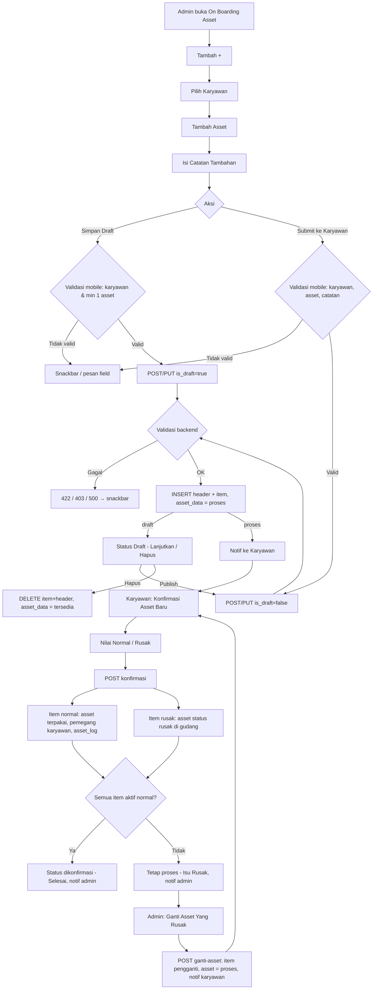
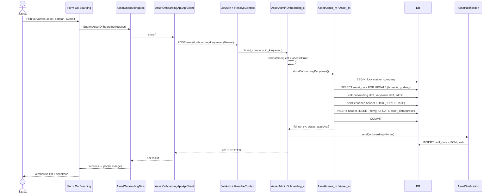
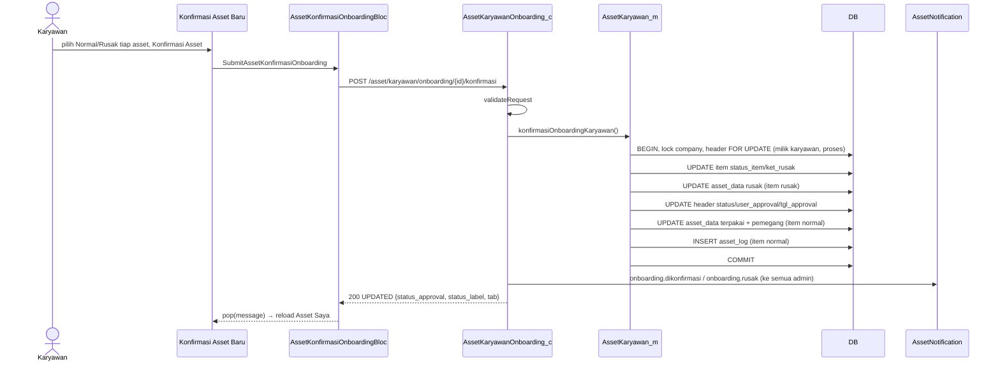
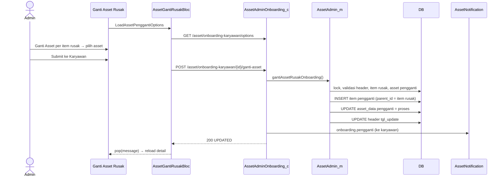
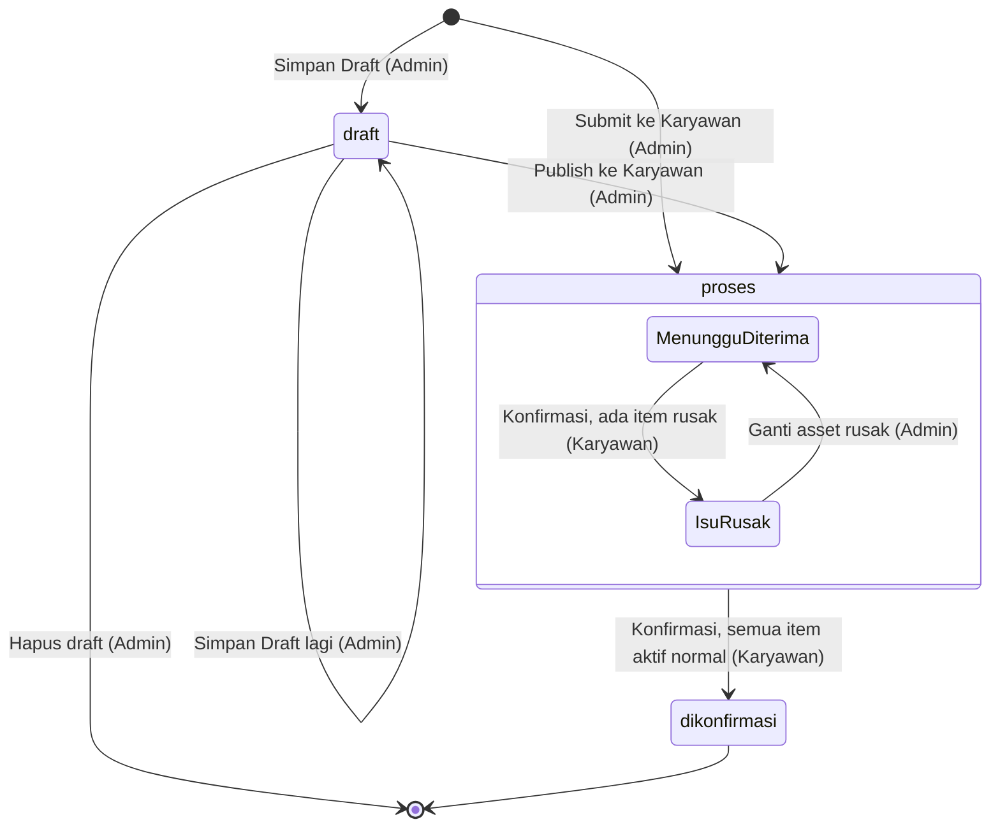
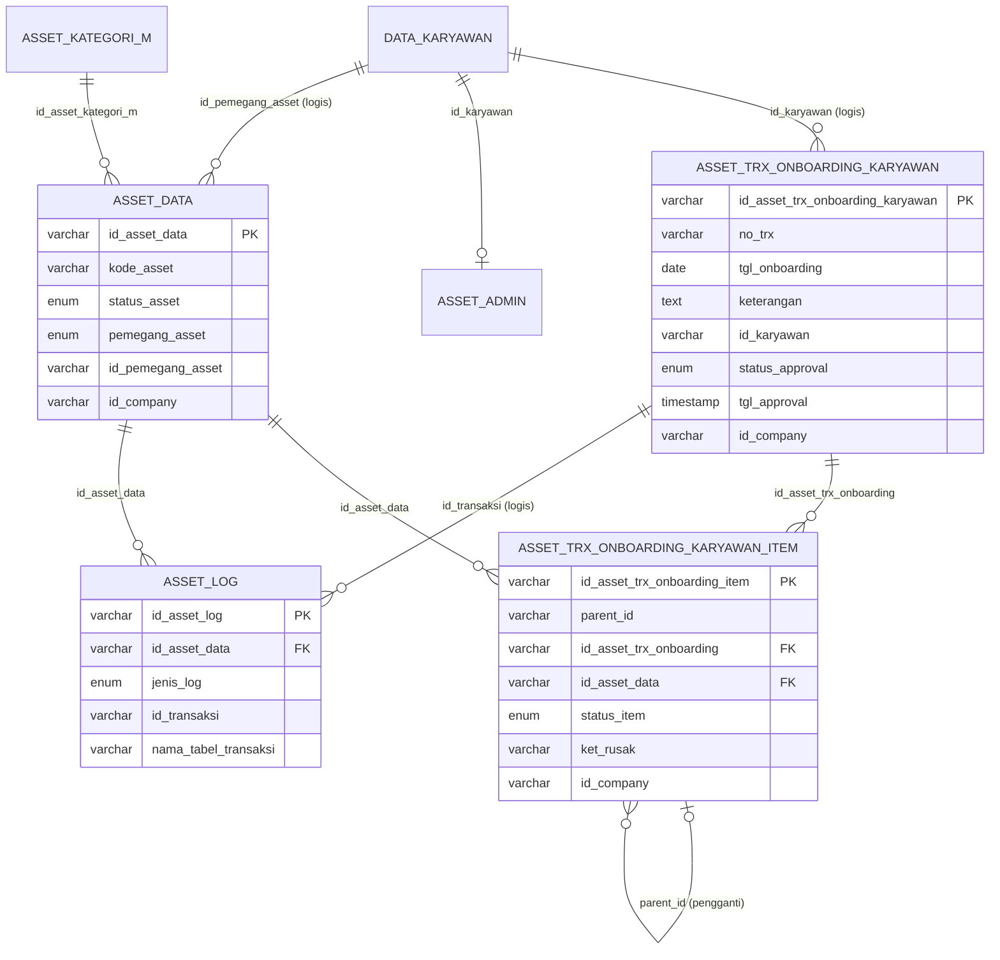

# Dokumentasi Teknis & Manual Book — Asset Onboarding Karyawan

> Dokumen ini disusun **murni dari source code lokal** (`API/` Lumen dan `MOBILE/` Flutter) per 26 September 2026.
> Business requirement dan kode fitur **diturunkan dari kode**, bukan dari dokumen bisnis terpisah.
> Bagian yang tidak ditemukan di source ditandai **⚠️ Belum ditemukan**, asumsi ditandai **⚠️ Asumsi**.
> Contoh ID/nama pada payload adalah **data sintetis**.

---

## 1. Informasi Dokumen

| Informasi | Nilai |
|---|---|
| Nama Fitur | Asset Onboarding Karyawan (UI: **"On Boarding Asset"**) |
| Kode Fitur | **KRY01** (prefix nomor transaksi `KRY01-YYYYMMNNN`) |
| Modul | Asset Management |
| Backend | Laravel **Lumen ^10.0**, PHP ^8.1, JWT `tymon/jwt-auth ^2.3`, Query Builder (`DB::table`) |
| Database | Relasional; struktur mengacu `API/diagram-asset.dbml` + migrations. ⚠️ Asumsi: MySQL/MariaDB (sintaks `ON UPDATE CURRENT_TIMESTAMP`, `lockForUpdate`) |
| Mobile | Flutter (package `professional_flutter_3_35`, app v3.11.0), `flutter_bloc ^7.0.0`, `dio ^5.9.0` |
| Web | ⚠️ Belum ditemukan: tidak ada source web di workspace |
| Versi Dokumen | 1.2 |
| Tanggal Dokumentasi | 2026-10-12 |
| Menggantikan | `Claude outputs/alur-onboarding-asset-karyawan.md` (usang — lihat §39) |

---

## 2. Daftar Isi

1. [Informasi Dokumen](#1-informasi-dokumen)
2. [Daftar Isi](#2-daftar-isi)
3. [Quick Overview](#3-quick-overview)
4. [Ringkasan Fitur](#4-ringkasan-fitur)
5. [Tujuan Fitur](#5-tujuan-fitur)
6. [Aktor](#6-aktor)
7. [Hak Akses](#7-hak-akses)
8. [Terminologi](#8-terminologi)
9. [Business Rules](#9-business-rules)
10. [Business Flow](#10-business-flow)
11. [Flow Berdasarkan Role](#11-flow-berdasarkan-role)
12. [Flow Diagram](#12-flow-diagram)
13. [Sequence Diagram](#13-sequence-diagram)
14. [Status Transaksi](#14-status-transaksi)
15. [State Transition](#15-state-transition)
16. [Struktur Database](#16-struktur-database)
17. [Relasi Database](#17-relasi-database)
18. [Data Dictionary](#18-data-dictionary)
19. [Database Index](#19-database-index)
20. [Backend Architecture](#20-backend-architecture)
21. [Backend Business Logic](#21-backend-business-logic)
22. [Dampak terhadap asset_data](#22-dampak-terhadap-asset_data)
23. [API Documentation](#23-api-documentation)
24. [Detail Setiap API](#24-detail-setiap-api)
25. [Mobile Architecture](#25-mobile-architecture)
26. [Mobile Screen](#26-mobile-screen)
27. [Mobile → API](#27-mobile--api)
28. [API → Mobile](#28-api--mobile)
29. [Mapping Mobile → API → Database](#29-mapping-mobile--api--database)
30. [Mapping Database → API → Mobile](#30-mapping-database--api--mobile)
31. [Validation](#31-validation)
32. [Error Handling](#32-error-handling)
33. [Audit Trail](#33-audit-trail)
34. [Notification](#34-notification)
35. [Security](#35-security)
36. [Manual Book User/Admin](#36-manual-book-useradmin)
37. [Kondisi Button](#37-kondisi-button)
38. [Testing Scenario](#38-testing-scenario)
39. [Temuan Ketidaksesuaian](#39-temuan-ketidaksesuaian)
40. [Edge Case](#40-edge-case)
41. [Potential Bug / Technical Risk](#41-potential-bug--technical-risk)
42. [Dependency](#42-dependency)
43. [Source Code Reference](#43-source-code-reference)
44. [Developer Notes](#44-developer-notes)
45. [End-to-End Traceability](#45-end-to-end-traceability)
46. [Ringkasan Database Impact](#46-ringkasan-database-impact)
47. [Checklist Implementasi](#47-checklist-implementasi)
48. [Changelog](#48-changelog)

---

## 3. Quick Overview

| Item | Informasi |
|---|---|
| Feature | Asset Onboarding Karyawan |
| Module | Asset Management |
| Actor | Admin Asset, Karyawan (penerima), System |
| Main Transaction | `asset_trx_onboarding_karyawan` |
| Detail Transaction | `asset_trx_onboarding_karyawan_item` (self-reference `parent_id` untuk asset pengganti) |
| Asset Master | `asset_data` |
| Log | `asset_log` (`jenis_log = onboarding_karyawan`) |
| Initial Status | `draft` (Simpan Draft) atau `proses` (Submit ke Karyawan) |
| Final Status | `dikonfirmasi` (label UI **"Selesai"**) |
| Approval | **Tidak ada** approval/reject oleh approver. "Konfirmasi" dilakukan karyawan penerima |
| API | 7 endpoint admin `/asset/onboarding-karyawan...` + 4 endpoint karyawan (`/asset/karyawan/onboarding...` dan `/asset/karyawan/data/{id}`) |
| Mobile Screen | List On Boarding, Form On Boarding (tambah/edit draft), Detail On Boarding, Ganti Asset Rusak, Konfirmasi Asset Baru, banner di Asset Saya |

Gambaran implementasi sebenarnya:

```text
Admin Asset
   ↓  (Asset Karyawan → "On Board" → tombol +)
Form On Boarding (Pilih Karyawan, Tambah Asset, Catatan Tambahan)
   ↓  Simpan Draft / Submit ke Karyawan
Flutter (AssetOnboardingBloc → AssetOnboardingApi → ApiClient/Dio + Bearer JWT)
   ↓
Lumen API  (middleware jwt.api + jwt.ctx → AssetAdminOnboarding_c → validasi → AssetAdmin_m)
   ↓  DB::transaction + lock master_company
INSERT asset_trx_onboarding_karyawan (draft/proses)
INSERT asset_trx_onboarding_karyawan_item (status_item = belum_dicek)
UPDATE asset_data.status_asset = 'proses'   (asset ter-reservasi)
   ↓  notifikasi "Onboarding Asset Baru" (jika bukan draft)
Karyawan → Asset Saya → Konfirmasi Asset Baru (Normal / Rusak per asset)
   ↓
Asset Normal → asset_data: terpakai, pemegang = karyawan  + INSERT asset_log
Asset Rusak  → asset_data: rusak, tetap di gudang → status "Isu Rusak"
   ↓  (jika ada rusak) Admin → Ganti Asset Yang Rusak → item pengganti → karyawan cek lagi
Semua item aktif Normal → status_approval = dikonfirmasi ("Selesai")
```

---

## 4. Ringkasan Fitur

Asset Onboarding Karyawan adalah fitur modul Asset Management untuk **mencatat dan menyerahkan asset perusahaan dari gudang kepada seorang karyawan**, disertai **verifikasi kondisi fisik oleh karyawan penerima**.

Cara kerja berdasarkan kode:

- **Onboarding dibuat** oleh Admin Asset: memilih satu karyawan aktif, satu/lebih asset yang **tersedia di gudang**, dan catatan tambahan. Dapat disimpan sebagai **Draft** (bisa diedit/dihapus) atau langsung **dikirim** ke karyawan.
- **Asset ditentukan** saat pembuatan (bukan tahap terpisah). Asset langsung **dikunci** (`status_asset = proses`), termasuk untuk draft.
- **Tidak ada approval** atasan/approver. Tahap "konfirmasi" adalah pengecekan fisik oleh karyawan penerima.
- **Serah terima** terjadi ketika karyawan mengonfirmasi: setiap asset dinilai **Normal** atau **Rusak**. Asset **Normal langsung berpindah** ke karyawan (per item, parsial). Asset **Rusak** tetap di gudang berstatus `rusak`.
- **Penggantian**: bila ada asset rusak, Admin memilih asset pengganti; karyawan mengecek ulang hanya asset pengganti. Siklus ini dapat berulang.
- **Transaksi selesai** (`dikonfirmasi`) ketika seluruh item aktif (item yang tidak digantikan) berstatus normal.
- **Pemegang asset** berubah pada `asset_data.pemegang_asset = 'karyawan'` dan `id_pemegang_asset = id_karyawan`; histori dicatat ke `asset_log`.

---

## 5. Tujuan Fitur

### 5.1 Tujuan Bisnis (diturunkan dari kode)

- Setiap asset yang diserahkan ke karyawan tercatat dalam transaksi bernomor (`KRY01-...`).
- Karyawan wajib memeriksa kondisi fisik dan menyatakan tanggung jawab atas asset ("Dengan menerima asset ini, saya menyatakan telah memeriksa kondisi dan bertanggung jawab atas asset tersebut.").
- Asset rusak saat serah terima tidak dibebankan ke karyawan, tetap di gudang dengan status rusak, dan dapat diganti.
- Asset yang sedang diproses tidak dapat dipakai oleh transaksi lain (peminjaman, penambahan, onboarding lain).
- Setiap perpindahan asset ke karyawan dapat ditelusuri (asset_log).

### 5.2 Tujuan Sistem

- Membuat, mengubah, dan menghapus draft transaksi onboarding.
- Menyimpan daftar asset beserta snapshot nama/deskripsi/kategori.
- Mereservasi asset (`status_asset = proses`) selama transaksi berjalan.
- Mencatat hasil pengecekan per item (`normal`/`rusak` + alasan).
- Memindahkan pemegang asset ke karyawan dan mencatat `asset_log`.
- Menyediakan mekanisme asset pengganti berbentuk pohon (`parent_id`).
- Mengirim notifikasi inbox + push FCM ke pihak terkait.

---

## 6. Aktor

| Aktor | Role (di sistem) | Fungsi |
|---|---|---|
| Admin Asset | Terdaftar di `asset_admin` dan karyawan aktif (`data_karyawan.status` ∈ '1','2','3','4') | Membuat/mengedit/menghapus draft, mengirim onboarding, melihat daftar & detail, memilih asset pengganti |
| Karyawan (penerima) | User login (JWT) yang dipilih sebagai `id_karyawan` pada transaksi | Menerima notifikasi, mengecek asset (Normal/Rusak), mengonfirmasi |
| System | Backend + FCM | Validasi, penguncian, penomoran, update `asset_data`, insert `asset_log`, notifikasi |

> Tidak ada role **Approver**. Status `ditolak` ada di database tetapi tidak pernah di-set (lihat §39).

---

## 7. Hak Akses

| Action | Admin Asset | Karyawan (penerima) | Keterangan |
|---|:---:|:---:|---|
| Melihat daftar onboarding (semua karyawan) | ✅ | ❌ | `GET /asset/onboarding-karyawan`, non-admin → 403 |
| Melihat onboarding miliknya (Asset Saya) | – | ✅ | Hanya status `proses` yang perlu dicek |
| Melihat detail | ✅ (semua, termasuk draft) | ✅ (milik sendiri, bukan draft) | |
| Membuat onboarding (draft/kirim) | ✅ | ❌ | |
| Edit | ✅ (hanya status `draft`) | ❌ | |
| Delete | ✅ (hanya status `draft`, hard delete) | ❌ | |
| Approve / Reject | ❌ tidak tersedia | ❌ tidak tersedia | ⚠️ Belum ditemukan di source |
| Memilih asset | ✅ (saat buat/edit draft) | ❌ | |
| Konfirmasi / serah terima (Normal/Rusak) | ❌ | ✅ | |
| Memilih asset pengganti | ✅ (status Isu Rusak) | ❌ | |
| Menyelesaikan onboarding | – | Otomatis saat semua item aktif normal | Tidak ada tombol "Selesai" manual |
| Membatalkan onboarding yang sudah dikirim | ❌ | ❌ | ⚠️ Belum ditemukan |

> Admin Asset juga merupakan karyawan; bila admin dipilih sebagai penerima, ia mengonfirmasi lewat Asset Saya seperti karyawan lain (tidak ada pembatasan di kode).

---

## 8. Terminologi

| Istilah | Arti di sistem |
|---|---|
| Onboarding / On Boarding Asset | Transaksi penyerahan asset dari gudang ke karyawan (`asset_trx_onboarding_karyawan`) |
| Draft | `status_approval = draft`; belum terlihat karyawan, asset sudah direservasi |
| Menunggu Diterima | Label UI untuk `proses` yang masih punya item perlu dicek (atau tidak ada rusak) |
| Isu Rusak | Label UI untuk `proses`, semua item sudah dicek, masih ada item rusak tanpa pengganti |
| Selesai | Label UI untuk `status_approval = dikonfirmasi` |
| Item | Baris `asset_trx_onboarding_karyawan_item`, satu asset |
| Item pengganti | Item dengan `parent_id` = id item rusak yang digantikan |
| Item aktif | Item yang **tidak** dirujuk sebagai `parent_id` oleh item lain (belum diganti) |
| Perlu dicek (`perlu_dicek`) | Item aktif yang harus dinilai karyawan pada ronde ini |
| Diganti (`diganti`) | Item yang sudah memiliki item pengganti |
| Kelengkapan | `deskripsi_asset` pada item (snapshot `asset_data.deskripsi`, atau input kelengkapan saat penggantian) |
| Konfirmasi | Aksi karyawan menilai item; bukan approval |
| Reservasi | `asset_data.status_asset = 'proses'` selama transaksi aktif |
| Tab | Kelompok daftar: `proses`, `dikonfirmasi` (= Isu Rusak), `selesai` |

---

## 9. Business Rules

### BR-001 — Hanya Admin Asset yang dapat mengelola onboarding
- **Kondisi:** endpoint `/asset/onboarding-karyawan*`.
- **Validation:** `Asset_m::isAdmin` → ada di `asset_admin` untuk company yang sama dan `data_karyawan.status` ∈ '1','2','3','4'. Model juga memanggil `findAssetAdmin` untuk mengambil `nik - nama` aktor.
- **Error:** 403 `FORBIDDEN` "Pengguna tidak memiliki akses admin asset." / 422 "Pengguna tidak terdaftar sebagai admin asset."

### BR-002 — Karyawan penerima wajib dipilih dan aktif
- **Validation:** `id_karyawan` required; `findActiveKaryawan` (company sama, status aktif).
- **Error:** 422 "Karyawan wajib dipilih." / 422 `BUSINESS_RULE_VIOLATION` "Karyawan tidak ditemukan atau tidak aktif."

### BR-003 — Minimal satu asset, tanpa duplikat
- **Validation:** `asset_ids` array min 1, `asset_ids.*` distinct. Mobile mencegah memilih asset yang sama (exclude di picker).
- **Error:** "Minimal satu asset wajib dipilih." / "Asset yang sama tidak boleh dipilih lebih dari sekali."

### BR-004 — Catatan tambahan wajib saat dikirim, opsional saat draft
- **Validation:** `keterangan` required jika `is_draft=false`.
- **Error:** "Catatan tambahan wajib diisi."

### BR-005 — Asset harus tersedia di gudang
- **Validation:** `asset_data.status_asset = 'tersedia'` AND `pemegang_asset = 'gudang'` (dengan `FOR UPDATE`). Jumlah hasil harus sama dengan jumlah asset dikirim.
- **Error:** "Satu atau beberapa asset tidak tersedia untuk onboarding."
- **Catatan:** `kondisi_awal` asset **tidak** divalidasi (asset dengan kondisi awal apa pun boleh dipilih selama status tersedia).

### BR-006 — Asset tidak boleh aktif di onboarding lain
- **Validation:** `hasActiveOnboardingAsset` — ada item `belum_dicek`, belum diganti, pada header `draft`/`proses`.
- **Error:** "Satu atau beberapa asset sedang diproses pada onboarding lain."

### BR-007 — Asset langsung direservasi, termasuk draft
- **Action:** `asset_data.status_asset = 'proses'` saat create/update (draft maupun kirim) dan saat penggantian. Dilepas (`proses → tersedia`) saat draft diubah (asset lama) atau dihapus.

### BR-008 — Draft hanya dapat diubah/dihapus selama berstatus draft
- **Error:** "Hanya onboarding berstatus draft yang dapat diubah." / "...dapat dihapus." / "Draft onboarding asset tidak ditemukan."

### BR-009 — Karyawan hanya mengakses onboarding miliknya dan bukan draft
- **Validation:** `WHERE id_karyawan = ctx.id_karyawan AND status_approval != 'draft'`.
- **Error:** 404 "Onboarding asset tidak ditemukan." (detail) / 422 (konfirmasi).

### BR-010 — Konfirmasi hanya untuk status proses dan jika ada item perlu dicek
- **Error:** "Onboarding asset sudah tidak menunggu konfirmasi." / "Tidak ada asset yang perlu dicek. Asset rusak sedang menunggu penggantian dari admin."

### BR-011 — Semua item yang perlu dicek wajib dinilai sekaligus
- **Validation:** jumlah & ID item dikirim harus sama persis dengan item pending. Mobile: tombol aktif hanya bila semua dinilai.
- **Error:** "Seluruh asset pada onboarding wajib dicek."

### BR-012 — Asset rusak wajib disertai keterangan
- **Validation:** `ket_rusak` required_if `status_item = rusak`, max 255.
- **Error:** "Alasan kerusakan wajib diisi."

### BR-013 — Serah terima bersifat parsial per item
- **Action:** Item **normal** pada ronde konfirmasi langsung diserahkan (asset `terpakai`, pemegang karyawan) walaupun item lain rusak.

### BR-014 — Asset rusak kembali ke gudang berstatus rusak
- **Action:** `asset_data.status_asset = 'rusak'`, `id_pemegang_asset = ''`, `ket_rusak` = alasan (hanya jika asset masih `proses` & `gudang`). Pesan UI: "Asset yang rusak akan dikembalikan ke gudang dengan status "Rusak"."

### BR-015 — Transaksi selesai otomatis
- **Kondisi:** seluruh item aktif berstatus `normal` → `status_approval = dikonfirmasi`. Jika tidak, tetap `proses` (Isu Rusak).

### BR-016 — Penggantian hanya setelah karyawan selesai mengecek
- **Validation:** status `proses`, `tgl_approval` tidak NULL, tidak ada item pending.
- **Error:** "Asset rusak hanya dapat diganti setelah karyawan selesai mengecek asset."

### BR-017 — Item yang diganti harus rusak dan belum pernah diganti
- **Error:** "Satu atau beberapa asset rusak tidak valid atau sudah diganti."
- Penggantian boleh untuk sebagian item rusak saja.

### BR-018 — Asset pengganti harus valid
- Tersedia & di gudang (BR-005), unik, tidak aktif di onboarding lain, `kelengkapan` wajib (max 255).
- **Error:** "Satu atau beberapa asset pengganti tidak tersedia." / "Asset pengganti yang sama tidak boleh dipilih lebih dari sekali." / "Satu atau beberapa asset pengganti sedang diproses pada onboarding lain." / "Kelengkapan asset pengganti wajib diisi."

### BR-019 — Batas penomoran
- ID header dan ID item: 3 digit urut per company per bulan (maks. 999); ID log: 5 digit.
- **Error:** "Nomor transaksi untuk periode ini sudah mencapai batas."

### BR-020 — Daftar pilihan karyawan (UI) mengecualikan karyawan yang masih memiliki onboarding draft/proses/ditolak
- Hanya diterapkan pada endpoint options, **tidak** divalidasi saat simpan (lihat RISK-003).

### BR-021 — Asset dalam onboarding aktif terkunci untuk modul lain
- Peminjaman dan Penambahan/Request asset memanggil `hasActiveOnboardingAsset` → "Satu atau beberapa asset sedang diproses pada onboarding."

---

## 10. Business Flow

```text
Admin membuka Asset Karyawan → On Board
        ↓
Tambah (+) → Pilih Karyawan → Tambah Asset (kategori → asset) → Catatan Tambahan
        ↓
 ┌──────────── Simpan Draft ─────────────┐        Submit ke Karyawan
 │ status draft, asset direservasi       │               │
 │ (bisa Lanjutkan Draft / Hapus)        │               │
 └── Publish ke Karyawan ────────────────┴──────────────►│
                                                         ↓
                                     status proses ("Menunggu Diterima")
                                     notifikasi ke karyawan
                                                         ↓
                              Karyawan: Asset Saya → Konfirmasi Asset Baru
                              nilai tiap asset Normal / Rusak (+alasan)
                                                         ↓
                    ┌────────── semua item aktif Normal? ──────────┐
                    │ Ya                                            │ Tidak
                    ↓                                               ↓
   status dikonfirmasi ("Selesai")                 status tetap proses ("Isu Rusak")
   asset normal → terpakai, pemegang karyawan      asset normal → terpakai (tetap diserahkan)
   notifikasi admin "Dikonfirmasi"                 asset rusak → status rusak di gudang
                                                   notifikasi admin "Laporan Asset Rusak"
                                                                    ↓
                                                   Admin: Ganti Asset Yang Rusak
                                                   pilih asset pengganti → Submit ke Karyawan
                                                                    ↓
                                                   status "Menunggu Diterima" (hanya pengganti dicek)
                                                                    ↓
                                                   kembali ke konfirmasi karyawan (berulang)
```

---

## 11. Flow Berdasarkan Role

### 11.1 Admin Asset
1. Buka halaman admin **Asset Karyawan**, pilih aksi **On Board** → halaman **On Boarding Asset** (tab Proses/Dikonfirmasi/Selesai).
2. Tekan **+** → form **On Boarding Asset**.
3. **Pilih Karyawan** (bottom sheet, cari nama/NIK). Hanya karyawan aktif tanpa onboarding aktif yang muncul.
4. **Tambah Asset**: pilih kategori (pohon kategori), lalu asset (cari nama/kode/merek). Ulangi untuk asset lain; asset bisa dihapus dari daftar.
5. Isi **Catatan Tambahan**.
6. Tekan **Simpan Draft** (status draft) atau **Submit ke Karyawan** (status proses + notifikasi).
7. Draft: pada list tekan **Lanjutkan Draft** untuk edit → **Simpan Draft** / **Publish ke Karyawan**; atau **Hapus**.
8. Pantau detail. Jika status **Isu Rusak** (tab Dikonfirmasi), buka detail → **Ganti Asset Yang Rusak** → tiap item rusak **Ganti Asset** → pilih asset pengganti → **Submit ke Karyawan**.
9. Transaksi berpindah ke tab **Selesai** setelah karyawan mengonfirmasi semua asset aktif normal.

### 11.2 Karyawan
1. Menerima notifikasi **"Onboarding Asset Baru"** / **"Asset Pengganti"**, atau melihat banner **On Boarding Asset** di **Asset Saya**.
2. Buka **Konfirmasi Asset Baru**: lihat data onboarding, data karyawan, catatan tambahan, daftar asset.
3. Untuk setiap asset yang perlu dicek pilih **Normal** atau **Rusak**; jika Rusak isi **Report Kerusakan**.
4. Tekan **Konfirmasi Asset**. Asset normal masuk daftar asset miliknya.

### 11.3 Approver
⚠️ Belum ditemukan: tidak ada role/proses approver pada source.

### 11.4 System
- Validasi request & aturan bisnis; lock `master_company` per transaksi.
- Generate ID & nomor transaksi.
- Reservasi/pelepasan asset (`tersedia ⇄ proses`).
- Pada konfirmasi: update item, update `asset_data`, insert `asset_log`, tentukan status header.
- Hitung label/tab turunan (`status_label`, `tab`, `isu_rusak`, `perlu_dicek`, `diganti`).
- Kirim notifikasi inbox (`notif_data`) + push FCM setelah transaksi DB selesai.

---

## 12. Flow Diagram



---

## 13. Sequence Diagram

### 13.1 Buat onboarding (Submit ke Karyawan)



### 13.2 Konfirmasi karyawan



### 13.3 Ganti asset rusak



---

## 14. Status Transaksi

Field: `asset_trx_onboarding_karyawan.status_approval` (enum `status_onboarding`, default `proses`). Enum PHP: `App\Models\Asset\OnboardingStatus`. Enum Flutter: `AssetOnboardingApproval`.

| Status (DB) | Label UI | Tab | Deskripsi | Action Selanjutnya |
|---|---|---|---|---|
| `draft` | Draft | proses | Disimpan admin, belum terlihat karyawan, asset direservasi | Admin: Lanjutkan Draft (edit/publish), Hapus |
| `proses` (ada item perlu dicek, atau tidak ada rusak) | Menunggu Diterima | proses | Menunggu karyawan mengecek | Karyawan: Konfirmasi Asset |
| `proses` (semua sudah dicek, ada rusak tanpa pengganti) | Isu Rusak | dikonfirmasi | Menunggu asset pengganti | Admin: Ganti Asset Yang Rusak |
| `dikonfirmasi` | Selesai | selesai | Semua item aktif normal, asset sudah diserahkan | Tidak ada (final) |
| `ditolak` | Ditolak | proses | **Tidak pernah di-set oleh kode** | ⚠️ Tidak ada aksi |

Status turunan per item (`status_item`, enum `kondisi_awal`): `belum_dicek` → `normal` / `rusak`. Label UI item: Menunggu Diterima / Normal / Rusak.

Migrasi nilai lama (`2026_09_17_000007`): 0=draft, 1=proses, 2=ditolak, 3=dikonfirmasi.

---

## 15. State Transition



| Status Awal | Action | Status Akhir | Actor |
|---|---|---|---|
| – | Create `is_draft=true` | draft | Admin |
| – | Create `is_draft=false` | proses (Menunggu Diterima) | Admin |
| draft | Update `is_draft=true` | draft | Admin |
| draft | Update `is_draft=false` | proses | Admin |
| draft | Delete | (terhapus) | Admin |
| proses (Menunggu Diterima) | Konfirmasi, ada item rusak | proses (Isu Rusak) | Karyawan |
| proses (Menunggu Diterima) | Konfirmasi, semua item aktif normal | dikonfirmasi (Selesai) | Karyawan |
| proses (Isu Rusak) | Ganti asset (sebagian/semua) | proses (Menunggu Diterima) | Admin |
| proses / dikonfirmasi | Edit / Delete | ditolak dengan 422 | – |
| – | – | ditolak | ⚠️ Tidak ada transisi |

Status `asset_data.status_asset` akibat onboarding:

| Dari | Ke | Trigger |
|---|---|---|
| tersedia (gudang) | proses | Create, Update draft (asset baru), Ganti asset (pengganti) |
| proses | tersedia | Update draft (asset lama dilepas), Delete draft |
| proses (gudang) | terpakai (karyawan) | Konfirmasi item normal |
| proses (gudang) | rusak (gudang) | Konfirmasi item rusak |

---

## 16. Struktur Database

| Table | Type | Fungsi |
|---|---|---|
| `asset_trx_onboarding_karyawan` | Transaction Header | Data transaksi onboarding |
| `asset_trx_onboarding_karyawan_item` | Transaction Detail | Asset per transaksi + pohon pengganti |
| `asset_data` | Master | Data asset; status & pemegang diubah |
| `asset_kategori_m` | Master | Nama kategori (snapshot) & pohon kategori untuk picker |
| `data_karyawan` | Master (HR) | Karyawan aktif, NIK, nama, cabang, departemen |
| `master_cabang`, `master_departemen` | Master | Nama cabang/divisi pada detail |
| `asset_admin` | Master akses | Daftar admin asset per company |
| `master_company` | Master | Dipakai sebagai lock (`SELECT ... FOR UPDATE`) |
| `asset_log` | Log | Histori perpindahan asset ke karyawan |
| `notif_data` | Notifikasi | Inbox notifikasi |
| `users` | Auth | `token_fcm`, `lang` untuk push notif; user JWT |

> ⚠️ Belum ditemukan: migration `CREATE TABLE` untuk tabel onboarding. Struktur di bawah mengacu pada DBML + migrations perubahan.

---

## 17. Relasi Database

Relasi berasal dari `ref` DBML dan kondisi JOIN pada query (semua JOIN juga mencocokkan `id_company`).



Relasi **logis** (tanpa `ref` di DBML, hanya lewat query): `id_karyawan` → `data_karyawan`, `id_pemegang_asset` → `data_karyawan`, `asset_log.id_transaksi` → header, `parent_id` → item. ⚠️ Belum ditemukan: apakah FK fisik dibuat di database (tidak ada migration create table).

---

## 18. Data Dictionary

### 18.1 asset_trx_onboarding_karyawan

| Field | Type | Null | Default | Key | Description |
|---|---|:---:|---|---|---|
| id_asset_trx_onboarding_karyawan | varchar(50) | No | – | PK | `id_company + YYYYMM + 3 digit` |
| no_trx | varchar(50) | No | '' | – | `KRY01-YYYYMM` + 3 digit (urutan sama dengan ID). Tidak unique |
| tgl_onboarding | date | No | CURRENT_DATE | – | Diisi tanggal hari ini saat create; di-reset ke hari ini saat update draft |
| keterangan | text | Yes | – | – | Catatan tambahan |
| ket_tolak | varchar(255) | No | '' | – | "terkait approval"; selalu diisi `''` (tidak dipakai) |
| id_karyawan | varchar(150) | – | '' | – | Karyawan penerima |
| nik_karyawan | varchar(255) | – | '' | – | Snapshot NIK |
| nama_karyawan | varchar(255) | – | '' | – | Snapshot nama |
| status_approval | enum(draft, proses, ditolak, dikonfirmasi) | No | proses | IDX | Status transaksi |
| user_approval | varchar(255) | No | '' | – | `nik - nama` **karyawan** yang terakhir konfirmasi |
| tgl_approval | timestamp | Yes | NULL | IDX | Waktu konfirmasi terakhir; NULL = belum pernah dicek (dipakai sebagai penanda ronde pertama) |
| id_company | varchar(50) | No | '' | IDX | Company |
| tgl_input | timestamp | – | CURRENT_TIMESTAMP | IDX | Waktu buat |
| user_input | varchar(255) | No | '' | – | `nik - nama` admin pembuat |
| tgl_update | timestamp | Yes | NULL (ON UPDATE) | – | Waktu update |
| user_update | varchar(255) | No | '' | – | `nik - nama` pengubah (admin/karyawan) |

### 18.2 asset_trx_onboarding_karyawan_item

| Field | Type | Null | Default | Key | Description |
|---|---|:---:|---|---|---|
| id_asset_trx_onboarding_item | varchar(50) | No | – | PK | `id_company + YYYYMM + 3 digit` |
| parent_id | varchar(50) | Yes | – | IDX | `''` = item awal; berisi ID item rusak bila item ini pengganti |
| id_asset_trx_onboarding | varchar(50) | – | – | FK, IDX | → header |
| id_asset_data | varchar(50) | – | – | FK | → asset_data |
| nama_asset | varchar(255) | No | '' | – | Snapshot `asset_data.nama_asset` |
| deskripsi_asset | varchar(255) | – | '' | – | Snapshot `asset_data.deskripsi`; untuk pengganti = input `kelengkapan`. Di API dikirim sebagai `kelengkapan` |
| kategori_asset | varchar(255) | – | '' | – | Snapshot `asset_kategori_m.nama_kategori` |
| status_item | enum(normal, rusak, belum_dicek) | – | – | IDX | Hasil pengecekan karyawan; awal `belum_dicek` |
| ket_rusak | varchar(255) | – | '' | – | Alasan rusak dari karyawan |
| id_company | varchar(50) | No | '' | IDX | Company |
| tgl_input | timestamp | – | CURRENT_TIMESTAMP | – | Waktu insert |
| user_input | varchar(255) | No | '' | – | `nik - nama` admin |

> Tidak ada `tgl_update`/`user_update` di tabel item; perubahan status item oleh karyawan tidak tercatat pelakunya di tabel ini (lihat §33).

### 18.3 asset_data (field yang dipakai fitur)

| Field | Type | Dipakai untuk |
|---|---|---|
| id_asset_data | varchar(50) PK | Referensi item |
| kode_asset, nama_asset, merek, deskripsi | varchar | Tampilan & snapshot |
| id_asset_kategori_m | varchar(50) | Kategori/picker |
| status_asset | enum(tersedia, terpakai, dipinjam, rusak, dalam_perbaikan, dalam_proses_klaim, disposed, proses) | Filter ketersediaan & di-UPDATE |
| kondisi_awal | enum(normal, rusak, belum_dicek) | Dikirim di options; disalin ke `asset_log.kondisi_awal` |
| ket_rusak | varchar(255) | Di-UPDATE saat item rusak |
| pemegang_asset | enum(gudang, ruangan, karyawan) | Filter `gudang` & di-UPDATE `karyawan` |
| id_pemegang_asset | varchar(150) | `id_karyawan` pemegang (migration `2026_09_14_000002`) |
| id_company, tgl_update, user_update | – | Isolasi company & audit |

### 18.4 asset_log (yang diisi fitur)

| Field | Nilai dari onboarding |
|---|---|
| id_asset_log | `id_company + YYYYMM + 5 digit` |
| id_asset_data | Asset yang diserahkan |
| jenis_log | `onboarding_karyawan` |
| id_transaksi | ID header onboarding |
| nama_tabel_transaksi | `asset_trx_onboarding_karyawan` |
| kondisi_awal | `asset_data.kondisi_awal` |
| kondisi_akhir | `normal` |
| posisi_awal | `asset_data.pemegang_asset` sebelumnya (`gudang`) |
| posisi_akhir / pemegang_asset | `karyawan` |
| id_pemegang / nama_pemegang | ID & nama karyawan |
| id_company, tgl_input, user_input | company, waktu, `nik - nama` karyawan |

---

## 19. Database Index

| Index | Table | Columns | Tujuan |
|---|---|---|---|
| `atok_admin_list_idx` | asset_trx_onboarding_karyawan | (id_company, status_approval, tgl_approval, tgl_input, id_asset_trx_onboarding_karyawan) | Composite untuk list admin per company + filter status/tab + urutan `tgl_input DESC, id DESC` |
| `atoki_onboarding_status_idx` | asset_trx_onboarding_karyawan_item | (id_asset_trx_onboarding, id_company, status_item, parent_id) | Hitung item per header, subquery item pending/rusak per header |
| PK | kedua tabel | ID | Lookup by ID & `nextSequence` (`LIKE id_company+YYYYMM%` + `ORDER BY DESC`) |

Dibuat oleh migration `2026_09_17_000005` dan dibuat ulang di `2026_09_17_000007`.

Catatan: pencarian berdasarkan `atoki.id_asset_data` (cek asset aktif) dan `pengganti.parent_id` (NOT EXISTS) tidak diawali kolom index di atas — lihat RISK-010.

---

## 20. Backend Architecture

```text
routes/web.php → RouteLoader (routes/modules/asset, prefix "asset")
   ↓  middleware: jwt.api (JwtAuth) → jwt.ctx (ResolveContext)
Controller (AssetAdminOnboarding_c / AssetKaryawanOnboarding_c)  ← extends Asset_c ← BaseController
   ↓  validateRequest() (Validator inline) + accessError()
Model statis (AssetAdmin_m / AssetKaryawan_m ← Asset_m)  — berisi business logic + query
   ↓  DB::table (Query Builder), DB::transaction
Database
   ↓
ApiResponse (format JSON seragam)   +   AssetNotification (setelah commit)
```

Tidak ada layer Service, Repository, FormRequest, atau Eloquent relation untuk fitur ini.

| Layer | File/Class | Function | Tanggung Jawab |
|---|---|---|---|
| Route | `routes/modules/asset/RouteAsset.php`, `_config.php` | – | Definisi endpoint, namespace `Asset`, middleware |
| Middleware | `App\Http\Middleware\JwtAuth` | handle | Validasi Bearer JWT, set `auth_user` |
| Middleware | `App\Http\Middleware\ResolveContext` | handle | Bentuk `ctx` (id_karyawan, id_company, jabatan, cabang, dll) |
| Base Controller | `BaseController` | validateRequest | Validator → `ApiResponse::validation` |
| Base Controller | `Asset_c` | accessError, forbiddenError | Cek ctx & admin asset |
| Controller | `AssetAdminOnboarding_c` | onboardingOptions, getOnboardingKaryawan, storeOnboardingKaryawan, updateOnboardingKaryawan, deleteOnboardingKaryawan, getDetailOnboardingKaryawan, gantiAssetRusakOnboarding | Endpoint admin |
| Controller | `AssetKaryawanOnboarding_c` | getOnboardingSaya, getDetailOnboardingSaya, konfirmasiOnboardingSaya | Endpoint karyawan |
| Model | `AssetAdmin_m` | getOnboardingOptions, getOnboardingKaryawan(Page), storeOnboardingKaryawan, updateOnboardingDraft, deleteOnboardingDraft, getDetailOnboardingKaryawan, gantiAssetRusakOnboarding | Logic admin |
| Model | `AssetKaryawan_m` | getAssetSaya, getDetailOnboardingSaya, konfirmasiOnboardingKaryawan | Logic karyawan |
| Model | `Asset_m` | isAdmin, onboardingDetail, findActiveKaryawan, findAssetAdmin, hasActiveOnboardingAsset, pendingItemIds, wherePerluDicek, onboardingIdsPerluDicek, onboardingIdsWithIsuRusak, getLockedAssets, lockCompany, nextSequence, ensureSequenceCapacity, statusMetadata | Helper bersama |
| Enum | `OnboardingStatus` | – | draft/proses/ditolak/dikonfirmasi |
| Response | `App\Libraries\ApiResponse` | success, error, validation | Format & HTTP status |
| Notifikasi | `App\Support\Asset\AssetNotification` | send | notif_data + FCM |

---

## 21. Backend Business Logic

Semua aksi tulis memakai `DB::transaction(fn, 3)` (retry deadlock 3×) dan diawali `lockCompany()` (`SELECT id_company FROM master_company ... FOR UPDATE`) sehingga transaksi asset dalam satu company **diserialkan**.

### 21.1 Create — `storeOnboardingKaryawan`
1. **Auth**: middleware JWT → `ctx`.
2. **Validasi request** (controller) lalu **cek admin** (`accessError`).
3. `lockCompany`.
4. `asset_ids` di-unique; `getLockedAssets` (tersedia + gudang, `FOR UPDATE`) — jumlah harus sama.
5. `hasActiveOnboardingAsset` → tolak jika asset aktif di onboarding lain.
6. `findActiveKaryawan` (penerima) dan `findAssetAdmin` (aktor).
7. **Generate ID**: `nextSequence(header)` → `id_company + YYYYMM + %03d`; `no_trx = 'KRY01-' + YYYYMM + %03d`.
8. **INSERT header** (`status_approval` draft/proses, `tgl_approval` NULL, `user_input` = `nik - nama` admin).
9. **Generate ID item** (sequence lanjutan) dan **INSERT item** per asset (`parent_id=''`, `status_item='belum_dicek'`, snapshot).
10. **UPDATE asset_data** `status_asset='proses'`.
11. **COMMIT**; controller mengirim notifikasi `onboarding.dikirim` bila bukan draft.
12. **Response** 201 `CREATED`.

### 21.2 Update Draft — `updateOnboardingDraft`
1. Validasi, akses, lock, cek admin.
2. Header `FOR UPDATE`; harus `draft`.
3. Lepas reservasi asset lama (`proses → tersedia`).
4. Validasi asset baru (tersedia+gudang, tidak aktif di onboarding lain kecuali ini) & karyawan.
5. **DELETE** semua item lama → **INSERT** item baru (ID baru).
6. **UPDATE header**: tgl_onboarding hari ini, keterangan, karyawan, status draft/proses, reset `ket_tolak`, `user_approval`, `tgl_approval`.
7. **UPDATE asset_data** baru → `proses`.
8. Notifikasi `onboarding.dikirim` bila `is_draft=false`. Response 200 `UPDATED`.

### 21.3 Delete Draft — `deleteOnboardingDraft`
Lock → cek admin → header `draft` → asset `proses → tersedia` → **DELETE** item → **DELETE** header → 200 `DELETED`.

### 21.4 Konfirmasi — `konfirmasiOnboardingKaryawan`
1. Validasi request; ctx wajib ada (tidak perlu admin).
2. Lock; header milik karyawan login, `FOR UPDATE`, harus `proses`.
3. Karyawan harus aktif.
4. Tentukan item pending (`pendingItemIds`):
   - `tgl_approval` NULL → semua item aktif.
   - Sudah pernah → item aktif dengan `status_item = belum_dicek` (asset pengganti).
5. Validasi kelengkapan penilaian & alasan rusak.
6. **UPDATE item** `status_item`, `ket_rusak`.
7. Item rusak → **UPDATE asset_data** `status_asset='rusak'`, `id_pemegang_asset=''`, `ket_rusak` (hanya jika masih `proses` & `gudang`).
8. Hitung `semuaNormal` atas **seluruh item aktif** → status `dikonfirmasi` atau tetap `proses`.
9. **UPDATE header** `status_approval`, `user_approval`, `tgl_approval = now`, `tgl_update`, `user_update`.
10. Item normal ronde ini: lock `asset_data`; lewati jika sudah dipegang karyawan ini; selain itu wajib `proses`+`gudang` → **UPDATE** `terpakai`/`karyawan`/`id_pemegang_asset`; **INSERT asset_log** per asset.
11. COMMIT; notifikasi `onboarding.dikonfirmasi` atau `onboarding.rusak` ke semua admin; response 200 `UPDATED`.

### 21.5 Ganti Asset Rusak — `gantiAssetRusakOnboarding`
1. Validasi, akses, lock, admin, header `FOR UPDATE`.
2. Syarat: `proses`, `tgl_approval` terisi, tidak ada item pending.
3. Asset pengganti unik; item rusak valid & belum diganti (`FOR UPDATE`).
4. Asset pengganti tersedia+gudang & tidak aktif di onboarding lain.
5. **INSERT item pengganti** (`parent_id` = item rusak, `deskripsi_asset` = kelengkapan, `belum_dicek`).
6. **UPDATE asset_data** pengganti → `proses`; **UPDATE header** (`status_approval` tetap `proses`, `tgl_update`, `user_update`).
7. Notifikasi `onboarding.pengganti` ke karyawan; response 200 `UPDATED`.

### 21.6 Query baca
- **Options**: karyawan aktif tanpa onboarding draft/proses/ditolak; asset gudang yang `tersedia` (plus asset `proses` milik draft yang sedang diedit) dan tidak punya item `belum_dicek` di onboarding `proses`; kategori yang dipakai asset beserta seluruh parent-nya.
- **List**: JOIN item, `COUNT` item (termasuk pengganti) → `jumlah_asset`; urut `tgl_input DESC`; filter tab (§14).
- **Detail**: header + karyawan (cabang/divisi dari master) + item + flag turunan.

---

## 22. Dampak terhadap asset_data

| Field asset_data | Sebelum | Sesudah | Trigger |
|---|---|---|---|
| status_asset | tersedia | proses | Create / Update draft / Ganti (pengganti) |
| status_asset | proses | tersedia | Update draft (asset dikeluarkan) / Delete draft |
| status_asset | proses | terpakai | Konfirmasi item Normal |
| pemegang_asset | gudang | karyawan | Konfirmasi item Normal |
| id_pemegang_asset | '' | id_karyawan penerima | Konfirmasi item Normal |
| status_asset | proses | rusak | Konfirmasi item Rusak |
| id_pemegang_asset | – | '' | Konfirmasi item Rusak |
| ket_rusak | – | alasan dari karyawan | Konfirmasi item Rusak |
| tgl_update / user_update | – | now / `nik - nama` pelaku | Setiap UPDATE di atas |
| kondisi_awal, status_rusak, tgl_keluar | – | **Tidak diubah** | – |

```text
asset tersedia @gudang
      ↓ create onboarding
status_asset = proses (terkunci)
      ↓ karyawan konfirmasi
 ├─ Normal → status_asset = terpakai, pemegang_asset = karyawan, id_pemegang_asset = id_karyawan, + asset_log
 └─ Rusak  → status_asset = rusak, tetap gudang, ket_rusak = alasan (tanpa asset_log)
```

---

## 23. API Documentation

Base path: `ServerInfo.jwtBaseUrl` + prefix modul `asset/`. Semua endpoint wajib **Bearer JWT**.

| ID | Method | Endpoint | Function | Auth |
|---|---|---|---|---|
| API-001 | GET | `/asset/onboarding-karyawan/options` | Opsi karyawan, kategori, asset | JWT + Admin Asset |
| API-002 | GET | `/asset/onboarding-karyawan` | List onboarding (paginated/non) | JWT + Admin Asset |
| API-003 | POST | `/asset/onboarding-karyawan` | Buat onboarding (draft/kirim) | JWT + Admin Asset |
| API-004 | PUT | `/asset/onboarding-karyawan/{id}` | Ubah draft / publish | JWT + Admin Asset |
| API-005 | DELETE | `/asset/onboarding-karyawan/{id}` | Hapus draft | JWT + Admin Asset |
| API-006 | GET | `/asset/onboarding-karyawan/{id}` | Detail (admin) | JWT + Admin Asset |
| API-007 | POST | `/asset/onboarding-karyawan/{id}/ganti-asset` | Ganti asset rusak | JWT + Admin Asset |
| API-008 | GET | `/asset/karyawan/onboarding` | Home Asset Saya (termasuk onboarding pending) | JWT |
| API-009 | GET | `/asset/karyawan/onboarding/{id}` | Detail (karyawan) | JWT, pemilik |
| API-010 | POST | `/asset/karyawan/onboarding/{id}/konfirmasi` | Konfirmasi Normal/Rusak | JWT, pemilik |
| API-011 | GET | `/asset/karyawan/data/{id}` | Detail satu asset yang sedang dipegang karyawan (dari Asset Saya) | JWT, pemegang |

Endpoint approve/reject/selesai manual: ⚠️ Belum ditemukan.

**Format response umum** (`ApiResponse`):

```json
{ "code": "SUCCESS", "message": "…", "data": { } }
```

| code | HTTP |
|---|---|
| SUCCESS / UPDATED / DELETED | 200 |
| CREATED | 201 |
| UNAUTHORIZED | 401 |
| FORBIDDEN | 403 |
| NOT_FOUND | 404 |
| VALIDATION_ERROR / BUSINESS_RULE_VIOLATION | 422 |
| SYSTEM_ERROR | 500 |

---

## 24. Detail Setiap API

**Headers umum (dikirim mobile):**

```http
Authorization: Bearer <access_token>
Content-Type: application/json
Accept: application/json
locale: id
versi-app: <versi aplikasi>
```

Error umum untuk semua endpoint:

```json
{ "code": "UNAUTHORIZED", "message": "Token telah expired." }
{ "code": "UNAUTHORIZED", "message": "Token tidak valid." }
{ "code": "FORBIDDEN", "message": "Pengguna tidak memiliki akses admin asset." }
{ "code": "SYSTEM_ERROR", "message": "Terjadi kesalahan saat …" }
```

### API-001 — Opsi Onboarding

```http
GET /asset/onboarding-karyawan/options?exclude_onboarding_id={id_draft}
```

| Param | Type | Required | Description |
|---|---|:---:|---|
| exclude_onboarding_id | string ≤50 | Tidak | Diisi saat edit draft: karyawan & asset milik draft ini tetap muncul |

**Backend validation:** `exclude_onboarding_id nullable|string|max:50` → "Parameter opsi onboarding tidak valid."
**Database impact:** SELECT saja.

**Success (200):**
```json
{
  "code": "SUCCESS",
  "message": "Data opsi onboarding berhasil ditemukan.",
  "data": {
    "karyawan": [
      { "id_karyawan": "KRY0001", "nik": "EMP-001", "nama_karyawan": "Budi Contoh" }
    ],
    "kategori_asset": [
      { "id_asset_kategori_m": "CMP001202601001", "parent_id": "", "flag_parent": 1, "nama_kategori": "Elektronik" },
      { "id_asset_kategori_m": "CMP001202601002", "parent_id": "CMP001202601001", "flag_parent": 0, "nama_kategori": "Laptop" }
    ],
    "assets": [
      {
        "id_asset_data": "CMP00120260100001",
        "kode_asset": "LPT-0001",
        "nama_asset": "Laptop 14 inch",
        "id_asset_kategori_m": "CMP001202601002",
        "kategori_asset": "Laptop",
        "merek": "MerekX",
        "deskripsi": "Charger, tas",
        "kondisi_awal": "normal"
      }
    ]
  }
}
```

### API-002 — Daftar Onboarding

```http
GET /asset/onboarding-karyawan?tab=proses&limit=20&offset=0
```

| Param | Type | Required | Description |
|---|---|:---:|---|
| tab | `proses` \| `dikonfirmasi` \| `selesai` | Tidak | Filter tab (§14) |
| limit | int 1–50 | Tidak | Default 20 |
| offset | int ≥0 | Tidak | Default 0 |

Jika tidak ada satu pun parameter → response `data` berupa **array** seluruh onboarding (tanpa pagination). Mobile selalu mengirim `tab`.

**Validation:** `tab.in` "Filter onboarding asset tidak valid.", `limit.max` "Limit maksimal adalah 50 data." (message: "Parameter daftar onboarding asset tidak valid.")

**Success (200, paginated):**
```json
{
  "code": "SUCCESS",
  "message": "Data onboarding asset karyawan berhasil ditemukan.",
  "data": {
    "filters": [
      { "value": "proses", "label": "Proses" },
      { "value": "dikonfirmasi", "label": "Dikonfirmasi" },
      { "value": "selesai", "label": "Selesai" }
    ],
    "onboardings": [
      {
        "id": "CMP001202609001",
        "no_trx": "KRY01-202609001",
        "tgl_onboarding": "2026-09-26",
        "keterangan": "Onboarding karyawan baru divisi IT",
        "ket_tolak": "",
        "id_karyawan": "KRY0001",
        "nik_karyawan": "EMP-001",
        "nama_karyawan": "Budi Contoh",
        "jumlah_asset": 2,
        "status_approval": "proses",
        "status_label": "Menunggu Diterima",
        "tab": "proses"
      }
    ],
    "pagination": { "limit": 20, "offset": 0, "next_offset": 1, "has_more": false }
  }
}
```

### API-003 — Buat Onboarding

```http
POST /asset/onboarding-karyawan
```

```json
{
  "id_karyawan": "KRY0001",
  "asset_ids": ["CMP00120260100001", "CMP00120260100002"],
  "keterangan": "Onboarding karyawan baru divisi IT",
  "is_draft": false
}
```

| Field | Type | Required | Description |
|---|---|:---:|---|
| id_karyawan | string ≤150 | Ya | Karyawan penerima |
| asset_ids | array string (≤50), min 1, distinct | Ya | ID `asset_data` |
| keterangan | string | Ya jika `is_draft=false` | Catatan tambahan |
| is_draft | boolean | Ya | `true` = draft, `false` = kirim ke karyawan |

**Backend validation:**

| Field | Rule | Message |
|---|---|---|
| id_karyawan | required\|string\|max:150 | Karyawan wajib dipilih. |
| asset_ids | required\|array\|min:1 | Minimal satu asset wajib dipilih. |
| asset_ids.* | required\|string\|max:50\|distinct | Asset yang sama tidak boleh dipilih lebih dari sekali. |
| keterangan | required (non-draft) / nullable (draft) | Catatan tambahan wajib diisi. |
| is_draft | required\|boolean | Status draft wajib dikirim. |

**Process:** §21.1. **Database impact:**
```text
INSERT asset_trx_onboarding_karyawan
INSERT asset_trx_onboarding_karyawan_item (n baris)
UPDATE asset_data (status_asset = proses)
INSERT notif_data (jika bukan draft)
```

**Success (201):**
```json
{
  "code": "CREATED",
  "message": "Onboarding asset berhasil dikirim ke karyawan.",
  "data": { "id": "CMP001202609001", "no_trx": "KRY01-202609001", "status_approval": "proses" }
}
```
Draft → message "Draft onboarding asset berhasil disimpan.", `status_approval: "draft"`.

**Error:**
```json
{ "code": "VALIDATION_ERROR", "message": "Data onboarding belum lengkap.",
  "errors": { "id_karyawan": ["Karyawan wajib dipilih."] } }
```
```json
{ "code": "BUSINESS_RULE_VIOLATION", "message": "Satu atau beberapa asset tidak tersedia untuk onboarding." }
```
Pesan 422 lain: "Satu atau beberapa asset sedang diproses pada onboarding lain.", "Karyawan tidak ditemukan atau tidak aktif.", "Pengguna tidak terdaftar sebagai admin asset.", "Perusahaan tidak ditemukan.", "Nomor transaksi untuk periode ini sudah mencapai batas." 500: "Terjadi kesalahan saat menyimpan onboarding asset."

### API-004 — Ubah / Publish Draft

```http
PUT /asset/onboarding-karyawan/{id}
```
Body & validasi **sama dengan API-003**. **Process:** §21.2.

**Database impact:**
```text
UPDATE asset_data (asset lama: proses → tersedia)
DELETE asset_trx_onboarding_karyawan_item (semua item draft)
INSERT asset_trx_onboarding_karyawan_item (item baru)
UPDATE asset_trx_onboarding_karyawan
UPDATE asset_data (asset baru → proses)
INSERT notif_data (jika publish)
```

**Success (200):**
```json
{ "code": "UPDATED", "message": "Onboarding asset berhasil dipublish ke karyawan.",
  "data": { "id": "CMP001202609001", "no_trx": "KRY01-202609001", "status_approval": "proses" } }
```
Draft → "Draft onboarding asset berhasil diperbarui."
**Error 422:** "Draft onboarding asset tidak ditemukan.", "Hanya onboarding berstatus draft yang dapat diubah.", + pesan API-003. 500: "Terjadi kesalahan saat memperbarui draft onboarding asset."

### API-005 — Hapus Draft

```http
DELETE /asset/onboarding-karyawan/{id}
```
Tanpa body. **Database impact:**
```text
UPDATE asset_data (proses → tersedia)
DELETE asset_trx_onboarding_karyawan_item
DELETE asset_trx_onboarding_karyawan
```
**Success (200):**
```json
{ "code": "DELETED", "message": "Draft onboarding asset berhasil dihapus.",
  "data": { "id": "CMP001202609001", "no_trx": "KRY01-202609001" } }
```
**Error 422:** "Draft onboarding asset tidak ditemukan.", "Hanya onboarding berstatus draft yang dapat dihapus." 500: "Terjadi kesalahan saat menghapus draft onboarding asset."

### API-006 — Detail Onboarding (Admin)

```http
GET /asset/onboarding-karyawan/{id}
```
**Database impact:** SELECT (header + data_karyawan + master_cabang + master_departemen + item + asset_data).

**Success (200):**
```json
{
  "code": "SUCCESS",
  "message": "Detail onboarding asset berhasil ditemukan.",
  "data": {
    "id": "CMP001202609001",
    "no_trx": "KRY01-202609001",
    "tgl_onboarding": "2026-09-26",
    "keterangan": "Onboarding karyawan baru divisi IT",
    "status_approval": "proses",
    "status_label": "Isu Rusak",
    "tab": "dikonfirmasi",
    "isu_rusak": true,
    "karyawan": {
      "id_karyawan": "KRY0001",
      "nik": "EMP-001",
      "nama_karyawan": "Budi Contoh",
      "cabang": "Kantor Pusat",
      "divisi": "IT"
    },
    "items": [
      {
        "id_item": "CMP001202609001",
        "parent_id": "",
        "id_asset_data": "CMP00120260100001",
        "kode_asset": "LPT-0001",
        "nama_asset": "Laptop 14 inch",
        "kategori_asset": "Laptop",
        "kelengkapan": "Charger, tas",
        "status_item": "rusak",
        "ket_rusak": "Ada garis pada layar",
        "perlu_dicek": false,
        "diganti": false
      },
      {
        "id_item": "CMP001202609002",
        "parent_id": "",
        "id_asset_data": "CMP00120260100002",
        "kode_asset": "MSE-0001",
        "nama_asset": "Mouse Wireless",
        "kategori_asset": "Aksesoris",
        "kelengkapan": "",
        "status_item": "normal",
        "ket_rusak": "",
        "perlu_dicek": false,
        "diganti": false
      }
    ]
  }
}
```
> `id_item` header & item memakai pola ID yang sama tetapi berasal dari tabel berbeda.
**Error:** 404 `{ "code": "NOT_FOUND", "message": "Onboarding asset tidak ditemukan." }`

### API-007 — Ganti Asset Rusak

```http
POST /asset/onboarding-karyawan/{id}/ganti-asset
```
```json
{
  "items": [
    { "id_item": "CMP001202609001", "id_asset_data": "CMP00120260100003", "kelengkapan": "Charger, tas" }
  ]
}
```

| Field | Type | Required | Description |
|---|---|:---:|---|
| items | array min 1 | Ya | Daftar penggantian |
| items.*.id_item | string ≤50, distinct | Ya | ID item **rusak** yang diganti |
| items.*.id_asset_data | string ≤50, distinct | Ya | Asset pengganti |
| items.*.kelengkapan | string ≤255 | Ya | Disimpan ke `deskripsi_asset` item pengganti |

**Backend validation messages:** "Minimal satu asset pengganti wajib dipilih.", "Asset rusak yang sama tidak boleh dikirim lebih dari sekali.", "Asset pengganti wajib dipilih.", "Asset pengganti yang sama tidak boleh dipilih lebih dari sekali.", "Kelengkapan asset pengganti wajib diisi." (message: "Data penggantian asset belum lengkap.")

**Database impact:**
```text
INSERT asset_trx_onboarding_karyawan_item (parent_id = item rusak)
UPDATE asset_data (pengganti → proses)
UPDATE asset_trx_onboarding_karyawan (tgl_update, user_update)
INSERT notif_data
```
**Success (200):**
```json
{ "code": "UPDATED", "message": "Asset pengganti berhasil dikirim ke karyawan.",
  "data": { "id": "CMP001202609001", "id_karyawan": "KRY0001", "no_trx": "KRY01-202609001",
            "status_approval": "proses", "jumlah_pengganti": 1 } }
```
**Error 422:** "Onboarding asset tidak ditemukan.", "Asset rusak hanya dapat diganti setelah karyawan selesai mengecek asset.", "Satu atau beberapa asset rusak tidak valid atau sudah diganti.", "Satu atau beberapa asset pengganti tidak tersedia.", "Satu atau beberapa asset pengganti sedang diproses pada onboarding lain." 500: "Terjadi kesalahan saat mengganti asset rusak."

### API-008 — Asset Saya (Karyawan)

```http
GET /asset/karyawan/onboarding
```
Response berisi data home Asset Saya; bagian onboarding:
```json
{
  "code": "SUCCESS",
  "message": "Data asset karyawan berhasil ditemukan.",
  "data": {
    "jumlah_asset": 3,
    "onboarding": [
      { "id": "CMP001202609001", "no_trx": "KRY01-202609001", "tgl_onboarding": "2026-09-26",
        "jumlah_asset": 2, "status_approval": "proses", "status_label": "Menunggu Diterima" }
    ],
    "assets": [
      { "id": "CMP00120260100002", "nama_asset": "Mouse Wireless", "kode_asset": "MSE-0001", "merek": "MerekX", "kategori": "Aksesoris" }
    ],
    "penambahan": [], "kerusakan": [], "upgrade": [], "peminjaman": [], "retur": [],
    "jatuh_tempo": [], "peminjaman_aktif": []
  }
}
```
`onboarding` hanya berisi transaksi `proses` yang masih perlu dicek. `assets` = asset dengan pemegang karyawan ini (bukan `dipinjam`).

### API-009 — Detail Onboarding (Karyawan)

```http
GET /asset/karyawan/onboarding/{id}
```
Sama dengan API-006, kecuali `karyawan` **tanpa** `id_karyawan`, dan hanya transaksi milik user login yang bukan draft. 404 "Onboarding asset tidak ditemukan."

### API-010 — Konfirmasi Onboarding (Karyawan)

```http
POST /asset/karyawan/onboarding/{id}/konfirmasi
```
```json
{
  "items": [
    { "id_item": "CMP001202609001", "status_item": "rusak", "ket_rusak": "Ada garis pada layar" },
    { "id_item": "CMP001202609002", "status_item": "normal" }
  ]
}
```

| Field | Rule | Message |
|---|---|---|
| items | required\|array\|min:1 | Kondisi asset wajib diisi. |
| items.*.id_item | required\|string\|max:50\|distinct | Asset yang sama tidak boleh dikirim lebih dari sekali. |
| items.*.status_item | required\|in:normal,rusak | Kondisi setiap asset wajib dipilih. / Kondisi asset harus normal atau rusak. |
| items.*.ket_rusak | nullable\|string\|max:255\|required_if rusak | Alasan kerusakan wajib diisi. |

(message: "Data konfirmasi asset belum lengkap.")

**Database impact:**
```text
UPDATE asset_trx_onboarding_karyawan_item (status_item, ket_rusak)
UPDATE asset_data (rusak → status rusak)
UPDATE asset_trx_onboarding_karyawan (status_approval, user_approval, tgl_approval)
UPDATE asset_data (normal → terpakai, pemegang karyawan)
INSERT asset_log (per asset normal)
INSERT notif_data (semua admin asset)
```
**Success (200):**
```json
{ "code": "UPDATED", "message": "Laporan kerusakan asset berhasil dikirim ke admin.",
  "data": { "id": "CMP001202609001", "no_trx": "KRY01-202609001",
            "status_approval": "proses", "status_label": "Isu Rusak", "tab": "dikonfirmasi" } }
```
Semua normal → message "Asset berhasil dikonfirmasi.", `status_approval: "dikonfirmasi"`, `status_label: "Selesai"`, `tab: "selesai"`.
**Error 422:** "Onboarding asset tidak ditemukan.", "Onboarding asset sudah tidak menunggu konfirmasi.", "Karyawan tidak ditemukan atau tidak aktif.", "Tidak ada asset yang perlu dicek. Asset rusak sedang menunggu penggantian dari admin.", "Seluruh asset pada onboarding wajib dicek.", "Alasan kerusakan wajib diisi.", "Satu atau beberapa asset pada onboarding tidak ditemukan.", "Satu atau beberapa asset pada onboarding tidak dapat diserahkan." 500: "Terjadi kesalahan saat mengonfirmasi asset."

### API-011 — Detail Asset Milik Karyawan
```http
GET /asset/karyawan/data/{id}
```
Dipanggil dari daftar **Asset Saya** untuk melihat satu asset. `{id}` adalah `id_asset_data`. Model: `AssetAdmin_m::getAssetDetailPemegang` (memakai kueri daftar asset admin dengan filter `pemegang_asset = karyawan` dan `id_pemegang_asset = ctx.id_karyawan`; asset berstatus `disposed` tidak ikut).

Respons memuat identitas asset (`kode_asset`, `nama_asset`, kategori, merek, deskripsi, kondisi awal, `status_asset`, lokasi), data garansi (`flag_garansi`, tanggal garansi, `vendor_garansi`, `no_dokumen_garansi`), dan `atribut[]` komponen. Data keuangan dan siapa yang mendaftarkan dikosongkan di sisi API: `didaftarkan_oleh`, `vendor_pembelian`, `tgl_perolehan`, `sumber_perolehan` (string kosong) serta `harga_perolehan`, `masa_penyusutan`, `nilai_residu`, `penyusutan_tahunan` (0). Pengosongan memakai daftar kolom tetap, sehingga kolom baru pada daftar admin perlu ditinjau agar tidak ikut terkirim ke karyawan.

404 "Asset tidak ditemukan." bila asset bukan (atau tidak lagi) milik pemanggil.

---

## 25. Mobile Architecture

```text
Page (StatefulWidget + BlocConsumer/BlocBuilder)
  ↓ event
Bloc (flutter_bloc)
  ↓
Api Service (AssetOnboardingApi / AssetSayaApi)   ← berperan sebagai repository
  ↓
ApiClient (Dio + _JwtAuthInterceptor)  → ApiResult
  ↓
Backend
```

| Layer | File | Function |
|---|---|---|
| Page | `UI/Modul/Asset/AssetAdmin/AssetAdminKaryawan/Onboarding/HalamanAssetAdminOnboardingKaryawan.dart` | List admin |
| Page | `.../Onboarding/HalamanAssetAdminAddOnboardingKaryawan.dart` | Form tambah/edit draft + picker |
| Page | `.../Onboarding/HalamanAssetAdminDetailOnboarding.dart` | Detail admin |
| Page | `.../Onboarding/HalamanAssetAdminGantiRusak.dart` | Ganti asset rusak |
| Page | `UI/Modul/Asset/AssetSaya/Onboarding/HalamanKonfirmasiAssetBaru.dart` | Konfirmasi karyawan |
| Page | `UI/Modul/Asset/AssetSaya/HalamanAssetSaya.dart` | Banner onboarding karyawan |
| Widget | `UI/Modul/Asset/Shared/Widgets/AssetCommonWidgets.dart` | Komponen bersama, `formatTanggalAsset` |
| Bloc | `Bloc/Asset/AssetOnboardingBloc.dart` | List, load more, options, draft, submit, update, delete |
| Bloc | `Bloc/Asset/AssetOnboardingDetailBloc.dart` | Detail admin |
| Bloc | `Bloc/Asset/AssetGantiRusakBloc.dart` | Options pengganti, pilih/hapus, submit |
| Bloc | `Bloc/Asset/AssetKonfirmasiOnboardingBloc.dart` | Detail karyawan, submit konfirmasi |
| Api | `Repository/Service/assetOnboardingApi.dart` | Endpoint admin |
| Api | `Repository/Service/assetSayaApi.dart` | Endpoint karyawan |
| Network | `Repository/Service/apiClient.dart`, `apiResult.dart` | Dio, JWT, parsing response |
| Model | `Repository/Model/Asset/mAssetOnboarding.dart`, `mAssetSaya.dart` | Model & request |
| Navigasi | `Setting/router.dart`, `Bloc/NavigatorBloc.dart` | Route & aksi navigasi |
| i18n | `assets/id/asset.json`, `assets/en/asset.json` (`MenuAsset`) | Label |

**Routes:**

| Route | Page | Bloc & event awal | Argumen |
|---|---|---|---|
| `/asset_admin_onboarding_karyawan` | List admin | AssetOnboardingBloc + `LoadAssetOnboardingList()` (tab `proses`) | – |
| `/asset_admin_add_onboarding_karyawan` | Form | AssetOnboardingBloc + `LoadAssetOnboardingOptions` / `LoadAssetOnboardingDraft(id)` | draftId? |
| `/asset_admin_detail_onboarding` | Detail admin | AssetOnboardingDetailBloc + `LoadAssetOnboardingDetail(id)` | id |
| `/asset_admin_ganti_rusak` | Ganti rusak | AssetGantiRusakBloc + `LoadAssetPenggantiOptions` | `AssetOnboardingKaryawanDetail` |
| `/asset_konfirmasi_onboarding` | Konfirmasi | AssetKonfirmasiOnboardingBloc + `LoadAssetKonfirmasiOnboarding(id)` | id |

`/asset_admin_detail_onboarding` dan `/asset_konfirmasi_onboarding` termasuk `assetNotifRoutes` (dibuka dari notifikasi dengan `id_ref`).

---

## 26. Mobile Screen

### 26.1 List On Boarding (Admin) — title "On Boarding Asset"
- **Data tampil per kartu:** No transaksi (`no_trx`), "Tanggal On Boarding", badge status, `nik - nama karyawan`, "{jumlah} Asset".
- **Filter/tab:** Proses, Dikonfirmasi, Selesai (label dari API `filters`, fallback i18n).
- **Search:** ⚠️ Belum ditemukan (tidak ada pencarian di list).
- **Status badge:** Menunggu Diterima (oranye), Draft (biru), Ditolak (merah), Isu Rusak (merah), Selesai (hijau).
- **Action:** + (Tambah onboarding); kartu draft: **Hapus** (dialog konfirmasi) & **Lanjutkan Draft**; tap kartu non-draft → Detail. Infinite scroll & pull-to-refresh.

### 26.2 Form On Boarding (Tambah / Edit Draft) — title "On Boarding Asset"

| Field UI | Widget | Required | Source Data |
|---|---|:---:|---|
| Pilih Karyawan * | TextFormField read-only → bottom sheet (cari, radio) | Ya | `options.karyawan` |
| Asset On Boarding — "Tambah Asset" | Tombol → bottom sheet pohon kategori → daftar asset (cari nama/kode/merek) | Ya (min 1) | `options.kategori_asset`, `options.assets` |
| Daftar asset terpilih | `_SelectedAssetTile` + tombol hapus, badge "{n} asset dipilih" | – | Pilihan lokal |
| Catatan Tambahan * | TextFormField multiline (3–4 baris), hint "Tambahkan catatan onboarding" | Ya saat submit | Input |
| Tombol | **Simpan Draft**, **Submit ke Karyawan** (baru) / **Publish ke Karyawan** (edit draft) | – | – |

### 26.3 Detail On Boarding (Admin) — title "Detail On Boarding"
- Kartu info: Tanggal On Boarding, badge status, Kode On Boarding.
- **Data Karyawan:** nama, NIK, Cabang, Divisi.
- **Asset On Boarding:** tiap item utama: nama, kategori • kode, Kelengkapan, Kondisi (Menunggu Diterima / Normal / Rusak), Report Kerusakan (jika rusak), dan box **Asset Pengganti** bersarang.
- Tombol bawah: Draft → "Simpan Draft" (membuka form edit); Isu Rusak → "Ganti Asset Yang Rusak".
- Catatan tambahan **tidak ditampilkan** di detail admin.

**Alur status**: `AssetAlurStepper.onboarding` (Draft → Diserahkan → Konfirmasi → Selesai; disembunyikan bila ditolak). Layar Konfirmasi Asset Baru karyawan (§26.5) adalah form pemeriksaan, bukan halaman detail, sehingga tidak memakai stepper. File: `Shared/Widgets/AssetAlurWidgets.dart`.

### 26.4 Ganti Asset Rusak (Admin) — title "Ganti Asset Rusak"
- Data Karyawan; section "Penggantian Asset yang Rusak".
- Per item rusak yang belum diganti: info asset, Kondisi Rusak, Report Kerusakan, tombol **Ganti Asset** → picker asset (asset yang sudah dipilih untuk item lain disembunyikan). Pilihan tampil sebagai box pengganti (bisa dihapus).
- Kelengkapan pengganti otomatis = `deskripsi` asset (tidak dapat diedit).
- Info: "Asset yang rusak akan dikembalikan ke gudang dengan status "Rusak"."
- Tombol **Submit ke Karyawan** (nonaktif, berlabel "Submit", bila belum ada pilihan).

### 26.5 Konfirmasi Asset Baru (Karyawan) — title "Konfirmasi Asset Baru"
- Info onboarding (tanggal, status, kode), Data Karyawan, Catatan Tambahan.
- Peringatan: "Penting! Periksa kondisi asset dengan teliti sebelum menerima."
- Per asset: nama, kategori • kode, Kelengkapan, pilihan **Normal / Rusak** (hanya item `perlu_dicek`; item lain read-only), field **Report Kerusakan \*** jika Rusak (hint "Contoh: Ada garis pada layar", maks 255).
- Pernyataan: "Dengan menerima asset ini, saya menyatakan telah memeriksa kondisi dan bertanggung jawab atas asset tersebut."
- Tombol **Konfirmasi Asset**.

### 26.6 Asset Saya (Karyawan)
Banner "On Boarding Asset" – "Cek dan konfirmasi asset yang Anda terima." per onboarding pending → membuka Konfirmasi Asset Baru.

### 26.7 Approval
⚠️ Belum ditemukan.

---

## 27. Mobile → API

| UI Field | Mobile Variable | JSON Field | Type | Required |
|---|---|---|---|:---:|
| Pilih Karyawan | `_selectedEmployee.idKaryawan` → `AssetOnboardingRequest.idKaryawan` | `id_karyawan` | string | Ya |
| Asset terpilih | `_selectedAssets[].idAssetData` → `assetIds` | `asset_ids[]` | array string | Ya |
| Catatan Tambahan | `_notesController.text.trim()` → `keterangan` | `keterangan` | string | Ya (non-draft) |
| Tombol Simpan Draft / Submit | `isDraft` | `is_draft` | bool | Ya |
| Tab list | `state.activeTab` | query `tab` | string | – |
| Paging | `_pageSize=20`, `state.nextOffset` | query `limit`, `offset` | int | – |
| Edit draft | `widget.draftId` | path `{id}`, query `exclude_onboarding_id` | string | – |
| Item rusak (ganti) | `AssetPenggantiPilihan.idItem` | `items[].id_item` | string | Ya |
| Asset pengganti | `pilihan.asset.idAssetData` | `items[].id_asset_data` | string | Ya |
| Kelengkapan pengganti | `pilihan.kelengkapan` (= `asset.deskripsi`) | `items[].kelengkapan` | string | Ya |
| Kondisi (konfirmasi) | `_statusByItem[idItem]` | `items[].id_item`, `items[].status_item` | string | Ya |
| Report Kerusakan | `_ketRusakByItem[idItem].trim()` | `items[].ket_rusak` (hanya jika rusak) | string | Ya jika rusak |

```text
Bottom sheet Pilih Karyawan → _selectedEmployee.idKaryawan → AssetOnboardingRequest.idKaryawan → "id_karyawan" → $request->input('id_karyawan') → asset_trx_onboarding_karyawan.id_karyawan
```

---

## 28. API → Mobile

| API JSON | Mobile Model.field | Type | UI |
|---|---|---|---|
| karyawan[].id_karyawan / nik / nama_karyawan | AssetOnboardingEmployee.idKaryawan / nik / namaKaryawan (`displayName = nik - nama`) | String | Picker & field Pilih Karyawan |
| kategori_asset[].* | AssetOnboardingCategory (flagParent bool) | – | Pohon kategori |
| assets[].* | AssetOnboardingAsset (displayName `kategori - nama`, secondaryText `kode | merek`) | – | Picker asset, tile asset |
| onboardings[].no_trx | AssetOnboardingRecord.noTrx | String | Judul kartu |
| tgl_onboarding | tglOnboarding | String | "Tanggal On Boarding" |
| nik_karyawan, nama_karyawan | nikKaryawan, namaKaryawan | String | Baris karyawan |
| jumlah_asset | jumlahAsset | int | "{jumlah} Asset" |
| status_approval | statusApproval (`parseAssetOnboardingApproval`) | enum | Badge, logika tombol |
| status_label | statusLabel | String | (disimpan; badge list memakai mapping lokal) |
| tab | tab | String | Isu Rusak jika `proses` + `dikonfirmasi` |
| ket_tolak | ketTolak | String | Tidak ditampilkan |
| filters[] | AssetOnboardingFilter | – | Tab bar |
| pagination.next_offset / has_more | AssetOnboardingPage.nextOffset / hasMore | int/bool | Infinite scroll |
| detail.isu_rusak | AssetOnboardingKaryawanDetail.isuRusak | bool | Label status & tombol Ganti |
| detail.karyawan.nik / nama_karyawan / cabang / divisi | nikKaryawan / namaKaryawan / cabang / divisi | String | Data Karyawan |
| detail.keterangan | keterangan | String | Catatan Tambahan (karyawan); prefill draft |
| items[].id_item / parent_id | idItem / parentId | String | Kunci item, pohon pengganti |
| items[].nama_asset, kategori_asset, kode_asset | namaAsset, kategoriAsset, kodeAsset (`subtitle`) | String | Ringkasan item |
| items[].kelengkapan | kelengkapan | String | "Kelengkapan" |
| items[].status_item | statusItem | String | Kondisi |
| items[].ket_rusak | ketRusak | String | "Report Kerusakan" |
| items[].perlu_dicek | perluDicek | bool | Tombol Normal/Rusak aktif |
| items[].diganti | diganti | bool | Item rusak sudah diganti |
| message | ApiResult.message | String | Snackbar |
| errors | ApiResult.errors | Map | Error per field / `firstError` |

---

## 29. Mapping Mobile → API → Database

| UI | Mobile Variable | JSON Request | Backend Variable | Table | Column |
|---|---|---|---|---|---|
| Pilih Karyawan | `idKaryawan` | `id_karyawan` | `$data['id_karyawan']` → `$karyawan->id_karyawan` | asset_trx_onboarding_karyawan | id_karyawan (+ nik_karyawan, nama_karyawan dari `data_karyawan`) |
| Tambah Asset | `assetIds` | `asset_ids[]` | `$assetIds` → `$asset->id_asset_data` | asset_trx_onboarding_karyawan_item | id_asset_data (+ snapshot nama_asset, deskripsi_asset, kategori_asset) |
| Tambah Asset | `assetIds` | `asset_ids[]` | `$assetIds` | asset_data | status_asset = `proses` |
| Catatan Tambahan | `keterangan` | `keterangan` | `$data['keterangan']` (trim) | asset_trx_onboarding_karyawan | keterangan |
| Simpan Draft / Submit | `isDraft` | `is_draft` | `$statusApproval` | asset_trx_onboarding_karyawan | status_approval (`draft`/`proses`) |
| (user login admin) | JWT | Authorization | `ctx.id_karyawan` → `findAssetAdmin` | header & item | user_input / user_update |
| (user login admin) | JWT | Authorization | `ctx.id_company` | semua tabel | id_company |
| Ganti Asset (item rusak) | `pilihan.idItem` | `items[].id_item` | `$rusakItem->id_asset_trx_onboarding_item` | asset_trx_onboarding_karyawan_item | parent_id (baris pengganti) |
| Asset pengganti | `pilihan.asset.idAssetData` | `items[].id_asset_data` | `$asset->id_asset_data` | item / asset_data | id_asset_data / status_asset=`proses` |
| Kelengkapan pengganti | `pilihan.kelengkapan` | `items[].kelengkapan` | `$pengganti['kelengkapan']` | asset_trx_onboarding_karyawan_item | deskripsi_asset |
| Normal / Rusak | `_statusByItem` | `items[].status_item` | `$statusByItem` | asset_trx_onboarding_karyawan_item | status_item |
| Report Kerusakan | `_ketRusakByItem` | `items[].ket_rusak` | `$ketRusakByItem` | item / asset_data | ket_rusak / ket_rusak |
| Konfirmasi (user karyawan) | JWT | Authorization | `$karyawan` | header / asset_data / asset_log | user_approval, tgl_approval / id_pemegang_asset / id_pemegang, nama_pemegang |

---

## 30. Mapping Database → API → Mobile

| Database Table | Column | Backend | API JSON | Mobile Model | UI |
|---|---|---|---|---|---|
| asset_trx_onboarding_karyawan | id_asset_trx_onboarding_karyawan | onboardingQuery/onboardingDetail | `id` | Record.id / Detail.id | Navigasi, path id |
| 〃 | no_trx | 〃 | `no_trx` | noTrx | Judul kartu, "Kode On Boarding" |
| 〃 | tgl_onboarding | 〃 | `tgl_onboarding` | tglOnboarding | "Tanggal On Boarding" (format `formatTanggalAsset`) |
| 〃 | keterangan | 〃 | `keterangan` | keterangan | "Catatan Tambahan" (halaman karyawan & prefill draft) |
| 〃 | nik_karyawan, nama_karyawan | 〃 | `nik_karyawan`, `nama_karyawan` / `karyawan.nik`, `karyawan.nama_karyawan` | nikKaryawan, namaKaryawan | Kartu, Data Karyawan |
| 〃 | status_approval (+ item) | statusMetadata | `status_approval`, `status_label`, `tab`, `isu_rusak` | statusApproval, statusLabel, tab, isuRusak | Badge & tombol |
| 〃 | ket_tolak | onboardingQuery | `ket_tolak` (list) | ketTolak | Tidak ditampilkan |
| data_karyawan → master_cabang.nama / master_departemen.nama | id_cabang/id_departemen | onboardingDetail | `karyawan.cabang`, `karyawan.divisi` | cabang, divisi | "Cabang", "Divisi" |
| asset_trx_onboarding_karyawan_item | COUNT(id) | onboardingQuery | `jumlah_asset` | jumlahAsset | "{jumlah} Asset" |
| 〃 | id_asset_trx_onboarding_item, parent_id | onboardingDetail | `id_item`, `parent_id`, `diganti` | idItem, parentId, diganti | Pohon item & pengganti |
| 〃 | nama_asset, kategori_asset | 〃 | `nama_asset`, `kategori_asset` | namaAsset, kategoriAsset | Nama & subtitle item |
| 〃 | deskripsi_asset | 〃 | `kelengkapan` | kelengkapan | "Kelengkapan" |
| 〃 | status_item (+ tgl_approval) | pendingItemIds | `status_item`, `perlu_dicek` | statusItem, perluDicek | Kondisi, tombol Normal/Rusak |
| 〃 | ket_rusak | 〃 | `ket_rusak` | ketRusak | "Report Kerusakan" |
| asset_data | kode_asset | LEFT JOIN | `kode_asset` | kodeAsset | Subtitle item |
| asset_data | * (tersedia, gudang) | getOnboardingOptions | `assets[]` | AssetOnboardingAsset | Picker asset |
| asset_data | pemegang_asset/id_pemegang_asset | getAssetSaya | `assets[]`, `jumlah_asset` | AssetSayaItem | Daftar asset di Asset Saya |

---

## 31. Validation

### 31.1 Mobile Validation
| Lokasi | Aturan | Pesan |
|---|---|---|
| Form – Submit | Karyawan wajib | "Karyawan wajib dipilih" |
| Form – Submit | Min. 1 asset | "Tambahkan minimal satu asset." |
| Form – Submit | Catatan wajib (trim) | "Catatan tambahan wajib diisi" |
| Form – Simpan Draft | Karyawan wajib | "Pilih karyawan sebelum menyimpan draft." |
| Form – Simpan Draft | Min. 1 asset | "Tambahkan minimal satu asset sebelum menyimpan draft." |
| Form – picker | Asset yang sudah dipilih disembunyikan | – |
| Ganti Rusak | Tombol submit nonaktif bila tidak ada pilihan; asset yang dipilih item lain disembunyikan | – |
| Konfirmasi | Tombol aktif hanya jika semua item `perlu_dicek` dinilai dan item rusak punya keterangan; maks 255 karakter | – |
| Semua submit | Abaikan event saat status `submitting`; tombol nonaktif | – |

### 31.2 Backend Validation
Lihat tabel per API di §24 dan Business Rules §9.

### 31.3 Database Constraint
| Constraint | Keterangan |
|---|---|
| PK varchar(50) | ID header, item, log |
| ENUM `status_approval` | draft/proses/ditolak/dikonfirmasi |
| ENUM `status_item` | normal/rusak/belum_dicek |
| ENUM `status_asset`, `pemegang_asset`, `jenis_log` | Nilai dibatasi |
| NOT NULL + default '' | Banyak kolom varchar |
| FK | Didefinisikan di DBML (`ref`); ⚠️ Belum ditemukan konfirmasi FK fisik |
| UNIQUE `no_trx` | **Tidak ada** |

### 31.4 Ringkasan per Field
| Field | Mobile | Backend | Database |
|---|---|---|---|
| id_karyawan | Wajib (submit & draft) | required, max 150, karyawan aktif | varchar(150) |
| asset_ids | Min 1, tanpa duplikat (picker) | required, min 1, distinct, tersedia+gudang, tidak aktif di onboarding lain | varchar(50) per item |
| keterangan | Wajib saat submit | required jika bukan draft | text |
| is_draft | Otomatis dari tombol | required boolean | → enum status |
| items.*.status_item | Wajib semua item pending | in:normal,rusak + lengkap semua pending | enum |
| items.*.ket_rusak | Wajib jika rusak, ≤255 | required_if rusak, ≤255 | varchar(255) |
| items.*.kelengkapan (ganti) | Otomatis dari deskripsi asset | required, ≤255 | varchar(255) |

---

## 32. Error Handling

**Backend:** `InvalidArgumentException` → 422 `BUSINESS_RULE_VIOLATION` (pesan exception). `Throwable` → `Log::error` + 500 `SYSTEM_ERROR` (pesan generik). Transaksi DB otomatis rollback.

**Mobile:** `ApiClient` membaca body error server bila ada; timeout/koneksi → "Tidak dapat terhubung ke server. Periksa koneksi Anda."; selain itu "Terjadi kesalahan tidak terduga." 401 → refresh token sekali lalu retry.

| Error | HTTP | Backend | Mobile Handling |
|---|---:|---|---|
| Field kosong / format salah | 422 | `VALIDATION_ERROR` + `errors` | Form: error di field (id_karyawan, asset_ids, keterangan) atau snackbar warning; halaman lain: snackbar `firstError` |
| Karyawan tidak ditemukan/tidak aktif | 422 | BUSINESS_RULE_VIOLATION | Snackbar error |
| Asset tidak tersedia / sudah dipakai | 422 | BUSINESS_RULE_VIOLATION | Snackbar error |
| Duplicate asset | 422 | VALIDATION_ERROR (distinct) | Dicegah picker; bila lolos → error field |
| Status tidak valid (edit non-draft, konfirmasi non-proses, ganti sebelum dicek) | 422 | BUSINESS_RULE_VIOLATION | Snackbar error |
| Detail tidak ditemukan | 404 | NOT_FOUND | Halaman error + tombol "Coba Lagi" |
| Update/Delete id tidak ditemukan | 422 | BUSINESS_RULE_VIOLATION "Draft onboarding asset tidak ditemukan." | Snackbar |
| Token expired/invalid | 401 | UNAUTHORIZED | Refresh token otomatis & retry; gagal → pesan error |
| Bukan admin asset | 403 | FORBIDDEN | Pesan error di halaman/snackbar |
| Database error / exception | 500 | SYSTEM_ERROR + log | Snackbar error |
| Timeout / network | – | – | "Tidak dapat terhubung ke server. Periksa koneksi Anda." |
| Response bukan JSON valid | – | – | "Terjadi kesalahan tidak terduga." / "Data onboarding asset tidak valid." |
| Double submit | – | Tidak ada idempotency | Bloc mengabaikan event saat `submitting`, tombol nonaktif |
| Batas nomor transaksi | 422 | "Nomor transaksi untuk periode ini sudah mencapai batas." | Snackbar |
| Gagal notifikasi | – | Ditangkap & di-log, transaksi tetap sukses | Tidak terlihat user |

---

## 33. Audit Trail

| Data | Disimpan? | Lokasi |
|---|:---:|---|
| User input (pembuat) | ✅ | header/item `user_input` (`nik - nama` admin) |
| Tanggal input | ✅ | `tgl_input` |
| User update | ✅ header | `user_update` (admin saat edit/ganti, karyawan saat konfirmasi) |
| Tanggal update | ✅ header | `tgl_update` |
| User/waktu konfirmasi | ✅ (terakhir saja) | `user_approval`, `tgl_approval` — tertimpa tiap ronde konfirmasi |
| Pelaku & waktu perubahan status item | ❌ | Tabel item tidak punya kolom update |
| History status transaksi | ❌ | ⚠️ Belum ditemukan tabel histori status |
| Asset log serah terima | ✅ | `asset_log` untuk setiap asset **normal** yang diserahkan |
| Asset log asset rusak | ❌ | Tidak ada insert `asset_log` untuk item rusak |
| Histori penggantian | ✅ (struktural) | Baris item lama tetap ada; pengganti terhubung via `parent_id` |
| Error sistem | ✅ | `Log::error` (Laravel log) dengan id_company, user_id, id_onboarding |
| Snapshot data | ✅ | nik/nama karyawan di header; nama/deskripsi/kategori asset di item |
| Draft yang dihapus | ❌ | Hard delete, tidak ada jejak |

---

## 34. Notification

Kelas: `App\Support\Asset\AssetNotification::send(event, id_company, id_trx)` — dipanggil controller **setelah** transaksi DB sukses. Kegagalan hanya di-log.

| Event | Trigger | Penerima | Judul (id) | Pesan (id) | Rute mobile |
|---|---|---|---|---|---|
| `onboarding.dikirim` | Create/Update dengan `is_draft=false` | Karyawan penerima | Onboarding Asset Baru | Anda menerima onboarding asset {no_trx}. | `asset_konfirmasi_onboarding` |
| `onboarding.pengganti` | Ganti asset rusak | Karyawan penerima | Asset Pengganti | Asset pengganti onboarding {no_trx} siap dicek. | `asset_konfirmasi_onboarding` |
| `onboarding.dikonfirmasi` | Konfirmasi, semua normal | Semua admin asset company | Onboarding Asset Dikonfirmasi | Onboarding asset {no_trx} telah dikonfirmasi oleh {nama}. | `asset_admin_detail_onboarding` |
| `onboarding.rusak` | Konfirmasi, ada rusak | Semua admin asset company | Laporan Asset Rusak | {nama} melaporkan asset rusak pada onboarding {no_trx}. | `asset_admin_detail_onboarding` |

Mekanisme: INSERT `notif_data` (`jenis='asset'`, `id_ref` = id onboarding, `rute`, `ket_notif_id/en`, `flag_baca='0'`) di dalam transaksi terpisah (lock `master_company`), lalu push FCM ke `users.token_fcm` sesuai `users.lang`. Di mobile, tap notifikasi → tandai dibaca → `pushNamed('/'+rute, arguments: id_ref)`.

---

## 35. Security

| Aspek | Implementasi |
|---|---|
| Bearer Token | Middleware `jwt.api` (tymon JWT) wajib untuk seluruh route modul asset; expired/invalid → 401 |
| Context | `jwt.ctx` membentuk `id_company` dan `id_karyawan` **dari user JWT**, bukan dari header client. Mobile secara eksplisit menghapus header legacy `id-company`, `id-karyawan`, dll |
| Company isolation | Seluruh query memakai `WHERE id_company = ctx.id_company`, termasuk JOIN (`on id_company`) |
| Authorization admin | `Asset_c::accessError` → `asset_admin` + karyawan aktif; model mengecek ulang `findAssetAdmin` |
| Ownership karyawan | Detail & konfirmasi memfilter `id_karyawan = ctx.id_karyawan` dan bukan draft |
| Employee validation | Penerima harus aktif saat create/update/konfirmasi |
| Request validation | Validator Lumen untuk semua input tulis |
| Concurrency | `lockCompany` + `lockForUpdate` pada header, item, asset, sequence |
| SQL injection | Query Builder dengan binding |
| Catatan | Validasi request dieksekusi **sebelum** cek admin pada store/update/ganti (non-admin dengan payload tidak valid menerima 422, bukan 403) |

---

## 36. Manual Book User/Admin

> Nama menu/tombol diambil dari `assets/id/asset.json` dan teks di halaman. Screenshot akan ditambahkan kemudian.
> ⚠️ Asumsi: halaman admin **Asset Karyawan** dibuka dari menu **Asset Management**; urutan navigasi dari beranda belum ditelusuri.

### A. Admin Asset

#### 1. Membuka Menu
1. Login aplikasi.
2. Buka **Asset Management** → halaman admin **Asset Karyawan**.
3. Pada panel aksi, pilih **On Board**. Halaman **On Boarding Asset** tampil dengan tab **Proses**, **Dikonfirmasi**, **Selesai**.

#### 2. Membuat Onboarding
1. Tekan tombol **+** di kanan atas.
2. Ketuk **Pilih Karyawan**, cari lalu pilih karyawan penerima.
   *Karyawan yang masih memiliki onboarding berjalan/draft tidak muncul.*
3. Ketuk **Tambah Asset** → pilih kategori → pilih asset. Ulangi untuk asset lainnya. Hapus asset dengan ikon hapus pada kartunya.
4. Isi **Catatan Tambahan**.
5. Tekan:
   - **Simpan Draft** — menyimpan tanpa mengirim ke karyawan (catatan boleh kosong), atau
   - **Submit ke Karyawan** — mengirim onboarding dan notifikasi ke karyawan.
6. Muncul pesan berhasil, kembali ke daftar.

> Asset yang dipilih (termasuk di draft) langsung **dikunci** dan tidak bisa dipakai transaksi lain.

#### 3. Melanjutkan / Menghapus Draft
1. Tab **Proses** → kartu berstatus **Draft**.
2. **Lanjutkan Draft** untuk mengubah karyawan/asset/catatan, lalu **Simpan Draft** atau **Publish ke Karyawan**.
3. **Hapus** → konfirmasi **Hapus**. Draft terhapus permanen dan asset kembali tersedia.

#### 4. Melihat Detail
1. Ketuk kartu onboarding (selain draft).
2. Halaman **Detail On Boarding** menampilkan tanggal, status, kode, data karyawan, dan daftar asset beserta kondisinya (**Menunggu Diterima**, **Normal**, **Rusak** + Report Kerusakan), termasuk asset pengganti.

#### 5. Approval
Tidak ada proses approval. Onboarding langsung dikirim ke karyawan.

#### 6. Mengganti Asset Rusak
1. Onboarding berstatus **Isu Rusak** muncul di tab **Dikonfirmasi** (juga mendapat notifikasi "Laporan Asset Rusak").
2. Buka detail → tekan **Ganti Asset Yang Rusak**.
3. Pada tiap asset rusak tekan **Ganti Asset** → pilih asset pengganti.
4. Tekan **Submit ke Karyawan**. Karyawan akan mendapat notifikasi "Asset Pengganti".
5. Asset rusak tetap di gudang dengan status **Rusak**.

> Pastikan asset pengganti memiliki deskripsi/kelengkapan; jika kosong, pengiriman akan ditolak (lihat §41 RISK-001).

#### 7. Menyelesaikan Onboarding
Tidak ada tombol selesai. Onboarding otomatis pindah ke tab **Selesai** ketika karyawan menyatakan seluruh asset (termasuk pengganti) **Normal**.

### B. Karyawan

#### 1. Membuka Onboarding
1. Buka notifikasi **Onboarding Asset Baru** / **Asset Pengganti**, atau
2. Buka **Asset Saya** → banner **On Boarding Asset** ("Cek dan konfirmasi asset yang Anda terima.").

#### 2. Serah Terima / Konfirmasi
1. Halaman **Konfirmasi Asset Baru** menampilkan data onboarding, data Anda, catatan tambahan, dan daftar asset.
2. Periksa fisik setiap asset dan kelengkapannya.
3. Pilih **Normal** atau **Rusak**. Jika **Rusak**, isi **Report Kerusakan** (contoh: "Ada garis pada layar").
4. Baca pernyataan tanggung jawab, lalu tekan **Konfirmasi Asset**.
5. Asset **Normal** langsung tercatat sebagai asset Anda. Asset **Rusak** dilaporkan ke admin untuk diganti; Anda akan diminta mengecek asset penggantinya nanti.

---

## 37. Kondisi Button

| Button | Role | Status | Condition | Action |
|---|---|---|---|---|
| + (Tambah onboarding) | Admin | – | Halaman list terbuka | Buka form baru |
| Hapus | Admin | draft | Kartu list berstatus draft | Dialog → DELETE draft |
| Lanjutkan Draft / tap kartu draft | Admin | draft | – | Buka form edit draft |
| Tap kartu | Admin | selain draft | – | Buka detail |
| Simpan Draft (form) | Admin | baru/draft | Tidak sedang submit | POST/PUT `is_draft=true` |
| Submit ke Karyawan (form baru) | Admin | – | Tidak sedang submit | POST `is_draft=false` |
| Publish ke Karyawan (form edit) | Admin | draft | Tidak sedang submit | PUT `is_draft=false` |
| Simpan Draft (detail) | Admin | draft | Detail dibuka untuk draft | Buka form edit draft |
| Ganti Asset Yang Rusak | Admin | proses | `isu_rusak = true` | Buka halaman Ganti Asset Rusak |
| Ganti Asset | Admin | proses (Isu Rusak) | Item rusak belum diganti, opsi termuat, tidak submit | Buka picker asset |
| Submit ke Karyawan (ganti) | Admin | proses (Isu Rusak) | Minimal satu pengganti dipilih | POST ganti-asset |
| Normal / Rusak | Karyawan | proses | Item `perlu_dicek` & tidak submit | Set kondisi item |
| Konfirmasi Asset | Karyawan | proses | Tampil jika `menungguKonfirmasi`; aktif jika semua item pending dinilai & rusak berketerangan | POST konfirmasi |
| Approve / Reject | – | – | ⚠️ Belum ditemukan | – |

---

## 38. Testing Scenario

### Happy Path
| TC | Scenario | Precondition | Steps | Expected |
|---|---|---|---|---|
| TC-01 | Buat onboarding & kirim | Admin asset; karyawan aktif; 2 asset tersedia di gudang | Form → pilih karyawan, 2 asset, catatan → Submit ke Karyawan | 201; status proses "Menunggu Diterima"; 2 item `belum_dicek`; asset `proses`; notif ke karyawan |
| TC-02 | Simpan draft | Sama | Isi karyawan & asset, catatan kosong → Simpan Draft | 201; status draft; asset `proses`; tidak ada notif; tidak terlihat karyawan |
| TC-03 | Edit draft | Draft ada | Lanjutkan Draft → ganti asset → Simpan Draft | Asset lama `tersedia`, asset baru `proses`; item diganti ID baru |
| TC-04 | Publish draft | Draft ada | Lanjutkan Draft → isi catatan → Publish ke Karyawan | Status proses; notif karyawan |
| TC-05 | Hapus draft | Draft ada | Hapus → konfirmasi | Header & item terhapus; asset `tersedia` |
| TC-06 | Konfirmasi semua normal | TC-01 | Karyawan pilih Normal semua → Konfirmasi Asset | Status dikonfirmasi "Selesai"; asset `terpakai`, pemegang karyawan; 2 baris asset_log; notif admin "Dikonfirmasi" |
| TC-07 | Konfirmasi ada rusak | TC-01 | Asset A Rusak + alasan, B Normal | Status proses "Isu Rusak" (tab Dikonfirmasi); A `rusak` di gudang; B `terpakai` + asset_log; notif admin "Laporan Asset Rusak" |
| TC-08 | Ganti asset rusak | TC-07; asset C tersedia berdeskripsi | Detail → Ganti Asset Yang Rusak → Ganti Asset (C) → Submit | Item pengganti `parent_id=A`; C `proses`; status "Menunggu Diterima"; notif karyawan |
| TC-09 | Konfirmasi pengganti | TC-08 | Karyawan hanya mengecek C → Normal | Status "Selesai"; C `terpakai`; B tidak diproses ulang |
| TC-10 | Pengganti rusak lagi | TC-08 | C Rusak | Tetap Isu Rusak; admin dapat mengganti C (pengganti bersarang) |

### Validation
| TC | Scenario | Steps | Expected |
|---|---|---|---|
| TC-11 | Karyawan kosong (submit) | Submit tanpa karyawan | Mobile: "Karyawan wajib dipilih"; API: 422 |
| TC-12 | Asset kosong | Submit tanpa asset | "Tambahkan minimal satu asset." / API 422 "Minimal satu asset wajib dipilih." |
| TC-13 | Catatan kosong saat submit | – | "Catatan tambahan wajib diisi" |
| TC-14 | Draft tanpa karyawan/asset | Simpan Draft | Snackbar peringatan draft |
| TC-15 | Asset duplikat (API) | `asset_ids` sama 2× | 422 distinct |
| TC-16 | Asset tidak tersedia | Asset `terpakai`/`rusak`/bukan gudang | 422 "…tidak tersedia untuk onboarding." |
| TC-17 | Karyawan nonaktif | `id_karyawan` status nonaktif | 422 "Karyawan tidak ditemukan atau tidak aktif." |
| TC-18 | Rusak tanpa alasan (API) | `status_item=rusak`, tanpa `ket_rusak` | 422 "Alasan kerusakan wajib diisi." |
| TC-19 | Konfirmasi sebagian item | Kirim 1 dari 2 item pending | 422 "Seluruh asset pada onboarding wajib dicek." |
| TC-20 | status_item tidak valid | `status_item="hilang"` | 422 |
| TC-21 | Kelengkapan kosong saat ganti | Asset pengganti tanpa deskripsi | 422 "Kelengkapan asset pengganti wajib diisi." |

### Status
| TC | Scenario | Expected |
|---|---|---|
| TC-22 | Edit onboarding status proses (PUT) | 422 "Hanya onboarding berstatus draft yang dapat diubah." |
| TC-23 | Hapus onboarding selesai (DELETE) | 422 "…dapat dihapus." |
| TC-24 | Konfirmasi ulang transaksi selesai | 422 "Onboarding asset sudah tidak menunggu konfirmasi." |
| TC-25 | Konfirmasi saat Isu Rusak (sebelum diganti) | 422 "Tidak ada asset yang perlu dicek…" |
| TC-26 | Ganti sebelum karyawan mengecek | 422 "Asset rusak hanya dapat diganti setelah karyawan selesai mengecek asset." |
| TC-27 | Ganti item yang sudah diganti / item normal | 422 "…tidak valid atau sudah diganti." |
| TC-28 | Karyawan membuka draft (GET detail) | 404 |
| TC-29 | Approve/Reject | Tidak ada endpoint (N/A) |

### Asset
| TC | Scenario | Expected |
|---|---|---|
| TC-30 | Asset sudah digunakan karyawan lain | Tidak muncul di options; API 422 |
| TC-31 | Asset `rusak` di gudang | Tidak muncul; API 422 |
| TC-32 | Asset dipilih di dua onboarding | Onboarding kedua 422 (status sudah `proses`) |
| TC-33 | Asset di draft dipakai peminjaman/penambahan | 422 dari modul lain |
| TC-34 | Pengganti sama untuk 2 item rusak | Mobile menyembunyikan; API 422 |

### API / Security
| TC | Scenario | Expected |
|---|---|---|
| TC-35 | Tanpa token | 401 |
| TC-36 | Token expired | 401 "Token telah expired." → mobile refresh & retry |
| TC-37 | User bukan admin akses endpoint admin | 403 (atau 422 jika payload invalid pada POST/PUT) |
| TC-38 | ID onboarding company lain | Detail 404; update/delete/ganti 422 "tidak ditemukan" |
| TC-39 | Karyawan konfirmasi onboarding milik orang lain | 422 "Onboarding asset tidak ditemukan." |
| TC-40 | Payload bukan array (`asset_ids="x"`) | 422 |
| TC-41 | List `limit=100` | 422 "Limit maksimal adalah 50 data." |

### Network / Concurrency
| TC | Scenario | Expected |
|---|---|---|
| TC-42 | Timeout saat submit | Snackbar koneksi; cek list — jika sudah tersimpan, submit ulang ditolak karena asset tidak tersedia |
| TC-43 | Double tap Submit | Hanya satu request (bloc guard) |
| TC-44 | Dua admin memilih asset sama bersamaan | Satu berhasil, lainnya 422 (serialisasi lock company) |
| TC-45 | Pagination | Scroll → load 20 berikutnya; `has_more=false` berhenti |
| TC-46 | Notifikasi dibuka | Karyawan → Konfirmasi Asset Baru; admin → Detail On Boarding |

---

## 39. Temuan Ketidaksesuaian

| ID | Component | Finding | Impact | Recommendation |
|---|---|---|---|---|
| INC-01 | DB ↔ Backend ↔ Mobile | Status `ditolak`, kolom `ket_tolak` ada (DBML, enum, filter list, mobile badge), tetapi **tidak ada kode yang men-set**; `ket_tolak` selalu `''` | Dead state; membingungkan BA/QA | Putuskan: implementasi reject (endpoint + UI) atau hapus dari enum/UI |
| INC-02 | Backend ↔ UI | Label "Selesai" untuk DB `dikonfirmasi`, sedangkan tab **"Dikonfirmasi"** berarti `proses` + Isu Rusak | Salah tafsir status | Samakan penamaan (mis. tab "Isu Rusak") |
| INC-03 | Kolom DB | `user_approval`/`tgl_approval` diisi karyawan saat konfirmasi (bukan approval); `tgl_approval` dipakai sebagai flag ronde | Penamaan menyesatkan | Dokumentasikan / rename saat refactor |
| INC-04 | Dok lama ↔ Source | Dok lama: "all-or-nothing". Source: item normal langsung diserahkan per ronde (parsial) | Ekspektasi bisnis berbeda | Konfirmasi ke bisnis; dokumen ini mengikuti source |
| INC-05 | Dok lama ↔ Source | Dok lama tidak memuat PUT/DELETE draft & konfirmasi, menyebut "tidak ada notifikasi", "draft buntu", status numerik | Dok lama usang | Arsipkan dok lama, pakai dokumen ini |
| INC-06 | Backend options ↔ store | Options mengecualikan karyawan dengan onboarding aktif, tetapi store/update tidak memvalidasi | Duplikasi onboarding via API/race | Tambah validasi di model |
| INC-07 | Mobile ↔ Backend | Ganti rusak mengirim `kelengkapan = asset.deskripsi` otomatis; backend mewajibkan | Submit gagal bila deskripsi kosong, user tidak bisa mengisi | Beri input kelengkapan (atau nullable di backend) |
| INC-08 | Mobile | `HalamanAssetAdminPilihPengganti` + route `/asset_admin_pilih_pengganti` + `NavigateToAssetAdminPilihPengganti` tidak pernah dipakai | Dead code | Hapus atau pakai kembali untuk input kelengkapan |
| INC-09 | Mobile | Tombol di Detail draft berlabel "Simpan Draft" tetapi membuka form edit | UX membingungkan | Ganti label "Lanjutkan Draft" |
| INC-10 | Mobile i18n | Form tambah memakai teks hardcode Indonesia walau key i18n tersedia | Bahasa Inggris tidak konsisten | Gunakan `MenuAsset` |
| INC-11 | API ↔ Mobile | `keterangan` dikirim di detail tetapi tidak ditampilkan di Detail Admin | Admin tidak melihat catatan di detail | Tampilkan |
| INC-12 | Backend | Update/Delete ID tidak ditemukan → 422, bukan 404 seperti detail | Inkonsistensi kode HTTP | Samakan ke NOT_FOUND |
| INC-13 | Backend | Validasi request sebelum cek akses admin (store/update/ganti) | Non-admin menerima 422 bukan 403 | Pindahkan `accessError` ke awal |
| INC-14 | Mobile model | `parseAssetOnboardingApproval` memetakan nilai tak dikenal → `proses` | Status invalid tersembunyi | Tambahkan nilai unknown |
| INC-15 | Backend | Konstanta `Asset_m::STATUS_DRAFT…STATUS_DISETUJUI` (0–3) legacy, tidak dipakai onboarding | Kebingungan developer | Bersihkan setelah cek modul lain |
| INC-16 | DB | Tidak ada migration CREATE TABLE onboarding; FK hanya di DBML | Sulit memastikan constraint | Tambah migration baseline |
| INC-17 | Backend | Item rusak tidak menghasilkan `asset_log`; `status_rusak` tidak diisi | Histori kerusakan tidak lengkap | Tambah log/isi field |

---

## 40. Edge Case

| Edge Case | Current Behavior | Impact | Handling | Recommendation |
|---|---|---|---|---|
| Klik submit dua kali | Bloc mengabaikan event saat `submitting`; tombol nonaktif | Aman di UI | Guard mobile | Idempotency key opsional |
| Admin A & B memilih asset sama | `lockCompany` menyerialkan; request kedua gagal "tidak tersedia" | Aman | Lock + `status_asset` | – |
| Asset berubah status saat onboarding berjalan | Konfirmasi normal gagal "…tidak dapat diserahkan."; item rusak di-skip diam-diam (WHERE status proses) | Transaksi macet | Error 422 | Tambah aksi admin untuk mengeluarkan item/batal |
| Timeout tapi DB sudah commit | User melihat error koneksi; submit ulang → 422 asset tidak tersedia; konfirmasi ulang → "sudah tidak menunggu konfirmasi" | Membingungkan | Reload list/detail | Refresh otomatis setelah timeout |
| Karyawan dinonaktifkan sebelum selesai | Konfirmasi 422 "Karyawan tidak ditemukan atau tidak aktif."; tidak ada pembatalan | Asset tertahan `proses` | – | Endpoint batal/tarik onboarding |
| Karyawan draft dinonaktifkan | Form edit tidak menemukan karyawan di options → tidak bisa simpan; masih bisa Hapus | Minor | Hapus draft | Pesan jelas |
| Asset dihapus sebelum selesai | Detail tetap tampil (LEFT JOIN, kode kosong); konfirmasi 422 "tidak ditemukan" | Transaksi macet | – | Cegah hapus asset berstatus `proses` |
| Onboarding dibatalkan setelah asset diserahkan | Tidak ada fitur batal | – | Gunakan fitur Offboarding/Retur | – |
| Ganti sebagian item rusak | Diizinkan; sisa item rusak tetap Isu Rusak setelah karyawan cek pengganti | Normal | – | – |
| Asset normal lalu diretur sebelum onboarding selesai | Ronde berikutnya hanya memproses item pengganti (komentar kode) | Aman | – | – |
| >999 transaksi/item per bulan | 422 batas nomor | Operasional terhenti | – | Perbesar digit |
| Notifikasi gagal | Transaksi tetap sukses | Karyawan tidak tahu | Banner Asset Saya | Retry/queue |
| Karyawan punya >1 onboarding aktif (via API) | Semua tampil di Asset Saya | Duplikasi | – | Validasi backend (INC-06) |

---

## 41. Potential Bug / Technical Risk

### RISK-001 — Penggantian gagal bila deskripsi asset kosong
**Lokasi:** `HalamanAssetAdminGantiRusak._pilihPengganti` (`kelengkapan: asset.deskripsi`) ↔ `AssetAdminOnboarding_c::gantiAssetRusakOnboarding` (`items.*.kelengkapan required`).
**Masalah:** Kelengkapan otomatis dari deskripsi; tidak ada input manual.
**Kondisi:** `asset_data.deskripsi` kosong.
**Impact:** 422, admin tidak bisa mengganti asset tersebut.
**Current Handling:** Snackbar error.
**Recommendation:** Tambah field kelengkapan editable atau jadikan nullable.

### RISK-002 — Tidak ada pembatalan onboarding berjalan
**Lokasi:** Route & model (hanya delete draft).
**Masalah:** Onboarding `proses` tidak bisa dibatalkan/ditarik.
**Kondisi:** Karyawan batal masuk/nonaktif, asset berubah.
**Impact:** Asset tertahan `status_asset = proses` tanpa jalan keluar di aplikasi.
**Current Handling:** Tidak ada (perlu intervensi DB).
**Recommendation:** Endpoint batal yang melepas reservasi.

### RISK-003 — Duplikasi onboarding per karyawan
**Lokasi:** `storeOnboardingKaryawan`, `updateOnboardingDraft`.
**Masalah:** Aturan "satu onboarding aktif per karyawan" hanya di options.
**Impact:** Dua transaksi aktif untuk karyawan sama.
**Recommendation:** Validasi di model dalam transaksi.

### RISK-004 — Kapasitas penomoran 3 digit
**Lokasi:** `nextSequence`/`ensureSequenceCapacity` (header & item).
**Masalah:** Maks 999 per company per bulan; item dipakai bersama semua onboarding + pengganti, dan edit draft menghabiskan sequence (delete+insert ID baru).
**Impact:** Transaksi ditolak di akhir bulan bagi company besar.
**Recommendation:** Perbesar digit / sequence table.

### RISK-005 — Lock tingkat company
**Lokasi:** `lockCompany`.
**Masalah:** Semua transaksi asset satu company diserialkan (juga notifikasi).
**Impact:** Antrian/latensi saat beban tinggi.
**Recommendation:** Pantau; pertimbangkan lock lebih granular.

### RISK-006 — Notifikasi di luar transaksi utama
**Lokasi:** Controller → `AssetNotification::send`.
**Masalah:** Gagal notif hanya di-log.
**Impact:** Penerima tidak tahu ada onboarding.
**Recommendation:** Queue/retry; banner Asset Saya sebagai fallback sudah ada.

### RISK-007 — Status `ditolak` tanpa implementasi
Lihat INC-01. Query list/options tetap memperhitungkannya.

### RISK-008 — Audit item & asset rusak tidak lengkap
**Lokasi:** Tabel item (tanpa kolom update), konfirmasi item rusak (tanpa asset_log).
**Impact:** Sulit menelusuri siapa/kapan item dinilai rusak (hanya `user_approval` terakhir).
**Recommendation:** Tambah log/histori.

### RISK-009 — Kode HTTP & urutan cek akses tidak konsisten
Lihat INC-12, INC-13.

### RISK-010 — Potensi query lambat
**Lokasi:** `hasActiveOnboardingAsset`, subquery `NOT EXISTS ... parent_id`, options asset.
**Masalah:** Filter `atoki.id_asset_data` dan `pengganti.parent_id` tidak diawali kolom index yang ada.
**Impact:** Lambat jika data item besar. ⚠️ Asumsi: belum diukur dengan EXPLAIN.
**Recommendation:** Index `(id_company, id_asset_data)` dan `(id_company, parent_id)` setelah verifikasi EXPLAIN.

### RISK-011 — Hard delete draft
Tidak ada jejak draft yang dihapus.

---

## 42. Dependency

```text
Master Company (lock, isolasi)
      ↓
Data Karyawan (aktif) ── Asset Admin (hak akses)
      ↓
Master Kategori → Asset Data (tersedia @gudang)
      ↓
Asset Onboarding (header + item)  ──► Notifikasi (notif_data + FCM, users.token_fcm)
      ↓ konfirmasi karyawan
Asset Data (terpakai, pemegang karyawan) ──► Asset Log (onboarding_karyawan)
      ↓
Modul lain yang bergantung:
  - Peminjaman & Penambahan/Request: menolak asset yang aktif di onboarding
  - Offboarding: menelusuri sumber asset karyawan (asset_log / onboarding dikonfirmasi) → jenis "onboarding"
  - Asset Saya: daftar asset & banner onboarding
```

---

## 43. Source Code Reference

```text
API (Lumen)
├── routes/web.php, routes/modules/asset/{RouteAsset.php,_config.php}
├── config/route_middleware.php
├── app/Http/Middleware/{JwtAuth.php,ResolveContext.php}
├── app/Http/Controllers/{BaseController.php, Asset/Asset_c.php, Asset/Admin/AssetAdminOnboarding_c.php, Asset/Karyawan/AssetKaryawanOnboarding_c.php}
├── app/Models/Asset/{Asset_m.php, AssetAdmin_m.php, AssetKaryawan_m.php, OnboardingStatus.php}
├── app/Libraries/ApiResponse.php
├── app/Support/Asset/AssetNotification.php
├── diagram-asset.dbml
└── database/migrations/2026_09_14_000002, 2026_09_17_000005, 2026_09_17_000007, 2026_09_18_000011

MOBILE (Flutter)
├── lib/UI/Modul/Asset/AssetAdmin/AssetAdminKaryawan/{HalamanAssetAdminKaryawan.dart, onboarding/*.dart}
├── lib/UI/Modul/Asset/{Shared/Widgets/AssetCommonWidgets.dart, AssetSaya/HalamanAssetSaya.dart, MOBILE/lib/UI/Modul/Asset/AssetSaya/Onboarding/HalamanKonfirmasiAssetBaru.dart}
├── lib/UI/Modul/Notif/KomponenNotif.dart
├── lib/Bloc/Asset/{AssetOnboardingBloc, AssetOnboardingDetailBloc, AssetGantiRusakBloc, AssetKonfirmasiOnboardingBloc}.dart
├── lib/Bloc/NavigatorBloc.dart, lib/Setting/router.dart
├── lib/Repository/Service/{assetOnboardingApi.dart, assetSayaApi.dart, apiClient.dart, apiResult.dart}
├── lib/Repository/Model/{mAssetOnboarding.dart, mAssetSaya.dart, PageModel/mAssetPage.dart}
└── assets/{id,en}/asset.json
```

| File | Layer | Function |
|---|---|---|
| `API/routes/modules/asset/RouteAsset.php` | Route | 11 endpoint onboarding |
| `API/app/Http/Controllers/Asset/Admin/AssetAdminOnboarding_c.php` | Controller | onboardingOptions, getOnboardingKaryawan, storeOnboardingKaryawan, updateOnboardingKaryawan, deleteOnboardingKaryawan, getDetailOnboardingKaryawan, gantiAssetRusakOnboarding |
| `API/app/Http/Controllers/Asset/Karyawan/AssetKaryawanOnboarding_c.php` | Controller | getOnboardingSaya, getDetailOnboardingSaya, konfirmasiOnboardingSaya |
| `API/app/Http/Controllers/Asset/Asset_c.php` | Base Controller | accessError |
| `API/app/Models/Asset/AssetAdmin_m.php` | Model | Logic admin |
| `API/app/Models/Asset/AssetKaryawan_m.php` | Model | Logic karyawan |
| `API/app/Models/Asset/Asset_m.php` | Model | Helper bersama, status metadata, lock, sequence |
| `API/app/Models/Asset/OnboardingStatus.php` | Enum | Status |
| `API/app/Support/Asset/AssetNotification.php` | Support | Notifikasi |
| `API/app/Libraries/ApiResponse.php` | Library | Format response |
| `MOBILE/lib/Repository/Service/assetOnboardingApi.dart` | Api | Endpoint admin |
| `MOBILE/lib/Repository/Service/assetSayaApi.dart` | Api | Endpoint karyawan |
| `MOBILE/lib/Repository/Model/Asset/mAssetOnboarding.dart` | Model | Options, list, request |
| `MOBILE/lib/Repository/Model/Asset/mAssetSaya.dart` | Model | Detail, item, konfirmasi request |
| `MOBILE/lib/Bloc/Asset/*Onboarding*.dart`, `AssetGantiRusakBloc.dart` | Bloc | State management |
| `MOBILE/lib/UI/Modul/Asset/...` | Page/Widget | Layar (lihat §25) |
| `MOBILE/lib/UI/Modul/Asset/AssetAdmin/AssetAdminKaryawan/Onboarding/HalamanAssetAdminPilihPengganti.dart` | Page | Tidak terpakai (INC-08) |

---

## 44. Developer Notes

- **Generate ID:** `nextSequence(table, column, id_company, YYYYMM, digits)` mengambil ID terbesar `LIKE id_company+YYYYMM%` dengan `FOR UPDATE`, +1. Harus dipanggil di dalam transaksi setelah `lockCompany`. Header/item 3 digit, log & notif 5 digit.
- **Nomor transaksi:** `KRY01-` + YYYYMM + 3 digit (urutan sama dengan ID header). Unik hanya per company.
- **Enum:** gunakan `OnboardingStatus::X->value` (PHP) dan `AssetOnboardingApproval` (Dart). Jangan pakai konstanta int `Asset_m::STATUS_*`.
- **Status turunan dihitung, bukan disimpan:** `status_label`, `tab`, `isu_rusak`, `perlu_dicek`, `diganti` → `Asset_m::statusMetadata`, `pendingItemIds`, `wherePerluDicek`, `applyOnboardingTabFilter`. Logika SQL (`wherePerluDicek`) dan PHP (`pendingItemIds`) harus tetap sinkron.
- **`tgl_approval` sebagai penanda ronde:** NULL = ronde pertama (semua item aktif dicek); terisi = hanya item `belum_dicek` aktif (pengganti).
- **Pohon item:** item aktif = tidak dirujuk `parent_id`. Pengganti dapat bersarang. Mobile merender rekursif.
- **Snapshot:** nama/NIK karyawan di header; nama/deskripsi/kategori asset di item — perubahan master tidak mengubah transaksi.
- **Reservasi draft:** asset draft berstatus `proses` (migration data `2026_09_18_000011`). Saat mengedit draft, options harus dipanggil dengan `exclude_onboarding_id`.
- **Relasi tanpa FK pasti:** semua JOIN menyertakan `id_company`; pertahankan pola ini.
- **Side effect lintas modul:** `hasActiveOnboardingAsset` dipakai Peminjaman & Request; Offboarding membaca onboarding `dikonfirmasi`.
- **Notifikasi:** tambah event baru di `AssetNotification::EVENTS`; rute tujuan harus terdaftar di `assetNotifRoutes` mobile dan menerima argumen `String id`.
- **Response:** gunakan `ApiResponse`; `InvalidArgumentException` untuk pelanggaran aturan bisnis.
- **Legacy/technical debt:** status `ditolak`/`ket_tolak`, `HalamanAssetAdminPilihPengganti`, teks hardcode form, konstanta int status.

---

## 45. End-to-End Traceability

### 45.1 Tracing karyawan
```text
Admin memilih karyawan di bottom sheet "Pilih Karyawan"
       ↓
_HalamanAssetAdminAddOnboardingKaryawanState._selectedEmployee (AssetOnboardingEmployee)
       ↓
AssetOnboardingRequest.idKaryawan
       ↓
JSON: "id_karyawan": "KRY0001"   (POST /asset/onboarding-karyawan)
       ↓
AssetAdminOnboarding_c::storeOnboardingKaryawan → validasi required|max:150
       ↓
AssetAdmin_m::storeOnboardingKaryawan → Asset_m::findActiveKaryawan (data_karyawan aktif)
       ↓
asset_trx_onboarding_karyawan.id_karyawan / nik_karyawan / nama_karyawan
```

### 45.2 Tracing asset
```text
Admin memilih asset (Tambah Asset → kategori → asset)
       ↓
_selectedAssets[].idAssetData → AssetOnboardingRequest.assetIds
       ↓
JSON: "asset_ids": ["CMP00120260100001"]
       ↓
Asset_m::getLockedAssets (tersedia @gudang, FOR UPDATE) + hasActiveOnboardingAsset
       ↓
INSERT asset_trx_onboarding_karyawan_item (id_asset_data, status_item = belum_dicek)
UPDATE asset_data.status_asset = 'proses'
       ↓
Karyawan memilih "Normal" → _statusByItem[id_item] = 'normal'
       ↓
JSON: {"items":[{"id_item":"CMP001202609001","status_item":"normal"}]}
       ↓
AssetKaryawan_m::konfirmasiOnboardingKaryawan
       ↓
UPDATE asset_trx_onboarding_karyawan_item.status_item = 'normal'
UPDATE asset_data: status_asset = 'terpakai', pemegang_asset = 'karyawan', id_pemegang_asset = 'KRY0001'
INSERT asset_log (jenis_log = onboarding_karyawan, posisi gudang → karyawan)
       ↓
Asset menjadi milik (dipegang) karyawan → tampil di Asset Saya (API-008 assets[])
```

### 45.3 Tracing balik (DB → UI)
```text
asset_trx_onboarding_karyawan_item.deskripsi_asset
   ↓ Asset_m::onboardingDetail
API: items[].kelengkapan
   ↓ AssetOnboardingKaryawanItem.kelengkapan
UI: "Kelengkapan" pada Detail / Konfirmasi Asset Baru
```

---

## 46. Ringkasan Database Impact

| Event | INSERT | UPDATE | DELETE |
|---|---|---|---|
| Create (draft/kirim) | header, item, notif_data (kirim) | asset_data (→ proses) | – |
| Update draft / Publish | item (baru), notif_data (publish) | asset_data (lama → tersedia, baru → proses), header | item (lama) |
| Delete draft | – | asset_data (→ tersedia) | item, header |
| Approval | ⚠️ Tidak ada | – | – |
| Pilih asset | (bagian dari Create/Update) | – | – |
| Serah terima / Konfirmasi | asset_log (item normal), notif_data | item (status_item, ket_rusak), asset_data (normal → terpakai/karyawan; rusak → rusak), header (status, user_approval, tgl_approval) | – |
| Ganti asset rusak | item pengganti, notif_data | asset_data (pengganti → proses), header (tgl_update) | – |
| Selesai | (terjadi dalam Konfirmasi saat semua item aktif normal) | header.status_approval = dikonfirmasi | – |

---

## 47. Checklist Implementasi

### Database
- [x] Table header
- [x] Table item (dengan pohon pengganti)
- [x] Index list header & item
- [x] Master relation (DBML ref; ⚠️ FK fisik belum terverifikasi)
- [x] Status enum
- [x] Log (asset_log untuk serah terima normal)
- [ ] Migration CREATE TABLE baseline
- [ ] Log untuk item rusak / histori status

### Backend
- [x] Route
- [x] Controller
- [x] Validation (inline)
- [ ] Service / Repository (tidak dipakai; logic di model)
- [x] Transaction + locking
- [x] Logging error
- [x] Error handling
- [x] Notifikasi
- [ ] Approve/Reject
- [ ] Pembatalan onboarding berjalan
- [ ] Validasi satu onboarding aktif per karyawan

### Mobile
- [x] List (tab, pagination, refresh)
- [x] Create
- [x] Detail
- [x] Edit (draft)
- [x] Delete (draft)
- [ ] Approval
- [x] Asset selection (pohon kategori + pencarian)
- [x] Serah terima (konfirmasi karyawan)
- [x] Ganti asset rusak
- [x] Validation
- [x] Error handling
- [ ] i18n penuh pada form
- [ ] Input kelengkapan manual saat penggantian

### Documentation
- [x] Business Flow
- [x] DB Relationship
- [x] API
- [x] Mobile
- [x] Mapping
- [x] Manual Book (tanpa screenshot)
- [x] Testing
- [ ] Screenshot aplikasi

---

## 48. Changelog

| Version | Date | Changes |
|---|---|---|
| 1.2 | 2026-10-12 | Mobile: stepper alur status (`AssetAlurStepper.onboarding`) di detail on boarding admin (§26.3). Teks langkah di grup JSON `alur`. Tidak ada perubahan API. |
| 1.1 | 2026-10-12 | Sinkronisasi dengan kode 12 Okt 2026: path file mobile mengikuti struktur folder baru (`UI/Modul/Asset/<Fitur>/` berhuruf kapital, model di `Repository/Model/Asset/`). `AssetOnboardingWidgets.dart` dan `labelStatusOnboarding` sudah dihapus (tidak terpakai); `formatTanggalAsset` kini di `Shared/Widgets/AssetCommonWidgets.dart`. Endpoint `GET /asset/karyawan/data/{id}` didokumentasikan (API-011). |
| 1.0 | 2026-09-26 | Initial documentation — disusun dari source lokal API (Lumen) & MOBILE (Flutter); menggantikan `alur-onboarding-asset-karyawan.md` |
