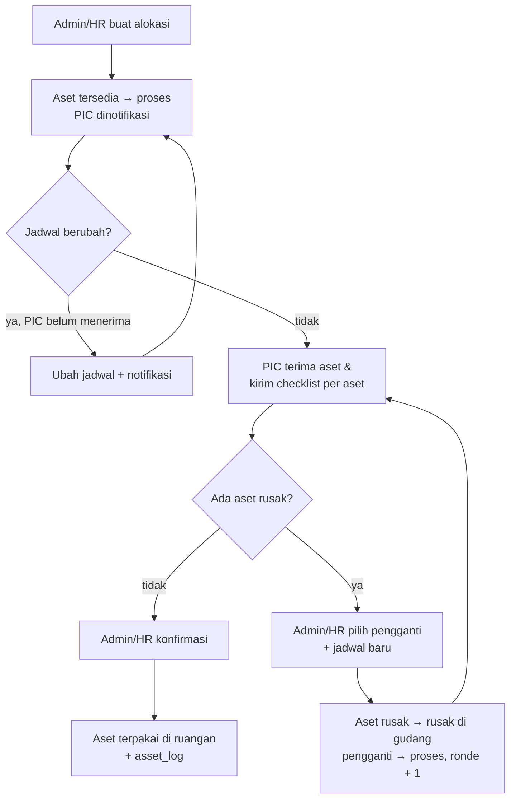
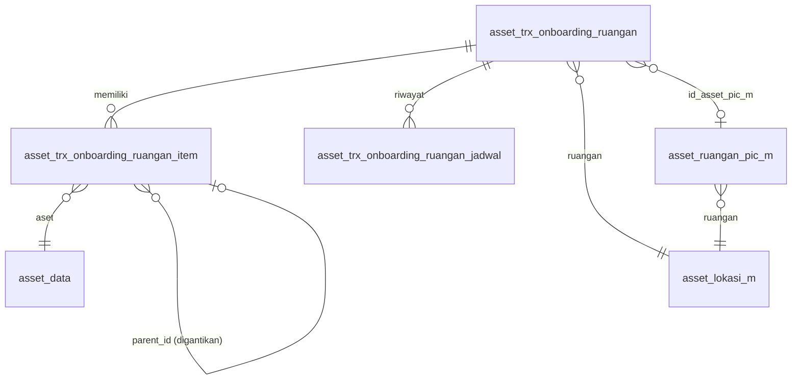

# Dokumentasi Teknis & Manual Book — Alokasi Asset ke Ruangan / Onboarding Ruangan (ALK-RGN01)

> Dokumen ini disusun **dari source code lokal** (`API/` Lumen dan `MOBILE/` Flutter) per 13 Oktober 2026, dibandingkan dengan dokumen bisnis **"2.1 Ruangan - Alokasi Aset ke Ruangan (Onboarding) (ALK-RGN01)" v1.0**.
> Cakupan implementasi: alokasi **aset gudang berstatus `tersedia`** ke **ruangan aktif**, sisi **Admin/HR** dan **PIC Ruangan**. Bagian yang tidak ditemukan ditandai **⚠️ Belum ditemukan**, asumsi ditandai **⚠️ Asumsi**.
> Contoh ID/nama pada payload adalah **data sintetis**.

---

## 1. Informasi Dokumen

| Informasi | Nilai |
|---|---|
| Nama Fitur | Alokasi Asset ke Ruangan (UI Admin: **"On Boarding"** di dashboard Ruangan; UI PIC: kartu **"PIC Ruangan"** di halaman pertama Asset) |
| Kode Fitur | **ALK-RGN01** (nomor transaksi `RGN01-YYYYMMNNN`) |
| Modul | Asset Management — Ruangan |
| Backend | Laravel **Lumen ^10.0**, PHP ^8.1, JWT, Query Builder |
| Database | `API/diagram-asset.dbml` (tanda `[NEW ALK-RGN01]` / `[REVISI ALK-RGN01]`) + SQL manual `Claude outputs/sql-alk-rgn01-onboarding-ruangan.sql` (sudah dijalankan di environment pengembang) |
| Mobile | Flutter (`professional_flutter_3_35`), `flutter_bloc`, `dio`, `dotted_border` |
| Web | ⚠️ Belum ditemukan: tidak ada source web di workspace |
| Test otomatis | API `tests/Asset/AssetAdminRuanganTest.php` (10 test) + `tests/Asset/AssetRuanganPicTest.php` (7 test) · Mobile `test/asset/asset_admin_ruangan_test.dart` (9 test) + `test/asset/asset_pic_ruangan_test.dart` (9 test) |
| Versi dokumen | 1.0 — 13 Oktober 2026 |
| Dokumen terkait | Onboarding Karyawan (KRY01), Master Lokasi & PIC Ruangan |

## 2. Daftar Isi

Lihat panel navigasi di samping.

## 3. Quick Overview

Admin/HR memilih satu atau lebih **aset gudang**, **ruangan tujuan**, dan **jadwal serah terima**. PIC Ruangan ditentukan dari master (`asset_ruangan_pic_m`) dan **terkunci**; hanya ruangan tanpa PIC yang boleh dipilihkan karyawan, dan pilihan itu **disimpan ke master**. Aset berubah `tersedia` → `proses` sehingga tidak bisa dialokasikan ganda. PIC menerima aset secara fisik, menilai **setiap aset Normal atau Rusak** (keterangan wajib bila rusak), lalu mengirim checklist. Admin/HR mereview: bila semua normal ia **mengonfirmasi** (aset menjadi `terpakai` di ruangan); bila ada yang rusak ia **menjadwalkan pengganti** dari gudang dan serah terima diulang pada **ronde** berikutnya sampai semua normal.

| Aspek | Ringkasan |
|---|---|
| Aktor | Admin/HR (Admin Asset), PIC Ruangan, Sistem |
| Fase (diturunkan dari data) | `menunggu_serah_terima` → `menunggu_review` → `selesai` (berulang per ronde bila ada aset rusak) |
| Status header | `status_approval`: `proses` → `dikonfirmasi` (enum sama dengan KRY01; `draft` dan `ditolak` tidak dipakai di alur ini) |
| Status asset | `tersedia` → `proses` → `terpakai` (pemegang `ruangan`); aset rusak → `rusak` (kembali ke gudang) |
| Endpoint | 7 admin + 3 PIC |
| Notifikasi | 5 event (`onboarding_ruangan.*`) |

## 4. Ringkasan Fitur

| No | Fitur | Aktor |
|---|---|---|
| 1 | Buat alokasi: pilih ruangan, asset (pemilih kategori → asset), jadwal, catatan | Admin/HR |
| 2 | PIC otomatis dari master ruangan; ruangan tanpa PIC → pilih karyawan dan simpan ke master | Admin/HR |
| 3 | Ubah jadwal serah terima sebelum PIC menerima (riwayat jadwal tercatat) | Admin/HR |
| 4 | Terima asset dan checklist kondisi per aset | PIC Ruangan |
| 5 | Review hasil checklist, tampilan timeline per aset | Admin/HR |
| 6 | Jadwalkan asset pengganti untuk aset rusak (ronde berikutnya) | Admin/HR |
| 7 | Konfirmasi selesai: aset menjadi `terpakai` di ruangan | Admin/HR |
| 8 | Daftar asset ruangan milik PIC (halaman "PIC Ruangan") | PIC Ruangan |

## 5. Tujuan Fitur

### 5.1 Tujuan Bisnis (diturunkan dari dokumen bisnis dan kode)

- Melengkapi ruangan (mis. ruangan baru) dengan aset dari gudang secara terdokumentasi.
- Penanggung jawab ruangan (PIC) menerima dan memeriksa aset secara fisik sebelum aset resmi tercatat di ruangan.
- Aset rusak tidak pernah masuk ruangan: wajib diganti sebelum proses selesai.
- Jejak lengkap: siapa, kapan, jadwal berapa kali berubah, ronde penggantian.

### 5.2 Tujuan Sistem

- Mencegah alokasi ganda (`proses`) dan onboarding ganda per ruangan.
- Menurunkan fase dari data (`tgl_terima_pic` pada jadwal) tanpa kolom status tambahan.
- Satu transaksi mencakup banyak ronde (pengganti) tanpa membuat transaksi baru.

## 6. Aktor

| Aktor | Peran |
|---|---|
| Admin/HR | Pengguna terdaftar di `asset_admin`. Membuat alokasi, mengubah jadwal, menjadwalkan pengganti, mengonfirmasi |
| PIC Ruangan | Karyawan yang melekat pada ruangan (`asset_ruangan_pic_m`) atau dipilih Admin/HR untuk ruangan tanpa PIC. Menerima aset dan mengirim checklist |
| Sistem | Mengubah status aset, mencatat log, mengirim notifikasi |

## 7. Hak Akses

| Aksi | Admin/HR | PIC Ruangan | Lainnya |
|---|---|---|---|
| Daftar/detail/buat/ubah jadwal/pengganti/konfirmasi | Ya | Tidak | Tidak (`FORBIDDEN`) |
| Daftar ruangan & aset milik sendiri, detail serah terima, terima | Tidak | Hanya transaksi dengan `id_karyawan_pic` = dirinya | Tidak |

Cek admin lewat `accessError` (tabel `asset_admin`). PIC dicek pada setiap query (`id_karyawan_pic` = karyawan login), jadi PIC lain mendapat `NOT_FOUND`.

## 8. Terminologi

| Istilah | Arti |
|---|---|
| Onboarding ruangan | Alokasi aset gudang ke ruangan tujuan (kebalikan: offboarding ruangan ALK-RGN02) |
| Ronde | Putaran serah terima; ronde 1 = aset awal, ronde berikutnya = unit pengganti |
| Rantai penggantian | `parent_id` pada baris pengganti = baris aset rusak yang digantikannya (sama dengan KRY01) |
| Master PIC | `asset_ruangan_pic_m`: satu ruangan satu PIC |
| Fase | Tahap serah terima, diturunkan dari data, bukan kolom |

## 9. Business Rules

### BR-001 — Aset yang boleh dialokasikan
Hanya `status_asset = 'tersedia'` dan `pemegang_asset = 'gudang'` (`getLockedAssets`). Pesan: "Satu atau beberapa asset tidak tersedia untuk dialokasikan."

### BR-002 — Ruangan tujuan
`asset_lokasi_m.tipe = 'ruangan'` dan `status_aktif = '1'`. Pesan: "Ruangan tujuan tidak ditemukan atau tidak aktif."

### BR-003 — Satu ruangan satu kali onboarding
Ditolak bila ruangan sudah punya transaksi berstatus `proses` atau `dikonfirmasi`. Pesan: "Ruangan ini sudah pernah di-onboarding. Onboarding hanya dapat dilakukan satu kali per ruangan." Ruangan tersebut juga disaring dari `options`.

### BR-004 — PIC Ruangan
PIC dari `asset_ruangan_pic_m` otomatis dipakai dan **tidak dapat diganti** ("PIC Ruangan sudah ditetapkan pada ruangan ini dan tidak dapat diganti."). Ruangan tanpa PIC: Admin/HR wajib memilih karyawan aktif; pilihan itu **disimpan ke `asset_ruangan_pic_m`** dalam transaksi yang sama, dan `id_asset_pic_m` header menunjuk baris baru itu.

### BR-005 — Jadwal serah terima
Tanggal (`Y-m-d`) dan jam (`H:i`) wajib; tidak boleh sebelum hari ini ("Tanggal serah terima tidak boleh sebelum tanggal pengajuan."). Header menyimpan jadwal terkini; riwayat di `asset_trx_onboarding_ruangan_jadwal`.

### BR-006 — Ubah jadwal
Hanya selama fase `menunggu_serah_terima` (PIC belum menerima). Menambah baris jadwal pada ronde yang sama. Pesan: "Jadwal hanya dapat diubah sebelum PIC Ruangan menerima asset."

### BR-007 — Checklist PIC
Wajib mengisi **semua** aset ronde berjalan (Normal/Rusak). Rusak wajib keterangan ("Keterangan kerusakan wajib diisi."). Pesan bila kurang: "Seluruh item pada serah terima wajib dicek." PIC **tidak mengubah status aset**; menunggu keputusan Admin/HR.

### BR-008 — Penggantian
Hanya di fase `menunggu_review`. **Semua** aset rusak ronde ini wajib diberi pengganti ("Seluruh asset rusak wajib diberi asset pengganti."), pengganti harus `tersedia` di gudang dan tidak boleh sama dua kali. Aset rusak → `status_asset = 'rusak'` (`ket_rusak` terisi, tetap di gudang); pengganti → `proses`. Baris pengganti: `ronde` + 1, `parent_id` = baris rusak. Jadwal baru wajib.

### BR-009 — Konfirmasi selesai
Hanya di fase `menunggu_review` dan **tanpa aset rusak**. Semua aset aktif (belum digantikan) menjadi `terpakai`, `pemegang_asset = 'ruangan'`, `id_pemegang_asset` dan `id_asset_lokasi_m` = id ruangan; `asset_log` jenis `onboarding_ruangan` dicatat per aset. Header → `dikonfirmasi` (`user_approval`, `tgl_approval`).

### BR-010 — Penomoran
`id` = `id_company` + `YYYYMM` + 3 digit; `no_trx` = `RGN01-YYYYMMNNN`. Maksimal 999 transaksi per bulan per company ("Nomor transaksi untuk periode ini sudah mencapai batas.").

### BR-011 — Skema harus sudah diterapkan
Fitur butuh SQL manual `sql-alk-rgn01-onboarding-ruangan.sql` (kolom baru, tabel jadwal, unique PIC).

## 10. Business Flow

1. Admin/HR membuka dashboard Ruangan → **On Boarding** → **Tambah Alokasi**.
2. Memilih ruangan (PIC otomatis terisi/terkunci, atau dipilih bila belum ada), asset, jadwal, catatan, lalu **Kirim ke PIC Ruangan**. Aset → `proses`; PIC dinotifikasi.
3. Pada jadwal, Admin/HR menyerahkan aset secara fisik; PIC menilai tiap aset dan mengirim checklist. Admin dinotifikasi.
4. Admin/HR mereview di detail (timeline per aset).
   - **Semua normal** → **Konfirmasi Selesai**: aset `terpakai` di ruangan.
   - **Ada rusak** → **Jadwalkan Pengganti**: pilih pengganti per aset rusak + jadwal baru; PIC dinotifikasi; kembali ke langkah 3 pada ronde berikutnya.
5. Selama PIC belum menerima, Admin/HR bisa **Ubah Jadwal**; PIC dinotifikasi.

## 11. Flow Berdasarkan Role

### 11.1 Admin/HR
Buat alokasi → (ubah jadwal) → tunggu PIC → review → konfirmasi atau jadwalkan pengganti.

### 11.2 PIC Ruangan
Terima notifikasi → buka banner pada halaman "PIC Ruangan" → periksa fisik, nilai tiap aset → kirim → (tunggu review; bila ada pengganti, ulangi untuk unit pengganti).

### 11.3 System
Kunci aset (`proses`), turunkan fase, catat jadwal/log, kirim notifikasi, simpan PIC ke master.

## 12. Flow Diagram



## 13. Sequence Diagram

```mermaid
sequenceDiagram
  participant A as Admin/HR (mobile)
  participant API as API Lumen
  participant DB as Database
  participant P as PIC (mobile)
  A->>API: POST asset/onboarding-ruangan
  API->>DB: header + item (ronde 1) + jadwal; asset_data → proses
  API-->>P: notifikasi onboarding_ruangan.dikirim
  P->>API: POST asset/karyawan/pic-ruangan/onboarding/{id}/terima
  API->>DB: item.status_item, jadwal.tgl_terima_pic
  API-->>A: notifikasi onboarding_ruangan.diterima
  alt semua normal
    A->>API: POST …/{id}/konfirmasi
    API->>DB: asset_data → terpakai/ruangan; asset_log; header dikonfirmasi
  else ada rusak
    A->>API: POST …/{id}/pengganti
    API->>DB: aset rusak → rusak; pengganti → proses; item ronde+1; jadwal baru
    API-->>P: notifikasi onboarding_ruangan.pengganti
  end
```

## 14. Status Transaksi

| Fase (turunan) | Syarat | Tampilan |
|---|---|---|
| `menunggu_serah_terima` | `status_approval='proses'` dan jadwal ronde terakhir `tgl_terima_pic` kosong | Menunggu Serah Terima |
| `menunggu_review` | `proses` dan `tgl_terima_pic` terisi | Menunggu Review Admin |
| `selesai` | `status_approval='dikonfirmasi'` | Selesai |

## 15. State Transition

| Dari | Aksi | Ke |
|---|---|---|
| (baru) | `store` | `menunggu_serah_terima` (ronde 1) |
| `menunggu_serah_terima` | `updateJadwal` | `menunggu_serah_terima` (baris jadwal baru) |
| `menunggu_serah_terima` | PIC `terima` | `menunggu_review` |
| `menunggu_review` | `jadwalkanPengganti` | `menunggu_serah_terima` (ronde + 1) |
| `menunggu_review` | `konfirmasi` (tanpa rusak) | `selesai` |

## 16. Struktur Database

| Tabel | Perubahan | Fungsi |
|---|---|---|
| `asset_trx_onboarding_ruangan` | header (status enum `status_onboarding`, `id_karyawan_pic`, jadwal boleh NULL) | Transaksi |
| `asset_trx_onboarding_ruangan_item` | `+ ronde`; `parent_id` = rantai pengganti | Satu baris per aset |
| `asset_trx_onboarding_ruangan_jadwal` | **tabel baru** | Riwayat jadwal per ronde |
| `asset_ruangan_pic_m` | unique `(id_company, id_asset_lokasi_m)` | 1 ruangan = 1 PIC |
| `asset_lokasi_m` | `+ status_aktif` | Hanya ruangan aktif |
| `asset_data` | status/pemegang/lokasi diubah | Dampak aset |
| `asset_log` | jenis `onboarding_ruangan` | Jejak |

## 17. Relasi Database



## 18. Data Dictionary

### 18.1 asset_trx_onboarding_ruangan

| Kolom | Tipe | Catatan |
|---|---|---|
| `id_asset_trx_onboarding_ruangan` | varchar(50) PK | `id_company`+`YYYYMM`+3 digit |
| `no_trx` | varchar(50) | `RGN01-YYYYMMNNN` |
| `tgl_onboarding` | date | Tanggal dibuat |
| `id_asset_lokasi_m`, `nama_asset_ruangan`, `nama_cabang`, `nama_departemen` | | Ruangan + snapshot |
| `id_asset_pic_m` | varchar(50) NULL | Baris master PIC |
| `id_karyawan_pic`, `nama_pic`, `nik_pic` | | PIC penerima + snapshot |
| `tgl_serah_terima`, `jam_serah_terima` | date, time NULL | Jadwal **terkini** |
| `keterangan_serah_terima` | varchar(255) | Catatan untuk PIC |
| `keterangan`, `ket_tolak` | text, varchar | Cadangan (dari pola KRY01), tidak dipakai alur ini |
| `id_karyawan`, `nik_karyawan`, `nama_karyawan` | | Admin/HR pembuat |
| `status_approval` | enum | `proses` / `dikonfirmasi` dipakai; `draft`, `ditolak` tidak |
| `user_approval`, `tgl_approval` | | Pelaku & waktu konfirmasi |
| `id_company`, `tgl_input`, `user_input`, `tgl_update`, `user_update` | | Audit |

### 18.2 asset_trx_onboarding_ruangan_item

| Kolom | Tipe | Catatan |
|---|---|---|
| `id_asset_trx_onboarding_ruangan_item` | varchar(50) PK | |
| `id_asset_trx_onboarding_ruangan` | FK | |
| `parent_id` | varchar(50), default `''` | Baris pengganti: id baris aset rusak yang digantikan |
| `id_asset_data` | FK | |
| `nama_asset`, `deskripsi_asset`, `kategori_asset` | | Snapshot |
| `ronde` | tinyint | 1 = awal; pengganti = ronde berikutnya |
| `status_item` | enum `kondisi_awal` | `belum_dicek`, `normal`, `rusak` |
| `ket_rusak` | varchar(255) | Wajib bila rusak |

### 18.3 asset_trx_onboarding_ruangan_jadwal

| Kolom | Tipe | Catatan |
|---|---|---|
| `id_asset_trx_onboarding_ruangan_jadwal` | varchar(50) PK | |
| `id_asset_trx_onboarding_ruangan` | FK | |
| `ronde` | tinyint | |
| `tanggal`, `jam` | date, time | |
| `tgl_terima_pic` | timestamp NULL | Terisi saat PIC mengirim checklist |
| `keterangan` | varchar(255) | Alasan perubahan |

Append-only: baris terakhir per ronde = jadwal aktif ronde itu.

## 19. Database Index

| Index | Kolom |
|---|---|
| `idx_onb_rgn_status` | `(id_company, status_approval, tgl_approval, tgl_input, id)` |
| `idx_onb_rgn_pic` | `(id_company, id_karyawan_pic, status_approval)` |
| `idx_onb_rgn_item_trx` | `(id_trx, id_company, status_item, parent_id)` |
| `idx_onb_rgn_item_asset` | `(id_asset_data, id_company)` |
| `idx_onb_rgn_jadwal_trx` | `(id_trx, ronde, id_company)` |
| `uq_asset_ruangan_pic_lokasi` | UNIQUE `(id_company, id_asset_lokasi_m)` |

## 20. Backend Architecture

| Lapisan | File |
|---|---|
| Route | `API/routes/modules/asset/RouteAsset.php` (grup `onboarding-ruangan`, `karyawan/pic-ruangan`) |
| Controller Admin | `Controllers/Asset/Admin/AssetAdminOnboardingRuangan_c.php` |
| Controller PIC | `Controllers/Asset/Karyawan/AssetKaryawanPicRuangan_c.php` |
| Model Admin | `Models/Asset/AssetAdminRuangan_m.php` |
| Model PIC + helper bersama | `Models/Asset/AssetRuanganPic_m.php` (`fase`, `rondeSaatIni`, `jadwalTerakhir`, `itemChecklist`, `buildDetail`) |
| Notifikasi | `Support/Asset/AssetNotification.php` |

Setiap mutasi memakai `DB::transaction`, `lockCompany` (kunci per company), dan penomoran `nextSequence`.

## 21. Backend Business Logic

### 21.1 Buat — `store`
Validasi admin → ruangan aktif → cek sekali-onboarding → resolve PIC (master terkunci / pilihan manual) → kunci aset (`getLockedAssets`) → validasi jadwal → (PIC manual) simpan ke `asset_ruangan_pic_m` → insert header, item ronde 1, jadwal ronde 1 → aset `proses`.

### 21.2 Ubah jadwal — `updateJadwal`
Header `proses`, fase `menunggu_serah_terima` → tambah baris jadwal (ronde sama) → update jadwal terkini header.

### 21.3 Terima (PIC) — `terimaOnboarding`
Header milik PIC login, fase `menunggu_serah_terima` → validasi semua item ronde dicek → update `status_item`/`ket_rusak` → isi `tgl_terima_pic` pada jadwal ronde → `tgl_update` header.

### 21.4 Pengganti — `jadwalkanPengganti`
Fase `menunggu_review` → `asetRusakRondeIni` → cocokkan penuh dengan pilihan admin → aset rusak: `rusak` + `ket_rusak`; pengganti dikunci; insert item ronde+1 (`parent_id` = baris rusak) + jadwal ronde+1 → pengganti `proses`.

### 21.5 Konfirmasi — `konfirmasi`
Fase `menunggu_review`, tanpa rusak → semua aset aktif divalidasi `proses`/`gudang` → `terpakai`/`ruangan` + lokasi → `asset_log` → header `dikonfirmasi`.

### 21.6 Query baca
`getOptions` (aset tersedia + pohon kategori, ruangan aktif belum onboarding beserta PIC, karyawan aktif), `getPage` (tab `proses`/`selesai`, paginasi), `getDetail` (+ `bisa_ubah_jadwal`, `bisa_konfirmasi`, `perlu_pengganti`), sisi PIC `getAssetRuanganSaya`, `getDetailOnboardingSaya`.

## 22. Dampak terhadap asset_data

| Peristiwa | `status_asset` | `pemegang_asset` | Lokasi |
|---|---|---|---|
| Buat alokasi | `tersedia` → `proses` | `gudang` | tetap |
| Aset dinilai rusak lalu diganti | `proses` → `rusak` | `gudang` | tetap |
| Pengganti dijadwalkan | `tersedia` → `proses` | `gudang` | tetap |
| Konfirmasi selesai | `proses` → `terpakai` | `ruangan` (`id_pemegang_asset` = id ruangan) | `id_asset_lokasi_m` = ruangan |

## 23. API Documentation

Base: `asset/` · Admin: Bearer + `asset_admin`.

| ID | Method | Path | Fungsi |
|---|---|---|---|
| API-001 | GET | `onboarding-ruangan/options` | Aset tersedia, kategori, ruangan, karyawan |
| API-002 | GET | `onboarding-ruangan?tab=&limit=&offset=` | Daftar (`proses`/`selesai`) |
| API-003 | POST | `onboarding-ruangan` | Buat alokasi |
| API-004 | GET | `onboarding-ruangan/{id}` | Detail |
| API-005 | PUT | `onboarding-ruangan/{id}/jadwal` | Ubah jadwal |
| API-006 | POST | `onboarding-ruangan/{id}/pengganti` | Jadwalkan pengganti |
| API-007 | POST | `onboarding-ruangan/{id}/konfirmasi` | Konfirmasi selesai |
| API-008 | GET | `karyawan/pic-ruangan` | Ruangan & aset PIC + serah terima menunggu |
| API-009 | GET | `karyawan/pic-ruangan/onboarding/{id}` | Detail serah terima PIC |
| API-010 | POST | `karyawan/pic-ruangan/onboarding/{id}/terima` | Kirim checklist |

## 24. Detail Setiap API

### API-003 — Buat
Request:
```json
{ "id_asset_lokasi_m": "RGN-1", "asset_ids": ["AST-1", "AST-2"],
  "id_karyawan_pic": "PIC-2", "tanggal": "2026-10-15", "jam": "09:00", "catatan": "Bawa kunci" }
```
`id_karyawan_pic` hanya dikirim untuk ruangan **tanpa** PIC master. Respons: `{ "id", "no_trx", "status_approval": "proses" }` (`CREATED`).

### API-005 — Ubah jadwal
`{ "tanggal": "2026-10-16", "jam": "13:30", "keterangan": "Ruangan belum siap" }` → `UPDATED`.

### API-006 — Pengganti
```json
{ "items": [{ "id_item": "<id baris rusak>", "id_asset_data": "AST-3" }],
  "tanggal": "2026-10-20", "jam": "10:00", "keterangan": "Unit pengganti" }
```
Respons: `{ "id", "no_trx", "ronde", "jumlah_pengganti" }`.

### API-007 — Konfirmasi
Tanpa body. Respons: `{ "id", "no_trx", "status_approval": "dikonfirmasi", "jumlah_asset" }`.

### API-004 / API-009 — Detail
Field penting: `fase`, `fase_label`, `ronde`, `bisa_diterima` (PIC) / `bisa_ubah_jadwal`, `bisa_konfirmasi`, `perlu_pengganti[]` (admin), `jadwal[]`, `items[]` (`id_item`, `parent_id`, `id_asset_data`, `nama_asset`, `ronde`, `status_item`, `ket_rusak`, `diganti`, `perlu_dicek`).

### API-010 — Terima (PIC)
```json
{ "items": [
  { "id_item": "ITM-1", "status_item": "normal" },
  { "id_item": "ITM-2", "status_item": "rusak", "ket_rusak": "Mati total" } ] }
```
Respons: `{ "id", "no_trx", "ada_rusak", "fase": "menunggu_review" }`.

## 25. Mobile Architecture

| Lapisan | File (`MOBILE/lib/`) |
|---|---|
| Model | `Repository/Model/Asset/mAssetPicRuangan.dart`, `mAssetAdminRuangan.dart` |
| API service | `Repository/Service/assetPicRuanganApi.dart`, `assetAdminRuanganApi.dart` |
| Bloc | `Bloc/Asset/AssetPicRuanganBloc.dart`, `AssetPicRuanganDetailBloc.dart`, `AssetAdminRuanganListBloc.dart`, `AssetAdminRuanganFormBloc.dart`, `AssetAdminRuanganDetailBloc.dart` |
| UI PIC | `UI/Modul/Asset/PicRuangan/` |
| UI Admin | `UI/Modul/Asset/AssetAdmin/AssetAdminRuangan/` |
| Teks | grup `pic_ruangan` di `assets/{id,en}/asset.json` (`MenuAsset.picRuangan`) |
| Navigasi | `Bloc/NavigatorBloc.dart`, `Setting/router.dart` |

## 26. Mobile Screen

### 26.1 PIC — "PIC Ruangan" (`HalamanAssetPicRuangan`)
Tampilan mengikuti Asset Saya: hero (jumlah aset, jumlah ruangan, perlu tindakan), banner serah terima, daftar aset per ruangan.

### 26.2 PIC — Detail serah terima (`HalamanDetailOnboardingPicRuangan`)
Kartu utama + stepper, riwayat jadwal, kartu per aset dengan tombol Normal/Rusak dan keterangan, pernyataan, tombol **Terima & Kirim Checklist**.

### 26.3 Admin — Daftar (`HalamanAssetAdminOnboardingRuangan`)
Tab Proses/Selesai, kartu transaksi, tombol Tambah Alokasi.

### 26.4 Admin — Form (`HalamanAssetAdminAddOnboardingRuangan`)
Seragam dengan form onboarding karyawan: Ruangan Tujuan, PIC Ruangan (terkunci bila ada PIC master), Asset On Boarding (pemilih kategori → asset), Jadwal, Catatan, **Kirim ke PIC Ruangan**.

### 26.5 Admin — Detail (`HalamanAssetAdminDetailOnboardingRuangan`)
Seragam dengan detail klaim garansi: kartu utama bergradien, stepper (Dijadwalkan, Serah Terima, Review, Selesai), timeline vertikal per aset (`AssetRuanganAsetTimeline`: Penjadwalan, Serah Terima & Checklist, Review, Selesai), kartu pengganti, informasi ruangan, riwayat jadwal. Tombol bawah: **Ubah Jadwal** / **Jadwalkan Pengganti** / **Konfirmasi Selesai** sesuai fase.

### 26.6 Entry point
Kartu **PIC Ruangan** di `HalamanHomeAsset`; tombol **On Boarding** di `HalamanAssetAdminRuangan`; notifikasi (`asset_pic_ruangan_onboarding`, `asset_admin_detail_onboarding_ruangan` terdaftar di `assetNotifRoutes`).

## 27. Mobile → API

| Layar | Aksi | API |
|---|---|---|
| PIC home | muat | API-008 |
| PIC detail | muat / kirim | API-009 / API-010 |
| Admin daftar | muat per tab | API-002 |
| Admin form | opsi / kirim | API-001 / API-003 |
| Admin detail | muat | API-004 |
| Admin detail | ubah jadwal / pengganti / konfirmasi | API-005 / API-006 / API-007 |

## 28. API → Mobile

Kunci JSON dipetakan ke model (`AssetPicRuanganDetail`, `AssetAdminRuanganDetail`, dll.). `fase` menentukan stepper dan tombol; flag `bisa_*` menentukan aksi; `perlu_pengganti[]` membentuk kartu pengganti.

## 29. Mapping Mobile → API → Database

| Mobile | API | Database |
|---|---|---|
| Field Ruangan Tujuan | `id_asset_lokasi_m` | `asset_trx_onboarding_ruangan.id_asset_lokasi_m` |
| Field PIC (hanya ruangan tanpa PIC) | `id_karyawan_pic` | `asset_ruangan_pic_m` (baru) + `id_karyawan_pic` |
| Tambah Asset | `asset_ids[]` | `_item` (satu baris per aset, ronde 1) |
| Jadwal | `tanggal`, `jam` | `tgl/jam_serah_terima` + `_jadwal` |
| Normal/Rusak + keterangan | `items[]` | `_item.status_item`, `ket_rusak` |
| Pilih pengganti | `items[].id_asset_data` | `_item` ronde+1 (`parent_id`) |

## 30. Mapping Database → API → Mobile

| Database | API | Mobile |
|---|---|---|
| `_jadwal.tgl_terima_pic` | `fase`, `jadwal[].tgl_terima_pic` | Stepper, "Diterima …" |
| `_item.parent_id` | `diganti`, `parent_id` | Badge "Diganti", "Digantikan oleh/Pengganti untuk" |
| `asset_ruangan_pic_m` | `ruangan[].id_karyawan_pic` | PIC terisi & terkunci |
| `asset_data` (pemegang ruangan) | `ruangan[].assets[]` | Daftar aset di halaman PIC |

## 31. Validation

### 31.1 Mobile
Form: ruangan, PIC, minimal satu asset, tanggal, jam wajib (error muncul setelah submit). Detail PIC: tombol kirim aktif bila semua aset dinilai dan keterangan rusak terisi. Detail admin: tombol pengganti aktif bila semua pengganti dan jadwal terisi.

### 31.2 Backend
Aturan Laravel: `asset_ids` array min 1 distinct; `tanggal` `date_format:Y-m-d`; `jam` `date_format:H:i`; `items.*.status_item` `in:normal,rusak`; `ket_rusak` wajib bila rusak. Aturan bisnis: BR-001 s.d. BR-010.

### 31.3 Database
Unique PIC per ruangan; PK; FK jadwal dibuat bila tipe/charset tabel cocok.

## 32. Error Handling

| Kode | Kondisi |
|---|---|
| `UNAUTHORIZED` | Tanpa konteks login |
| `FORBIDDEN` | Bukan admin asset |
| `NOT_FOUND` | Transaksi tidak ada / bukan milik PIC |
| `VALIDATION_ERROR` | Payload tidak valid |
| `BUSINESS_RULE_VIOLATION` (422) | Pelanggaran aturan bisnis (pesan Indonesia di §9) |
| `SYSTEM_ERROR` | Kesalahan tak terduga (dicatat ke log) |

Controller wajib mengimpor `InvalidArgumentException` dan `Throwable`.

## 33. Audit Trail

`user_input`/`user_update` = `nik - nama`; `tgl_approval` + `user_approval` saat konfirmasi; riwayat jadwal append-only; `asset_log` (`onboarding_ruangan`) per aset saat konfirmasi.

## 34. Notification

| Event | Penerima | Rute tujuan |
|---|---|---|
| `onboarding_ruangan.dikirim` | PIC Ruangan | `asset_pic_ruangan_onboarding` |
| `onboarding_ruangan.jadwal_diubah` | PIC Ruangan | idem |
| `onboarding_ruangan.pengganti` | PIC Ruangan | idem |
| `onboarding_ruangan.selesai` | PIC Ruangan | idem |
| `onboarding_ruangan.diterima` | Seluruh admin asset | `asset_admin_detail_onboarding_ruangan` |

Penerima PIC diambil dari `id_karyawan_pic` header (penerima baru `PIC_RUANGAN`). Dikirim setelah transaksi database selesai.

## 35. Security

JWT; admin dicek lewat `asset_admin`; PIC dibatasi per transaksi; semua query memakai `id_company`; kunci per company mencegah balapan penomoran/alokasi.

## 36. Manual Book User/Admin

### A. Admin/HR — Membuat alokasi
1. Menu Asset → Ruangan → **On Boarding** → **Tambah Alokasi**.
2. Pilih **Ruangan Tujuan**. PIC terisi otomatis dan terkunci; bila ruangan belum punya PIC, pilih karyawan (akan tersimpan sebagai PIC ruangan).
3. **Tambah Asset**: pilih kategori lalu asset (ulangi untuk asset lain).
4. Pilih tanggal dan jam serah terima, isi catatan bila perlu, tekan **Kirim ke PIC Ruangan**.

### B. PIC Ruangan — Menerima aset
1. Buka menu **PIC Ruangan** di halaman pertama Asset; ketuk banner **Serah Terima Asset Ruangan**.
2. Setelah aset diserahkan, periksa tiap aset: pilih **Normal** atau **Rusak** (isi keterangan bila rusak).
3. Tekan **Terima & Kirim Checklist**. Halaman menjadi hanya-baca sampai Admin/HR mereview.

### C. Admin/HR — Review
1. Buka transaksi di tab **Proses**; periksa timeline tiap aset.
2. Semua normal: tekan **Konfirmasi Selesai**.
3. Ada rusak: pada kartu pengganti pilih asset pengganti untuk **setiap** aset rusak, tetapkan jadwal baru, tekan **Jadwalkan Pengganti**. PIC mengecek unit pengganti; ulangi review.

### D. Admin/HR — Mengubah jadwal
Selama PIC belum menerima, tekan **Ubah Jadwal**, isi tanggal, jam, dan alasan (opsional).

## 37. Kondisi Button

| Tombol | Aktif bila |
|---|---|
| Kirim ke PIC Ruangan | Form tidak sedang mengirim (validasi saat ditekan) |
| Terima & Kirim Checklist | Fase `menunggu_serah_terima`, semua aset dinilai, keterangan rusak terisi |
| Ubah Jadwal | `bisa_ubah_jadwal` (PIC belum menerima) |
| Jadwalkan Pengganti | Ada aset rusak, semua pengganti + tanggal + jam terisi |
| Konfirmasi Selesai | `bisa_konfirmasi` (menunggu review, tanpa rusak) |

## 38. Testing Scenario

| ID | Skenario | Hasil |
|---|---|---|
| T-01 | Opsi form | Aset tersedia, kategori, ruangan aktif belum onboarding |
| T-02 | Buat valid | Aset `proses`, item per aset, jadwal ronde 1 |
| T-03 | Ruangan tidak aktif/tanpa PIC/jadwal lampau | Ditolak |
| T-04 | PIC master dikunci; ruangan tanpa PIC menyimpan ke master | Sesuai |
| T-05 | Ruangan sudah onboarding (proses/selesai) | Ditolak dan hilang dari opsi |
| T-06 | Ubah jadwal sebelum/sesudah PIC terima | Diizinkan / ditolak |
| T-07 | PIC terima: kurang item, rusak tanpa keterangan, PIC lain | Ditolak |
| T-08 | Rusak → pengganti → ronde 2 → konfirmasi | Aset rusak `rusak`, pengganti `terpakai` |
| T-09 | Konfirmasi tanpa checklist / dengan rusak | Ditolak |
| T-10 | Mobile: form, daftar tab, detail aksi, halaman PIC | Lulus (18 test mobile) |

## 39. Temuan Ketidaksesuaian

| ID | Temuan |
|---|---|
| INC-01 | Dokumen bisnis: checklist per **Daftar Atribut Aset** (Aset Utama/Kelengkapan, "Atribut Lainnya"). Implementasi: checklist **per aset utama** (keputusan pemilik produk), seperti KRY01 |
| INC-02 | Dokumen bisnis: Admin/HR dapat mengganti PIC. Implementasi: PIC dari master **terkunci**; hanya ruangan tanpa PIC yang dipilihkan karyawan dan pilihannya disimpan ke master |
| INC-03 | Dokumen bisnis menamai status aset selama alokasi `DIALOKASIKAN`. Implementasi memakai `proses` (nilai enum status aset tidak ditambah; keputusan pemilik produk) |
| INC-04 | Satu ruangan hanya boleh onboarding satu kali (aturan tambahan di luar dokumen); penambahan aset ke ruangan aktif adalah alur terpisah ALK-RGN03 |
| INC-05 | Dokumen bisnis menyebut "menarik item rusak ke gudang" tanpa lokasi; implementasi menandai aset `rusak` dan tidak mengubah `id_asset_lokasi_m` (NULL) |
| INC-06 | Enum `status_onboarding` memuat `draft`/`ditolak` (dari KRY01) yang tidak dipakai alur ini |

## 40. Edge Case

- Dua admin membuat alokasi untuk aset yang sama: pengunci company + validasi `tersedia`, yang kedua ditolak.
- Aset berubah status di luar alur saat konfirmasi: ditolak "Satu atau beberapa asset tidak dapat diserahkan ke ruangan."
- Admin memilih pengganti yang sudah dipakai alur lain: ditolak "Satu atau beberapa asset pengganti tidak tersedia."
- Pengganti ikut rusak: ronde berikutnya (loop tanpa batas sampai normal atau stok habis).
- Ruangan tanpa PIC: admin wajib memilih karyawan; setelah tersimpan, onboarding ruangan itu tidak bisa dibuat lagi (BR-003).

## 41. Potential Bug / Technical Risk

### RISK-001 — Skema dari SQL manual (TINGGI)
Wajib menjalankan blok 5 dan 5b `sql-alk-rgn01-onboarding-ruangan.sql` pada setiap environment; tanpa itu kolom lama (`jenis_item` dst.) membuat insert gagal.

### RISK-002 — Tidak ada pembatalan alokasi (SEDANG)
Alokasi yang tertahan mengunci aset (`proses`) dan ruangannya (BR-003). Belum ada aksi batal/hapus.

### RISK-003 — Notifikasi di luar transaksi (RENDAH)
Kegagalan push tidak membatalkan transaksi (dicatat ke log).

### RISK-004 — Kapasitas penomoran 999/bulan (RENDAH)

### RISK-005 — PIC tersimpan permanen (SEDANG)
PIC yang dipilih manual menjadi master. Mengganti PIC ruangan hanya lewat data master (belum ada layar).

### RISK-006 — Belum diuji di perangkat (SEDANG)
Test memakai database tiruan dan widget test; belum diverifikasi di emulator/server nyata, termasuk push notifikasi.

## 42. Dependency

`Asset_m/Asset_c`, `AssetNotification`, `asset_admin`, `asset_lokasi_m`, `asset_ruangan_pic_m`, `asset_kategori_m`, `asset_data`, `asset_log`, `data_karyawan`, `master_cabang`, `master_departemen`; mobile: pemilih aset/karyawan dari `HalamanAssetAdminAddOnboardingKaryawan`, `AssetPemeliharaanStepper`, `AssetPeminjamanCard`.

## 43. Source Code Reference

| Area | Lokasi |
|---|---|
| Model | `API/app/Models/Asset/AssetAdminRuangan_m.php`, `AssetRuanganPic_m.php` |
| Controller | `API/app/Http/Controllers/Asset/Admin/AssetAdminOnboardingRuangan_c.php`, `Karyawan/AssetKaryawanPicRuangan_c.php` |
| Notifikasi | `API/app/Support/Asset/AssetNotification.php` |
| SQL | `Claude outputs/sql-alk-rgn01-onboarding-ruangan.sql` |
| Test API | `API/tests/Asset/AssetAdminRuanganTest.php`, `AssetRuanganPicTest.php` |
| Mobile UI | `MOBILE/lib/UI/Modul/Asset/PicRuangan/`, `AssetAdmin/AssetAdminRuangan/` |
| Test mobile | `MOBILE/test/asset/asset_admin_ruangan_test.dart`, `asset_pic_ruangan_test.dart` |

## 44. Developer Notes

- Fase tidak disimpan: turunkan dari `status_approval` + `tgl_terima_pic` jadwal ronde terakhir (`AssetRuanganPic_m::fase`).
- `parent_id` item = rantai penggantian seperti KRY01; jangan dipakai untuk pengelompokan.
- Test model memakai SQLite in-memory dengan skema tiruan; tambahkan kolom ke skema test bila model membaca kolom baru.
- Test layar tinggi/lebar: dialog time picker pada font uji lebih lebar dari 360px, gunakan surface 800px.
- `tests/Routing` (4 test jumlah route) sudah gagal sebelum fitur ini; bukan akibat ALK-RGN01.

## 45. End-to-End Traceability

| Kebutuhan | Rule | API | Mobile | DB |
|---|---|---|---|---|
| Hanya aset tersedia | BR-001 | API-001/003 | Pemilih aset | `asset_data.status_asset` |
| PIC otomatis/terkunci | BR-004 | API-001/003 | Field PIC | `asset_ruangan_pic_m` |
| Sekali onboarding | BR-003 | API-001/003 | Pilihan ruangan | `asset_trx_onboarding_ruangan` |
| Checklist PIC | BR-007 | API-010 | Detail PIC | `_item.status_item` |
| Pengganti | BR-008 | API-006 | Kartu pengganti | `_item.parent_id`, `ronde` |
| Konfirmasi | BR-009 | API-007 | Tombol konfirmasi | `asset_data`, `asset_log` |

## 46. Ringkasan Database Impact

Tabel baru `asset_trx_onboarding_ruangan_jadwal`; kolom `asset_lokasi_m.status_aktif`, `asset_trx_onboarding_ruangan.id_karyawan_pic`, `asset_trx_onboarding_ruangan_item.ronde`; header disamakan dengan KRY01 (enum status); `parent_id` item menjadi rantai pengganti; unique `asset_ruangan_pic_m (id_company, id_asset_lokasi_m)`.

## 47. Checklist Implementasi

### Database
- [x] DBML diperbarui
- [x] SQL manual + guard + migrasi + rollback
- [ ] SQL dijalankan di setiap environment (sudah di lingkungan pengembang)

### Backend
- [x] Model, controller admin dan PIC, route, notifikasi, test

### Mobile
- [x] Halaman PIC, form/daftar/detail admin, timeline, teks id/en, test

### Documentation
- [x] Dokumen ini
- [ ] Publikasi HTML/artifact dan kartu index

## 48. Changelog

| Versi | Tanggal | Perubahan |
|---|---|---|
| 1.0 | 13 Okt 2026 | Dokumen awal ALK-RGN01 (sisi PIC Ruangan dan Admin/HR) |
