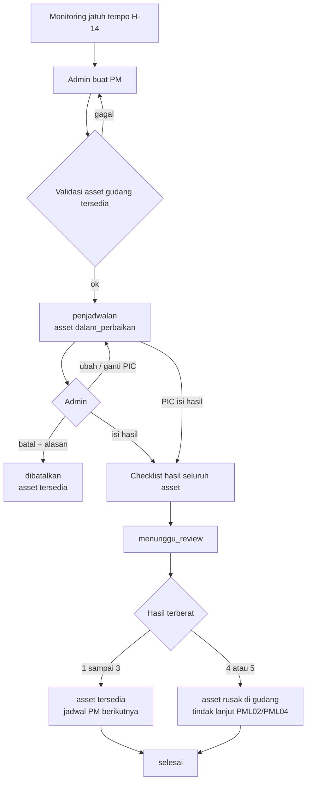
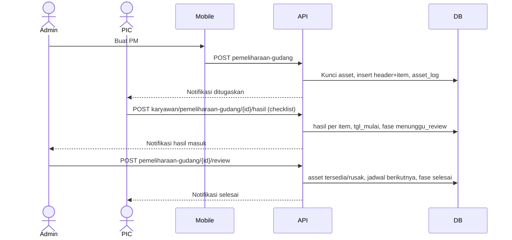
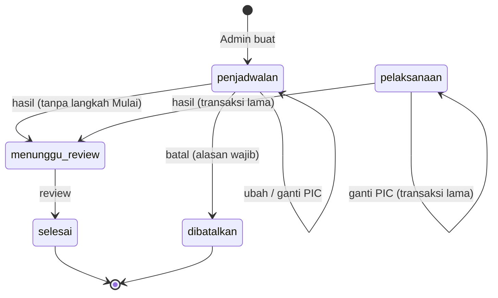
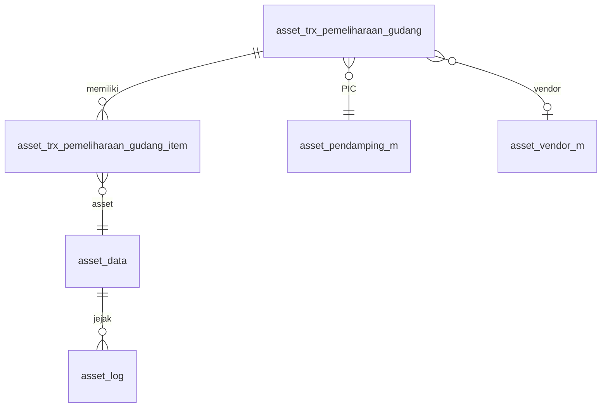

# Dokumentasi Teknis & Manual Book — Pemeliharaan Terjadwal Asset Gudang

> Dokumen ini disusun **dari source code lokal** (`API/` Lumen dan `MOBILE/` Flutter) per 8 Oktober 2026. Cakupan: **PML01 konteks gudang** (asset berstatus `tersedia` di gudang). Konteks karyawan ada di dokumen terpisah *Pemeliharaan Terjadwal Asset Karyawan*.
> Bagian yang tidak ditemukan ditandai **⚠️ Belum ditemukan**, asumsi ditandai **⚠️ Asumsi**.
> Contoh ID/nama pada payload adalah **data sintetis**.

---

## 1. Informasi Dokumen

| Informasi | Nilai |
|---|---|
| Nama Fitur | Pemeliharaan Terjadwal Asset Gudang (tab **Gudang** pada menu Pemeliharaan admin; menu **Tugas PIC** untuk pendamping) |
| Kode Fitur | **PML01** konteks gudang (nomor transaksi `PML01-3-YYYYMMNNN`; `-2-` = karyawan, `-1-` = ruangan dicadangkan) |
| Modul | Asset Management — Pemeliharaan Aset |
| Backend | Laravel **Lumen ^10.0**, PHP ^8.1, JWT, Query Builder |
| Database | `API/diagram-asset.dbml` (tanda `[NEW PML01 gudang]`) + SQL manual `Claude outputs/sql-pml01-pemeliharaan-gudang.sql`. ⚠️ SQL harus dijalankan manual; tidak ada migration Lumen |
| Mobile | Flutter (`professional_flutter_3_35`), `flutter_bloc`, `dio` |
| Web | ⚠️ Belum ditemukan: tidak ada source web di workspace |
| Test otomatis | API `tests/Asset/AssetPemeliharaanGudangTest.php` (8 test) · Mobile `test/asset/asset_pemeliharaan_gudang_test.dart` (13 test) dan `asset_pemeliharaan_gudang_dashboard_test.dart` (8 test) |
| Versi dokumen | 1.2 — 12 Oktober 2026 |
| Dokumen terkait | Pemeliharaan Karyawan (PML01), Perbaikan (PML02), Klaim Garansi (PML03), Disposal (PML04), Master Pendamping & Tugas PIC |

## 2. Daftar Isi

Lihat panel navigasi di samping.

## 3. Quick Overview

Asset yang **tersedia di gudang** dan punya jadwal PM (`flag_pemeliharaan = 1`) muncul di **Monitoring Jatuh Tempo** sejak **H-14**. Admin membuat transaksi PM untuk satu atau banyak asset, menentukan vendor/teknisi, lokasi, jadwal, dan **PIC Pendamping** (wajib, dari master pendamping aktif). Sejak dibuat, asset **dikunci** (`dalam_perbaikan`). PIC (atau admin sebagai cadangan) langsung mengisi **checklist hasil per komponen** setelah PM dilaksanakan, tanpa langkah Mulai; hasil asset = komponen **terberat**. Admin mereview: hasil 1–3 mengembalikan asset ke `tersedia` dengan jadwal PM berikutnya, hasil 4–5 menandai asset `rusak` di gudang untuk Perbaikan/Disposal.

| Aspek | Ringkasan |
|---|---|
| Aktor | Admin Asset, PIC Pendamping, Sistem |
| Fase | `penjadwalan` → `menunggu_review` → `selesai` (`dibatalkan` hanya dari penjadwalan; `pelaksanaan` hanya tersisa pada transaksi lama) |
| Status asset | `tersedia` → `dalam_perbaikan` → `tersedia` / `rusak` |
| Endpoint | 11 admin + 4 PIC |
| Notifikasi | 7 event (`pemeliharaan_gudang.*`) |

## 4. Ringkasan Fitur

| No | Fitur | Aktor |
|---|---|---|
| 1 | Monitoring asset gudang jatuh tempo PM (H-14) | Admin |
| 2 | Buat PM (multi-asset, vendor, lokasi, PIC) | Admin |
| 3 | Ubah jadwal/vendor/lokasi/PIC selama penjadwalan | Admin |
| 4 | Ganti PIC sebelum hasil dikirim | Admin |
| 5 | Batalkan PM sebelum hasil dikirim | Admin |
| 6 | Checklist hasil PM per komponen (tanpa langkah Mulai) | PIC / Admin |
| 7 | Review hasil dan tindak lanjut | Admin |
| 8 | Daftar tugas dan detail | Admin, PIC |

## 5. Tujuan Fitur

### 5.1 Tujuan Bisnis (diturunkan dari kode)

- Asset cadangan di gudang tetap terawat sesuai interval PM.
- Tanggung jawab pelaksanaan jelas: satu PIC Pendamping per transaksi.
- Asset yang sedang dipelihara tidak bisa dipakai modul lain.
- Hasil PM menentukan nasib asset: kembali tersedia, atau ditarik untuk perbaikan/disposal.

### 5.2 Tujuan Sistem

- Mengunci asset sepanjang PM dan membuka kembali saat selesai/batal.
- Menurunkan hasil asset dari checklist komponen (hasil terberat).
- Menghitung jadwal PM berikutnya dari interval asset.
- Mencatat `asset_log` (`pemeliharaan_gudang`) dan notifikasi.

## 6. Aktor

| Aktor | Peran |
|---|---|
| Admin Asset | Menjadwalkan, mengubah, membatalkan, mereview; boleh mengisi hasil sebagai cadangan PIC |
| PIC Pendamping | Karyawan dari master pendamping aktif; mengisi checklist hasil lewat akunnya |
| Sistem | Mengunci/membuka asset, menghitung hasil terberat dan jadwal berikutnya, mengirim notifikasi |

## 7. Hak Akses

| Aksi | Admin | PIC |
|---|---|---|
| Monitoring, opsi, daftar semua, buat, ubah, ganti PIC, batal, review | ✅ | ❌ |
| Daftar dan detail milik sendiri | ✅ (semua) | ✅ (hanya yang ditugaskan) |
| Isi hasil | ✅ (cadangan) | ✅ (hanya PIC transaksi) |

Admin ditentukan lewat `Asset_m::isAdmin` (tabel `asset_admin`). PIC divalidasi dari `id_pic_pendamping` header dan status karyawan aktif.

## 8. Terminologi

| Istilah | Arti |
|---|---|
| PM | Preventive Maintenance (pemeliharaan terjadwal) |
| PIC Pendamping | Karyawan dari master `asset_pendamping_m` yang bertanggung jawab atas pelaksanaan |
| Jatuh tempo | `jadwal_pemeliharaan` asset ≤ hari ini + 14 hari |
| Hasil terberat | Hasil tertinggi dari seluruh komponen pada satu asset |
| Hasil 1–5 | `normal`, `perlu_tindak_lanjut`, `komponen_rusak_tidak_segera`, `komponen_rusak_perlu_segera`, `tidak_dapat_diperbaiki` |
| Ditarik | Asset hasil 4–5 yang dijadikan `rusak` di gudang |

## 9. Business Rules

### BR-001 — Asset yang boleh dipelihara
Hanya asset `pemegang_asset = gudang`, `status_asset = tersedia`, `flag_pemeliharaan = 1`, dan `jadwal_pemeliharaan` terisi. Pelanggaran: *"Hanya asset tersedia di gudang yang dapat dipelihara."* atau *"…tidak memiliki jadwal pemeliharaan aktif."*

### BR-002 — Tidak bentrok onboarding
Asset yang masih berstatus belum dicek pada onboarding aktif tidak boleh dipilih.

### BR-003 — Asset dikunci
Saat PM dibuat, setiap asset menjadi `dalam_perbaikan` dan masuk `asset_log`. Karena statusnya bukan `tersedia`, asset otomatis hilang dari monitoring dan tidak bisa dipilih modul lain.

### BR-004 — PIC wajib
PIC dipilih dari pendamping aktif (`flag_aktif = 1`). Dapat diganti selama fase `penjadwalan` atau `pelaksanaan`; memilih pendamping yang sama ditolak.

### BR-005 — Perubahan dan pembatalan
Ubah hanya saat `penjadwalan`. Batal hanya saat `penjadwalan` (sebelum hasil dikirim) dan **alasan wajib**; asset kembali `tersedia`.

### BR-006 — Hasil (tanpa langkah Mulai)
Hasil dikirim langsung dari `penjadwalan` (atau `pelaksanaan` pada transaksi lama) dan **seluruh asset wajib diperiksa**, masing-masing dengan checklist komponen lengkap. `tgl_mulai`/`user_mulai` terisi otomatis saat hasil dikirim.

### BR-007 — Hasil terberat
Hasil asset = hasil komponen tertinggi pada urutan 1–5.

### BR-008 — Review hasil 1–3
Asset kembali `tersedia`; jadwal PM berikutnya dihitung dari tanggal review + interval; hasil 3 dapat membawa `tgl_rencana_penggantian_komponen`.

### BR-009 — Review hasil 4–5
Asset menjadi `rusak`, `kondisi_awal = rusak`, `ket_rusak` dari temuan + catatan review, `status_rusak = sudah tidak bisa di gunakan`. `nama_tabel_tindak_lanjut` diisi `asset_trx_perbaikan` (hasil 4) atau `asset_trx_disposal` (hasil 5).

### BR-010 — Penomoran
`id` = `id_company` + `YYYYMM` + 3 digit; `no_trx` = `PML01-3-YYYYMMNNN`. Batas 999 per bulan per perusahaan.

### BR-011 — Skema harus sudah diterapkan
Dashboard memanggil `skemaSiap()`; sebelum SQL diterapkan, bagian gudang kosong tanpa memblokir modul lain.

## 10. Business Flow

1. Admin membuka **Monitoring Jatuh Tempo** (tab Gudang) dan memilih asset.
2. Admin mengisi jadwal, vendor/teknisi, lokasi, PIC, keterangan → transaksi `penjadwalan`, asset `dalam_perbaikan`. PIC dinotifikasi.
3. Admin dapat mengubah jadwal, mengganti PIC, atau membatalkan.
4. PIC (atau admin) mengisi checklist hasil seluruh asset setelah PM dilaksanakan → `menunggu_review`. Admin dinotifikasi.
5. Admin mereview → `selesai`; asset kembali `tersedia` (hasil 1–3) atau `rusak` (hasil 4–5).

## 11. Flow Berdasarkan Role

### 11.1 Admin Asset
Pantau jatuh tempo → buat PM → ubah/ganti PIC/batal bila perlu → (opsional) isi hasil sebagai cadangan → review.

### 11.2 PIC Pendamping
Terima notifikasi tugas → isi checklist hasil seluruh asset → pantau sampai review selesai.

### 11.3 System
Mengunci asset, memvalidasi, menurunkan hasil terberat, menghitung jadwal berikutnya, menulis log dan notifikasi.

## 12. Flow Diagram



## 13. Sequence Diagram



## 14. Status Transaksi

| `fase_pemeliharaan` | Label | Tab | `status` |
|---|---|---|---|
| `penjadwalan` | Penjadwalan | jadwal | proses |
| `pelaksanaan` | Pelaksanaan (hanya transaksi lama) | proses | proses |
| `menunggu_review` | Menunggu Review | proses | proses |
| `selesai` | Selesai | selesai | selesai |
| `dibatalkan` | Dibatalkan | selesai | selesai |

## 15. State Transition



## 16. Struktur Database

| Tabel | Fungsi |
|---|---|
| `asset_trx_pemeliharaan_gudang` | Header transaksi PM gudang |
| `asset_trx_pemeliharaan_gudang_item` | Satu baris per asset (hasil, checklist, tindak lanjut) |
| `asset_pendamping_m` | Master PIC Pendamping (di-ALTER: `flag_aktif`, unik per karyawan) |
| `asset_data` | Status asset dan jadwal PM (tidak diubah strukturnya) |
| `asset_log` | Jejak (`jenis_log = pemeliharaan_gudang`) |

## 17. Relasi Database



## 18. Data Dictionary

### 18.1 asset_trx_pemeliharaan_gudang

| Kolom | Tipe | Keterangan |
|---|---|---|
| `id_asset_trx_pemeliharaan_gudang` | varchar(50) PK | `id_company`+`YYYYMM`+3 digit |
| `no_trx` | varchar(50) | `PML01-3-YYYYMMNNN` |
| `fase_pemeliharaan` | enum | penjadwalan, pelaksanaan, menunggu_review, selesai, dibatalkan |
| `id_asset_pendamping_m` | varchar(50) FK | PIC dari master aktif |
| `id_pic_pendamping`, `nama_pic_pendamping`, `nik_pic_pendamping` | varchar | Snapshot PIC; `id_pic_pendamping` dipakai endpoint tugas PIC |
| `id_asset_vendor_m` | varchar(50) FK null | NULL bila vendor teks bebas |
| `nama_vendor`, `keterangan_vendor` | varchar(255) | Vendor/teknisi dan info kontak |
| `tgl_pemeliharaan`, `jam_pemeliharaan` | date, time | Jadwal PM |
| `lokasi_pemeliharaan` | varchar(255) | Wajib |
| `keterangan` | varchar(255) | Catatan admin |
| `tgl_mulai`, `user_mulai` | timestamp, varchar | Terisi otomatis saat hasil dikirim (sebelumnya langkah Mulai PM) |
| `tgl_hasil`, `user_hasil` | timestamp, varchar | Hasil dikirim (PIC/admin) |
| `tgl_review`, `user_review`, `keterangan_review` | timestamp, varchar, text | Review admin |
| `tgl_batal`, `user_batal`, `alasan_batal` | timestamp, varchar | Pembatalan |
| `status` | enum proses/selesai | `selesai` bila fase selesai/dibatalkan |
| `id_company`, `tgl_input`, `user_input`, `tgl_update`, `user_update` | | Audit |

### 18.2 asset_trx_pemeliharaan_gudang_item

| Kolom | Tipe | Keterangan |
|---|---|---|
| `id_asset_trx_pemeliharaan_gudang_item` | varchar(50) PK | |
| `id_asset_trx_pemeliharaan_gudang` | varchar(50) FK | Header |
| `id_asset_data` | varchar(50) FK | Unik per transaksi |
| `nama_asset`, `deskripsi_asset`, `kategori_asset` | varchar | Snapshot |
| `status_item_pendamping` | enum null | Hasil terberat; NULL = belum diisi |
| `checklist_hasil` | text JSON | `[{id_item, nama_item, jenis, hasil, keterangan}]` |
| `keterangan_konfirmasi` | varchar(255) | Ringkasan temuan |
| `tgl_pemeliharaan_selanjutnya` | datetime null | Hasil 1–3: tgl review + interval |
| `tgl_rencana_penggantian_komponen` | date null | Hasil 3 |
| `id_trx_tindak_lanjut`, `nama_tabel_tindak_lanjut` | varchar | Tabel tujuan hasil 4/5 |

### 18.3 asset_log (`jenis_log = pemeliharaan_gudang`)

Ditulis saat PM dibuat (`posisi` gudang → gudang), saat dibatalkan, dan saat review. `kondisi_akhir` = `rusak` untuk hasil 4–5.

## 19. Database Index

| Index | Kolom | Fungsi |
|---|---|---|
| `atpg_company_fase_idx` | `id_company, fase_pemeliharaan, tgl_input, id` | Daftar per tab |
| `atpg_company_pic_fase_idx` | `id_company, id_pic_pendamping, fase_pemeliharaan, tgl_input` | Tugas PIC |
| `atpgi_trx_asset_uq` | `id_trx, id_asset_data` | Satu asset sekali per transaksi |
| `atpgi_company_asset_hasil_idx` | `id_company, id_asset_data, status_item_pendamping` | Riwayat/watchlist asset |
| FK | `id_asset_pendamping_m`, `id_asset_vendor_m`, `id_asset_data` | Integritas |

## 20. Backend Architecture

| Lapisan | File |
|---|---|
| Route | `API/routes/modules/asset/RouteAsset.php` (`pemeliharaan-gudang/*`, `karyawan/pemeliharaan-gudang/*`) |
| Controller admin | `Asset/Admin/AssetAdminPemeliharaanGudang_c.php` |
| Controller PIC | `Asset/Karyawan/AssetKaryawanPemeliharaanGudang_c.php` |
| Model | `Models/Asset/AssetPemeliharaanGudang_m.php` (turunan `Asset_m`) |
| Pendukung | `AssetPemeliharaanKaryawan_m` (hasil, checklist, jadwal berikutnya), `AssetPendamping_m` |
| Notifikasi | `Support/Asset/AssetNotification.php` |
| Validasi aturan bersama | `Asset_c` (`PEMELIHARAAN_GUDANG_HASIL_RULES`) |

## 21. Backend Business Logic

### 21.1 Buat PM — `store`
Transaksi DB dengan kunci perusahaan; validasi asset (BR-001/002), jadwal tidak sebelum hari ini, vendor, lokasi, PIC; nomor urut; insert header + item; setiap asset → `dalam_perbaikan` + `asset_log`.

### 21.2 Ubah — `ubah`
Hanya `penjadwalan`; validasi ulang jadwal dan PIC. Mengembalikan `pic_berubah` untuk memilih event notifikasi (`ditugaskan` bila PIC berganti, selain itu `diubah`).

### 21.3 Ganti PIC — `gantiPic`
`penjadwalan` atau `pelaksanaan`; PIC baru harus berbeda.

### 21.4 Batal — `batal`
Hanya `penjadwalan`, alasan wajib; asset kembali `tersedia`; fase `dibatalkan`.

### 21.5 Hasil — `hasil`
Aktor PIC (`id_karyawan`, harus PIC header dan karyawan aktif) atau admin (`user_id`). Fase `penjadwalan` (atau `pelaksanaan` pada transaksi lama); `tgl_mulai`/`user_mulai` diisi otomatis; input harus mencakup semua asset; checklist dinormalisasi per komponen asset; hasil asset = terberat; fase `menunggu_review`.

### 21.6 Review — `review`
Fase `menunggu_review`; per asset sesuai BR-008/009; fase `selesai`; mengembalikan daftar `ditarik`.

### 21.7 Query baca
`getPage` (tab jadwal/proses/selesai, paginasi limit+1), `getDetail`, `getMonitoring`, `countJatuhTempo`, `getPendingForPic`, `getPendingForAdmin`, `countByTabForPic`, `countPendingForAdmin`, `hasActivePic`.

## 22. Dampak terhadap asset_data

| Kejadian | `status_asset` | Kolom lain |
|---|---|---|
| PM dibuat | `tersedia` → `dalam_perbaikan` | — |
| Batal | → `tersedia` | — |
| Review hasil 1–3 | → `tersedia` | `jadwal_pemeliharaan` dihitung ulang (bila ada interval) |
| Review hasil 4–5 | → `rusak` | `kondisi_awal=rusak`, `ket_rusak`, `status_rusak` |

## 23. API Documentation

| Kode | Method | Path | Aktor |
|---|---|---|---|
| API-001 | GET | `asset/pemeliharaan-gudang/monitoring` | Admin |
| API-002 | GET | `asset/pemeliharaan-gudang/options` | Admin |
| API-003 | GET | `asset/pemeliharaan-gudang` | Admin |
| API-004 | POST | `asset/pemeliharaan-gudang` | Admin |
| API-005 | PUT | `asset/pemeliharaan-gudang/{id}` | Admin |
| API-006 | POST | `asset/pemeliharaan-gudang/{id}/pic` | Admin |
| API-007 | POST | `asset/pemeliharaan-gudang/{id}/batal` | Admin |
| API-008 | POST | `asset/pemeliharaan-gudang/{id}/hasil` | Admin |
| API-009 | POST | `asset/pemeliharaan-gudang/{id}/review` | Admin |
| API-010 | GET | `asset/pemeliharaan-gudang/{id}` | Admin |
| API-011 | GET | `asset/karyawan/pemeliharaan-gudang` | PIC |
| API-012 | POST | `asset/karyawan/pemeliharaan-gudang/{id}/hasil` | PIC |
| API-013 | GET | `asset/karyawan/pemeliharaan-gudang/{id}` | PIC |

## 24. Detail Setiap API

### API-001 — Monitoring
Daftar asset gudang jatuh tempo (H-14) beserta watchlist dari PM sebelumnya.

### API-002 — Opsi
`{vendor[], pendamping[] (aktif), asset[] (eligible), hasil[]}`.

### API-003/011 — Daftar
Query: `tab` (`jadwal|proses|selesai`), `limit` (1–50, default 20), `offset`. Respons `{filters, records[], pagination{limit, offset, next_offset, has_more}}`. Record memuat `peran` (`admin`/`pendamping`), `jumlah_asset`, ringkasan asset, PIC.

### API-004 — Buat
Body:
```json
{
  "asset_ids": ["AC-1", "AC-2"],
  "tgl_jadwal": "2026-10-20",
  "jam_jadwal": "09:00",
  "id_asset_vendor_m": "VND-1",
  "nama_vendor": "",
  "keterangan_vendor": "0812-0000",
  "lokasi_pemeliharaan": "Gudang Utama",
  "id_asset_pendamping_m": "PDM-1",
  "keterangan": "Servis berkala"
}
```
Aturan: `nama_vendor` wajib bila `id_asset_vendor_m` kosong. Respons `CREATED` `{id, no_trx, fase_pemeliharaan, status_label, tab}`.

### API-005 — Ubah
Body sama tanpa `asset_ids`.

### API-006 — Ganti PIC
Body `{id_asset_pendamping_m}`.

### API-007 — Batal
Body `{alasan_batal}` (wajib).

### API-008/012 — Hasil
```json
{
  "assets": [
    {
      "id_asset_data": "AC-1",
      "keterangan": "Filter kotor",
      "items": [
        {"id_item": "KMP-1", "hasil": "normal", "keterangan": ""},
        {"id_item": "KMP-2", "hasil": "komponen_rusak_tidak_segera", "keterangan": "Kipas berisik"}
      ]
    }
  ]
}
```
`hasil` ∈ lima tingkat. Respons memuat peta `hasil` per asset.

### API-009 — Review
```json
{
  "keterangan_review": "Lanjut pantau kipas",
  "items": [{"id_asset_data": "AC-1", "tgl_rencana_penggantian_komponen": "2026-12-01"}]
}
```
Respons memuat `ditarik[]` (id asset hasil 4–5).

### API-010/013 — Detail
Berisi header, PIC, vendor, jadwal, hasil/review, `assets[]` dengan checklist, dan objek `aksi` per peran (ubah, ganti PIC, batal, hasil, review).

## 25. Mobile Architecture

| Lapisan | File |
|---|---|
| Model | `lib/Repository/Model/Asset/mAssetPemeliharaanGudang.dart` |
| API client | `lib/Repository/Service/assetPemeliharaanGudangApi.dart` (`admin: true/false` memilih prefix) |
| Bloc | `lib/Bloc/Asset/AssetPemeliharaanGudangBloc.dart` |
| UI | `lib/UI/Modul/Asset/Pemeliharaan/Gudang/*` |
| Teks | grup `pemeliharaan_gudang` di `assets/{id,en}/asset.json` |
| Navigasi | `NavigatorBloc` + `router.dart` |

## 26. Mobile Screen

### 26.1 Daftar (tab Gudang / Tugas PIC)
`HalamanAssetPemeliharaanGudang` dan `AssetPemeliharaanGudangListView`: tab Jadwal/Proses/Selesai, kartu transaksi, paginasi.

### 26.2 Monitoring dan Buat PM (admin)
`HalamanBuatPemeliharaanGudang`: daftar asset jatuh tempo, pilih banyak, lalu sheet form (jadwal, vendor terdaftar/manual, lokasi, PIC, keterangan).

### 26.3 Detail
`HalamanDetailAssetPemeliharaanGudang`: tahapan, asset beserta checklist, tombol sesuai `aksi`.

### 26.4 Master Pendamping
`HalamanPendampingAsset` (lihat dokumen Master Pendamping & Tugas PIC).

### 26.5 Entry point
Admin: Pemeliharaan → tab **Gudang**, kartu "perlu diproses" dan "jatuh tempo" di beranda. PIC: kartu Tugas PIC.

## 27. Mobile → API

| Aksi UI | Method | Endpoint |
|---|---|---|
| Muat daftar | GET | `…/pemeliharaan-gudang?tab=` |
| Buka detail | GET | `…/{id}` |
| Buka form | GET | `…/options` |
| Buat | POST | `…/pemeliharaan-gudang` |
| Ubah | PUT | `…/{id}` |
| Ganti PIC | POST | `…/{id}/pic` |
| Batal | POST | `…/{id}/batal` |
| Kirim hasil | POST | `…/{id}/hasil` |
| Review | POST | `…/{id}/review` |

## 28. API → Mobile

Respons dipetakan ke `AssetPemeliharaanGudangRecord`/`Page`/`Options`; kegagalan validasi (422) ditampilkan `CustomSnackBar` tipe warning, kegagalan lain tipe error. Sukses menutup halaman dengan pesan dan memuat ulang daftar/ringkasan.

## 29. Mapping Mobile → API → Database

| Field form | Field API | Kolom DB |
|---|---|---|
| Asset terpilih | `asset_ids` | `…_item.id_asset_data` |
| Tanggal/jam | `tgl_jadwal`/`jam_jadwal` | `tgl_pemeliharaan`/`jam_pemeliharaan` |
| Vendor terdaftar | `id_asset_vendor_m` | `id_asset_vendor_m` |
| Vendor manual | `nama_vendor` | `nama_vendor` |
| Lokasi | `lokasi_pemeliharaan` | `lokasi_pemeliharaan` |
| PIC | `id_asset_pendamping_m` | `id_asset_pendamping_m` + snapshot |
| Checklist | `assets[].items[]` | `checklist_hasil` |

## 30. Mapping Database → API → Mobile

| Kolom DB | Field API | Tampil di |
|---|---|---|
| `fase_pemeliharaan` | `fase_pemeliharaan`, `status_label`, `tab` | Badge, tab |
| `status_item_pendamping` | `assets[].hasil` | Detail asset |
| `checklist_hasil` | `assets[].checklist` | Detail asset |
| `alasan_batal` | `batal.alasan` | Detail |

## 31. Validation

### 31.1 Mobile
Tanggal, jam, lokasi, vendor (mode terdaftar/manual), dan PIC wajib; alasan batal wajib; checklist harus lengkap untuk semua asset.

### 31.2 Backend
Lihat BR dan §24. Aturan Laravel: `tgl_jadwal` `Y-m-d`, `jam_jadwal` `H:i`, `lokasi_pemeliharaan` wajib, `id_asset_pendamping_m` wajib, `hasil` dalam lima nilai.

### 31.3 Database
Enum `fase_pemeliharaan`, `status`, `status_item_pendamping`; FK PIC, vendor, asset; unik `(trx, asset)`.

## 32. Error Handling

| Kondisi | Kode | Pesan |
|---|---|---|
| Validasi request | 422 | Pesan per field |
| Aturan bisnis | 422 `BUSINESS_RULE_VIOLATION` | Mis. "Hanya pemeliharaan yang belum dimulai yang dapat dibatalkan." |
| Bukan admin | 403 | "Pengguna tidak memiliki akses admin asset." |
| Tidak ditemukan | 404 `NOT_FOUND` | "Pemeliharaan tidak ditemukan." |
| Kesalahan sistem | 500 `SYSTEM_ERROR` | Pesan umum; detail ke log |

## 33. Audit Trail

Kolom `user_*`/`tgl_*` per langkah (hasil, review, batal; `*_mulai` terisi bersama hasil) berisi `nik - nama`. `asset_log` mencatat pembuatan, pembatalan, dan review.

## 34. Notification

| Event | Penerima | Rute mobile |
|---|---|---|
| `pemeliharaan_gudang.ditugaskan` | PIC | `asset_detail_pemeliharaan_gudang` |
| `pemeliharaan_gudang.diubah` | PIC | idem |
| `pemeliharaan_gudang.dibatalkan` | PIC | idem |
| `pemeliharaan_gudang.hasil` | Admin | idem |
| `pemeliharaan_gudang.selesai` | PIC | `asset_detail_pemeliharaan_gudang` |

Notifikasi dikirim setelah transaksi commit; kegagalan kirim hanya dicatat log.

## 35. Security

JWT; admin diperiksa per request; PIC dibatasi ke `id_pic_pendamping` miliknya; filter `id_company` di semua query; transaksi + `lockForUpdate` mencegah balapan; input dinormalisasi dan dipotong sesuai panjang kolom.

## 36. Manual Book User/Admin

### A. Admin — Menjadwalkan PM
1. Buka Pemeliharaan → tab **Gudang**.
2. Pilih asset jatuh tempo, ketuk lanjut.
3. Isi jadwal, vendor, lokasi, PIC, keterangan lalu simpan.

### B. Admin — Mengubah / mengganti PIC / membatalkan
Buka detail transaksi `penjadwalan`; pilih Ubah, Ganti PIC, atau Batalkan (isi alasan).

### C. PIC — Menjalankan PM
Buka Tugas PIC → transaksi → isi checklist setiap komponen untuk semua asset → **Kirim hasil**.

### D. Admin — Review
Buka transaksi `menunggu_review`, periksa hasil, isi catatan dan rencana penggantian (hasil 3), simpan.

## 37. Kondisi Button

| Tombol | Syarat |
|---|---|
| Ubah | admin, `penjadwalan` |
| Ganti PIC | admin, `penjadwalan`/`pelaksanaan` |
| Batalkan | admin, `penjadwalan` |
| Isi hasil | admin atau PIC, `penjadwalan` (atau `pelaksanaan` pada transaksi lama) |
| Review | admin, `menunggu_review` |

Semua dikendalikan objek `aksi` dari API.

## 38. Testing Scenario

| No | Skenario | Hasil |
|---|---|---|
| T-01 | Buat PM dengan asset bukan gudang/tidak tersedia/tanpa PM | Ditolak |
| T-02 | Buat PM valid | Asset `dalam_perbaikan`, `PML01-3-…` |
| T-03 | PIC langsung isi hasil dari penjadwalan, admin review | Fase berurutan, asset kembali tersedia |
| T-04 | Hasil 4/5 | Asset `rusak`, `nama_tabel_tindak_lanjut` terisi |
| T-05 | Review tanpa interval | Jadwal tetap, fase selesai |
| T-06 | Ubah dan ganti PIC | Master konsisten, notifikasi sesuai |
| T-07 | Batal tanpa alasan / setelah hasil dikirim | Ditolak |
| T-08 | PIC lain mengakses transaksi | Tidak ditemukan |
| T-09 | Hasil tidak mencakup semua asset | Ditolak |
| T-10 | Route admin dan PIC | 200/403 sesuai peran |

Cakupan otomatis: lihat §1.

## 39. Temuan Ketidaksesuaian

| ID | Temuan |
|---|---|
| INC-01 | Hasil 4–5 baru mencatat **nama tabel** tindak lanjut; `id_trx_tindak_lanjut` tidak diisi dan PML02/PML04 tidak dibuat otomatis |
| INC-02 | Tidak ada notifikasi otomatis jatuh tempo; admin harus membuka monitoring |
| INC-03 | Tidak ada kedaluwarsa/pembatalan setelah `pelaksanaan` |

## 40. Edge Case

- PIC dinonaktifkan di master saat transaksi berjalan: transaksi tetap, tetapi `hasActivePic` mencegah penonaktifan pendamping yang masih bertugas.
- Asset diubah statusnya di luar alur saat `pelaksanaan`: `lockAssets` menolak dengan *"Status asset sudah berubah…"*.
- Dua admin membuat PM untuk asset yang sama: yang kedua gagal karena asset sudah `dalam_perbaikan`.
- Asset tanpa interval: review tidak mengubah jadwal.

## 41. Potential Bug / Technical Risk

### RISK-001 — Skema dari SQL manual (TINGGI)
Endpoint gagal bila SQL belum dijalankan; dashboard aman lewat `skemaSiap()`.

### RISK-002 — Tidak ada pembatalan setelah hasil dikirim (SEDANG)
PM yang tertahan di `menunggu_review` mengunci asset.

### RISK-003 — Tindak lanjut hasil 4–5 manual (SEDANG)
Lihat INC-01.

### RISK-004 — Notifikasi di luar transaksi (RENDAH)
Kegagalan push tidak membatalkan transaksi.

### RISK-005 — Kapasitas penomoran (RENDAH)
Maksimum 999 transaksi per bulan per perusahaan.

## 42. Dependency

| Komponen | Dipakai untuk |
|---|---|
| `Asset_m`/`Asset_c` | Akses admin, nomor urut, `asset_log`, kunci perusahaan |
| `AssetPemeliharaanKaryawan_m` | Tingkat hasil, normalisasi checklist, jadwal berikutnya |
| `AssetPendamping_m` | Master PIC |
| `AssetNotification` | Notifikasi inbox + FCM |
| `asset_vendor_m`, `asset_data_item` (komponen) | Vendor dan komponen checklist |

## 43. Source Code Reference

| Area | Lokasi |
|---|---|
| Model | `API/app/Models/Asset/AssetPemeliharaanGudang_m.php` |
| Controller | `API/app/Http/Controllers/Asset/Admin/AssetAdminPemeliharaanGudang_c.php`, `Karyawan/AssetKaryawanPemeliharaanGudang_c.php` |
| Route | `API/routes/modules/asset/RouteAsset.php` |
| SQL | `Claude outputs/sql-pml01-pemeliharaan-gudang.sql` |
| Test API | `API/tests/Asset/AssetPemeliharaanGudangTest.php` |
| Mobile UI | `MOBILE/lib/UI/Modul/Asset/Pemeliharaan/Gudang/` |
| Test mobile | `MOBILE/test/asset/asset_pemeliharaan_gudang_test.dart`, `…_dashboard_test.dart` |

## 44. Developer Notes

- Pola konsisten dengan PML02/PML03: header `fase_*`, `lockHeader`/`lockAssets`, `updateHeader`, `headerResult`.
- Admin dan PIC memakai model yang sama; perbedaan hanya parameter `$idPic` dan `lockForActor`.
- Daftar memakai paginasi `limit + 1` untuk `has_more`.
- Jangan mengubah urutan nilai enum `jenis_log` tanpa menyesuaikan SQL berikutnya (PML02/03/04 menulis ulang daftar penuh).

## 45. End-to-End Traceability

| Kebutuhan | Rule | API | Mobile | DB |
|---|---|---|---|---|
| Kunci asset saat PM | BR-003 | API-004 | Buat PM | `asset_data.status_asset` |
| PIC wajib | BR-004 | API-004/006 | Form PIC | `id_asset_pendamping_m` |
| Hasil terberat | BR-007 | API-008/012 | Checklist | `status_item_pendamping` |
| Tarik asset rusak | BR-009 | API-009 | Review | `asset_data`, `nama_tabel_tindak_lanjut` |

## 46. Ringkasan Database Impact

Tabel baru: `asset_trx_pemeliharaan_gudang`, `…_item`. Perubahan: `asset_pendamping_m` (+`flag_aktif`, audit update, unik per karyawan), `asset_log.jenis_log` (+`pemeliharaan_gudang`). `asset_data` tidak diubah strukturnya.

## 47. Checklist Implementasi

### Database
- [x] DBML diperbarui
- [x] SQL manual + rollback
- [ ] SQL dijalankan di setiap environment

### Backend
- [x] Model, controller admin dan PIC
- [x] Route, notifikasi
- [x] Test otomatis

### Mobile
- [x] Daftar, buat, detail, form
- [x] Teks id/en
- [x] Test otomatis

### Documentation
- [x] Dokumen ini

## 48. Changelog

| Versi | Tanggal | Perubahan |
|---|---|---|
| 1.0 | 8 Okt 2026 | Dokumen awal PML01 konteks gudang |
| 1.1 | 12 Okt 2026 | Sinkronisasi dengan kode 12 Okt 2026: path file mobile mengikuti struktur folder baru (`UI/Modul/Asset/<Fitur>/` berhuruf kapital, model di `Repository/Model/Asset/`). |
| 1.2 | 12 Okt 2026 | Langkah **Mulai PM** dihapus: PIC/admin mengisi hasil langsung dari `penjadwalan`; endpoint `…/mulai` (2) dan notifikasi `pemeliharaan_gudang.dimulai*` dihapus; API-009…015 dinomori ulang menjadi API-008…013; `tgl_mulai` terisi otomatis saat hasil. Fase `pelaksanaan` hanya tersisa untuk transaksi lama. |
