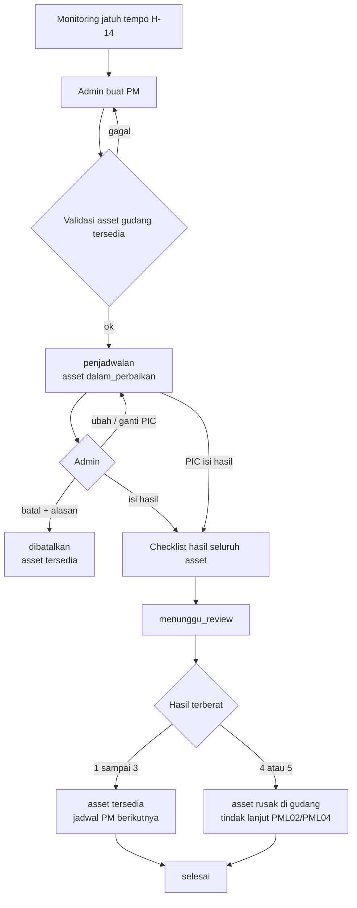
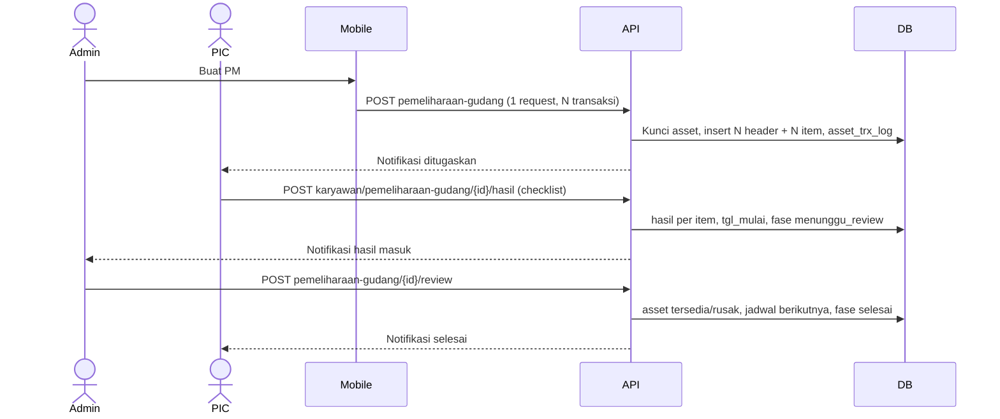
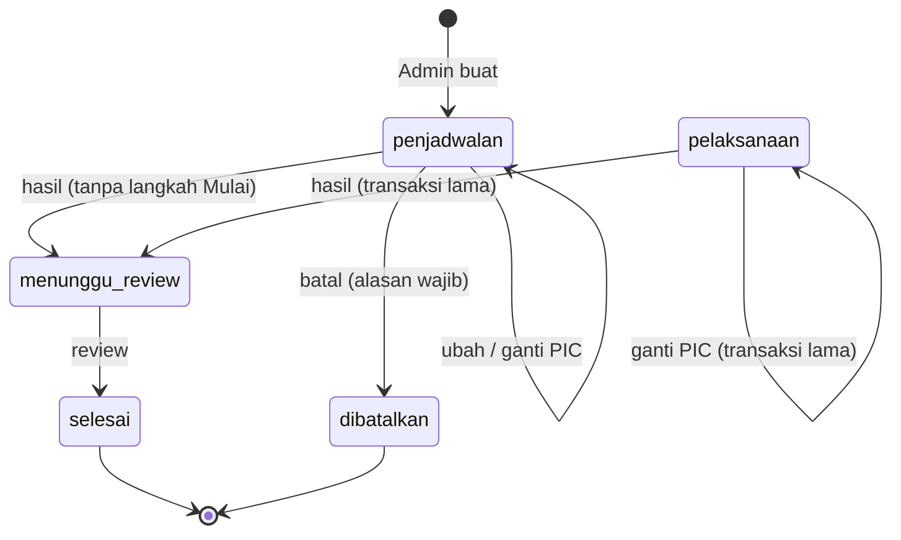
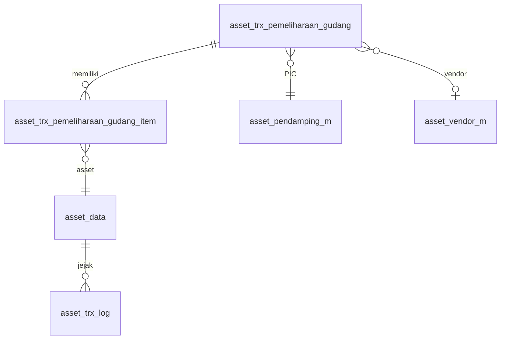

# Dokumentasi Teknis & Manual Book — Pemeliharaan Terjadwal Asset Gudang

> Dokumen ini disusun **dari source code lokal** (`API/` Lumen dan `MOBILE/` Flutter) per 21 Oktober 2026. Cakupan: **PML01 konteks gudang** (asset berstatus `tersedia` di gudang). Konteks karyawan ada di dokumen terpisah *Pemeliharaan Terjadwal Asset Karyawan*.
> Bagian yang tidak ditemukan ditandai **⚠️ Belum ditemukan**, asumsi ditandai **⚠️ Asumsi**.
> Contoh ID/nama pada payload adalah **data sintetis**.

---

## 1. Informasi Dokumen

| Informasi | Nilai |
|---|---|
| Nama Fitur | Pemeliharaan Terjadwal Asset Gudang (tab **Gudang** pada menu Pemeliharaan admin; menu **Tugas PIC** untuk pendamping) |
| Kode Fitur | **PML01** konteks gudang (nomor transaksi `PML01-3-YYYYMMNNN`; `-2-` = karyawan, `-1-` = ruangan dicadangkan) |
| Modul | Asset Management — Pemeliharaan Aset |
| Backend | Laravel **Lumen ^10.0**, PHP ^8.1, JWT, Query Builder |
| Database | `API/diagram-asset.dbml` (tanda `[NEW PML01 gudang]`) + SQL manual `Claude outputs/sql-pml01-pemeliharaan-gudang.sql`. ⚠️ SQL harus dijalankan manual; tidak ada migration Lumen |
| Mobile | Flutter (`professional_flutter_3_35`), `flutter_bloc`, `dio` |
| Web | ⚠️ Belum ditemukan: tidak ada source web di workspace |
| Test otomatis | API `tests/Asset/AssetPemeliharaanGudangTest.php` (16 test) · Mobile `test/asset/asset_pemeliharaan_gudang_test.dart` (30 test) dan `asset_pemeliharaan_gudang_dashboard_test.dart` (8 test) |
| Versi dokumen | 1.4 — 22 Oktober 2026 |
| Dokumen terkait | Pemeliharaan Karyawan (PML01), Perbaikan (PML02), Klaim Garansi (PML03), Disposal (PML04), Master Pendamping & Tugas PIC |

## 2. Daftar Isi

Lihat panel navigasi di samping.

## 3. Quick Overview

Asset yang **tersedia di gudang** dan punya jadwal PM (`flag_pemeliharaan = 1`) muncul di **Monitoring Jatuh Tempo** sejak **H-14**. Admin memilih satu atau banyak asset; untuk **setiap asset** dibuat **satu transaksi PM sendiri** dengan jadwal, vendor/teknisi, lokasi, dan **PIC Pendamping** (wajib, dari master pendamping aktif) masing-masing. Sejak dibuat, asset **dikunci** (`dalam_perbaikan`). PIC (atau admin sebagai cadangan) langsung mengisi **checklist hasil per komponen** setelah PM dilaksanakan, tanpa langkah Mulai; hasil asset = komponen **terberat**. Admin mereview: hasil 1–3 mengembalikan asset ke `tersedia` dengan jadwal PM berikutnya, hasil 4–5 menandai asset `rusak` di gudang untuk Perbaikan/Disposal.

| Aspek | Ringkasan |
|---|---|
| Aktor | Admin Asset, PIC Pendamping, Sistem |
| Struktur transaksi | 1 transaksi = 1 asset; satu request pembuatan dapat membuat banyak transaksi |
| Fase | `penjadwalan` → `menunggu_review` → `selesai` (`dibatalkan` hanya dari penjadwalan; `pelaksanaan` hanya tersisa pada transaksi lama) |
| Status asset | `tersedia` → `dalam_perbaikan` → `tersedia` / `rusak` |
| Endpoint | 10 admin + 3 PIC |
| Notifikasi | 5 event (`pemeliharaan_gudang.*`) |

## 4. Ringkasan Fitur

| No | Fitur | Aktor |
|---|---|---|
| 1 | Monitoring asset gudang jatuh tempo PM (H-14) | Admin |
| 2 | Buat PM (pilih banyak asset; satu transaksi per asset dengan jadwal, vendor, lokasi, PIC sendiri) | Admin |
| 3 | Ubah jadwal/vendor/lokasi/PIC selama penjadwalan | Admin |
| 4 | Ganti PIC sebelum hasil dikirim | Admin |
| 5 | Batalkan PM sebelum hasil dikirim | Admin |
| 6 | Checklist hasil PM per komponen (tanpa langkah Mulai) | PIC / Admin |
| 7 | Review hasil dan tindak lanjut | Admin |
| 8 | Daftar tugas dan detail | Admin, PIC |

## 5. Tujuan Fitur

### 5.1 Tujuan Bisnis (diturunkan dari kode)

- Asset cadangan di gudang tetap terawat sesuai interval PM.
- Tanggung jawab pelaksanaan jelas: satu PIC Pendamping per transaksi.
- Asset yang sedang dipelihara tidak bisa dipakai modul lain.
- Hasil PM menentukan nasib asset: kembali tersedia, atau ditarik untuk perbaikan/disposal.

### 5.2 Tujuan Sistem

- Mengunci asset sepanjang PM dan membuka kembali saat selesai/batal.
- Menurunkan hasil asset dari checklist komponen (hasil terberat).
- Menghitung jadwal PM berikutnya dari interval asset.
- Mencatat `asset_trx_log` (`pemeliharaan_gudang`) dan notifikasi.

## 6. Aktor

| Aktor | Peran |
|---|---|
| Admin Asset | Menjadwalkan, mengubah, membatalkan, mereview; boleh mengisi hasil sebagai cadangan PIC |
| PIC Pendamping | Karyawan dari master pendamping aktif; mengisi checklist hasil lewat akunnya |
| Sistem | Mengunci/membuka asset, menghitung hasil terberat dan jadwal berikutnya, mengirim notifikasi |

## 7. Hak Akses

| Aksi | Admin | PIC |
|---|---|---|
| Monitoring, opsi, daftar semua, buat, ubah, ganti PIC, batal, review | ✅ | ❌ |
| Daftar dan detail milik sendiri | ✅ (semua) | ✅ (hanya yang ditugaskan) |
| Isi hasil | ✅ (cadangan) | ✅ (hanya PIC transaksi) |

Admin ditentukan lewat `Asset_m::isAdmin` (tabel `asset_admin`). PIC divalidasi dari `id_pic_pendamping` header dan status karyawan aktif.

## 8. Terminologi

| Istilah | Arti |
|---|---|
| PM | Preventive Maintenance (pemeliharaan terjadwal) |
| PIC Pendamping | Karyawan dari master `asset_pendamping_m` yang bertanggung jawab atas pelaksanaan |
| Jatuh tempo | `jadwal_pemeliharaan` asset ≤ hari ini + 14 hari |
| Hasil terberat | Hasil tertinggi dari seluruh komponen pada satu asset |
| Hasil 1–5 | `normal`, `perlu_tindak_lanjut`, `komponen_rusak_tidak_segera`, `komponen_rusak_perlu_segera`, `tidak_dapat_diperbaiki` |
| Ditarik | Asset hasil 4–5 yang dijadikan `rusak` di gudang |

## 9. Business Rules

### BR-001 — Asset yang boleh dipelihara
Hanya asset `pemegang_asset = gudang`, `status_asset = tersedia`, `flag_pemeliharaan = 1`, dan `jadwal_pemeliharaan` terisi. Pelanggaran: *"Hanya asset tersedia di gudang yang dapat dipelihara."* atau *"…tidak memiliki jadwal pemeliharaan aktif."*

### BR-002 — Tidak bentrok onboarding
Asset yang masih berstatus belum dicek pada onboarding aktif tidak boleh dipilih.

### BR-003 — Asset dikunci
Saat PM dibuat, setiap asset menjadi `dalam_perbaikan` dan masuk `asset_trx_log`. Karena statusnya bukan `tersedia`, asset otomatis hilang dari monitoring dan tidak bisa dipilih modul lain.

### BR-004 — PIC wajib
PIC dipilih dari pendamping aktif (`flag_aktif = 1`). Dapat diganti selama fase `penjadwalan` atau `pelaksanaan`; memilih pendamping yang sama ditolak.

### BR-005 — Perubahan dan pembatalan
Ubah hanya saat `penjadwalan`. Batal hanya saat `penjadwalan` (sebelum hasil dikirim) dan **alasan wajib**; asset kembali `tersedia`.

### BR-006 — Hasil (tanpa langkah Mulai)
Hasil dikirim langsung dari `penjadwalan` (atau `pelaksanaan` pada transaksi lama) dan **seluruh asset wajib diperiksa**, masing-masing dengan checklist komponen lengkap. `tgl_mulai`/`user_mulai` terisi otomatis saat hasil dikirim.

### BR-007 — Hasil terberat
Hasil asset = hasil komponen tertinggi pada urutan 1–5.

### BR-008 — Review hasil 1–3
Asset kembali `tersedia`; jadwal PM berikutnya dihitung dari tanggal review + interval; hasil 3 dapat membawa `tgl_rencana_penggantian_komponen`.

### BR-009 — Review hasil 4–5
Asset menjadi `rusak`, `kondisi_awal = rusak`, `ket_rusak` dari temuan + catatan review, `status_rusak = sudah tidak bisa di gunakan`. `nama_tabel_tindak_lanjut` diisi `asset_trx_perbaikan` (hasil 4) atau `asset_trx_disposal` (hasil 5).

### BR-010 — Penomoran
`id` = `id_company` + `YYYYMM` + 3 digit; `no_trx` = `PML01-3-YYYYMMNNN`. Batas 999 per bulan per perusahaan, dihitung per transaksi (N asset memakai N nomor).

### BR-011 — Skema harus sudah diterapkan
Dashboard memanggil `skemaSiap()`; sebelum SQL diterapkan, bagian gudang kosong tanpa memblokir modul lain.

### BR-012 — Satu transaksi satu asset
Setiap transaksi baru memuat tepat satu asset (satu header, satu item), sehingga jadwal, vendor, lokasi, dan PIC ditentukan per asset. Satu request pembuatan boleh memuat 1–50 asset dan menghasilkan satu transaksi per asset secara atomik: bila satu asset gagal validasi, tidak ada transaksi yang tersimpan. Transaksi lama yang berisi banyak asset tetap dapat dibuka, diubah, diisi hasilnya, dan direview seperti sebelumnya.

## 10. Business Flow

1. Admin membuka **Monitoring Jatuh Tempo** (tab Gudang) dan memilih satu atau banyak asset.
2. Admin mengisi jadwal, vendor/teknisi, lokasi, PIC, keterangan **untuk setiap asset** (halaman form per asset) → satu transaksi `penjadwalan` per asset, asset `dalam_perbaikan`. PIC dinotifikasi per transaksi.
3. Admin dapat mengubah jadwal, mengganti PIC, atau membatalkan.
4. PIC (atau admin) mengisi checklist hasil seluruh asset setelah PM dilaksanakan → `menunggu_review`. Admin dinotifikasi.
5. Admin mereview → `selesai`; asset kembali `tersedia` (hasil 1–3) atau `rusak` (hasil 4–5).

## 11. Flow Berdasarkan Role

### 11.1 Admin Asset
Pantau jatuh tempo → buat PM → ubah/ganti PIC/batal bila perlu → (opsional) isi hasil sebagai cadangan → review.

### 11.2 PIC Pendamping
Terima notifikasi tugas → isi checklist hasil seluruh asset → pantau sampai review selesai.

### 11.3 System
Mengunci asset, memvalidasi, menurunkan hasil terberat, menghitung jadwal berikutnya, menulis log dan notifikasi.

## 12. Flow Diagram



## 13. Sequence Diagram



## 14. Status Transaksi

| `fase_pemeliharaan` | Label | Tab | `status` |
|---|---|---|---|
| `penjadwalan` | Penjadwalan | jadwal | proses |
| `pelaksanaan` | Pelaksanaan (hanya transaksi lama) | proses | proses |
| `menunggu_review` | Menunggu Review | proses | proses |
| `selesai` | Selesai | selesai | selesai |
| `dibatalkan` | Dibatalkan | selesai | selesai |

## 15. State Transition



## 16. Struktur Database

| Tabel | Fungsi |
|---|---|
| `asset_trx_pemeliharaan_gudang` | Header transaksi PM gudang |
| `asset_trx_pemeliharaan_gudang_item` | Satu baris per asset (hasil, checklist, tindak lanjut) |
| `asset_pendamping_m` | Master PIC Pendamping (di-ALTER: `flag_aktif`, unik per karyawan) |
| `asset_data` | Status asset dan jadwal PM (tidak diubah strukturnya) |
| `asset_trx_log` | Jejak (`jenis_log = pemeliharaan_gudang`) |

## 17. Relasi Database



## 18. Data Dictionary

### 18.1 asset_trx_pemeliharaan_gudang

| Kolom | Tipe | Keterangan |
|---|---|---|
| `id_asset_trx_pemeliharaan_gudang` | varchar(50) PK | `id_company`+`YYYYMM`+3 digit |
| `no_trx` | varchar(50) | `PML01-3-YYYYMMNNN` |
| `fase_pemeliharaan` | enum | penjadwalan, pelaksanaan, menunggu_review, selesai, dibatalkan |
| `id_asset_pendamping_m` | varchar(50) FK | PIC dari master aktif |
| `id_pic_pendamping`, `nama_pic_pendamping`, `nik_pic_pendamping` | varchar | Snapshot PIC; `id_pic_pendamping` dipakai endpoint tugas PIC |
| `id_asset_vendor_m` | varchar(50) FK null | NULL bila vendor teks bebas |
| `nama_vendor`, `keterangan_vendor` | varchar(255) | Vendor/teknisi dan info kontak |
| `tgl_pemeliharaan`, `jam_pemeliharaan` | date, time | Jadwal PM |
| `lokasi_pemeliharaan` | varchar(255) | Wajib |
| `keterangan` | varchar(255) | Catatan admin |
| `tgl_mulai`, `user_mulai` | timestamp, varchar | Terisi otomatis saat hasil dikirim (sebelumnya langkah Mulai PM) |
| `tgl_hasil`, `user_hasil` | timestamp, varchar | Hasil dikirim (PIC/admin) |
| `tgl_review`, `user_review`, `keterangan_review` | timestamp, varchar, text | Review admin |
| `tgl_batal`, `user_batal`, `alasan_batal` | timestamp, varchar | Pembatalan |
| `status` | enum proses/selesai | `selesai` bila fase selesai/dibatalkan |
| `id_company`, `tgl_input`, `user_input`, `tgl_update`, `user_update` | | Audit |

### 18.2 asset_trx_pemeliharaan_gudang_item

| Kolom | Tipe | Keterangan |
|---|---|---|
| `id_asset_trx_pemeliharaan_gudang_item` | varchar(50) PK | |
| `id_asset_trx_pemeliharaan_gudang` | varchar(50) FK | Header |
| `id_asset_data` | varchar(50) FK | Unik per transaksi |
| `nama_asset`, `deskripsi_asset`, `kategori_asset` | varchar | Snapshot |
| `status_item_pendamping` | enum null | Hasil terberat; NULL = belum diisi |
| `checklist_hasil` | text JSON | `[{id_item, nama_item, jenis, hasil, keterangan}]` |
| `keterangan_konfirmasi` | varchar(255) | Ringkasan temuan |
| `tgl_pemeliharaan_selanjutnya` | datetime null | Hasil 1–3: tgl review + interval |
| `tgl_rencana_penggantian_komponen` | date null | Hasil 3 |
| `id_trx_tindak_lanjut`, `nama_tabel_tindak_lanjut` | varchar | Tabel tujuan hasil 4/5 |

### 18.3 asset_trx_log (`jenis_log = pemeliharaan_gudang`)

Ditulis saat PM dibuat (`posisi` gudang → gudang), saat dibatalkan, dan saat review. `kondisi_akhir` = `rusak` untuk hasil 4–5.

## 19. Database Index

| Index | Kolom | Fungsi |
|---|---|---|
| `atpg_company_fase_idx` | `id_company, fase_pemeliharaan, tgl_input, id` | Daftar per tab |
| `atpg_company_pic_fase_idx` | `id_company, id_pic_pendamping, fase_pemeliharaan, tgl_input` | Tugas PIC |
| `atpgi_trx_asset_uq` | `id_trx, id_asset_data` | Satu asset sekali per transaksi |
| `atpgi_company_asset_hasil_idx` | `id_company, id_asset_data, status_item_pendamping` | Riwayat/watchlist asset |
| FK | `id_asset_pendamping_m`, `id_asset_vendor_m`, `id_asset_data` | Integritas |

## 20. Backend Architecture

| Lapisan | File |
|---|---|
| Route | `API/routes/modules/asset/RouteAsset.php` (`pemeliharaan-gudang/*`, `karyawan/pemeliharaan-gudang/*`) |
| Controller admin | `Asset/Admin/AssetAdminPemeliharaanGudang_c.php` |
| Controller PIC | `Asset/Karyawan/AssetKaryawanPemeliharaanGudang_c.php` |
| Model | `Models/Asset/AssetPemeliharaanGudang_m.php` (turunan `Asset_m`) |
| Pendukung | `AssetPemeliharaanKaryawan_m` (hasil, checklist, jadwal berikutnya), `AssetPendamping_m` |
| Notifikasi | `Support/Asset/AssetNotification.php` |
| Validasi aturan bersama | `Asset_c` (`PEMELIHARAAN_GUDANG_HASIL_RULES`) |

## 21. Backend Business Logic

### 21.1 Buat PM — `store`
Transaksi DB dengan kunci perusahaan. Input `pemeliharaan[]` (1–50 elemen, satu elemen per asset). Seluruh elemen divalidasi lebih dulu (asset BR-001/002, jadwal tidak sebelum hari ini, vendor, lokasi, PIC) sebelum ada yang ditulis. Nomor urut header dan item dihitung sekali untuk N transaksi (batas 999 dicek untuk N sekaligus); setiap asset → satu header + satu item, `dalam_perbaikan` + `asset_trx_log`. Pesan error bisnis diawali `Asset <nama>:`. Notifikasi `ditugaskan` dikirim per transaksi setelah commit.

### 21.2 Ubah — `ubah`
Hanya `penjadwalan`; validasi ulang jadwal dan PIC. Mengembalikan `pic_berubah` untuk memilih event notifikasi (`ditugaskan` bila PIC berganti, selain itu `diubah`).

### 21.3 Ganti PIC — `gantiPic`
`penjadwalan` atau `pelaksanaan`; PIC baru harus berbeda.

### 21.4 Batal — `batal`
Hanya `penjadwalan`, alasan wajib; asset kembali `tersedia`; fase `dibatalkan`.

### 21.5 Hasil — `hasil`
Aktor PIC (`id_karyawan`, harus PIC header dan karyawan aktif) atau admin (`user_id`). Fase `penjadwalan` (atau `pelaksanaan` pada transaksi lama); `tgl_mulai`/`user_mulai` diisi otomatis; input harus mencakup semua asset; checklist dinormalisasi per komponen asset; hasil asset = terberat; fase `menunggu_review`.

### 21.6 Review — `review`
Fase `menunggu_review`; per asset sesuai BR-008/009; fase `selesai`; mengembalikan daftar `ditarik`.

### 21.7 Query baca
`getPage` (tab jadwal/proses/selesai, paginasi limit+1), `getDetail`, `getMonitoring`, `countJatuhTempo`, `getPendingForPic`, `getPendingForAdmin`, `countByTabForPic`, `countPendingForAdmin`, `hasActivePic`.

## 22. Dampak terhadap asset_data

| Kejadian | `status_asset` | Kolom lain |
|---|---|---|
| PM dibuat | `tersedia` → `dalam_perbaikan` | — |
| Batal | → `tersedia` | — |
| Review hasil 1–3 | → `tersedia` | `jadwal_pemeliharaan` dihitung ulang (bila ada interval) |
| Review hasil 4–5 | → `rusak` | `kondisi_awal=rusak`, `ket_rusak`, `status_rusak` |

## 23. API Documentation

| Kode | Method | Path | Aktor |
|---|---|---|---|
| API-001 | GET | `asset/pemeliharaan-gudang/monitoring` | Admin |
| API-002 | GET | `asset/pemeliharaan-gudang/options` | Admin |
| API-003 | GET | `asset/pemeliharaan-gudang` | Admin |
| API-004 | POST | `asset/pemeliharaan-gudang` | Admin |
| API-005 | PUT | `asset/pemeliharaan-gudang/{id}` | Admin |
| API-006 | POST | `asset/pemeliharaan-gudang/{id}/pic` | Admin |
| API-007 | POST | `asset/pemeliharaan-gudang/{id}/batal` | Admin |
| API-008 | POST | `asset/pemeliharaan-gudang/{id}/hasil` | Admin |
| API-009 | POST | `asset/pemeliharaan-gudang/{id}/review` | Admin |
| API-010 | GET | `asset/pemeliharaan-gudang/{id}` | Admin |
| API-011 | GET | `asset/karyawan/pemeliharaan-gudang` | PIC |
| API-012 | POST | `asset/karyawan/pemeliharaan-gudang/{id}/hasil` | PIC |
| API-013 | GET | `asset/karyawan/pemeliharaan-gudang/{id}` | PIC |

## 24. Detail Setiap API

### API-001 — Monitoring
Daftar asset gudang jatuh tempo (H-14) beserta watchlist dari PM sebelumnya.

### API-002 — Opsi
`{vendor[], pendamping[] (aktif), asset[] (eligible), hasil[]}`.

### API-003/011 — Daftar
Query: `tab` (`jadwal|proses|selesai`), `limit` (1–50, default 20), `offset`. Respons `{filters, records[], pagination{limit, offset, next_offset, has_more}}`. Record memuat `peran` (`admin`/`pendamping`), `jumlah_asset`, ringkasan asset, PIC.

### API-004 — Buat

Satu request membuat satu transaksi **per asset**. Body:
```json
{
  "pemeliharaan": [
    {
      "id_asset_data": "AC-1",
      "tgl_jadwal": "2026-10-20",
      "jam_jadwal": "09:00",
      "id_asset_vendor_m": "VND-1",
      "nama_vendor": "",
      "keterangan_vendor": "0812-0000",
      "lokasi_pemeliharaan": "Gudang Utama",
      "id_asset_pendamping_m": "PDM-1",
      "keterangan": "Servis berkala"
    },
    {
      "id_asset_data": "AC-2",
      "tgl_jadwal": "2026-10-22",
      "jam_jadwal": "13:00",
      "id_asset_vendor_m": "",
      "nama_vendor": "Teknisi Lepas",
      "keterangan_vendor": "",
      "lokasi_pemeliharaan": "Gudang Cabang",
      "id_asset_pendamping_m": "PDM-2",
      "keterangan": ""
    }
  ]
}
```

Aturan: `pemeliharaan` wajib, 1–50 elemen, `id_asset_data` harus berbeda antar elemen. Setiap elemen divalidasi dengan aturan form yang sama; `nama_vendor` wajib bila `id_asset_vendor_m` kosong. Kunci error validasi berbentuk `pemeliharaan.N.field` (N = indeks elemen). Pembuatan atomik: bila satu asset gagal (mis. bukan asset gudang tersedia), tidak ada transaksi yang tersimpan dan pesan `BUSINESS_RULE_VIOLATION` diawali `Asset <nama>:`. Respons `CREATED`: `{records: [{id, no_trx, fase_pemeliharaan, status_label, tab, id_asset_data}], jumlah}`. Payload lama `asset_ids` tidak lagi diterima.

### API-005 — Ubah
Body sama dengan satu elemen `pemeliharaan[]` pada API-004, tanpa `id_asset_data`.

### API-006 — Ganti PIC
Body `{id_asset_pendamping_m}`.

### API-007 — Batal
Body `{alasan_batal}` (wajib).

### API-008/012 — Hasil
```json
{
  "assets": [
    {
      "id_asset_data": "AC-1",
      "keterangan": "Filter kotor",
      "items": [
        {"id_item": "KMP-1", "hasil": "normal", "keterangan": ""},
        {"id_item": "KMP-2", "hasil": "komponen_rusak_tidak_segera", "keterangan": "Kipas berisik"}
      ]
    }
  ]
}
```
`hasil` ∈ lima tingkat. Respons memuat peta `hasil` per asset.

### API-009 — Review
```json
{
  "keterangan_review": "Lanjut pantau kipas",
  "items": [{"id_asset_data": "AC-1", "tgl_rencana_penggantian_komponen": "2026-12-01"}]
}
```
Respons memuat `ditarik[]` (id asset hasil 4–5).

### API-010/013 — Detail
Berisi header, PIC, vendor, jadwal, hasil/review, `assets[]` dengan checklist, dan objek `aksi` per peran (ubah, ganti PIC, batal, hasil, review).

## 25. Mobile Architecture

| Lapisan | File |
|---|---|
| Model | `lib/Repository/Model/Asset/mAssetPemeliharaanGudang.dart` |
| API client | `lib/Repository/Service/assetPemeliharaanGudangApi.dart` (`admin: true/false` memilih prefix) |
| Bloc | `lib/Bloc/Asset/AssetPemeliharaanGudangBloc.dart` |
| UI | `lib/UI/Modul/Asset/Pemeliharaan/Gudang/*` |
| Teks | grup `pemeliharaan_gudang` di `assets/{id,en}/asset.json` |
| Navigasi | `NavigatorBloc` + `router.dart` |

## 26. Mobile Screen

### 26.1 Daftar (tab Gudang / Tugas PIC)
`HalamanAssetPemeliharaanGudang` dan `AssetPemeliharaanGudangListView`: tab Jadwal/Proses/Selesai, kartu transaksi, paginasi.

### 26.2 Monitoring dan Buat PM (admin)
`HalamanBuatPemeliharaanGudang`: daftar asset jatuh tempo, pilih banyak (maksimal 50), lalu **Lanjut** membuka halaman `HalamanFormPemeliharaanGudang` (route `/asset_admin_form_pemeliharaan_gudang`, bukan bottom sheet). Halaman form berisi satu kartu per asset yang bisa dilipat (satu terbuka sekaligus; header: nama, kode, chip Lengkap/Belum lengkap, menu *Samakan untuk semua*; ringkasan satu baris saat terlipat) dengan field tanggal, jam, vendor terdaftar/manual, kontak vendor, lokasi, PIC, dan catatan. Bar bawah menampilkan progres "N dari M lengkap" dan tombol **Buat Pemeliharaan**, yang baru mengirim setelah semua kartu lengkap; kartu pertama yang bermasalah terbuka otomatis. Tombol back sistem dan AppBar nonaktif saat submit. Picker vendor dan PIC tetap bottom sheet. Sheet ubah di halaman detail (`showAssetPemeliharaanGudangFormSheet`) tidak berubah.

### 26.3 Detail
`HalamanDetailAssetPemeliharaanGudang`: tahapan, asset beserta checklist, tombol sesuai `aksi`.

### 26.4 Master Pendamping
`HalamanPendampingAsset` (lihat dokumen Master Pendamping & Tugas PIC).

### 26.5 Entry point
Admin: Pemeliharaan → tab **Gudang**, kartu "perlu diproses" dan "jatuh tempo" di beranda. PIC: kartu Tugas PIC.

## 27. Mobile → API

| Aksi UI | Method | Endpoint |
|---|---|---|
| Muat daftar | GET | `…/pemeliharaan-gudang?tab=` |
| Buka detail | GET | `…/{id}` |
| Buka form | GET | `…/options` |
| Buat | POST | `…/pemeliharaan-gudang` |
| Ubah | PUT | `…/{id}` |
| Ganti PIC | POST | `…/{id}/pic` |
| Batal | POST | `…/{id}/batal` |
| Kirim hasil | POST | `…/{id}/hasil` |
| Review | POST | `…/{id}/review` |

## 28. API → Mobile

Respons dipetakan ke `AssetPemeliharaanGudangRecord`/`Page`/`Options`; kegagalan validasi (422) ditampilkan `CustomSnackBar` tipe warning, kegagalan lain tipe error. Sukses menutup halaman dengan pesan dan memuat ulang daftar/ringkasan.

## 29. Mapping Mobile → API → Database

Setiap field form dikirim per asset sebagai satu elemen `pemeliharaan[]`; kartu form = satu elemen = satu transaksi.

| Field form | Field API | Kolom DB |
|---|---|---|
| Asset pada kartu | `pemeliharaan[].id_asset_data` | `…_item.id_asset_data` |
| Tanggal/jam | `tgl_jadwal`/`jam_jadwal` | `tgl_pemeliharaan`/`jam_pemeliharaan` |
| Vendor terdaftar | `id_asset_vendor_m` | `id_asset_vendor_m` |
| Vendor manual | `nama_vendor` | `nama_vendor` |
| Lokasi | `lokasi_pemeliharaan` | `lokasi_pemeliharaan` |
| PIC | `id_asset_pendamping_m` | `id_asset_pendamping_m` + snapshot |
| Checklist | `assets[].items[]` | `checklist_hasil` |

## 30. Mapping Database → API → Mobile

| Kolom DB | Field API | Tampil di |
|---|---|---|
| `fase_pemeliharaan` | `fase_pemeliharaan`, `status_label`, `tab` | Badge, tab |
| `status_item_pendamping` | `assets[].hasil` | Detail asset |
| `checklist_hasil` | `assets[].checklist` | Detail asset |
| `alasan_batal` | `batal.alasan` | Detail |

## 31. Validation

### 31.1 Mobile
Tanggal, jam, lokasi, vendor (mode terdaftar/manual), dan PIC wajib **per asset** (kartu yang belum lengkap ditandai dan submit tertahan sampai semua lengkap); maksimal 50 asset dipilih; alasan batal wajib; checklist harus lengkap untuk semua asset.

### 31.2 Backend
Lihat BR dan §24. Aturan Laravel: `pemeliharaan` wajib 1–50 elemen dengan `id_asset_data` distinct, dan aturan berikut berlaku per elemen: `tgl_jadwal` `Y-m-d`, `jam_jadwal` `H:i`, `lokasi_pemeliharaan` wajib, `id_asset_pendamping_m` wajib, `hasil` dalam lima nilai.

### 31.3 Database
Enum `fase_pemeliharaan`, `status`, `status_item_pendamping`; FK PIC, vendor, asset; unik `(trx, asset)`.

## 32. Error Handling

| Kondisi | Kode | Pesan |
|---|---|---|
| Validasi request | 422 | Pesan per field |
| Aturan bisnis | 422 `BUSINESS_RULE_VIOLATION` | Mis. "Hanya pemeliharaan yang belum dimulai yang dapat dibatalkan." |
| Bukan admin | 403 | "Pengguna tidak memiliki akses admin asset." |
| Tidak ditemukan | 404 `NOT_FOUND` | "Pemeliharaan tidak ditemukan." |
| Kesalahan sistem | 500 `SYSTEM_ERROR` | Pesan umum; detail ke log |

## 33. Audit Trail

Kolom `user_*`/`tgl_*` per langkah (hasil, review, batal; `*_mulai` terisi bersama hasil) berisi `nik - nama`. `asset_trx_log` mencatat pembuatan, pembatalan, dan review.

## 34. Notification

| Event | Penerima | Rute mobile |
|---|---|---|
| `pemeliharaan_gudang.ditugaskan` | PIC | `asset_detail_pemeliharaan_gudang` |
| `pemeliharaan_gudang.diubah` | PIC | idem |
| `pemeliharaan_gudang.dibatalkan` | PIC | idem |
| `pemeliharaan_gudang.hasil` | Admin | idem |
| `pemeliharaan_gudang.selesai` | PIC | `asset_detail_pemeliharaan_gudang` |

Notifikasi dikirim setelah transaksi commit; kegagalan kirim hanya dicatat log.

## 35. Security

JWT; admin diperiksa per request; PIC dibatasi ke `id_pic_pendamping` miliknya; filter `id_company` di semua query; transaksi + `lockForUpdate` mencegah balapan; input dinormalisasi dan dipotong sesuai panjang kolom.

## 36. Manual Book User/Admin

### A. Admin — Menjadwalkan PM
1. Buka Pemeliharaan → tab **Gudang**.
2. Pilih satu atau banyak asset jatuh tempo (maksimal 50), ketuk **Lanjut**.
3. Pada halaman **Jadwal per Aset**, isi jadwal, vendor, lokasi, PIC, dan catatan untuk tiap asset. Gunakan menu ⋮ → *Samakan untuk semua* untuk menyalin isian satu asset ke asset lain.
4. Pastikan bar bawah menunjukkan semua asset lengkap, lalu ketuk **Buat Pemeliharaan** (satu transaksi per asset).

### B. Admin — Mengubah / mengganti PIC / membatalkan
Buka detail transaksi `penjadwalan`; pilih Ubah, Ganti PIC, atau Batalkan (isi alasan).

### C. PIC — Menjalankan PM
Buka Tugas PIC → transaksi → isi checklist setiap komponen untuk semua asset → **Kirim hasil**.

### D. Admin — Review
Buka transaksi `menunggu_review`, periksa hasil, isi catatan dan rencana penggantian (hasil 3), simpan.

## 37. Kondisi Button

| Tombol | Syarat |
|---|---|
| Ubah | admin, `penjadwalan` |
| Ganti PIC | admin, `penjadwalan`/`pelaksanaan` |
| Batalkan | admin, `penjadwalan` |
| Isi hasil | admin atau PIC, `penjadwalan` (atau `pelaksanaan` pada transaksi lama) |
| Review | admin, `menunggu_review` |

Semua dikendalikan objek `aksi` dari API.

## 38. Testing Scenario

| No | Skenario | Hasil |
|---|---|---|
| T-01 | Buat PM dengan asset bukan gudang/tidak tersedia/tanpa PM | Ditolak |
| T-02 | Buat PM valid | Asset `dalam_perbaikan`, `PML01-3-…` |
| T-03 | PIC langsung isi hasil dari penjadwalan, admin review | Fase berurutan, asset kembali tersedia |
| T-04 | Hasil 4/5 | Asset `rusak`, `nama_tabel_tindak_lanjut` terisi |
| T-05 | Review tanpa interval | Jadwal tetap, fase selesai |
| T-06 | Ubah dan ganti PIC | Master konsisten, notifikasi sesuai |
| T-07 | Batal tanpa alasan / setelah hasil dikirim | Ditolak |
| T-08 | PIC lain mengakses transaksi | Tidak ditemukan |
| T-09 | Hasil tidak mencakup semua asset | Ditolak |
| T-10 | Route admin dan PIC | 200/403 sesuai peran |
| T-11 | Buat PM untuk beberapa asset dengan jadwal/vendor/PIC berbeda | Satu transaksi per asset (masing-masing 1 item), nomor `PML01-3-…` berurutan |
| T-12 | Satu asset dalam request tidak eligible | Tidak ada transaksi tersimpan, asset lain tetap `tersedia`, pesan menyebut nama asset |
| T-13 | Vendor kosong tanpa nama manual / asset duplikat / 51 elemen | 422 dengan kunci `pemeliharaan.N.field` |
| T-14 | Non-admin memanggil buat PM | 403 tanpa transaksi, perubahan status, atau notifikasi |
| T-15 | Mobile: back saat submit, pilihan ke-51, Samakan untuk semua | Back diblokir, pilihan ditolak dengan peringatan, isian tersalin ke semua kartu |

Cakupan otomatis: lihat §1.

## 39. Temuan Ketidaksesuaian

| ID | Temuan |
|---|---|
| INC-01 | Hasil 4–5 baru mencatat **nama tabel** tindak lanjut; `id_trx_tindak_lanjut` tidak diisi dan PML02/PML04 tidak dibuat otomatis |
| INC-02 | Tidak ada notifikasi otomatis jatuh tempo; admin harus membuka monitoring |
| INC-03 | Tidak ada kedaluwarsa/pembatalan setelah `pelaksanaan` |

## 40. Edge Case

- PIC dinonaktifkan di master saat transaksi berjalan: transaksi tetap, tetapi `hasActivePic` mencegah penonaktifan pendamping yang masih bertugas.
- Asset diubah statusnya di luar alur saat `pelaksanaan`: `lockAssets` menolak dengan *"Status asset sudah berubah…"*.
- Dua admin membuat PM untuk asset yang sama: yang kedua gagal karena asset sudah `dalam_perbaikan`.
- Asset tanpa interval: review tidak mengubah jadwal.
- Transaksi lama yang berisi banyak asset tetap berfungsi (hasil dan review diproses untuk semua asset sekaligus); transaksi baru selalu 1 asset.
- Back saat submit ditahan (`PopScope`). Bila form tetap tertutup setelah pembuatan sukses, halaman pilih ikut tertutup dan daftar dimuat ulang.

## 41. Potential Bug / Technical Risk

### RISK-001 — Skema dari SQL manual (TINGGI)
Endpoint gagal bila SQL belum dijalankan; dashboard aman lewat `skemaSiap()`.

### RISK-002 — Tidak ada pembatalan setelah hasil dikirim (SEDANG)
PM yang tertahan di `menunggu_review` mengunci asset.

### RISK-003 — Tindak lanjut hasil 4–5 manual (SEDANG)
Lihat INC-01.

### RISK-004 — Notifikasi di luar transaksi (RENDAH)
Kegagalan push tidak membatalkan transaksi.

### RISK-005 — Kapasitas penomoran (RENDAH)
Maksimum 999 transaksi per bulan per perusahaan.

### RISK-006 — Submit ulang setelah request terputus (RENDAH)
Klien memakai timeout 30 detik tanpa `sendTimeout`. Bila koneksi putus setelah server menyimpan, form aktif lagi; submit ulang kemungkinan besar ditolak karena asset sudah `dalam_perbaikan`, tetapi belum diuji.

### RISK-007 — Notifikasi berurutan untuk banyak transaksi (RENDAH)
Sampai 50 notifikasi dikirim berurutan setelah commit. Kegagalan di tengah dapat menghasilkan respons error padahal transaksi sudah tersimpan. Penguncian `lockForUpdate` baru diuji pada SQLite, belum pada MySQL.

## 42. Dependency

| Komponen | Dipakai untuk |
|---|---|
| `Asset_m`/`Asset_c` | Akses admin, nomor urut, `asset_trx_log`, kunci perusahaan |
| `AssetPemeliharaanKaryawan_m` | Tingkat hasil, normalisasi checklist, jadwal berikutnya |
| `AssetPendamping_m` | Master PIC |
| `AssetNotification` | Notifikasi inbox + FCM |
| `asset_vendor_m`, `asset_data_item` (komponen) | Vendor dan komponen checklist |

## 43. Source Code Reference

| Area | Lokasi |
|---|---|
| Model | `API/app/Models/Asset/AssetPemeliharaanGudang_m.php` |
| Controller | `API/app/Http/Controllers/Asset/Admin/AssetAdminPemeliharaanGudang_c.php`, `Karyawan/AssetKaryawanPemeliharaanGudang_c.php` |
| Route | `API/routes/modules/asset/RouteAsset.php` |
| SQL | `Claude outputs/sql-pml01-pemeliharaan-gudang.sql` |
| Test API | `API/tests/Asset/AssetPemeliharaanGudangTest.php` |
| Mobile UI | `MOBILE/lib/UI/Modul/Asset/Pemeliharaan/Gudang/` |
| Test mobile | `MOBILE/test/asset/asset_pemeliharaan_gudang_test.dart`, `…_dashboard_test.dart` |

## 44. Developer Notes

- Pola konsisten dengan PML02/PML03: header `fase_*`, `lockHeader`/`lockAssets`, `updateHeader`, `headerResult`.
- Admin dan PIC memakai model yang sama; perbedaan hanya parameter `$idPic` dan `lockForActor`.
- Daftar memakai paginasi `limit + 1` untuk `has_more`.
- Jangan mengubah urutan nilai enum `jenis_log` tanpa menyesuaikan SQL berikutnya (PML02/03/04 menulis ulang daftar penuh).

## 45. End-to-End Traceability

| Kebutuhan | Rule | API | Mobile | DB |
|---|---|---|---|---|
| Kunci asset saat PM | BR-003 | API-004 | Buat PM | `asset_data.status_asset` |
| PIC wajib | BR-004 | API-004/006 | Form PIC | `id_asset_pendamping_m` |
| Hasil terberat | BR-007 | API-008/012 | Checklist | `status_item_pendamping` |
| Tarik asset rusak | BR-009 | API-009 | Review | `asset_data`, `nama_tabel_tindak_lanjut` |

### 45.4 Walkthrough Lengkap dengan Contoh Data

Bagian ini mengikuti **satu permintaan pemeliharaan gudang yang membuat dua transaksi**: satu diisi hasilnya dan direview, satu dibatalkan. Setiap langkah menjelaskan apa yang dilakukan pengguna di mobile, apa yang dikirim, apa yang diproses API, dan apa yang tersimpan di database. Data bersifat **sintetis**, tetapi format ID, nama kolom, urutan proses, label status, dan pesan diambil dari kode (`AssetPemeliharaanGudang_m`, `AssetAdminPemeliharaanGudang_c`, `AssetKaryawanPemeliharaanGudang_c`, `AssetNotification`).

**Skenario:** Dua asset gudang jatuh tempo PM: AC Portable dan Mesin Fotokopi. Admin membuat PM untuk keduanya dalam satu request (satu transaksi per asset, masing-masing dengan jadwal, vendor, lokasi, dan PIC sendiri). Jadwal mesin fotokopi diubah. PIC AC mengisi checklist hasil dan admin mereview. PM mesin fotokopi dibatalkan.

| Langkah | Pelaku | Aksi | Endpoint |
|:---:|---|---|---|
| 0 | Admin | Membuka monitoring dan memuat opsi | API-001 `GET /asset/pemeliharaan-gudang/monitoring`, API-002 `GET …/options` |
| 1 | Admin | **Buat PM** untuk 2 asset | API-004 `POST /asset/pemeliharaan-gudang` |
| 2 | Admin | **Ubah** jadwal transaksi kedua | API-005 `PUT /asset/pemeliharaan-gudang/{id}` |
| 3 | PIC | **Checklist Hasil** transaksi pertama | API-012 `POST /asset/karyawan/pemeliharaan-gudang/{id}/hasil` |
| 4 | Admin | **Review** transaksi pertama | API-009 `POST /asset/pemeliharaan-gudang/{id}/review` |
| 5 | Admin | **Batalkan** transaksi kedua | API-007 `POST /asset/pemeliharaan-gudang/{id}/batal` |

#### Data awal

Company `CMP001`. PM dibuat 22 Oktober 2026, periode ID `202610`. Belum ada transaksi PM gudang, log, atau notifikasi pada periode ini.

**`asset_data`** (semua `pemegang_asset = gudang`, `status_asset = tersedia`, `flag_pemeliharaan = 1`, `kondisi_awal = normal`)

| Kode | id_asset_data | nama_asset | interval_pemeliharaan | jadwal_pemeliharaan | Komponen (`asset_data_item`) |
|---|---|---|:---:|---|---|
| A40 | CMP00120260100040 (AC-0001) | AC Portable | 3 bulan | 2026-10-28 | `CMP001ITEM0501` Unit Utama (aset_utama), `CMP001ITEM0502` Filter (kelengkapan) |
| A41 | CMP00120260100041 (MFK-0001) | Mesin Fotokopi | 6 bulan | 2026-11-02 | `CMP001ITEM0601` Unit Utama (aset_utama) |

**`asset_pendamping_m`** (PIC aktif, `flag_aktif = 1`)

| id_asset_pendamping_m | id_karyawan | nik | nama | Peran |
|---|---|---|---|---|
| CMP001202601001 | KRY0020 | EMP-020 | Tono Pendamping | PIC transaksi AC |
| CMP001202601002 | KRY0021 | EMP-021 | Rina Pendamping | PIC transaksi mesin fotokopi |

**Vendor:** `asset_vendor_m` `CMP001VND001` = PT Servis Dingin. **Admin:** KRY0099 (ADM-001, Siti Admin) dan KRY0100 (ADM-002, Rudi Admin).

Penomoran: header dan item `id_company + YYYYMM + 3 digit`, `no_trx = PML01-3-YYYYMMNNN` (`-3-` = gudang); log dan notifikasi 5 digit. **Satu transaksi = satu asset**; N asset memakai N nomor header dan N nomor item.

---

#### Langkah 0 — Admin membuka monitoring dan memuat opsi

**Mobile:** Pemeliharaan (admin) → tab **Gudang** → **Jatuh Tempo Pemeliharaan** → `AssetPemeliharaanGudangApi.getMonitoring()` dan `getOptions()` (`admin: true`).

**Dikirim**
```http
GET /asset/pemeliharaan-gudang/monitoring
GET /asset/pemeliharaan-gudang/options
Authorization: Bearer <access_token_admin>
```

**Diproses API:** `getMonitoring` mengembalikan asset `tersedia` di gudang dengan `flag_pemeliharaan = 1` dan `jadwal_pemeliharaan` ≤ hari ini + 14, urut jadwal terdekat, beserta `watchlist` dari PM sebelumnya. `getAdminOptions` memuat `vendor[]`, `pendamping[]` (hanya yang aktif), `asset[]` (eligible), dan `hasil[]`.

**Database:** hanya `SELECT`. Karena asset yang sudah dipilih akan menjadi `dalam_perbaikan`, ia **otomatis hilang** dari monitoring dan opsi.

#### Langkah 1 — Admin membuat PM untuk dua asset

**Mobile:** admin memilih AC dan mesin fotokopi, lalu untuk **setiap asset** mengisi jadwal, vendor, lokasi, PIC, dan keterangan → **Simpan** → `AssetPemeliharaanGudangApi.store`.

**Dikirim**
```http
POST /asset/pemeliharaan-gudang
```
```json
{
  "pemeliharaan": [
    { "id_asset_data": "CMP00120260100040", "tgl_jadwal": "2026-10-24", "jam_jadwal": "09:00",
      "id_asset_vendor_m": "CMP001VND001", "nama_vendor": "", "keterangan_vendor": "0812-0000-0000",
      "lokasi_pemeliharaan": "Gudang Utama", "id_asset_pendamping_m": "CMP001202601001",
      "keterangan": "Servis berkala" },
    { "id_asset_data": "CMP00120260100041", "tgl_jadwal": "2026-10-26", "jam_jadwal": "13:00",
      "id_asset_vendor_m": "", "nama_vendor": "Teknisi Lepas", "keterangan_vendor": "",
      "lokasi_pemeliharaan": "Gudang Cabang", "id_asset_pendamping_m": "CMP001202601002", "keterangan": "" }
  ]
}
```

**Diproses API** (`AssetAdminPemeliharaanGudang_c::storePemeliharaanGudang` → `AssetPemeliharaanGudang_m::store`, **satu** `DB::transaction` untuk semua elemen)
1. Validasi: `pemeliharaan` wajib, 1–50 elemen; `id_asset_data` unik antar elemen; `nama_vendor` wajib bila `id_asset_vendor_m` kosong. Kunci error berbentuk `pemeliharaan.N.field`.
2. `lockCompany`; cek admin. Asset dikunci `FOR UPDATE` (urut `id_asset_data`).
3. **Seluruh elemen divalidasi lebih dulu sebelum ada yang ditulis**: asset dipegang `gudang` dan `tersedia` ("Hanya asset tersedia di gudang yang dapat dipelihara."), `flag_pemeliharaan = 1`, tidak ada di onboarding aktif, jadwal valid dan tidak sebelum hari ini, vendor, lokasi wajib, dan PIC harus ada di **pendamping aktif** ("PIC Pendamping wajib dipilih dari daftar pendamping aktif."). Pesan error diawali `Asset <nama>:`.
4. Nomor urut header dan item dihitung **sekali** untuk N transaksi (batas 999 dicek untuk N sekaligus): header `…001` dan `…002`.
5. Per asset: INSERT header (`fase_pemeliharaan = penjadwalan`, `status = proses`, snapshot PIC, vendor, jadwal), INSERT item (hasil NULL), UPDATE `asset_data` → **`dalam_perbaikan`**, INSERT `asset_trx_log` (gudang → gudang).
6. Setelah commit: notifikasi `pemeliharaan_gudang.ditugaskan` **per transaksi** ke PIC masing-masing. Bila satu asset gagal, **tidak ada** transaksi yang tersimpan.

**Hasil database**

`asset_trx_pemeliharaan_gudang` (2 baris)

| Kolom | Transaksi 1 | Transaksi 2 |
|---|---|---|
| id_asset_trx_pemeliharaan_gudang | CMP001202610001 | CMP001202610002 |
| no_trx | PML01-3-202610001 | PML01-3-202610002 |
| fase_pemeliharaan / status | **penjadwalan** / proses | **penjadwalan** / proses |
| id_asset_pendamping_m | CMP001202601001 | CMP001202601002 |
| id_pic_pendamping / nama_pic_pendamping / nik_pic_pendamping | KRY0020 / Tono Pendamping / EMP-020 | KRY0021 / Rina Pendamping / EMP-021 |
| id_asset_vendor_m / nama_vendor | CMP001VND001 / PT Servis Dingin | NULL / Teknisi Lepas |
| keterangan_vendor | 0812-0000-0000 | `''` |
| tgl_pemeliharaan / jam_pemeliharaan | 2026-10-24 / 09:00:00 | 2026-10-26 / 13:00:00 |
| lokasi_pemeliharaan | Gudang Utama | Gudang Cabang |
| keterangan | Servis berkala | `''` |
| tgl_input / user_input | 2026-10-22 09:00:00 / ADM-001 - Siti Admin | sama |

`asset_trx_pemeliharaan_gudang_item`

| id_asset_trx_pemeliharaan_gudang_item | id_asset_trx_pemeliharaan_gudang | id_asset_data | nama_asset | status_item_pendamping |
|---|---|---|---|---|
| CMP001202610001 | CMP001202610001 | A40 | AC Portable | NULL |
| CMP001202610002 | CMP001202610002 | A41 | Mesin Fotokopi | NULL |

`asset_data`: A40 dan A41 `status_asset` **tersedia → dalam_perbaikan**, `pemegang_asset` tetap `gudang`, `user_update` = ADM-001 - Siti Admin.

`asset_trx_log` (2 baris, `jenis_log = pemeliharaan_gudang`)

| id_asset_trx_log | id_asset_data | id_transaksi | kondisi awal → akhir | posisi awal → akhir | user_input |
|---|---|---|---|---|---|
| CMP00120261000001 | A40 | CMP001202610001 | normal → normal | gudang → gudang | ADM-001 - Siti Admin |
| CMP00120261000002 | A41 | CMP001202610002 | normal → normal | gudang → gudang | ADM-001 - Siti Admin |

`notif_data` (2 baris, masing-masing ke PIC transaksinya)

| id_notif | id_karyawan | id_ref | rute | ket_notif_id |
|---|---|---|---|---|
| CMP00120261000001 | KRY0020 | CMP001202610001 | asset_detail_pemeliharaan_gudang | Anda ditunjuk sebagai PIC pemeliharaan gudang PML01-3-202610001. |
| CMP00120261000002 | KRY0021 | CMP001202610002 | asset_detail_pemeliharaan_gudang | Anda ditunjuk sebagai PIC pemeliharaan gudang PML01-3-202610002. |

**Diterima mobile** (HTTP 201)
```json
{ "code": "CREATED", "message": "…",
  "data": { "records": [
      { "id": "CMP001202610001", "no_trx": "PML01-3-202610001", "fase_pemeliharaan": "penjadwalan",
        "status_label": "Penjadwalan", "tab": "jadwal", "id_asset_data": "CMP00120260100040" },
      { "id": "CMP001202610002", "no_trx": "PML01-3-202610002", "fase_pemeliharaan": "penjadwalan",
        "status_label": "Penjadwalan", "tab": "jadwal", "id_asset_data": "CMP00120260100041" } ],
    "jumlah": 2 } }
```

#### Langkah 2 — Admin mengubah jadwal transaksi kedua

**Mobile:** detail transaksi kedua (`aksi.ubah = true`) → **Ubah** → `AssetPemeliharaanGudangApi.ubah`.

**Dikirim**
```http
PUT /asset/pemeliharaan-gudang/CMP001202610002
```
```json
{ "tgl_jadwal": "2026-10-27", "jam_jadwal": "10:00", "id_asset_vendor_m": "", "nama_vendor": "Teknisi Lepas",
  "keterangan_vendor": "", "lokasi_pemeliharaan": "Gudang Cabang", "id_asset_pendamping_m": "CMP001202601002",
  "keterangan": "Jadwal digeser" }
```
Body sama dengan satu elemen `pemeliharaan[]`, tanpa `id_asset_data`.

**Diproses API** (`ubah`): hanya fase `penjadwalan`; jadwal, vendor, lokasi, dan PIC divalidasi ulang. Respons menandai apakah PIC berganti (`pic_berubah`): bila berganti, event `pemeliharaan_gudang.ditugaskan`; selain itu `pemeliharaan_gudang.diubah`.

**Hasil database**

| Tabel | Perubahan |
|---|---|
| header `…002` | tgl_pemeliharaan `2026-10-26 → 2026-10-27`; jam_pemeliharaan `13:00:00 → 10:00:00`; keterangan = Jadwal digeser; tgl_update/user_update = ADM-001 - Siti Admin |
| notif_data | + `CMP00120261000003`: KRY0021, id_ref `CMP001202610002`, rute `asset_detail_pemeliharaan_gudang`, "Jadwal pemeliharaan gudang PML01-3-202610002 telah diperbarui." (PIC tidak berganti) |

Admin juga bisa **Ganti PIC** (API-006, `POST …/{id}/pic` dengan `{id_asset_pendamping_m}`) selama `penjadwalan` atau `pelaksanaan`; PIC baru harus berbeda dari PIC saat ini.

#### Langkah 3 — PIC mengisi checklist hasil transaksi pertama

**Mobile:** menu **Tugas PIC** → detail transaksi AC (`peran = pendamping`) → checklist tiap komponen (lima tingkat) → `AssetPemeliharaanGudangApi.hasil` (`admin: false`). **Tidak ada langkah "Mulai PM"**: hasil dapat dikirim langsung dari `penjadwalan`.

**Dikirim**
```http
POST /asset/karyawan/pemeliharaan-gudang/CMP001202610001/hasil
```
```json
{
  "assets": [ {
    "id_asset_data": "CMP00120260100040",
    "keterangan": "Filter kotor",
    "items": [
      { "id_item": "CMP001ITEM0501", "hasil": "normal", "keterangan": "" },
      { "id_item": "CMP001ITEM0502", "hasil": "komponen_rusak_tidak_segera", "keterangan": "Filter kotor dan sobek" }
    ] } ]
}
```

**Diproses API** (`AssetKaryawanPemeliharaanGudang_c` → `hasil`)
1. `lockForActor`: aktor PIC lewat `id_karyawan`; header harus milik PIC itu (`id_pic_pendamping = KRY0020`) dan karyawan aktif. Admin dapat mengisi lewat API-008.
2. Fase harus `penjadwalan` (atau `pelaksanaan` pada transaksi lama) ("Pemeliharaan sudah tidak berada pada tahap pelaksanaan.").
3. `lockAssets`: seluruh asset transaksi harus masih di gudang dan `dalam_perbaikan` ("Status asset sudah berubah atau tidak lagi berada di gudang.").
4. **Seluruh asset** transaksi wajib ada pada `assets[]` ("Seluruh asset wajib diperiksa.").
5. `normalizeHasilChecklist`: semua komponen wajib dinilai, hasil salah satu dari lima tingkat, selain `normal` wajib keterangan.
6. Hasil asset = komponen **terberat** (`komponen_rusak_tidak_segera`).
7. UPDATE item (`status_item_pendamping`, `checklist_hasil`, `keterangan_konfirmasi`); UPDATE header: `fase_pemeliharaan = menunggu_review`, `tgl_mulai` dan `user_mulai` **diisi otomatis** bila kosong, `tgl_hasil`, `user_hasil`.
8. Notifikasi `pemeliharaan_gudang.hasil` ke admin.

**Hasil database**

| Tabel | Perubahan |
|---|---|
| item `…001` | status_item_pendamping NULL → **komponen_rusak_tidak_segera**; checklist_hasil = `[{"id_item":"CMP001ITEM0501","nama_item":"Unit Utama","jenis":"aset_utama","hasil":"normal","keterangan":""},{"id_item":"CMP001ITEM0502","nama_item":"Filter","jenis":"kelengkapan","hasil":"komponen_rusak_tidak_segera","keterangan":"Filter kotor dan sobek"}]`; keterangan_konfirmasi = Filter kotor |
| header `…001` | fase `penjadwalan → menunggu_review`; tgl_mulai = tgl_hasil = 2026-10-24 10:30:00; user_mulai = user_hasil = EMP-020 - Tono Pendamping |
| asset_data A40 | Tidak berubah (`dalam_perbaikan`) |
| notif_data | + `CMP00120261000004` (KRY0099) dan `CMP00120261000005` (KRY0100), rute `asset_admin_detail_pemeliharaan_gudang`, "Hasil pemeliharaan gudang PML01-3-202610001 telah dikirim dan menunggu review." |

**Diterima mobile** (HTTP 200): header `fase_pemeliharaan = menunggu_review`, `status_label = "Menunggu Review"`, `tab = "proses"`, dan peta `hasil`: `{"CMP00120260100040": "komponen_rusak_tidak_segera"}`.

#### Langkah 4 — Admin mereview transaksi pertama

**Mobile:** detail admin (`aksi.review = true`) → **Review**, mengisi catatan dan tanggal rencana penggantian komponen → `AssetPemeliharaanGudangApi.review`.

**Dikirim**
```http
POST /asset/pemeliharaan-gudang/CMP001202610001/review
```
```json
{ "keterangan_review": "Lanjut pantau filter",
  "items": [ { "id_asset_data": "CMP00120260100040", "tgl_rencana_penggantian_komponen": "2026-12-01" } ] }
```

**Diproses API** (`review`)
1. Fase harus `menunggu_review` ("Hasil pemeliharaan belum dikirim."). Asset pada `items[]` harus termasuk transaksi ini.
2. Hasil asset ini **bukan** 4–5, sehingga `jadwalBerikutnya`: hasil 3 (`komponen_rusak_tidak_segera`) **wajib** tanggal rencana penggantian komponen; bila `interval_pemeliharaan > 0`, jadwal berikutnya = **tanggal review + interval bulan** (tanpa overflow akhir bulan).
3. UPDATE `asset_data` → **`tersedia`** (kembali bisa dipakai modul lain) dan INSERT `asset_trx_log` (gudang → gudang).
4. UPDATE header → `selesai`: `status = selesai`, `tgl_review`, `user_review`, `keterangan_review`.
5. Notifikasi `pemeliharaan_gudang.selesai` ke PIC. Respons memuat `ditarik[]` (kosong di sini).

**Hasil database**

| Tabel | Perubahan |
|---|---|
| item `…001` | tgl_rencana_penggantian_komponen = 2026-12-01; tgl_pemeliharaan_selanjutnya = 2027-01-24 00:00:00 |
| asset_data A40 | status_asset `dalam_perbaikan → tersedia`; **jadwal_pemeliharaan `2026-10-28 → 2027-01-24`** (review 2026-10-24 + 3 bulan) |
| header `…001` | fase `menunggu_review → selesai`; status `proses → selesai`; tgl_review = 2026-10-24 15:00:00; user_review = ADM-001 - Siti Admin; keterangan_review = Lanjut pantau filter |
| notif_data | + `CMP00120261000006`: KRY0020, id_ref `CMP001202610001`, rute `asset_detail_pemeliharaan_gudang`, "Pemeliharaan gudang PML01-3-202610001 telah direview dan selesai." |

`asset_trx_log` (1 baris baru): `CMP00120261000003`, A40, `pemeliharaan_gudang`, id_transaksi `CMP001202610001`, kondisi normal → normal, posisi gudang → gudang, `user_input` = ADM-001 - Siti Admin.

**Diterima mobile** (HTTP 200): `fase_pemeliharaan = selesai`, `status_label = "Selesai"`, `tab = "selesai"`, `ditarik = []`.

#### Langkah 5 — Admin membatalkan transaksi kedua

**Mobile:** detail transaksi kedua → **Batalkan** dengan alasan → `AssetPemeliharaanGudangApi.batal`.

**Dikirim**
```http
POST /asset/pemeliharaan-gudang/CMP001202610002/batal
```
```json
{ "alasan_batal": "Vendor berhalangan" }
```

**Diproses API** (`batal`): hanya fase `penjadwalan` ("Hanya pemeliharaan yang belum dimulai yang dapat dibatalkan."); alasan wajib ("Alasan pembatalan wajib diisi."). Asset dikunci dan dikembalikan `tersedia`, INSERT `asset_trx_log`, header `dibatalkan`. Notifikasi `pemeliharaan_gudang.dibatalkan` ke PIC.

**Hasil database**

| Tabel | Perubahan |
|---|---|
| asset_data A41 | status_asset `dalam_perbaikan → tersedia`; `jadwal_pemeliharaan` **tidak diubah** (tetap 2026-11-02, sehingga muncul lagi di monitoring) |
| header `…002` | fase `penjadwalan → dibatalkan`; status `proses → selesai`; tgl_batal = 2026-10-24 16:00:00; user_batal = ADM-001 - Siti Admin; alasan_batal = Vendor berhalangan |
| asset_trx_log | + `CMP00120261000004`: A41, `pemeliharaan_gudang`, normal → normal, gudang → gudang |
| notif_data | + `CMP00120261000007`: KRY0021, rute `asset_detail_pemeliharaan_gudang`, "Pemeliharaan gudang PML01-3-202610002 dibatalkan." |

**Diterima mobile** (HTTP 200): `fase_pemeliharaan = dibatalkan`, `status_label = "Dibatalkan"`, `tab = "selesai"`.

---

#### Kondisi akhir data

`asset_trx_pemeliharaan_gudang`

| id | no_trx | fase_pemeliharaan | status | PIC |
|---|---|---|---|---|
| CMP001202610001 | PML01-3-202610001 | selesai | selesai | KRY0020 |
| CMP001202610002 | PML01-3-202610002 | dibatalkan | selesai | KRY0021 |

`asset_data`: A40 → `tersedia`, `jadwal_pemeliharaan = 2027-01-24`; A41 → `tersedia`, jadwal tetap 2026-11-02. `asset_trx_log`: 4 baris. `notif_data`: 7 baris.

---

#### Variasi

**Hasil 4–5 (asset ditarik).** Pada review, asset dengan hasil `komponen_rusak_perlu_segera` atau `tidak_dapat_diperbaiki`: `status_asset = rusak`, `kondisi_awal = rusak`, `ket_rusak` (temuan + catatan review, maks 255), `status_rusak = "sudah tidak bisa di gunakan"`; INSERT `asset_trx_log` dengan `kondisi_akhir = rusak`; item `nama_tabel_tindak_lanjut` = `asset_trx_perbaikan` (hasil 4) atau `asset_trx_disposal` (hasil 5); id asset masuk `ditarik[]`. Transaksi Perbaikan atau Disposal **tidak dibuat otomatis**. Pada gudang, `pemegang_asset` memang sudah `gudang`.

**Hasil 1–2.** Hasil `normal` atau `perlu_tindak_lanjut`: tanpa tanggal rencana penggantian; jadwal PM berikutnya tetap dihitung bila interval > 0. Interval 0 tidak mengubah `jadwal_pemeliharaan`.

**Admin mengisi hasil sebagai cadangan.** `POST /asset/pemeliharaan-gudang/{id}/hasil` (API-008) dengan body sama; aktor admin (`user_id`), tanpa pemeriksaan kepemilikan PIC.

**Request pembuatan gagal sebagian.** Bila salah satu asset tidak lolos validasi (mis. sudah `dalam_perbaikan`), **seluruh** request ditolak, tidak ada transaksi atau perubahan asset yang tersimpan, dan pesan berbentuk `Asset <nama>: <alasan>`.

---

#### Kasus gagal yang umum

| Situasi | Langkah | HTTP | Pesan | Perubahan database |
|---|---|:---:|---|---|
| `pemeliharaan` kosong atau > 50 | 1 | 422 | Minimal satu asset wajib dipilih. / validasi `pemeliharaan` | Tidak ada |
| Asset duplikat dalam request | 1 | 422 | Asset yang sama tidak boleh dipilih lebih dari sekali. | Tidak ada |
| Asset tidak ditemukan | 1 | 422 | Asset <id> tidak ditemukan. | Tidak ada |
| Asset bukan `tersedia` di gudang | 1 | 422 | Asset <nama>: Hanya asset tersedia di gudang yang dapat dipelihara. | Tidak ada (seluruh request) |
| `flag_pemeliharaan` tidak aktif | 1 | 422 | Asset <nama>: Asset tidak memiliki jadwal pemeliharaan aktif. | Tidak ada |
| Asset di onboarding aktif | 1 | 422 | Asset <nama>: Asset sedang diproses pada onboarding. | Tidak ada |
| Jadwal kosong atau sebelum hari ini | 1, 2 | 422 | Jadwal pemeliharaan wajib diisi dan tidak boleh sebelum tanggal pembuatan. | Tidak ada |
| Vendor atau lokasi kosong | 1, 2 | 422 | Vendor / teknisi wajib diisi. / Lokasi pemeliharaan wajib diisi. | Tidak ada |
| PIC bukan pendamping aktif | 1, 2 | 422 | PIC Pendamping wajib dipilih dari daftar pendamping aktif. | Tidak ada |
| Ubah di luar fase `penjadwalan` | 2 | 422 | Pemeliharaan hanya dapat diubah pada tahap penjadwalan. | Tidak ada |
| Ganti PIC di luar fase `penjadwalan`/`pelaksanaan` | – | 422 | PIC Pendamping tidak dapat diganti pada tahap ini. | Tidak ada |
| Ganti PIC dengan PIC yang sama | – | 422 | Pendamping yang dipilih sudah menjadi PIC. | Tidak ada |
| Hasil di luar fase | 3 | 422 | Pemeliharaan sudah tidak berada pada tahap pelaksanaan. | Tidak ada |
| Bukan PIC transaksi | 3 | 404 | Pemeliharaan asset tidak ditemukan. | Tidak ada |
| Asset tidak lagi `dalam_perbaikan` di gudang | 3, 4, 5 | 422 | Status asset sudah berubah atau tidak lagi berada di gudang. | Tidak ada |
| Asset belum semua diperiksa | 3 | 422 | Seluruh asset wajib diperiksa. | Tidak ada |
| Komponen belum semua dinilai / hasil tidak valid | 3 | 422 | Seluruh item aset wajib diperiksa. / Hasil pemeriksaan item tidak valid. | Tidak ada |
| Keterangan temuan kosong | 3 | 422 | Keterangan temuan wajib diisi untuk hasil selain normal. | Tidak ada |
| Review sebelum hasil dikirim | 4 | 422 | Hasil pemeliharaan belum dikirim. | Tidak ada |
| Hasil 3 tanpa tanggal rencana penggantian | 4 | 422 | Tanggal rencana penggantian komponen wajib diisi. | Tidak ada |
| Asset pada rencana bukan bagian transaksi | 4 | 422 | Asset pada rencana penggantian tidak termasuk transaksi ini. | Tidak ada |
| Batal di luar fase `penjadwalan` | 5 | 422 | Hanya pemeliharaan yang belum dimulai yang dapat dibatalkan. | Tidak ada |
| Batal tanpa alasan | 5 | 422 | Alasan pembatalan wajib diisi. | Tidak ada |
| Pengguna bukan admin asset | 0–2, 4, 5 | 403 / 422 | Pengguna tidak memiliki akses admin asset. / Pengguna tidak terdaftar sebagai admin asset. | Tidak ada |
| Token kedaluwarsa | semua | 401 | Token telah expired. Mobile me-refresh token sekali lalu mengulang request. | Tidak ada |

Semua pelanggaran aturan dilempar sebagai `InvalidArgumentException` di dalam `DB::transaction`, sehingga seluruh perubahan request itu dibatalkan. Pesan tersedia dalam bahasa Indonesia dan Inggris mengikuti header `locale`.

#### Ringkasan siapa mengerjakan apa

| Tahap | Mobile | API | Database |
|---|---|---|---|
| Monitoring dan opsi | Daftar jatuh tempo, pilih asset | Asset gudang tersedia H-14, opsi vendor/PIC aktif | `SELECT` saja |
| Buat PM | Form per asset: jadwal, vendor, lokasi, PIC | Validasi semua elemen sebelum menulis, satu transaksi per asset, kunci asset | header (N), item (N), `asset_data → dalam_perbaikan`, `asset_trx_log`, `notif_data` |
| Ubah / ganti PIC / batal | Form ubah, dialog alasan | Hanya fase penjadwalan, kembalikan asset bila batal | header, `asset_data` (batal), `asset_trx_log` (batal), `notif_data` |
| Hasil | Checklist komponen 5 tingkat oleh PIC | Hasil terberat, `tgl_mulai` otomatis | item, header, `notif_data` |
| Review | Catatan dan rencana penggantian | Asset → `tersedia` + jadwal berikutnya, atau `rusak` (4–5) | `asset_data`, item, header, `asset_trx_log`, `notif_data` |
| Tampilan | JSON → model → widget; objek `aksi` per peran | `statusFase`, `peran` | `SELECT` saja |

## 46. Ringkasan Database Impact

Tabel baru: `asset_trx_pemeliharaan_gudang`, `…_item`. Perubahan: `asset_pendamping_m` (+`flag_aktif`, audit update, unik per karyawan), `asset_trx_log.jenis_log` (+`pemeliharaan_gudang`). `asset_data` tidak diubah strukturnya.

## 47. Checklist Implementasi

### Database
- [x] DBML diperbarui
- [x] SQL manual + rollback
- [ ] SQL dijalankan di setiap environment

### Backend
- [x] Model, controller admin dan PIC
- [x] Route, notifikasi
- [x] Test otomatis

### Mobile
- [x] Daftar, buat, detail, form
- [x] Teks id/en
- [x] Test otomatis

### Documentation
- [x] Dokumen ini

## 48. Changelog

| Versi | Tanggal | Perubahan |
|---|---|---|
| 1.0 | 8 Okt 2026 | Dokumen awal PML01 konteks gudang |
| 1.1 | 12 Okt 2026 | Sinkronisasi dengan kode 12 Okt 2026: path file mobile mengikuti struktur folder baru (`UI/Modul/Asset/<Fitur>/` berhuruf kapital, model di `Repository/Model/Asset/`). |
| 1.2 | 12 Okt 2026 | Langkah **Mulai PM** dihapus: PIC/admin mengisi hasil langsung dari `penjadwalan`; endpoint `…/mulai` (2) dan notifikasi `pemeliharaan_gudang.dimulai*` dihapus; API-009…015 dinomori ulang menjadi API-008…013; `tgl_mulai` terisi otomatis saat hasil. Fase `pelaksanaan` hanya tersisa untuk transaksi lama. |
| 1.3 | 21 Okt 2026 | Pembuatan PM berubah menjadi **1 transaksi = 1 asset**: `POST asset/pemeliharaan-gudang` menerima `pemeliharaan[]` (1–50 elemen, atomik) dan membalas `{records[], jumlah}`; `asset_ids` dihapus; BR-012 ditambah. Mobile: **Lanjut** membuka halaman form per asset (kartu lipat, Samakan untuk semua, progres), bukan bottom sheet; pilihan dibatasi 50; back diblokir saat submit. Koreksi angka ringkasan: 10 admin + 3 PIC endpoint, 5 event notifikasi; jumlah test 16 API / 30 + 8 mobile. Tanpa perubahan skema. |
| 1.4 | 22 Okt 2026 | Menambah §45.4 *Walkthrough Lengkap dengan Contoh Data* (satu request membuat dua transaksi per asset, ubah jadwal, checklist hasil PIC, review dengan jadwal PM berikutnya, pembatalan; variasi hasil 4–5, hasil 1–2, request gagal sebagian; kasus gagal). Sinkronisasi kode: tabel log ternyata `asset_trx_log` (`id_asset_trx_log`), bukan `asset_log`. |
