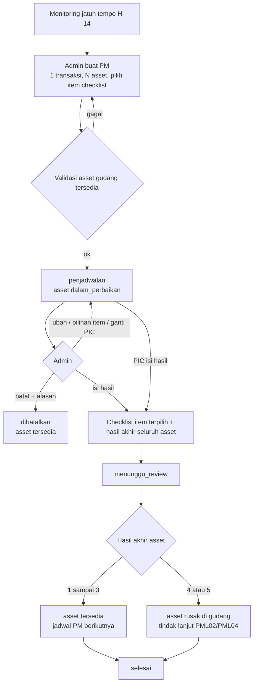
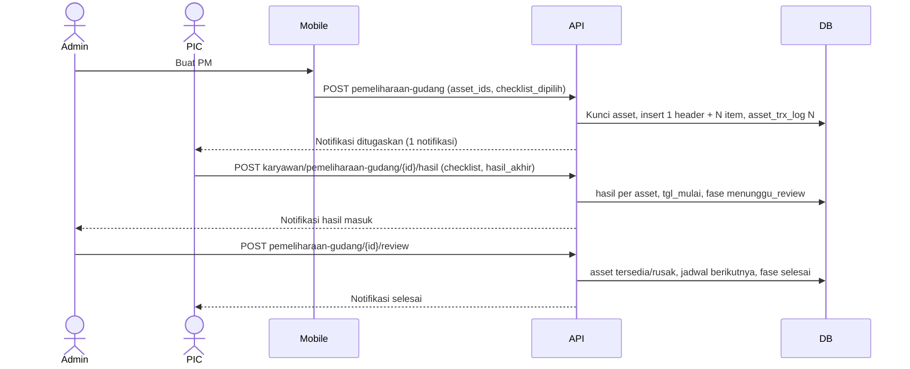
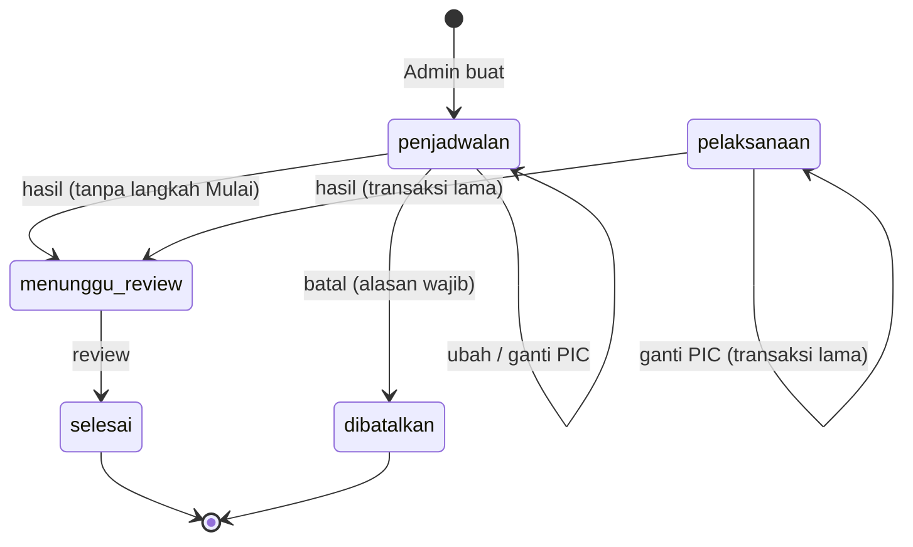
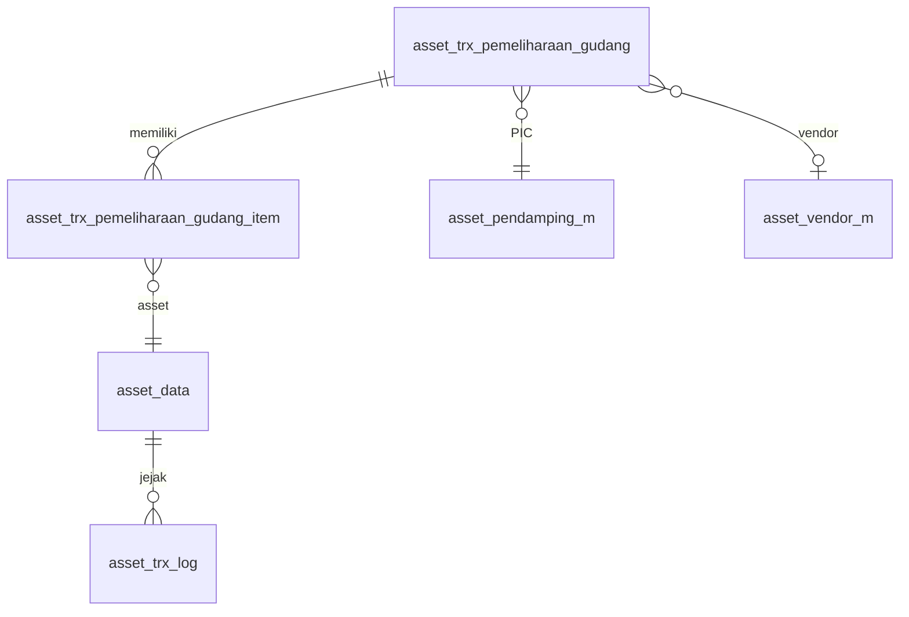

# Dokumentasi Teknis & Manual Book — Pemeliharaan Terjadwal Asset Gudang

> Dokumen ini disusun **dari source code lokal** (`API/` Lumen dan `MOBILE/` Flutter) per 18 November 2026. Cakupan: **PML01 konteks gudang** (asset berstatus `tersedia` di gudang). Konteks karyawan ada di dokumen terpisah *Pemeliharaan Terjadwal Asset Karyawan*.
> Bagian yang tidak ditemukan ditandai **⚠️ Belum ditemukan**, asumsi ditandai **⚠️ Asumsi**.
> Contoh ID/nama pada payload adalah **data sintetis**.

---

## 1. Informasi Dokumen

| Informasi | Nilai |
|---|---|
| Nama Fitur | Pemeliharaan Terjadwal Asset Gudang (tab **Servis Berkala** pada halaman Pemeliharaan admin, sumber **Gudang**; menu **Tugas PIC** untuk pendamping) |
| Kode Fitur | **PML01** konteks gudang (nomor transaksi `PML01-3-YYYYMMNNN`; `-2-` = karyawan, `-1-` = ruangan dicadangkan) |
| Modul | Asset Management — Pemeliharaan Aset |
| Backend | Laravel **Lumen ^10.0**, PHP ^8.1, JWT, Query Builder |
| Database | `API/diagram-asset.dbml` (tanda `[NEW PML01 gudang]` dan `[NEW PML01 gudang item dipilih]`) + SQL manual `Claude outputs/sql-pml01-pemeliharaan-gudang.sql` dan `Claude outputs/sql-pml01-gudang-item-dipilih.sql` (kolom `checklist_item_dipilih`). ⚠️ SQL harus dijalankan manual; tidak ada migration Lumen |
| Mobile | Flutter (`professional_flutter_3_35`), `flutter_bloc`, `dio` |
| Web | ⚠️ Belum ditemukan: tidak ada source web di workspace |
| Test otomatis | API `tests/Asset/AssetPemeliharaanGudangTest.php` (33 test, 269 assertion, lulus) · Mobile `test/asset/asset_pemeliharaan_gudang_test.dart` (47 test, lulus), `asset_pemeliharaan_gudang_dashboard_test.dart` (8 test; 7 lulus, 1 gagal, lihat §38) dan `asset_pemeliharaan_gabungan_test.dart` (40 test halaman admin gabungan, lulus). Hasil dijalankan 18 November 2026 |
| Versi dokumen | 1.5 — 18 November 2026 |
| Dokumen terkait | Pemeliharaan Karyawan (PML01), Perbaikan (PML02), Klaim Garansi (PML03), Disposal (PML04), Master Pendamping & Tugas PIC |

## 2. Daftar Isi

Lihat panel navigasi di samping.

## 3. Quick Overview

Asset yang **tersedia di gudang** dan punya jadwal PM (`flag_pemeliharaan = 1`) muncul di **Monitoring Jatuh Tempo** sejak **H-14**. Admin memilih satu atau banyak asset (maksimal 50) lalu mengisi **satu set** jadwal, vendor/teknisi, lokasi, dan **PIC Pendamping** (wajib, dari master pendamping aktif). Semua asset terpilih masuk **satu transaksi PM** (satu header, N item). Admin juga memilih **item checklist per asset** (minimal satu item per asset; tanpa pilihan = semua item). Sejak dibuat, semua asset **dikunci** (`dalam_perbaikan`). PIC (atau admin sebagai cadangan) langsung mengisi **checklist hasil untuk item terpilih** setelah PM dilaksanakan, tanpa langkah Mulai, lalu memilih **hasil akhir** tiap asset; bila hasil akhir tidak dikirim, hasil asset = komponen **terberat**. Admin mereview: hasil 1–3 mengembalikan asset ke `tersedia` dengan jadwal PM berikutnya, hasil 4–5 menandai asset `rusak` di gudang untuk Perbaikan/Disposal.

| Aspek | Ringkasan |
|---|---|
| Aktor | Admin Asset, PIC Pendamping, Sistem |
| Struktur transaksi | Satu transaksi memuat 1–50 asset (jadwal, vendor, lokasi, PIC bersama; pilihan item per asset); pembuatan atomik; request lama `pemeliharaan[]` ditolak |
| Fase | `penjadwalan` → `menunggu_review` → `selesai` (`dibatalkan` hanya dari penjadwalan; `pelaksanaan` hanya tersisa pada transaksi lama) |
| Status asset | `tersedia` → `dalam_perbaikan` → `tersedia` / `rusak` |
| Endpoint | 10 admin + 3 PIC |
| Notifikasi | 5 event (`pemeliharaan_gudang.*`) |

## 4. Ringkasan Fitur

| No | Fitur | Aktor |
|---|---|---|
| 1 | Monitoring asset gudang jatuh tempo PM (H-14) | Admin |
| 2 | Buat PM (pilih banyak asset; satu transaksi berisi semua asset dengan jadwal, vendor, lokasi, PIC bersama) | Admin |
| 3 | Pilih item checklist per asset saat buat dan saat ubah | Admin |
| 4 | Ubah jadwal/vendor/lokasi/PIC/pilihan item selama penjadwalan | Admin |
| 5 | Ganti PIC sebelum hasil dikirim | Admin |
| 6 | Batalkan PM sebelum hasil dikirim (semua asset kembali tersedia) | Admin |
| 7 | Checklist hasil PM untuk item terpilih dan hasil akhir per asset (tanpa langkah Mulai) | PIC / Admin |
| 8 | Review hasil dan tindak lanjut | Admin |
| 9 | Daftar tugas dan detail | Admin, PIC |

## 5. Tujuan Fitur

### 5.1 Tujuan Bisnis (diturunkan dari kode)

- Asset cadangan di gudang tetap terawat sesuai interval PM.
- Tanggung jawab pelaksanaan jelas: satu PIC Pendamping per transaksi, berlaku untuk semua asset di dalamnya.
- Asset yang sedang dipelihara tidak bisa dipakai modul lain.
- Hasil PM menentukan nasib asset: kembali tersedia, atau ditarik untuk perbaikan/disposal.

### 5.2 Tujuan Sistem

- Mengunci asset sepanjang PM dan membuka kembali saat selesai/batal.
- Membatasi checklist ke item yang dipilih admin, dan menetapkan hasil asset dari hasil akhir pilihan PIC (bawaan: komponen terberat).
- Menghitung jadwal PM berikutnya dari interval asset.
- Mencatat `asset_trx_log` (`pemeliharaan_gudang`) dan notifikasi.

## 6. Aktor

| Aktor | Peran |
|---|---|
| Admin Asset | Menjadwalkan, mengubah, membatalkan, mereview; boleh mengisi hasil sebagai cadangan PIC |
| PIC Pendamping | Karyawan dari master pendamping aktif; mengisi checklist hasil lewat akunnya |
| Sistem | Mengunci/membuka asset, menetapkan hasil asset (hasil akhir; bawaan terberat) dan jadwal berikutnya, mengirim notifikasi |

## 7. Hak Akses

| Aksi | Admin | PIC |
|---|---|---|
| Monitoring, opsi, daftar semua, buat, ubah, ganti PIC, batal, review | ✅ | ❌ |
| Daftar dan detail milik sendiri | ✅ (semua) | ✅ (hanya yang ditugaskan) |
| Isi hasil | ✅ (cadangan) | ✅ (hanya PIC transaksi) |

Admin ditentukan lewat `Asset_m::isAdmin` (tabel `asset_admin`). PIC divalidasi dari `id_pic_pendamping` header dan status karyawan aktif.

## 8. Terminologi

| Istilah | Arti |
|---|---|
| PM | Preventive Maintenance (pemeliharaan terjadwal) |
| PIC Pendamping | Karyawan dari master `asset_pendamping_m` yang bertanggung jawab atas pelaksanaan |
| Jatuh tempo | `jadwal_pemeliharaan` asset ≤ hari ini + 14 hari |
| Hasil terberat | Hasil tertinggi dari komponen yang diperiksa pada satu asset; dipakai sebagai hasil asset hanya bila `hasil_akhir` tidak dikirim |
| Hasil akhir | Hasil asset yang dipilih PIC (`assets[].hasil_akhir`); menjadi `status_item_pendamping` dan penentu tindak lanjut review, sah walau lebih ringan dari komponen terburuk |
| Item terpilih | Item checklist (baris `asset_data_item` unit utama/kelengkapan) yang dipilih admin untuk diperiksa; disimpan di `checklist_item_dipilih`, NULL = semua item |
| Hasil 1–5 | `normal`, `perlu_tindak_lanjut`, `komponen_rusak_tidak_segera`, `komponen_rusak_perlu_segera`, `tidak_dapat_diperbaiki` |
| Ditarik | Asset hasil 4–5 yang dijadikan `rusak` di gudang |

## 9. Business Rules

### BR-001 — Asset yang boleh dipelihara
Hanya asset `pemegang_asset = gudang`, `status_asset = tersedia`, `flag_pemeliharaan = 1`, dan `jadwal_pemeliharaan` terisi. Pelanggaran: *"Aset <nama>: Hanya aset tersedia di gudang yang dapat dipelihara."* atau *"Aset <nama>: Aset tidak memiliki jadwal pemeliharaan aktif."*

### BR-002 — Tidak ada pemeriksaan onboarding
Kode `AssetPemeliharaanGudang_m::store` tidak lagi memeriksa onboarding (alur onboarding sudah dihapus dari sistem). Asset hanya harus memenuhi BR-001. Aturan lama "asset yang masih belum dicek pada onboarding aktif tidak boleh dipilih" tidak berlaku.

### BR-003 — Asset dikunci
Saat PM dibuat, setiap asset menjadi `dalam_perbaikan` dan masuk `asset_trx_log`. Karena statusnya bukan `tersedia`, asset otomatis hilang dari monitoring dan tidak bisa dipilih modul lain.

### BR-004 — PIC wajib
PIC dipilih dari pendamping aktif (`flag_aktif = 1`) dan berlaku untuk semua asset dalam transaksi. Dapat diganti selama fase `penjadwalan` atau `pelaksanaan`; memilih pendamping yang sama ditolak.

### BR-005 — Perubahan dan pembatalan
Ubah hanya saat `penjadwalan`. Batal hanya saat `penjadwalan` (sebelum hasil dikirim) dan **alasan wajib**; **seluruh asset** transaksi kembali `tersedia`. Ubah dan batal berlaku untuk transaksi utuh, bukan per asset.

### BR-006 — Hasil (tanpa langkah Mulai)
Hasil dikirim langsung dari `penjadwalan` (atau `pelaksanaan` pada transaksi lama) dan **seluruh asset wajib diperiksa**, masing-masing dengan checklist lengkap untuk **item terpilih** (lihat BR-014). `tgl_mulai`/`user_mulai` terisi otomatis saat hasil dikirim.

### BR-007 — Hasil akhir asset
Hasil asset = `assets[].hasil_akhir` yang dipilih PIC/admin, dan sah walau lebih ringan dari komponen terburuk (checklist hanya catatan). Bila `hasil_akhir` kosong (klien lama), hasil asset = komponen tertinggi pada urutan 1–5. Nilai di luar lima tingkat atau bukan string ditolak: *"Hasil akhir aset tidak valid."* Mobile mewajibkan PIC memilih hasil akhir untuk setiap asset; API menganggapnya opsional.

### BR-008 — Review hasil 1–3
Asset kembali `tersedia`; jadwal PM berikutnya dihitung dari tanggal review + interval; hasil 3 dapat membawa `tgl_rencana_penggantian_komponen`.

### BR-009 — Review hasil 4–5
Asset menjadi `rusak`, `kondisi_awal = rusak`, `ket_rusak` dari temuan + catatan review, `status_rusak = sudah tidak bisa di gunakan`. `nama_tabel_tindak_lanjut` diisi `asset_trx_perbaikan` (hasil 4) atau `asset_trx_disposal` (hasil 5). Penarikan mengikuti **hasil akhir** asset: hasil akhir 4–5 menarik asset, sedangkan hasil akhir yang lebih ringan dari komponen bermasalah (mis. komponen 4, hasil akhir `normal`) tidak menarik asset (lihat INC-04).

### BR-010 — Penomoran
`id` header = `id_company` + `YYYYMM` + 3 digit; `no_trx` = `PML01-3-YYYYMMNNN`. Satu transaksi memakai **satu** nomor header. Nomor **item** (`id_asset_trx_pemeliharaan_gudang_item`) juga 3 digit per bulan per perusahaan dan memakai **satu nomor per asset** (N asset = N nomor item). Batas 999 berlaku terpisah untuk header dan item; bila terlampaui, pembuatan ditolak: *"Nomor transaksi untuk periode ini sudah mencapai batas."* (lihat RISK-008).

### BR-011 — Skema harus sudah diterapkan
Dashboard memanggil `skemaSiap()`; sebelum SQL diterapkan, bagian gudang kosong tanpa memblokir modul lain.

### BR-012 — Satu transaksi memuat banyak asset
Sejak 18 November 2026 satu transaksi PM gudang kembali memuat **1–50 asset** (membalik perubahan 21 Oktober 2026). Jadwal, vendor, lokasi, PIC, dan keterangan berlaku bersama untuk semua asset; yang berbeda per asset hanya pilihan item checklist dan hasil. Pembuatan atomik: satu `DB::transaction` dengan `lockForUpdate` pada asset, satu header + N item, dan bila satu asset tidak memenuhi syarat tidak ada transaksi, perubahan asset, atau notifikasi yang tersimpan. `asset_ids` wajib 1–50 elemen dan unik.

### BR-013 — Pilihan item checklist per asset
Admin memilih item yang diperiksa untuk setiap asset (`checklist_dipilih: [{id_asset_data, id_items[]}]`) saat buat dan saat ubah (fase `penjadwalan`). Bila dikirim, pilihan harus mencakup **tepat satu entri untuk setiap asset** transaksi, setiap asset minimal **satu** item, item unik, dan setiap item harus milik asset itu (urutan disimpan mengikuti urutan komponen). Pelanggaran → 422 dan tidak ada yang tersimpan. Tanpa `checklist_dipilih` pada buat, kolom `checklist_item_dipilih` tetap NULL = semua item; pada ubah, pilihan lama dipertahankan. Mobile selalu mengirim pilihan saat buat (bawaan: semua item).

### BR-014 — Checklist hasil mengikuti pilihan
Saat hasil dikirim, yang wajib dinilai hanya item terpilih (`normalizeHasilChecklistDipilih`); jumlah dan id item pada request harus persis sama dengan item terpilih, item di luar pilihan ditolak. Bila tidak ada pilihan (NULL) semua item wajib. Bila seluruh item terpilih sudah terhapus dari data asset, API memakai semua komponen agar checklist tidak kosong (`filterKomponenDipilih`). Asset tanpa baris unit utama tetap mendapat satu item unit utama (`id_item` = `id_asset_data`).

### BR-015 — Kompatibilitas klien lama
Request buat berbentuk `pemeliharaan[]` (versi 21 Okt–17 Nov 2026) ditolak 422 karena `asset_ids` wajib; respons `{records[], jumlah}` tidak ada lagi dan diganti satu objek `{id, no_trx, fase_pemeliharaan, status_label, tab, jumlah_asset, ids_asset_data}`. API dan mobile harus dirilis bersamaan (lihat RISK-010).

## 10. Business Flow

1. Admin membuka **Monitoring Jatuh Tempo** (halaman Pemeliharaan, tab Servis Berkala) dan memilih satu atau banyak asset gudang (maksimal 50).
2. Admin mengisi **satu** set jadwal, vendor/teknisi, lokasi, PIC, keterangan, dan memilih **item checklist per asset** → **satu** transaksi `penjadwalan` berisi semua asset, semua asset `dalam_perbaikan`. PIC dinotifikasi satu kali.
3. Admin dapat mengubah jadwal/vendor/lokasi/PIC/pilihan item, mengganti PIC, atau membatalkan (semua asset kembali `tersedia`).
4. PIC (atau admin) mengisi checklist item terpilih dan memilih hasil akhir untuk seluruh asset setelah PM dilaksanakan → `menunggu_review`. Admin dinotifikasi.
5. Admin mereview → `selesai`; setiap asset kembali `tersedia` (hasil 1–3) atau `rusak` (hasil 4–5).

## 11. Flow Berdasarkan Role

### 11.1 Admin Asset
Pantau jatuh tempo → pilih asset dan item checklist → buat PM → ubah/ganti PIC/batal bila perlu → (opsional) isi hasil sebagai cadangan → review.

### 11.2 PIC Pendamping
Terima notifikasi tugas → isi checklist item terpilih dan pilih hasil akhir untuk seluruh asset → pantau sampai review selesai.

### 11.3 System
Mengunci asset, memvalidasi (termasuk pilihan item), menetapkan hasil asset dari hasil akhir (bawaan: hasil terberat), menghitung jadwal berikutnya, menulis log dan notifikasi.

## 12. Flow Diagram



## 13. Sequence Diagram



## 14. Status Transaksi

| `fase_pemeliharaan` | Label | Tab | `status` |
|---|---|---|---|
| `penjadwalan` | Penjadwalan | jadwal | proses |
| `pelaksanaan` | Pelaksanaan PM (hanya transaksi lama) | proses | proses |
| `menunggu_review` | Menunggu Review | proses | proses |
| `selesai` | Selesai | selesai | selesai |
| `dibatalkan` | Dibatalkan | selesai | selesai |

## 15. State Transition



## 16. Struktur Database

| Tabel | Fungsi |
|---|---|
| `asset_trx_pemeliharaan_gudang` | Header transaksi PM gudang |
| `asset_trx_pemeliharaan_gudang_item` | Satu baris per asset (item terpilih, hasil, checklist, tindak lanjut) |
| `asset_pendamping_m` | Master PIC Pendamping (di-ALTER: `flag_aktif`, unik per karyawan) |
| `asset_data` | Status asset dan jadwal PM (tidak diubah strukturnya) |
| `asset_trx_log` | Jejak (`jenis_log = pemeliharaan_gudang`) |

## 17. Relasi Database



## 18. Data Dictionary

### 18.1 asset_trx_pemeliharaan_gudang

| Kolom | Tipe | Keterangan |
|---|---|---|
| `id_asset_trx_pemeliharaan_gudang` | varchar(50) PK | `id_company`+`YYYYMM`+3 digit |
| `no_trx` | varchar(50) | `PML01-3-YYYYMMNNN` |
| `fase_pemeliharaan` | enum | penjadwalan, pelaksanaan, menunggu_review, selesai, dibatalkan |
| `id_asset_pendamping_m` | varchar(50) FK | PIC dari master aktif |
| `id_pic_pendamping`, `nama_pic_pendamping`, `nik_pic_pendamping` | varchar | Snapshot PIC; `id_pic_pendamping` dipakai endpoint tugas PIC |
| `id_asset_vendor_m` | varchar(50) FK null | NULL bila vendor teks bebas |
| `nama_vendor`, `keterangan_vendor` | varchar(255) | Vendor/teknisi dan info kontak |
| `tgl_pemeliharaan`, `jam_pemeliharaan` | date, time | Jadwal PM |
| `lokasi_pemeliharaan` | varchar(255) | Wajib |
| `keterangan` | varchar(255) | Catatan admin |
| `tgl_mulai`, `user_mulai` | timestamp, varchar | Terisi otomatis saat hasil dikirim (sebelumnya langkah Mulai PM) |
| `tgl_hasil`, `user_hasil` | timestamp, varchar | Hasil dikirim (PIC/admin) |
| `tgl_review`, `user_review`, `keterangan_review` | timestamp, varchar, text | Review admin |
| `tgl_batal`, `user_batal`, `alasan_batal` | timestamp, varchar | Pembatalan |
| `status` | enum proses/selesai | `selesai` bila fase selesai/dibatalkan |
| `id_company`, `tgl_input`, `user_input`, `tgl_update`, `user_update` | | Audit |

### 18.2 asset_trx_pemeliharaan_gudang_item

| Kolom | Tipe | Keterangan |
|---|---|---|
| `id_asset_trx_pemeliharaan_gudang_item` | varchar(50) PK | `id_company`+`YYYYMM`+3 digit, satu nomor per asset |
| `id_asset_trx_pemeliharaan_gudang` | varchar(50) FK | Header |
| `id_asset_data` | varchar(50) FK | Unik per transaksi; satu transaksi dapat berisi banyak baris |
| `nama_asset`, `deskripsi_asset`, `kategori_asset` | varchar | Snapshot |
| `status_item_pendamping` | enum null | Hasil akhir asset (pilihan PIC; bawaan hasil terberat); NULL = belum diisi |
| `checklist_item_dipilih` | text JSON null | **Baru.** JSON array `id_item` (string) yang dipilih admin, mis. `["12","15"]`; NULL/kosong = semua item (transaksi lama). SQL `Claude outputs/sql-pml01-gudang-item-dipilih.sql`, tanda DBML `[NEW PML01 gudang item dipilih]` |
| `checklist_hasil` | text JSON | `[{id_item, nama_item, jenis, hasil, keterangan}]`, hanya untuk item terpilih |
| `keterangan_konfirmasi` | varchar(255) | Ringkasan temuan |
| `tgl_pemeliharaan_selanjutnya` | datetime null | Hasil 1–3: tgl review + interval |
| `tgl_rencana_penggantian_komponen` | date null | Hasil 3 |
| `id_trx_tindak_lanjut`, `nama_tabel_tindak_lanjut` | varchar | Tabel tujuan hasil 4/5 |

### 18.3 asset_trx_log (`jenis_log = pemeliharaan_gudang`)

Ditulis saat PM dibuat (`posisi` gudang → gudang), saat dibatalkan, dan saat review. `kondisi_akhir` = `rusak` untuk hasil 4–5.

## 19. Database Index

| Index | Kolom | Fungsi |
|---|---|---|
| `atpg_company_fase_idx` | `id_company, fase_pemeliharaan, tgl_input, id` | Daftar per tab |
| `atpg_company_pic_fase_idx` | `id_company, id_pic_pendamping, fase_pemeliharaan, tgl_input` | Tugas PIC |
| `atpgi_trx_asset_uq` | `id_trx, id_asset_data` | Satu asset sekali per transaksi |
| `atpgi_company_asset_hasil_idx` | `id_company, id_asset_data, status_item_pendamping` | Riwayat/watchlist asset |
| FK | `id_asset_pendamping_m`, `id_asset_vendor_m`, `id_asset_data` | Integritas |

## 20. Backend Architecture

| Lapisan | File |
|---|---|
| Route | `API/routes/modules/asset/RouteAsset.php` (`pemeliharaan-gudang/*`, `karyawan/pemeliharaan-gudang/*`) |
| Controller admin | `Asset/Admin/AssetAdminPemeliharaanGudang_c.php` |
| Controller PIC | `Asset/Karyawan/AssetKaryawanPemeliharaanGudang_c.php` |
| Model | `Models/Asset/AssetPemeliharaanGudang_m.php` (turunan `Asset_m`) |
| Pendukung | `AssetPemeliharaanKaryawan_m` (hasil, `normalizeHasilChecklistDipilih`, `filterKomponenDipilih`, jadwal berikutnya), `Asset_m::komponenAssets` (komponen per asset), `AssetPendamping_m` |
| Notifikasi | `Support/Asset/AssetNotification.php` |
| Validasi aturan bersama | `Asset_c` (`PEMELIHARAAN_GUDANG_HASIL_RULES`) |

## 21. Backend Business Logic

### 21.1 Buat PM — `store`
Controller memvalidasi request lebih dulu (aturan form + `asset_ids` 1–50 distinct), lalu cek admin. Model `store` berjalan dalam satu `DB::transaction` dengan kunci perusahaan: jadwal (tidak sebelum hari ini), vendor, lokasi, dan PIC divalidasi, asset dikunci `FOR UPDATE` (urut `id_asset_data`), setiap asset divalidasi (ditemukan, BR-001) dan pilihan item divalidasi (BR-013, `pilihanDariInput`) **sebelum ada yang ditulis**. Nomor header dihitung satu kali; nomor item dihitung untuk N asset (batas 999 dicek terpisah untuk header dan item). Lalu INSERT **satu** header + N item (kolom `checklist_item_dipilih` hanya ditulis bila admin mengirim pilihan), `dalam_perbaikan` + `asset_trx_log` per asset. Pesan error bisnis asset diawali `Aset <nama>:`. Notifikasi `ditugaskan` dikirim **satu kali** setelah commit. Respons berupa satu objek `{id, no_trx, fase_pemeliharaan, status_label, tab, jumlah_asset, ids_asset_data}`.

### 21.2 Ubah — `ubah`
Hanya `penjadwalan`; validasi ulang jadwal (batas bawah = tanggal pembuatan transaksi) dan PIC. Bila `checklist_dipilih` dikirim, pilihan divalidasi untuk seluruh asset transaksi dan `checklist_item_dipilih` setiap item di-UPDATE; bila tidak dikirim, pilihan lama dipertahankan. Mengembalikan `pic_berubah` untuk memilih event notifikasi (`ditugaskan` bila PIC berganti, selain itu `diubah`).

### 21.3 Ganti PIC — `gantiPic`
`penjadwalan` atau `pelaksanaan`; PIC baru harus berbeda.

### 21.4 Batal — `batal`
Hanya `penjadwalan`, alasan wajib; **semua asset** transaksi kembali `tersedia` (masing-masing mendapat baris `asset_trx_log`); fase `dibatalkan`.

### 21.5 Hasil — `hasil`
Aktor PIC (`id_karyawan`, harus PIC header dan karyawan aktif) atau admin (`user_id`). Fase `penjadwalan` (atau `pelaksanaan` pada transaksi lama); `tgl_mulai`/`user_mulai` diisi otomatis; input harus mencakup semua asset. Checklist dinormalisasi hanya untuk **item terpilih** per asset (`normalizeHasilChecklistDipilih`, BR-014). Hasil asset diambil dari `hasil_akhir` (string salah satu dari lima tingkat; kosong/spasi = fallback komponen terberat; nilai lain ditolak, BR-007) dan disimpan ke `status_item_pendamping`; checklist hanya menjadi catatan. Fase `menunggu_review`; respons memuat peta `hasil` per asset.

### 21.6 Review — `review`
Fase `menunggu_review`; per asset sesuai BR-008/009; fase `selesai`; mengembalikan daftar `ditarik`.

### 21.7 Query baca
`getPage` (tab jadwal/proses/selesai, paginasi limit+1, filter tanggal pengajuan untuk admin), `getDetail`, `getAdminOptions` (vendor, pendamping aktif, asset eligible beserta `komponen`, hasil), `getMonitoring`, `countJatuhTempo`, `getPendingForPic`, `getPendingForAdmin`, `getBerjalanForAdmin`, `countByTabForPic`, `countPendingForAdmin`, `hasActivePic`.

### 21.8 Pilihan item — `pilihanDariInput`
Dipakai `store` dan `ubah`. Mengembalikan `id_asset_data => id_item[]` (urutan komponen asli) atau `null` bila `checklist_dipilih` tidak dikirim. Menolak: bukan list atau jumlah entri tidak sama dengan jumlah asset; asset di luar transaksi; asset muncul lebih dari sekali; `id_items` kosong; item tidak valid, bukan milik asset, atau duplikat. Pesan tersedia id/en (lihat §32). Logika yang sama ditulis ulang di `AssetPemeliharaanRuangan_m` (RISK-007).

## 22. Dampak terhadap asset_data

| Kejadian | `status_asset` | Kolom lain |
|---|---|---|
| PM dibuat | semua asset transaksi: `tersedia` → `dalam_perbaikan` | — |
| Batal | semua asset → `tersedia` | — |
| Review hasil akhir 1–3 | → `tersedia` | `jadwal_pemeliharaan` dihitung ulang (bila ada interval) |
| Review hasil akhir 4–5 | → `rusak` | `kondisi_awal=rusak`, `ket_rusak`, `status_rusak` |

## 23. API Documentation

| Kode | Method | Path | Aktor |
|---|---|---|---|
| API-001 | GET | `asset/pemeliharaan-gudang/monitoring` | Admin |
| API-002 | GET | `asset/pemeliharaan-gudang/options` | Admin |
| API-003 | GET | `asset/pemeliharaan-gudang` | Admin |
| API-004 | POST | `asset/pemeliharaan-gudang` | Admin |
| API-005 | PUT | `asset/pemeliharaan-gudang/{id}` | Admin |
| API-006 | POST | `asset/pemeliharaan-gudang/{id}/pic` | Admin |
| API-007 | POST | `asset/pemeliharaan-gudang/{id}/batal` | Admin |
| API-008 | POST | `asset/pemeliharaan-gudang/{id}/hasil` | Admin |
| API-009 | POST | `asset/pemeliharaan-gudang/{id}/review` | Admin |
| API-010 | GET | `asset/pemeliharaan-gudang/{id}` | Admin |
| API-011 | GET | `asset/karyawan/pemeliharaan-gudang` | PIC |
| API-012 | POST | `asset/karyawan/pemeliharaan-gudang/{id}/hasil` | PIC |
| API-013 | GET | `asset/karyawan/pemeliharaan-gudang/{id}` | PIC |

## 24. Detail Setiap API

### API-001 — Monitoring
Daftar asset gudang jatuh tempo (H-14) beserta watchlist dari PM sebelumnya.

### API-002 — Opsi
`{vendor[], pendamping[] (aktif), asset[] (eligible), hasil[]}`. Setiap elemen `asset[]` memuat `komponen[]` (`{id_item, nama_item, jenis, detail}`, unit utama lebih dulu) sebagai dasar pilihan item checklist.

### API-003/011 — Daftar
Query: `tab` (`jadwal|proses|selesai`), `limit` (1–50, default 20), `offset`; khusus admin juga `range_tanggal_mulai` dan `range_tanggal_selesai` (`Y-m-d`, harus berpasangan, memfilter tanggal pengajuan `tgl_input`). Respons `{filters, records[], pagination{limit, offset, next_offset, has_more}}`. Record memuat `peran` (`admin`/`pendamping`), `jumlah_asset`, ringkasan asset (`nama_asset`, `kategori_asset`), vendor, jadwal, lokasi, PIC.

### API-004 — Buat

Satu request membuat **satu** transaksi berisi semua asset pada `asset_ids`. Body:
```json
{
  "asset_ids": ["AC-1", "AC-2"],
  "tgl_jadwal": "2026-11-24",
  "jam_jadwal": "09:00",
  "id_asset_vendor_m": "VND-1",
  "nama_vendor": "",
  "keterangan_vendor": "0812-0000",
  "lokasi_pemeliharaan": "Gudang Utama",
  "id_asset_pendamping_m": "PDM-1",
  "keterangan": "Servis berkala",
  "checklist_dipilih": [
    {"id_asset_data": "AC-1", "id_items": ["KMP-1", "KMP-2"]},
    {"id_asset_data": "AC-2", "id_items": ["KMP-3"]}
  ]
}
```

Aturan: `asset_ids` wajib, 1–50 elemen, unik; `nama_vendor` wajib bila `id_asset_vendor_m` kosong; `checklist_dipilih` opsional tetapi bila dikirim harus array (422 *"Format pilihan item checklist tidak valid."*) dan memenuhi BR-013. Kunci error validasi berbentuk nama field (mis. `asset_ids`, `asset_ids.1`, `lokasi_pemeliharaan`). Pembuatan atomik: bila satu asset gagal (mis. bukan asset gudang tersedia) atau pilihan item tidak valid, tidak ada transaksi yang tersimpan dan pesan `BUSINESS_RULE_VIOLATION` diawali `Aset <nama>:`. Respons `CREATED` berupa **satu objek**:
```json
{"id": "CMP001202611001", "no_trx": "PML01-3-202611001", "fase_pemeliharaan": "penjadwalan",
 "status_label": "Penjadwalan", "tab": "jadwal", "jumlah_asset": 2, "ids_asset_data": ["AC-1", "AC-2"]}
```
Payload lama `pemeliharaan[]` ditolak 422 (kunci `asset_ids`: *"Minimal satu aset wajib dipilih."*) dan respons lama `{records[], jumlah}` tidak ada lagi (BR-015).

### API-005 — Ubah
Body sama dengan API-004 tanpa `asset_ids`. `checklist_dipilih` opsional: bila dikirim harus mencakup semua asset transaksi dan menggantikan pilihan lama; bila tidak dikirim, pilihan lama tetap.

### API-006 — Ganti PIC
Body `{id_asset_pendamping_m}`.

### API-007 — Batal
Body `{alasan_batal}` (wajib).

### API-008/012 — Hasil
```json
{
  "assets": [
    {
      "id_asset_data": "AC-1",
      "hasil_akhir": "komponen_rusak_tidak_segera",
      "keterangan": "Filter kotor",
      "items": [
        {"id_item": "KMP-1", "hasil": "normal", "keterangan": ""},
        {"id_item": "KMP-2", "hasil": "komponen_rusak_tidak_segera", "keterangan": "Kipas berisik"}
      ]
    }
  ]
}
```
`hasil` ∈ lima tingkat. `items` harus persis item terpilih asset itu (BR-014). `hasil_akhir` ∈ lima tingkat menjadi hasil asset; kosong = hasil terberat (BR-007), selain itu 422 *"Hasil akhir aset tidak valid."* Respons memuat peta `hasil` per asset.

### API-009 — Review
```json
{
  "keterangan_review": "Lanjut pantau kipas",
  "items": [{"id_asset_data": "AC-1", "tgl_rencana_penggantian_komponen": "2026-12-01"}]
}
```
Respons memuat `ditarik[]` (id asset hasil 4–5).

### API-010/013 — Detail
Berisi header, PIC, vendor, jadwal, hasil/review, `jejak`, `assets[]`, dan objek `aksi` per peran (ubah, ganti PIC, batal, hasil, review). Setiap `assets[]` memuat `komponen` (item terpilih yang diperiksa), `komponen_tersedia` (semua item asset), `checklist_dipilih` (list `id_item` atau `null` = semua), `hasil {status, label, keterangan, checklist}`, `tgl_pemeliharaan_selanjutnya`, `tgl_rencana_penggantian_komponen`, dan `tindak_lanjut`.

## 25. Mobile Architecture

| Lapisan | File |
|---|---|
| Model | `lib/Repository/Model/Asset/mAssetPemeliharaanGudang.dart` |
| API client | `lib/Repository/Service/assetPemeliharaanGudangApi.dart` (`admin: true/false` memilih prefix) |
| Bloc | `lib/Bloc/Asset/AssetPemeliharaanGudangBloc.dart` |
| UI | `lib/UI/Modul/Asset/Pemeliharaan/Gudang/*` (`HalamanAssetPemeliharaanGudang`, `HalamanBuatPemeliharaanGudang`, `HalamanFormPemeliharaanGudang`, `HalamanDetailAssetPemeliharaanGudang`, `AssetPemeliharaanGudangWidgets`) |
| Halaman admin | `lib/UI/Modul/Asset/Pemeliharaan/HalamanAssetAdminPemeliharaanGabungan.dart` (tab Servis Berkala menggabungkan Karyawan, Gudang, Ruangan) |
| Draft isian | `AssetPemeliharaanGudangDraftStore` di `HalamanFormPemeliharaanGudang.dart` (memori saja) |
| Teks | grup `pemeliharaan_gudang` di `assets/{id,en}/asset.json` |
| Navigasi | `NavigatorBloc` + `router.dart` (`/asset_admin_buat_pemeliharaan_gudang`, `/asset_admin_form_pemeliharaan_gudang`; `NavigateToAssetBuatPemeliharaanGudang(preselectedAssetIds, fromAdminHome)`) |

## 26. Mobile Screen

### 26.1 Daftar (Tugas PIC)
`HalamanAssetPemeliharaanGudang` dan `AssetPemeliharaanGudangListView`: tab Jadwal/Proses/Selesai, kartu transaksi (jumlah dan nama asset ringkas), paginasi. Untuk admin, daftar transaksi gudang tampil sebagai kartu pada tab **Servis Berkala** di halaman gabungan (§26.5).

### 26.2 Monitoring dan Buat PM (admin)
`HalamanBuatPemeliharaanGudang` (route `/asset_admin_buat_pemeliharaan_gudang`): daftar asset jatuh tempo dengan kotak centang, pilih banyak (maksimal 50; pilihan ke-51 ditolak dengan peringatan). Asset yang dikirim lewat `NavigateToAssetBuatPemeliharaanGudang.preselectedAssetIds` (list) dicentang sekali setelah opsi termuat; id yang tidak ada diabaikan dan jumlahnya dipotong 50. **Lanjut** membuka `HalamanFormPemeliharaanGudang` (route `/asset_admin_form_pemeliharaan_gudang`, bukan bottom sheet), **satu form bersama** untuk semua asset terpilih: ringkasan "Aset Terpilih (N)" (lima pertama, *Lihat semua*, *Ubah Pilihan* kembali ke halaman pilih), kartu **Item Checklist**, lalu isian tanggal, jam, vendor terdaftar/manual, kontak vendor, lokasi, PIC, dan catatan.

Kartu **Item Checklist** berisi satu `ExpansionTile` per asset (judul nama asset, subjudul "{dipilih} dari {total} item", tombol *Pilih semua item*, satu kotak centang per item). Bawaan semua item tercentang; aset tanpa satu item terpilih ditandai merah dan submit ditolak (*"Pilih minimal satu item checklist untuk setiap aset."*). Tombol **Buat Pemeliharaan** mengirim satu request (`asset_ids` + `checklist_dipilih`) setelah form valid. Tombol back sistem dan AppBar nonaktif saat submit.

**Draft isian** (`AssetPemeliharaanGudangDraftStore`, dimiliki halaman pilih): isian dan pilihan item bertahan saat admin menekan *Ubah Pilihan* lalu *Lanjut* lagi (pilihan item disaring ke item yang masih ada pada opsi terbaru), dan dibuang setelah submit sukses atau halaman pilih ditutup; tidak disimpan ke storage. Picker vendor dan PIC tetap bottom sheet.

### 26.3 Detail
`HalamanDetailAssetPemeliharaanGudang`: tahapan, asset beserta item terpilih (`komponen`) dan hasilnya, tombol sesuai `aksi`. Sheet **Ubah** (`showAssetPemeliharaanGudangFormSheet`) memuat jadwal, vendor, lokasi, PIC, catatan, dan pemilih item checklist yang diawali dari `checklist_dipilih`; pilihan hanya dikirim bila berubah. Form hasil menampilkan checklist item terpilih per asset, pilihan **Hasil akhir aset** (wajib dipilih per asset di mobile), dan catatan asset; konfirmasi sebelum kirim.

### 26.4 Master Pendamping
`HalamanPendampingAsset` (lihat dokumen Master Pendamping & Tugas PIC).

### 26.5 Entry point
Admin: halaman **Pemeliharaan** (`HalamanAssetAdminPemeliharaanGabungan`, halaman gabungan bertab: Servis Berkala, Aset Rusak, Perbaikan, Klaim, Disposal). Tab **Servis Berkala** menggabungkan Karyawan, Gudang, dan Ruangan; asset gudang jatuh tempo muncul sebagai satu kartu per asset (membuka halaman pilih dengan asset itu tercentang), transaksi gudang sebagai satu kartu berisi semua asset (membuka detail), dan tombol tambah memilih sumber Karyawan/Gudang/Ruangan. Route lama admin (`/asset_admin_pemeliharaan`, Klaim, Perbaikan, Disposal) diarahkan ke tab halaman ini; tidak ada lagi pintasan terpisah Klaim Garansi/Perbaikan/Disposal pada grid admin karyawan. Kartu "perlu diproses" dan "jatuh tempo" di beranda admin tetap ada. PIC: kartu Tugas PIC.

## 27. Mobile → API

| Aksi UI | Method | Endpoint |
|---|---|---|
| Muat daftar | GET | `…/pemeliharaan-gudang?tab=` |
| Buka detail | GET | `…/{id}` |
| Buka form | GET | `…/options` |
| Buat (satu transaksi, banyak asset) | POST | `…/pemeliharaan-gudang` |
| Ubah | PUT | `…/{id}` |
| Ganti PIC | POST | `…/{id}/pic` |
| Batal | POST | `…/{id}/batal` |
| Kirim hasil | POST | `…/{id}/hasil` |
| Review | POST | `…/{id}/review` |

## 28. API → Mobile

Respons dipetakan ke `AssetPemeliharaanGudangRecord`/`Page`/`Options`; kegagalan validasi (422) ditampilkan `CustomSnackBar` tipe warning, kegagalan lain tipe error. Sukses buat menutup halaman form dengan pesan "Pemeliharaan gudang untuk {jumlah} aset berhasil dibuat." (jumlah dari `jumlah_asset`) dan memuat ulang daftar/ringkasan.

## 29. Mapping Mobile → API → Database

Isian form dikirim **sekali** untuk seluruh asset terpilih; kartu Item Checklist menghasilkan `checklist_dipilih`.

| Field form | Field API | Kolom DB |
|---|---|---|
| Asset terpilih (halaman pilih) | `asset_ids[]` | `…_item.id_asset_data` (satu baris per asset) |
| Tanggal/jam | `tgl_jadwal`/`jam_jadwal` | header `tgl_pemeliharaan`/`jam_pemeliharaan` |
| Vendor terdaftar | `id_asset_vendor_m` | header `id_asset_vendor_m` |
| Vendor manual | `nama_vendor` | header `nama_vendor` |
| Kontak vendor | `keterangan_vendor` | header `keterangan_vendor` |
| Lokasi | `lokasi_pemeliharaan` | header `lokasi_pemeliharaan` |
| PIC | `id_asset_pendamping_m` | header `id_asset_pendamping_m` + snapshot |
| Catatan | `keterangan` | header `keterangan` |
| Item Checklist per asset | `checklist_dipilih[].{id_asset_data, id_items[]}` | `…_item.checklist_item_dipilih` (JSON) |
| Hasil per item (PIC) | `assets[].items[]` | `…_item.checklist_hasil` |
| Hasil akhir aset | `assets[].hasil_akhir` | `…_item.status_item_pendamping` |
| Catatan aset | `assets[].keterangan` | `…_item.keterangan_konfirmasi` |

## 30. Mapping Database → API → Mobile

| Kolom DB | Field API | Tampil di |
|---|---|---|
| `fase_pemeliharaan` | `fase_pemeliharaan`, `status_label`, `tab` | Badge, tab |
| `status_item_pendamping` | `assets[].hasil.status` | Detail asset |
| `checklist_hasil` | `assets[].hasil.checklist` | Detail asset |
| `checklist_item_dipilih` | `assets[].checklist_dipilih`, `assets[].komponen` | Detail asset, sheet ubah |
| `asset_data_item` (komponen) | `assets[].komponen_tersedia`, `asset[].komponen` (opsi) | Kartu Item Checklist, sheet ubah |
| `alasan_batal` | `batal.alasan` | Detail |

## 31. Validation

### 31.1 Mobile
Tanggal, jam, lokasi, vendor (mode terdaftar/manual), dan PIC wajib pada satu form bersama; minimal satu asset dan maksimal 50 asset dipilih; setiap asset minimal satu item checklist; alasan batal wajib; pada hasil, semua item terpilih dinilai, hasil akhir dipilih untuk setiap asset, dan keterangan temuan wajib untuk hasil selain normal.

### 31.2 Backend
Lihat BR dan §24. Aturan Laravel (POST buat): `asset_ids` wajib 1–50 elemen dengan `asset_ids.*` distinct; `tgl_jadwal` `Y-m-d`, `jam_jadwal` `H:i`, `lokasi_pemeliharaan` wajib, `id_asset_pendamping_m` wajib, `nama_vendor` wajib bila `id_asset_vendor_m` kosong, `checklist_dipilih` nullable array (aturan lainnya di model). PUT ubah memakai aturan yang sama tanpa `asset_ids`. Hasil: `assets` wajib array, `assets.*.items` wajib minimal satu, `hasil` dalam lima nilai; `hasil_akhir` divalidasi di model.

### 31.3 Database
Enum `fase_pemeliharaan`, `status`, `status_item_pendamping`; FK PIC, vendor, asset; unik `(trx, asset)`. `checklist_item_dipilih` berupa text bebas; keabsahan isinya dijaga API.

## 32. Error Handling

| Kondisi | Kode | Pesan |
|---|---|---|
| Validasi request | 422 | Pesan per field |
| Aturan bisnis | 422 `BUSINESS_RULE_VIOLATION` | Mis. "Hanya pemeliharaan yang belum dimulai yang dapat dibatalkan." |
| Pilihan item tidak valid | 422 `BUSINESS_RULE_VIOLATION` | "Pilihan item checklist wajib mencakup seluruh aset.", "Aset <nama>: pilih minimal satu item checklist.", "Aset <nama>: item checklist tidak valid." (lihat §45.4) |
| Bukan admin | 403 | "Pengguna tidak memiliki akses admin aset." |
| Tidak ditemukan | 404 `NOT_FOUND` | "Pemeliharaan aset tidak ditemukan." |
| Kesalahan sistem | 500 `SYSTEM_ERROR` | Pesan umum; detail ke log |

Pesan tersedia dalam bahasa Indonesia dan Inggris mengikuti header `locale`.

## 33. Audit Trail

Kolom `user_*`/`tgl_*` per langkah (hasil, review, batal; `*_mulai` terisi bersama hasil) berisi `nik - nama`. `asset_trx_log` mencatat pembuatan, pembatalan, dan review.

## 34. Notification

| Event | Penerima | Rute mobile |
|---|---|---|
| `pemeliharaan_gudang.ditugaskan` | PIC | `asset_detail_pemeliharaan_gudang` |
| `pemeliharaan_gudang.diubah` | PIC | idem |
| `pemeliharaan_gudang.dibatalkan` | PIC | idem |
| `pemeliharaan_gudang.hasil` | Admin | idem |
| `pemeliharaan_gudang.selesai` | PIC | `asset_detail_pemeliharaan_gudang` |

Notifikasi dikirim setelah transaksi commit; kegagalan kirim hanya dicatat log. Pembuatan PM memicu **satu** notifikasi `ditugaskan` per transaksi (bukan per asset).

## 35. Security

JWT; admin diperiksa per request; PIC dibatasi ke `id_pic_pendamping` miliknya; filter `id_company` di semua query; transaksi + `lockForUpdate` mencegah balapan; input dinormalisasi dan dipotong sesuai panjang kolom.

## 36. Manual Book User/Admin

### A. Admin — Menjadwalkan PM
1. Buka **Pemeliharaan** → tab **Servis Berkala**. Ketuk kartu asset gudang jatuh tempo, atau tombol tambah lalu pilih sumber **Gudang**.
2. Pada **Buat Pemeliharaan Gudang**, centang satu atau banyak asset (maksimal 50), ketuk **Lanjut**.
3. Pada **Jadwal Pemeliharaan**, isi satu jadwal, vendor, lokasi, PIC, dan catatan yang berlaku untuk semua asset terpilih.
4. Pada kartu **Item Checklist**, buka tiap asset dan centang item yang akan diperiksa (bawaan semua item; minimal satu per asset; *Pilih semua item* untuk mengembalikan semua).
5. Ketuk **Buat Pemeliharaan**. Satu transaksi dibuat untuk semua asset. *Ubah Pilihan* kembali ke halaman pilih tanpa menghilangkan isian.

### B. Admin — Mengubah / mengganti PIC / membatalkan
Buka detail transaksi `penjadwalan`; pilih **Ubah Jadwal & Vendor** (jadwal, vendor, lokasi, PIC, catatan, dan pilihan item checklist), **Ganti PIC**, atau **Batalkan PM** (isi alasan; seluruh asset kembali tersedia).

### C. PIC — Menjalankan PM
Buka Tugas PIC → transaksi → untuk setiap asset isi checklist item terpilih, pilih **Hasil akhir aset** (wajib), isi catatan bila perlu → **Kirim hasil** dan konfirmasi.

### D. Admin — Review
Buka transaksi `menunggu_review`, periksa hasil, isi catatan dan rencana penggantian (hasil 3), simpan.

## 37. Kondisi Button

| Tombol | Syarat |
|---|---|
| Ubah | admin, `penjadwalan` |
| Ganti PIC | admin, `penjadwalan`/`pelaksanaan` |
| Batalkan | admin, `penjadwalan` |
| Isi hasil | admin atau PIC, `penjadwalan` (atau `pelaksanaan` pada transaksi lama) |
| Review | admin, `menunggu_review` |
| Lanjut (halaman pilih) | minimal satu asset dipilih, maksimal 50 |
| Buat Pemeliharaan | form lengkap dan setiap asset punya minimal satu item terpilih |
| Kirim hasil | semua item terpilih dinilai dan hasil akhir tiap asset dipilih |

Semua dikendalikan objek `aksi` dari API.

## 38. Testing Scenario

| No | Skenario | Hasil |
|---|---|---|
| T-01 | Buat PM dengan asset bukan gudang/tidak tersedia/tanpa PM | Ditolak |
| T-02 | Buat PM valid | Asset `dalam_perbaikan`, `PML01-3-…` |
| T-03 | PIC langsung isi hasil dari penjadwalan, admin review | Fase berurutan, asset kembali tersedia |
| T-04 | Hasil akhir 4/5 | Asset `rusak`, `nama_tabel_tindak_lanjut` terisi |
| T-05 | Review tanpa interval | Jadwal tetap, fase selesai |
| T-06 | Ubah dan ganti PIC | Master konsisten, notifikasi sesuai |
| T-07 | Batal tanpa alasan / setelah hasil dikirim | Ditolak |
| T-08 | PIC lain mengakses transaksi | Tidak ditemukan |
| T-09 | Hasil tidak mencakup semua asset | Ditolak |
| T-10 | Route admin dan PIC | 200/403 sesuai peran |
| T-11 | Buat PM untuk beberapa asset dengan satu jadwal/vendor/PIC | 1 header + N item, nomor `PML01-3-…` satu, 1 notifikasi, respons satu objek `{jumlah_asset, ids_asset_data}` |
| T-12 | Satu asset dalam request tidak eligible | Tidak ada transaksi tersimpan, asset lain tetap `tersedia`, pesan menyebut nama asset |
| T-13 | `asset_ids` kosong / duplikat / 51 elemen, atau payload lama `pemeliharaan[]` | 422 pada kunci `asset_ids`, tanpa transaksi atau notifikasi |
| T-14 | Non-admin memanggil buat PM | 403 tanpa transaksi, perubahan status, atau notifikasi |
| T-15 | Mobile: back saat submit, pilihan ke-51 | Back diblokir, pilihan ditolak dengan peringatan |
| T-16 | Buat PM dengan `checklist_dipilih` | Disimpan sebagai JSON per item; detail hanya menampilkan item terpilih |
| T-17 | Pilihan tidak valid (tidak mencakup semua asset, `id_items` kosong, duplikat, item asing, asset asing) | 422, tidak ada yang tersimpan |
| T-18 | Buat PM tanpa `checklist_dipilih`; kolom NULL pada transaksi lama; `checklist_dipilih` bukan array | Semua item; NULL berarti semua item; bukan array ditolak 422 |
| T-19 | Hasil hanya untuk item terpilih; item di luar pilihan atau item terpilih kurang | Item tak terpilih tidak wajib dan tidak memengaruhi hasil; kurang/lebih ditolak |
| T-20 | Ubah menggantikan pilihan hanya saat penjadwalan | Pilihan baru tersimpan; di luar penjadwalan ditolak |
| T-21 | Asset tanpa baris komponen, atau seluruh item terpilih sudah terhapus | Fallback ke item bawaan / semua item |
| T-22 | `hasil_akhir` PIC: menggantikan komponen terberat, kosong = fallback, non-string/tidak valid, lebih ringan dari komponen | Hasil asset = hasil akhir; fallback terberat; `Hasil akhir aset tidak valid.`; sah |
| T-23 | Review menarik asset bila hasil akhir dinaikkan, tidak bila diturunkan | `ditarik[]` mengikuti hasil akhir |
| T-24 | Batal dan review batch pada transaksi banyak asset | Semua asset dilepas / diproses sekaligus |
| T-25 | Nomor item periode penuh (item 999 terpakai) | Ditolak tanpa efek samping |
| T-26 | Mobile: pilihan item (bawaan semua, minimal satu, draft menyimpan dan memangkas item hilang, sheet ubah, detail item terpilih) | Sesuai aturan BR-013 |
| T-27 | Mobile: `preselectedAssetIds` (satu/banyak, tidak dikenal diabaikan, maks 50), draft bertahan saat Ubah Pilihan dan dibuang setelah sukses | Sesuai aturan |

Cakupan otomatis (dijalankan 18 November 2026): API `AssetPemeliharaanGudangTest.php` **33 test, 269 assertion, lulus** (SQLite); mobile `asset_pemeliharaan_gudang_test.dart` **47 test, lulus**; `asset_pemeliharaan_gabungan_test.dart` **40 test, lulus**. `asset_pemeliharaan_gudang_dashboard_test.dart` **8 test: 7 lulus, 1 gagal** (*PIC sees actionable count and opens the matching process tab*: teks "Tugas Pemeliharaan Gudang" tidak ditemukan; belum ditelusuri dan di luar perubahan v1.5).

## 39. Temuan Ketidaksesuaian

| ID | Temuan |
|---|---|
| INC-01 | Hasil 4–5 baru mencatat **nama tabel** tindak lanjut; `id_trx_tindak_lanjut` tidak diisi dan PML02/PML04 tidak dibuat otomatis |
| INC-02 | Tidak ada notifikasi otomatis jatuh tempo; admin harus membuka monitoring |
| INC-03 | Tidak ada kedaluwarsa/pembatalan setelah `pelaksanaan` |
| INC-04 | Hasil akhir pilihan PIC boleh lebih ringan dari komponen terburuk. Review menarik asset (hasil 4–5) hanya berdasarkan hasil akhir, sehingga komponen berstatus 4–5 dengan hasil akhir `normal` tidak menarik asset |
| INC-05 | Catatan kolom `status_item_pendamping` di `API/diagram-asset.dbml` masih berbunyi "hasil terburuk dari checklist_hasil" padahal hasil asset kini hasil akhir pilihan PIC |

## 40. Edge Case

- PIC dinonaktifkan di master saat transaksi berjalan: transaksi tetap, tetapi `hasActivePic` mencegah penonaktifan pendamping yang masih bertugas.
- Asset diubah statusnya di luar alur saat `pelaksanaan`: `lockAssets` menolak dengan *"Status aset sudah berubah atau tidak lagi berada di gudang."*
- Dua admin membuat PM untuk asset yang sama: yang kedua gagal karena asset sudah `dalam_perbaikan` (penguncian `lockForUpdate` belum diuji pada MariaDB, RISK-009).
- Asset tanpa interval: review tidak mengubah jadwal.
- Transaksi yang dibuat sejak 21 Oktober 2026 berisi satu asset dan transaksi sebelum kolom `checklist_item_dipilih` ada bernilai NULL: keduanya tetap berfungsi (NULL = semua item).
- Sebagian item terpilih sudah terhapus dari data asset: checklist memakai item yang masih ada; bila semuanya terhapus, semua komponen dipakai.
- Asset tanpa baris unit utama mendapat satu item bawaan (`id_item` = `id_asset_data`) dan pilihan memakai id itu.
- PIC memilih hasil akhir lebih ringan dari komponen terburuk: sah, dan review tidak menarik asset (INC-04).
- Back saat submit ditahan (`PopScope`). Bila form tetap tertutup setelah pembuatan sukses, halaman pilih ikut tertutup dan daftar dimuat ulang. Draft isian dibuang setelah sukses, disimpan bila form ditutup tanpa submit.

## 41. Potential Bug / Technical Risk

### RISK-001 — Skema dari SQL manual (TINGGI)
Endpoint gagal bila SQL belum dijalankan; dashboard aman lewat `skemaSiap()`. SQL kedua (`sql-pml01-gudang-item-dipilih.sql`, kolom `checklist_item_dipilih`) sudah dijalankan pengguna; belum dikonfirmasi untuk setiap environment. Tanpa kolom itu, buat PM dari mobile (selalu mengirim `checklist_dipilih`) dan ubah dengan pilihan diperkirakan gagal `SYSTEM_ERROR` (dari alur kode, tidak diuji), sedangkan membaca, hasil, dan review tetap berjalan (kolom dianggap NULL).

### RISK-002 — Tidak ada pembatalan setelah hasil dikirim (SEDANG)
PM yang tertahan di `menunggu_review` mengunci asset.

### RISK-003 — Tindak lanjut hasil 4–5 manual (SEDANG)
Lihat INC-01.

### RISK-004 — Notifikasi di luar transaksi (RENDAH)
Kegagalan push tidak membatalkan transaksi.

### RISK-005 — Kapasitas penomoran (RENDAH)
Maksimum 999 nomor header per bulan per perusahaan (lihat juga RISK-008 untuk nomor item).

### RISK-006 — Submit ulang setelah request terputus (RENDAH)
Klien memakai timeout 30 detik tanpa `sendTimeout`. Bila koneksi putus setelah server menyimpan, form aktif lagi; submit ulang kemungkinan besar ditolak karena asset sudah `dalam_perbaikan`, tetapi belum diuji.

### RISK-007 — Logika validasi pilihan item duplikat (SEDANG)
`pilihanDariInput` (validasi `checklist_dipilih`) ditulis dua kali sebagai method private yang sama di `AssetPemeliharaanGudang_m` dan `AssetPemeliharaanRuangan_m`. Perbaikan aturan atau pesan di satu model mudah terlewat di model lain; perlu diekstrak ke bagian bersama (belum dilakukan).

### RISK-008 — Nomor item 3 digit per bulan (SEDANG)
Nomor item memakai 3 digit per bulan per perusahaan dan satu nomor per asset, sehingga kapasitas item (999 asset per bulan, semua transaksi gudang) lebih kecil daripada kapasitas header. Satu transaksi 50 asset menghabiskan 50 nomor. Bila terlampaui, pembuatan ditolak dengan *"Nomor transaksi untuk periode ini sudah mencapai batas."* (teruji tanpa efek samping, T-25). Belum ada perluasan digit.

### RISK-009 — Belum diuji MariaDB nyata (SEDANG)
Seluruh test API memakai SQLite dengan skema yang dibuat di test, bukan dari file SQL. SQL manual (termasuk kolom `checklist_item_dipilih`), perilaku `lockForUpdate` pada MariaDB, pemotongan teks, dan penomoran bersamaan belum diuji pada MariaDB 10.4 yang sebenarnya.

### RISK-010 — Kompatibilitas klien lama (SEDANG)
Aplikasi mobile versi 21 Okt–17 Nov 2026 mengirim `pemeliharaan[]` dan membaca `records[]`; API baru menolaknya (422) dan membalas satu objek. API dan mobile harus dirilis bersamaan. Sebaliknya, mobile baru terhadap API lama (tanpa `asset_ids`/`checklist_dipilih`) juga tidak kompatibel.

## 42. Dependency

| Komponen | Dipakai untuk |
|---|---|
| `Asset_m`/`Asset_c` | Akses admin, nomor urut, `asset_trx_log`, kunci perusahaan |
| `AssetPemeliharaanKaryawan_m` | Tingkat hasil, normalisasi checklist (termasuk item terpilih), jadwal berikutnya |
| `AssetPendamping_m` | Master PIC |
| `AssetNotification` | Notifikasi inbox + FCM |
| `asset_vendor_m`, `asset_data_item` (komponen, via `Asset_m::komponenAssets`) | Vendor dan komponen/item checklist |

## 43. Source Code Reference

| Area | Lokasi |
|---|---|
| Model | `API/app/Models/Asset/AssetPemeliharaanGudang_m.php` |
| Controller | `API/app/Http/Controllers/Asset/Admin/AssetAdminPemeliharaanGudang_c.php`, `Karyawan/AssetKaryawanPemeliharaanGudang_c.php` |
| Route | `API/routes/modules/asset/RouteAsset.php` |
| SQL | `Claude outputs/sql-pml01-pemeliharaan-gudang.sql`, `Claude outputs/sql-pml01-gudang-item-dipilih.sql` |
| Test API | `API/tests/Asset/AssetPemeliharaanGudangTest.php` |
| Mobile UI | `MOBILE/lib/UI/Modul/Asset/Pemeliharaan/Gudang/`, `MOBILE/lib/UI/Modul/Asset/Pemeliharaan/HalamanAssetAdminPemeliharaanGabungan.dart` |
| Test mobile | `MOBILE/test/asset/asset_pemeliharaan_gudang_test.dart`, `…_dashboard_test.dart`, `asset_pemeliharaan_gabungan_test.dart` |

## 44. Developer Notes

- Pola konsisten dengan PML02/PML03: header `fase_*`, `lockHeader`/`lockAssets`, `updateHeader`, `headerResult`.
- Admin dan PIC memakai model yang sama; perbedaan hanya parameter `$idPic` dan `lockForActor`.
- Daftar memakai paginasi `limit + 1` untuk `has_more`.
- Jangan mengubah urutan nilai enum `jenis_log` tanpa menyesuaikan SQL berikutnya (PML02/03/04 menulis ulang daftar penuh).
- Pilihan item disimpan sebagai JSON array string di `checklist_item_dipilih`; baca lewat `idItemDipilih` (NULL/kosong/bukan list = semua item) dan saring komponen lewat `filterKomponenDipilih`.
- `store` hanya menulis `checklist_item_dipilih` bila `checklist_dipilih` dikirim, sehingga pembuatan tanpa pilihan tidak membutuhkan kolom itu.
- Hasil akhir pilihan PIC menggantikan hasil terberat (BR-007); jangan menghitung ulang dari `checklist_hasil` di sisi klien selain untuk teks konfirmasi.

## 45. End-to-End Traceability

| Kebutuhan | Rule | API | Mobile | DB |
|---|---|---|---|---|
| Kunci asset saat PM | BR-003 | API-004 | Buat PM | `asset_data.status_asset` |
| PIC wajib | BR-004 | API-004/006 | Form PIC | `id_asset_pendamping_m` |
| Hasil akhir asset | BR-007 | API-008/012 | Checklist + Hasil akhir aset | `status_item_pendamping` |
| Satu transaksi banyak asset | BR-012 | API-004 | Halaman pilih + form bersama | header (1), item (N) |
| Pilih item checklist | BR-013 | API-004/005 | Kartu Item Checklist, sheet ubah | `checklist_item_dipilih` |
| Checklist hanya item terpilih | BR-014 | API-008/012 | Form hasil PIC | `checklist_hasil` |
| Kompatibilitas klien lama | BR-015 | API-004 | Model request/respons | - |
| Tarik asset rusak | BR-009 | API-009 | Review | `asset_data`, `nama_tabel_tindak_lanjut` |

### 45.4 Walkthrough Lengkap dengan Contoh Data

Bagian ini mengikuti **satu permintaan pemeliharaan gudang yang membuat satu transaksi berisi dua asset**: admin memilih item checklist per asset, mengubah jadwal dan pilihan item, PIC mengisi hasil, lalu admin mereview. Pembatalan dan variasi lain ada di bagian *Variasi*. Setiap langkah menjelaskan apa yang dilakukan pengguna di mobile, apa yang dikirim, apa yang diproses API, dan apa yang tersimpan di database. Data bersifat **sintetis**, tetapi format ID, nama kolom, urutan proses, label status, dan pesan diambil dari kode (`AssetPemeliharaanGudang_m`, `AssetAdminPemeliharaanGudang_c`, `AssetKaryawanPemeliharaanGudang_c`, `AssetNotification`).

**Skenario:** Dua asset gudang jatuh tempo PM: AC Portable dan Mesin Fotokopi. Admin membuat satu PM untuk keduanya dengan satu jadwal, vendor, lokasi, dan PIC; untuk AC admin hanya memilih Unit Utama dan Filter (tanpa Remote), untuk mesin fotokopi memilih semua item. Admin lalu menggeser jadwal dan membuang item Drum dari mesin fotokopi. PIC mengisi hasil kedua asset dan admin mereview.

| Langkah | Pelaku | Aksi | Endpoint |
|:---:|---|---|---|
| 0 | Admin | Membuka monitoring dan memuat opsi | API-001 `GET /asset/pemeliharaan-gudang/monitoring`, API-002 `GET …/options` |
| 1 | Admin | **Buat PM** untuk 2 asset dengan pilihan item | API-004 `POST /asset/pemeliharaan-gudang` |
| 2 | Admin | **Ubah** jadwal dan pilihan item | API-005 `PUT /asset/pemeliharaan-gudang/{id}` |
| 3 | PIC | **Checklist Hasil** item terpilih + hasil akhir | API-012 `POST /asset/karyawan/pemeliharaan-gudang/{id}/hasil` |
| 4 | Admin | **Review** transaksi | API-009 `POST /asset/pemeliharaan-gudang/{id}/review` |

#### Data awal

Company `CMP001`. PM dibuat 18 November 2026, periode ID `202611`. Belum ada transaksi PM gudang, log, atau notifikasi pada periode ini.

**`asset_data`** (semua `pemegang_asset = gudang`, `status_asset = tersedia`, `flag_pemeliharaan = 1`, `kondisi_awal = normal`)

| Kode | id_asset_data | nama_asset | interval_pemeliharaan | jadwal_pemeliharaan | Komponen (`asset_data_item`) |
|---|---|---|:---:|---|---|
| A40 | CMP00120260100040 (AC-0001) | AC Portable | 3 bulan | 2026-11-25 | `CMP001ITEM0501` Unit Utama (aset_utama), `CMP001ITEM0502` Filter (kelengkapan), `CMP001ITEM0503` Remote (kelengkapan) |
| A41 | CMP00120260100041 (MFK-0001) | Mesin Fotokopi | 6 bulan | 2026-11-30 | `CMP001ITEM0601` Unit Utama (aset_utama), `CMP001ITEM0602` Drum (kelengkapan) |

**`asset_pendamping_m`** (PIC aktif, `flag_aktif = 1`)

| id_asset_pendamping_m | id_karyawan | nik | nama | Peran |
|---|---|---|---|---|
| CMP001202601001 | KRY0020 | EMP-020 | Tono Pendamping | PIC transaksi |
| CMP001202601002 | KRY0021 | EMP-021 | Rina Pendamping | Pendamping cadangan (untuk variasi ganti PIC) |

**Vendor:** `asset_vendor_m` `CMP001VND001` = PT Servis Dingin. **Admin:** KRY0099 (ADM-001, Siti Admin) dan KRY0100 (ADM-002, Rudi Admin).

Penomoran: header dan item `id_company + YYYYMM + 3 digit`, `no_trx = PML01-3-YYYYMMNNN` (`-3-` = gudang); log dan notifikasi 5 digit. **Satu transaksi memakai satu nomor header dan N nomor item** (di sini header `…001`, item `…001` dan `…002`).

---

#### Langkah 0 — Admin membuka monitoring dan memuat opsi

**Mobile:** Pemeliharaan (admin) → tab **Servis Berkala** (kartu asset gudang jatuh tempo) / **Buat Pemeliharaan Gudang** → `AssetPemeliharaanGudangApi.getMonitoring()` dan `getOptions()` (`admin: true`).

**Dikirim**
```http
GET /asset/pemeliharaan-gudang/monitoring
GET /asset/pemeliharaan-gudang/options
Authorization: Bearer <access_token_admin>
```

**Diproses API:** `getMonitoring` mengembalikan asset `tersedia` di gudang dengan `flag_pemeliharaan = 1` dan `jadwal_pemeliharaan` ≤ hari ini + 14, urut jadwal terdekat, beserta `watchlist` dari PM sebelumnya. `getAdminOptions` memuat `vendor[]`, `pendamping[]` (hanya yang aktif), `asset[]` (eligible, **masing-masing dengan `komponen[]`** `{id_item, nama_item, jenis, detail}`), dan `hasil[]`.

**Database:** hanya `SELECT`. Karena asset yang sudah dipilih akan menjadi `dalam_perbaikan`, ia **otomatis hilang** dari monitoring dan opsi.

#### Langkah 1 — Admin membuat PM untuk dua asset dengan pilihan item

**Mobile:** admin mencentang AC dan mesin fotokopi → **Lanjut** → pada form bersama mengisi jadwal, vendor, lokasi, PIC, catatan. Pada kartu **Item Checklist**, AC: Unit Utama dan Filter dicentang, Remote tidak; mesin fotokopi: semua item. → **Buat Pemeliharaan** → `AssetPemeliharaanGudangApi.store`.

**Dikirim**
```http
POST /asset/pemeliharaan-gudang
```
```json
{
  "asset_ids": ["CMP00120260100040", "CMP00120260100041"],
  "tgl_jadwal": "2026-11-24", "jam_jadwal": "09:00",
  "id_asset_vendor_m": "CMP001VND001", "nama_vendor": "", "keterangan_vendor": "0812-0000-0000",
  "lokasi_pemeliharaan": "Gudang Utama", "id_asset_pendamping_m": "CMP001202601001",
  "keterangan": "Servis berkala",
  "checklist_dipilih": [
    { "id_asset_data": "CMP00120260100040", "id_items": ["CMP001ITEM0501", "CMP001ITEM0502"] },
    { "id_asset_data": "CMP00120260100041", "id_items": ["CMP001ITEM0601", "CMP001ITEM0602"] }
  ]
}
```

**Diproses API** (`AssetAdminPemeliharaanGudang_c::storePemeliharaanGudang` → `AssetPemeliharaanGudang_m::store`, **satu** `DB::transaction`)
1. Validasi request: `asset_ids` wajib 1–50 dan unik; `tgl_jadwal` `Y-m-d`; `jam_jadwal` `H:i`; `lokasi_pemeliharaan` dan `id_asset_pendamping_m` wajib; `nama_vendor` wajib bila `id_asset_vendor_m` kosong; `checklist_dipilih` bila ada harus array. Kunci error memakai nama field. Setelah itu cek admin.
2. `lockCompany`; jadwal (tidak sebelum hari ini), vendor, lokasi, dan PIC divalidasi; asset dikunci `FOR UPDATE` (urut `id_asset_data`).
3. **Seluruh asset divalidasi lebih dulu sebelum ada yang ditulis**: ditemukan, dipegang `gudang` dan `tersedia` ("Aset <nama>: Hanya aset tersedia di gudang yang dapat dipelihara."), `flag_pemeliharaan = 1`. PIC harus ada di **pendamping aktif** ("PIC Pendamping wajib dipilih dari daftar pendamping aktif.").
4. **Pilihan item divalidasi** (`pilihanDariInput`): tepat satu entri per asset, minimal satu item, unik, dan milik asset itu; disimpan dengan urutan komponen asli.
5. Nomor: header sekali (`…001`), item untuk 2 asset (`…001`, `…002`); batas 999 dicek terpisah.
6. INSERT **satu** header (`fase_pemeliharaan = penjadwalan`, `status = proses`, snapshot PIC, vendor, jadwal) dan **dua** item (hasil NULL, `checklist_item_dipilih` JSON). Per asset: UPDATE `asset_data` → **`dalam_perbaikan`**, INSERT `asset_trx_log` (gudang → gudang).
7. Setelah commit: **satu** notifikasi `pemeliharaan_gudang.ditugaskan` ke PIC. Bila satu asset atau pilihan item gagal, **tidak ada** transaksi yang tersimpan.

**Hasil database**

`asset_trx_pemeliharaan_gudang` (1 baris)

| Kolom | Nilai |
|---|---|
| id_asset_trx_pemeliharaan_gudang | CMP001202611001 |
| no_trx | PML01-3-202611001 |
| fase_pemeliharaan / status | **penjadwalan** / proses |
| id_asset_pendamping_m | CMP001202601001 |
| id_pic_pendamping / nama_pic_pendamping / nik_pic_pendamping | KRY0020 / Tono Pendamping / EMP-020 |
| id_asset_vendor_m / nama_vendor | CMP001VND001 / PT Servis Dingin |
| keterangan_vendor | 0812-0000-0000 |
| tgl_pemeliharaan / jam_pemeliharaan | 2026-11-24 / 09:00:00 |
| lokasi_pemeliharaan | Gudang Utama |
| keterangan | Servis berkala |
| tgl_input / user_input | 2026-11-18 09:00:00 / ADM-001 - Siti Admin |

`asset_trx_pemeliharaan_gudang_item` (2 baris)

| id_asset_trx_pemeliharaan_gudang_item | id_asset_trx_pemeliharaan_gudang | id_asset_data | nama_asset | checklist_item_dipilih | status_item_pendamping |
|---|---|---|---|---|---|
| CMP001202611001 | CMP001202611001 | A40 | AC Portable | `["CMP001ITEM0501","CMP001ITEM0502"]` | NULL |
| CMP001202611002 | CMP001202611001 | A41 | Mesin Fotokopi | `["CMP001ITEM0601","CMP001ITEM0602"]` | NULL |

`asset_data`: A40 dan A41 `status_asset` **tersedia → dalam_perbaikan**, `pemegang_asset` tetap `gudang`, `user_update` = ADM-001 - Siti Admin.

`asset_trx_log` (2 baris, `jenis_log = pemeliharaan_gudang`, `id_transaksi` sama)

| id_asset_trx_log | id_asset_data | id_transaksi | kondisi awal → akhir | posisi awal → akhir | user_input |
|---|---|---|---|---|---|
| CMP00120261100001 | A40 | CMP001202611001 | normal → normal | gudang → gudang | ADM-001 - Siti Admin |
| CMP00120261100002 | A41 | CMP001202611001 | normal → normal | gudang → gudang | ADM-001 - Siti Admin |

`notif_data` (1 baris, ke PIC)

| id_notif | id_karyawan | id_ref | rute | ket_notif_id |
|---|---|---|---|---|
| CMP00120261100001 | KRY0020 | CMP001202611001 | asset_detail_pemeliharaan_gudang | Anda ditunjuk sebagai PIC pemeliharaan gudang PML01-3-202611001. |

**Diterima mobile** (HTTP 201)
```json
{ "code": "CREATED", "message": "…",
  "data": { "id": "CMP001202611001", "no_trx": "PML01-3-202611001", "fase_pemeliharaan": "penjadwalan",
            "status_label": "Penjadwalan", "tab": "jadwal", "jumlah_asset": 2,
            "ids_asset_data": ["CMP00120260100040", "CMP00120260100041"] } }
```
Mobile menutup form dengan pesan "Pemeliharaan gudang untuk 2 aset berhasil dibuat." dan draft isian dibuang.

#### Langkah 2 — Admin mengubah jadwal dan pilihan item

**Mobile:** detail transaksi (`aksi.ubah = true`) → **Ubah Jadwal & Vendor** → sheet memuat nilai saat ini; admin menggeser jadwal dan membuang centang Drum pada mesin fotokopi → `AssetPemeliharaanGudangApi.ubah`.

**Dikirim**
```http
PUT /asset/pemeliharaan-gudang/CMP001202611001
```
```json
{ "tgl_jadwal": "2026-11-25", "jam_jadwal": "10:00", "id_asset_vendor_m": "CMP001VND001", "nama_vendor": "",
  "keterangan_vendor": "0812-0000-0000", "lokasi_pemeliharaan": "Gudang Utama", "id_asset_pendamping_m": "CMP001202601001",
  "keterangan": "Jadwal digeser",
  "checklist_dipilih": [
    { "id_asset_data": "CMP00120260100040", "id_items": ["CMP001ITEM0501", "CMP001ITEM0502"] },
    { "id_asset_data": "CMP00120260100041", "id_items": ["CMP001ITEM0601"] }
  ] }
```
Body sama dengan API-004 tanpa `asset_ids`. Bila `checklist_dipilih` dikirim, harus mencakup **semua** asset transaksi.

**Diproses API** (`ubah`): hanya fase `penjadwalan`; jadwal (batas bawah = tanggal pembuatan), vendor, lokasi, dan PIC divalidasi ulang; pilihan item divalidasi dan **menggantikan** pilihan lama di setiap item. Respons menandai apakah PIC berganti (`pic_berubah`): bila berganti, event `pemeliharaan_gudang.ditugaskan`; selain itu `pemeliharaan_gudang.diubah`.

**Hasil database**

| Tabel | Perubahan |
|---|---|
| header `…001` | tgl_pemeliharaan `2026-11-24 → 2026-11-25`; jam_pemeliharaan `09:00:00 → 10:00:00`; keterangan = Jadwal digeser; tgl_update/user_update = ADM-001 - Siti Admin |
| item `…002` | checklist_item_dipilih `["CMP001ITEM0601","CMP001ITEM0602"] → ["CMP001ITEM0601"]` (item `…001` diisi ulang dengan nilai yang sama) |
| notif_data | + `CMP00120261100002`: KRY0020, id_ref `CMP001202611001`, rute `asset_detail_pemeliharaan_gudang`, "Jadwal pemeliharaan gudang PML01-3-202611001 telah diperbarui." (PIC tidak berganti) |

Admin juga bisa **Ganti PIC** (API-006, `POST …/{id}/pic` dengan `{id_asset_pendamping_m}`) selama `penjadwalan` atau `pelaksanaan`; PIC baru harus berbeda dari PIC saat ini.

#### Langkah 3 — PIC mengisi hasil

**Mobile:** menu **Tugas PIC** → detail transaksi (`peran = pendamping`) → untuk setiap asset, checklist **item terpilih** saja (AC: Unit Utama dan Filter; mesin fotokopi: Unit Utama), memilih **Hasil akhir aset**, dan catatan asset → **Kirim hasil** → konfirmasi → `AssetPemeliharaanGudangApi.hasil` (`admin: false`). **Tidak ada langkah "Mulai PM"**: hasil dapat dikirim langsung dari `penjadwalan`.

**Dikirim**
```http
POST /asset/karyawan/pemeliharaan-gudang/CMP001202611001/hasil
```
```json
{
  "assets": [
    { "id_asset_data": "CMP00120260100040", "hasil_akhir": "komponen_rusak_tidak_segera", "keterangan": "Filter kotor",
      "items": [
        { "id_item": "CMP001ITEM0501", "hasil": "normal", "keterangan": "" },
        { "id_item": "CMP001ITEM0502", "hasil": "komponen_rusak_tidak_segera", "keterangan": "Filter kotor dan sobek" }
      ] },
    { "id_asset_data": "CMP00120260100041", "hasil_akhir": "normal", "keterangan": "",
      "items": [ { "id_item": "CMP001ITEM0601", "hasil": "normal", "keterangan": "" } ] }
  ]
}
```

**Diproses API** (`AssetKaryawanPemeliharaanGudang_c` → `hasil`)
1. `lockForActor`: aktor PIC lewat `id_karyawan`; header harus milik PIC itu (`id_pic_pendamping = KRY0020`) dan karyawan aktif. Admin dapat mengisi lewat API-008.
2. Fase harus `penjadwalan` (atau `pelaksanaan` pada transaksi lama) ("Pemeliharaan sudah tidak berada pada tahap pelaksanaan.").
3. `lockAssets`: seluruh asset transaksi harus masih di gudang dan `dalam_perbaikan` ("Status aset sudah berubah atau tidak lagi berada di gudang.").
4. **Seluruh asset** transaksi wajib ada pada `assets[]` ("Seluruh aset wajib diperiksa.").
5. `normalizeHasilChecklistDipilih`: hanya **item terpilih** yang wajib dinilai dan jumlah/id harus persis sama ("Seluruh item aset wajib diperiksa."); hasil salah satu dari lima tingkat; selain `normal` wajib keterangan.
6. Hasil asset = **`hasil_akhir`** pilihan PIC (di sini `komponen_rusak_tidak_segera` untuk AC dan `normal` untuk mesin fotokopi). Bila kosong, dipakai komponen terberat.
7. UPDATE item (`status_item_pendamping`, `checklist_hasil`, `keterangan_konfirmasi`); UPDATE header: `fase_pemeliharaan = menunggu_review`, `tgl_mulai` dan `user_mulai` **diisi otomatis** bila kosong, `tgl_hasil`, `user_hasil`.
8. Notifikasi `pemeliharaan_gudang.hasil` ke admin.

**Hasil database**

| Tabel | Perubahan |
|---|---|
| item `…001` | status_item_pendamping NULL → **komponen_rusak_tidak_segera**; checklist_hasil = `[{"id_item":"CMP001ITEM0501","nama_item":"Unit Utama","jenis":"aset_utama","hasil":"normal","keterangan":""},{"id_item":"CMP001ITEM0502","nama_item":"Filter","jenis":"kelengkapan","hasil":"komponen_rusak_tidak_segera","keterangan":"Filter kotor dan sobek"}]`; keterangan_konfirmasi = Filter kotor |
| item `…002` | status_item_pendamping NULL → **normal**; checklist_hasil = `[{"id_item":"CMP001ITEM0601","nama_item":"Unit Utama","jenis":"aset_utama","hasil":"normal","keterangan":""}]`; keterangan_konfirmasi = `''` |
| header `…001` | fase `penjadwalan → menunggu_review`; tgl_mulai = tgl_hasil = 2026-11-25 10:30:00; user_mulai = user_hasil = EMP-020 - Tono Pendamping |
| asset_data A40, A41 | Tidak berubah (`dalam_perbaikan`) |
| notif_data | + `CMP00120261100003` (KRY0099) dan `CMP00120261100004` (KRY0100), rute `asset_admin_detail_pemeliharaan_gudang`, "Hasil pemeliharaan gudang PML01-3-202611001 telah dikirim dan menunggu review." |

**Diterima mobile** (HTTP 200): header `fase_pemeliharaan = menunggu_review`, `status_label = "Menunggu Review"`, `tab = "proses"`, dan peta `hasil`: `{"CMP00120260100040": "komponen_rusak_tidak_segera", "CMP00120260100041": "normal"}`.

#### Langkah 4 — Admin mereview transaksi

**Mobile:** detail admin (`aksi.review = true`) → **Review**, mengisi catatan dan tanggal rencana penggantian komponen (wajib untuk asset hasil 3) → `AssetPemeliharaanGudangApi.review`.

**Dikirim**
```http
POST /asset/pemeliharaan-gudang/CMP001202611001/review
```
```json
{ "keterangan_review": "Lanjut pantau filter",
  "items": [ { "id_asset_data": "CMP00120260100040", "tgl_rencana_penggantian_komponen": "2026-12-10" } ] }
```

**Diproses API** (`review`)
1. Fase harus `menunggu_review` ("Hasil pemeliharaan belum dikirim."). Asset pada `items[]` harus termasuk transaksi ini.
2. Untuk **setiap asset** (keduanya hasil 1–3, bukan 4–5), `jadwalBerikutnya`: hasil 3 (`komponen_rusak_tidak_segera`, AC) **wajib** tanggal rencana penggantian komponen; bila `interval_pemeliharaan > 0`, jadwal berikutnya = **tanggal review + interval bulan** (tanpa overflow akhir bulan).
3. UPDATE `asset_data` → **`tersedia`** (kembali bisa dipakai modul lain) dan INSERT `asset_trx_log` per asset (gudang → gudang).
4. UPDATE header → `selesai`: `status = selesai`, `tgl_review`, `user_review`, `keterangan_review`.
5. Notifikasi `pemeliharaan_gudang.selesai` ke PIC. Respons memuat `ditarik[]` (kosong di sini).

**Hasil database**

| Tabel | Perubahan |
|---|---|
| item `…001` | tgl_rencana_penggantian_komponen = 2026-12-10; tgl_pemeliharaan_selanjutnya = 2027-02-25 00:00:00 |
| item `…002` | tgl_pemeliharaan_selanjutnya = 2027-05-25 00:00:00 |
| asset_data A40 | status_asset `dalam_perbaikan → tersedia`; **jadwal_pemeliharaan `2026-11-25 → 2027-02-25`** (review 2026-11-25 + 3 bulan) |
| asset_data A41 | status_asset `dalam_perbaikan → tersedia`; **jadwal_pemeliharaan `2026-11-30 → 2027-05-25`** (review 2026-11-25 + 6 bulan) |
| header `…001` | fase `menunggu_review → selesai`; status `proses → selesai`; tgl_review = 2026-11-25 15:00:00; user_review = ADM-001 - Siti Admin; keterangan_review = Lanjut pantau filter |
| notif_data | + `CMP00120261100005`: KRY0020, id_ref `CMP001202611001`, rute `asset_detail_pemeliharaan_gudang`, "Pemeliharaan gudang PML01-3-202611001 telah direview dan selesai." |

`asset_trx_log` (2 baris baru): `CMP00120261100003` (A40) dan `CMP00120261100004` (A41), `pemeliharaan_gudang`, id_transaksi `CMP001202611001`, kondisi normal → normal, posisi gudang → gudang, `user_input` = ADM-001 - Siti Admin.

**Diterima mobile** (HTTP 200): `fase_pemeliharaan = selesai`, `status_label = "Selesai"`, `tab = "selesai"`, `ditarik = []`.

---

#### Kondisi akhir data

`asset_trx_pemeliharaan_gudang`

| id | no_trx | fase_pemeliharaan | status | PIC |
|---|---|---|---|---|
| CMP001202611001 | PML01-3-202611001 | selesai | selesai | KRY0020 |

`asset_trx_pemeliharaan_gudang_item`: 2 baris (`…001` hasil komponen_rusak_tidak_segera, `…002` hasil normal). `asset_data`: A40 → `tersedia`, `jadwal_pemeliharaan = 2027-02-25`; A41 → `tersedia`, `jadwal_pemeliharaan = 2027-05-25`. `asset_trx_log`: 4 baris. `notif_data`: 5 baris.

---

#### Variasi

**Pembatalan.** `POST /asset/pemeliharaan-gudang/{id}/batal` dengan `{alasan_batal}` hanya pada fase `penjadwalan` ("Hanya pemeliharaan yang belum dimulai yang dapat dibatalkan."); alasan wajib ("Alasan pembatalan wajib diisi."). **Seluruh asset** transaksi dikunci, dikembalikan `tersedia` dengan `jadwal_pemeliharaan` tidak berubah (muncul lagi di monitoring), masing-masing mendapat baris `asset_trx_log`; header `dibatalkan` (`status = selesai`, `tgl_batal`, `user_batal`, `alasan_batal`). Notifikasi `pemeliharaan_gudang.dibatalkan` ke PIC.

**Hasil akhir 4–5 (asset ditarik).** Pada review, asset dengan hasil akhir `komponen_rusak_perlu_segera` atau `tidak_dapat_diperbaiki`: `status_asset = rusak`, `kondisi_awal = rusak`, `ket_rusak` (temuan + catatan review, maks 255), `status_rusak = "sudah tidak bisa di gunakan"`; INSERT `asset_trx_log` dengan `kondisi_akhir = rusak`; item `nama_tabel_tindak_lanjut` = `asset_trx_perbaikan` (hasil 4) atau `asset_trx_disposal` (hasil 5); id asset masuk `ditarik[]`. Transaksi Perbaikan atau Disposal **tidak dibuat otomatis**. Pada gudang, `pemegang_asset` memang sudah `gudang`. Asset lain dalam transaksi yang sama diproses sendiri-sendiri (hasil 1–3 kembali `tersedia`).

**Hasil akhir lebih ringan dari komponen terburuk.** Bila PIC memilih `hasil_akhir = normal` padahal ada komponen `komponen_rusak_perlu_segera`, hasil asset tetap `normal` dan review **tidak** menarik asset (lihat INC-04). Sebaliknya hasil akhir yang dinaikkan (mis. `tidak_dapat_diperbaiki` dengan komponen semua normal) menarik asset.

**Hasil akhir kosong (klien lama).** Tanpa `hasil_akhir` (atau string kosong/spasi), hasil asset = komponen terberat dari item yang dinilai. Nilai di luar lima tingkat atau bukan string ditolak: "Hasil akhir aset tidak valid."

**Hasil 1–2.** Hasil `normal` atau `perlu_tindak_lanjut`: tanpa tanggal rencana penggantian; jadwal PM berikutnya tetap dihitung bila interval > 0. Interval 0 tidak mengubah `jadwal_pemeliharaan`.

**Tanpa pilihan item.** Request buat tanpa `checklist_dipilih` tidak menulis `checklist_item_dipilih` (NULL): semua item asset wajib dinilai saat hasil. Mobile selalu mengirim pilihan (bawaan semua item).

**Admin mengisi hasil sebagai cadangan.** `POST /asset/pemeliharaan-gudang/{id}/hasil` (API-008) dengan body sama; aktor admin (`user_id`), tanpa pemeriksaan kepemilikan PIC.

**Request pembuatan gagal sebagian.** Bila salah satu asset tidak lolos validasi (mis. sudah `dalam_perbaikan`) atau pilihan item tidak valid, **seluruh** request ditolak, tidak ada transaksi, perubahan asset, atau notifikasi yang tersimpan, dan pesan asset berbentuk `Aset <nama>: <alasan>`.

**Klien lama.** Request berbentuk `pemeliharaan[]` (tanpa `asset_ids`) ditolak 422 pada kunci `asset_ids` ("Minimal satu aset wajib dipilih.").

---

#### Kasus gagal yang umum

| Situasi | Langkah | HTTP | Pesan | Perubahan database |
|---|:---:|:---:|---|---|
| `asset_ids` kosong atau > 50 | 1 | 422 | Minimal satu aset wajib dipilih. / Maksimal 50 aset dalam satu pengajuan. | Tidak ada |
| Payload lama `pemeliharaan[]` | 1 | 422 | Minimal satu aset wajib dipilih. (kunci `asset_ids`) | Tidak ada |
| Asset duplikat dalam request | 1 | 422 | Aset yang sama tidak boleh dipilih lebih dari sekali. | Tidak ada |
| Asset tidak ditemukan | 1 | 422 | Aset <id> tidak ditemukan. | Tidak ada |
| Asset bukan `tersedia` di gudang | 1 | 422 | Aset <nama>: Hanya aset tersedia di gudang yang dapat dipelihara. | Tidak ada (seluruh request) |
| `flag_pemeliharaan` tidak aktif | 1 | 422 | Aset <nama>: Aset tidak memiliki jadwal pemeliharaan aktif. | Tidak ada |
| Jadwal kosong atau sebelum hari ini | 1, 2 | 422 | Jadwal pemeliharaan wajib diisi dan tidak boleh sebelum tanggal pembuatan. | Tidak ada |
| Vendor atau lokasi kosong | 1, 2 | 422 | Vendor / teknisi wajib diisi. / Lokasi pemeliharaan wajib diisi. | Tidak ada |
| Vendor terdaftar tidak ditemukan | 1, 2 | 422 | Vendor tidak ditemukan. | Tidak ada |
| PIC bukan pendamping aktif | 1, 2 | 422 | PIC Pendamping wajib dipilih dari daftar pendamping aktif. | Tidak ada |
| `checklist_dipilih` bukan array | 1, 2 | 422 | Format pilihan item checklist tidak valid. | Tidak ada |
| Pilihan tidak mencakup seluruh asset | 1, 2 | 422 | Pilihan item checklist wajib mencakup seluruh aset. | Tidak ada |
| Asset pada pilihan bukan bagian transaksi | 1, 2 | 422 | Aset <id> pada pilihan checklist tidak termasuk transaksi ini. | Tidak ada |
| Asset muncul dua kali pada pilihan | 1, 2 | 422 | Aset <nama> muncul lebih dari sekali pada pilihan checklist. | Tidak ada |
| Asset tanpa item terpilih | 1, 2 | 422 | Aset <nama>: pilih minimal satu item checklist. | Tidak ada |
| Item tidak valid / bukan milik asset | 1, 2 | 422 | Aset <nama>: item checklist tidak valid. | Tidak ada |
| Item dipilih dua kali | 1, 2 | 422 | Aset <nama>: item checklist tidak boleh dipilih lebih dari sekali. | Tidak ada |
| Nomor header/item periode penuh | 1 | 422 | Nomor transaksi untuk periode ini sudah mencapai batas. | Tidak ada |
| Ubah di luar fase `penjadwalan` | 2 | 422 | Pemeliharaan hanya dapat diubah pada tahap penjadwalan. | Tidak ada |
| Ganti PIC di luar fase `penjadwalan`/`pelaksanaan` | – | 422 | PIC Pendamping tidak dapat diganti pada tahap ini. | Tidak ada |
| Ganti PIC dengan PIC yang sama | – | 422 | Pendamping yang dipilih sudah menjadi PIC. | Tidak ada |
| Hasil di luar fase | 3 | 422 | Pemeliharaan sudah tidak berada pada tahap pelaksanaan. | Tidak ada |
| Bukan PIC transaksi | 3 | 404 | Pemeliharaan aset tidak ditemukan. | Tidak ada |
| Karyawan tidak aktif | 3 | 422 | Karyawan tidak ditemukan atau tidak aktif. | Tidak ada |
| Asset tidak lagi `dalam_perbaikan` di gudang | 3, 4, batal | 422 | Status aset sudah berubah atau tidak lagi berada di gudang. | Tidak ada |
| Asset belum semua diperiksa | 3 | 422 | Seluruh aset wajib diperiksa. | Tidak ada |
| Item terpilih belum semua dinilai, atau ada item di luar pilihan | 3 | 422 | Seluruh item aset wajib diperiksa. | Tidak ada |
| Hasil item tidak valid | 3 | 422 | Hasil pemeriksaan item tidak valid. | Tidak ada |
| Keterangan temuan kosong | 3 | 422 | Keterangan temuan wajib diisi untuk hasil selain normal. | Tidak ada |
| `hasil_akhir` tidak valid | 3 | 422 | Hasil akhir aset tidak valid. | Tidak ada |
| Review sebelum hasil dikirim | 4 | 422 | Hasil pemeliharaan belum dikirim. | Tidak ada |
| Hasil 3 tanpa tanggal rencana penggantian | 4 | 422 | Tanggal rencana penggantian komponen wajib diisi. | Tidak ada |
| Asset pada rencana bukan bagian transaksi | 4 | 422 | Aset pada rencana penggantian tidak termasuk transaksi ini. | Tidak ada |
| Batal di luar fase `penjadwalan` | batal | 422 | Hanya pemeliharaan yang belum dimulai yang dapat dibatalkan. | Tidak ada |
| Batal tanpa alasan | batal | 422 | Alasan pembatalan wajib diisi. | Tidak ada |
| Pengguna bukan admin asset | 0–2, 4, batal | 403 / 422 | Pengguna tidak memiliki akses admin aset. / Pengguna tidak terdaftar sebagai admin aset. | Tidak ada |
| Token kedaluwarsa | semua | 401 | Token telah expired. Mobile me-refresh token sekali lalu mengulang request. | Tidak ada |

Pelanggaran aturan bisnis dilempar sebagai `InvalidArgumentException` di dalam `DB::transaction`, sehingga seluruh perubahan request itu dibatalkan. Pada POST buat, validasi request (422 per field) dievaluasi sebelum cek admin. Pesan tersedia dalam bahasa Indonesia dan Inggris mengikuti header `locale`.

#### Ringkasan siapa mengerjakan apa

| Tahap | Mobile | API | Database |
|---|---|---|---|
| Monitoring dan opsi | Daftar jatuh tempo, pilih asset | Asset gudang tersedia H-14, opsi vendor/PIC aktif, komponen per asset | `SELECT` saja |
| Buat PM | Halaman pilih (maks 50) + satu form bersama + kartu Item Checklist | Validasi semua asset dan pilihan sebelum menulis, satu transaksi, kunci asset | header (1), item (N, `checklist_item_dipilih`), `asset_data → dalam_perbaikan`, `asset_trx_log` (N), `notif_data` (1) |
| Ubah / ganti PIC / batal | Sheet ubah (termasuk pilihan item), dialog alasan | Hanya fase penjadwalan, kembalikan semua asset bila batal | header, item (pilihan), `asset_data` (batal), `asset_trx_log` (batal), `notif_data` |
| Hasil | Checklist item terpilih, hasil akhir per asset, oleh PIC | Hasil akhir pilihan PIC (bawaan terberat), `tgl_mulai` otomatis | item, header, `notif_data` |
| Review | Catatan dan rencana penggantian | Asset → `tersedia` + jadwal berikutnya, atau `rusak` (4–5) | `asset_data`, item, header, `asset_trx_log`, `notif_data` |
| Tampilan | JSON → model → widget; objek `aksi` per peran | `statusFase`, `peran`, `komponen`/`checklist_dipilih` | `SELECT` saja |

## 46. Ringkasan Database Impact

Tabel baru: `asset_trx_pemeliharaan_gudang`, `…_item` (kolom `checklist_item_dipilih` ditambah lewat SQL kedua, `ALTER TABLE … ADD COLUMN` dengan rollback `DROP COLUMN`). Perubahan: `asset_pendamping_m` (+`flag_aktif`, audit update, unik per karyawan), `asset_trx_log.jenis_log` (+`pemeliharaan_gudang`). `asset_data` tidak diubah strukturnya.

## 47. Checklist Implementasi

### Database
- [x] DBML diperbarui
- [x] SQL manual + rollback
- [x] SQL item dipilih (`sql-pml01-gudang-item-dipilih.sql`) + DBML `[NEW PML01 gudang item dipilih]`
- [ ] SQL dijalankan di setiap environment (sudah dijalankan pengguna; belum dikonfirmasi untuk semua environment)

### Backend
- [x] Model, controller admin dan PIC
- [x] Route, notifikasi
- [x] Test otomatis (33 test)
- [ ] Diuji pada MariaDB nyata

### Mobile
- [x] Daftar, buat (form bersama), detail, pilihan item checklist, draft isian
- [x] Teks id/en
- [x] Test otomatis (47 test; 1 test dashboard gagal)

### Documentation
- [x] Dokumen ini

## 48. Changelog

| Versi | Tanggal | Perubahan |
|---|---|---|
| 1.0 | 8 Okt 2026 | Dokumen awal PML01 konteks gudang |
| 1.1 | 12 Okt 2026 | Sinkronisasi dengan kode 12 Okt 2026: path file mobile mengikuti struktur folder baru (`UI/Modul/Asset/<Fitur>/` berhuruf kapital, model di `Repository/Model/Asset/`). |
| 1.2 | 12 Okt 2026 | Langkah **Mulai PM** dihapus: PIC/admin mengisi hasil langsung dari `penjadwalan`; endpoint `…/mulai` (2) dan notifikasi `pemeliharaan_gudang.dimulai*` dihapus; API-009…015 dinomori ulang menjadi API-008…013; `tgl_mulai` terisi otomatis saat hasil. Fase `pelaksanaan` hanya tersisa untuk transaksi lama. |
| 1.3 | 21 Okt 2026 | Pembuatan PM berubah menjadi **1 transaksi = 1 asset**: `POST asset/pemeliharaan-gudang` menerima `pemeliharaan[]` (1–50 elemen, atomik) dan membalas `{records[], jumlah}`; `asset_ids` dihapus; BR-012 ditambah. Mobile: **Lanjut** membuka halaman form per asset (kartu lipat, Samakan untuk semua, progres), bukan bottom sheet; pilihan dibatasi 50; back diblokir saat submit. Koreksi angka ringkasan: 10 admin + 3 PIC endpoint, 5 event notifikasi; jumlah test 16 API / 30 + 8 mobile. Tanpa perubahan skema. |
| 1.4 | 22 Okt 2026 | Menambah §45.4 *Walkthrough Lengkap dengan Contoh Data* (satu request membuat dua transaksi per asset, ubah jadwal, checklist hasil PIC, review dengan jadwal PM berikutnya, pembatalan; variasi hasil 4–5, hasil 1–2, request gagal sebagian; kasus gagal). Sinkronisasi kode: tabel log ternyata `asset_trx_log` (`id_asset_trx_log`), bukan `asset_log`. |
| 1.5 | 18 Nov 2026 | Sinkronisasi dengan kode 18 Nov 2026. **Satu transaksi kembali memuat banyak asset** (membalik perubahan 1.3 "1 transaksi = 1 asset"): `POST asset/pemeliharaan-gudang` menerima `asset_ids` (1–50, unik) + satu set jadwal/vendor/lokasi/PIC, atomik (1 header + N item), membalas satu objek `{id, no_trx, fase_pemeliharaan, status_label, tab, jumlah_asset, ids_asset_data}`; `pemeliharaan[]` ditolak 422; BR-012 ditulis ulang. **Pilihan item checklist per asset**: kolom baru `checklist_item_dipilih` (SQL `sql-pml01-gudang-item-dipilih.sql`), field `checklist_dipilih` pada buat dan ubah, `komponen` pada opsi, `komponen`/`komponen_tersedia`/`checklist_dipilih` pada detail; hasil hanya untuk item terpilih (BR-013, BR-014, BR-015). **Hasil akhir pilihan PIC** (`assets[].hasil_akhir`) menjadi hasil asset (BR-007, INC-04). BR-002 (onboarding) dicabut karena kode tidak lagi memeriksa. Mobile: satu form bersama dengan kartu Item Checklist, draft isian, `preselectedAssetIds` berupa list, halaman admin Pemeliharaan gabungan bertab (Servis Berkala). Walkthrough §45.4, diagram, test case (T-11…T-27), dan risiko (RISK-007…RISK-010) ditulis ulang; pesan error disesuaikan ejaan kode (aset). Test nyata: 33 API, 47 mobile (+8 dashboard dengan 1 gagal, +40 halaman gabungan). Jumlah endpoint tetap 10 admin + 3 PIC, 5 event notifikasi. |
