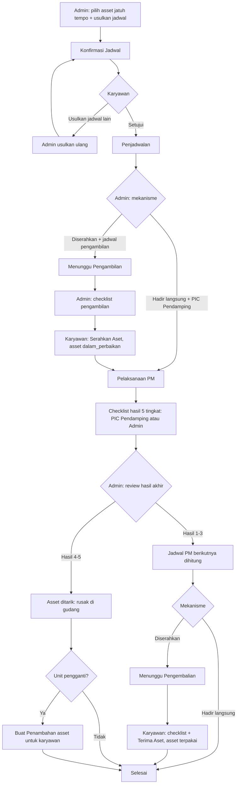
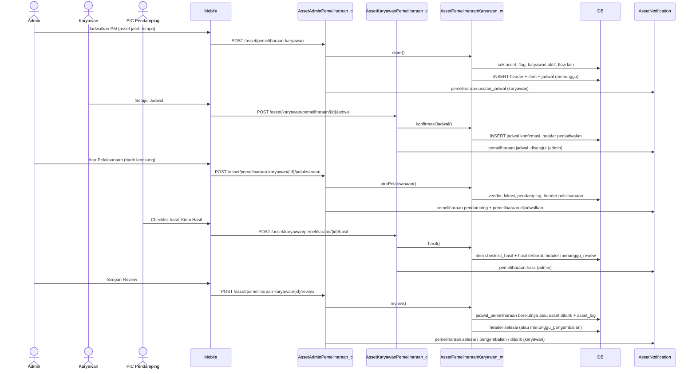
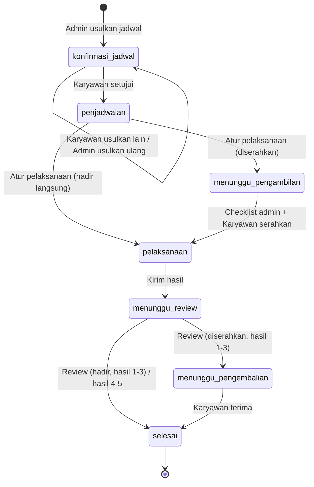
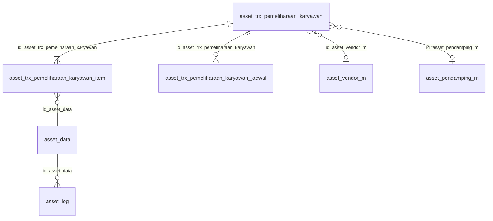

# Dokumentasi Teknis & Manual Book — Pemeliharaan Terjadwal Asset Karyawan

> Dokumen ini disusun **dari source code lokal** (`API/` Lumen dan `MOBILE/` Flutter) per 28 September 2026, dibandingkan dengan dokumen bisnis **"4.1 - V2 Pemeliharaan - Terjadwal (PML01)"** (V2.0, 2026-08-10).
> Hanya **konteks karyawan** yang diimplementasikan; konteks ruangan (PIC Ruangan) sengaja di luar cakupan. Bagian yang tidak ditemukan ditandai **⚠️ Belum ditemukan**, asumsi ditandai **⚠️ Asumsi**.
> Contoh ID/nama pada payload adalah **data sintetis**.

---

## 1. Informasi Dokumen

| Informasi | Nilai |
|---|---|
| Nama Fitur | Pemeliharaan Terjadwal Asset Karyawan (UI: **"Pemeliharaan Terjadwal"**; menu **"Pemeliharaan"**) |
| Kode Fitur | **PML01** (nomor transaksi `PML01-2-YYYYMMNNN`; `-2-` = konteks karyawan, `-1-` dicadangkan untuk ruangan) |
| Modul | Asset Management — Pemeliharaan Aset |
| Backend | Laravel **Lumen ^10.0**, PHP ^8.1, JWT, Query Builder |
| Database | `API/diagram-asset.dbml` (tanda `[FIX PML01]`) + SQL manual `Claude outputs/sql-pml01-pemeliharaan-karyawan.sql`. ⚠️ SQL harus dijalankan manual; tidak ada migration Lumen |
| Mobile | Flutter (`professional_flutter_3_35`), `flutter_bloc`, `dio` |
| Web | ⚠️ Belum ditemukan: tidak ada source web di workspace |
| Test otomatis | API `tests/Asset/AssetPemeliharaanKaryawanTest.php` (7 test) · Mobile `test/asset/asset_pemeliharaan_test.dart` (8 test) |
| Versi Dokumen | 1.1 |
| Tanggal Dokumentasi | 2026-10-12 |
| Dokumen terkait | Upgrade (KRY03), Kerusakan (KRY06), Retur (KRY04), Offboarding (KRY02), Request/Penambahan (KRY-03-1, unit pengganti), PML02 Perbaikan & PML04 Disposal (sudah diimplementasikan, tetapi belum dipicu otomatis dari hasil 4–5) |

---

## 2. Daftar Isi

1. Informasi Dokumen · 3. Quick Overview · 4. Ringkasan Fitur · 5. Tujuan · 6. Aktor · 7. Hak Akses · 8. Terminologi · 9. Business Rules · 10. Business Flow · 11. Flow per Role · 12. Flow Diagram · 13. Sequence Diagram · 14. Status Transaksi · 15. State Transition · 16. Struktur Database · 17. Relasi · 18. Data Dictionary · 19. Index · 20. Backend Architecture · 21. Backend Logic · 22. Dampak asset_data · 23. API · 24. Detail API · 25. Mobile Architecture · 26. Mobile Screen · 27. Mobile → API · 28. API → Mobile · 29. Mapping Mobile→API→DB · 30. Mapping DB→API→Mobile · 31. Validation · 32. Error Handling · 33. Audit Trail · 34. Notification · 35. Security · 36. Manual Book · 37. Kondisi Button · 38. Testing · 39. Temuan Ketidaksesuaian · 40. Edge Case · 41. Risk · 42. Dependency · 43. Source Reference · 44. Developer Notes · 45. Traceability · 46. DB Impact · 47. Checklist · 48. Changelog

---

## 3. Quick Overview

| Item | Informasi |
|---|---|
| Feature | Preventive maintenance (PM) **satu asset** yang dipegang karyawan, sesuai interval yang dikonfigurasi di data asset |
| Module | Asset Management — Pemeliharaan |
| Inisiasi | **Jalur B (Dashboard)**: admin membuka *Jatuh Tempo Pemeliharaan* (asset jatuh tempo mulai H-14) lalu mengusulkan jadwal. ⚠️ Jalur A (notifikasi otomatis berkala) belum diimplementasikan |
| Mekanisme | **Karyawan Hadir Langsung** (asset tetap `terpakai`, PIC Pendamping wajib) · **Diserahkan ke Admin/HR** (asset `dalam_perbaikan` selama PM) |
| Actor | Admin Asset, Karyawan pemegang asset, PIC Pendamping (karyawan), Vendor/Teknisi (di luar sistem), System |
| Main Transaction | `asset_trx_pemeliharaan_karyawan` |
| Detail Transaction | `asset_trx_pemeliharaan_karyawan_item` (satu baris per asset) + `asset_trx_pemeliharaan_karyawan_jadwal` (riwayat negosiasi & jadwal) |
| Asset Master | `asset_data` (`flag_pemeliharaan`, `interval_pemeliharaan`, `jadwal_pemeliharaan`) |
| Log | `asset_log` `jenis_log = pemeliharaan_karyawan` |
| Status | `fase_pemeliharaan`: `konfirmasi_jadwal → penjadwalan → [menunggu_pengambilan] → pelaksanaan → menunggu_review → [menunggu_pengembalian] → selesai` |
| Hasil PM | 5 tingkat per item: normal · perlu tindak lanjut · komponen rusak tidak segera · komponen rusak perlu segera · tidak dapat diperbaiki. Hasil akhir = item **terberat** |
| Tindak lanjut | Hasil 1–3: jadwal PM berikutnya otomatis. Hasil 4–5: asset ditarik ke gudang (`rusak`), opsional unit pengganti lewat Penambahan |
| API | 10 endpoint admin + 6 endpoint karyawan |
| Mobile Screen | Pemeliharaan Terjadwal (list), Jatuh Tempo Pemeliharaan (admin), Detail Pemeliharaan, sheet Atur Pelaksanaan, banner Asset Saya, panel beranda admin |

```text
Admin: Jatuh Tempo Pemeliharaan → pilih asset → Usulkan Jadwal               konfirmasi_jadwal
Karyawan: Setujui Jadwal  ⇄  Usulkan Jadwal Lain (admin usulkan ulang, berulang)
                                                                         penjadwalan
Admin: Atur Pelaksanaan (mekanisme, vendor, lokasi)
   ├─ Hadir Langsung + PIC Pendamping ─────────────────────────────────── pelaksanaan
   └─ Diserahkan + jadwal pengambilan ────────────────────────────────── menunggu_pengambilan
        Admin: Checklist Pengambilan → Karyawan: Serahkan Aset (asset dalam_perbaikan) ── pelaksanaan
Checklist Hasil PM (5 tingkat per item)
   ├─ Hadir Langsung: diisi PIC Pendamping (akun karyawan)
   └─ Diserahkan: diisi Admin berdasarkan laporan vendor ─────────────── menunggu_review
Admin: Review & Tindak Lanjut
   ├─ Hasil 1–3: jadwal PM berikutnya = hari review + interval
   │     ├─ Hadir Langsung ─────────────────────────────────────────────── selesai
   │     └─ Diserahkan + jadwal pengembalian ──────────────────────────── menunggu_pengembalian
   │           Karyawan: Checklist Pengembalian → Terima Aset (asset terpakai) ── selesai
   └─ Hasil 4–5: asset ditarik → rusak @gudang (+ unit pengganti opsional) ── selesai
```

---

## 4. Ringkasan Fitur

Pemeliharaan Terjadwal memastikan asset yang dipegang karyawan (misalnya laptop, kendaraan dinas) diservis berkala sesuai interval. Asset yang ikut PM adalah asset dengan **Perlu Pemeliharaan Terjadwal = Ya** (`flag_pemeliharaan = 1`), berstatus `terpakai`, dan dipegang karyawan aktif.

Admin memulai PM dari daftar **Jatuh Tempo Pemeliharaan** (asset yang jadwalnya ≤ 14 hari lagi atau sudah lewat) dan mengusulkan jadwal. Karyawan menyetujui atau mengusulkan jadwal lain; negosiasi berulang sampai disepakati. Admin lalu memilih mekanisme:

- **Karyawan Hadir Langsung** — karyawan membawa asset ke vendor atau vendor datang. Asset tidak berpindah tangan dan tetap `terpakai`. Seorang **PIC Pendamping** (boleh karyawan pemegang sendiri) mendampingi teknisi dan mengisi checklist hasil dari akunnya.
- **Diserahkan ke Admin/HR** — admin mengambil asset (checklist pengambilan), karyawan mengonfirmasi penyerahan, asset menjadi `dalam_perbaikan` (DALAM SERVICE). Admin mengisi hasil berdasarkan laporan vendor lalu mengembalikan asset.

Checklist hasil PM dinilai **per item asset** (unit utama & kelengkapan) dengan lima tingkat. Hasil akhir mengikuti item terberat dan menentukan tindak lanjut: jadwal PM berikutnya otomatis (hasil 1–3, dengan catatan *watchlist* untuk hasil 2–3) atau penarikan asset ke gudang berstatus `rusak` untuk diteruskan ke Perbaikan (PML02) / Disposal (PML04), opsional dengan unit pengganti.

---

## 5. Tujuan Fitur

### 5.1 Tujuan Bisnis (diturunkan dari dokumen bisnis & kode)
- Asset karyawan dipelihara tepat waktu sesuai interval.
- Jadwal disepakati bersama karyawan agar operasional tidak terganggu.
- Hasil pemeriksaan per komponen terdokumentasi, termasuk siapa yang mengisi.
- Temuan ringan dipantau (*watchlist*) dan diingatkan pada PM berikutnya.
- Asset yang tidak layak segera ditarik, dengan opsi unit pengganti.

### 5.2 Tujuan Sistem
- Menampilkan asset jatuh tempo yang belum punya PM aktif.
- Menyimpan riwayat negosiasi jadwal (usulan admin, usulan karyawan, konfirmasi).
- Mengunci asset dari Upgrade, Kerusakan, Retur, dan Offboarding selama PM aktif.
- Memperbarui `asset_data` (status, pemegang, `jadwal_pemeliharaan`) dan mencatat `asset_log`.

---

## 6. Aktor

| Aktor | Role | Fungsi |
|---|---|---|
| Admin Asset | `asset_admin` + karyawan aktif | Usul/ubah jadwal, atur pelaksanaan, checklist pengambilan, isi hasil (mekanisme diserahkan / fallback), review & tindak lanjut |
| Karyawan pemegang | User login aktif, `id_karyawan` pada header | Setujui / usulkan jadwal lain, serahkan asset, terima asset kembali |
| PIC Pendamping | Karyawan aktif, `id_pic_pendamping` pada header | Mengisi checklist hasil PM (khusus hadir langsung) |
| Vendor / Teknisi | Di luar sistem | Melaksanakan PM. Dipilih dari `asset_vendor_m` atau teks bebas. ⚠️ Tidak menerima notifikasi |
| System | Backend + FCM | Validasi, lock, penomoran, hasil terberat, jadwal berikutnya, update asset, log, notifikasi |

---

## 7. Hak Akses

| Action | Admin Asset | Karyawan pemegang | PIC Pendamping | Keterangan |
|:---|:---:|:---:|:---:|:---|
| Melihat jatuh tempo & semua PM | ✅ | ❌ | ❌ | `/asset/pemeliharaan-karyawan*` |
| Melihat PM sendiri | – | ✅ | ✅ | Daftar gabungan sebagai pemegang **atau** pendamping |
| Membuat PM (usul jadwal pertama) | ✅ | ❌ | ❌ | Asset jatuh tempo |
| Usul jadwal ulang | ✅ | ❌ | ❌ | Fase `konfirmasi_jadwal` |
| Setujui / usulkan jadwal lain | ❌ | ✅ | ❌ | Ada usulan admin yang terbuka |
| Atur pelaksanaan | ✅ | ❌ | ❌ | Fase `penjadwalan` |
| Ubah jadwal pengambilan / pengembalian | ✅ | ❌ | ❌ | Fase terkait |
| Checklist pengambilan | ✅ | ❌ | ❌ | Mekanisme diserahkan |
| Serahkan aset | ❌ | ✅ | ❌ | Setelah checklist pengambilan |
| Isi checklist hasil | ✅ | ❌ | ✅ | Pendamping hanya hadir langsung; admin untuk semua mekanisme |
| Review & tindak lanjut | ✅ | ❌ | ❌ | Fase `menunggu_review` |
| Terima aset kembali | ❌ | ✅ | ❌ | Fase `menunggu_pengembalian` |
| Batalkan PM | ❌ | ❌ | ❌ | ⚠️ Belum ditemukan (RISK-002) |

---

## 8. Terminologi

| Istilah | Arti di sistem |
|---|---|
| PM | Preventive maintenance / pemeliharaan terjadwal |
| Jatuh tempo | `asset_data.jadwal_pemeliharaan ≤ hari ini + 14 hari` |
| Interval | `asset_data.interval_pemeliharaan` dalam **bulan** |
| Usulan jadwal | Baris jadwal `jenis_jadwal = pemeliharaan`, `jenis_alur = menunggu`, `label_alur = admin` |
| Usulan alternatif | Baris jadwal `jenis_alur = revisi`, `label_alur = karyawan` (wajib alasan) |
| Mekanisme | `hadir_langsung` atau `diserahkan_admin` |
| DALAM SERVICE | Istilah bisnis untuk asset yang diserahkan; di sistem `status_asset = dalam_perbaikan` (sama dengan Upgrade KRY03) |
| PIC Pendamping | Karyawan yang mendampingi teknisi; tercatat juga di `asset_pendamping_m` |
| Hasil akhir | `status_item_pendamping` = hasil item terberat dari `checklist_hasil` |
| Watchlist | Hasil 2 atau 3 pada PM terakhir yang selesai; ditampilkan lagi di daftar jatuh tempo |
| Ditarik | Hasil 4/5: asset → `rusak` @gudang, `nama_tabel_tindak_lanjut` = tabel PML02/PML04 |

---

## 9. Business Rules

### BR-001 — Asset yang boleh dipelihara
`asset_data` dipegang karyawan (`pemegang_asset = karyawan`), `status_asset = terpakai`, `flag_pemeliharaan = '1'`, dan pemegang adalah karyawan aktif → "Asset tidak ditemukan atau tidak dipegang karyawan." / "Hanya asset berstatus terpakai yang dapat dipelihara." / "Asset tidak memiliki jadwal pemeliharaan aktif." / "Karyawan pemegang asset tidak ditemukan atau tidak aktif."

### BR-002 — Satu PM aktif per asset, tidak bentrok flow lain
Dicek saat membuat PM: pemeliharaan aktif (fase ≠ `selesai`), upgrade aktif, laporan kerusakan aktif, retur aktif, offboarding aktif → "Asset sedang diproses pada pemeliharaan lain." / "…pada upgrade." / "…pada laporan kerusakan." / "…pada retur." / "…pada offboarding."

### BR-003 — PM aktif mengunci asset di modul lain
`hasActivePemeliharaanAsset` dipanggil oleh Upgrade & Kerusakan ("Asset sedang diproses pada pemeliharaan."), Retur & Offboarding ("Satu atau beberapa asset sedang diproses pada pemeliharaan."). Asset juga hilang dari daftar jatuh tempo selama PM aktif.

### BR-004 — Negosiasi jadwal (Fase 2B)
- Admin membuat PM dengan usulan jadwal (tanggal ≥ hari ini). Usulan admin berikutnya boleh diberikan kapan saja selama fase `konfirmasi_jadwal`.
- Karyawan hanya bisa menjawab bila baris jadwal PM **terakhir** adalah usulan admin (`menunggu`) → "Tidak ada usulan jadwal yang perlu dikonfirmasi."
- **Setujui**: jadwal usulan disalin ke `tgl_pemeliharaan`/`jam_pemeliharaan`, fase → `penjadwalan`.
- **Usulkan jadwal lain**: tanggal, jam, dan alasan wajib → "Alasan usulan jadwal alternatif wajib diisi."; fase tetap, admin wajib mengusulkan ulang.

### BR-005 — Atur pelaksanaan (Fase 2B.4 + 3)
Hanya fase `penjadwalan` → "Jadwal pemeliharaan belum disepakati karyawan." Asset harus masih `terpakai` di karyawan.
- Vendor: `id_asset_vendor_m` dari master **atau** `nama_vendor` teks → "Vendor tidak ditemukan." / "Vendor / teknisi wajib diisi."
- Lokasi wajib → "Lokasi pemeliharaan wajib diisi."
- **Hadir langsung**: PIC Pendamping wajib karyawan aktif (boleh pemegang) → "PIC Pendamping wajib dipilih dari karyawan aktif."; fase → `pelaksanaan`; pendamping dicatat ke `asset_pendamping_m` bila belum ada.
- **Diserahkan**: jadwal pengambilan wajib; fase → `menunggu_pengambilan`.

### BR-006 — Pengambilan (mekanisme diserahkan, Fase 2C)
Admin mengisi checklist kondisi seluruh item asset (normal/rusak, rusak wajib keterangan) → "Checklist pengambilan tidak dapat diisi saat ini." / "Seluruh item aset wajib dicek." Karyawan baru bisa **Serahkan Aset** setelah checklist ada → "Aset belum siap diserahkan untuk pemeliharaan." Penyerahan: `status_asset = dalam_perbaikan` (**pemegang tetap karyawan**), log karyawan → gudang, fase → `pelaksanaan`.

### BR-007 — Checklist hasil PM (Fase 4)
Hanya fase `pelaksanaan` → "Pemeliharaan belum berada pada tahap pelaksanaan."
- Pengisi: **PIC Pendamping** lewat endpoint karyawan (hanya mekanisme hadir langsung dan `id_pic_pendamping` = dirinya) → "Hanya PIC Pendamping yang dapat mengisi hasil pemeliharaan."; atau **admin** (semua mekanisme).
- Semua item asset wajib dinilai → "Seluruh item aset wajib diperiksa."; hasil harus salah satu dari 5 → "Hasil pemeriksaan item tidak valid."; selain normal wajib keterangan → "Keterangan temuan wajib diisi untuk hasil selain normal."
- Hasil akhir = item terberat → `status_item_pendamping`. Fase → `menunggu_review`, `tgl_hasil`/`user_hasil` diisi.

### BR-008 — Review hasil 1–3 (asset tetap dipakai)
- Jadwal PM berikutnya = tanggal review + `interval_pemeliharaan` bulan (tanpa overflow akhir bulan) → `asset_data.jadwal_pemeliharaan` dan `item.tgl_pemeliharaan_selanjutnya`. Interval 0 → tidak dijadwalkan ulang.
- Hasil 3 wajib tanggal rencana penggantian komponen → "Tanggal rencana penggantian komponen wajib diisi."
- Hadir langsung → `selesai`. Diserahkan → jadwal pengembalian wajib, fase `menunggu_pengembalian`.

### BR-009 — Review hasil 4–5 (asset ditarik)
Asset → `status_asset = rusak`, `kondisi_awal = rusak`, `ket_rusak` = keterangan hasil + review, `status_rusak = "sudah tidak bisa di gunakan"`, `pemegang_asset = gudang`. Log dengan `kondisi_akhir = rusak`. `nama_tabel_tindak_lanjut` = `asset_trx_perbaikan` (hasil 4) atau `asset_trx_disposal` (hasil 5); ⚠️ transaksi PML02/PML04 belum dibuat (INC-05). Fase → `selesai`.

### BR-010 — Unit pengganti (hasil 4–5, opsional)
Bila admin memilih unit pengganti, sistem membuat **Penambahan asset (KRY-03-1)** untuk karyawan yang sama (`urgensi = mendesak`, jadwal serah terima dari admin) di dalam transaksi review. `flag_unit_pengganti = 1`, `id_trx_request_pengganti` diisi, notifikasi `penambahan.dikirim` dikirim. Aturan Penambahan berlaku (asset harus `tersedia` @gudang).

### BR-011 — Pengembalian (mekanisme diserahkan, Fase 5)
Hanya fase `menunggu_pengembalian` → "Aset belum dijadwalkan untuk dikembalikan." Karyawan mengisi checklist kondisi seluruh item; asset → `terpakai`, log gudang → karyawan, fase `selesai`.

### BR-012 — Ubah jadwal
Admin: fase `konfirmasi_jadwal` → usulan PM baru; `menunggu_pengambilan` → jadwal pengambilan; `menunggu_pengembalian` → jadwal pengembalian. Fase lain → "Jadwal tidak dapat diubah pada tahap ini." Tanggal tidak boleh sebelum tanggal transaksi dibuat.

### BR-013 — Penomoran
Header/item/jadwal `id_company + YYYYMM + 3 digit`; `no_trx = PML01-2-YYYYMMNNN`; `asset_pendamping_m` 3 digit; log 5 digit.

### BR-014 — Skema harus sudah diterapkan
Dashboard dan pengecekan lintas modul memanggil `skemaSiap()` (kolom `fase_pemeliharaan` ada). Sebelum SQL diterapkan, bagian PML01 di dashboard kosong dan modul lain tidak terblokir; endpoint PML01 sendiri akan gagal (RISK-001).

---

## 10. Business Flow

```text
1. Admin: Asset Karyawan → Pemeliharaan → ikon Jatuh Tempo (atau kartu "Pemeliharaan Jatuh Tempo")
   → pilih asset → Jadwalkan PM → tanggal, jam, catatan                 [Konfirmasi Jadwal · notif karyawan]
2. Karyawan: banner "Konfirmasi Jadwal PM" → Detail
   → Setujui Jadwal                                                      [Penjadwalan · notif admin]
     atau Usulkan Jadwal Lain (tanggal, jam, alasan)                     [notif admin → admin usulkan ulang]
3. Admin: Detail → Atur Pelaksanaan → mekanisme, vendor, keterangan vendor, lokasi
   a. Hadir Langsung + PIC Pendamping                                    [Pelaksanaan PM · notif karyawan & pendamping]
   b. Diserahkan + Jadwal Pengambilan                                    [Menunggu Pengambilan · notif karyawan]
      → Admin: Simpan Checklist (pengambilan)                            [notif karyawan]
      → Karyawan: Serahkan Aset                                          [Pelaksanaan PM · asset dalam_perbaikan · notif admin]
4. Checklist Hasil PM → Kirim Hasil
   a. Hadir Langsung: PIC Pendamping (banner "Isi Hasil PM")
   b. Diserahkan: Admin                                                  [Menunggu Review · notif admin]
5. Admin: Review & Tindak Lanjut → Simpan Review
   - Hasil 1–3 hadir langsung                                            [Selesai · notif karyawan]
   - Hasil 1–3 diserahkan + Jadwal Pengembalian                          [Menunggu Pengembalian · notif karyawan]
       → Karyawan: Checklist Pengembalian → Terima Aset                  [Selesai · notif admin]
   - Hasil 4–5 (+ unit pengganti & jadwal pengiriman)                    [Selesai · asset ditarik · notif karyawan]
```

---

## 11. Flow Berdasarkan Role

### 11.1 Karyawan pemegang
1. **Asset Saya** → menu **Pemeliharaan** → **Pemeliharaan Terjadwal** (tab Jadwal / Proses / Selesai).
2. Banner Asset Saya: **Konfirmasi Jadwal PM**, **Serahkan Aset untuk PM**, **Terima Aset Hasil PM**.
3. Detail → **Setujui Jadwal** / **Usulkan Jadwal Lain**, **Serahkan Aset**, **Terima Aset**.

### 11.2 PIC Pendamping
1. Banner **Isi Hasil PM** ("Anda PIC Pendamping pemeliharaan {asset}. Isi checklist hasil.") atau daftar Pemeliharaan (kartu bertanda "Anda PIC Pendamping").
2. Detail → pilih hasil setiap item + keterangan temuan → **Kirim Hasil**.

### 11.3 Admin Asset
1. **Asset Karyawan** → aksi **Pemeliharaan**, kartu **Pemeliharaan Perlu Diproses**, atau kartu **Pemeliharaan Jatuh Tempo**.
2. Daftar → ikon **Jatuh Tempo** → **Jadwalkan PM**.
3. Detail → **Usulkan Jadwal**, **Atur Pelaksanaan**, **Ubah Jadwal**, **Simpan Checklist**, **Kirim Hasil**, **Simpan Review**.

### 11.4 System
Hitung jatuh tempo & watchlist, validasi, hasil terberat, jadwal berikutnya, update asset & log, buat Penambahan unit pengganti, notifikasi.

---

## 12. Flow Diagram



---

## 13. Sequence Diagram



---

## 14. Status Transaksi

Kolom utama `fase_pemeliharaan` (enum). Kolom `status` (`proses`/`selesai`) mengikuti: `selesai` hanya saat fase `selesai`.

| fase_pemeliharaan | Label API | Tab | Arti | Menunggu |
|---|---|---|---|---|
| `konfirmasi_jadwal` | Konfirmasi Jadwal | jadwal | Negosiasi jadwal PM | Karyawan (ada usulan admin) / Admin (ada usulan karyawan) |
| `penjadwalan` | Penjadwalan | jadwal | Jadwal disepakati | Admin: atur pelaksanaan |
| `menunggu_pengambilan` | Menunggu Pengambilan | proses | Mekanisme diserahkan | Admin: checklist → Karyawan: serahkan |
| `pelaksanaan` | Pelaksanaan PM | proses | PM berlangsung | PIC Pendamping (hadir) / Admin (diserahkan) |
| `menunggu_review` | Menunggu Review | proses | Hasil sudah dikirim | Admin |
| `menunggu_pengembalian` | Menunggu Pengembalian | proses | Diserahkan, hasil 1–3 | Karyawan: terima |
| `selesai` | Selesai | selesai | Tuntas atau asset ditarik | – |

Hasil PM (`status_item_pendamping`, NULL sebelum diisi): `normal`, `perlu_tindak_lanjut`, `komponen_rusak_tidak_segera`, `komponen_rusak_perlu_segera`, `tidak_dapat_diperbaiki`.

---

## 15. State Transition



---

## 16. Struktur Database

| Tabel | Peran |
|---|---|
| `asset_trx_pemeliharaan_karyawan` | Header: fase, mekanisme, karyawan, PIC Pendamping, vendor, jadwal PM/pengambilan/pengembalian, checklist pengambilan/pengembalian, jejak hasil & review |
| `asset_trx_pemeliharaan_karyawan_item` | Satu baris per asset: hasil akhir, checklist hasil (JSON), jadwal PM berikutnya, tindak lanjut, unit pengganti |
| `asset_trx_pemeliharaan_karyawan_jadwal` | Riwayat jadwal: usulan/revisi/konfirmasi PM, jadwal pengambilan & pengembalian |
| `asset_pendamping_m` | Master PIC Pendamping (diisi otomatis) |
| `asset_vendor_m` | Master vendor (dibaca) |
| `asset_data` | `flag_pemeliharaan`, `interval_pemeliharaan`, `jadwal_pemeliharaan`, status & pemegang |
| `asset_log` | Jejak perpindahan (`pemeliharaan_karyawan`) |

> ⚠️ Kolom PML01 berasal dari **SQL manual** (`sql-pml01-pemeliharaan-karyawan.sql`) yang menyesuaikan tabel yang sudah ada di DB (kosong saat ditulis). Tidak ada migration Lumen.

---

## 17. Relasi Database



Relasi logis (tanpa FK): `id_karyawan` / `id_pic_pendamping` → `data_karyawan`; `id_trx_request_pengganti` → `asset_trx_request_karyawan`; `id_trx_tindak_lanjut` + `nama_tabel_tindak_lanjut` → PML02/PML04 (⚠️ belum terisi).

---

## 18. Data Dictionary

### 18.1 asset_trx_pemeliharaan_karyawan

| Kolom | Tipe | Keterangan |
|---|---|---|
| `id_asset_trx_pemeliharaan_karyawan` | varchar(50) PK | `id_company + YYYYMM + NNN` |
| `no_trx` | varchar(50) | `PML01-2-YYYYMMNNN` |
| `mekanisme_pelaksanaan` | enum | `hadir_langsung` (default) / `diserahkan_admin` |
| `fase_pemeliharaan` | enum | Lihat §14 |
| `id_karyawan`, `nik_karyawan`, `nama_karyawan` | varchar | Pemegang asset (snapshot) |
| `nama_cabang`, `nama_departemen` | varchar | Snapshot karyawan |
| `id_asset_pendamping_m` | varchar NULL, FK | Master pendamping |
| `id_pic_pendamping`, `nama_pic_pendamping`, `nik_pic_pendamping` | varchar | Kosong untuk mekanisme diserahkan |
| `id_asset_vendor_m` | varchar NULL, FK | NULL bila vendor teks bebas |
| `nama_vendor`, `keterangan_vendor` | varchar(255) | Nama & kontak vendor |
| `tgl_pemeliharaan`, `jam_pemeliharaan` | date/time NULL | Jadwal PM disepakati |
| `lokasi_pemeliharaan` | varchar(255) | Lokasi PM |
| `tgl_pengambilan`, `jam_pengambilan`, `checklist_pengambilan` | date/time/JSON | Fase 2C |
| `tgl_pelepasan`, `user_pelepasan` | timestamp/varchar | Konfirmasi serah karyawan |
| `tgl_hasil`, `user_hasil` | timestamp/varchar | Pengisi checklist hasil |
| `tgl_review`, `user_review`, `keterangan_review` | timestamp/varchar/text | Review admin |
| `tgl_pengembalian`, `jam_pengembalian`, `checklist_pengembalian` | date/time/JSON | Fase 5 |
| `tgl_diterima`, `user_diterima` | timestamp/varchar | Konfirmasi terima karyawan |
| `status` | enum `proses`/`selesai` | Ringkasan |
| `id_company`, `tgl_input`, `user_input`, `tgl_update`, `user_update` | – | Standar |

Format JSON `checklist_pengambilan` / `checklist_pengembalian`: `[{id_item, nama_item, jenis, kondisi: normal|rusak, ket_rusak}]`.

### 18.2 asset_trx_pemeliharaan_karyawan_item

| Kolom | Tipe | Keterangan |
|---|---|---|
| `id_asset_trx_pemeliharaan_karyawan_item` | varchar PK | |
| `id_asset_data` | varchar FK | Asset yang dipelihara |
| `nama_asset`, `deskripsi_asset`, `kategori_asset` | varchar | Snapshot |
| `status_item_pendamping` | enum NULL | Hasil akhir (item terberat) |
| `checklist_hasil` | text JSON | `[{id_item, nama_item, jenis, hasil, keterangan}]` |
| `keterangan_konfirmasi` | varchar(255) | Catatan umum pengisi hasil |
| `tgl_pemeliharaan_selanjutnya` | datetime NULL | Hasil 1–3 dengan interval > 0 |
| `tgl_rencana_penggantian_komponen` | date NULL | Wajib untuk hasil 3 |
| `id_trx_tindak_lanjut`, `nama_tabel_tindak_lanjut` | varchar | Hasil 4/5 (id kosong, lihat INC-05) |
| `flag_unit_pengganti`, `id_trx_request_pengganti` | enum('0','1'), varchar | Unit pengganti |

### 18.3 asset_trx_pemeliharaan_karyawan_jadwal

| Kolom | Tipe | Keterangan |
|---|---|---|
| `jenis_jadwal` | enum | `pemeliharaan` / `pengambilan` / `pengembalian` |
| `tanggal`, `jam` | date/time | |
| `jenis_alur` | enum | `menunggu` (usulan admin), `revisi` (usulan karyawan), `konfirmasi` |
| `label_alur` | varchar | `admin` / `karyawan` |
| `keterangan` | varchar(255) | Catatan / alasan usulan alternatif |
| `user_input`, `tgl_input` | – | Pelaku & waktu |

### 18.4 asset_log (`jenis_log = pemeliharaan_karyawan`)
Dicatat saat **serahkan** (karyawan → gudang), **terima** (gudang → karyawan), dan **asset ditarik** (hasil 4/5, `kondisi_akhir = rusak`). `id_pemegang`/`nama_pemegang` diisi hanya bila posisi akhir karyawan.

---

## 19. Database Index

| Tabel | Index | Kolom | Dipakai oleh |
|---|---|---|---|
| header | PK | `id_asset_trx_pemeliharaan_karyawan` | Detail, lock |
| header | `atpk_company_fase_idx` | `id_company, fase_pemeliharaan, tgl_input, id_…` | List admin, pending admin |
| header | `atpk_company_karyawan_fase_idx` | `id_company, id_karyawan, fase_pemeliharaan, tgl_input` | List & pending karyawan |
| item | `atpki_company_asset_hasil_idx` | `id_company, id_asset_data, status_item_pendamping` | Blokir lintas modul, watchlist |
| item / jadwal | FK index | `id_asset_trx_pemeliharaan_karyawan`, `id_asset_data` | Join |

⚠️ Pencarian karyawan sebagai **pendamping** (`id_pic_pendamping`) tidak punya index khusus.

---

## 20. Backend Architecture

```text
routes/modules/asset/RouteAsset.php
   ↓
AssetAdminPemeliharaan_c (10 endpoint)        AssetKaryawanPemeliharaan_c (6 endpoint, pemegang & pendamping)
   ↓  mutateAssetTrx / mutateTrxSaya → AssetNotification::send
AssetPemeliharaanKaryawan_m extends Asset_m
   ↓   ↔ AssetUpgradeKaryawan_m / AssetRusakKaryawan_m / AssetReturKaryawan_m / AssetOffboardingKaryawan_m (cek flow lain)
   ↓   → AssetRequestKaryawan_m::store (unit pengganti)
DB (header, item, jadwal, asset_pendamping_m, asset_data, asset_log)
```

| Layer | File | Isi |
|---|---|---|
| Route | `API/routes/modules/asset/RouteAsset.php` | 16 route PML01 |
| Controller | `AssetAdminPemeliharaan_c.php` | getMonitoringPemeliharaan, getPemeliharaanOptions, getPemeliharaanKaryawan, getDetailPemeliharaanKaryawan, storePemeliharaanKaryawan, updateJadwalPemeliharaan, aturPelaksanaanPemeliharaan, checklistPengambilanPemeliharaan, hasilPemeliharaanKaryawan, reviewPemeliharaanKaryawan |
| Controller | `AssetKaryawanPemeliharaan_c.php` | getPemeliharaanSaya, getDetailPemeliharaanSaya, konfirmasiJadwalPemeliharaanSaya, pelepasanPemeliharaanSaya, hasilPemeliharaanSaya, terimaPemeliharaanSaya |
| Model | `AssetPemeliharaanKaryawan_m` | getMonitoring, countJatuhTempo, getAdminOptions, getPage, getDetail, store, updateJadwal, konfirmasiJadwal, aturPelaksanaan, checklistPengambilan, pelepasan, hasil, review, terima, getPendingForEmployee, getPendingForAdmin, countPendingForAdmin, hasActivePemeliharaanAsset |
| Helper bersama | `Asset_m` | `normalizeKondisiChecklist` (dipakai juga Upgrade), `komponenAssets`, `parseJadwalValue`, `insertAssetLog`, `nextSequence`, `lockCompany` |
| Notifikasi | `App\Support\Asset\AssetNotification` | 14 event `pemeliharaan.*`, penerima baru `pendamping` |
| Dashboard | `AssetAdmin_m::getSummary`, `AssetKaryawan_m` | `pemeliharaan_*` & `pemeliharaan[]` |

---

## 21. Backend Business Logic

### 21.1 Buat PM — `store`
Lock company → admin → jadwal valid (≥ hari ini) → asset dipegang karyawan (FOR UPDATE), `terpakai`, `flag_pemeliharaan = 1` → `assetBlockMessage` → karyawan aktif + cabang/departemen → ID + `PML01-2-…` → INSERT header (`konfirmasi_jadwal`, `hadir_langsung`) → INSERT item (hasil NULL) → INSERT jadwal (`pemeliharaan`, `menunggu`, `admin`).

### 21.2 Usul/ubah jadwal — `updateJadwal`
Fase menentukan jenis jadwal (§BR-012); insert baris jadwal (`menunggu` untuk PM, `konfirmasi` untuk pengambilan/pengembalian) dan perbarui kolom tanggal header untuk pengambilan/pengembalian.

### 21.3 Konfirmasi jadwal — `konfirmasiJadwal`
Karyawan aktif, header milik karyawan, fase `konfirmasi_jadwal`, usulan admin terakhir terbuka → `revisi` (insert baris revisi) atau `konfirmasi` (insert baris konfirmasi, salin jadwal ke header, fase `penjadwalan`).

### 21.4 Atur pelaksanaan — `aturPelaksanaan`
Fase `penjadwalan` → mekanisme valid → asset `terpakai` → vendor (master/teks) → lokasi → hadir: pendamping aktif + `pendampingMasterId` → fase `pelaksanaan`; diserahkan: jadwal pengambilan + baris jadwal → fase `menunggu_pengambilan`.

### 21.5 Checklist pengambilan — `checklistPengambilan`
Fase `menunggu_pengambilan`, checklist kosong, asset `terpakai` → `normalizeKondisiChecklist` → simpan JSON.

### 21.6 Serahkan — `pelepasan`
Karyawan aktif, milik karyawan, checklist ada → asset `dalam_perbaikan` → log karyawan → gudang → fase `pelaksanaan`, `tgl/user_pelepasan`.

### 21.7 Hasil — `hasil`
Pengisi = pendamping (payload `id_karyawan`) atau admin (`user_id`) → fase `pelaksanaan` → cek hak pendamping → asset dipegang (status sesuai mekanisme) → `normalizeHasilChecklist` → hasil terberat → UPDATE item → fase `menunggu_review`.

### 21.8 Review — `review`
Fase `menunggu_review` → asset dipegang (`dalam_perbaikan` untuk diserahkan, `terpakai` untuk hadir) → hasil 4/5: tarik asset + log + (opsional) `AssetRequestKaryawan_m::store` → `selesai`; hasil 1–3: `jadwalBerikutnya` (+ rencana penggantian hasil 3) → hadir `selesai` / diserahkan jadwal pengembalian + `menunggu_pengembalian`. Respons menambah `hasil`, `ditarik`, `id_request_pengganti`.

### 21.9 Terima — `terima`
Fase `menunggu_pengembalian` → asset `dalam_perbaikan` di karyawan → checklist → asset `terpakai` → log gudang → karyawan → `selesai`, `tgl/user_diterima`.

### 21.10 Query baca
- **Monitoring**: asset `flag = 1`, karyawan, `terpakai`, jadwal ≤ H+14, tanpa PM aktif; urut jadwal terdekat; `sisa_hari` negatif = terlambat; `watchlist` dari PM selesai terakhir bila hasil 2/3.
- **List**: tab `jadwal` (konfirmasi_jadwal, penjadwalan), `proses` (fase lain kecuali selesai), `selesai`; karyawan melihat PM sebagai pemegang **atau** pendamping (`peran`).
- **Detail**: header, riwayat jadwal, `usulan_jadwal` terbuka, komponen, checklist, hasil, review, objek `aksi` sesuai peran.
- **Pending admin**: usulan karyawan terakhir (`revisi`), `penjadwalan`, pengambilan tanpa checklist, `pelaksanaan` mekanisme diserahkan, `menunggu_review`.
- **Pending karyawan**: `konfirmasi_jadwal` (ada usulan admin), `pelepasan`, `terima`, `hasil` (pendamping).

---

## 22. Dampak terhadap asset_data

| Tahap | status_asset | pemegang | Kolom lain | asset_log |
|---|---|---|---|---|
| Buat PM s/d penjadwalan | tetap `terpakai` | karyawan | – | – |
| Serahkan (diserahkan) | `dalam_perbaikan` | tetap karyawan | – | karyawan → gudang |
| Review hasil 1–3 | tetap | tetap | `jadwal_pemeliharaan` = review + interval | – |
| Terima kembali (diserahkan) | `terpakai` | karyawan | – | gudang → karyawan |
| Review hasil 4–5 | `rusak` | `gudang` (`id_pemegang_asset` kosong) | `kondisi_awal = rusak`, `ket_rusak`, `status_rusak` | karyawan/gudang → gudang, kondisi_akhir rusak |
| Unit pengganti | `proses` (oleh Penambahan) | gudang → karyawan saat penambahan dikonfirmasi | – | log Penambahan |

> Mekanisme hadir langsung dengan hasil 1–3 **tidak** menulis `asset_log`; jejaknya ada di transaksi PM dan `jadwal_pemeliharaan` baru.

---

## 23. API Documentation

Prefix `/asset`, header `Authorization: Bearer <JWT>`. Admin divalidasi `accessError` (admin asset aktif).

| ID | Method | Endpoint | Aktor | Fungsi |
|---|---|---|---|---|
| API-001 | GET | `/pemeliharaan-karyawan/monitoring` | Admin | Asset jatuh tempo |
| API-002 | GET | `/pemeliharaan-karyawan/options` | Admin | Vendor, karyawan aktif, unit pengganti, mekanisme, hasil |
| API-003 | GET | `/pemeliharaan-karyawan` | Admin | List (`tab`, `limit` ≤ 50, `offset`) |
| API-004 | POST | `/pemeliharaan-karyawan` | Admin | Buat PM + usulan jadwal |
| API-005 | PUT | `/pemeliharaan-karyawan/{id}/jadwal` | Admin | Usul/ubah jadwal |
| API-006 | POST | `/pemeliharaan-karyawan/{id}/pelaksanaan` | Admin | Atur pelaksanaan |
| API-007 | POST | `/pemeliharaan-karyawan/{id}/checklist-pengambilan` | Admin | Checklist pengambilan |
| API-008 | POST | `/pemeliharaan-karyawan/{id}/hasil` | Admin | Checklist hasil |
| API-009 | POST | `/pemeliharaan-karyawan/{id}/review` | Admin | Review & tindak lanjut |
| API-010 | GET | `/pemeliharaan-karyawan/{id}` | Admin | Detail |
| API-011 | GET | `/karyawan/pemeliharaan` | Karyawan | List pemegang/pendamping |
| API-012 | POST | `/karyawan/pemeliharaan/{id}/jadwal` | Pemegang | Setujui / usulkan lain |
| API-013 | POST | `/karyawan/pemeliharaan/{id}/pelepasan` | Pemegang | Serahkan aset |
| API-014 | POST | `/karyawan/pemeliharaan/{id}/hasil` | Pendamping | Checklist hasil |
| API-015 | POST | `/karyawan/pemeliharaan/{id}/terima` | Pemegang | Terima aset |
| API-016 | GET | `/karyawan/pemeliharaan/{id}` | Pemegang/Pendamping | Detail |

Terkait: `GET /asset/summary` (`pemeliharaan_perlu_proses`, `pemeliharaan_pending`, `pemeliharaan_jatuh_tempo_jumlah`, `pemeliharaan_jatuh_tempo`) dan Asset Saya (`pemeliharaan[]`).

---

## 24. Detail Setiap API

### API-001 — Monitoring jatuh tempo

```json
{
  "code": "SUCCESS",
  "data": {
    "records": [
      {
        "id_asset_data": "C0012026090001",
        "kode_asset": "LTP-2026-0001",
        "nama_asset": "Laptop Kerja",
        "kategori_asset": "Laptop",
        "interval_pemeliharaan": 6,
        "jadwal_pemeliharaan": "2026-10-03",
        "sisa_hari": 5,
        "karyawan": {"id_karyawan": "EMP-01", "nik": "343242", "nama_karyawan": "Karyawan Contoh"},
        "watchlist": {"no_trx": "PML01-2-202603001", "hasil": "perlu_tindak_lanjut", "hasil_label": "Perlu Tindak Lanjut", "keterangan": "Kipas bising"}
      }
    ]
  }
}
```

### API-004 — Buat PM

```http
POST /asset/pemeliharaan-karyawan
{"id_asset_data": "C0012026090001", "tgl_jadwal": "2026-10-02", "jam_jadwal": "10:00", "keterangan_jadwal": "PM rutin 6 bulan"}
```

Validasi: `id_asset_data` wajib, `tgl_jadwal` `Y-m-d` wajib, `jam_jadwal` `H:i` wajib. Respons 201 `{id, no_trx, mekanisme_pelaksanaan, fase_pemeliharaan, status_label, tab}`. Notif `pemeliharaan.usulan_jadwal`.

### API-005 — Usul/ubah jadwal
`tgl_jadwal`, `jam_jadwal` wajib, `keterangan_jadwal` opsional. Notif `pemeliharaan.usulan_jadwal` (fase konfirmasi_jadwal) atau `pemeliharaan.jadwal_diubah`.

### API-012 — Konfirmasi jadwal (karyawan)

```json
{"aksi": "revisi", "tgl_jadwal": "2026-10-05", "jam_jadwal": "13:00", "keterangan_jadwal": "Sedang dinas luar"}
```

`aksi` `konfirmasi|revisi`; untuk `revisi` tanggal, jam, keterangan wajib. Notif `pemeliharaan.jadwal_disetujui` / `pemeliharaan.jadwal_revisi` ke admin.

### API-006 — Atur pelaksanaan

```json
{
  "mekanisme_pelaksanaan": "hadir_langsung",
  "id_asset_vendor_m": "",
  "nama_vendor": "Servis Laptop Contoh",
  "keterangan_vendor": "0812-0000-0000",
  "lokasi_pemeliharaan": "Ruang IT lantai 2",
  "id_pic_pendamping": "EMP-01"
}
```

`nama_vendor` wajib bila `id_asset_vendor_m` kosong; `lokasi_pemeliharaan` wajib; `id_pic_pendamping` wajib untuk hadir langsung; `tgl_jadwal`/`jam_jadwal` (pengambilan) wajib untuk diserahkan. Notif hadir: `pemeliharaan.pendamping` (ke pendamping) + `pemeliharaan.dijadwalkan` (ke karyawan); diserahkan: `pemeliharaan.pengambilan`.

### API-007 — Checklist pengambilan & API-015 — Terima

```json
{"items": [{"id_item": "C001…UNIT", "kondisi": "normal", "ket_rusak": ""}, {"id_item": "C001…CHG", "kondisi": "rusak", "ket_rusak": "Kabel longgar"}]}
```

Semua item asset (`komponen` di detail) wajib. Notif `pemeliharaan.checklist_pengambilan` / `pemeliharaan.diterima`.

### API-013 — Serahkan aset
Tanpa body. Notif `pemeliharaan.dilepas` ke admin.

### API-008 / API-014 — Checklist hasil

```json
{
  "items": [
    {"id_item": "C001…UNIT", "hasil": "normal", "keterangan": ""},
    {"id_item": "C001…CHG", "hasil": "komponen_rusak_tidak_segera", "keterangan": "Adaptor panas"}
  ],
  "keterangan": "Dikerjakan vendor, dibersihkan"
}
```

Respons menambah `hasil` (hasil akhir). Notif `pemeliharaan.hasil` ke admin.

### API-009 — Review & tindak lanjut

```json
{
  "keterangan_review": "Pantau adaptor",
  "tgl_rencana_penggantian_komponen": "2026-11-01",
  "id_asset_pengganti": "",
  "tgl_jadwal": "2026-10-10",
  "jam_jadwal": "09:00",
  "keterangan_jadwal": "Ambil di ruang HR"
}
```

`tgl_rencana_penggantian_komponen` wajib untuk hasil 3; jadwal wajib untuk diserahkan hasil 1–3 (pengembalian) atau bila unit pengganti dipilih (serah terima Penambahan). Respons `{…, hasil, ditarik, id_request_pengganti}`. Notif `pemeliharaan.selesai` / `pemeliharaan.pengembalian` / `pemeliharaan.ditarik` (+ `penambahan.dikirim`).

### API-010 / API-016 — Detail (ringkas)

```json
{
  "id": "C001202609001",
  "no_trx": "PML01-2-202609001",
  "fase_pemeliharaan": "menunggu_review",
  "status_label": "Menunggu Review",
  "tab": "proses",
  "peran": "pendamping",
  "mekanisme_pelaksanaan": "hadir_langsung",
  "karyawan": {"id_karyawan": "EMP-01", "nik": "343242", "nama_karyawan": "Karyawan Contoh", "cabang": "Pusat", "divisi": "IT"},
  "pendamping": {"id_karyawan": "EMP-02", "nik": "343243", "nama_karyawan": "Pendamping Contoh"},
  "vendor": {"id_asset_vendor_m": "", "nama_vendor": "Servis Laptop Contoh", "keterangan_vendor": "0812-0000-0000"},
  "lokasi_pemeliharaan": "Ruang IT lantai 2",
  "tgl_pemeliharaan": "2026-10-02", "jam_pemeliharaan": "10:00",
  "usulan_jadwal": null,
  "riwayat_jadwal": [{"jenis_jadwal": "pemeliharaan", "jenis_alur": "menunggu", "label_alur": "admin", "tanggal": "2026-10-02", "jam": "10:00", "keterangan": ""}],
  "asset": {"id_asset_data": "C0012026090001", "nama_asset": "Laptop Kerja", "status_asset": "terpakai", "interval_pemeliharaan": 6},
  "komponen": [{"id_item": "C001…UNIT", "nama_item": "Unit Utama", "jenis": "aset_utama"}],
  "hasil": {"status": "perlu_tindak_lanjut", "label": "Perlu Tindak Lanjut", "checklist": [], "user_hasil": "343243 - Pendamping Contoh"},
  "review": {"tgl_pemeliharaan_selanjutnya": "", "tindak_lanjut": "", "flag_unit_pengganti": false},
  "aksi": {"konfirmasi_jadwal": false, "pelepasan": false, "hasil": false, "terima": false}
}
```

Objek `aksi` admin: `usul_jadwal`, `ubah_jadwal`, `atur_pelaksanaan`, `checklist_pengambilan`, `hasil`, `review`. Karyawan hanya melihat PM miliknya atau yang ia dampingi (lainnya 404).

---

## 25. Mobile Architecture

| Layer | File |
|---|---|
| Model | `lib/Repository/Model/Asset/mAssetPemeliharaan.dart` (Record, Aksi, HasilData, Review, Monitoring, Options, Pelaksanaan, konstanta Fase/Mekanisme/Hasil) |
| Service | `lib/Repository/Service/assetPemeliharaanApi.dart` (`admin` memilih prefix) |
| Bloc | `lib/Bloc/Asset/AssetPemeliharaanBloc.dart` (list, loadMore, monitoring, options, detail, submit) |
| UI | `lib/UI/Modul/Asset/Pemeliharaan/` — `HalamanAssetPemeliharaan`, `HalamanMonitoringPemeliharaan`, `HalamanDetailAssetPemeliharaan`, `AssetPemeliharaanWidgets` |
| Bahasa | `assets/id|en/asset.json` grup `pemeliharaan` (124 teks) → `AssetPemeliharaanText` di `mAssetPage.dart` |
| Route | `/asset_pemeliharaan`, `/asset_detail_pemeliharaan`, `/asset_admin_pemeliharaan`, `/asset_admin_detail_pemeliharaan`, `/asset_admin_monitoring_pemeliharaan` (dua rute detail juga tujuan notifikasi) |
| Navigator | `NavigateToAssetPemeliharaan`, `NavigateToAssetMonitoringPemeliharaan`, `NavigateToAssetDetailPemeliharaan` (`fromAssetSaya` / `fromAdminHome`) |
| Entry point | Asset Saya (menu + banner), hub Asset Karyawan admin (tile + 2 kartu) |

---

## 26. Mobile Screen

### 26.1 Pemeliharaan Terjadwal — list
Tab **Jadwal / Proses / Selesai**; kartu menampilkan asset, no_trx, badge fase, karyawan (admin), "Anda PIC Pendamping", hasil akhir berwarna, dan notice jadwal aktif. Admin punya ikon **Jatuh Tempo** di app bar.

### 26.2 Jatuh Tempo Pemeliharaan (admin)
Kartu per asset: nama, kategori/kode, badge **"5 hari lagi" / "Hari ini" / "Terlambat 2 hari"**, pemegang, jadwal PM, interval, notice **Catatan PM sebelumnya** (watchlist), tombol **Jadwalkan PM** (sheet jadwal).

### 26.3 Detail Pemeliharaan
Header (no_trx, badge, asset, pemegang, interval) → timeline (Jadwal · Pelaksanaan · Review · [Pengembalian] · Selesai) → notice jadwal aktif (+ tombol Ubah Jadwal admin) → notice info fase sesuai peran → ringkasan pelaksanaan (mekanisme, jadwal, vendor, lokasi, pendamping) → form checklist kondisi / form checklist hasil (chip 5 tingkat + keterangan temuan + catatan umum) → ringkasan hasil → form review (catatan, rencana penggantian untuk hasil 3, unit pengganti untuk hasil 4–5) → ringkasan review → checklist pengambilan/pengembalian → riwayat jadwal. Tombol bawah sesuai `aksi`.

### 26.4 Sheet Atur Pelaksanaan
Segmented mekanisme, dropdown vendor master + "Isi nama vendor manual", keterangan vendor, lokasi, pemilih PIC Pendamping (default pemegang). Mekanisme diserahkan lanjut ke sheet **Jadwal Pengambilan**.

### 26.5 Entry point
- Asset Saya: menu **Pemeliharaan**; banner teal sesuai `aksi` (`konfirmasi_jadwal`, `pelepasan`, `terima`, `hasil`).
- Admin: tile **Pemeliharaan**, kartu **Pemeliharaan Perlu Diproses** (label aksi per fase) dan **Pemeliharaan Jatuh Tempo** (chip merah bila terlambat).

---

## 27. Mobile → API

| Aksi UI | Method API | Endpoint |
|---|---|---|
| Buka daftar / ganti tab | `getList(tab)` | API-003 / API-011 |
| Buka Jatuh Tempo | `getMonitoring()` | API-001 |
| Jadwalkan PM | `store(idAsset, jadwal)` | API-004 |
| Usulkan Jadwal / Ubah Jadwal (admin) | `updateJadwal(id, jadwal)` | API-005 |
| Setujui Jadwal | `konfirmasiJadwal(id)` | API-012 |
| Usulkan Jadwal Lain | `revisiJadwal(id, jadwal)` | API-012 |
| Atur Pelaksanaan | `aturPelaksanaan(id, data, jadwalPengambilan?)` | API-006 |
| Simpan Checklist (pengambilan) | `checklistPengambilan(id, items)` | API-007 |
| Serahkan Aset | `pelepasan(id)` | API-013 |
| Kirim Hasil | `hasil(id, items, keterangan)` | API-008 / API-014 |
| Simpan Review | `review(id, …)` | API-009 |
| Terima Aset | `terima(id, items)` | API-015 |
| Buka detail (admin memuat options) | `getDetail(id)` + `getOptions()` | API-010 / API-016 + API-002 |

---

## 28. API → Mobile

| Field API | Model | Tampilan |
|---|---|---|
| `fase_pemeliharaan`, `tab` | `fase`, `tab` | Badge, timeline, tab |
| `peran` | `peran` → `pendampingSaya` | Label "Anda PIC Pendamping" |
| `usulan_jadwal` | `usulanTanggal/Jam/Keterangan` | Notice "Usulan Jadwal Admin"; kosong → "Menunggu jadwal baru dari admin" |
| `riwayat_jadwal[]` | `riwayatJadwal` | Riwayat Jadwal |
| `komponen[]` | `komponen` | Item checklist |
| `hasil` (objek di detail, string di list) | `hasil.status/checklist` | Warna & label hasil |
| `review` | `review` | PM berikutnya, rencana penggantian, tindak lanjut |
| `aksi` | `AssetPemeliharaanAksi` | Tombol bawah |
| `sisa_hari`, `watchlist` | `AssetPemeliharaanMonitoring` | Badge jatuh tempo, catatan PM sebelumnya |

---

## 29. Mapping Mobile → API → Database

| Field UI | Payload | Kolom DB |
|---|---|---|
| Tanggal/jam/catatan jadwal | `tgl_jadwal`, `jam_jadwal`, `keterangan_jadwal` | `…_jadwal.tanggal/jam/keterangan` (+ header `tgl_pengambilan`/`tgl_pengembalian`) |
| Setujui Jadwal | `aksi = konfirmasi` | header `tgl_pemeliharaan`, `jam_pemeliharaan`, `fase_pemeliharaan` |
| Mekanisme | `mekanisme_pelaksanaan` | header `mekanisme_pelaksanaan` |
| Vendor | `id_asset_vendor_m` / `nama_vendor` | header `id_asset_vendor_m`, `nama_vendor` |
| Kontak vendor | `keterangan_vendor` | header `keterangan_vendor` |
| Lokasi | `lokasi_pemeliharaan` | header `lokasi_pemeliharaan` |
| PIC Pendamping | `id_pic_pendamping` | header `id/nama/nik_pic_pendamping`, `id_asset_pendamping_m` |
| Checklist kondisi | `items[{id_item,kondisi,ket_rusak}]` | header `checklist_pengambilan` / `checklist_pengembalian` |
| Checklist hasil | `items[{id_item,hasil,keterangan}]`, `keterangan` | item `checklist_hasil`, `status_item_pendamping`, `keterangan_konfirmasi` |
| Catatan review | `keterangan_review` | header `keterangan_review` |
| Rencana penggantian | `tgl_rencana_penggantian_komponen` | item `tgl_rencana_penggantian_komponen` |
| Unit pengganti | `id_asset_pengganti` | item `flag_unit_pengganti`, `id_trx_request_pengganti` (+ tabel request) |

---

## 30. Mapping Database → API → Mobile

| Kolom DB | Field API | UI |
|---|---|---|
| `asset_data.jadwal_pemeliharaan` | `jadwal_pemeliharaan`, `sisa_hari` | Jatuh Tempo |
| header `fase_pemeliharaan` | `fase_pemeliharaan`, `status_label`, `tab` | Badge |
| header `nama_vendor`, `lokasi_pemeliharaan` | `vendor.nama_vendor`, `lokasi_pemeliharaan` | Ringkasan pelaksanaan |
| item `status_item_pendamping` | `hasil.status` / `hasil` | Hasil akhir |
| item `tgl_pemeliharaan_selanjutnya` | `review.tgl_pemeliharaan_selanjutnya` | "PM berikutnya" |
| item `nama_tabel_tindak_lanjut` | `review.tindak_lanjut` | "Ditarik ke alur Perbaikan/Disposal" |
| jadwal baris terakhir `menunggu` admin | `usulan_jadwal` | Tombol Setujui/Usulkan Lain |

---

## 31. Validation

### 31.1 Mobile
- Sheet jadwal: tanggal (≥ hari ini) & jam wajib.
- Checklist hasil: semua item wajib dipilih ("Pilih hasil untuk setiap item."); keterangan temuan wajib untuk hasil selain normal.
- Sheet pelaksanaan: vendor (manual) wajib, lokasi wajib, PIC Pendamping wajib untuk hadir langsung.
- Review: tanggal rencana penggantian wajib untuk hasil 3.
- Checklist kondisi: semua item wajib, rusak wajib keterangan.

### 31.2 Backend — §9 & §24.
### 31.3 Database — enum `mekanisme_pelaksanaan`, `fase_pemeliharaan`, `jenis_jadwal`, `jenis_alur`, `status_item_pendamping`, `status`; FK vendor, pendamping, asset.

---

## 32. Error Handling

| Kondisi | HTTP / code | Pesan contoh | Mobile |
|---|---|---|---|
| Validasi request | 422 `VALIDATION_ERROR` | "Tanggal jadwal alternatif wajib diisi." | Snackbar warning |
| Aturan bisnis | 422 `BUSINESS_RULE_VIOLATION` | "Tidak ada usulan jadwal yang perlu dikonfirmasi." | Snackbar error |
| Bukan admin | 403 | "Pengguna tidak terdaftar sebagai admin asset." | Snackbar |
| Detail bukan milik/pendamping | 404 `NOT_FOUND` | "Pemeliharaan asset tidak ditemukan." | Halaman gagal muat |
| Error sistem | 500 `SYSTEM_ERROR` | "Terjadi kesalahan saat memproses transaksi asset." | Snackbar |

422 lain: "Asset sedang diproses pada pemeliharaan lain.", "Jadwal tidak dapat diubah pada tahap ini.", "Jadwal pemeliharaan belum disepakati karyawan.", "Mekanisme pelaksanaan tidak valid.", "Vendor tidak ditemukan.", "Checklist pengambilan tidak dapat diisi saat ini.", "Aset belum siap diserahkan untuk pemeliharaan.", "Hasil pemeliharaan belum dikirim.", "Status asset sudah berubah atau tidak lagi dipegang karyawan.", "Tanggal serah terima tidak boleh sebelum tanggal pengajuan." (pesan helper jadwal bersama).

---

## 33. Audit Trail

| Kejadian | Jejak |
|---|---|
| Setiap usulan/konfirmasi/perubahan jadwal | Baris `…_jadwal` (`user_input`, `tgl_input`, `label_alur`) |
| Setiap mutasi header | `tgl_update`, `user_update` (`nik - nama`) |
| Serah karyawan | `tgl_pelepasan`, `user_pelepasan` + `asset_log` |
| Pengisi hasil | `tgl_hasil`, `user_hasil` |
| Review | `tgl_review`, `user_review`, `keterangan_review` |
| Terima karyawan | `tgl_diterima`, `user_diterima` + `asset_log` |
| Asset ditarik | `asset_log` (kondisi_akhir rusak), `asset_data.user_update` |

---

## 34. Notification

| Event | Penerima | Judul (ID) | Rute |
|---|---|---|---|
| `pemeliharaan.usulan_jadwal` | Karyawan | Konfirmasi Jadwal Pemeliharaan | asset_detail_pemeliharaan |
| `pemeliharaan.jadwal_disetujui` | Admin | Jadwal Pemeliharaan Disetujui | asset_admin_detail_pemeliharaan |
| `pemeliharaan.jadwal_revisi` | Admin | Usulan Jadwal Alternatif | asset_admin_detail_pemeliharaan |
| `pemeliharaan.dijadwalkan` | Karyawan | Pemeliharaan Dijadwalkan | asset_detail_pemeliharaan |
| `pemeliharaan.pendamping` | PIC Pendamping | Tugas PIC Pendamping | asset_detail_pemeliharaan |
| `pemeliharaan.pengambilan` | Karyawan | Jadwal Pengambilan Asset | asset_detail_pemeliharaan |
| `pemeliharaan.jadwal_diubah` | Karyawan | Jadwal Pemeliharaan Diperbarui | asset_detail_pemeliharaan |
| `pemeliharaan.checklist_pengambilan` | Karyawan | Konfirmasi Penyerahan Asset | asset_detail_pemeliharaan |
| `pemeliharaan.dilepas` | Admin | Asset Diserahkan untuk Pemeliharaan | asset_admin_detail_pemeliharaan |
| `pemeliharaan.hasil` | Admin | Hasil Pemeliharaan Masuk | asset_admin_detail_pemeliharaan |
| `pemeliharaan.pengembalian` | Karyawan | Jadwal Pengembalian Asset | asset_detail_pemeliharaan |
| `pemeliharaan.selesai` | Karyawan | Pemeliharaan Selesai | asset_detail_pemeliharaan |
| `pemeliharaan.ditarik` | Karyawan | Asset Ditarik | asset_detail_pemeliharaan |
| `pemeliharaan.diterima` | Admin | Asset Pemeliharaan Diterima | asset_admin_detail_pemeliharaan |

Semua event punya versi ID & EN, disimpan ke `notif_data` dan dikirim FCM setelah transaksi commit. Penerima `pendamping` diambil dari `id_pic_pendamping` header. ⚠️ Vendor tidak menerima notifikasi (INC-01).

---

## 35. Security

- Semua endpoint di balik JWT; identitas diambil dari token (`ctx`), bukan dari body.
- Endpoint admin memanggil `accessError` + `actorAdmin` (admin asset & karyawan aktif).
- Endpoint karyawan membatasi header: aksi pemegang memakai `lockHeader(..., id_karyawan)`; pengisian hasil memeriksa `id_pic_pendamping` + mekanisme; detail hanya untuk pemegang/pendamping.
- Semua mutasi di dalam `DB::transaction` dengan `lockCompany` + `lockForUpdate` pada header, item, dan asset.
- Validasi enum di controller dan model; JSON checklist dibangun ulang server-side dari komponen asset (bukan disimpan mentah dari klien).

---

## 36. Manual Book User/Admin

### A. Admin — Menjadwalkan PM
1. **Asset Karyawan** → **Pemeliharaan** → ikon **Jatuh Tempo** (atau kartu *Pemeliharaan Jatuh Tempo*).
2. Periksa sisa hari dan *Catatan PM sebelumnya* bila ada.
3. Tekan **Jadwalkan PM**, isi tanggal, jam, catatan → simpan.

### B. Karyawan — Menyetujui jadwal
1. Buka banner **Konfirmasi Jadwal PM** atau menu **Pemeliharaan**.
2. Tekan **Setujui Jadwal**, atau **Usulkan Jadwal Lain** dengan tanggal, jam, dan alasan.

### C. Admin — Menanggapi usulan karyawan
Buka detail (kartu *Pemeliharaan Perlu Diproses* menampilkan "Usulkan Jadwal"), lihat **Riwayat Jadwal**, tekan **Usulkan Jadwal**.

### D. Admin — Mengatur pelaksanaan
Tekan **Atur Pelaksanaan** → pilih mekanisme → vendor (dari daftar atau isi manual), kontak vendor, lokasi → **Karyawan Hadir Langsung**: pilih PIC Pendamping → **Simpan**; **Diserahkan ke Admin/HR**: isi **Jadwal Pengambilan**.

### E. Mekanisme diserahkan — Pengambilan
1. Admin: saat mengambil asset, isi **Checklist Pengambilan** → **Simpan Checklist**.
2. Karyawan: banner **Serahkan Aset untuk PM** → **Serahkan Aset**.

### F. Mengisi hasil PM
- Hadir langsung: PIC Pendamping membuka banner **Isi Hasil PM**, memilih hasil setiap item bersama teknisi, mengisi keterangan temuan → **Kirim Hasil**.
- Diserahkan: admin mengisi berdasarkan laporan vendor.

### G. Admin — Review & tindak lanjut
Buka detail → periksa hasil → isi catatan → hasil 3: **Rencana penggantian komponen**; hasil 4–5: pilih **Unit pengganti** bila perlu → **Simpan Review** (diserahkan: isi **Jadwal Pengembalian**; unit pengganti: isi **Jadwal Pengiriman Unit Pengganti**).

### H. Karyawan — Menerima asset kembali
Banner **Terima Aset Hasil PM** → isi checklist kondisi → **Terima Aset**.

---

## 37. Kondisi Button

| Button | Peran | Tampil bila |
|---|---|---|
| Jadwalkan PM | Admin | Asset di daftar Jatuh Tempo |
| Usulkan Jadwal | Admin | `aksi.usul_jadwal` (fase konfirmasi_jadwal) |
| Ubah Jadwal | Admin | `aksi.ubah_jadwal` (menunggu_pengambilan / menunggu_pengembalian) |
| Atur Pelaksanaan | Admin | `aksi.atur_pelaksanaan` |
| Simpan Checklist | Admin | `aksi.checklist_pengambilan` |
| Kirim Hasil | Admin / Pendamping | `aksi.hasil` |
| Simpan Review | Admin | `aksi.review` |
| Setujui Jadwal + Usulkan Jadwal Lain | Pemegang | `aksi.konfirmasi_jadwal` |
| Serahkan Aset | Pemegang | `aksi.pelepasan` |
| Terima Aset | Pemegang | `aksi.terima` |

---

## 38. Testing Scenario

| ID | Skenario | Hasil yang diharapkan |
|---|---|---|
| TC-01 | Asset jatuh tempo muncul di monitoring | Tercantum dengan `sisa_hari`, hilang setelah PM dibuat |
| TC-02 | Buat PM asset tanpa flag pemeliharaan | 422 "Asset tidak memiliki jadwal pemeliharaan aktif." |
| TC-03 | Buat PM kedua untuk asset yang sama | 422 "…pemeliharaan lain." |
| TC-04 | Upgrade / Kerusakan / Retur / Offboarding untuk asset dalam PM | Ditolak "…pemeliharaan." |
| TC-05 | Karyawan usulkan jadwal lain tanpa alasan | 422 |
| TC-06 | Karyawan konfirmasi saat usulan terakhir miliknya | 422 "Tidak ada usulan jadwal…" |
| TC-07 | Admin usulkan ulang lalu karyawan setujui | Fase `penjadwalan`, jadwal tersalin ke header |
| TC-08 | Atur hadir langsung dengan pendamping nonaktif | 422 |
| TC-09 | Hadir langsung: pemegang bukan pendamping kirim hasil | 422 "Hanya PIC Pendamping…" |
| TC-10 | Hasil selain normal tanpa keterangan | 422 |
| TC-11 | Hasil campuran (normal + komponen rusak tidak segera) | Hasil akhir = komponen_rusak_tidak_segera |
| TC-12 | Review hasil 2 hadir langsung | `selesai`, `jadwal_pemeliharaan` = hari ini + interval, tanpa asset_log |
| TC-13 | Review hasil 3 tanpa rencana penggantian | 422 |
| TC-14 | Diserahkan: serahkan sebelum checklist | 422 "Aset belum siap diserahkan…" |
| TC-15 | Diserahkan: serahkan | Asset `dalam_perbaikan`, pemegang tetap karyawan |
| TC-16 | Diserahkan: review tanpa jadwal pengembalian | 422 |
| TC-17 | Diserahkan: terima dengan checklist | Asset `terpakai`, 2 asset_log, PM selesai |
| TC-18 | Review hasil 5 tanpa pengganti | Asset `rusak` @gudang, `nama_tabel_tindak_lanjut = asset_trx_disposal` |
| TC-19 | Review hasil 4 dengan unit pengganti tersedia | Penambahan dibuat, `flag_unit_pengganti = 1`, notif penambahan |
| TC-20 | Watchlist tampil pada PM berikutnya | Monitoring menampilkan `watchlist` |
| TC-21 | Karyawan lain membuka detail | 404 |
| TC-22 | Notifikasi rute | Admin: `asset_admin_detail_pemeliharaan`; karyawan: `asset_detail_pemeliharaan` |
| TC-23 | Dashboard sebelum SQL diterapkan | Bagian PML01 kosong, modul lain tetap jalan |

Test otomatis API (6): `test_monitoring_lists_due_asset_and_store_blocks_duplicates`, `test_retur_and_offboarding_reject_asset_in_maintenance`, `test_hadir_langsung_flow_with_negotiation_and_pendamping`, `test_diserahkan_flow_returns_asset_after_review`, `test_tidak_dapat_diperbaiki_withdraws_asset_to_warehouse`, `test_routes_confirm_schedule_and_notify_admin`. Mobile (6): teks id/en, parsing detail/list, hasil terberat, summary & Asset Saya, monitoring. ⚠️ TC-19 (unit pengganti) belum diuji otomatis.

---

## 39. Temuan Ketidaksesuaian

| ID | Dokumen bisnis | Implementasi | Dampak |
|---|---|---|---|
| INC-01 | 3.4: notifikasi ke Vendor/Teknisi | Vendor tidak punya akun; tidak ada notifikasi | Admin menghubungi vendor manual (kontak di `keterangan_vendor`) |
| INC-02 | Jalur A: notifikasi otomatis & kirim ulang berkala | Belum ada scheduler; hanya dashboard & kartu beranda | Admin harus rutin membuka Jatuh Tempo |
| INC-03 | Aturan 8: jadwal berikutnya hanya untuk hasil Normal | Dijadwalkan untuk hasil 1–3 | Watchlist hasil 2–3 bisa diingatkan pada PM berikutnya |
| INC-04 | Diagram: Fase 5 (pengembalian) sebelum Fase 6 (review) | Review dulu, pengembalian hanya hasil 1–3 | Asset hasil 4–5 tidak sempat dikembalikan ke karyawan |
| INC-05 | Hasil 4/5 masuk alur PML02 / PML04 | Modul PML02/PML04 kini sudah ada, tetapi hanya `nama_tabel_tindak_lanjut` yang dicatat; `id_trx_tindak_lanjut` kosong dan transaksi tujuan tidak dibuat otomatis | Admin menindaklanjuti manual |
| INC-06 | Interval dikonfigurasi di Kategori Aset; contoh interval km | Interval per asset (`asset_data`) dalam bulan; km tidak didukung | Kendaraan berbasis km dijadwalkan manual |
| INC-07 | Status DALAM SERVICE | `dalam_perbaikan` (sama dengan Upgrade & PML02) | Status perlu dibaca bersama fase transaksi |
| INC-08 | Skenario 10 unit AC dalam satu PM | Satu asset per transaksi | PM massal = banyak transaksi |
| INC-09 | Hasil 4 hadir langsung: "aset ditarik dari karyawan" | Status langsung berubah saat review, tanpa checklist/konfirmasi penarikan | Lihat RISK-004 |
| INC-10 | Konteks ruangan (PIC Ruangan) | Tidak diimplementasikan (di luar cakupan) | Tabel `…_ruangan` masih skema lama |

---

## 40. Edge Case

| Kasus | Perilaku | Risiko | Saran |
|---|---|---|---|
| Karyawan tidak pernah menjawab usulan | PM tertahan di `konfirmasi_jadwal` | Asset terkunci dari flow lain | Pembatalan / kedaluwarsa |
| Interval 0 | Tidak ada jadwal berikutnya; asset tak muncul lagi di monitoring | PM berkala terhenti | Validasi interval saat flag aktif |
| Asset pindah tangan di tengah PM | Aksi berikutnya 422 "Status asset sudah berubah…" | Transaksi macet | Pembatalan admin |
| Pendamping = pemegang | Diizinkan; karyawan menilai asset sendiri | Objektivitas | Review admin (sudah wajib) |
| Pendamping dinonaktifkan | Tidak bisa kirim hasil; admin masih bisa (fallback) | – | – |
| Unit pengganti tidak tersedia saat review | Seluruh review gagal (rollback) | – | Pilih unit lain |
| Jadwal PM lewat tanpa pelaksanaan | Tidak ada pengingat | – | Jalur A |
| SQL belum diterapkan | Endpoint PML01 500; dashboard kosong | – | Terapkan SQL (RISK-001) |

---

## 41. Potential Bug / Technical Risk

### RISK-001 — Skema dari SQL manual (TINGGI)
**Lokasi:** kolom PML01 hanya ada di `sql-pml01-pemeliharaan-karyawan.sql`; tidak ada migration.
**Masalah:** environment yang belum menjalankan SQL akan gagal di semua endpoint PML01 (kolom tidak ada), sementara dashboard diam-diam kosong karena `skemaSiap()`. Rollback migration Upgrade menulis ulang enum `jenis_log` tanpa `pemeliharaan_karyawan`.
**Recommendation:** jalankan SQL di semua environment; buat migration padanan; sertakan `pemeliharaan_karyawan` di daftar enum migration lain.

### RISK-002 — Tidak ada pembatalan / kedaluwarsa (SEDANG)
PM yang tidak berlanjut mengunci asset dari Upgrade, Kerusakan, Retur, dan Offboarding tanpa jalan keluar.

### RISK-003 — Karyawan nonaktif menghentikan alur (SEDANG)
Konfirmasi jadwal, serahkan, dan terima mensyaratkan karyawan aktif; admin tidak punya aksi pengganti (kecuali isi hasil).

### RISK-004 — Penarikan tanpa serah terima fisik (SEDANG)
Hasil 4–5 mekanisme hadir langsung langsung memindahkan asset ke gudang saat review, walau fisik masih di karyawan.

### RISK-005 — Kueri pending karyawan N+1 (RENDAH)
`getPendingForEmployee` membaca riwayat jadwal per transaksi `konfirmasi_jadwal`.

### RISK-006 — Notifikasi di luar transaksi (RENDAH)
Notifikasi (termasuk pendamping & penambahan pengganti) dikirim setelah commit; kegagalan hanya dicatat log.

### RISK-007 — Kapasitas penomoran (RENDAH)
999 transaksi per bulan per company (header, item, jadwal).

---

## 42. Dependency

```text
asset_data (flag_pemeliharaan, interval, jadwal) + asset_data_item (komponen checklist)
      ↓
Pemeliharaan PML01 (konfirmasi_jadwal → … → selesai) ──► Notifikasi (karyawan / admin / pendamping)
      ↓
asset_data (dalam_perbaikan ↔ terpakai | rusak @gudang, jadwal_pemeliharaan baru), asset_log pemeliharaan_karyawan
      ↓ (hasil 4–5)
Penambahan KRY-03-1 (unit pengganti) · PML02 / PML04 (ada, belum terhubung otomatis)

Aturan silang:
  - PML01 mengecek: pemeliharaan lain, Upgrade, Kerusakan, Retur, Offboarding
  - Dicek oleh: Upgrade, Kerusakan, Retur, Offboarding (hasActivePemeliharaanAsset)
  - Summary admin: pemeliharaan_perlu_proses / _pending / _jatuh_tempo(_jumlah); Asset Saya: pemeliharaan[]
```

---

## 43. Source Code Reference

| File | Layer | Isi |
|---|---|---|
| `API/app/Models/Asset/AssetPemeliharaanKaryawan_m.php` | Model | Seluruh logika PML01 |
| `API/app/Models/Asset/Asset_m.php` | Model | `normalizeKondisiChecklist` + helper bersama |
| `API/app/Http/Controllers/Asset/Admin/AssetAdminPemeliharaan_c.php` | Controller | 10 endpoint admin, `PEMELIHARAAN_HASIL_RULES` |
| `API/app/Http/Controllers/Asset/Karyawan/AssetKaryawanPemeliharaan_c.php` | Controller | 6 endpoint karyawan |
| `API/routes/modules/asset/RouteAsset.php` | Route | 16 route |
| `API/app/Support/Asset/AssetNotification.php` | Notifikasi | 14 event, penerima `pendamping` |
| `API/app/Models/Asset/AssetAdmin_m.php`, `AssetKaryawan_m.php` | Dashboard | Summary & pending |
| `API/app/Models/Asset/AssetUpgradeKaryawan_m.php`, `AssetRusakKaryawan_m.php`, `AssetReturKaryawan_m.php`, `AssetOffboardingKaryawan_m.php` | Model | Pemakai `hasActivePemeliharaanAsset` |
| `API/tests/Asset/AssetPemeliharaanKaryawanTest.php` | Test | 7 test |
| `API/diagram-asset.dbml`, `Claude outputs/sql-pml01-pemeliharaan-karyawan.sql` | DB | Skema & SQL |
| `MOBILE/lib/Repository/Model/Asset/mAssetPemeliharaan.dart` | Model | |
| `MOBILE/lib/Repository/Service/assetPemeliharaanApi.dart` | Service | |
| `MOBILE/lib/Bloc/Asset/AssetPemeliharaanBloc.dart` | Bloc | |
| `MOBILE/lib/UI/Modul/Asset/Pemeliharaan/*` | UI | List, monitoring, detail, widget |
| `MOBILE/lib/Setting/router.dart`, `lib/Bloc/NavigatorBloc.dart` | Navigasi | Route & event |
| `MOBILE/lib/UI/Modul/Asset/AssetSaya/HalamanAssetSaya.dart`, `…/AssetAdminKaryawan/HalamanAssetAdminKaryawan.dart` | Entry point | Menu, banner, kartu |
| `MOBILE/assets/id/asset.json`, `assets/en/asset.json` | Bahasa | Grup `pemeliharaan` |
| `MOBILE/test/asset/asset_pemeliharaan_test.dart` | Test | 8 test |

---

## 44. Developer Notes

- **Terapkan SQL dulu.** Tanpa kolom baru, endpoint PML01 gagal; `skemaSiap()` hanya melindungi dashboard dan modul lain.
- **Hasil akhir dihitung server.** Klien mengirim hasil per item; `status_item_pendamping` = item terberat (urutan konstanta `HASIL`).
- **Peran dari header.** Karyawan yang sama bisa pemegang sekaligus pendamping (`peran = pemegang_pendamping`); aksi hasil hanya dibuka untuk hadir langsung.
- **Unit pengganti memakai Penambahan.** `AssetRequestKaryawan_m::store` dipanggil di dalam transaksi review; kegagalannya membatalkan review.
- **Jadwal berikutnya** memakai `addMonthsNoOverflow` (31 Jan + 1 bulan → 28/29 Feb).
- **Tab list** berbeda dari modul lain (`jadwal / proses / selesai`); `AssetTrxListBody` kini menerima parameter `filters`.
- **Format kode Mobile:** jalankan `dart format` hanya pada file yang diubah (repo MOBILE memiliki banyak perubahan lokal).

---

## 45. End-to-End Traceability

| Langkah bisnis | Mobile | API | Model | DB |
|---|---|---|---|---|
| Monitoring (Jalur B) | HalamanMonitoringPemeliharaan | API-001 | getMonitoring | asset_data |
| Konfirmasi jadwal (2B) | Detail: Setujui / Usulkan Lain | API-004, 005, 012 | store, updateJadwal, konfirmasiJadwal | header, jadwal |
| Mekanisme + Fase 3 | Sheet Atur Pelaksanaan | API-006 | aturPelaksanaan | header, asset_pendamping_m |
| Pengambilan (2C) | Checklist + Serahkan | API-007, 013 | checklistPengambilan, pelepasan | header, asset_data, asset_log |
| Pelaksanaan (4) | Checklist Hasil | API-008, 014 | hasil | item |
| Review (6) | Form Review | API-009 | review | item, asset_data, asset_log, request |
| Pengembalian (5) | Checklist + Terima | API-015 | terima | header, asset_data, asset_log |

---

## 46. Ringkasan Database Impact

| Aksi | Header | Item | Jadwal | asset_data | asset_log | Lain |
|---|---|---|---|---|---|---|
| Buat PM | INSERT | INSERT | INSERT | – | – | – |
| Usul/konfirmasi/revisi jadwal | UPDATE | – | INSERT | – | – | – |
| Atur pelaksanaan | UPDATE | – | INSERT (diserahkan) | – | – | `asset_pendamping_m` INSERT bila baru |
| Checklist pengambilan | UPDATE | – | – | – | – | – |
| Serahkan | UPDATE | – | – | UPDATE | INSERT | – |
| Hasil | UPDATE | UPDATE | – | – | – | – |
| Review 1–3 | UPDATE | UPDATE | INSERT (diserahkan) | UPDATE jadwal_pemeliharaan | – | – |
| Review 4–5 | UPDATE | UPDATE | – | UPDATE | INSERT | Request KRY-03-1 (opsional) |
| Terima | UPDATE | – | – | UPDATE | INSERT | – |

---

## 47. Checklist Implementasi

### Database
- [x] DBML diperbarui (`[FIX PML01]`)
- [x] SQL manual + rollback
- [ ] SQL dijalankan di semua environment
- [ ] Migration Lumen padanan

### Backend
- [x] Monitoring jatuh tempo + watchlist
- [x] Negosiasi jadwal
- [x] Dua mekanisme + PIC Pendamping
- [x] Checklist hasil 5 tingkat, hasil terberat
- [x] Review: jadwal berikutnya, penarikan, unit pengganti
- [x] Blokir lintas modul dua arah
- [x] Notifikasi 14 event
- [x] Test otomatis (6)
- [ ] Notifikasi otomatis Jalur A (scheduler)
- [ ] Integrasi otomatis ke PML02 / PML04 (modulnya sudah ada)
- [ ] Pembatalan / kedaluwarsa
- [ ] Test unit pengganti

### Mobile
- [x] List, monitoring, detail, sheet pelaksanaan
- [x] Banner Asset Saya & kartu beranda admin
- [x] Bahasa id/en
- [x] Test model (6)
- [ ] Uji end-to-end di perangkat

### Documentation
- [x] Business Flow, DB, API, Mobile, Mapping, Manual Book, Testing
- [ ] Screenshot

---

## 48. Changelog

| Version | Date | Changes |
|---|---|---|
| 1.1 | 2026-10-12 | Sinkronisasi dengan kode 12 Okt 2026: path file mobile mengikuti struktur folder baru (`UI/Modul/Asset/<Fitur>/` berhuruf kapital, model di `Repository/Model/Asset/`). |
| 1.0 | 2026-09-28 | Initial documentation — disusun dari source lokal API & MOBILE setelah implementasi PML01 konteks karyawan; dibandingkan dengan dokumen bisnis PML01 V2.0 |
