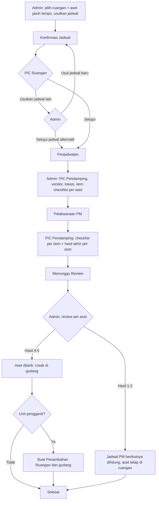
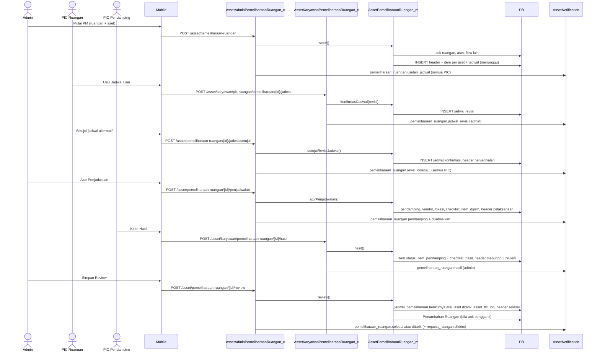
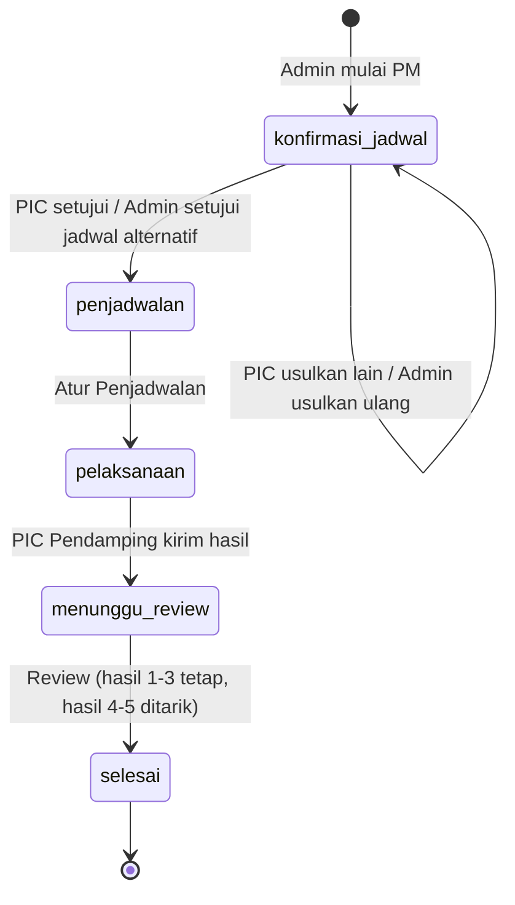
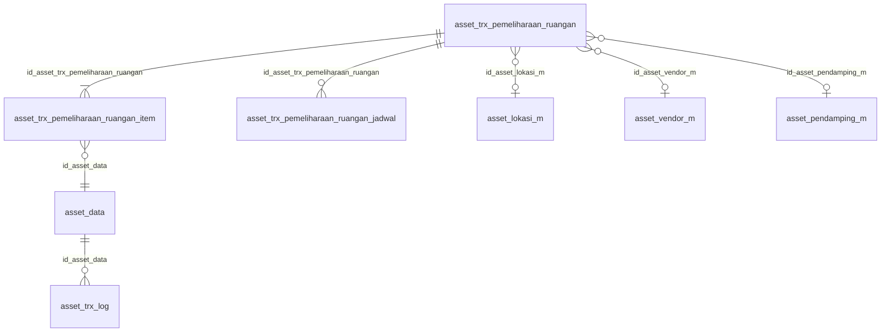

# Dokumentasi Teknis & Manual Book — Pemeliharaan Terjadwal Asset Ruangan

> Dokumen ini disusun **dari source code lokal** (`API/` Lumen dan `MOBILE/` Flutter) per 18 November 2026. Seluruh klaim diverifikasi ke kode, SQL, DBML, dan test; dokumen bisnis PML01 V2.0 **tidak dibaca ulang** untuk dokumen ini, sehingga penomoran fase (2A, 3, 4, 6) mengikuti komentar di kode.
> Cakupan: **konteks ruangan** (satu transaksi = satu ruangan, banyak aset). Konteks karyawan dan gudang punya dokumen sendiri. Bagian yang tidak ditemukan ditandai **⚠️ Belum ditemukan**, asumsi ditandai **⚠️ Asumsi**.
> Contoh ID/nama pada payload adalah **data sintetis**.

---

## 1. Informasi Dokumen

| Informasi | Nilai |
|---|---|
| Nama Fitur | Pemeliharaan Terjadwal Asset Ruangan (UI: **"Pemeliharaan Ruangan"**; admin melihatnya di tab **Servis Berkala** pada halaman Pemeliharaan) |
| Kode Fitur | **PML01** konteks ruangan (nomor transaksi `PML01-1-YYYYMMNNN`; `-1-` = ruangan, `-2-` = karyawan) |
| Modul | Asset Management — Pemeliharaan Aset |
| Backend | Laravel **Lumen ^10.0**, PHP ^8.1, JWT, Query Builder |
| Database | `API/diagram-asset.dbml` (tanda `[NEW PML01 ruangan v2.0]` dan `[NEW PML01 ruangan item dipilih]`) + SQL manual `Claude outputs/sql-pml01-pemeliharaan-ruangan.sql` dan `Claude outputs/sql-pml01-ruangan-item-dipilih.sql`. Keduanya **sudah dijalankan** pengguna; tidak ada migration Lumen |
| Mobile | Flutter (`professional_flutter_3_35`), `flutter_bloc`, `dio` |
| Web | ⚠️ Belum ditemukan: tidak ada source web di workspace |
| Test otomatis | API `tests/Asset/AssetPemeliharaanRuanganTest.php` (**39 test**, 362 assertion, lulus) · Mobile `test/asset/asset_pemeliharaan_ruangan_test.dart` (**38 test**, lulus). Dijalankan 18 Nov 2026; API memakai SQLite in-memory |
| Versi Dokumen | 1.0 |
| Tanggal Dokumentasi | 2026-11-18 |
| Dokumen terkait | PML01 Karyawan dan PML01 Gudang (helper hasil/checklist dipakai bersama), PML02 Perbaikan dan PML04 Disposal (belum terhubung otomatis), Penambahan Aset Ruangan (ALK-RGN04, dipakai unit pengganti), Kerusakan / Retur / Upgrade Ruangan (saling mengunci aset), Onboarding sisi PIC Ruangan (ALK-RGN01), Servis Berkala gabungan |

---

## 2. Daftar Isi

1. Informasi Dokumen · 3. Quick Overview · 4. Ringkasan Fitur · 5. Tujuan · 6. Aktor · 7. Hak Akses · 8. Terminologi · 9. Business Rules · 10. Business Flow · 11. Flow per Role · 12. Flow Diagram · 13. Sequence Diagram · 14. Status Transaksi · 15. State Transition · 16. Struktur Database · 17. Relasi · 18. Data Dictionary · 19. Index · 20. Backend Architecture · 21. Backend Logic · 22. Dampak asset_data · 23. API · 24. Detail API · 25. Mobile Architecture · 26. Mobile Screen · 27. Mobile → API · 28. API → Mobile · 29. Mapping Mobile→API→DB · 30. Mapping DB→API→Mobile · 31. Validation · 32. Error Handling · 33. Audit Trail · 34. Notification · 35. Security · 36. Manual Book · 37. Kondisi Button · 38. Testing · 39. Temuan Ketidaksesuaian · 40. Edge Case · 41. Risk · 42. Dependency · 43. Source Reference · 44. Developer Notes · 45. Traceability · 46. DB Impact · 47. Checklist · 48. Changelog

---

## 3. Quick Overview

| Item | Informasi |
|---|---|
| Feature | Preventive maintenance (PM) **banyak aset dalam satu ruangan** sekaligus, sesuai interval yang dikonfigurasi di data asset |
| Module | Asset Management — Pemeliharaan |
| Inisiasi | Admin membuka daftar jatuh tempo (aset ruangan jatuh tempo mulai H-14 pada monitoring, H-30 pada tab Servis Berkala) lalu mengusulkan jadwal. ⚠️ Notifikasi otomatis berkala belum ada |
| Mekanisme | **Aset tidak berpindah.** Status aset tetap `terpakai` selama PM. Tidak ada fase pengambilan atau pengembalian |
| Actor | Admin/HR, PIC Ruangan (dari `asset_lokasi_pic_m`), PIC Pendamping (dari master `asset_pendamping_m`), Vendor/Teknisi (di luar sistem), System |
| Main Transaction | `asset_trx_pemeliharaan_ruangan` (satu ruangan per transaksi) |
| Detail Transaction | `asset_trx_pemeliharaan_ruangan_item` (satu baris per aset) + `asset_trx_pemeliharaan_ruangan_jadwal` (riwayat negosiasi jadwal) |
| Asset Master | `asset_data` (`flag_pemeliharaan`, `interval_pemeliharaan`, `jadwal_pemeliharaan`) |
| Log | `asset_trx_log` `jenis_log = pemeliharaan_ruangan` (ditulis saat review, untuk setiap aset) |
| Status | `fase_pemeliharaan`: `konfirmasi_jadwal → penjadwalan → pelaksanaan → menunggu_review → selesai` |
| Hasil PM | 5 tingkat per aset (`status_item_pendamping`), dipilih PIC Pendamping sebagai **hasil akhir aset**; checklist per komponen hanya catatan |
| Tindak lanjut | Hasil 1–3: jadwal PM berikutnya otomatis. Hasil 4–5: aset ditarik ke gudang (`rusak`), opsional unit pengganti lewat Penambahan Ruangan |
| API | 15 endpoint (9 admin, 3 PIC Ruangan, 3 PIC Pendamping) + 1 endpoint gabungan `GET /asset/servis-berkala` |
| Mobile Screen | Mulai PM, Jatuh Tempo (monitoring), daftar PM (PIC/Pendamping), Detail PM, sheet Jadwal, sheet Atur Penjadwalan, tab Servis Berkala admin |

```text
Admin: pilih ruangan + aset jatuh tempo → Mulai PM (usul jadwal)              konfirmasi_jadwal
PIC Ruangan: Setujui  atau  Usul Jadwal Lain (alasan wajib)
   └─ Admin: Setujui jadwal alternatif  atau  Usul Jadwal Baru (berulang)
                                                                         penjadwalan
Admin: Atur Penjadwalan = PIC Pendamping + vendor + lokasi
       + pilih item checklist per aset (checklist_dipilih)               pelaksanaan
PIC Pendamping: isi checklist per item terpilih
       + HASIL AKHIR per aset (assets[].hasil_akhir) → Kirim Hasil       menunggu_review
Admin: Review (per aset)
   ├─ Hasil 1–3: jadwal PM berikutnya = hari review + interval            selesai
   │             (hasil 3 wajib tanggal rencana penggantian komponen)
   └─ Hasil 4–5: aset → rusak @gudang, lalu admin membuat PML02/PML04
                 secara manual; unit pengganti opsional                   selesai
```

---

## 4. Ringkasan Fitur

Pemeliharaan Terjadwal Ruangan memastikan aset yang ditempatkan di ruangan (misalnya AC, printer, proyektor) diservis berkala. Satu transaksi mewakili **satu ruangan** dan memuat **satu atau banyak aset** ruangan itu. Aset yang ikut PM adalah aset dengan **Perlu Pemeliharaan Terjadwal = Ya** (`flag_pemeliharaan = 1`), `pemegang_asset = ruangan`, `status_asset = terpakai`, di ruangan aktif bertipe `ruangan`, dengan `jadwal_pemeliharaan` terisi.

Admin memulai PM dari daftar jatuh tempo (dikelompokkan per ruangan) dan mengusulkan jadwal. **PIC Ruangan** (semua PIC aktif ruangan itu boleh menjawab) menyetujui atau mengusulkan jadwal alternatif beserta alasan. Admin menyetujui jadwal alternatif itu, atau mengusulkan jadwal baru; negosiasi berulang sampai disepakati. Setelah itu Admin **Atur Penjadwalan**: memilih PIC Pendamping dari pendamping aktif, vendor (master atau teks bebas), lokasi pelaksanaan, dan boleh **memilih item checklist per aset**.

Pada hari pelaksanaan **PIC Pendamping** mengisi checklist per item terpilih dan **hasil akhir per aset** dari akunnya. Hasil akhir itulah yang menentukan tindak lanjut pada review. Admin lalu mereview: aset dengan hasil 1–3 tetap di ruangan dengan jadwal PM berikutnya otomatis; aset dengan hasil 4–5 ditarik ke gudang berstatus `rusak` untuk diteruskan secara manual ke Perbaikan (PML02) atau Disposal (PML04), opsional dengan unit pengganti dari gudang.

---

## 5. Tujuan Fitur

### 5.1 Tujuan Bisnis (diturunkan dari kode)
- Aset ruangan dipelihara tepat waktu sesuai interval, banyak aset dalam satu kunjungan vendor.
- Jadwal disepakati bersama PIC Ruangan agar operasional ruangan tidak terganggu.
- Cakupan checklist dapat dibatasi admin per aset sesuai pekerjaan vendor.
- Hasil pemeriksaan terdokumentasi per komponen dan per aset, termasuk siapa yang mengisi.
- Temuan ringan dipantau (*watchlist*) dan diingatkan pada PM berikutnya.
- Aset yang tidak layak segera ditarik dari ruangan, dengan opsi unit pengganti.

### 5.2 Tujuan Sistem
- Menampilkan aset ruangan jatuh tempo yang belum punya PM aktif dan tidak terkunci flow ruangan lain.
- Menyimpan riwayat negosiasi jadwal (usulan admin, jadwal alternatif PIC, konfirmasi).
- Mengunci aset dari Kerusakan, Retur, dan Upgrade ruangan selama PM aktif (dan sebaliknya).
- Memperbarui `asset_data` (jadwal berikutnya, atau status/pemegang bila ditarik) dan mencatat `asset_trx_log`.

---

## 6. Aktor

| Aktor | Role | Fungsi |
|---|---|---|
| Admin/HR | `asset_admin` + karyawan aktif | Mulai PM, usul/ubah jadwal, setujui jadwal alternatif, Atur Penjadwalan, review dan tindak lanjut |
| PIC Ruangan | Karyawan aktif terdaftar di `asset_lokasi_pic_m` untuk ruangan transaksi | Setujui atau usulkan jadwal alternatif. Satu ruangan boleh punya beberapa PIC; PIC mana pun dapat menjawab |
| PIC Pendamping | Karyawan aktif terdaftar di master `asset_pendamping_m` (aktif), dipilih admin di Atur Penjadwalan | Mendampingi teknisi dan mengisi checklist hasil + hasil akhir per aset |
| Vendor / Teknisi | Di luar sistem | Melaksanakan PM. Dipilih dari `asset_vendor_m` atau teks bebas. ⚠️ Tidak menerima notifikasi |
| System | Backend + FCM | Validasi, lock, penomoran, jadwal berikutnya, penarikan aset, log, notifikasi |

---

## 7. Hak Akses

| Action | Admin/HR | PIC Ruangan | PIC Pendamping | Keterangan |
|:---|:---:|:---:|:---:|:---|
| Melihat jatuh tempo, opsi, semua PM | ✅ | ❌ | ❌ | `/asset/pemeliharaan-ruangan*` |
| Melihat PM ruangannya | – | ✅ | – | Daftar dan detail dibatasi ke ruangan yang PIC-nya karyawan ini |
| Melihat PM yang ditugaskan | – | – | ✅ | Dibatasi `id_pic_pendamping` = karyawan ini; baru terlihat setelah Atur Penjadwalan |
| Mulai PM (usul jadwal pertama) | ✅ | ❌ | ❌ | Ruangan aktif dengan PIC |
| Usul jadwal baru | ✅ | ❌ | ❌ | Fase `konfirmasi_jadwal` |
| Setujui jadwal alternatif PIC | ✅ | ❌ | ❌ | Baris jadwal terakhir = revisi PIC |
| Setujui / usulkan jadwal alternatif | ❌ | ✅ | ❌ | Baris jadwal terakhir = usulan admin |
| Atur Penjadwalan | ✅ | ❌ | ❌ | Fase `penjadwalan` |
| Isi checklist hasil + hasil akhir | ❌ | ❌ | ✅ | Fase `pelaksanaan`. ⚠️ Admin tidak punya endpoint pengganti |
| Review & tindak lanjut | ✅ | ❌ | ❌ | Fase `menunggu_review` |
| Batalkan PM | ❌ | ❌ | ❌ | ⚠️ Belum ditemukan (RISK-002) |
| Ubah jadwal setelah disepakati | ❌ | ❌ | ❌ | `updateJadwal` hanya di fase `konfirmasi_jadwal` |

---

## 8. Terminologi

| Istilah | Arti di sistem |
|---|---|
| PM | Preventive maintenance / pemeliharaan terjadwal |
| Jatuh tempo | `asset_data.jadwal_pemeliharaan` ≤ hari ini + N hari. N = 14 pada monitoring/beranda, 30 pada tab Servis Berkala |
| Interval | `asset_data.interval_pemeliharaan` dalam **bulan** |
| Usulan jadwal | Baris jadwal `jenis_alur = menunggu`, `label_alur = admin` |
| Jadwal alternatif | Baris jadwal `jenis_alur = revisi`, `label_alur = pic ruangan` (alasan wajib) |
| Konfirmasi | Baris jadwal `jenis_alur = konfirmasi`; `label_alur` = `pic ruangan` (PIC setuju) atau `admin` (admin setujui jadwal alternatif) |
| PIC Ruangan | Karyawan di `asset_lokasi_pic_m`; semua PIC aktif ruangan menerima notifikasi |
| PIC Pendamping | Karyawan di `asset_pendamping_m`; dipilih per transaksi pada Atur Penjadwalan |
| `checklist_dipilih` | Pilihan admin: item komponen mana per aset yang wajib diperiksa. Disimpan di `checklist_item_dipilih`; NULL = semua item |
| Hasil akhir aset | `status_item_pendamping` per aset = `assets[].hasil_akhir` pilihan PIC Pendamping |
| Watchlist | Hasil 2 atau 3 pada PM selesai terakhir suatu aset; ditampilkan lagi di jatuh tempo |
| Ditarik | Hasil 4/5: aset → `rusak` @gudang, `nama_tabel_tindak_lanjut` = tabel PML02/PML04 |
| Unit pengganti | Aset `tersedia` di gudang yang dikirim ke ruangan lewat Penambahan Ruangan jalur Admin |

---

## 9. Business Rules

### BR-001 — Aset yang boleh dipelihara dan ruangan valid
Ruangan harus bertipe `ruangan`, aktif, dan punya minimal satu PIC aktif → "Ruangan tidak ditemukan, tidak aktif, atau belum memiliki PIC." Setiap aset harus `pemegang_asset = ruangan` di ruangan itu → "Satu atau beberapa aset bukan milik ruangan ini atau tidak ditemukan." Per aset: `terpakai` → "Aset {nama}: hanya aset berstatus terpakai yang dapat dipelihara."; `flag_pemeliharaan = 1` → "Aset {nama}: tidak memiliki jadwal pemeliharaan aktif." Minimal satu aset → "Minimal satu aset wajib dipilih."

### BR-002 — Satu PM aktif per aset, tidak bentrok flow ruangan lain
Dicek saat Mulai PM (`assetBlockMessage`): PM ruangan aktif (fase ≠ `selesai`) → "Aset sedang diproses pada pemeliharaan lain."; kerusakan ruangan aktif → "…pada laporan kerusakan."; retur → "…pada retur."; upgrade → "…pada upgrade."; penambahan aset ruangan aktif → "…pada penambahan aset ruangan."

### BR-003 — PM aktif mengunci aset di flow ruangan lain
`hasActivePemeliharaanRuanganAsset` dan `activeAssetIds` dipakai Kerusakan, Retur, dan Upgrade ruangan ("Aset sedang diproses pada pemeliharaan."). Aset yang sedang aktif di kerusakan/retur/upgrade/penambahan **tidak ditampilkan** di monitoring dan opsi Mulai PM, supaya tidak terlihat lalu ditolak saat simpan. Aset dengan PM aktif juga hilang dari monitoring.

### BR-004 — Negosiasi jadwal (Fase 2A)
- Admin membuat PM dengan usulan jadwal (tanggal ≥ hari ini; jam wajib). Usulan admin berikutnya boleh diberikan kapan saja selama fase `konfirmasi_jadwal` (menjawab jadwal alternatif atau mengulang usulan).
- PIC Ruangan hanya bisa menjawab bila baris jadwal **terakhir** adalah usulan admin (`menunggu`) → "Tidak ada usulan jadwal yang perlu dikonfirmasi." Satu PIC tidak bisa menjawab dua kali sebelum admin membalas.
- **Setujui (PIC)**: jadwal usulan disalin ke `tgl_pemeliharaan`/`jam_pemeliharaan`, fase → `penjadwalan`. ⚠️ Tanggal usulan **tidak divalidasi ulang** saat dikonfirmasi (RISK-004).
- **Usulkan jadwal lain (PIC)**: tanggal (≥ hari ini), jam, dan alasan wajib → "Alasan usulan jadwal alternatif wajib diisi."; fase tetap, admin wajib membalas.
- **Setujui jadwal alternatif (admin)**: hanya bila baris terakhir = revisi PIC → "Tidak ada usulan jadwal alternatif yang perlu disetujui."; tanggal revisi divalidasi lagi (lampau ditolak); fase → `penjadwalan`.
- Setelah `penjadwalan` jadwal **tidak dapat diubah** → "Jadwal tidak dapat diubah pada tahap ini."

### BR-005 — Atur Penjadwalan (Fase 3)
Hanya fase `penjadwalan` → "Pemeliharaan belum berada pada tahap penjadwalan." Semua aset harus masih di ruangan dan `terpakai`.
- **PIC Pendamping wajib dipilih** dari pendamping aktif (karyawan aktif) → "PIC Pendamping wajib dipilih dari daftar pendamping aktif."
- Vendor: `id_asset_vendor_m` dari master **atau** `nama_vendor` teks → "Vendor tidak ditemukan." / "Vendor / teknisi wajib diisi."
- Lokasi wajib → "Lokasi pemeliharaan wajib diisi."
- Pilihan item checklist (`checklist_dipilih`, opsional) lihat BR-006. Fase → `pelaksanaan`.

### BR-006 — Pilihan item checklist per aset
Bila `checklist_dipilih` dikirim harus berupa daftar `[{id_asset_data, id_items[]}]` yang mencakup **semua** aset transaksi, tepat satu entri per aset, tiap aset minimal satu item unik yang termasuk komponen aset itu. Pelanggaran → 422 tanpa menulis apa pun ("Pilihan item checklist wajib mencakup seluruh aset.", "Aset {id} pada pilihan checklist tidak termasuk transaksi ini.", "Aset {nama} muncul lebih dari sekali pada pilihan checklist.", "Aset {nama}: pilih minimal satu item checklist.", "Aset {nama}: item checklist tidak boleh dipilih lebih dari sekali.", "Aset {nama}: item checklist tidak valid."). Urutan disimpan mengikuti urutan komponen asli. Tidak dikirim = NULL = **semua item**. Jika semua item terpilih sudah dihapus dari aset, seluruh komponen dipakai agar checklist tidak kosong.

### BR-007 — Checklist hasil dan hasil akhir (Fase 4)
Hanya fase `pelaksanaan` → "Pemeliharaan belum berada pada tahap pelaksanaan." Hanya PIC Pendamping transaksi (`id_pic_pendamping` = pengguna, karyawan aktif) yang menemukan transaksinya; lainnya → "Pemeliharaan aset tidak ditemukan."
- Semua aset wajib ada → "Seluruh aset wajib diperiksa."
- Per aset semua item terpilih wajib dinilai, tidak lebih → "Seluruh item aset wajib diperiksa."; hasil item salah satu dari 5 → "Hasil pemeriksaan item tidak valid."; selain `normal` wajib keterangan → "Keterangan temuan wajib diisi untuk hasil selain normal."
- **Hasil akhir aset** `assets[].hasil_akhir`: bila diisi harus salah satu dari 5 (string) → "Hasil akhir aset tidak valid."; **keputusan bisnis: sah walau lebih ringan atau lebih berat dari komponen terburuk**; checklist hanya catatan. Bila tidak dikirim/null/kosong, API memakai hasil komponen terberat (demi klien lama). Mobile baru mewajibkan PIC memilihnya.
- Fase → `menunggu_review`, `tgl_hasil`/`user_hasil` diisi.

### BR-008 — Review hasil 1–3 (aset tetap di ruangan)
- Jadwal PM berikutnya = tanggal review + `interval_pemeliharaan` bulan (tanpa overflow akhir bulan) → `asset_data.jadwal_pemeliharaan` dan `item.tgl_pemeliharaan_selanjutnya`. Interval 0 → tidak dijadwalkan ulang.
- Hasil 3 (`komponen_rusak_tidak_segera`) **wajib** tanggal rencana penggantian komponen → "Tanggal rencana penggantian komponen wajib diisi."; bila diisi tidak boleh sebelum hari ini → "Tanggal rencana penggantian komponen tidak boleh sebelum hari ini."
- Setiap aset (hasil 1–3) tetap dicatat di `asset_trx_log` ruangan → ruangan.

### BR-009 — Review hasil 4–5 (aset ditarik)
Berdasarkan **hasil akhir aset**. Aset → `status_asset = rusak`, `kondisi_awal = rusak`, `ket_rusak` = keterangan aset + keterangan review (maks 255), `status_rusak = "sudah tidak bisa di gunakan"`, `pemegang_asset = gudang`, `id_pemegang_asset = ''`, `tgl_dialokasikan = '0000-00-00'`, `id_asset_lokasi_m = NULL`. Log `ruangan → gudang`, `kondisi_akhir = rusak`. `nama_tabel_tindak_lanjut` = `asset_trx_perbaikan` (hasil 4) atau `asset_trx_disposal` (hasil 5). ⚠️ Transaksi PML02/PML04 **tidak dibuat otomatis**; `id_trx_tindak_lanjut` sengaja kosong, admin membuatnya manual.

### BR-010 — Unit pengganti (hasil 4–5, opsional)
`items[].id_asset_pengganti` hanya untuk aset ditarik → "Unit pengganti hanya untuk aset yang ditarik (hasil 4 atau 5)."; bukan aset transaksi ini → "Unit pengganti tidak boleh aset pada transaksi ini."; tidak boleh dobel → "Unit pengganti yang sama tidak boleh dipilih lebih dari sekali."; jadwal serah terima wajib → "Tanggal dan jam serah terima wajib diisi." Semua pengganti dalam satu review dibuat menjadi **satu** Penambahan Ruangan jalur Admin (`AssetRequestRuangan_m::storeAdmin`) ke ruangan yang sama, `keterangan = "Unit pengganti pemeliharaan {no_trx}"`. Item PM mendapat `flag_unit_pengganti = 1` dan `id_trx_request_pengganti`. Bila aset pengganti tidak tersedia, **seluruh review di-rollback** ("Satu atau beberapa aset tidak tersedia untuk dialokasikan.").

### BR-011 — Penomoran
Header/item/jadwal `id_company + YYYYMM + 3 digit`; `no_trx = PML01-1-YYYYMMNNN`; log 5 digit. Batas 999 per tabel per bulan per company → "Nomor transaksi untuk periode ini sudah mencapai batas." Tabel item menghabiskan satu nomor **per aset**.

### BR-012 — Skema harus sudah diterapkan
Dashboard, monitoring, dan pengecekan lintas modul memanggil `skemaSiap()` (kolom `fase_pemeliharaan` ada, di-cache per koneksi). Sebelum SQL diterapkan, bagian ruangan di dashboard kosong dan modul lain tidak terblokir; endpoint transaksi sendiri akan gagal (RISK-001).

---

## 10. Business Flow

```text
1. Admin: Pemeliharaan → tab Servis Berkala → kartu ruangan jatuh tempo (atau tombol Buat Jadwal → Ruangan)
   → pilih ruangan + centang aset → tanggal, jam, keterangan → Mulai PM        [Konfirmasi Jadwal · notif semua PIC Ruangan]
2. PIC Ruangan: banner / tugas → Detail
   → Setujui Jadwal                                                          [Penjadwalan · notif admin]
     atau Usul Jadwal Lain (tanggal, jam, alasan)                            [notif admin]
       → Admin: Setujui jadwal alternatif                                    [Penjadwalan · notif PIC]
         atau Usul Jadwal Baru                                               [notif PIC, kembali ke langkah 2]
3. Admin: Detail → Atur Penjadwalan → PIC Pendamping, vendor, keterangan vendor, lokasi,
   item checklist per aset                                                   [Pelaksanaan PM · notif pendamping & PIC Ruangan]
4. PIC Pendamping: banner "Isi Hasil Pemeliharaan Ruangan" → Detail
   → checklist per item terpilih + pilih hasil akhir tiap aset → Kirim Hasil [Menunggu Review · notif admin]
5. Admin: Review → rencana penggantian (hasil 3), unit pengganti + jadwal serah terima (hasil 4–5)
   → Simpan Review                                                           [Selesai · notif PIC Ruangan]
```

---

## 11. Flow Berdasarkan Role

### 11.1 PIC Ruangan
1. Beranda PIC Ruangan: menu **Pemeliharaan Ruangan** dan daftar tugas; atau dashboard **Tugas PIC**.
2. Detail → **Setujui Jadwal** (dengan konfirmasi) atau **Usul Jadwal Lain** (tanggal, jam, alasan).
3. Setelah itu hanya memantau (Penjadwalan, Pelaksanaan PM, Menunggu Review, Selesai) dan menerima notifikasi.

### 11.2 PIC Pendamping
1. Banner Asset Saya **Isi Hasil Pemeliharaan Ruangan** ("{no_trx} · {ruangan} · {jumlah} aset menunggu hasil pemeliharaan Anda.") atau dashboard Tugas PIC.
2. Detail → untuk tiap aset: pilih hasil setiap item terpilih + keterangan temuan, pilih **hasil akhir aset**, catatan aset → **Kirim Hasil**.

### 11.3 Admin/HR
1. **Pemeliharaan** → tab **Servis Berkala** (gabungan karyawan, gudang, ruangan), kartu **Pemeliharaan Ruangan Perlu Diproses** / **Jatuh Tempo** di beranda admin.
2. Mulai PM, Usul Jadwal Baru / Setujui jadwal alternatif, Atur Penjadwalan, Simpan Review.

### 11.4 System
Hitung jatuh tempo & watchlist, validasi, lock, jadwal berikutnya, penarikan aset, Penambahan unit pengganti, log, notifikasi.

---

## 12. Flow Diagram



---

## 13. Sequence Diagram



---

## 14. Status Transaksi

Kolom utama `fase_pemeliharaan` (enum). Kolom `status` (`proses`/`selesai`) mengikuti: `selesai` hanya saat fase `selesai`.

| fase_pemeliharaan | Label API | Tab | Arti | Menunggu |
|---|---|---|---|---|
| `konfirmasi_jadwal` | Konfirmasi Jadwal | jadwal | Negosiasi jadwal PM | PIC Ruangan (ada usulan admin) / Admin (ada jadwal alternatif PIC) |
| `penjadwalan` | Penjadwalan | jadwal | Jadwal disepakati | Admin: Atur Penjadwalan |
| `pelaksanaan` | Pelaksanaan PM | proses | PM berlangsung | PIC Pendamping: isi hasil |
| `menunggu_review` | Menunggu Review | proses | Hasil sudah dikirim | Admin |
| `selesai` | Selesai | selesai | Tuntas, sebagian aset mungkin ditarik | – |

Hasil PM (`status_item_pendamping`, NULL sebelum diisi): `normal`, `perlu_tindak_lanjut`, `komponen_rusak_tidak_segera`, `komponen_rusak_perlu_segera`, `tidak_dapat_diperbaiki`. Label bawaan: Normal · Perlu Tindak Lanjut · Komponen Rusak, Tidak Langsung Diganti · Komponen Rusak, Perlu Penggantian Segera · Aset Tidak Dapat Diperbaiki.

---

## 15. State Transition



---

## 16. Struktur Database

| Tabel | Peran |
|---|---|
| `asset_trx_pemeliharaan_ruangan` | Header: fase, ruangan, PIC Ruangan, PIC Pendamping, vendor, jadwal PM, lokasi, jejak hasil & review |
| `asset_trx_pemeliharaan_ruangan_item` | Satu baris per aset: hasil akhir, checklist hasil (JSON), item terpilih (JSON), jadwal PM berikutnya, tindak lanjut, unit pengganti |
| `asset_trx_pemeliharaan_ruangan_jadwal` | Riwayat negosiasi jadwal (usulan/revisi/konfirmasi) |
| `asset_lokasi_m` | Ruangan (tipe `ruangan`, aktif); FK `id_asset_lokasi_m` |
| `asset_lokasi_pic_m` | PIC Ruangan (dibaca) |
| `asset_pendamping_m` | Master PIC Pendamping (dibaca, **tidak** dibuat otomatis) |
| `asset_vendor_m` | Master vendor (dibaca) |
| `asset_data` / `asset_data_item` | `flag_pemeliharaan`, `interval_pemeliharaan`, `jadwal_pemeliharaan`, status & pemegang; komponen checklist |
| `asset_trx_log` | Jejak perpindahan (`pemeliharaan_ruangan`) |

> ⚠️ Kolom PML01 ruangan berasal dari dua **SQL manual** (`sql-pml01-pemeliharaan-ruangan.sql`, `sql-pml01-ruangan-item-dipilih.sql`) yang menyesuaikan tabel yang sudah ada di DB. Keduanya sudah dijalankan pengguna. Tidak ada migration Lumen. `asset_trx_log.jenis_log` tidak diubah karena `pemeliharaan_ruangan` sudah ada.

---

## 17. Relasi Database



Relasi logis (tanpa FK): `id_karyawan_pic` / `id_pic_pendamping` → `data_karyawan`; `id_trx_request_pengganti` → `asset_trx_request_ruangan`; `id_trx_tindak_lanjut` + `nama_tabel_tindak_lanjut` → PML02/PML04 (⚠️ id belum terisi).

---

## 18. Data Dictionary

### 18.1 asset_trx_pemeliharaan_ruangan

| Kolom | Tipe | Keterangan |
|---|---|---|
| `id_asset_trx_pemeliharaan_ruangan` | varchar(50) PK | `id_company + YYYYMM + NNN` |
| `no_trx` | varchar(50) | `PML01-1-YYYYMMNNN` |
| `fase_pemeliharaan` | enum | `konfirmasi_jadwal` (default) / `penjadwalan` / `pelaksanaan` / `menunggu_review` / `selesai` |
| `id_asset_lokasi_m` | varchar(50) NULL, FK | Ruangan tempat PM |
| `nama_asset_ruangan`, `nama_cabang`, `nama_departemen` | varchar | Snapshot ruangan |
| `id_karyawan_pic`, `nama_pic`, `nik_pic` | varchar | PIC Ruangan: PIC pertama saat dibuat, lalu PIC yang terakhir menjawab jadwal |
| `id_asset_pendamping_m` | varchar(50) NULL, FK | NULL sebelum Atur Penjadwalan |
| `id_pic_pendamping`, `nama_pic_pendamping`, `nik_pic_pendamping` | varchar | PIC Pendamping (`''` sebelum Fase 3) |
| `id_asset_vendor_m` | varchar(50) NULL, FK | NULL bila vendor teks bebas |
| `nama_vendor`, `keterangan_vendor` | varchar(255) | Nama & kontak vendor |
| `tgl_pemeliharaan`, `jam_pemeliharaan` | date/time NULL | Jadwal PM disepakati |
| `lokasi_pemeliharaan` | varchar(255) | Lokasi pelaksanaan (default `''`) |
| `tgl_hasil`, `user_hasil` | timestamp/varchar | Pengisi checklist hasil |
| `tgl_review`, `user_review`, `keterangan_review` | timestamp/varchar/text | Review admin |
| `status` | enum `proses`/`selesai` | Ringkasan |
| `id_company`, `tgl_input`, `user_input`, `tgl_update`, `user_update` | – | Standar (`nik - nama`) |

### 18.2 asset_trx_pemeliharaan_ruangan_item

| Kolom | Tipe | Keterangan |
|---|---|---|
| `id_asset_trx_pemeliharaan_ruangan_item` | varchar PK | `id_company + YYYYMM + NNN` |
| `id_asset_trx_pemeliharaan_ruangan` | varchar FK | Header |
| `id_asset_data` | varchar FK | Aset yang dipelihara |
| `nama_asset`, `deskripsi_asset`, `kategori_asset` | varchar | Snapshot |
| `status_item_pendamping` | enum NULL | **Hasil akhir aset** (pilihan PIC Pendamping; fallback komponen terberat) |
| `checklist_hasil` | text JSON | `[{id_item, nama_item, jenis, hasil, keterangan}]` (catatan per komponen) |
| `checklist_item_dipilih` | text JSON NULL | `["id_item", ...]` pilihan admin; NULL = semua item |
| `keterangan_konfirmasi` | varchar(255) | Catatan aset dari PIC Pendamping |
| `tgl_pemeliharaan_selanjutnya` | datetime NULL | Hasil 1–3 dengan interval > 0 |
| `tgl_rencana_penggantian_komponen` | date NULL | Wajib untuk hasil 3 |
| `id_trx_tindak_lanjut`, `nama_tabel_tindak_lanjut` | varchar | Hasil 4/5 (id kosong, lihat INC-03) |
| `flag_unit_pengganti`, `id_trx_request_pengganti` | enum('0','1'), varchar | Unit pengganti |

### 18.3 asset_trx_pemeliharaan_ruangan_jadwal

| Kolom | Tipe | Keterangan |
|---|---|---|
| `id_asset_trx_pemeliharaan_ruangan_jadwal` | varchar PK | `id_company + YYYYMM + NNN` |
| `tanggal`, `jam` | date/time | Jadwal diusulkan/dikonfirmasi |
| `jenis_alur` | enum | `menunggu` (usulan admin), `revisi` (alternatif PIC), `konfirmasi` |
| `label_alur` | varchar | `admin` / `pic ruangan` |
| `keterangan` | varchar(255) | Catatan / alasan jadwal alternatif |
| `user_input`, `tgl_input` | – | Pelaku & waktu |

Tabel ini **tidak** punya kolom `jenis_jadwal` (hanya ada satu jenis jadwal, PM).

### 18.4 asset_trx_log (`jenis_log = pemeliharaan_ruangan`)
Dicatat saat **review**, satu baris per aset: hasil 1–3 `ruangan → ruangan` (`id_pemegang` = id ruangan, `nama_pemegang` = nama ruangan, `kondisi_akhir` = `kondisi_awal`); hasil 4–5 `ruangan → gudang` dengan `kondisi_akhir = rusak` dan pemegang kosong.

---

## 19. Database Index

| Tabel | Index | Kolom | Dipakai oleh |
|---|---|---|---|
| header | PK | `id_asset_trx_pemeliharaan_ruangan` | Detail, lock |
| header | `atpr_company_fase_idx` | `id_company, fase_pemeliharaan, tgl_input, id_…` | List admin, pending admin, beranda |
| header | `atpr_company_lokasi_fase_idx` | `id_company, id_asset_lokasi_m, fase_pemeliharaan, tgl_input` | List/tugas PIC Ruangan |
| header | FK `fk_atpr_id_asset_lokasi_m`, `fk_atpr_id_asset_vendor_m` | `id_asset_lokasi_m`, `id_asset_vendor_m` | Integritas |
| item | `atpri_company_asset_hasil_idx` | `id_company, id_asset_data, status_item_pendamping` | Kunci lintas modul, watchlist, histori per aset |

⚠️ Pencarian sebagai **pendamping** (`id_pic_pendamping`) tidak punya index khusus.

---

## 20. Backend Architecture

```text
routes/modules/asset/RouteAsset.php
   ↓
AssetAdminPemeliharaanRuangan_c (9 endpoint)    AssetKaryawanPemeliharaanRuangan_c (6 endpoint: PIC Ruangan 3, Pendamping 3)
   ↓  mutateAssetTrx / mutateTrxSaya → AssetNotification::send
AssetPemeliharaanRuangan_m extends Asset_m
   ↓   ↔ AssetKerusakanRuangan_m / AssetReturRuangan_m / AssetUpgradeRuangan_m (cek flow lain, dua arah)
   ↓   → AssetPemeliharaanKaryawan_m (helper hasil, checklist, vendor, jadwal berikutnya)
   ↓   → AssetPendamping_m::findAktif · AssetRequestRuangan_m::storeAdmin (unit pengganti)
DB (header, item, jadwal, asset_data, asset_trx_log)
```

| Layer | File | Isi |
|---|---|---|
| Route | `API/routes/modules/asset/RouteAsset.php` | 15 route PML01 ruangan + `GET servis-berkala` |
| Controller | `AssetAdminPemeliharaanRuangan_c.php` | getMonitoringPemeliharaanRuangan, getPemeliharaanRuanganOptions, getPemeliharaanRuangan, getDetailPemeliharaanRuangan, storePemeliharaanRuangan, updateJadwalPemeliharaanRuangan, setujuiRevisiJadwalPemeliharaanRuangan, aturPenjadwalanPemeliharaanRuangan, reviewPemeliharaanRuangan |
| Controller | `AssetKaryawanPemeliharaanRuangan_c.php` | PIC Ruangan: getPemeliharaanRuanganPic, getDetailPemeliharaanRuanganPic, konfirmasiJadwalPemeliharaanRuanganPic. Pendamping: getPemeliharaanRuanganPendamping, getDetailPemeliharaanRuanganPendamping, hasilPemeliharaanRuanganPendamping |
| Model | `AssetPemeliharaanRuangan_m` | getMonitoring, countJatuhTempo, getAdminOptions, getPage, getDetail, store, updateJadwal, setujuiRevisiJadwal, konfirmasiJadwal, aturPenjadwalan, hasil, review, countPendingForAdmin, getPendingForAdmin/Pic/Pendamping, countByTab, getBerjalanForAdmin, hasActivePemeliharaanRuanganAsset, activeAssetIds |
| Helper bersama | `AssetPemeliharaanKaryawan_m`, `Asset_m` | `HASIL`, `HASIL_DITARIK`, `HASIL_WATCHLIST`, `normalizeHasilChecklistDipilih`, `filterKomponenDipilih`, `jadwalBerikutnya`, `vendorValue`, `komponenAssets`, `parseJadwalValue`, `insertAssetLog`, `nextSequence`, `lockCompany` |
| Aturan validasi hasil | `Asset_c` | `PEMELIHARAAN_GUDANG_HASIL_RULES/MESSAGES` dipakai bersama PM gudang |
| Notifikasi | `App\Support\Asset\AssetNotification` | 9 event `pemeliharaan_ruangan.*`, penerima `semua_pic_ruangan` dan `pendamping` |
| Gabungan | `AssetServisBerkala_m`, `AssetAdminServisBerkala_c` | Daftar read-only karyawan + gudang + ruangan |
| Dashboard | `AssetAdmin_m::getSummary`, `AssetKaryawan_m`, `AssetLokasiPic_m`, `AssetKaryawanPic_c` | `pemeliharaan_ruangan_*` dan `pemeliharaan_ruangan[]` |

---

## 21. Backend Business Logic

### 21.1 Mulai PM — `store`
Lock company → admin → jadwal valid (≥ hari ini, `parseJadwalValue`) → minimal satu aset unik → ruangan aktif dengan PIC (`ruanganAktif`) → aset `pemegang_asset = ruangan` di ruangan itu, `FOR UPDATE`, semua `terpakai` dan `flag_pemeliharaan = 1` → `assetBlockMessage` → ID header + `PML01-1-…` → INSERT header (`konfirmasi_jadwal`, PIC pertama ruangan sebagai `id_karyawan_pic`, pendamping/vendor kosong) → INSERT item per aset (hasil NULL) → INSERT jadwal (`menunggu`, `admin`). `asset_data` tidak berubah. Respons menyertakan `jumlah_asset`.

### 21.2 Usul jadwal baru — `updateJadwal`
Hanya fase `konfirmasi_jadwal`; tanggal tidak boleh sebelum hari ini; INSERT baris jadwal `menunggu` (header tidak diubah selain `tgl_update`).

### 21.3 Setujui jadwal alternatif — `setujuiRevisiJadwal`
Fase `konfirmasi_jadwal` dan baris jadwal terakhir = revisi PIC; tanggal revisi divalidasi lagi; INSERT jadwal `konfirmasi` (`label_alur = admin`); header `penjadwalan` + `tgl_pemeliharaan`/`jam_pemeliharaan`.

### 21.4 Konfirmasi PIC — `konfirmasiJadwal`
Karyawan aktif; header dikunci hanya bila karyawan terdaftar sebagai PIC ruangan transaksi (`lockHeaderPic`); fase `konfirmasi_jadwal` dan baris terakhir = usulan admin. `revisi`: alasan wajib, jadwal ≥ hari ini, INSERT `revisi` (`pic ruangan`), fase tetap; `konfirmasi`: INSERT `konfirmasi`, salin jadwal ke header, fase `penjadwalan`. Header mencatat PIC yang terakhir menjawab.

### 21.5 Atur Penjadwalan — `aturPenjadwalan`
Fase `penjadwalan` → pendamping aktif (`AssetPendamping_m::findAktif`) → vendor (`vendorValue`) → lokasi → `lockAssets` (aset masih di ruangan, `terpakai`) → `pilihanDariInput` bila `checklist_dipilih` ada (tulis `checklist_item_dipilih` per item) → header: `pelaksanaan`, pendamping, vendor, lokasi.

### 21.6 Hasil — `hasil`
Karyawan aktif dan `id_pic_pendamping` = pengguna (`lockHeader` dengan pendamping) → fase `pelaksanaan` → `lockAssets` → satu entri per aset → `normalizeHasilChecklistDipilih` (item terpilih saja) → hasil akhir (`hasil_akhir` valid, atau komponen terberat bila kosong) → UPDATE item (`status_item_pendamping`, `checklist_hasil`, `keterangan_konfirmasi`) → header `menunggu_review`, `tgl_hasil`, `user_hasil`. Respons menambah peta `hasil` per `id_asset_data`.

### 21.7 Review — `review`
Fase `menunggu_review` → `lockAssets` → `items[]` hanya boleh aset transaksi → **validasi semua dulu** (hasil lengkap, batas tanggal rencana hasil 3, aturan pengganti) → per aset: hasil 4–5 → tarik aset + log (+ `nama_tabel_tindak_lanjut`); hasil 1–3 → `jadwalBerikutnya` (+ rencana hasil 3) + log ruangan → ruangan → bila ada pengganti: jadwal serah terima wajib, `AssetRequestRuangan_m::storeAdmin` dengan semua pengganti sekaligus, item ditandai → header `selesai`. Semua dalam satu `DB::transaction`; kegagalan mana pun membatalkan semuanya. Respons menambah `hasil`, `ditarik`, `id_request_pengganti`.

### 21.8 Query baca
- **Monitoring**: aset `flag = 1`, `pemegang = ruangan`, `terpakai`, ruangan `tipe = ruangan` aktif, `jadwal_pemeliharaan` terisi (bukan `0000-00-00`) dan ≤ H+14, tanpa PM aktif, tidak terkunci flow lain; dikelompokkan per ruangan (ruangan paling mendesak di atas); `sisa_hari` negatif = terlambat; `watchlist` dari PM selesai terakhir bila hasil 2/3.
- **Opsi admin**: `ruangan` (aktif, punya PIC, dengan aset eligible dan komponen), `vendor`, `pendamping` (aktif), `unit_pengganti` (aset `tersedia` di gudang), `hasil` (5 opsi).
- **List**: tab `jadwal` (konfirmasi_jadwal, penjadwalan), `proses` (pelaksanaan, menunggu_review), `selesai`; filter `range_tanggal_mulai/selesai` pada `tgl_input`; cakupan per peran (admin semua, PIC = ruangannya, Pendamping = yang ditugaskan).
- **Detail**: header, riwayat jadwal, `usulan_jadwal`, `revisi_jadwal`, per aset (komponen terpilih, komponen tersedia, hasil, tindak lanjut), jejak, objek `aksi` sesuai peran.
- **Pending admin**: fase `penjadwalan`, `menunggu_review`, atau `konfirmasi_jadwal` dengan revisi PIC belum dijawab. **Berjalan**: fase ≠ selesai dikurangi pending admin.
- **Pending PIC Ruangan**: usulan admin terakhir belum dijawab. **Pending Pendamping**: fase `pelaksanaan`, jadwal terdekat di atas.

---

## 22. Dampak terhadap asset_data

| Tahap | status_asset | pemegang | Kolom lain | asset_trx_log |
|---|---|---|---|---|
| Mulai PM s/d menunggu review | tetap `terpakai` | tetap ruangan | – | – |
| Review hasil 1–3 | tetap `terpakai` | tetap ruangan | `jadwal_pemeliharaan` = review + interval (bila interval > 0) | ruangan → ruangan |
| Review hasil 4–5 | `rusak` | `gudang` (`id_pemegang_asset` kosong) | `kondisi_awal = rusak`, `ket_rusak`, `status_rusak`, `tgl_dialokasikan = '0000-00-00'`, `id_asset_lokasi_m = NULL` | ruangan → gudang, kondisi_akhir rusak |
| Unit pengganti | `proses` (oleh Penambahan) | gudang → ruangan saat penambahan dikonfirmasi | – | log Penambahan |

> `tgl_dialokasikan` (date, NULL) ditulis API setiap `pemegang_asset` berubah; kembali ke gudang = `'0000-00-00'` (sengaja bukan NULL). Pada PML01 ruangan hanya review hasil 4 atau 5 yang mengubah pemegang, sehingga hanya itu yang mengisi nilai tersebut. Nilai ini ditolak MariaDB bila `sql_mode` memuat `NO_ZERO_DATE` (RISK-008).

> Berbeda dari PM karyawan, hasil 1–3 pada ruangan **tetap menulis** `asset_trx_log` (ruangan → ruangan) untuk setiap aset.

---

## 23. API Documentation

Prefix `/asset`, header `Authorization: Bearer <JWT>`. Endpoint admin divalidasi `accessError` (admin asset aktif).

| ID | Method | Endpoint | Aktor | Fungsi |
|---|---|---|---|---|
| API-001 | GET | `/pemeliharaan-ruangan/monitoring` | Admin | Aset jatuh tempo per ruangan |
| API-002 | GET | `/pemeliharaan-ruangan/options` | Admin | Ruangan+aset+komponen, vendor, pendamping, unit pengganti, hasil |
| API-003 | GET | `/pemeliharaan-ruangan` | Admin | List (`tab`, `limit` ≤ 50, `offset`, rentang tanggal) |
| API-004 | POST | `/pemeliharaan-ruangan` | Admin | Mulai PM + usulan jadwal |
| API-005 | PUT | `/pemeliharaan-ruangan/{id}/jadwal` | Admin | Usul jadwal baru |
| API-006 | POST | `/pemeliharaan-ruangan/{id}/jadwal/setujui` | Admin | Setujui jadwal alternatif PIC |
| API-007 | POST | `/pemeliharaan-ruangan/{id}/penjadwalan` | Admin | Atur Penjadwalan |
| API-008 | POST | `/pemeliharaan-ruangan/{id}/review` | Admin | Review & tindak lanjut |
| API-009 | GET | `/pemeliharaan-ruangan/{id}` | Admin | Detail |
| API-010 | GET | `/karyawan/pic-ruangan/pemeliharaan` | PIC Ruangan | List |
| API-011 | POST | `/karyawan/pic-ruangan/pemeliharaan/{id}/jadwal` | PIC Ruangan | Setujui / usulkan jadwal alternatif |
| API-012 | GET | `/karyawan/pic-ruangan/pemeliharaan/{id}` | PIC Ruangan | Detail |
| API-013 | GET | `/karyawan/pemeliharaan-ruangan` | Pendamping | List |
| API-014 | POST | `/karyawan/pemeliharaan-ruangan/{id}/hasil` | Pendamping | Checklist hasil + hasil akhir |
| API-015 | GET | `/karyawan/pemeliharaan-ruangan/{id}` | Pendamping | Detail |

Terkait (bukan bagian 15 endpoint): `GET /asset/servis-berkala` (tab `perlu_tindakan`/`berjalan`/`perlu_cek_ulang`, jendela jatuh tempo 30 hari, gabungan karyawan + gudang + ruangan, read-only), `GET /asset/summary` (`pemeliharaan_ruangan_perlu_proses`, `pemeliharaan_ruangan_pending`, `pemeliharaan_ruangan_jatuh_tempo_jumlah`, `pemeliharaan_ruangan_jatuh_tempo`, dan `berjalan`), `GET /asset/karyawan/pic/ringkasan` (`pemeliharaan_ruangan.jumlah` + `perlu_tindakan`), beranda PIC Ruangan (`pemeliharaan_ruangan[]`) dan Asset Saya (`pemeliharaan_ruangan[]` untuk pendamping).

---

## 24. Detail Setiap API

### API-001 — Monitoring jatuh tempo

```json
{
  "code": "SUCCESS",
  "data": {
    "records": [
      {
        "id_asset_lokasi_m": "CMP001202601002",
        "nama_ruangan": "Ruang Finance Lt.2",
        "pic": [
          {"id_karyawan": "KRY0011", "nik": "EMP-011", "nama_karyawan": "Wulan Contoh"},
          {"id_karyawan": "KRY0012", "nik": "EMP-012", "nama_karyawan": "Bagus Contoh"}
        ],
        "jumlah_asset": 2,
        "sisa_hari_terdekat": 5,
        "assets": [
          {
            "id_asset_data": "CMP00120260100041", "kode_asset": "AC-2026-0041", "nama_asset": "AC Split Lantai 2",
            "kategori_asset": "AC", "merek": "Contoh", "interval_pemeliharaan": 6,
            "jadwal_pemeliharaan": "2026-11-08", "sisa_hari": 5, "watchlist": null
          }
        ]
      }
    ]
  }
}
```

Ruangan tanpa PIC aktif tetap muncul (`pic: []`) tetapi tidak bisa dipilih pada Mulai PM.

### API-002 — Opsi admin (ringkas)
`data` memuat `ruangan[]` (`id_asset_lokasi_m`, `nama_ruangan`, `cabang`, `divisi`, `pic[]`, `assets[]` dengan `komponen[{id_item, nama_item, jenis, detail}]`), `vendor[]`, `pendamping[{id_asset_pendamping_m, id_karyawan, nik, nama_karyawan}]`, `unit_pengganti[]`, `hasil[]` (5 opsi).

### API-003 — List
Query: `tab` (`jadwal|proses|selesai`), `limit` (1–50, default 20), `offset`, `range_tanggal_mulai` + `range_tanggal_selesai` (keduanya atau tidak sama sekali, selesai ≥ mulai). Respons `{filters, records, pagination{limit, offset, next_offset, has_more}}`. Record: `id`, `no_trx`, `fase_pemeliharaan`, `status_label`, `tab`, `peran`, `perlu_tindakan`, `tgl_pemeliharaan`, `jam_pemeliharaan`, `lokasi_pemeliharaan`, `ruangan`, `pic_ruangan`, `pendamping`, `nama_vendor`, `jumlah_asset`, `asset[{nama_asset, kategori_asset, hasil, hasil_label}]`.

### API-004 — Mulai PM

```http
POST /asset/pemeliharaan-ruangan
```
```json
{
  "id_asset_lokasi_m": "CMP001202601002",
  "asset_ids": ["CMP00120260100041", "CMP00120260100042", "CMP00120260100043"],
  "tgl_jadwal": "2026-11-10", "jam_jadwal": "10:00", "keterangan_jadwal": "PM rutin 6 bulan"
}
```

Validasi: `id_asset_lokasi_m` wajib; `asset_ids` array minimal 1, elemen unik; `tgl_jadwal` `Y-m-d` wajib; `jam_jadwal` `H:i` wajib; `keterangan_jadwal` maks 255. Respons 201 `{id, no_trx, fase_pemeliharaan, status_label, tab, jumlah_asset}`. Notif `pemeliharaan_ruangan.usulan_jadwal`.

### API-005 — Usul jadwal baru
Body `tgl_jadwal`, `jam_jadwal` wajib, `keterangan_jadwal` opsional. Notif `pemeliharaan_ruangan.usulan_jadwal`.

### API-006 — Setujui jadwal alternatif PIC
Tanpa body. Notif `pemeliharaan_ruangan.revisi_disetujui` ke semua PIC Ruangan.

### API-011 — Jawab jadwal (PIC Ruangan)

```json
{"aksi": "revisi", "tgl_jadwal": "2026-11-12", "jam_jadwal": "13:30", "keterangan_jadwal": "Ada rapat bulanan"}
```

`aksi` `konfirmasi|revisi`; untuk `revisi` tanggal, jam, keterangan wajib; untuk `konfirmasi` cukup `{"aksi": "konfirmasi"}`. Notif `pemeliharaan_ruangan.jadwal_disetujui` / `pemeliharaan_ruangan.jadwal_revisi` ke admin.

### API-007 — Atur Penjadwalan

```json
{
  "id_asset_pendamping_m": "CMP001202610001",
  "id_asset_vendor_m": "CMP001202603001",
  "nama_vendor": "",
  "keterangan_vendor": "0812-0000-0000",
  "lokasi_pemeliharaan": "Ruang Finance Lt.2",
  "checklist_dipilih": [
    {"id_asset_data": "CMP00120260100041", "id_items": ["CMP001ITEM0501", "CMP001ITEM0502"]},
    {"id_asset_data": "CMP00120260100042", "id_items": ["CMP001ITEM0511"]},
    {"id_asset_data": "CMP00120260100043", "id_items": ["CMP001ITEM0521", "CMP001ITEM0522"]}
  ]
}
```

`id_asset_pendamping_m` dan `lokasi_pemeliharaan` wajib; `nama_vendor` wajib bila `id_asset_vendor_m` kosong; `checklist_dipilih` opsional (array; isi divalidasi model, BR-006). Notif `pemeliharaan_ruangan.pendamping` (ke pendamping) lalu `pemeliharaan_ruangan.dijadwalkan` (ke PIC Ruangan).

### API-014 — Checklist hasil (PIC Pendamping)

```json
{
  "assets": [
    {
      "id_asset_data": "CMP00120260100041", "hasil_akhir": "perlu_tindak_lanjut", "keterangan": "Filter dibersihkan",
      "items": [
        {"id_item": "CMP001ITEM0501", "hasil": "normal", "keterangan": ""},
        {"id_item": "CMP001ITEM0502", "hasil": "komponen_rusak_tidak_segera", "keterangan": "Filter kotor, sudah dibersihkan"}
      ]
    }
  ]
}
```

`assets` wajib (≥ 1, satu entri per aset, `id_asset_data` unik); `assets[].items` wajib (≥ 1); `items[].hasil` salah satu dari 5; `keterangan` maks 255 (aset dan item). `hasil_akhir` **tidak** divalidasi di controller, hanya di model (BR-007). Respons menambah `hasil` = peta `id_asset_data → hasil akhir`. Notif `pemeliharaan_ruangan.hasil` ke admin.

### API-008 — Review & tindak lanjut

```json
{
  "keterangan_review": "Proyektor diteruskan ke Perbaikan",
  "items": [
    {"id_asset_data": "CMP00120260100042", "tgl_rencana_penggantian_komponen": "2026-12-15"},
    {"id_asset_data": "CMP00120260100043", "id_asset_pengganti": "CMP00120260100099"}
  ],
  "tgl_jadwal": "2026-11-20", "jam_jadwal": "09:00", "keterangan_jadwal": "Antar unit pengganti"
}
```

Semua field opsional di controller (`items.*.id_asset_data` wajib dan unik bila `items` ada). `tgl_rencana_penggantian_komponen` wajib untuk aset hasil 3; `id_asset_pengganti` hanya untuk aset hasil 4–5; `tgl_jadwal` + `jam_jadwal` wajib bila ada pengganti. Respons `{id, no_trx, fase_pemeliharaan, status_label, tab, hasil{}, ditarik[], id_request_pengganti}`. Notif `pemeliharaan_ruangan.ditarik` bila ada aset ditarik, selain itu `pemeliharaan_ruangan.selesai`; plus `request_ruangan.dikirim` bila ada pengganti.

### API-009 / API-012 / API-015 — Detail (ringkas)

```json
{
  "id": "CMP001202611001",
  "no_trx": "PML01-1-202611001",
  "fase_pemeliharaan": "menunggu_review",
  "status_label": "Menunggu Review",
  "tab": "proses",
  "peran": "admin",
  "ruangan": {"id_asset_lokasi_m": "CMP001202601002", "nama_ruangan": "Ruang Finance Lt.2", "cabang": "Kantor Pusat", "divisi": "Finance"},
  "pic_ruangan": {"id_karyawan": "KRY0011", "nik": "EMP-011", "nama_karyawan": "Wulan Contoh"},
  "pendamping": {"id_asset_pendamping_m": "CMP001202610001", "id_karyawan": "KRY0021", "nik": "EMP-021", "nama_karyawan": "Dewi Pendamping"},
  "vendor": {"id_asset_vendor_m": "CMP001202603001", "nama_vendor": "CV Servis Kantor Contoh", "keterangan_vendor": "0812-0000-0000"},
  "lokasi_pemeliharaan": "Ruang Finance Lt.2",
  "tgl_pemeliharaan": "2026-11-13", "jam_pemeliharaan": "09:00",
  "usulan_jadwal": null, "revisi_jadwal": null,
  "riwayat_jadwal": [{"jenis_alur": "menunggu", "label_alur": "admin", "tanggal": "2026-11-10", "jam": "10:00", "keterangan": "PM rutin 6 bulan", "user_input": "ADM-001 - Siti Admin", "tgl_input": "2026-11-03 09:00:00"}],
  "assets": [{
    "id_asset_data": "CMP00120260100041", "nama_asset": "AC Split Lantai 2", "status_asset": "terpakai",
    "komponen": [{"id_item": "CMP001ITEM0501", "nama_item": "Unit Utama", "jenis": "aset_utama", "detail": ""}],
    "komponen_tersedia": [],
    "checklist_dipilih": ["CMP001ITEM0501", "CMP001ITEM0502"],
    "hasil": {"status": "perlu_tindak_lanjut", "label": "Perlu Tindak Lanjut", "keterangan": "Filter dibersihkan", "checklist": []},
    "tgl_pemeliharaan_selanjutnya": "", "tgl_rencana_penggantian_komponen": "",
    "tindak_lanjut": "", "id_trx_tindak_lanjut": "", "flag_unit_pengganti": false, "id_trx_request_pengganti": ""
  }],
  "hasil": {"tgl_hasil": "2026-11-13 11:30:00", "user_hasil": "EMP-021 - Dewi Pendamping"},
  "review": {"tgl_review": "", "user_review": "", "keterangan_review": ""},
  "aksi": {"usul_jadwal": false, "setujui_revisi": false, "penjadwalan": false, "review": true},
  "jejak": []
}
```

Objek `aksi` per peran: admin `usul_jadwal`, `setujui_revisi`, `penjadwalan`, `review`; PIC Ruangan `konfirmasi_jadwal`; Pendamping `hasil`. `checklist_dipilih` bernilai `null` bila tidak ada pilihan (semua item). `komponen` = komponen yang wajib diperiksa; `komponen_tersedia` = semua komponen aset. Detail di luar cakupan peran → 404 `NOT_FOUND`.

---

## 25. Mobile Architecture

| Layer | File |
|---|---|
| Model | `lib/Repository/Model/Asset/mAssetPemeliharaanRuangan.dart` (Record, Asset, Aksi, Jadwal, Page, Monitoring, Options, Buat, Penjadwalan, ReviewItem, ReviewRules, ReviewResult, Pending; konstanta Fase/Peran) |
| Service | `lib/Repository/Service/assetPemeliharaanRuanganApi.dart` (`peran` memilih prefix admin / PIC Ruangan / Pendamping) |
| Bloc | `lib/Bloc/Asset/AssetPemeliharaanRuanganBloc.dart` (list, loadMore, monitoring, options, detail, aksi) |
| UI | `lib/UI/Modul/Asset/Pemeliharaan/Ruangan/` — `HalamanAssetPemeliharaanRuangan` (daftar PIC/Pendamping), `HalamanMonitoringPemeliharaanRuangan`, `HalamanBuatPemeliharaanRuangan`, `HalamanDetailAssetPemeliharaanRuangan`, `AssetPemeliharaanRuanganWidgets` (badge, kartu, sheet Jadwal, sheet Atur Penjadwalan) |
| Admin gabungan | `lib/UI/Modul/Asset/Pemeliharaan/HalamanAssetAdminPemeliharaanGabungan.dart` (tab Servis Berkala), `ServisBerkala/AssetServisBerkalaWidgets.dart` |
| Bahasa | `assets/id|en/asset.json` grup `menu_asset.pemeliharaan_ruangan` (85 teks); form hasil memakai teks `pemeliharaan` dan `pemeliharaan_gudang` (mis. `hasil_akhir_aset`) |
| Route | `/asset_pemeliharaan_ruangan`, `/asset_pic_ruangan_pemeliharaan`, `/asset_detail_pemeliharaan_ruangan`, `/asset_admin_detail_pemeliharaan_ruangan`, `/asset_admin_monitoring_pemeliharaan_ruangan`, `/asset_admin_buat_pemeliharaan_ruangan` (tiga rute detail terdaftar sebagai tujuan notifikasi) |
| Navigator | `NavigateToAssetPemeliharaanRuangan`, `NavigateToAssetDetailPemeliharaanRuangan`, `NavigateToAssetMonitoringPemeliharaanRuangan`, `NavigateToAssetBuatPemeliharaanRuangan` |
| Entry point | Beranda PIC Ruangan, Asset Saya (banner pendamping), dashboard Tugas PIC, beranda admin (kartu), tab Servis Berkala |

---

## 26. Mobile Screen

### 26.1 Daftar PM ruangan (PIC Ruangan / PIC Pendamping)
Tab **Jadwal / Proses / Selesai**, filter rentang tanggal; kartu menampilkan nomor transaksi, ruangan, badge fase, jadwal, jumlah aset, hasil per aset, dan penanda **Perlu tindakan Anda**.

### 26.2 Jatuh Tempo Pemeliharaan Ruangan (admin)
Kartu per ruangan dengan jumlah aset jatuh tempo dan sisa hari terdekat; kartu dapat dibuka untuk melihat asetnya (termasuk catatan watchlist); **Mulai PM** membuka form dengan ruangan dan aset jatuh tempo tercentang.

### 26.3 Mulai Pemeliharaan Ruangan (admin)
Pilih ruangan (dari opsi), centang aset (Pilih semua / Batal pilih semua), tanggal, jam, keterangan. Simpan ditolak di sisi klien sampai ruangan, minimal satu aset, tanggal, dan jam terisi.

### 26.4 Detail Pemeliharaan Ruangan
Stepper alur lima langkah sesuai fase → notice info sesuai peran dan fase (mis. "Menunggu PIC Ruangan mengonfirmasi jadwal atau mengusulkan jadwal lain.") → usulan/jadwal alternatif aktif → daftar aset (komponen terpilih saja) → form hasil (chip lima tingkat per item, keterangan temuan, **hasil akhir aset**, catatan aset) untuk Pendamping → ringkasan hasil → form review (rencana penggantian hasil 3, unit pengganti hasil 4–5, jadwal serah terima) untuk admin → riwayat jadwal dengan teks lokal. Tombol bawah mengikuti objek `aksi`.

### 26.5 Sheet Jadwal dan sheet Atur Penjadwalan
Sheet Jadwal dipakai Usul Jadwal Baru (admin) dan Usul Jadwal Lain (PIC, alasan wajib). Sheet **Atur Penjadwalan**: PIC Pendamping, vendor master atau manual, keterangan vendor, lokasi, dan pilihan item checklist per aset (minimal satu item per aset; bila tidak diubah, `checklist_dipilih` tidak dikirim). Opsi admin dimuat sekali saat diperlukan; gagal memuat → pesan galat dengan **Coba lagi**.

### 26.6 Entry point
- PIC Ruangan: menu **Pemeliharaan Ruangan** dan daftar tugas di beranda PIC Ruangan.
- PIC Pendamping: banner **Isi Hasil Pemeliharaan Ruangan** di Asset Saya; seksi PM ruangan di dashboard Tugas PIC.
- Admin: halaman Pemeliharaan membuka halaman bertab gabungan (**Servis Berkala**, Aset Rusak, Perbaikan, Klaim, Disposal). Kartu ruangan pada Servis Berkala membuka detail (bila sudah ada transaksi) atau form Mulai PM dengan ruangan dan aset jatuh tempo terpilih; tombol **Buat Jadwal** memilih sumber (karyawan / gudang / ruangan). Kartu beranda admin: **Pemeliharaan Ruangan Perlu Diproses** dan **Pemeliharaan Ruangan Jatuh Tempo**.

---

## 27. Mobile → API

| Aksi UI | Method API | Endpoint |
|---|---|---|
| Buka daftar / ganti tab | `getList(tab, dateRange)` | API-010 / API-013 (admin: API-003) |
| Buka Jatuh Tempo | `getMonitoring()` | API-001 |
| Muat opsi admin | `getOptions()` | API-002 |
| Mulai PM | `store(AssetPemeliharaanRuanganBuat)` | API-004 |
| Usul Jadwal Baru | `updateJadwal(id, jadwal)` | API-005 |
| Setujui jadwal alternatif | `setujuiRevisi(id)` | API-006 |
| Setujui Jadwal (PIC) | `konfirmasiJadwal(id)` | API-011 (`aksi = konfirmasi`) |
| Usul Jadwal Lain (PIC) | `revisiJadwal(id, jadwal)` | API-011 (`aksi = revisi`) |
| Simpan Penjadwalan | `penjadwalan(id, AssetPemeliharaanRuanganPenjadwalan)` | API-007 |
| Kirim Hasil | `hasil(id, assets)` | API-014 |
| Simpan Review | `review(id, keteranganReview, items, jadwal)` | API-008 |
| Buka detail | `getDetail(id)` (+ `getOptions()` bila admin di fase penjadwalan) | API-009 / API-012 / API-015 |
| Tab Servis Berkala | `AssetServisBerkalaApi` | `GET /asset/servis-berkala` |

---

## 28. API → Mobile

| Field API | Model | Tampilan |
|---|---|---|
| `fase_pemeliharaan`, `tab`, `status_label` | `fase`, `tab` | Badge, stepper, tab |
| `peran`, `perlu_tindakan` | `peran`, `perluTindakan` | Penanda "Perlu tindakan Anda" |
| `ruangan`, `pic_ruangan`, `pendamping` | `AssetPemeliharaanRuanganRef` | Header, PIC |
| `usulan_jadwal`, `revisi_jadwal` | `AssetPemeliharaanRuanganJadwal` | Notice Usulan Jadwal Admin / Jadwal Alternatif PIC |
| `riwayat_jadwal[]` | jadwal list | Riwayat Jadwal (teks lokal, bukan `label_alur` mentah) |
| `assets[].komponen`, `komponen_tersedia`, `checklist_dipilih` | `AssetPemeliharaanRuanganAsset` | Item checklist per aset, sheet pilihan item |
| `assets[].hasil`, `tindak_lanjut`, `flag_unit_pengganti` | idem | Hasil berwarna, "ditarik", unit pengganti |
| `aksi` | `AssetPemeliharaanRuanganAksi` | Tombol bawah |
| `sisa_hari_terdekat`, `assets[].watchlist` | `AssetPemeliharaanRuanganMonitoring` | Badge jatuh tempo, catatan PM sebelumnya |
| `hasil{}`, `ditarik[]`, `id_request_pengganti` | `AssetPemeliharaanRuanganReviewResult` | Pesan sukses review |

---

## 29. Mapping Mobile → API → Database

| Field UI | Payload | Kolom DB |
|---|---|---|
| Ruangan, aset dicentang | `id_asset_lokasi_m`, `asset_ids` | header `id_asset_lokasi_m` + snapshot; satu baris `…_item` per aset |
| Tanggal/jam/keterangan jadwal | `tgl_jadwal`, `jam_jadwal`, `keterangan_jadwal` | `…_jadwal.tanggal/jam/keterangan` |
| Setujui Jadwal / jadwal alternatif disetujui | `aksi = konfirmasi` / POST `jadwal/setujui` | header `tgl_pemeliharaan`, `jam_pemeliharaan`, `fase_pemeliharaan`; jadwal `konfirmasi` |
| PIC Pendamping | `id_asset_pendamping_m` | header `id_asset_pendamping_m`, `id/nama/nik_pic_pendamping` |
| Vendor, kontak, lokasi | `id_asset_vendor_m` / `nama_vendor`, `keterangan_vendor`, `lokasi_pemeliharaan` | header `id_asset_vendor_m`, `nama_vendor`, `keterangan_vendor`, `lokasi_pemeliharaan` |
| Item checklist per aset | `checklist_dipilih[{id_asset_data, id_items}]` | item `checklist_item_dipilih` (JSON id_item) |
| Hasil per item | `assets[].items[{id_item, hasil, keterangan}]` | item `checklist_hasil` |
| Hasil akhir aset | `assets[].hasil_akhir` | item `status_item_pendamping` |
| Catatan aset | `assets[].keterangan` | item `keterangan_konfirmasi` |
| Catatan review | `keterangan_review` | header `keterangan_review` |
| Rencana penggantian | `items[].tgl_rencana_penggantian_komponen` | item `tgl_rencana_penggantian_komponen` |
| Unit pengganti + jadwal serah terima | `items[].id_asset_pengganti`, `tgl_jadwal`, `jam_jadwal`, `keterangan_jadwal` | item `flag_unit_pengganti`, `id_trx_request_pengganti` (+ tabel Penambahan Ruangan) |

---

## 30. Mapping Database → API → Mobile

| Kolom DB | Field API | UI |
|---|---|---|
| `asset_data.jadwal_pemeliharaan` | `assets[].jadwal_pemeliharaan`, `sisa_hari` | Jatuh Tempo |
| header `fase_pemeliharaan` | `fase_pemeliharaan`, `status_label`, `tab` | Badge, stepper |
| header `nama_asset_ruangan` | `ruangan.nama_ruangan` | Judul kartu |
| header `id_karyawan_pic`/`nama_pic` | `pic_ruangan` | PIC Ruangan |
| header `nama_vendor`, `lokasi_pemeliharaan` | `vendor.nama_vendor`, `lokasi_pemeliharaan` | Ringkasan pelaksanaan |
| item `status_item_pendamping` | `assets[].hasil.status`, `record.asset[].hasil` | Hasil akhir |
| item `checklist_item_dipilih` | `assets[].checklist_dipilih`, `komponen` | Item yang wajib diisi |
| item `tgl_pemeliharaan_selanjutnya` | `assets[].tgl_pemeliharaan_selanjutnya` | "PM berikutnya" |
| item `nama_tabel_tindak_lanjut` | `assets[].tindak_lanjut` | "Ditarik ke Perbaikan/Disposal" |
| jadwal baris terakhir `menunggu` admin / `revisi` PIC | `usulan_jadwal` / `revisi_jadwal` | Tombol Setujui / Usul Lain / Setujui jadwal alternatif |

---

## 31. Validation

### 31.1 Mobile
- Form Mulai PM: ruangan, ≥ 1 aset, tanggal, jam wajib; keterangan ≤ 255.
- Sheet jadwal alternatif PIC: alasan wajib; usulan admin tidak wajib alasan.
- Sheet Atur Penjadwalan: PIC Pendamping, vendor (master atau nama manual), lokasi (≤ 255) wajib; setiap aset minimal satu item checklist (aset tanpa item dipilih ditolak).
- Form hasil: setiap item dipilih hasilnya, keterangan temuan wajib bila bukan normal, **hasil akhir tiap aset wajib dipilih**.
- Review: tanggal rencana wajib untuk aset hasil 3; pengganti hanya untuk aset ditarik, tidak boleh dobel; jadwal serah terima wajib bila ada pengganti.

### 31.2 Backend — §9 & §24.
### 31.3 Database — enum `fase_pemeliharaan`, `jenis_alur`, `status_item_pendamping`, `status`, `flag_unit_pengganti`; FK ruangan, vendor, pendamping, aset.

---

## 32. Error Handling

| Kondisi | HTTP / code | Pesan contoh | Mobile |
|---|---|---|---|
| Validasi request | 422 `VALIDATION_ERROR` (dengan `errors`) | "Minimal satu aset wajib dipilih." | Snackbar warning |
| Aturan bisnis | 422 `BUSINESS_RULE_VIOLATION` | "Tidak ada usulan jadwal yang perlu dikonfirmasi." | Snackbar error; detail dimuat ulang |
| Bukan admin | 403 `FORBIDDEN` | "Pengguna tidak memiliki akses admin aset." | Snackbar |
| Detail di luar cakupan peran | 404 `NOT_FOUND` | "Pemeliharaan ruangan tidak ditemukan." | Halaman gagal muat |
| Aksi karyawan pada transaksi bukan miliknya | 422 `BUSINESS_RULE_VIOLATION` | "Pemeliharaan aset tidak ditemukan." | Snackbar error |
| Error sistem | 500 `SYSTEM_ERROR` | "Terjadi kesalahan saat memproses transaksi aset." | Snackbar |

422 lain: "Aset sedang diproses pada pemeliharaan lain." (dan varian kerusakan/retur/upgrade/penambahan), "Jadwal tidak dapat diubah pada tahap ini.", "Pemeliharaan belum berada pada tahap penjadwalan.", "PIC Pendamping wajib dipilih dari daftar pendamping aktif.", "Vendor tidak ditemukan.", "Status aset sudah berubah atau tidak lagi berada di ruangan.", "Hasil pemeliharaan belum dikirim.", "Hasil pemeliharaan belum lengkap.", "Aset pada review tidak termasuk transaksi ini.", "Nomor transaksi untuk periode ini sudah mencapai batas.", "Tanggal serah terima tidak boleh sebelum tanggal pengajuan." dan "Tanggal dan jam serah terima wajib diisi." (pesan helper jadwal bersama, juga dipakai untuk jadwal PM). Pesan tersedia dalam bahasa Indonesia dan Inggris mengikuti header `locale`.

---

## 33. Audit Trail

| Kejadian | Jejak |
|---|---|
| Setiap usulan/revisi/konfirmasi jadwal | Baris `…_jadwal` (`user_input`, `tgl_input`, `label_alur`) |
| Setiap mutasi header | `tgl_update`, `user_update` (`nik - nama`) |
| Pengisi hasil | `tgl_hasil`, `user_hasil` |
| Review | `tgl_review`, `user_review`, `keterangan_review` |
| Pembuatan | `tgl_input`, `user_input`; detail menyusun `jejak` (pengajuan, hasil, review) |
| Aset dipelihara/ditarik | `asset_trx_log` (satu baris per aset saat review), `asset_data.tgl_update/user_update` |
| PIC Ruangan yang menjawab | header `id_karyawan_pic`/`nama_pic` (PIC terakhir) dan `user_input` baris jadwal |

---

## 34. Notification

| Event | Penerima | Judul (ID) | Rute |
|---|---|---|---|
| `pemeliharaan_ruangan.usulan_jadwal` | Semua PIC Ruangan | Konfirmasi Jadwal Pemeliharaan | asset_pic_ruangan_pemeliharaan |
| `pemeliharaan_ruangan.jadwal_disetujui` | Admin | Jadwal Pemeliharaan Disetujui | asset_admin_detail_pemeliharaan_ruangan |
| `pemeliharaan_ruangan.jadwal_revisi` | Admin | Usulan Jadwal Alternatif | asset_admin_detail_pemeliharaan_ruangan |
| `pemeliharaan_ruangan.revisi_disetujui` | Semua PIC Ruangan | Jadwal Pemeliharaan Disetujui | asset_pic_ruangan_pemeliharaan |
| `pemeliharaan_ruangan.dijadwalkan` | Semua PIC Ruangan | Pemeliharaan Dijadwalkan | asset_pic_ruangan_pemeliharaan |
| `pemeliharaan_ruangan.pendamping` | PIC Pendamping | Tugas PIC Pendamping | asset_detail_pemeliharaan_ruangan |
| `pemeliharaan_ruangan.hasil` | Admin | Hasil Pemeliharaan Masuk | asset_admin_detail_pemeliharaan_ruangan |
| `pemeliharaan_ruangan.selesai` | Semua PIC Ruangan | Pemeliharaan Selesai | asset_pic_ruangan_pemeliharaan |
| `pemeliharaan_ruangan.ditarik` | Semua PIC Ruangan | Aset Ditarik dari Ruangan | asset_pic_ruangan_pemeliharaan |

Tambahan: `request_ruangan.dikirim` (event Penambahan Ruangan) bila review membuat unit pengganti. Semua event punya versi ID & EN dengan placeholder `{no_trx}` dan `{ruangan}`, disimpan ke `notif_data` dan dikirim FCM setelah transaksi commit. Penerima `pendamping` diambil dari `id_pic_pendamping` header. Review dengan sedikitnya satu aset ditarik memakai event `ditarik`, bukan `selesai`. ⚠️ Vendor tidak menerima notifikasi (INC-01); belum ada notifikasi otomatis jatuh tempo (INC-02).

---

## 35. Security

- Semua endpoint di balik JWT; identitas diambil dari token (`ctx`), bukan dari body.
- Endpoint admin memanggil `accessError` + `actorAdmin` (admin asset & karyawan aktif). ⚠️ Pada beberapa endpoint admin (Mulai PM, Usul jadwal, Atur Penjadwalan, Review) validasi request dijalankan **sebelum** cek admin, sehingga non-admin dapat menerima 422 alih-alih 403 untuk payload tidak valid; tidak ada data yang bocor dan tidak ada mutasi.
- PIC Ruangan dibatasi lewat `asset_lokasi_pic_m` (`lockHeaderPic`, `scopeQuery`); PIC Pendamping lewat `id_pic_pendamping` header. Karyawan lain mendapat 404 pada detail dan 422 "Pemeliharaan aset tidak ditemukan." pada aksi.
- Semua mutasi di dalam `DB::transaction` dengan `lockCompany` + `lockForUpdate` pada header, item, dan aset. Perusahaan lain ditolak ("Perusahaan tidak ditemukan.").
- Validasi enum di controller dan model; JSON checklist dibangun ulang server-side dari komponen aset dan pilihan admin (bukan disimpan mentah dari klien). Pilihan item yang tidak dimiliki aset ditolak.

---

## 36. Manual Book User/Admin

### A. Admin — Memulai PM ruangan
1. **Pemeliharaan** → tab **Servis Berkala**; kartu ruangan jatuh tempo (atau **Buat Jadwal** → Ruangan).
2. Periksa aset jatuh tempo dan *Catatan PM sebelumnya* bila ada. Pilih ruangan, centang aset, isi tanggal, jam, keterangan → **Mulai PM**.

### B. PIC Ruangan — Menjawab jadwal
Buka tugas **Pemeliharaan Ruangan** → Detail → **Setujui Jadwal** (jadwal tidak dapat diubah setelah disepakati) atau **Usul Jadwal Lain** dengan tanggal, jam, alasan.

### C. Admin — Menanggapi jadwal alternatif
Detail → **Setujui** jadwal alternatif PIC, atau **Usul Jadwal Baru**. Ulangi sampai PIC menyetujui.

### D. Admin — Atur Penjadwalan
Detail (fase Penjadwalan) → **Atur Penjadwalan** → pilih PIC Pendamping, vendor (daftar atau manual), kontak vendor, lokasi → atur item checklist tiap aset (minimal satu) → **Simpan Penjadwalan**.

### E. PIC Pendamping — Mengisi hasil
Banner **Isi Hasil Pemeliharaan Ruangan** → untuk setiap aset: pilih hasil tiap item bersama teknisi, isi keterangan temuan bila bukan normal, pilih **hasil akhir aset**, isi catatan → **Kirim Hasil** (konfirmasi menampilkan hasil terberat dari semua hasil akhir).

### F. Admin — Review
Detail (Menunggu Review) → periksa hasil per aset → catatan review → aset hasil 3: **tanggal rencana penggantian komponen**; aset hasil 4–5: pilih **unit pengganti** bila perlu dan isi **jadwal serah terima** → **Simpan Review**. Aset ditarik menjadi `rusak` di gudang; buat Perbaikan (PML02) atau Disposal (PML04) secara manual.

---

## 37. Kondisi Button

| Button | Peran | Tampil bila |
|---|---|---|
| Mulai PM | Admin | Asset/ruangan di daftar Jatuh Tempo atau tombol Buat Jadwal |
| Usul Jadwal Baru | Admin | `aksi.usul_jadwal` (fase konfirmasi_jadwal) |
| Setujui (jadwal alternatif) | Admin | `aksi.setujui_revisi` |
| Atur Penjadwalan | Admin | `aksi.penjadwalan` |
| Simpan Review | Admin | `aksi.review` |
| Setujui Jadwal + Usul Jadwal Lain | PIC Ruangan | `aksi.konfirmasi_jadwal` |
| Kirim Hasil | PIC Pendamping | `aksi.hasil` |

---

## 38. Testing Scenario

Test otomatis API (39, `AssetPemeliharaanRuanganTest`, SQLite in-memory, waktu dibekukan 2026-11-05):

| ID | Test | Hasil yang diharapkan |
|---|---|---|
| TC-01 | `test_monitoring_groups_due_assets_per_active_room_and_excludes_active_pm` | Aset dikelompokkan per ruangan aktif; PM aktif menyingkirkan aset |
| TC-02 | `test_options_list_rooms_with_pic_and_eligible_assets_with_components` | Opsi ruangan ber-PIC, aset eligible + komponen, pendamping, pengganti, 5 hasil |
| TC-03 | `test_store_validates_room_assets_and_schedule` | Semua penolakan BR-001 dan jadwal; tidak ada baris tertulis |
| TC-04 | `test_store_creates_one_transaction_for_the_room_without_changing_asset_status` | Satu header, item per aset, status aset tetap, duplikat ditolak |
| TC-05 | `test_active_room_flows_block_store_and_pm_blocks_damage_report` | Kerusakan aktif memblokir Mulai PM dan sebaliknya |
| TC-06 | `test_pic_confirms_or_negotiates_schedule_until_agreed` | Negosiasi berulang; riwayat 4 baris; jadwal beku setelah disepakati |
| TC-07 | `test_admin_can_approve_the_alternative_schedule` | Admin setujui revisi PIC → penjadwalan |
| TC-08 | `test_penjadwalan_requires_active_companion_vendor_and_location` | Pendamping aktif, vendor, lokasi wajib; fase salah ditolak |
| TC-09 | `test_companion_submits_checklist_and_result_is_the_worst_component` | Hasil per aset tersimpan; fase `menunggu_review`; aset tetap `terpakai` |
| TC-10 | `test_review_normal_result_schedules_next_pm_and_keeps_assets_in_the_room` | Jadwal berikutnya = review + interval, log ruangan → ruangan, watchlist |
| TC-11 | `test_review_result_three_requires_replacement_plan_date` | Hasil 3 tanpa rencana ditolak; fase tetap, tanpa log |
| TC-12 | `test_review_withdraws_assets_for_repair_or_disposal_with_replacement_from_warehouse` | Aset ditarik, Penambahan Ruangan dibuat, aturan pengganti |
| TC-13 | `test_page_and_detail_are_scoped_by_role_with_action_flags` | Cakupan list/detail per peran, flag `aksi` |
| TC-14 | `test_dashboard_hooks_report_pending_and_berjalan_for_room_maintenance` | Pending/berjalan admin, tugas PIC & Pendamping |
| TC-15 | `test_schedule_cannot_be_in_the_past_for_proposal_revision_and_approval` | Jadwal lampau ditolak di usul, revisi, dan setujui revisi |
| TC-16 | `test_midnight_time_is_preserved_through_the_negotiation` | Jam 00:00 tidak hilang |
| TC-17 | `test_replacement_plan_date_cannot_be_before_today` | Rencana penggantian lampau ditolak |
| TC-18 | `test_assets_locked_by_other_flows_are_hidden_and_pm_assets_are_locked_for_them` | Kunci lintas flow dua arah |
| TC-19 | `test_cross_company_and_wrong_actors_are_rejected_and_double_submits_fail` | Lintas company, aktor salah, kirim ganda ditolak |
| TC-20 | `test_review_with_unavailable_replacement_rolls_everything_back` | Pengganti tak tersedia → seluruh review rollback |
| TC-21 | `test_review_missing_handover_schedule_for_replacement_is_localized` | Pesan EN "Handover date and time are required." |
| TC-22 | `test_review_with_both_withdrawal_levels_and_partial_or_full_replacement` | Hasil 4 dan 5 bersamaan, satu Penambahan untuk banyak pengganti |
| TC-23 | `test_zero_interval_keeps_asset_schedule_untouched_on_review` | Interval 0: jadwal aset tidak berubah |
| TC-24 | `test_karyawan_lists_filter_by_date_range_and_require_both_dates` | Filter tanggal PIC/Pendamping; sebagian tanggal 422 |
| TC-25 | `test_notification_events_reach_pic_ruangan_companion_and_admins` | Penerima dan rute notifikasi benar |
| TC-26 | `test_controllers_validate_input_and_enforce_roles` | 201/200/403/404/422 di controller |
| TC-27 | `test_penjadwalan_with_selection_saves_json_in_original_order_and_detail_shows_selected_only` | JSON urutan asli; detail hanya item terpilih |
| TC-28 | `test_penjadwalan_rejects_invalid_selection_and_writes_nothing` | 9 jenis pilihan tidak valid ditolak, bahasa EN tersedia |
| TC-29 | `test_penjadwalan_without_selection_means_all_items_and_companion_must_fill_all` | NULL = semua item wajib |
| TC-30 | `test_hasil_requires_exactly_selected_items_and_worst_uses_selected_only` | Hasil wajib tepat item terpilih |
| TC-31 | `test_selection_with_only_unit_item_ignores_unselected_item_state` | Item tak terpilih tidak memengaruhi hasil |
| TC-32 | `test_selection_works_for_asset_without_component_rows` | Aset tanpa baris komponen (id item = id aset) |
| TC-33 | `test_fallback_to_all_items_when_every_selected_item_was_deleted` | Fallback semua komponen |
| TC-34 | `test_controller_validates_selection_format_and_only_admin_sets_it` | Format `checklist_dipilih` divalidasi; hanya admin |
| TC-35 | `test_selection_is_rejected_outside_scheduling_phase_and_cannot_be_overwritten` | Pilihan hanya di fase penjadwalan |
| TC-36 | `test_hasil_akhir_chosen_by_pic_may_be_lighter_or_heavier_than_worst_component` | Hasil akhir pilihan PIC sah lebih ringan/berat |
| TC-37 | `test_hasil_akhir_missing_null_or_blank_falls_back_to_worst_component` | Kosong/null/spasi/tidak dikirim → komponen terberat |
| TC-38 | `test_invalid_hasil_akhir_is_rejected_localized_without_writing` | "Hasil akhir aset tidak valid." (ID/EN), tanpa tulis |
| TC-39 | `test_review_follows_hasil_akhir_for_withdrawal` | Penarikan mengikuti hasil akhir, bukan komponen |

Test mobile (38, `asset_pemeliharaan_ruangan_test.dart`): lokalisasi id/en (1); model (7: detail admin, jadwal menunggu, baris daftar, data kosong, fase stepper, monitoring/opsi, hasil review); hook beranda (3); logika aksi dan validasi form (3); API dan bloc (5); widget (12: stepper, tombol per flag aksi, PIC setujui, riwayat jadwal, opsi lazy, opsi gagal, PIC tanpa aksi, jadwal alternatif, sheet penjadwalan, hasil PIC Pendamping, review admin, form Mulai PM); pilihan item checklist (7). Hasil run 18 Nov 2026: API 39 test / 362 assertion lulus, mobile 38 test lulus. ⚠️ Belum diuji pada MariaDB/MySQL nyata maupun perangkat.

---

## 39. Temuan Ketidaksesuaian

| ID | Acuan | Implementasi | Dampak |
|---|---|---|---|
| INC-01 | Notifikasi ke Vendor/Teknisi | Vendor tidak punya akun; tidak ada notifikasi | Admin menghubungi vendor manual (kontak di `keterangan_vendor`) |
| INC-02 | Notifikasi otomatis & kirim ulang berkala | Belum ada scheduler; hanya dashboard, kartu beranda, tab Servis Berkala | Admin harus rutin membuka daftar jatuh tempo |
| INC-03 | Hasil 4/5 masuk alur PML02 / PML04 | Hanya `nama_tabel_tindak_lanjut` dicatat; `id_trx_tindak_lanjut` kosong, transaksi tujuan tidak dibuat (kedua modul tidak merujuk PM ruangan) | Admin membuat Perbaikan/Disposal manual |
| INC-04 | Jadwal berikutnya hanya untuk hasil Normal (acuan PM karyawan) | Dijadwalkan untuk hasil 1–3 | Watchlist hasil 2–3 diingatkan pada PM berikutnya |
| INC-05 | Interval dikonfigurasi per kategori / contoh interval km | Interval per aset dalam bulan; km tidak didukung | Aset berbasis km dijadwalkan manual |
| INC-06 | DBML: `status_item_pendamping` = "hasil terburuk dari checklist_hasil", `checklist_hasil` = `[{id_komponen,label,jenis,hasil,keterangan}]` | Hasil akhir dipilih PIC (boleh berbeda dari terburuk); JSON memakai `id_item`, `nama_item`, `jenis`, `hasil`, `keterangan` | Catatan DBML usang; baca §18 |
| INC-07 | Alur karyawan: fase pengambilan/pengembalian, aset `dalam_perbaikan` | Ruangan: aset tidak berpindah, status tetap `terpakai` | Beda disengaja; PM ruangan tidak mengosongkan ruangan |
| INC-08 | Gudang punya endpoint batal dan ganti PIC | Ruangan tidak punya pembatalan maupun penggantian PIC Pendamping | RISK-002, RISK-003 |
| INC-09 | Hasil 1–3 hadir langsung pada PM karyawan tidak menulis `asset_trx_log` | Ruangan menulis log ruangan → ruangan untuk setiap aset | Beda perilaku antar-konteks; log ruangan lebih lengkap |
| INC-10 | Mobile: segmen **Ruangan** pada `HalamanAssetPemeliharaan` dan layar Jatuh Tempo | Rute admin kini langsung ke halaman bertab gabungan; segmen lama tidak terjangkau admin, tersisa di kode. Layar monitoring masih dibuka dari beberapa titik lain | Kode lama menunggu pembersihan |
| INC-11 | Pesan jadwal PM | Memakai helper bersama dengan pesan "Tanggal serah terima tidak boleh sebelum tanggal pengajuan." | Redaksi bernuansa serah terima, bukan pemeliharaan |

---

## 40. Edge Case

| Kasus | Perilaku | Risiko | Saran |
|---|---|---|---|
| PIC tidak pernah menjawab usulan | PM tertahan di `konfirmasi_jadwal` | Aset terkunci dari Kerusakan/Retur/Upgrade | Pembatalan / kedaluwarsa |
| Admin tidak membalas jadwal alternatif | PM tertahan; muncul sebagai pending admin | – | Pengingat |
| Interval 0 | Jadwal aset tidak diubah, item tanpa `tgl_pemeliharaan_selanjutnya`; aset tetap lolos filter jatuh tempo | Aset muncul lagi di monitoring segera setelah PM selesai | Validasi interval saat flag aktif |
| Aset di ruangan tanpa PIC aktif | Muncul di monitoring (`pic: []`) tetapi tidak bisa Mulai PM | Admin bingung | Tampilkan alasan |
| Aset berpindah/berubah status di tengah PM | Aksi berikutnya 422 "Status aset sudah berubah atau tidak lagi berada di ruangan." | Transaksi macet, tanpa pembatalan | RISK-002 |
| PIC Pendamping nonaktif | Tidak bisa kirim hasil; admin tidak punya endpoint pengganti | Transaksi macet di `pelaksanaan` | RISK-003 |
| Jadwal usulan lampau saat PIC konfirmasi | PIC dapat mengonfirmasi usulan yang sudah lewat | Jadwal lampau tersimpan di header | RISK-004 |
| Hasil akhir lebih ringan dari komponen terburuk | Sah; review mengikuti hasil akhir | Detail tampak kontradiktif | RISK-006 |
| Unit pengganti tidak tersedia saat review | Seluruh review gagal (rollback) | – | Pilih unit lain |
| Banyak aset dalam satu PM | Menghabiskan banyak nomor item | Batas 999/bulan | RISK-007 |
| Item terpilih dihapus dari aset | Fallback ke semua komponen | – | – |
| Kolom `checklist_item_dipilih` belum ada | Pembacaan aman (nilai NULL); menyimpan pilihan item gagal 500 | – | Jalankan SQL kedua (sudah dijalankan) |

---

## 41. Potential Bug / Technical Risk

### RISK-001 — Skema dari SQL manual (SEDANG)
**Lokasi:** kolom PML01 ruangan hanya ada di dua SQL manual; tidak ada migration. **Status:** kedua SQL sudah dijalankan pengguna.
**Masalah:** environment lain yang belum menjalankan SQL gagal di endpoint transaksi, sementara dashboard diam-diam kosong karena `skemaSiap()` (hanya memeriksa kolom `fase_pemeliharaan`; kolom `checklist_item_dipilih` tidak dicek).
**Recommendation:** jalankan kedua SQL berurutan di semua environment; buat migration padanan.

### RISK-002 — Tidak ada pembatalan / kedaluwarsa (SEDANG)
PM yang tidak berlanjut (PIC tidak menjawab, aset berubah status) mengunci aset dari Kerusakan, Retur, dan Upgrade tanpa jalan keluar, berbeda dengan PM gudang yang punya endpoint batal.

### RISK-003 — PIC Pendamping nonaktif menghentikan alur (SEDANG)
Pengisian hasil mensyaratkan karyawan aktif dan `id_pic_pendamping`; tidak ada endpoint admin pengganti hasil ataupun ganti pendamping untuk ruangan.

### RISK-004 — Konfirmasi PIC atas jadwal lampau tidak divalidasi (RENDAH)
`konfirmasiJadwal(aksi = konfirmasi)` menyalin jadwal usulan admin ke header tanpa memeriksa tanggalnya lagi; hanya `setujuiRevisiJadwal` yang memvalidasi ulang. Dicatat sebagai keputusan bisnis; konsekuensinya jadwal lampau dapat tersimpan bila PIC lambat menjawab.

### RISK-005 — Interval 0 tetap tampil jatuh tempo (RENDAH)
Kode `jadwalBerikutnya` dipakai bersama PM karyawan: bila `interval_pemeliharaan <= 0` jadwal aset tidak diubah, sehingga aset lolos filter jatuh tempo lagi tepat setelah PM selesai.

### RISK-006 — Hasil akhir bebas membuat detail tampak kontradiktif (RENDAH)
Hasil akhir pilihan PIC boleh lebih ringan dari komponen terburuk (keputusan bisnis). Layar detail dapat menampilkan komponen "rusak perlu segera" bersama hasil akhir "normal"; penarikan dan jadwal berikutnya mengikuti hasil akhir.

### RISK-007 — Nomor item/transaksi 3 digit (RENDAH)
999 baris per tabel per bulan per company. Tabel item memakai satu nomor per aset sehingga PM ruangan berisi banyak aset menghabiskannya lebih cepat; melewati batas → "Nomor transaksi untuk periode ini sudah mencapai batas."

### RISK-008 — `tgl_dialokasikan = '0000-00-00'` ditolak bila `NO_ZERO_DATE` (SEDANG)
Nilai ini ditulis saat aset ditarik ke gudang (hasil 4–5); ditolak MySQL/MariaDB bila `sql_mode` memuat `NO_ZERO_DATE` atau strict, sehingga review gagal. Periksa `SELECT @@sql_mode` di tiap environment. Test memakai SQLite yang tidak menegakkan ini.

### RISK-009 — Logika pilihan item checklist ada dua salinan (RENDAH)
`pilihanDariInput` dan `idItemDipilih` disalin identik di model ruangan dan gudang (`AssetPemeliharaanGudang_m`). Perubahan aturan di satu tempat dapat membuat keduanya berbeda.

### RISK-010 — Belum diuji MariaDB dan perangkat nyata (SEDANG)
API diuji pada SQLite in-memory; mobile hanya lewat unit/widget test. Perilaku enum, FK, `0000-00-00`, dan lock `FOR UPDATE` pada MariaDB 10.4 serta alur di perangkat belum diverifikasi.

### RISK-011 — Kompatibilitas klien lama (RENDAH)
`assets[].hasil_akhir` opsional di API demi klien lama (fallback komponen terberat), sedangkan mobile baru mewajibkannya. Klien lama tetap berjalan tetapi tidak dapat memilih hasil akhir.

### RISK-012 — Kueri pending dan jadwal terakhir (RENDAH)
`getPage` dan `getPendingForPic` membaca jadwal terakhir lewat pengurutan `id_…_jadwal` (string); bergantung pada format ID berurutan per bulan.

---

## 42. Dependency

```text
asset_data (flag_pemeliharaan, interval, jadwal) + asset_data_item (komponen checklist)
asset_lokasi_m + asset_lokasi_pic_m (PIC Ruangan)  ·  asset_pendamping_m  ·  asset_vendor_m
      ↓
Pemeliharaan PML01 ruangan (konfirmasi_jadwal → … → selesai) ──► Notifikasi (PIC Ruangan / admin / pendamping)
      ↓
asset_data (jadwal_pemeliharaan baru | rusak @gudang), asset_trx_log pemeliharaan_ruangan
      ↓ (hasil 4–5)
Penambahan Ruangan (unit pengganti, storeAdmin) · PML02 / PML04 (belum terhubung otomatis)

Aturan silang:
  - PM ruangan mengecek: PM lain, Kerusakan, Retur, Upgrade, Penambahan ruangan
  - Dicek oleh: Kerusakan, Retur, Upgrade ruangan (hasActivePemeliharaanRuanganAsset / activeAssetIds)
  - Summary admin: pemeliharaan_ruangan_* ; Tugas PIC: pemeliharaan_ruangan ; Asset Saya / PIC Ruangan: pemeliharaan_ruangan[]
  - Servis Berkala: AssetServisBerkala_m membaca monitoring (30 hari) dan transaksi PM ruangan
```

---

## 43. Source Code Reference

| File | Layer | Isi |
|---|---|---|
| `API/app/Models/Asset/AssetPemeliharaanRuangan_m.php` | Model | Seluruh logika PML01 ruangan |
| `API/app/Models/Asset/AssetPemeliharaanKaryawan_m.php` | Model | Helper hasil/checklist/vendor/jadwal berikutnya bersama |
| `API/app/Http/Controllers/Asset/Admin/AssetAdminPemeliharaanRuangan_c.php` | Controller | 9 endpoint admin |
| `API/app/Http/Controllers/Asset/Karyawan/AssetKaryawanPemeliharaanRuangan_c.php` | Controller | 6 endpoint PIC Ruangan & Pendamping |
| `API/app/Http/Controllers/Asset/Asset_c.php` | Controller dasar | `mutateAssetTrx`, `mutateTrxSaya`, `PEMELIHARAAN_GUDANG_HASIL_RULES` |
| `API/routes/modules/asset/RouteAsset.php` | Route | 15 route + `servis-berkala` |
| `API/app/Support/Asset/AssetNotification.php` | Notifikasi | 9 event, penerima `semua_pic_ruangan`, `pendamping` |
| `API/app/Models/Asset/AssetServisBerkala_m.php`, `…/Admin/AssetAdminServisBerkala_c.php` | Gabungan | Daftar Servis Berkala |
| `API/app/Models/Asset/AssetAdmin_m.php`, `AssetKaryawan_m.php`, `AssetLokasiPic_m.php`, `…/Karyawan/AssetKaryawanPic_c.php` | Dashboard | Summary, pending, tugas |
| `API/app/Models/Asset/AssetKerusakanRuangan_m.php`, `AssetReturRuangan_m.php`, `AssetUpgradeRuangan_m.php` | Model | Pemakai kunci lintas flow |
| `API/tests/Asset/AssetPemeliharaanRuanganTest.php` | Test | 39 test |
| `API/diagram-asset.dbml`, `Claude outputs/sql-pml01-pemeliharaan-ruangan.sql`, `Claude outputs/sql-pml01-ruangan-item-dipilih.sql` | DB | Skema & SQL |
| `MOBILE/lib/Repository/Model/Asset/mAssetPemeliharaanRuangan.dart` | Model | |
| `MOBILE/lib/Repository/Service/assetPemeliharaanRuanganApi.dart` | Service | |
| `MOBILE/lib/Bloc/Asset/AssetPemeliharaanRuanganBloc.dart` | Bloc | |
| `MOBILE/lib/UI/Modul/Asset/Pemeliharaan/Ruangan/*` | UI | Daftar, monitoring, buat, detail, widget |
| `MOBILE/lib/UI/Modul/Asset/Pemeliharaan/HalamanAssetAdminPemeliharaanGabungan.dart`, `ServisBerkala/AssetServisBerkalaWidgets.dart` | UI | Tab Servis Berkala |
| `MOBILE/lib/Setting/router.dart`, `lib/Bloc/NavigatorBloc.dart` | Navigasi | Route & event |
| `MOBILE/lib/UI/Modul/Asset/PicRuangan/PicRuanganSection.dart`, `AssetSaya/HalamanAssetSaya.dart`, `Pemeliharaan/Pic/AssetPicTugasSection.dart`, `AssetSaya/Baru/AssetAdminBeranda.dart` | Entry point | Menu, banner, tugas, kartu |
| `MOBILE/assets/id/asset.json`, `assets/en/asset.json` | Bahasa | Grup `menu_asset.pemeliharaan_ruangan` |
| `MOBILE/test/asset/asset_pemeliharaan_ruangan_test.dart` | Test | 38 test |

---

## 44. Developer Notes

- **Terapkan kedua SQL dulu**, berurutan. `skemaSiap()` hanya melindungi dashboard dan modul lain.
- **Hasil akhir dipilih PIC.** `status_item_pendamping` = `assets[].hasil_akhir`; komponen terberat hanya fallback klien lama. Penarikan dan jadwal berikutnya mengikuti hasil akhir.
- **Hasil dan checklist memakai helper PM karyawan** (`HASIL`, `normalizeHasilChecklistDipilih`, `jadwalBerikutnya`); aturan validasi controller dibagi dengan PM gudang (`PEMELIHARAAN_GUDANG_HASIL_RULES`).
- **Pilihan item** disimpan sebagai JSON `id_item` urutan asli; NULL = semua item, sehingga transaksi lama tetap berjalan tanpa backfill.
- **PIC Pendamping dari master** (`asset_pendamping_m`), tidak otomatis dibuat seperti PM karyawan.
- **Unit pengganti** memakai `AssetRequestRuangan_m::storeAdmin` di dalam transaksi review; semua pengganti dalam satu review menjadi satu Penambahan.
- **Jadwal berikutnya** memakai `addMonthsNoOverflow` (31 Jan + 1 bulan → 28/29 Feb).
- **Tab list** `jadwal / proses / selesai`; tab Servis Berkala admin punya tab sendiri (`perlu_tindakan / berjalan / perlu_cek_ulang`, yang terakhir saat ini selalu kosong).
- **Mobile:** admin masuk lewat halaman gabungan; segmen Ruangan lama di `HalamanAssetPemeliharaan` tersisa tetapi tidak dipakai admin (INC-10).
- **Format kode Mobile:** jalankan `dart format` hanya pada file yang diubah.
- **Menjalankan test:** API `cd API && vendor/bin/phpunit tests/Asset/AssetPemeliharaanRuanganTest.php`; mobile dari folder `MOBILE` `flutter test --no-pub test/asset/asset_pemeliharaan_ruangan_test.dart`.

---

## 45. End-to-End Traceability

| Langkah bisnis | Mobile | API | Model | DB |
|---|---|---|---|---|
| Monitoring jatuh tempo | HalamanMonitoringPemeliharaanRuangan / kartu Servis Berkala | API-001 | getMonitoring | asset_data, asset_lokasi_m, asset_lokasi_pic_m |
| Mulai PM (Fase 1) | HalamanBuatPemeliharaanRuangan | API-002, API-004 | getAdminOptions, store | header, item, jadwal |
| Negosiasi jadwal (2A) | Detail: Setujui / Usul Lain / Usul Jadwal Baru / Setujui | API-005, 006, 011 | updateJadwal, setujuiRevisiJadwal, konfirmasiJadwal | header, jadwal |
| Atur Penjadwalan (3) | Sheet Atur Penjadwalan | API-007 | aturPenjadwalan | header, item (`checklist_item_dipilih`) |
| Pelaksanaan (4) | Form hasil + hasil akhir | API-014 | hasil | item, header |
| Review (6) | Form Review | API-008 | review | item, asset_data, asset_trx_log, request ruangan |

### 45.4 Walkthrough Lengkap dengan Contoh Data

Bagian ini mengikuti **satu pemeliharaan ruangan dengan tiga aset dari usulan jadwal sampai selesai**, langkah demi langkah: apa yang dilakukan pengguna di mobile, apa yang dikirim, apa yang diproses API, dan apa yang tersimpan di database. Data bersifat **sintetis**, tetapi format ID, nama kolom, urutan proses, label status, dan pesan diambil dari kode (`AssetPemeliharaanRuangan_m`, `AssetAdminPemeliharaanRuangan_c`, `AssetKaryawanPemeliharaanRuangan_c`, `AssetNotification`).

**Skenario:** Ruang Finance Lt.2 punya tiga aset yang jatuh tempo: AC Split, Printer Laser, dan Proyektor. Admin mengusulkan jadwal, Bagus (PIC Ruangan) mengusulkan jadwal lain, admin mengusulkan ulang, lalu Wulan (PIC Ruangan lain) menyetujui. Admin mengatur penjadwalan dengan memilih item checklist per aset (Printer hanya Unit Utama). Dewi (PIC Pendamping) mengisi hasil: AC (filter kotor, komponen hasil 3 tetapi PIC memilih hasil akhir 2), Printer (hasil 3), Proyektor (lampu mati, hasil 4). Admin mereview: AC dan Printer tetap di ruangan dengan jadwal PM berikutnya, Proyektor ditarik ke gudang.

| Langkah | Pelaku | Aksi | Endpoint |
|:---:|---|---|---|
| 0 | Admin | Membuka **Jatuh Tempo** | API-001 `GET /asset/pemeliharaan-ruangan/monitoring` |
| 1 | Admin | **Mulai PM** | API-004 `POST /asset/pemeliharaan-ruangan` |
| 2 | PIC Ruangan (Bagus) | **Usul Jadwal Lain** | API-011 `POST /asset/karyawan/pic-ruangan/pemeliharaan/{id}/jadwal` (`revisi`) |
| 3 | Admin | **Usul Jadwal Baru** | API-005 `PUT /asset/pemeliharaan-ruangan/{id}/jadwal` |
| 4 | PIC Ruangan (Wulan) | **Setujui Jadwal** | API-011 (`konfirmasi`) |
| 5 | Admin | **Atur Penjadwalan** | API-007 `POST /asset/pemeliharaan-ruangan/{id}/penjadwalan` |
| 6 | PIC Pendamping | **Kirim Hasil** | API-014 `POST /asset/karyawan/pemeliharaan-ruangan/{id}/hasil` |
| 7 | Admin | **Simpan Review** | API-008 `POST /asset/pemeliharaan-ruangan/{id}/review` |

#### Data awal

Company `CMP001`. PM dibuat 3 November 2026, periode ID `202611`. Belum ada PM pada periode ini.

**`data_karyawan`**

| id_karyawan | nik | nama_lengkap | Peran |
|---|---|---|---|
| KRY0011 | EMP-011 | Wulan Contoh | PIC Ruangan Finance (terdaftar lebih awal) |
| KRY0012 | EMP-012 | Bagus Contoh | PIC Ruangan Finance |
| KRY0021 | EMP-021 | Dewi Pendamping | PIC Pendamping (master `asset_pendamping_m` `CMP001202610001`, aktif) |
| KRY0099 | ADM-001 | Siti Admin | Admin Asset (aktor) |
| KRY0100 | ADM-002 | Rudi Admin | Admin Asset lain (ikut menerima notifikasi) |

**Ruangan** `CMP001202601002` Ruang Finance Lt.2 (tipe `ruangan`, aktif, cabang Kantor Pusat, departemen Finance). **Vendor master** `CMP001202603001` CV Servis Kantor Contoh.

**`asset_data`** (semua `status_asset = terpakai`, `pemegang_asset = ruangan`, `id_asset_lokasi_m = CMP001202601002`, `flag_pemeliharaan = 1`, `interval_pemeliharaan = 6`, `kondisi_awal = normal`)

| id_asset_data | kode | nama | jadwal_pemeliharaan | Komponen (`asset_data_item`) |
|---|---|---|---|---|
| CMP00120260100041 | AC-2026-0041 | AC Split Lantai 2 | 2026-11-08 | `CMP001ITEM0501` Unit Utama, `CMP001ITEM0502` Filter |
| CMP00120260100042 | PRN-2026-0042 | Printer Laser | 2026-11-10 | `CMP001ITEM0511` Unit Utama, `CMP001ITEM0512` Kabel Daya |
| CMP00120260100043 | PRJ-2026-0043 | Proyektor | 2026-11-14 | `CMP001ITEM0521` Unit Utama, `CMP001ITEM0522` Lampu |

Penomoran: header, item, dan baris jadwal `id_company + YYYYMM + 3 digit`; `no_trx = PML01-1-YYYYMMNNN`; log 5 digit.

---

#### Langkah 0 — Admin membuka daftar jatuh tempo

**Mobile:** kartu ruangan pada tab Servis Berkala (atau layar Jatuh Tempo) → `getMonitoring()`.

**Dikirim**
```http
GET /asset/pemeliharaan-ruangan/monitoring
Authorization: Bearer <access_token_admin>
```

**Diproses API** (`getMonitoring`): aset `flag_pemeliharaan = 1`, `pemegang = ruangan`, `terpakai`, di ruangan aktif bertipe ruangan, `jadwal_pemeliharaan` ≤ hari ini + 14 (= 2026-11-17), **tanpa PM aktif**, tidak terkunci flow lain; dikelompokkan per ruangan. Pada 3 November sisa hari: 5, 7, 11.

**Database:** hanya `SELECT`.

**Diterima mobile** (ringkas)
```json
{ "code": "SUCCESS",
  "data": { "records": [ {
    "id_asset_lokasi_m": "CMP001202601002", "nama_ruangan": "Ruang Finance Lt.2",
    "pic": [ {"id_karyawan": "KRY0011", "nik": "EMP-011", "nama_karyawan": "Wulan Contoh"},
             {"id_karyawan": "KRY0012", "nik": "EMP-012", "nama_karyawan": "Bagus Contoh"} ],
    "jumlah_asset": 3, "sisa_hari_terdekat": 5,
    "assets": [ {"id_asset_data": "CMP00120260100041", "nama_asset": "AC Split Lantai 2", "jadwal_pemeliharaan": "2026-11-08", "sisa_hari": 5, "watchlist": null},
                {"id_asset_data": "CMP00120260100042", "nama_asset": "Printer Laser", "jadwal_pemeliharaan": "2026-11-10", "sisa_hari": 7, "watchlist": null},
                {"id_asset_data": "CMP00120260100043", "nama_asset": "Proyektor", "jadwal_pemeliharaan": "2026-11-14", "sisa_hari": 11, "watchlist": null} ] } ] } }
```

#### Langkah 1 — Admin memulai PM dan mengusulkan jadwal

**Mobile:** **Mulai PM** pada kartu ruangan: ruangan dan tiga aset sudah tercentang, tanggal 10 Nov 2026 pukul 10:00 → `AssetPemeliharaanRuanganApi.store`.

**Dikirim**
```http
POST /asset/pemeliharaan-ruangan
```
```json
{ "id_asset_lokasi_m": "CMP001202601002",
  "asset_ids": ["CMP00120260100041", "CMP00120260100042", "CMP00120260100043"],
  "tgl_jadwal": "2026-11-10", "jam_jadwal": "10:00", "keterangan_jadwal": "PM rutin 6 bulan" }
```

**Diproses API** (`storePemeliharaanRuangan` → `store`, satu `DB::transaction`)
1. Validasi request (ruangan, `asset_ids` unik minimal satu, jadwal). Cek admin, `lockCompany`.
2. Jadwal ≥ hari ini. Ruangan harus aktif dan punya PIC (PIC pertama = Wulan).
3. Aset diambil `FOR UPDATE`: milik ruangan itu, `terpakai`, `flag_pemeliharaan = 1`.
4. `assetBlockMessage`: tidak ada PM, kerusakan, retur, upgrade, atau penambahan aktif atas aset itu.
5. ID header urutan 1 → `CMP001202611001`, `no_trx = PML01-1-202611001`; item `…001` sampai `…003`; jadwal `…001`.
6. INSERT header (`konfirmasi_jadwal`, `status = proses`), 3 item (hasil NULL), 1 baris jadwal (`menunggu`, `admin`). **`asset_data` tidak berubah.** Notifikasi `pemeliharaan_ruangan.usulan_jadwal` ke semua PIC Ruangan.

**Hasil database**

`asset_trx_pemeliharaan_ruangan`

| Kolom | Nilai |
|---|---|
| id_asset_trx_pemeliharaan_ruangan / no_trx | CMP001202611001 / PML01-1-202611001 |
| fase_pemeliharaan / status | **konfirmasi_jadwal** / proses |
| id_asset_lokasi_m / nama_asset_ruangan | CMP001202601002 / Ruang Finance Lt.2 |
| nama_cabang / nama_departemen | Kantor Pusat / Finance |
| id_karyawan_pic / nama_pic / nik_pic | KRY0011 / Wulan Contoh / EMP-011 |
| id_asset_pendamping_m / id_pic_pendamping | NULL / `''` (diisi saat Atur Penjadwalan) |
| id_asset_vendor_m / nama_vendor / lokasi_pemeliharaan | NULL / `''` / `''` |
| tgl_pemeliharaan / jam_pemeliharaan | NULL / NULL |
| tgl_input / user_input | 2026-11-03 09:00:00 / ADM-001 - Siti Admin |

`asset_trx_pemeliharaan_ruangan_item`: tiga baris (`CMP001202611001` AC, `CMP001202611002` Printer, `CMP001202611003` Proyektor; urut `id_asset_data`), `status_item_pendamping = NULL`, `checklist_item_dipilih = NULL`, `flag_unit_pengganti = '0'`.

`asset_trx_pemeliharaan_ruangan_jadwal` (1 baris)

| id | tanggal / jam | jenis_alur | label_alur | keterangan | user_input |
|---|---|---|---|---|---|
| CMP001202611001 | 2026-11-10 / 10:00:00 | **menunggu** | admin | PM rutin 6 bulan | ADM-001 - Siti Admin |

`notif_data`: dua baris ke KRY0011 dan KRY0012, id_ref `CMP001202611001`, rute `asset_pic_ruangan_pemeliharaan`, "Admin mengusulkan jadwal pemeliharaan PML01-1-202611001 untuk Ruang Finance Lt.2. Silakan konfirmasi."

**Diterima mobile** (HTTP 201)
```json
{ "code": "CREATED", "data": { "id": "CMP001202611001", "no_trx": "PML01-1-202611001",
  "fase_pemeliharaan": "konfirmasi_jadwal", "status_label": "Konfirmasi Jadwal", "tab": "jadwal", "jumlah_asset": 3 } }
```

#### Langkah 2 — Bagus mengusulkan jadwal lain

**Mobile:** tugas PIC Ruangan → Detail → **Usul Jadwal Lain**: 12 Nov 2026 pukul 13:30, alasan "Ada rapat bulanan" → `AssetPemeliharaanRuanganApi(peran: picRuangan).revisiJadwal`.

**Dikirim**
```http
POST /asset/karyawan/pic-ruangan/pemeliharaan/CMP001202611001/jadwal
```
```json
{ "aksi": "revisi", "tgl_jadwal": "2026-11-12", "jam_jadwal": "13:30", "keterangan_jadwal": "Ada rapat bulanan" }
```

**Diproses API** (`konfirmasiJadwalPemeliharaanRuanganPic` → `konfirmasiJadwal`)
1. Karyawan aktif dan terdaftar sebagai PIC ruangan transaksi (`lockHeaderPic`).
2. Fase `konfirmasi_jadwal` **dan** baris jadwal terakhir adalah usulan admin berstatus `menunggu` ("Tidak ada usulan jadwal yang perlu dikonfirmasi.").
3. `aksi = revisi`: alasan wajib, tanggal ≥ hari ini. INSERT baris jadwal `revisi` (`label_alur = pic ruangan`). **Fase tetap `konfirmasi_jadwal`**; header mencatat Bagus sebagai PIC terakhir.
4. Notifikasi `pemeliharaan_ruangan.jadwal_revisi` ke admin.

**Hasil database**

| Tabel | Perubahan |
|---|---|
| jadwal (baru) | `CMP001202611002`: 2026-11-12 / 13:30:00, jenis_alur **revisi**, label_alur pic ruangan, keterangan = Ada rapat bulanan, user_input = EMP-012 - Bagus Contoh |
| header | `id_karyawan_pic = KRY0012` (Bagus), nama_pic Bagus Contoh, nik_pic EMP-012; tgl_update/user_update = EMP-012 - Bagus Contoh; fase tetap |
| notif_data | dua baris ke KRY0099 dan KRY0100, rute `asset_admin_detail_pemeliharaan_ruangan`, "PIC Ruang Finance Lt.2 mengusulkan jadwal alternatif untuk pemeliharaan PML01-1-202611001." |

**Diterima mobile** (HTTP 200): ringkasan fase yang sama (`konfirmasi_jadwal`). Wulan tidak bisa menjawab lagi sampai admin membalas ("Tidak ada usulan jadwal yang perlu dikonfirmasi.").

#### Langkah 3 — Admin mengusulkan jadwal baru

Admin dapat memilih **Setujui** jadwal alternatif (API-006, lihat Variasi), tetapi pada skenario ini ia mengusulkan jadwal sendiri.

**Dikirim**
```http
PUT /asset/pemeliharaan-ruangan/CMP001202611001/jadwal
```
```json
{ "tgl_jadwal": "2026-11-13", "jam_jadwal": "09:00", "keterangan_jadwal": "Disesuaikan kehadiran vendor" }
```

**Diproses API** (`updateJadwalPemeliharaanRuangan` → `updateJadwal`): hanya fase `konfirmasi_jadwal` ("Jadwal tidak dapat diubah pada tahap ini." untuk fase lain); tanggal ≥ hari ini; INSERT baris `menunggu` baru; kolom tanggal header **tidak** diubah. Notifikasi `pemeliharaan_ruangan.usulan_jadwal` ke semua PIC.

**Hasil database:** jadwal baru `CMP001202611003` (2026-11-13 / 09:00:00, **menunggu**, admin, keterangan Disesuaikan kehadiran vendor); notifikasi ke KRY0011 dan KRY0012.

#### Langkah 4 — Wulan menyetujui jadwal

**Dikirim**
```http
POST /asset/karyawan/pic-ruangan/pemeliharaan/CMP001202611001/jadwal
```
```json
{ "aksi": "konfirmasi" }
```

**Diproses API** (`konfirmasiJadwal`): Wulan terdaftar sebagai PIC ruangan; usulan admin terakhir (`CMP001202611003`) terbuka. INSERT jadwal `konfirmasi` (`label_alur = pic ruangan`) dan UPDATE header: `fase_pemeliharaan = penjadwalan`, `tgl_pemeliharaan = 2026-11-13`, `jam_pemeliharaan = 09:00:00`, PIC terakhir = Wulan. Tanggal usulan tidak divalidasi ulang (RISK-004). Notifikasi `pemeliharaan_ruangan.jadwal_disetujui` ke admin.

**Hasil database**

| Tabel | Perubahan |
|---|---|
| jadwal (baru) | `CMP001202611004`: 2026-11-13 / 09:00:00, jenis_alur **konfirmasi**, label_alur pic ruangan, user_input = EMP-011 - Wulan Contoh |
| header | fase `konfirmasi_jadwal → penjadwalan`; tgl_pemeliharaan 2026-11-13; jam_pemeliharaan 09:00:00; id_karyawan_pic KRY0011 |
| notif_data | dua baris ke KRY0099 dan KRY0100, "PIC Ruang Finance Lt.2 menyetujui jadwal pemeliharaan PML01-1-202611001." |

**Diterima mobile:** `fase_pemeliharaan = penjadwalan`, `status_label = "Penjadwalan"`, `tab = "jadwal"`.

#### Langkah 5 — Admin mengatur penjadwalan

**Mobile:** detail admin (`aksi.penjadwalan = true`) → **Atur Penjadwalan**: PIC Pendamping Dewi, vendor master, lokasi, item checklist per aset (Printer hanya Unit Utama) → `AssetPemeliharaanRuanganApi.penjadwalan`.

**Dikirim**
```http
POST /asset/pemeliharaan-ruangan/CMP001202611001/penjadwalan
```
```json
{
  "id_asset_pendamping_m": "CMP001202610001",
  "id_asset_vendor_m": "CMP001202603001", "nama_vendor": "", "keterangan_vendor": "0812-0000-0000",
  "lokasi_pemeliharaan": "Ruang Finance Lt.2",
  "checklist_dipilih": [
    {"id_asset_data": "CMP00120260100041", "id_items": ["CMP001ITEM0501", "CMP001ITEM0502"]},
    {"id_asset_data": "CMP00120260100042", "id_items": ["CMP001ITEM0511"]},
    {"id_asset_data": "CMP00120260100043", "id_items": ["CMP001ITEM0521", "CMP001ITEM0522"]}
  ]
}
```

**Diproses API** (`aturPenjadwalanPemeliharaanRuangan` → `aturPenjadwalan`)
1. Validasi controller: `id_asset_pendamping_m`, `lokasi_pemeliharaan` wajib; `nama_vendor` wajib bila vendor master kosong; `checklist_dipilih` harus array.
2. Fase harus `penjadwalan` ("Pemeliharaan belum berada pada tahap penjadwalan.").
3. Pendamping aktif (`findAktif`): terdaftar aktif di `asset_pendamping_m` dan karyawannya aktif. **Master tidak dibuat otomatis.**
4. Vendor dari master (nama diambil dari master) atau teks. Lokasi wajib.
5. `lockAssets`: ketiga aset masih di ruangan dan `terpakai`.
6. `pilihanDariInput`: pilihan mencakup ketiga aset, tiap aset ≥ 1 item valid milik aset itu; disimpan urut komponen asli.
7. Header → `pelaksanaan`. Notifikasi `pemeliharaan_ruangan.pendamping` (ke Dewi) lalu `pemeliharaan_ruangan.dijadwalkan` (ke semua PIC Ruangan).

**Hasil database**

| Tabel | Perubahan |
|---|---|
| header | id_asset_pendamping_m = CMP001202610001; id_pic_pendamping = KRY0021; nama_pic_pendamping = Dewi Pendamping; nik_pic_pendamping = EMP-021; id_asset_vendor_m = CMP001202603001; nama_vendor = CV Servis Kantor Contoh; keterangan_vendor = 0812-0000-0000; lokasi_pemeliharaan = Ruang Finance Lt.2; fase `penjadwalan → pelaksanaan` |
| item AC | checklist_item_dipilih = `["CMP001ITEM0501","CMP001ITEM0502"]` |
| item Printer | checklist_item_dipilih = `["CMP001ITEM0511"]` |
| item Proyektor | checklist_item_dipilih = `["CMP001ITEM0521","CMP001ITEM0522"]` |
| asset_data | **Tidak berubah** (`terpakai` di ruangan) |
| notif_data | + satu baris ke KRY0021 (rute `asset_detail_pemeliharaan_ruangan`, "Anda ditunjuk sebagai PIC Pendamping pemeliharaan PML01-1-202611001 di Ruang Finance Lt.2. Isi checklist hasil saat pelaksanaan."); + dua baris ke KRY0011 dan KRY0012 (rute `asset_pic_ruangan_pemeliharaan`, "Pemeliharaan PML01-1-202611001 untuk Ruang Finance Lt.2 telah dijadwalkan. Cek detail pelaksanaan.") |

**Diterima mobile** (HTTP 200): `fase_pemeliharaan = pelaksanaan`, `status_label = "Pelaksanaan PM"`, `tab = "proses"`, message "Pemeliharaan berhasil dijadwalkan.".

#### Langkah 6 — PIC Pendamping mengisi hasil

**Mobile:** pada 13 Nov 2026 Dewi membuka banner **Isi Hasil Pemeliharaan Ruangan** → detail (`peran = pendamping`, `aksi.hasil = true`). Form hanya menampilkan item terpilih (Printer hanya Unit Utama). Untuk tiap aset ia memilih hasil per item, **hasil akhir aset**, dan catatan → `AssetPemeliharaanRuanganApi(peran: pendamping).hasil`.

**Dikirim**
```http
POST /asset/karyawan/pemeliharaan-ruangan/CMP001202611001/hasil
```
```json
{
  "assets": [
    { "id_asset_data": "CMP00120260100041", "hasil_akhir": "perlu_tindak_lanjut", "keterangan": "Filter dibersihkan",
      "items": [ {"id_item": "CMP001ITEM0501", "hasil": "normal", "keterangan": ""},
                 {"id_item": "CMP001ITEM0502", "hasil": "komponen_rusak_tidak_segera", "keterangan": "Filter kotor, sudah dibersihkan"} ] },
    { "id_asset_data": "CMP00120260100042", "hasil_akhir": "komponen_rusak_tidak_segera", "keterangan": "Roller aus",
      "items": [ {"id_item": "CMP001ITEM0511", "hasil": "komponen_rusak_tidak_segera", "keterangan": "Roller aus"} ] },
    { "id_asset_data": "CMP00120260100043", "hasil_akhir": "komponen_rusak_perlu_segera", "keterangan": "Lampu mati",
      "items": [ {"id_item": "CMP001ITEM0521", "hasil": "normal", "keterangan": ""},
                 {"id_item": "CMP001ITEM0522", "hasil": "komponen_rusak_perlu_segera", "keterangan": "Lampu mati total"} ] }
  ]
}
```

**Diproses API** (`hasilPemeliharaanRuanganPendamping` → `hasil` dengan `id_karyawan`)
1. Validasi controller: `assets` wajib, tiap aset `items` wajib, `hasil` salah satu dari 5.
2. Karyawan aktif dan `id_pic_pendamping` = KRY0021 (selain itu "Pemeliharaan aset tidak ditemukan."). Fase harus `pelaksanaan`.
3. `lockAssets`; ketiga aset wajib ada ("Seluruh aset wajib diperiksa.").
4. `normalizeHasilChecklistDipilih` per aset: **tepat** item terpilih ("Seluruh item aset wajib diperiksa."); hasil valid; selain `normal` wajib keterangan.
5. **Hasil akhir** = `hasil_akhir` pilihan PIC (valid, string). AC: komponen terburuk hasil 3, tetapi PIC memilih hasil 2; **sah** (keputusan bisnis).
6. UPDATE item (`status_item_pendamping`, `checklist_hasil`, `keterangan_konfirmasi`) dan header (`menunggu_review`, `tgl_hasil`, `user_hasil`). Notifikasi `pemeliharaan_ruangan.hasil` ke admin.

**Hasil database**

| Tabel | Perubahan |
|---|---|
| item AC | status_item_pendamping NULL → **perlu_tindak_lanjut**; checklist_hasil = `[{"id_item":"CMP001ITEM0501","nama_item":"Unit Utama","jenis":"aset_utama","hasil":"normal","keterangan":""},{"id_item":"CMP001ITEM0502","nama_item":"Filter","jenis":"kelengkapan","hasil":"komponen_rusak_tidak_segera","keterangan":"Filter kotor, sudah dibersihkan"}]`; keterangan_konfirmasi = Filter dibersihkan |
| item Printer | status **komponen_rusak_tidak_segera**; checklist_hasil memuat hanya `CMP001ITEM0511`; keterangan_konfirmasi = Roller aus |
| item Proyektor | status **komponen_rusak_perlu_segera**; keterangan_konfirmasi = Lampu mati |
| header | fase `pelaksanaan → menunggu_review`; tgl_hasil = 2026-11-13 11:30:00; user_hasil = EMP-021 - Dewi Pendamping |
| asset_data | Tidak berubah |
| notif_data | + dua baris ke KRY0099 dan KRY0100, "Hasil pemeliharaan PML01-1-202611001 di Ruang Finance Lt.2 telah dikirim dan menunggu review." |

**Diterima mobile** (HTTP 200)
```json
{ "code": "UPDATED", "data": { "id": "CMP001202611001", "no_trx": "PML01-1-202611001",
  "fase_pemeliharaan": "menunggu_review", "status_label": "Menunggu Review", "tab": "proses",
  "hasil": { "CMP00120260100041": "perlu_tindak_lanjut",
             "CMP00120260100042": "komponen_rusak_tidak_segera",
             "CMP00120260100043": "komponen_rusak_perlu_segera" } } }
```

#### Langkah 7 — Admin mereview dan menentukan tindak lanjut

**Mobile:** detail admin (`aksi.review = true`) → form review: Printer (hasil 3) wajib **tanggal rencana penggantian komponen**; Proyektor (hasil 4) boleh **unit pengganti**, tidak dipilih → `AssetPemeliharaanRuanganApi.review`.

**Dikirim**
```http
POST /asset/pemeliharaan-ruangan/CMP001202611001/review
```
```json
{ "keterangan_review": "Proyektor diteruskan ke Perbaikan",
  "items": [ {"id_asset_data": "CMP00120260100042", "tgl_rencana_penggantian_komponen": "2026-12-15"} ] }
```

**Diproses API** (`reviewPemeliharaanRuangan` → `review`)
1. Fase harus `menunggu_review` ("Hasil pemeliharaan belum dikirim."); aset masih di ruangan dan `terpakai`.
2. Validasi semua aset **sebelum menulis**: hasil lengkap; Printer (hasil 3) rencana 2026-12-15 tidak sebelum hari ini; tidak ada pengganti.
3. **Proyektor** (hasil akhir 4): `asset_data` → `rusak`, `kondisi_awal = rusak`, `ket_rusak = "Lampu mati Proyektor diteruskan ke Perbaikan"`, `status_rusak = "sudah tidak bisa di gunakan"`, `pemegang_asset = gudang`, `id_pemegang_asset = ''`, `tgl_dialokasikan = '0000-00-00'`, `id_asset_lokasi_m = NULL`; log `ruangan → gudang` (`kondisi_akhir = rusak`); `nama_tabel_tindak_lanjut = asset_trx_perbaikan`.
4. **AC dan Printer** (hasil 2 dan 3): `jadwalBerikutnya` = 2026-11-13 + 6 bulan = 2027-05-13 → `asset_data.jadwal_pemeliharaan` dan `item.tgl_pemeliharaan_selanjutnya`; Printer juga `tgl_rencana_penggantian_komponen`; log `ruangan → ruangan`.
5. Header `selesai`, `status = selesai`, `tgl_review`, `user_review`, `keterangan_review`. Karena ada aset ditarik, notifikasi `pemeliharaan_ruangan.ditarik` ke semua PIC Ruangan.

**Hasil database**

| Tabel | Perubahan |
|---|---|
| asset_data AC | **jadwal_pemeliharaan `2026-11-08 → 2027-05-13`**; status tetap `terpakai` @ruangan |
| asset_data Printer | **jadwal_pemeliharaan `2026-11-10 → 2027-05-13`**; status tetap `terpakai` @ruangan |
| asset_data Proyektor | status `terpakai → rusak`; pemegang `ruangan → gudang`; id_pemegang_asset `''`; id_asset_lokasi_m `CMP001202601002 → NULL`; kondisi_awal rusak; tgl_dialokasikan `0000-00-00`; ket_rusak = Lampu mati Proyektor diteruskan ke Perbaikan |
| item AC | tgl_pemeliharaan_selanjutnya = 2027-05-13 00:00:00 |
| item Printer | tgl_rencana_penggantian_komponen = 2026-12-15; tgl_pemeliharaan_selanjutnya = 2027-05-13 00:00:00 |
| item Proyektor | nama_tabel_tindak_lanjut = asset_trx_perbaikan; id_trx_tindak_lanjut `''`; flag_unit_pengganti `0` |
| header | fase `menunggu_review → selesai`; status `proses → selesai`; tgl_review = 2026-11-13 14:00:00; user_review = ADM-001 - Siti Admin; keterangan_review = Proyektor diteruskan ke Perbaikan |
| asset_trx_log | 3 baris `jenis_log = pemeliharaan_ruangan`: AC dan Printer `ruangan → ruangan` (id_pemegang CMP001202601002, nama_pemegang Ruang Finance Lt.2); Proyektor `ruangan → gudang`, kondisi_akhir rusak, pemegang kosong |
| notif_data | + dua baris ke KRY0011 dan KRY0012, rute `asset_pic_ruangan_pemeliharaan`, "Pemeliharaan PML01-1-202611001 di Ruang Finance Lt.2 selesai. Aset yang rusak ditarik untuk tindak lanjut." |

**Diterima mobile** (HTTP 200)
```json
{ "code": "UPDATED", "data": { "id": "CMP001202611001", "no_trx": "PML01-1-202611001",
  "fase_pemeliharaan": "selesai", "status_label": "Selesai", "tab": "selesai",
  "hasil": { "CMP00120260100041": "perlu_tindak_lanjut", "CMP00120260100042": "komponen_rusak_tidak_segera", "CMP00120260100043": "komponen_rusak_perlu_segera" },
  "ditarik": ["CMP00120260100043"], "id_request_pengganti": "" } }
```
AC dan Printer muncul di `watchlist` pada pemantauan berikutnya (hasil 2 dan 3). Admin kemudian membuat Perbaikan (PML02) untuk Proyektor secara manual; `id_trx_tindak_lanjut` tidak terisi otomatis.

---

#### Kondisi akhir data

`asset_trx_pemeliharaan_ruangan`: `CMP001202611001` / `PML01-1-202611001`, `fase_pemeliharaan = selesai`, `status = selesai`, PIC Ruangan terakhir Wulan, PIC Pendamping KRY0021.

`asset_trx_pemeliharaan_ruangan_jadwal`: 4 baris (menunggu admin → revisi PIC → menunggu admin → konfirmasi PIC) sebagai riwayat negosiasi.

`asset_data`: AC dan Printer `terpakai` @ruangan dengan `jadwal_pemeliharaan = 2027-05-13`; Proyektor `rusak` @gudang. `asset_trx_log`: 3 baris. `asset_pendamping_m`: tidak berubah.

---

#### Variasi

**Admin menyetujui jadwal alternatif.** Pada langkah 3, alih-alih mengusulkan jadwal baru admin memilih **Setujui** (API-006 `POST /asset/pemeliharaan-ruangan/{id}/jadwal/setujui`, tanpa body). Syarat: fase `konfirmasi_jadwal` dan baris terakhir = revisi PIC; tanggal revisi divalidasi lagi (lampau ditolak). Efek: INSERT jadwal `konfirmasi` (`label_alur = admin`), header `penjadwalan` dengan jadwal revisi (12 Nov 13:30), notifikasi `pemeliharaan_ruangan.revisi_disetujui` ke semua PIC Ruangan; langkah 4 tidak diperlukan.

**Tanpa pilihan item.** Bila `checklist_dipilih` tidak dikirim, `checklist_item_dipilih` tetap NULL dan Pendamping wajib memeriksa **semua** komponen tiap aset.

**Hasil akhir tidak dikirim (klien lama).** `hasil_akhir` kosong/null/tidak ada → API memakai hasil komponen terberat.

**Unit pengganti.** Pada langkah 7 Proyektor dapat diganti dari gudang: `items[].id_asset_pengganti = "CMP00120260100099"` beserta `tgl_jadwal`, `jam_jadwal` (wajib), `keterangan_jadwal`. Review membuat **satu** Penambahan Ruangan jalur Admin (`storeAdmin`, `keterangan = "Unit pengganti pemeliharaan PML01-1-202611001"`) ke ruangan yang sama; item Proyektor mendapat `flag_unit_pengganti = 1` dan `id_trx_request_pengganti`; notifikasi `request_ruangan.dikirim` ikut terkirim. Aset pengganti harus `tersedia` di gudang, bukan aset transaksi ini, dan tidak dobel; bila gagal seluruh review di-rollback.

**Hasil 1.** Hasil akhir `normal`: tanpa tanggal rencana penggantian; jadwal PM berikutnya tetap dihitung bila interval > 0, aset tetap di ruangan, log `ruangan → ruangan`.

**Interval 0.** `jadwal_pemeliharaan` aset tidak diubah dan item tidak diberi `tgl_pemeliharaan_selanjutnya`.

---

#### Kasus gagal yang umum

| Situasi | Langkah | HTTP | Pesan | Perubahan database |
|---|---|:---:|---|---|
| Tidak ada aset dipilih | 1 | 422 | Minimal satu aset wajib dipilih. | Tidak ada |
| Ruangan tidak ada / nonaktif / tanpa PIC | 1 | 422 | Ruangan tidak ditemukan, tidak aktif, atau belum memiliki PIC. | Tidak ada |
| Aset bukan milik ruangan itu | 1 | 422 | Satu atau beberapa aset bukan milik ruangan ini atau tidak ditemukan. | Tidak ada |
| Aset bukan `terpakai` | 1 | 422 | Aset {nama}: hanya aset berstatus terpakai yang dapat dipelihara. | Tidak ada |
| `flag_pemeliharaan` tidak aktif | 1 | 422 | Aset {nama}: tidak memiliki jadwal pemeliharaan aktif. | Tidak ada |
| Aset di PM / kerusakan / retur / upgrade / penambahan lain | 1 | 422 | Aset sedang diproses pada pemeliharaan lain. / …laporan kerusakan. / …retur. / …upgrade. / …penambahan aset ruangan. | Tidak ada |
| Jadwal sebelum hari ini / tidak lengkap | 1, 2, 3 | 422 | Tanggal serah terima tidak boleh sebelum tanggal pengajuan. / Tanggal dan jam serah terima wajib diisi. | Tidak ada |
| Payload tidak lengkap | 1, 3, 5 | 422 `VALIDATION_ERROR` | Ruangan wajib dipilih. / Minimal satu aset wajib dipilih. / PIC Pendamping wajib dipilih. | Tidak ada |
| Karyawan bukan PIC ruangan menjawab | 2, 4 | 422 | Pemeliharaan aset tidak ditemukan. | Tidak ada |
| Menjawab usulan yang tidak ada / sudah dijawab | 2, 4 | 422 | Tidak ada usulan jadwal yang perlu dikonfirmasi. | Tidak ada |
| Revisi tanpa alasan | 2 | 422 | Alasan usulan jadwal alternatif wajib diisi. | Tidak ada |
| Ubah jadwal di fase salah | 3 | 422 | Jadwal tidak dapat diubah pada tahap ini. | Tidak ada |
| Setujui revisi tanpa jadwal alternatif | Variasi | 422 | Tidak ada usulan jadwal alternatif yang perlu disetujui. | Tidak ada |
| Atur Penjadwalan di fase salah | 5 | 422 | Pemeliharaan belum berada pada tahap penjadwalan. | Tidak ada |
| Pendamping kosong / nonaktif | 5 | 422 | PIC Pendamping wajib dipilih dari daftar pendamping aktif. | Tidak ada |
| Vendor / lokasi kosong atau vendor master tak ada | 5 | 422 | Vendor / teknisi wajib diisi. / Lokasi pemeliharaan wajib diisi. / Vendor tidak ditemukan. | Tidak ada |
| Pilihan item tidak valid | 5 | 422 | Pilihan item checklist wajib mencakup seluruh aset. / Aset {nama}: pilih minimal satu item checklist. / Aset {nama}: item checklist tidak valid. (dan varian BR-006) | Tidak ada |
| Aset berubah status / pindah | 5, 6, 7 | 422 | Status aset sudah berubah atau tidak lagi berada di ruangan. | Tidak ada |
| Hasil di luar fase pelaksanaan | 6 | 422 | Pemeliharaan belum berada pada tahap pelaksanaan. | Tidak ada |
| Bukan PIC Pendamping transaksi | 6 | 422 | Pemeliharaan aset tidak ditemukan. | Tidak ada |
| Aset belum semua diperiksa | 6 | 422 | Seluruh aset wajib diperiksa. | Tidak ada |
| Item belum semua dinilai | 6 | 422 | Seluruh item aset wajib diperiksa. | Tidak ada |
| Hasil item tidak valid / keterangan kosong | 6 | 422 | Hasil pemeriksaan item tidak valid. / Keterangan temuan wajib diisi untuk hasil selain normal. | Tidak ada |
| Hasil akhir tidak valid | 6 | 422 | Hasil akhir aset tidak valid. | Tidak ada |
| Review sebelum hasil dikirim | 7 | 422 | Hasil pemeliharaan belum dikirim. | Tidak ada |
| Hasil 3 tanpa tanggal rencana | 7 | 422 | Tanggal rencana penggantian komponen wajib diisi. | Tidak ada |
| Tanggal rencana sebelum hari ini | 7 | 422 | Tanggal rencana penggantian komponen tidak boleh sebelum hari ini. | Tidak ada |
| Pengganti untuk aset tidak ditarik / dobel / aset transaksi | 7 | 422 | Unit pengganti hanya untuk aset yang ditarik (hasil 4 atau 5). / …tidak boleh aset pada transaksi ini. / …tidak boleh dipilih lebih dari sekali. | Tidak ada |
| Pengganti tanpa jadwal serah terima | 7 | 422 | Tanggal dan jam serah terima wajib diisi. | Tidak ada |
| Pengganti tidak tersedia | 7 | 422 | Satu atau beberapa aset tidak tersedia untuk dialokasikan. | Tidak ada (seluruh review di-rollback) |
| Pengguna bukan admin asset | 0, 1, 3, 5, 7 | 403 / 422 | Pengguna tidak memiliki akses admin aset. / Pengguna tidak terdaftar sebagai admin aset. | Tidak ada |
| Detail di luar cakupan peran | – | 404 | Pemeliharaan ruangan tidak ditemukan. | Tidak ada |
| Perusahaan lain | semua | 422 | Perusahaan tidak ditemukan. | Tidak ada |
| Skema belum diterapkan | semua | 500 | Endpoint transaksi gagal sebelum SQL diterapkan (RISK-001). | Tidak ada |
| Token kedaluwarsa | semua | 401 | Token telah expired. Mobile me-refresh token sekali lalu mengulang request. | Tidak ada |

Semua pelanggaran aturan dilempar sebagai `InvalidArgumentException` di dalam `DB::transaction`, sehingga seluruh perubahan request itu dibatalkan. Pesan tersedia dalam bahasa Indonesia dan Inggris mengikuti header `locale`.

#### Ringkasan siapa mengerjakan apa

| Tahap | Mobile | API | Database |
|---|---|---|---|
| Jatuh tempo | Kartu ruangan dengan aset dan sisa hari | `getMonitoring` per ruangan, `watchlist` | `SELECT` saja |
| Mulai PM | Pilih ruangan, centang aset, jadwal | Validasi ruangan/aset/flow lain, buat header+item+jadwal | header, item, jadwal, `notif_data` |
| Negosiasi jadwal | Usul, usul lain, setujui, setujui jadwal alternatif | Cek baris jadwal terakhir, tambah riwayat | header, jadwal, `notif_data` |
| Atur Penjadwalan | Pendamping, vendor, lokasi, pilih item per aset | Validasi pendamping/vendor/pilihan item, set fase | header, item (`checklist_item_dipilih`), `notif_data` |
| Hasil | Checklist item terpilih + hasil akhir per aset | Hasil akhir, simpan JSON | item, header, `notif_data` |
| Review | Rencana penggantian, pengganti, jadwal serah terima | Jadwal berikutnya, tarik aset (4–5), Penambahan, log | `asset_data`, item, header, `asset_trx_log`, (Penambahan), `notif_data` |
| Tampilan | JSON → model → widget; objek `aksi` per peran | `statusFase`, `peran`, `usulan_jadwal`, `revisi_jadwal` | `SELECT` saja |

---

## 46. Ringkasan Database Impact

| Aksi | Header | Item | Jadwal | asset_data | asset_trx_log | Lain |
|---|---|---|---|---|---|---|
| Mulai PM | INSERT | INSERT (per aset) | INSERT | – | – | – |
| Usul jadwal baru | UPDATE (audit) | – | INSERT | – | – | – |
| Revisi PIC | UPDATE (PIC terakhir) | – | INSERT | – | – | – |
| Konfirmasi PIC / setujui jadwal alternatif | UPDATE (fase, jadwal) | – | INSERT | – | – | – |
| Atur Penjadwalan | UPDATE | UPDATE (`checklist_item_dipilih`) | – | – | – | – |
| Hasil | UPDATE | UPDATE (hasil, checklist) | – | – | – | – |
| Review 1–3 | UPDATE | UPDATE (jadwal berikutnya, rencana) | – | UPDATE `jadwal_pemeliharaan` | INSERT (ruangan → ruangan) | – |
| Review 4–5 | UPDATE | UPDATE (tindak lanjut, pengganti) | – | UPDATE (rusak, gudang) | INSERT (ruangan → gudang) | Penambahan Ruangan (opsional) |

---

## 47. Checklist Implementasi

### Database
- [x] DBML diperbarui (`[NEW PML01 ruangan v2.0]`, `[NEW PML01 ruangan item dipilih]`)
- [x] SQL manual + rollback (dua file)
- [x] SQL dijalankan (dikonfirmasi pengguna)
- [ ] SQL dijalankan di semua environment
- [ ] Migration Lumen padanan

### Backend
- [x] Monitoring jatuh tempo per ruangan + watchlist
- [x] Mulai PM banyak aset per ruangan
- [x] Negosiasi jadwal dua arah (PIC dan admin)
- [x] Atur Penjadwalan: pendamping, vendor, lokasi, pilihan item checklist
- [x] Hasil akhir per aset dipilih PIC Pendamping (fallback komponen terberat)
- [x] Review: jadwal berikutnya, penarikan, unit pengganti, log
- [x] Blokir lintas flow ruangan dua arah
- [x] Notifikasi 9 event
- [x] Test otomatis (39)
- [ ] Notifikasi otomatis jatuh tempo (scheduler)
- [ ] Integrasi otomatis ke PML02 / PML04
- [ ] Pembatalan / kedaluwarsa
- [ ] Penggantian PIC Pendamping atau hasil oleh admin
- [ ] Uji pada MariaDB nyata

### Mobile
- [x] Mulai PM, monitoring, detail, sheet jadwal dan penjadwalan
- [x] Daftar dan tugas PIC Ruangan / Pendamping
- [x] Tab Servis Berkala admin (gabungan)
- [x] Bahasa id/en (85 teks)
- [x] Test (38)
- [ ] Pembersihan segmen Ruangan lama (INC-10)
- [ ] Uji end-to-end di perangkat

### Documentation
- [x] Business Flow, DB, API, Mobile, Mapping, Manual Book, Testing, Walkthrough
- [ ] Screenshot

---

## 48. Changelog

| Version | Date | Changes |
|---|---|---|
| 1.0 | 2026-11-18 | Initial documentation — disusun dari source lokal API & MOBILE untuk PML01 konteks ruangan (v2.0): 15 endpoint, 39 test API, 38 test mobile; alur konfirmasi jadwal dua arah, Atur Penjadwalan dengan pilihan item checklist per aset, hasil akhir per aset oleh PIC Pendamping, review hasil 1–3 / 4–5, unit pengganti via Penambahan Ruangan, tab Servis Berkala admin. Mencakup §45.4 walkthrough dengan contoh data |
