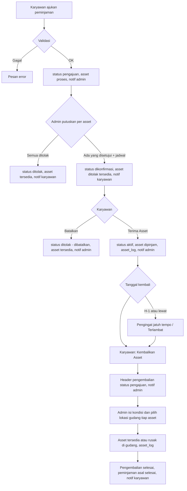
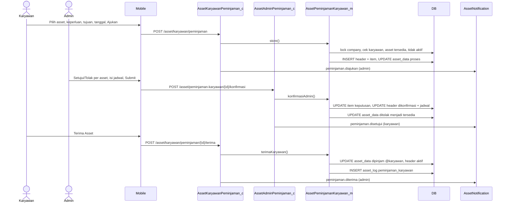
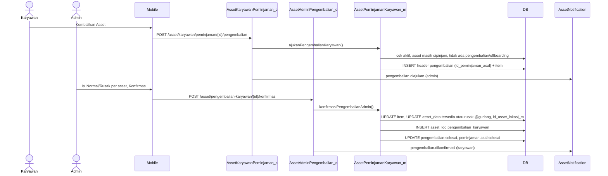
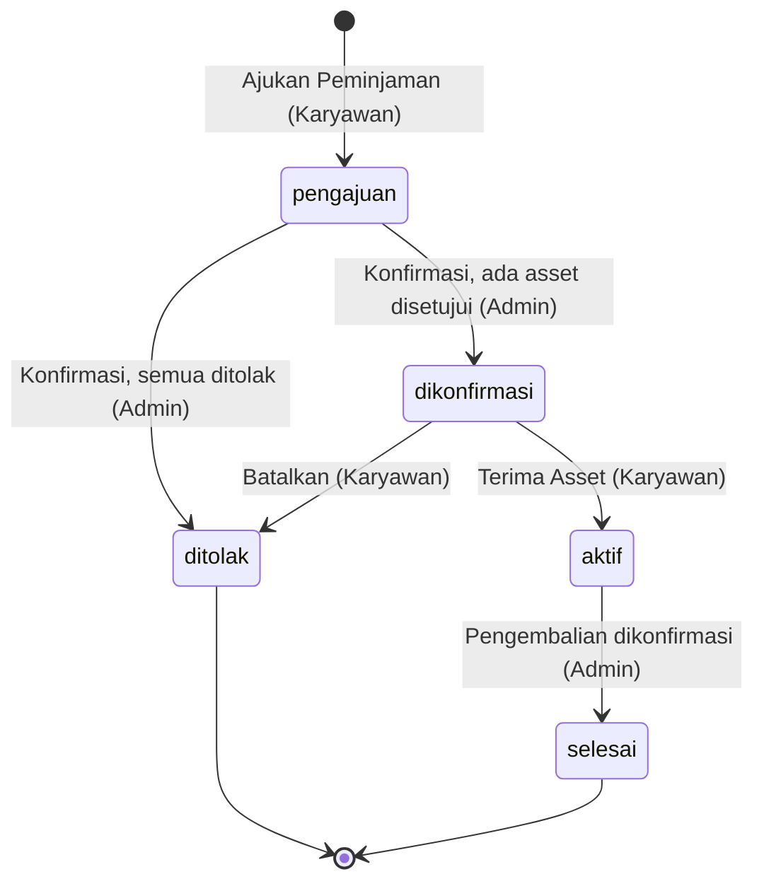
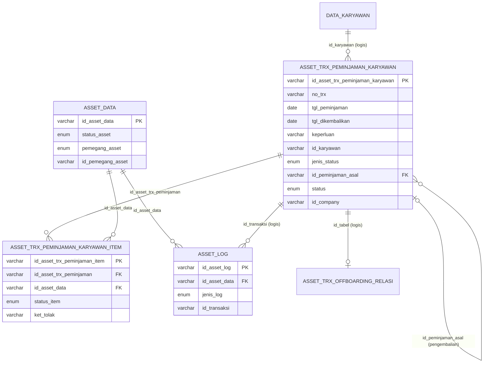

# Dokumentasi Teknis & Manual Book — Peminjaman Asset Karyawan

> Dokumen ini disusun **murni dari source code lokal** (`API/` Lumen dan `MOBILE/` Flutter) per 26 September 2026.
> Business requirement dan kode fitur **diturunkan dari kode**. Bagian yang tidak ditemukan ditandai **⚠️ Belum ditemukan**, asumsi ditandai **⚠️ Asumsi**.
> Contoh ID/nama pada payload adalah **data sintetis**.

---

## 1. Informasi Dokumen

| Informasi | Nilai |
|---|---|
| Nama Fitur | Peminjaman Asset Karyawan (termasuk **Pengembalian** pinjaman) |
| Kode Fitur | **KRY05** (prefix nomor transaksi `KRY05-YYYYMMNNN`, dipakai untuk peminjaman dan pengembalian) |
| Modul | Asset Management |
| Backend | Laravel **Lumen ^10.0**, PHP ^8.1, JWT `tymon/jwt-auth ^2.3`, Query Builder |
| Database | Struktur mengacu `API/diagram-asset.dbml` + migrations. ⚠️ Asumsi: MySQL/MariaDB |
| Mobile | Flutter (package `professional_flutter_3_35`), `flutter_bloc`, `dio` |
| Web | ⚠️ Belum ditemukan: tidak ada source web di workspace |
| Versi Dokumen | 1.3 |
| Tanggal Dokumentasi | 2026-10-12 |
| Dokumen terkait | Onboarding, Request/Penambahan (helper & pola bersama), Offboarding (mengembalikan pinjaman saat karyawan keluar) |

---

## 2. Daftar Isi

1. Informasi Dokumen · 3. Quick Overview · 4. Ringkasan Fitur · 5. Tujuan · 6. Aktor · 7. Hak Akses · 8. Terminologi · 9. Business Rules · 10. Business Flow · 11. Flow per Role · 12. Flow Diagram · 13. Sequence Diagram · 14. Status Transaksi · 15. State Transition · 16. Struktur Database · 17. Relasi · 18. Data Dictionary · 19. Index · 20. Backend Architecture · 21. Backend Logic · 22. Dampak asset_data · 23. API · 24. Detail API · 25. Mobile Architecture · 26. Mobile Screen · 27. Mobile → API · 28. API → Mobile · 29. Mapping Mobile→API→DB · 30. Mapping DB→API→Mobile · 31. Validation · 32. Error Handling · 33. Audit Trail · 34. Notification · 35. Security · 36. Manual Book · 37. Kondisi Button · 38. Testing · 39. Temuan Ketidaksesuaian · 40. Edge Case · 41. Risk · 42. Dependency · 43. Source Reference · 44. Developer Notes · 45. Traceability · 46. DB Impact · 47. Checklist · 48. Changelog

---

## 3. Quick Overview

| Item | Informasi |
|---|---|
| Feature | Peminjaman & Pengembalian Asset Karyawan |
| Module | Asset Management |
| Actor | Karyawan (peminjam), Admin Asset (penyetuju & penerima pengembalian), System |
| Main Transaction | `asset_trx_peminjaman_karyawan` (dua jenis baris: `jenis_status = peminjaman` dan `pengembalian`) |
| Detail Transaction | `asset_trx_peminjaman_karyawan_item` |
| Relasi pengembalian | `id_peminjaman_asal` → header peminjaman |
| Asset Master | `asset_data` (`status_asset = dipinjam` selama dipinjam) |
| Log | `asset_log`: `peminjaman_karyawan` (serah terima) dan `pengembalian_karyawan` (pengembalian) |
| Status | Peminjaman: `pengajuan → dikonfirmasi → aktif → selesai` atau `ditolak`. Pengembalian: `pengajuan → selesai` |
| Approval | Admin memutuskan **per asset** (setujui/tolak) lalu menetapkan jadwal serah terima |
| API | 6 endpoint admin + 9 endpoint karyawan |
| Mobile Screen | Karyawan: Peminjaman Asset (switch Peminjaman / Pengembalian), Tambah Peminjaman Asset, Detail Peminjaman / Pengembalian. Admin: Peminjaman Asset (switch Peminjaman / Pengembalian), Detail + sheet Konfirmasi Peminjaman Asset. Banner & kartu di Asset Saya |

```text
Karyawan: pilih asset gudang + keperluan + tujuan + tanggal pinjam–kembali → Ajukan Peminjaman
      │  asset_data → proses                                          status: pengajuan
      ▼
Admin: setujui / tolak tiap asset + jadwal serah terima (dalam periode pinjam)
      │  asset ditolak → tersedia                                     status: dikonfirmasi (atau ditolak bila semua ditolak)
      ▼
Karyawan: Terima Asset ─────────────► asset → dipinjam @karyawan + asset_log     status: aktif
      │   (atau Batalkan → asset → tersedia, status: ditolak)
      ▼
Pengingat H-1 / terlambat (banner di aplikasi)
      ▼
Karyawan: Kembalikan Asset ─► header baru jenis pengembalian               status: pengajuan
      ▼
Admin: kondisi + lokasi gudang tiap asset ─► asset → tersedia / rusak @gudang pilihan admin + asset_log
                                            pengembalian: selesai · peminjaman asal: selesai
```

---

## 4. Ringkasan Fitur

Peminjaman Asset memungkinkan **karyawan meminjam asset gudang untuk jangka waktu tertentu** (mis. dinas, pelatihan) dan mengembalikannya. Berbeda dengan Onboarding/Penambahan yang memindahkan asset secara tetap (`terpakai`), asset pinjaman berstatus **`dipinjam`** dan wajib kembali.

Alur utama:
- **Pengajuan** oleh karyawan: memilih satu atau lebih asset yang tersedia, keperluan (Kantor/Dinas/Pelatihan/Lainnya), tujuan, tanggal pinjam dan tanggal kembali. Asset langsung dikunci.
- **Konfirmasi admin per asset**: setiap asset disetujui atau ditolak (dengan alasan). Jika ada yang disetujui, admin menentukan **jadwal serah terima** yang harus berada dalam periode pinjam.
- **Serah terima**: karyawan menekan **Terima Asset** setelah menerima fisik asset → status **Aktif**, asset tercatat dipinjam karyawan. Karyawan juga bisa **Batalkan** sebelum menerima.
- **Jatuh tempo**: mulai H-1 tanggal kembali, peminjaman tampil sebagai pengingat; lewat tanggal ditandai **Terlambat**.
- **Pengembalian**: karyawan mengajukan pengembalian **seluruh** asset pinjaman; admin memeriksa kondisi tiap asset (Normal → kembali tersedia, Rusak → status rusak di gudang). Peminjaman asal otomatis **Selesai**.

---

## 5. Tujuan Fitur

### 5.1 Tujuan Bisnis (diturunkan dari kode)
- Peminjaman asset tercatat dengan keperluan, tujuan, dan periode yang jelas.
- Admin mengontrol asset mana yang boleh dipinjam dan kapan diserahkan.
- Karyawan bertanggung jawab atas asset setelah menyatakan menerima secara fisik.
- Keterlambatan pengembalian terlihat oleh karyawan dan admin.
- Kondisi asset saat kembali tercatat; asset rusak tidak kembali ke stok tersedia.

### 5.2 Tujuan Sistem
- Menyimpan pengajuan, keputusan per asset, jadwal serah terima, dan pengembalian.
- Mengunci asset selama proses (`proses`) dan selama dipinjam (`dipinjam`).
- Menghitung status jatuh tempo (`sisa_hari`, `terlambat`).
- Mencatat `asset_log` saat serah terima dan saat pengembalian.
- Mengirim notifikasi di setiap perubahan status.

---

## 6. Aktor

| Aktor | Role | Fungsi |
|---|---|---|
| Karyawan (peminjam) | User login (JWT) | Mengajukan peminjaman, menerima/membatalkan, mengajukan pengembalian |
| Admin Asset | `asset_admin` + karyawan aktif | Menyetujui/menolak per asset, menetapkan jadwal serah terima, memeriksa kondisi pengembalian dan memilih lokasi gudang tiap asset |
| System | Backend + FCM | Validasi, lock, penomoran, update asset, log, pengingat jatuh tempo (tampilan), notifikasi |

---

## 7. Hak Akses

| Action | Admin Asset | Karyawan | Keterangan |
|---|:---:|:---:|---|
| Melihat semua peminjaman & pengembalian | ✅ | ❌ | `/asset/peminjaman-karyawan`, `/asset/pengembalian-karyawan` |
| Melihat peminjaman & pengembalian sendiri | – | ✅ | `/asset/karyawan/peminjaman`, `/asset/karyawan/pengembalian` |
| Mengajukan peminjaman | – | ✅ | Untuk diri sendiri |
| Membatalkan pengajuan (sebelum admin memutuskan) | ❌ | ❌ | ⚠️ Belum ditemukan (RISK-002) |
| Setujui / tolak per asset | ✅ (status pengajuan) | ❌ | |
| Terima asset | ❌ | ✅ (status dikonfirmasi) | |
| Batalkan setelah disetujui | ❌ | ✅ (status dikonfirmasi) | Disimpan sebagai `ditolak` |
| Ajukan pengembalian | ❌ | ✅ (status aktif) | Seluruh asset |
| Konfirmasi kondisi & lokasi gudang pengembalian | ✅ (status pengajuan) | ❌ | |
| Menolak pengembalian | ❌ | ❌ | ⚠️ Belum ditemukan (RISK-004) |

---

## 8. Terminologi

| Istilah | Arti di sistem |
|---|---|
| Peminjaman | Baris header `jenis_status = peminjaman` |
| Pengembalian | Baris header `jenis_status = pengembalian`, merujuk `id_peminjaman_asal` |
| Keperluan | `kantor`, `dinas`, `pelatihan`, `lainnya` |
| Tujuan peminjaman | Teks bebas (maks. 255) |
| Periode pinjam | `tgl_peminjaman` s.d. `tgl_dikembalikan` |
| Jadwal serah terima | Tanggal + jam penyerahan fisik yang ditetapkan admin, harus di dalam periode pinjam |
| Aktif | Karyawan sudah menerima asset (`status_asset = dipinjam`) |
| Jatuh tempo | Peminjaman aktif dengan `tgl_dikembalikan` ≤ besok dan belum diajukan pengembalian |
| Terlambat | Aktif dan hari ini > `tgl_dikembalikan` |
| `sisa_hari` | Selisih hari ke tanggal kembali; negatif = terlambat |
| `dapat_dikembalikan` | Flag detail karyawan: aktif, semua asset masih dipegang, belum ada pengembalian berjalan |

---

## 9. Business Rules

### BR-001 — Peminjaman diajukan oleh karyawan untuk dirinya sendiri
`id_karyawan` diambil dari JWT; karyawan harus aktif → "Karyawan tidak ditemukan atau tidak aktif."

### BR-002 — Data pengajuan wajib lengkap
`keperluan` (maks 255), `tujuan_peminjaman` (maks 255), `tgl_pinjam`, `tgl_kembali`, `asset_ids` (min 1, distinct) → pesan pada §24 API-009.

### BR-003 — Tanggal pinjam tidak boleh lampau; tanggal kembali ≥ tanggal pinjam
`tgl_pinjam after_or_equal:today`, `tgl_kembali after_or_equal:tgl_pinjam` → "Tanggal pinjam tidak boleh sebelum hari ini." / "Tanggal kembali tidak boleh sebelum tanggal pinjam." Tidak ada batas maksimal durasi.

### BR-004 — Asset harus tersedia di gudang
`getLockedAssets`: `status_asset = tersedia` & `pemegang_asset = gudang` (FOR UPDATE) → "Satu atau beberapa asset tidak tersedia untuk dipinjam."

### BR-005 — Asset tidak boleh sedang di onboarding atau peminjaman lain
`hasActiveOnboardingAsset` → "…sedang diproses pada onboarding." `hasActivePeminjamanAsset` (peminjaman `pengajuan`/`dikonfirmasi`/`aktif`, item tidak ditolak) → "…sedang diproses pada peminjaman lain."

### BR-006 — Asset langsung dikunci saat diajukan
`asset_data.status_asset = proses`.

### BR-007 — Admin wajib memutuskan seluruh asset
Semua item harus diberi `disetujui`/`ditolak` → "Seluruh asset peminjaman wajib dikonfirmasi." Tolak wajib alasan → "Alasan penolakan asset wajib diisi."

### BR-008 — Jadwal serah terima wajib jika ada asset disetujui dan harus dalam periode pinjam
→ "Tanggal serah terima wajib diisi." / "Jam serah terima wajib diisi." / "Tanggal serah terima harus berada dalam periode peminjaman."

### BR-009 — Hasil keputusan admin
Minimal satu disetujui → `dikonfirmasi`; semua ditolak → `ditolak` dengan `ket_tolak = "Seluruh asset peminjaman ditolak."` Asset ditolak kembali `tersedia` di gudang; asset disetujui tetap `proses`.

### BR-010 — Konfirmasi admin hanya untuk status pengajuan dan bukan milik offboarding
→ "Peminjaman asset sudah tidak menunggu konfirmasi." / "Pengembalian ini diproses melalui offboarding."

### BR-011 — Terima asset hanya saat dikonfirmasi
Karyawan aktif, status `dikonfirmasi`, asset disetujui masih `proses` di gudang → asset `dipinjam` @karyawan, status `aktif`, `asset_log` → "Peminjaman asset belum dapat diterima." / "Satu atau beberapa asset belum siap diserahterimakan."

### BR-012 — Batalkan hanya saat dikonfirmasi
Asset disetujui kembali `tersedia`; status `ditolak`, `ket_tolak = "Dibatalkan oleh karyawan."` → "Peminjaman asset sudah tidak dapat dibatalkan."

### BR-013 — Pengembalian hanya untuk peminjaman aktif, seluruh asset
Semua asset disetujui harus masih `dipinjam` oleh karyawan; tidak boleh ada pengembalian berjalan; tidak sedang di offboarding → "Hanya peminjaman aktif yang dapat dikembalikan." / "Satu atau beberapa asset tidak sedang dipinjam oleh karyawan." / "Pengembalian asset sedang menunggu konfirmasi." / "Asset sedang diproses pada offboarding."

### BR-014 — Admin wajib mengisi kondisi dan lokasi gudang setiap asset yang dikembalikan
`normal`/`rusak`; rusak wajib keterangan → "Seluruh kondisi asset pengembalian wajib diisi." / "Keterangan kerusakan asset wajib diisi." (v1.1) Setiap item juga wajib punya `id_asset_lokasi_m` bertipe `gudang` pada company yang sama, tepat satu kali per item → "Lokasi gudang tujuan setiap asset wajib dipilih." / "Lokasi gudang tujuan tidak valid." / "Lokasi gudang tujuan asset tidak sesuai."

### BR-015 — Dampak pengembalian
Normal → `tersedia` @gudang; Rusak → `rusak` @gudang + `ket_rusak`; keduanya di gudang pilihan admin (`asset_data.id_asset_lokasi_m`, item `id_asset_lokasi_m_tujuan`). Pengembalian `selesai`; peminjaman asal `selesai` bila tidak ada asset pinjaman yang masih dipegang.

### BR-015a — Lokasi dikosongkan saat asset keluar gudang (v1.1)
Saat karyawan menerima asset pinjaman (Terima Asset), `asset_data.id_asset_lokasi_m` di-set `NULL` (kolom FK ke asset_lokasi_m; nilai '' ditolak database) karena asset tidak lagi berada di gudang.

### BR-016 — Pengingat jatuh tempo
Peminjaman `aktif` dengan `tgl_dikembalikan ≤ besok`, asset masih dipegang, dan belum ada pengembalian `pengajuan`/`dikonfirmasi` → tampil di Asset Saya (karyawan) dan ringkasan admin. ⚠️ Belum ditemukan: scheduler/push otomatis.

### BR-017 — Pengembalian lewat offboarding dipisahkan
Pengembalian yang dibuat oleh proses offboarding (tercatat di `asset_trx_offboarding_relasi`) disembunyikan dari daftar dan tidak dapat dikonfirmasi lewat menu peminjaman.

### BR-018 — Penomoran
ID header/item `id_company + YYYYMM + 3 digit`; `no_trx = KRY05-YYYYMMNNN` (sequence yang sama untuk peminjaman & pengembalian).

---

## 10. Business Flow

```text
1. Karyawan: Asset Saya → Peminjaman → (+) Tambah Peminjaman Asset
   → Pilih Asset (Tambah Asset) → Pilih Keperluan → Tujuan Peminjaman → Tanggal Pinjam–Kembali
   → Ajukan Peminjaman                         [pengajuan · asset proses · notif admin]
2. Admin: Asset Karyawan → Peminjaman → tab Pengajuan → Detail
   → Setujui / Tolak tiap asset (+ alasan) → Konfirmasi
   → Sheet "Konfirmasi Peminjaman Asset": Jadwal Serah Terima + Jam + Catatan → Submit
                                               [dikonfirmasi / ditolak · notif karyawan]
3. Karyawan: banner / Detail → "Siap untuk meminjam Asset?"
   → Terima Asset   [aktif · asset dipinjam · asset_log · notif admin]
   → Batalkan       [ditolak "Dibatalkan oleh karyawan." · asset tersedia · notif admin]
4. H-1 tanggal kembali → pengingat jatuh tempo; lewat tanggal → "Terlambat"
5. Karyawan: Detail peminjaman aktif → Kembalikan Asset
                                               [header pengembalian: pengajuan · notif admin]
6. Admin: Peminjaman → switch Pengembalian → Detail → Normal / Rusak tiap asset → Konfirmasi
                                               [pengembalian selesai · asset tersedia/rusak · asset_log
                                                · peminjaman asal selesai · notif karyawan]
```

---

## 11. Flow Berdasarkan Role

### 11.1 Karyawan
1. **Asset Saya** → menu **Peminjaman** → halaman **Peminjaman Asset** (switch **Peminjaman** / **Pengembalian**; tab Pengajuan, Dikonfirmasi, Ditolak, Aktif untuk peminjaman; Pengajuan, Selesai untuk pengembalian).
2. Tekan **+** → **Tambah Peminjaman Asset** → **Ajukan Peminjaman**.
3. Setelah admin mengonfirmasi: banner di Asset Saya / detail → **Terima Asset** atau **Batalkan**.
4. Selama aktif: kartu peminjaman aktif di Asset Saya, pengingat jatuh tempo, label **Terlambat** bila lewat.
5. **Kembalikan Asset** di detail peminjaman aktif → pantau di switch Pengembalian.

### 11.2 Admin Asset
1. **Asset Karyawan** → aksi **Peminjaman** (juga panel ringkasan "perlu diproses" dan "jatuh tempo").
2. Tab **Pengajuan** → detail → **Setujui**/**Tolak** per asset → **Konfirmasi** → isi jadwal → **Submit**.
3. Switch **Pengembalian** → tab Pengajuan → detail → **Normal**/**Rusak** per asset → **Konfirmasi**.

### 11.3 Approver
Dijalankan Admin Asset (§11.2 langkah 2).

### 11.4 System
Lock company, penomoran, penguncian/pelepasan asset, validasi jadwal dalam periode, perhitungan `sisa_hari`/`terlambat`/`dapat_dikembalikan`, `asset_log`, penutupan peminjaman asal, notifikasi setelah commit.

---

## 12. Flow Diagram



---

## 13. Sequence Diagram

### 13.1 Pengajuan sampai aktif



### 13.2 Pengembalian



---

## 14. Status Transaksi

Kolom `status` (enum `status_peminjaman`: `pengajuan`, `dikonfirmasi`, `ditolak`, `aktif`, `selesai`; default `pengajuan`). Di API dikirim sebagai `status_approval`.

### 14.1 Peminjaman (`jenis_status = peminjaman`)
| Status | Label API | Tab | Arti | Aksi berikutnya |
|---|---|---|---|---|
| `pengajuan` | Menunggu Konfirmasi | pengajuan | Menunggu keputusan admin | Admin: Konfirmasi |
| `dikonfirmasi` | Dikonfirmasi | dikonfirmasi | Minimal satu asset disetujui, jadwal ditetapkan | Karyawan: Terima / Batalkan |
| `ditolak` | Ditolak | ditolak | Semua asset ditolak admin **atau** dibatalkan karyawan | – |
| `aktif` | Aktif (mobile: **Terlambat** bila lewat tanggal kembali) | aktif | Asset dipegang karyawan | Karyawan: Kembalikan Asset |
| `selesai` | Selesai | selesai | Seluruh asset sudah kembali | – (tidak tampil di daftar peminjaman) |

### 14.2 Pengembalian (`jenis_status = pengembalian`)
| Status | Label API | Tab | Arti |
|---|---|---|---|
| `pengajuan` | Menunggu Konfirmasi | pengajuan | Menunggu pemeriksaan admin |
| `dikonfirmasi` | Dikonfirmasi | pengajuan | Hanya dipakai pengembalian yang dibuat **offboarding** |
| `ditolak` | Ditolak | selesai | ⚠️ Tidak pernah di-set |
| `selesai` | Selesai | selesai | Kondisi dicatat, asset kembali ke gudang |

### 14.3 Status item (`status_item`, enum `approval_item`)
| Konteks | Nilai DB | Nilai API | Arti |
|---|---|---|---|
| Peminjaman | NULL | `''` | Belum diputuskan |
| Peminjaman | `disetujui` / `ditolak` | sama | Keputusan admin (+`ket_tolak`) |
| Pengembalian | `disetujui` | `normal` | Kondisi normal |
| Pengembalian | `ditolak` | `rusak` | Kondisi rusak (`ket_tolak` = keterangan kerusakan) |

Migrasi `2026_09_17_000009`: nilai lama 1=pengajuan, 2=dikonfirmasi, 3=ditolak, 4=aktif (peminjaman) / selesai (pengembalian).

---

## 15. State Transition



| Status Awal | Action | Status Akhir | Actor |
|---|---|---|---|
| – | Ajukan Peminjaman | pengajuan | Karyawan |
| pengajuan | Konfirmasi (≥1 disetujui) | dikonfirmasi | Admin |
| pengajuan | Konfirmasi (semua ditolak) | ditolak | Admin |
| dikonfirmasi | Terima Asset | aktif | Karyawan |
| dikonfirmasi | Batalkan | ditolak | Karyawan |
| aktif | Ajukan pengembalian | aktif (+ header pengembalian `pengajuan`) | Karyawan |
| aktif | Pengembalian dikonfirmasi | selesai | Admin (otomatis) |
| pengajuan (pengembalian) | Konfirmasi kondisi | selesai | Admin |

Status `asset_data`:
| Dari | Ke | Trigger |
|---|---|---|
| tersedia @gudang | proses | Ajukan peminjaman |
| proses | tersedia @gudang | Asset ditolak admin / peminjaman dibatalkan karyawan |
| proses @gudang | dipinjam @karyawan | Terima Asset |
| dipinjam @karyawan | tersedia @gudang | Pengembalian, kondisi normal |
| dipinjam @karyawan | rusak @gudang | Pengembalian, kondisi rusak |

---

## 16. Struktur Database

| Table | Type | Fungsi |
|---|---|---|
| `asset_trx_peminjaman_karyawan` | Transaction Header | Peminjaman & pengembalian (`jenis_status`) |
| `asset_trx_peminjaman_karyawan_item` | Transaction Detail | Asset per transaksi + keputusan/kondisi |
| `asset_data` | Master | Status & pemegang asset |
| `asset_kategori_m` | Master | Nama kategori (snapshot) |
| `data_karyawan`, `master_cabang`, `master_departemen` | Master HR | Karyawan aktif, cabang, divisi |
| `asset_admin` | Master akses | Admin asset |
| `master_company` | Master | Lock transaksi |
| `asset_log` | Log | `peminjaman_karyawan`, `pengembalian_karyawan` |
| `asset_trx_offboarding_relasi` | Relasi | Menandai pengembalian yang dibuat offboarding |
| `notif_data`, `users` | Notifikasi | Inbox & token FCM |

> ⚠️ Belum ditemukan: migration `CREATE TABLE` untuk tabel peminjaman; struktur mengacu DBML + migrations `2026_09_17_000006`, `2026_09_17_000009`.

---

## 17. Relasi Database



Semua JOIN mencocokkan `id_company`. `id_peminjaman_asal` memiliki `ref` di DBML (self-reference).

---

## 18. Data Dictionary

### 18.1 asset_trx_peminjaman_karyawan
| Field | Type | Null | Default | Key | Description |
|---|---|:---:|---|---|---|
| id_asset_trx_peminjaman_karyawan | varchar(50) | No | – | PK | `id_company + YYYYMM + 3 digit` |
| no_trx | varchar(50) | No | '' | – | `KRY05-YYYYMMNNN` (tidak unique) |
| tgl_peminjaman | date | No | CURRENT_DATE | – | Tanggal pinjam (API: `tgl_pinjam`) |
| tgl_dikembalikan | date | No | CURRENT_DATE | – | Tanggal wajib kembali (API: `tgl_kembali`) |
| keperluan | varchar(255) | No | '' | – | `kantor`/`dinas`/`pelatihan`/`lainnya` |
| tujuan_peminjaman | varchar(255) | No | '' | – | Teks tujuan |
| tgl_serah_terima | date | No | 0000-00-00 | – | Jadwal serah terima (admin) |
| jam_serah_terima | time | No | 00:00:00 | – | Jam serah terima |
| keterangan_serah_terima | varchar(255) | – | '' | – | Catatan admin |
| ket_tolak | varchar(255) | No | '' | – | "Seluruh asset peminjaman ditolak." / "Dibatalkan oleh karyawan." |
| id_karyawan, nik_karyawan, nama_karyawan | varchar | – | '' | IDX | Peminjam (snapshot) |
| jenis_status | enum(peminjaman, pengembalian) | No | peminjaman | IDX | Jenis baris |
| id_peminjaman_asal | varchar(50) | Yes | NULL | FK | Wajib untuk pengembalian |
| status | enum(pengajuan, dikonfirmasi, ditolak, aktif, selesai) | No | pengajuan | IDX | API: `status_approval` |
| user_approval / tgl_approval | varchar / timestamp | – | '' / NULL | – | Admin pemutus / pemeriksa pengembalian |
| id_company | varchar(50) | No | '' | IDX | Company |
| tgl_input, user_input | – | – | – | IDX | Pembuat (API: `tgl_pengajuan`) |
| tgl_update, user_update | – | Yes | NULL | – | Perubahan terakhir; dipakai sebagai **tanggal diterima** saat `aktif` |

### 18.2 asset_trx_peminjaman_karyawan_item
| Field | Type | Null | Default | Key | Description |
|---|---|:---:|---|---|---|
| id_asset_trx_peminjaman_item | varchar(50) | No | – | PK | `id_company + YYYYMM + 3 digit` |
| id_asset_trx_peminjaman | varchar(50) | – | – | FK, IDX | → header |
| id_asset_data | varchar(50) | – | – | FK, IDX | → asset_data |
| nama_asset, deskripsi_asset, kategori_asset | varchar(255) | – | '' | – | Snapshot |
| status_item | enum(disetujui, ditolak) | Yes | NULL | IDX | Keputusan (peminjaman) / kondisi (pengembalian) |
| ket_tolak | varchar(255) | No | '' | – | Alasan tolak / keterangan kerusakan |
| id_asset_lokasi_m_tujuan | varchar(50) | No | '' | – | Lokasi gudang tujuan asset (pengembalian), dipilih admin (v1.1; migration `2026_10_05_000003`, SQL `sql-lokasi-retur-pengembalian.sql`) |
| id_company, tgl_input, user_input | – | – | – | IDX | – |

### 18.3 asset_data (field yang dipakai)
`status_asset` (tersedia → proses → dipinjam → tersedia/rusak), `pemegang_asset` (gudang ↔ karyawan), `id_pemegang_asset`, `id_asset_lokasi_m` (lokasi gudang; dikosongkan saat dipinjam, diisi saat kembali), `ket_rusak` (diisi saat kembali rusak), `kondisi_awal` (disalin ke log), `nama_asset`, `kode_asset`, `merek`, `deskripsi`, `tgl_update`, `user_update`.

### 18.4 asset_log
| Event | jenis_log | kondisi_awal → kondisi_akhir | posisi_awal → akhir | pemegang |
|---|---|---|---|---|
| Terima Asset | `peminjaman_karyawan` | kondisi_awal → kondisi_awal | gudang → karyawan | karyawan (id, nama) |
| Pengembalian | `pengembalian_karyawan` | kondisi_awal → normal/rusak | karyawan → gudang | gudang (kosong) |

---

## 19. Database Index

| Index | Table | Columns | Tujuan |
|---|---|---|---|
| `atpk_admin_list_idx` | header | (id_company, jenis_status, status, tgl_input, id_asset_trx_peminjaman_karyawan) | List admin per jenis & tab |
| `atpk_employee_list_idx` | header | (id_company, id_karyawan, jenis_status, status, tgl_input, id_asset_trx_peminjaman_karyawan) | List karyawan |
| `atpki_loan_status_idx` | item | (id_asset_trx_peminjaman, id_company, status_item, id_asset_data) | Hitung item, cek asset per header |

Dibuat migration `2026_09_17_000006`, dibuat ulang `2026_09_17_000009`. Pencarian `hasActivePeminjamanAsset`/`hasActivePengembalianAsset` berdasarkan `atpki.id_asset_data` tidak diawali kolom index (⚠️ belum diukur).

---

## 20. Backend Architecture

```text
RouteAsset.php (prefix /asset, jwt.api + jwt.ctx)
   ↓
AssetAdminPeminjaman_c + AssetAdminPengembalian_c (admin) / AssetKaryawanPeminjaman_c (karyawan; terima & batalkan lewat prosesSerahTerimaPeminjaman)
   ↓ validateRequest + accessError
AssetPeminjamanKaryawan_m ← Asset_m (lock, sequence, getLockedAssets, findActiveKaryawan, findAssetAdmin, hasActiveOnboardingAsset)
   ↓                      ← AssetOffboardingKaryawan_m::hasActiveOffboardingAsset
DB::transaction (retry 3)
   ↓
ApiResponse + AssetNotification (setelah commit)
```

| Layer | File/Class | Function |
|---|---|---|
| Route | `RouteAsset.php` | 15 route peminjaman/pengembalian |
| Controller | `AssetAdminPeminjaman_c` (peminjaman), `AssetAdminPengembalian_c` (pengembalian) | getPeminjamanKaryawan, getDetailPeminjamanKaryawan, konfirmasiPeminjamanKaryawan, getPengembalianKaryawan, getDetailPengembalianKaryawan, konfirmasiPengembalianKaryawan |
| Controller | `AssetKaryawanPeminjaman_c` | getPeminjamanOptions, getPeminjamanSaya, storePeminjamanSaya, getDetailPeminjamanSaya, terimaPeminjamanSaya, batalkanPeminjamanSaya, ajukanPengembalianSaya, getPengembalianSaya, getDetailPengembalianSaya |
| Model | `AssetPeminjamanKaryawan_m` | getOptions, getPeminjaman/Page, getPengembalian(Admin), getDetail(Admin), getDetailPengembalian(Admin), store, konfirmasiAdmin, terimaKaryawan, batalkanKaryawan, ajukanPengembalianKaryawan, konfirmasiPengembalianAdmin (lokasi gudang per item via `resolveItemLocations` di `Asset_m`), getPendingForEmployee, getPendingForAdmin, countPendingForAdmin, getJatuhTempo, countJatuhTempo |
| Enum | `PeminjamanStatus` | pengajuan/dikonfirmasi/ditolak/aktif/selesai (dipakai lewat konstanta model) |
| Support | `AssetNotification` | Event `peminjaman.*`, `pengembalian.*` |

---

## 21. Backend Business Logic

### 21.1 Ajukan — `store`
Lock → karyawan aktif → `getLockedAssets` (tersedia + gudang) → tidak aktif di onboarding/peminjaman → tgl_kembali ≥ tgl_pinjam → ID + `KRY05-…` → INSERT header (`pengajuan`, jadwal kosong) → INSERT item (`status_item` NULL) → UPDATE asset `proses` → notif `peminjaman.diajukan`. Response 201.

### 21.2 Konfirmasi admin — `konfirmasiAdmin`
Lock → admin → header peminjaman FOR UPDATE → bukan milik offboarding → status `pengajuan` → semua item diputuskan (tolak wajib alasan) → UPDATE item → bila ada disetujui: jadwal wajib, format valid, di dalam periode pinjam → UPDATE header (`dikonfirmasi`/`ditolak`, jadwal atau nol, `ket_tolak`, `user_approval`, `tgl_approval`) → asset ditolak → `tersedia` @gudang → notif `peminjaman.disetujui`/`ditolak`. Response 200 (+`jumlah_disetujui`, `jumlah_ditolak`).

### 21.3 Terima — `terimaKaryawan`
Lock → header milik karyawan FOR UPDATE → status `dikonfirmasi` → karyawan aktif → item disetujui → asset harus `proses` @gudang → UPDATE asset `dipinjam` @karyawan (`id_asset_lokasi_m = NULL`) → header `aktif` → INSERT `asset_log peminjaman_karyawan` → notif `peminjaman.diterima`.

### 21.4 Batalkan — `batalkanKaryawan`
Lock → header milik karyawan → status `dikonfirmasi` → karyawan aktif → asset disetujui → `tersedia` @gudang → header `ditolak`, `ket_tolak = "Dibatalkan oleh karyawan."` → notif `peminjaman.dibatalkan`.

### 21.5 Ajukan pengembalian — `ajukanPengembalianKaryawan`
Lock → peminjaman milik karyawan `aktif` → item disetujui → semua asset masih `dipinjam` oleh karyawan → tidak ada pengembalian `pengajuan`/`dikonfirmasi` → tidak di offboarding → INSERT header `jenis_status = pengembalian`, `id_peminjaman_asal`, salinan periode/keperluan, `pengajuan` → INSERT item (salinan item disetujui, `status_item` NULL) → notif `pengembalian.diajukan`. Response 201.

### 21.6 Konfirmasi pengembalian — `konfirmasiPengembalianAdmin`
Lock → admin → header pengembalian `pengajuan` → peminjaman asal ada & `aktif` → semua item diisi kondisi + lokasi gudang (`resolveItemLocations`) → asset masih `dipinjam` oleh karyawan → per item: UPDATE item (`disetujui` = normal / `ditolak` = rusak + keterangan, `id_asset_lokasi_m_tujuan`), UPDATE asset (`tersedia`/`rusak` @gudang, `id_asset_lokasi_m` pilihan admin, `ket_rusak`), siapkan `asset_log pengembalian_karyawan` → INSERT log → header pengembalian `selesai` (+`user_approval`, `tgl_approval`) → bila tidak ada asset pinjaman yang masih dipegang: peminjaman asal `selesai` → notif `pengembalian.dikonfirmasi`. Response 200 (+`jumlah_normal`, `jumlah_rusak`).

### 21.7 Query baca
- **Options**: asset `tersedia` @gudang yang tidak ada di peminjaman berjalan (item tidak ditolak) + daftar keperluan.
- **List peminjaman**: tidak menampilkan `selesai`, dan `aktif` hanya jika asset masih dipegang karyawan.
- **List pengembalian**: mengecualikan pengembalian milik offboarding.
- **Detail**: menghitung `terlambat`, `tgl_diterima` (= `tgl_update` saat aktif), `dapat_dikembalikan` (hanya untuk karyawan).
- **Jatuh tempo**: aktif, `tgl_dikembalikan ≤ besok`, asset masih dipegang, belum ada pengembalian berjalan; `sisa_hari` negatif = terlambat.

---

## 22. Dampak terhadap asset_data

| Field | Sebelum | Sesudah | Trigger |
|---|---|---|---|
| status_asset | tersedia | proses | Ajukan peminjaman |
| status_asset / pemegang | proses | tersedia / gudang | Asset ditolak admin; peminjaman dibatalkan |
| status_asset | proses | dipinjam | Terima Asset |
| pemegang_asset / id_pemegang_asset | gudang / '' | karyawan / id_karyawan | Terima Asset |
| id_asset_lokasi_m | lokasi gudang | NULL (v1.1) | Terima Asset |
| status_asset | dipinjam | tersedia | Pengembalian normal |
| status_asset | dipinjam | rusak | Pengembalian rusak |
| pemegang_asset / id_pemegang_asset | karyawan / id | gudang / '' | Pengembalian |
| id_asset_lokasi_m | NULL | lokasi gudang pilihan admin (v1.1) | Pengembalian |
| ket_rusak | – | keterangan (rusak) / '' (normal) | Pengembalian |
| tgl_update / user_update | – | now / pelaku | Setiap perubahan |

---

## 23. API Documentation

| ID | Method | Endpoint | Function | Auth |
|---|---|---|---|---|
| API-001 | GET | `/asset/peminjaman-karyawan` | List peminjaman (admin) | Admin |
| API-002 | GET | `/asset/peminjaman-karyawan/{id}` | Detail peminjaman (admin) | Admin |
| API-003 | POST | `/asset/peminjaman-karyawan/{id}/konfirmasi` | Setujui/tolak per asset + jadwal | Admin |
| API-004 | GET | `/asset/pengembalian-karyawan` | List pengembalian (admin) | Admin |
| API-005 | GET | `/asset/pengembalian-karyawan/{id}` | Detail pengembalian (admin) | Admin |
| API-006 | POST | `/asset/pengembalian-karyawan/{id}/konfirmasi` | Konfirmasi kondisi + lokasi gudang per asset | Admin |
| API-007 | GET | `/asset/karyawan/peminjaman/options` | Opsi keperluan & asset | JWT |
| API-008 | GET | `/asset/karyawan/peminjaman` | List peminjaman saya | JWT |
| API-009 | POST | `/asset/karyawan/peminjaman` | Ajukan peminjaman | JWT |
| API-010 | GET | `/asset/karyawan/peminjaman/{id}` | Detail peminjaman saya | JWT, pemilik |
| API-011 | POST | `/asset/karyawan/peminjaman/{id}/terima` | Terima asset | JWT, pemilik |
| API-012 | POST | `/asset/karyawan/peminjaman/{id}/batalkan` | Batalkan (setelah dikonfirmasi) | JWT, pemilik |
| API-013 | POST | `/asset/karyawan/peminjaman/{id}/pengembalian` | Ajukan pengembalian | JWT, pemilik |
| API-014 | GET | `/asset/karyawan/pengembalian` | List pengembalian saya | JWT |
| API-015 | GET | `/asset/karyawan/pengembalian/{id}` | Detail pengembalian saya | JWT, pemilik |

Terkait: `GET /asset/karyawan/onboarding` (Asset Saya: `peminjaman[]`, `jatuh_tempo[]`, `peminjaman_aktif[]`) dan `GET /asset/summary` (`peminjaman_perlu_proses`, `peminjaman_pending`, `jatuh_tempo_jumlah`, `jatuh_tempo`).
Batalkan pengajuan, tolak pengembalian, perpanjangan: ⚠️ Belum ditemukan.

---

## 24. Detail Setiap API

Header umum: `Authorization: Bearer <token>`, `Content-Type: application/json`, `Accept`, `locale`, `versi-app`. Format response `{ code, message, data }`.

### API-001 / API-008 — List Peminjaman
```http
GET /asset/peminjaman-karyawan?tab=pengajuan&limit=20&offset=0          (admin)
GET /asset/karyawan/peminjaman?tab=aktif&limit=20&offset=0              (karyawan)
```
`tab`: `pengajuan` | `dikonfirmasi` | `ditolak` | `aktif` ("Filter peminjaman asset tidak valid."); `limit` 1–50; `offset` ≥ 0. Tanpa parameter → array.
```json
{
  "code": "SUCCESS",
  "message": "Data peminjaman asset berhasil ditemukan.",
  "data": {
    "filters": [
      {"value": "pengajuan", "label": "Pengajuan"},
      {"value": "dikonfirmasi", "label": "Dikonfirmasi"},
      {"value": "ditolak", "label": "Ditolak"},
      {"value": "aktif", "label": "Aktif"}
    ],
    "records": [
      {
        "id": "CMP001202609007",
        "no_trx": "KRY05-202609007",
        "tgl_pengajuan": "2026-09-26",
        "keperluan": "dinas",
        "tujuan_peminjaman": "Presentasi klien di Surabaya",
        "tgl_pinjam": "2026-09-28",
        "tgl_kembali": "2026-10-02",
        "tgl_serah_terima": "2026-09-28",
        "jam_serah_terima": "08:30:00",
        "keterangan_serah_terima": "Ambil di ruang IT",
        "ket_tolak": "",
        "id_karyawan": "KRY0003",
        "nik_karyawan": "EMP-003",
        "nama_karyawan": "Andi Contoh",
        "jenis_status": "peminjaman",
        "id_peminjaman_asal": "",
        "status_approval": "aktif",
        "status_label": "Aktif",
        "tab": "aktif",
        "jumlah_asset": 1,
        "tgl_diterima": "2026-09-28",
        "terlambat": false
      }
    ],
    "pagination": {"limit": 20, "offset": 0, "next_offset": 1, "has_more": false}
  }
}
```

### API-002 / API-010 — Detail Peminjaman
```http
GET /asset/peminjaman-karyawan/{id}        (admin)
GET /asset/karyawan/peminjaman/{id}        (karyawan, hanya miliknya)
```
Field sama dengan record list (tanpa `id_karyawan`, `nik/nama` di dalam `karyawan`) ditambah:
```json
{
  "dapat_dikembalikan": true,
  "karyawan": {"nik": "EMP-003", "nama_karyawan": "Andi Contoh", "cabang": "Kantor Pusat", "divisi": "Sales"},
  "assets": [
    {
      "id_item": "CMP001202609021",
      "id_asset_data": "CMP00120260100009",
      "kode_asset": "PRJ-0002",
      "nama_asset": "Proyektor Mini",
      "deskripsi": "Kabel HDMI, tas",
      "kategori_asset": "Proyektor",
      "merek": "MerekY",
      "status_item": "disetujui",
      "ket_tolak": ""
    }
  ]
}
```
`dapat_dikembalikan` hanya bernilai true pada endpoint karyawan. 404: "Peminjaman asset tidak ditemukan."

### API-003 — Konfirmasi Peminjaman (Admin)
```http
POST /asset/peminjaman-karyawan/{id}/konfirmasi
```
```json
{
  "items": [
    {"id_item": "CMP001202609021", "status_item": "disetujui"},
    {"id_item": "CMP001202609022", "status_item": "ditolak", "ket_tolak": "Sedang dijadwalkan servis"}
  ],
  "tgl_serah_terima": "2026-09-28",
  "jam_serah_terima": "08:30",
  "keterangan_serah_terima": "Ambil di ruang IT"
}
```
| Field | Rule | Message |
|---|---|---|
| items | required\|array\|min:1 | Keputusan asset wajib diisi. |
| items.*.id_item | required\|string\|max:50\|distinct | Asset yang sama tidak boleh dikirim lebih dari sekali. |
| items.*.status_item | required\|in:disetujui,ditolak | Keputusan setiap asset wajib dipilih. / Keputusan asset harus disetujui atau ditolak. |
| items.*.ket_tolak | nullable\|max:255\|required_if ditolak | Alasan penolakan asset wajib diisi. |
| tgl_serah_terima | nullable\|date_format:Y-m-d (wajib di model bila ada disetujui) | Format tanggal serah terima harus YYYY-MM-DD. |
| jam_serah_terima | nullable\|date_format:H:i (wajib di model bila ada disetujui) | Format jam serah terima harus HH:MM. |
| keterangan_serah_terima | nullable\|max:255 | – |

Database impact:
```text
UPDATE asset_trx_peminjaman_karyawan_item (status_item, ket_tolak)
UPDATE asset_trx_peminjaman_karyawan (status, jadwal, ket_tolak, user_approval, tgl_approval)
UPDATE asset_data (item ditolak → tersedia @gudang)
INSERT notif_data
```
```json
{ "code": "UPDATED", "message": "Peminjaman asset berhasil dikonfirmasi.",
  "data": { "id": "CMP001202609007", "no_trx": "KRY05-202609007", "status_approval": "dikonfirmasi",
            "status_label": "Dikonfirmasi", "tab": "dikonfirmasi", "jumlah_disetujui": 1, "jumlah_ditolak": 1 } }
```
Semua ditolak: "Peminjaman asset berhasil ditolak.", `status_approval: ditolak`.
422: "Peminjaman asset tidak ditemukan.", "Pengembalian ini diproses melalui offboarding.", "Peminjaman asset sudah tidak menunggu konfirmasi.", "Seluruh asset peminjaman wajib dikonfirmasi.", "Tanggal/Jam serah terima wajib diisi.", "Format jadwal serah terima tidak valid.", "Tanggal serah terima harus berada dalam periode peminjaman." 500: "Terjadi kesalahan saat mengonfirmasi peminjaman asset."

### API-004 / API-014 — List Pengembalian
```http
GET /asset/pengembalian-karyawan?tab=pengajuan     (admin)
GET /asset/karyawan/pengembalian?tab=selesai       (karyawan)
```
`tab`: `pengajuan` (pengajuan/dikonfirmasi) | `selesai` (ditolak/selesai). Filters: Pengajuan, Selesai. Record sama dengan API-001 dengan `jenis_status = pengembalian` dan `id_peminjaman_asal` terisi.

### API-005 / API-015 — Detail Pengembalian
```http
GET /asset/pengembalian-karyawan/{id}
GET /asset/karyawan/pengembalian/{id}
```
Struktur seperti API-002; `assets[].status_item` bernilai `normal`/`rusak` (dipetakan dari `disetujui`/`ditolak`), `ket_tolak` = keterangan kerusakan. 404: "Pengembalian asset tidak ditemukan."

### API-006 — Konfirmasi Pengembalian (Admin)
```http
POST /asset/pengembalian-karyawan/{id}/konfirmasi
```
```json
{
  "items": [
    {"id_item": "CMP001202610003", "kondisi": "rusak", "id_asset_lokasi_m": "CMP001202610001", "keterangan_kerusakan": "Lensa tergores"}
  ]
}
```
| Field | Rule | Message |
|---|---|---|
| items | required\|array\|min:1 | Kondisi asset wajib diisi. |
| items.*.id_item | required\|distinct | Asset yang sama tidak boleh dikirim lebih dari sekali. |
| items.*.kondisi | required\|in:normal,rusak | Kondisi setiap asset wajib dipilih. / Kondisi asset harus normal atau rusak. |
| items.*.keterangan_kerusakan | nullable\|max:255\|required_if rusak | Keterangan kerusakan asset wajib diisi. |
| items.*.id_asset_lokasi_m | required\|string\|max:50 | Lokasi gudang tujuan wajib dipilih. (v1.1) |

Database impact:
```text
UPDATE asset_trx_peminjaman_karyawan_item (status_item, ket_tolak, id_asset_lokasi_m_tujuan)
UPDATE asset_data (tersedia / rusak @gudang, id_asset_lokasi_m, ket_rusak)
INSERT asset_log (pengembalian_karyawan)
UPDATE asset_trx_peminjaman_karyawan (pengembalian → selesai; peminjaman asal → selesai)
INSERT notif_data
```
```json
{ "code": "UPDATED", "message": "Pengembalian asset berhasil dikonfirmasi.",
  "data": { "id": "CMP001202610001", "no_trx": "KRY05-202610001", "jenis_status": "pengembalian",
            "id_peminjaman_asal": "CMP001202609007", "status_approval": "selesai", "status_label": "Selesai",
            "tab": "selesai", "jumlah_normal": 0, "jumlah_rusak": 1 } }
```
422: "Pengembalian asset tidak ditemukan.", "Pengembalian asset sudah tidak menunggu konfirmasi.", "Peminjaman asal pengembalian tidak ditemukan.", "Peminjaman asal pengembalian tidak ditemukan atau sudah tidak aktif.", "Seluruh kondisi asset pengembalian wajib diisi.", "Satu atau beberapa asset tidak sedang dipinjam oleh karyawan.", "Lokasi gudang tujuan setiap asset wajib dipilih.", "Lokasi gudang tujuan tidak valid.", "Lokasi gudang tujuan asset tidak sesuai." 500: "Terjadi kesalahan saat mengonfirmasi pengembalian asset."

Detail pengembalian admin (API-005) mulai v1.1 memuat `lokasi_gudang[]` (gudang milik company), `karyawan.id_cabang`, dan `assets[].id_asset_lokasi_m_tujuan` serta `nama_lokasi_tujuan` (kosong sampai dikonfirmasi). Pesan umum validasi: "Data konfirmasi pengembalian belum lengkap."

### API-007 — Opsi Peminjaman
```http
GET /asset/karyawan/peminjaman/options
```
```json
{
  "code": "SUCCESS",
  "message": "Opsi peminjaman asset berhasil ditemukan.",
  "data": {
    "keperluan": [
      {"value": "kantor", "label": "Kantor"},
      {"value": "dinas", "label": "Dinas"},
      {"value": "pelatihan", "label": "Pelatihan"},
      {"value": "lainnya", "label": "Lainnya"}
    ],
    "assets": [
      {"id_asset_data": "CMP00120260100009", "kode_asset": "PRJ-0002", "nama_asset": "Proyektor Mini",
       "kategori_asset": "Proyektor", "merek": "MerekY", "deskripsi": "Kabel HDMI, tas"}
    ]
  }
}
```

### API-009 — Ajukan Peminjaman
```http
POST /asset/karyawan/peminjaman
```
```json
{
  "keperluan": "dinas",
  "tujuan_peminjaman": "Presentasi klien di Surabaya",
  "tgl_pinjam": "2026-09-28",
  "tgl_kembali": "2026-10-02",
  "asset_ids": ["CMP00120260100009"]
}
```
| Field | Rule | Message |
|---|---|---|
| keperluan | required\|string\|max:255 | Keperluan wajib diisi. |
| tujuan_peminjaman | required\|string\|max:255 | Tujuan peminjaman wajib diisi. |
| tgl_pinjam | required\|date_format:Y-m-d\|after_or_equal:today | Tanggal pinjam wajib diisi. / Format … / Tanggal pinjam tidak boleh sebelum hari ini. |
| tgl_kembali | required\|date_format:Y-m-d\|after_or_equal:tgl_pinjam | Tanggal kembali wajib diisi. / Format … / Tanggal kembali tidak boleh sebelum tanggal pinjam. |
| asset_ids | required\|array\|min:1 | Asset yang dipinjam wajib dipilih. |
| asset_ids.* | required\|max:50\|distinct | Asset yang sama tidak boleh dipilih lebih dari sekali. |

> `keperluan` tidak divalidasi terhadap daftar opsi di backend (hanya string ≤255).

Database impact: `INSERT header (pengajuan)`, `INSERT item`, `UPDATE asset_data (proses)`, `INSERT notif_data`.
```json
{ "code": "CREATED", "message": "Pengajuan peminjaman asset berhasil dikirim.",
  "data": { "id": "CMP001202609007", "no_trx": "KRY05-202609007", "status_approval": "pengajuan",
            "status_label": "Menunggu Konfirmasi", "tab": "pengajuan" } }
```
422: "Karyawan tidak ditemukan atau tidak aktif.", "Satu atau beberapa asset tidak tersedia untuk dipinjam.", "…sedang diproses pada onboarding.", "…sedang diproses pada peminjaman lain.", "Nomor transaksi untuk periode ini sudah mencapai batas." 500: "Terjadi kesalahan saat menyimpan peminjaman asset."

### API-011 — Terima Asset
```http
POST /asset/karyawan/peminjaman/{id}/terima
```
Tanpa body. Database impact: `UPDATE asset_data (dipinjam @karyawan)`, `UPDATE header (aktif)`, `INSERT asset_log (peminjaman_karyawan)`, `INSERT notif_data`.
```json
{ "code": "UPDATED", "message": "Asset peminjaman berhasil diterima.",
  "data": { "id": "CMP001202609007", "no_trx": "KRY05-202609007", "status_approval": "aktif",
            "status_label": "Aktif", "tab": "aktif", "jumlah_asset": 1 } }
```
422: "Peminjaman asset tidak ditemukan.", "Peminjaman asset belum dapat diterima.", "Karyawan tidak ditemukan atau tidak aktif.", "Tidak ada asset yang disetujui untuk diterima.", "Satu atau beberapa asset belum siap diserahterimakan." 500: "Terjadi kesalahan saat memproses serah terima asset."

### API-012 — Batalkan Peminjaman
```http
POST /asset/karyawan/peminjaman/{id}/batalkan
```
Tanpa body. Database impact: `UPDATE asset_data (tersedia @gudang)`, `UPDATE header (ditolak, ket_tolak)`, `INSERT notif_data`.
```json
{ "code": "UPDATED", "message": "Peminjaman asset berhasil dibatalkan.",
  "data": { "id": "CMP001202609007", "no_trx": "KRY05-202609007", "status_approval": "ditolak",
            "status_label": "Ditolak", "tab": "ditolak" } }
```
422: "Peminjaman asset sudah tidak dapat dibatalkan." (status bukan `dikonfirmasi`).

### API-013 — Ajukan Pengembalian
```http
POST /asset/karyawan/peminjaman/{id}/pengembalian
```
Tanpa body (semua asset disetujui ikut dikembalikan). Database impact: `INSERT header pengembalian`, `INSERT item`, `INSERT notif_data`.
```json
{ "code": "CREATED", "message": "Pengajuan pengembalian asset berhasil dikirim.",
  "data": { "id": "CMP001202610001", "no_trx": "KRY05-202610001", "jenis_status": "pengembalian",
            "id_peminjaman_asal": "CMP001202609007", "status_approval": "pengajuan",
            "status_label": "Menunggu Konfirmasi", "tab": "pengajuan", "jumlah_asset": 1 } }
```
422: "Peminjaman asset tidak ditemukan.", "Hanya peminjaman aktif yang dapat dikembalikan.", "Tidak ada asset aktif yang dapat dikembalikan.", "Satu atau beberapa asset tidak sedang dipinjam oleh karyawan.", "Pengembalian asset sedang menunggu konfirmasi.", "Asset sedang diproses pada offboarding."

---

## 25. Mobile Architecture

```text
Page → Bloc (AssetPeminjamanBloc / AssetPeminjamanAdminBloc) → Api (AssetPeminjamanApi / AssetPeminjamanAdminApi) → ApiClient → Backend
```

| Layer | File | Function |
|---|---|---|
| Api | `Repository/Service/assetPeminjamanApi.dart` | getPeminjaman, getOptions, store, getDetail, terima, batalkan, getPengembalian, getDetailPengembalian, ajukanPengembalian |
| Api | `Repository/Service/assetPeminjamanAdminApi.dart` | getPeminjaman, getDetail, konfirmasi, getPengembalian, getDetailPengembalian, konfirmasiPengembalian (+ `id_asset_lokasi_m` per item) |
| Model | `Repository/Model/Asset/mAssetPeminjaman.dart` | AssetPeminjamanAsset, AssetPeminjamanKeperluan, AssetPeminjamanOptions, AssetPeminjamanKaryawan, `AssetPeminjamanApproval` + `parseAssetPeminjamanApproval`, AssetPeminjamanRecord, AssetPeminjamanPage, AssetPeminjamanRequest |
| Model | `Repository/Model/Asset/mAssetPeminjamanAdmin.dart` | AssetPeminjamanAdminKeputusan, AssetPeminjamanAdminKonfirmasiRequest, AssetPengembalianAdminKondisi (kini + `idLokasi`), AssetPengembalianAdminKonfirmasiRequest; model bersama `AssetWarehouseLocation` (`mAssetWarehouseLocation.dart`) |
| Bloc | `Bloc/Asset/AssetPeminjamanBloc.dart` | List peminjaman/pengembalian, options, detail, submit, terima, batalkan, ajukan pengembalian |
| Bloc | `Bloc/Asset/AssetPeminjamanAdminBloc.dart` | List, detail, konfirmasi peminjaman & pengembalian |
| UI karyawan | `UI/Modul/Asset/AssetSaya/Peminjaman/*` | HalamanAssetPeminjaman, HalamanTambahAssetPeminjaman, HalamanDetailAssetPeminjaman, AssetPeminjamanPicker, AssetPeminjamanWidgets |
| UI admin | `UI/Modul/Asset/AssetAdmin/AssetAdminKaryawan/Peminjaman/*` | HalamanAssetAdminPeminjaman, HalamanAssetAdminDetailPeminjaman, AssetPeminjamanAdminConfirmationSheet, AssetPeminjamanAdminWidgets |
| UI | `UI/Modul/Asset/AssetSaya/HalamanAssetSaya.dart` | Banner terima, pengingat jatuh tempo, kartu peminjaman aktif |

| Route | Page | Event awal |
|---|---|---|
| `/asset_peminjaman` | Peminjaman Asset (argumen `true` = buka mode Pengembalian) | LoadAssetPeminjamanList / LoadAssetPengembalianList |
| `/asset_tambah_peminjaman` | Tambah Peminjaman Asset | LoadAssetPeminjamanOptions |
| `/asset_detail_peminjaman` | Detail Peminjaman Asset | LoadAssetPeminjamanDetail(id) |
| `/asset_detail_pengembalian` | Detail Pengembalian Asset (`isPengembalian`) | LoadAssetPengembalianDetail(id) |
| `/asset_admin_peminjaman` | Peminjaman Asset (admin) | LoadAssetPeminjamanAdminList |
| `/asset_admin_detail_peminjaman` | Detail Peminjaman (admin) | LoadAssetPeminjamanAdminDetail(id) |
| `/asset_admin_detail_pengembalian` | Detail Pengembalian (admin, `isPengembalian`) | LoadAssetPengembalianAdminDetail(id) |

---

## 26. Mobile Screen

### 26.1 Peminjaman Asset (Karyawan)
Switch **Peminjaman** / **Pengembalian**; tab peminjaman: Pengajuan, Dikonfirmasi, Ditolak, Aktif; tab pengembalian: Pengajuan, Selesai. Kartu: nomor, Tanggal Pengajuan / **Tanggal Diterima** (bila aktif), status (Menunggu Konfirmasi, Dikonfirmasi, Ditolak, Aktif, **Terlambat**), Keperluan, Tanggal Pinjam, Tanggal Kembali, "{jumlah} Asset", info jadwal serah terima, peringatan "Sudah lewat tanggal pengembalian. Silakan kembalikan asset sekarang." Tombol **+**.

### 26.2 Tambah Peminjaman Asset
| Field UI | Widget | Required | Source |
|---|---|:---:|---|
| Pilih Asset → Tambah Asset | Bottom sheet "Tambah Pinjam Asset" (cari nama/kode/merek) | Ya, min 1 | `options.assets` |
| Form Peminjaman: Pilih Keperluan | Bottom sheet | Ya | `options.keperluan` |
| Tujuan Peminjaman | Text field | Ya | Input |
| Tanggal Pinjam – Tanggal Kembali | Date range picker | Ya, kembali ≥ pinjam | Input |
| Tombol | **Ajukan Peminjaman** | – | – |

### 26.3 Detail Peminjaman / Pengembalian (Karyawan)
Header (Tanggal Pengajuan/Diterima, status, Nomor Pengajuan), Data Karyawan, Detail Peminjaman (Tanggal Pinjam, Tanggal Kembali, Keperluan, Tujuan Peminjaman), Jadwal Serah Terima, daftar asset dengan status **Disetujui Admin**/**Ditolak Admin** (+Alasan Penolakan) atau kondisi **Normal**/**Rusak** (+Keterangan Kerusakan) untuk pengembalian.
- Status `dikonfirmasi`: panel "Siap untuk meminjam Asset?" + instruksi, tombol **Batalkan** dan **Terima Asset** (dialog konfirmasi).
- `dapat_dikembalikan`: tombol **Kembalikan Asset** (dialog "Asset aktif pada peminjaman ini akan diajukan untuk dikembalikan.").

**Alur status**: `AssetAlurStepper.peminjaman` (Pengajuan → Konfirmasi → Dipinjam → Pengembalian → Selesai; transaksi pengembalian mulai dari langkah Pengembalian; disembunyikan bila ditolak) dan satu kartu timeline per aset (`AssetPeminjamanTimelineCards`). Transaksi peminjaman: Pengajuan (keperluan, periode) · Konfirmasi (jadwal serah terima; chip **Ditolak** per aset) · Dipinjam (tanggal diterima, batas kembali; chip **Terlambat**) · Pengembalian · Selesai (lokasi gudang). Transaksi pengembalian: Pengembalian (jadwal) · Konfirmasi (kondisi Normal/Rusak; chip **Rusak**) · Selesai (lokasi gudang). Alasan penolakan tetap di kartu aset. File: `Shared/Widgets/AssetAlurWidgets.dart`, `Shared/Widgets/AssetPeminjamanTimeline.dart`.

### 26.4 Peminjaman Asset (Admin)
Switch Peminjaman/Pengembalian dan tab seperti karyawan; kartu menampilkan karyawan, keperluan, periode, jumlah asset.

### 26.5 Detail Peminjaman (Admin)
Data karyawan, detail peminjaman, daftar asset. Status `pengajuan`: tiap asset tombol **Setujui**/**Tolak** (+Alasan Penolakan) dan tombol bawah **Konfirmasi** → sheet **Konfirmasi Peminjaman Asset** (ringkasan, Jadwal Serah Terima dibatasi periode pinjam, Jam Serah Terima, Catatan Tambahan, **Submit**). Jadwal hanya diminta bila ada asset disetujui.

Stepper dan kartu timeline sama seperti §26.3; kartu timeline disembunyikan saat form keputusan admin terbuka.

### 26.6 Detail Pengembalian (Admin)
Status `pengajuan`: tiap asset **Normal**/**Rusak** (+Keterangan Kerusakan) dropdown **Lokasi Tujuan Asset** per asset (v1.1; default gudang di cabang karyawan) dan tombol **Konfirmasi** (langsung dikirim, tanpa sheet). Bila belum ada pilihan lokasi: "Pilih lokasi gudang tujuan untuk seluruh asset.". Setelah selesai: kondisi dan lokasi tujuan read-only.

Stepper dan kartu timeline transaksi pengembalian sama seperti §26.3; kartu timeline disembunyikan saat form kondisi dan lokasi admin terbuka.

### 26.7 Asset Saya
Banner per peminjaman `dikonfirmasi` (aksi terima), banner jatuh tempo (label dari `sisa_hari`), bagian **Peminjaman Asset** berisi kartu peminjaman aktif.

---

## 27. Mobile → API

| UI Field | Mobile Variable | JSON Field | Type | Required |
|---|---|---|---|:---:|
| Pilih Keperluan | `_selectedPurpose.value` | `keperluan` | string | Ya |
| Tujuan Peminjaman | `_detailController.text.trim()` | `tujuan_peminjaman` | string | Ya |
| Tanggal Pinjam | `tanggalPeminjamanApi(_borrowDate)` | `tgl_pinjam` | Y-m-d | Ya |
| Tanggal Kembali | `tanggalPeminjamanApi(_returnDate)` | `tgl_kembali` | Y-m-d | Ya |
| Tambah Asset | `_selectedAssets[].idAssetData` | `asset_ids[]` | array | Ya |
| Setujui / Tolak (admin) | `AssetPeminjamanAdminKeputusan.statusItem` | `items[].status_item` | `disetujui`/`ditolak` | Ya |
| Alasan Penolakan | `ketTolak.trim()` | `items[].ket_tolak` | string | Bila ditolak |
| Jadwal & Jam Serah Terima | sheet `_handoverDate`, `_handoverTime` | `tgl_serah_terima`, `jam_serah_terima` | Y-m-d, H:i | Bila ada disetujui |
| Catatan Tambahan | sheet | `keterangan_serah_terima` | string | Tidak |
| Normal / Rusak (admin pengembalian) | `AssetPengembalianAdminKondisi.kondisi` | `items[].kondisi` | string | Ya |
| Lokasi Tujuan Asset (admin pengembalian) | `AssetPengembalianAdminKondisi.idLokasi` | `items[].id_asset_lokasi_m` | string | Ya (v1.1) |
| Keterangan Kerusakan | `keteranganKerusakan.trim()` | `items[].keterangan_kerusakan` | string | Bila rusak |
| Terima / Batalkan / Kembalikan | – | (tanpa body) | – | – |

---

## 28. API → Mobile

| API JSON | Mobile Model (`AssetPeminjamanRecord`) | UI |
|---|---|---|
| `id`, `no_trx` | id, noTrx | Navigasi, "Nomor Pengajuan" |
| `tgl_pengajuan` / `tgl_diterima` | tanggalPengajuan / tanggalDiterima | "Tanggal Pengajuan" / "Tanggal Diterima" |
| `keperluan`, `tujuan_peminjaman` | keperluan, tujuanPeminjaman | "Keperluan", "Tujuan Peminjaman" |
| `tgl_pinjam`, `tgl_kembali` | tanggalPinjam, tanggalKembali | "Tanggal Pinjam", "Tanggal Kembali" |
| `tgl_serah_terima`, `jam_serah_terima`, `keterangan_serah_terima` | idem | Info "Jadwal serah terima asset pada {tanggal}, jam {jam}." |
| `ket_tolak` | ketTolak | Alasan |
| `status_approval` (+`jenis_status`) | statusApproval (`parseAssetPeminjamanApproval`) | Badge, tombol |
| `status_label`, `tab` | statusLabel, tab | Badge |
| `terlambat` | terlambat | "Terlambat" + peringatan |
| `dapat_dikembalikan` | dapatDikembalikan | Tombol Kembalikan Asset |
| `jenis_status`, `id_peminjaman_asal` | jenisStatus, idPeminjamanAsal | Mode pengembalian |
| `karyawan.*` | karyawan | Data Karyawan |
| `assets[]` | assets (`AssetPeminjamanAsset`) | Daftar asset, keputusan/kondisi |
| `lokasi_gudang[]`, `karyawan.id_cabang`, `assets[].nama_lokasi_tujuan` | AssetPeminjamanRecord.lokasiGudang, AssetPeminjamanKaryawan.idCabang, AssetPeminjamanAsset | Dropdown Lokasi Tujuan Asset; lokasi tujuan di kartu |
| `filters`, `records`, `pagination` | AssetPeminjamanPage | Tab, list, infinite scroll |

---

## 29. Mapping Mobile → API → Database

| UI | Mobile Variable | JSON | Backend | Table | Column |
|---|---|---|---|---|---|
| Pilih Keperluan | `keperluan` | `keperluan` | trim | header | keperluan |
| Tujuan Peminjaman | `tujuanPeminjaman` | `tujuan_peminjaman` | trim | header | tujuan_peminjaman |
| Tanggal Pinjam | `tanggalPinjam` | `tgl_pinjam` | `$tanggalPinjam` | header | tgl_peminjaman |
| Tanggal Kembali | `tanggalKembali` | `tgl_kembali` | `$tanggalKembali` | header | tgl_dikembalikan |
| Tambah Asset | `assetIds` | `asset_ids[]` | `$assets` | item / asset_data | id_asset_data (+snapshot) / status_asset = proses |
| (JWT karyawan) | – | Authorization | `$karyawan` | header | id_karyawan, nik_karyawan, nama_karyawan, user_input |
| Setujui/Tolak | `statusItem` | `items[].status_item` | `$statusItem` | item | status_item |
| Alasan Penolakan | `ketTolak` | `items[].ket_tolak` | `$ketTolak` | item | ket_tolak |
| Jadwal | `tanggalSerahTerima`, `jamSerahTerima` | `tgl_serah_terima`, `jam_serah_terima` | Carbon | header | tgl_serah_terima, jam_serah_terima (H:i:s) |
| Catatan Tambahan | `keteranganSerahTerima` | `keterangan_serah_terima` | trim | header | keterangan_serah_terima |
| Terima Asset | – | – | `terimaKaryawan` | asset_data / header / asset_log | dipinjam, pemegang karyawan / aktif / peminjaman_karyawan |
| Kembalikan Asset | – | – | `ajukanPengembalianKaryawan` | header (baru) | jenis_status = pengembalian, id_peminjaman_asal |
| Normal/Rusak | `kondisi` | `items[].kondisi` | `$condition` | item / asset_data | status_item (disetujui/ditolak) / status_asset (tersedia/rusak) |
| Keterangan Kerusakan | `keteranganKerusakan` | `items[].keterangan_kerusakan` | `$damageNote` | item / asset_data | ket_tolak / ket_rusak |
| Lokasi Tujuan Asset | `idLokasi` | `items[].id_asset_lokasi_m` | `resolveItemLocations` | item / asset_data | id_asset_lokasi_m_tujuan / id_asset_lokasi_m |

---

## 30. Mapping Database → API → Mobile

| Table | Column | Backend | API JSON | Mobile | UI |
|---|---|---|---|---|---|
| header | tgl_input | dateOnly | `tgl_pengajuan` | tanggalPengajuan | Tanggal Pengajuan |
| header | tgl_update (saat aktif) | dateOnly | `tgl_diterima` | tanggalDiterima | Tanggal Diterima |
| header | tgl_peminjaman, tgl_dikembalikan | – | `tgl_pinjam`, `tgl_kembali` | tanggalPinjam, tanggalKembali | Periode |
| header | tgl_dikembalikan + status | isTerlambat | `terlambat` | terlambat | Terlambat |
| header | status + jenis_status | peminjamanStatusMetadata | `status_approval`, `status_label`, `tab` | statusApproval, statusLabel, tab | Badge, tab |
| header + item + asset_data | – | getDetail | `dapat_dikembalikan` | dapatDikembalikan | Tombol Kembalikan |
| item | COUNT | peminjamanQuery | `jumlah_asset` | jumlahAsset | "{jumlah} Asset" |
| item | status_item (pengembalian dipetakan) | getDetail | `assets[].status_item` | status | Disetujui/Ditolak Admin, Normal/Rusak |
| item | ket_tolak | getDetail | `assets[].ket_tolak` | ketTolak | Alasan / Keterangan Kerusakan |
| asset_data | kode_asset, merek | LEFT JOIN | `kode_asset`, `merek` | – | Kartu asset |
| header (jatuh tempo) | tgl_dikembalikan | getJatuhTempo | `sisa_hari` | sisaHari | Banner jatuh tempo |

---

## 31. Validation

### 31.1 Mobile
| Lokasi | Aturan | Pesan |
|---|---|---|
| Form | Min 1 asset | "Tambahkan minimal satu asset." |
| Form | Keperluan wajib | "Keperluan wajib dipilih." |
| Form | Tujuan wajib (trim) | "Tujuan peminjaman wajib diisi." |
| Form | Tanggal pinjam & kembali wajib; kembali ≥ pinjam | "Tanggal pinjam wajib dipilih." / "Tanggal kembali wajib dipilih." / "Tanggal kembali tidak boleh sebelum tanggal pinjam." |
| Form | Picker menyembunyikan asset yang sudah dipilih | – |
| Detail admin | Semua asset diputuskan; tolak wajib alasan | "Pilih keputusan untuk seluruh asset." / "Alasan penolakan wajib diisi." |
| Sheet admin | Tanggal & jam wajib bila ada disetujui; tanggal dibatasi periode pinjam | "Tanggal serah terima wajib dipilih." / "Jam serah terima wajib dipilih." |
| Detail pengembalian admin | Semua kondisi diisi; rusak wajib keterangan | "Pilih kondisi untuk seluruh asset." / "Keterangan kerusakan wajib diisi." |
| Detail pengembalian admin | Setiap asset wajib punya lokasi gudang (v1.1) | "Pilih lokasi gudang tujuan untuk seluruh asset." |
| Terima/Batalkan/Kembalikan | Dialog konfirmasi | – |

### 31.2 Backend — lihat §9 dan §24.

### 31.3 Database
ENUM `jenis_status`, `status`, `status_item`; NOT NULL + default untuk tanggal (`CURRENT_DATE`, `0000-00-00`) dan teks; `no_trx` tidak unique.

### 31.4 Ringkasan per Field
| Field | Mobile | Backend | Database |
|---|---|---|---|
| keperluan | Wajib, dari opsi | required ≤255 (tidak dicek terhadap opsi) | varchar(255) |
| tujuan_peminjaman | Wajib (tanpa batas panjang) | required ≤255 | varchar(255) |
| tgl_pinjam | Wajib | ≥ hari ini | date |
| tgl_kembali | Wajib, ≥ pinjam | ≥ tgl_pinjam | date |
| asset_ids | Min 1, tanpa duplikat | tersedia @gudang, tidak aktif | item |
| status_item (admin) | Semua dipilih | in disetujui/ditolak, lengkap | enum |
| jadwal serah terima | Dalam periode | wajib bila ada disetujui, dalam periode | date/time |
| kondisi (pengembalian) | Semua dipilih | in normal/rusak, lengkap | enum (disetujui/ditolak) |

---

## 32. Error Handling

| Error | HTTP | Backend | Mobile |
|---|---:|---|---|
| Field tidak valid | 422 | VALIDATION_ERROR + errors | Error field / snackbar |
| Aturan bisnis | 422 | BUSINESS_RULE_VIOLATION | Snackbar error |
| Detail tidak ditemukan | 404 | NOT_FOUND | Halaman error + Coba Lagi |
| Token | 401 | UNAUTHORIZED | Refresh & retry |
| Bukan admin | 403 | FORBIDDEN | Pesan error |
| Exception | 500 | SYSTEM_ERROR + log | Snackbar |
| Timeout / koneksi | – | – | "Tidak dapat terhubung ke server. Periksa koneksi Anda." |
| Double submit | – | tanpa idempotency | Bloc abaikan saat submitting; tombol loading |
| Notifikasi gagal | – | di-log | – |

---

## 33. Audit Trail

| Data | Disimpan? | Lokasi |
|---|:---:|---|
| Pengaju & waktu | ✅ | `user_input`, `tgl_input` |
| Admin pemutus & waktu | ✅ | `user_approval`, `tgl_approval` |
| Keputusan per asset + alasan | ✅ | item `status_item`, `ket_tolak` |
| Waktu diterima karyawan | ⚠️ tidak langsung | `tgl_update` saat `aktif` (tertimpa bila ada update lain) |
| Pembatalan karyawan | ⚠️ | status `ditolak` + `ket_tolak` teks, `user_update` |
| Serah terima fisik | ✅ | `asset_log peminjaman_karyawan` |
| Pengembalian + kondisi | ✅ | item pengembalian + `asset_log pengembalian_karyawan` |
| Histori status | ❌ | ⚠️ Belum ditemukan |

---

## 34. Notification

| Event | Trigger | Penerima | Judul | Pesan | Rute mobile |
|---|---|---|---|---|---|
| `peminjaman.diajukan` | Ajukan | Semua admin | Pengajuan Peminjaman Asset | {nama} mengajukan peminjaman asset {no_trx}. | `asset_admin_detail_peminjaman` |
| `peminjaman.disetujui` | Konfirmasi (≥1 disetujui) | Karyawan | Peminjaman Asset Disetujui | Peminjaman asset {no_trx} telah dikonfirmasi admin. | `asset_detail_peminjaman` |
| `peminjaman.ditolak` | Konfirmasi (semua ditolak) | Karyawan | Peminjaman Asset Ditolak | Peminjaman asset {no_trx} ditolak admin. | `asset_detail_peminjaman` |
| `peminjaman.diterima` | Terima Asset | Semua admin | Asset Peminjaman Diterima | {nama} telah menerima asset peminjaman {no_trx}. | `asset_admin_detail_peminjaman` |
| `peminjaman.dibatalkan` | Batalkan | Semua admin | Peminjaman Asset Dibatalkan | {nama} membatalkan peminjaman asset {no_trx}. | `asset_admin_detail_peminjaman` |
| `pengembalian.diajukan` | Kembalikan Asset | Semua admin | Pengajuan Pengembalian Asset | {nama} mengajukan pengembalian asset {no_trx}. | `asset_admin_detail_pengembalian` |
| `pengembalian.dikonfirmasi` | Konfirmasi pengembalian | Karyawan | Pengembalian Asset Dikonfirmasi | Pengembalian asset {no_trx} telah dikonfirmasi admin. | `asset_detail_pengembalian` |

Pengingat jatuh tempo **bukan** notifikasi push: hanya daftar/banner (`getJatuhTempo`). ⚠️ Belum ditemukan: scheduler (`Kernel::schedule` kosong).

---

## 35. Security

| Aspek | Implementasi |
|---|---|
| Autentikasi | Bearer JWT; context dari token |
| Isolasi company | Semua query `id_company = ctx.id_company` |
| Otorisasi admin | `accessError` + `findAssetAdmin` |
| Kepemilikan | Endpoint karyawan memfilter `id_karyawan = ctx.id_karyawan`; pengajuan selalu atas nama user login |
| Integritas asset | Lock company + `lockForUpdate`; cek status & pemegang asset di setiap langkah |
| Pemisahan offboarding | Pengembalian offboarding tidak bisa diproses di menu peminjaman |
| Catatan | Validasi request dijalankan sebelum cek admin (konfirmasi peminjaman/pengembalian) |

---

## 36. Manual Book User/Admin

> Label dari `assets/id/asset.json`. ⚠️ Asumsi: halaman admin **Asset Karyawan** diakses dari **Asset Management**. Screenshot menyusul.

### A. Karyawan — Meminjam Asset
1. Buka **Asset Saya** → menu **Peminjaman** → tekan **+**.
2. **Pilih Asset** → **Tambah Asset** → cari dan pilih asset → **Pilih**. Ulangi bila perlu.
3. Di **Form Peminjaman**: **Pilih Keperluan** (Kantor/Dinas/Pelatihan/Lainnya), isi **Tujuan Peminjaman**, pilih **Tanggal Pinjam** dan **Tanggal Kembali**.
4. Tekan **Ajukan Peminjaman**. Status **Menunggu Konfirmasi**.

### B. Admin — Menyetujui Peminjaman
1. **Asset Karyawan** → aksi **Peminjaman** → tab **Pengajuan** → pilih transaksi.
2. Untuk setiap asset pilih **Setujui** atau **Tolak** (isi **Alasan Penolakan**).
3. Tekan **Konfirmasi** → isi **Jadwal Serah Terima**, **Jam Serah Terima** (dalam periode pinjam) dan **Catatan Tambahan** → **Submit**.

### C. Karyawan — Menerima Asset
1. Buka notifikasi **Peminjaman Asset Disetujui** atau banner di Asset Saya.
2. Datang sesuai jadwal serah terima, periksa asset secara fisik.
3. Tekan **Terima Asset** → konfirmasi. Status **Aktif**.
   - Tidak jadi meminjam: tekan **Batalkan** (tidak dapat dipulihkan).

### D. Karyawan — Mengembalikan Asset
1. Perhatikan pengingat jatuh tempo di Asset Saya; lewat tanggal akan tertulis **Terlambat**.
2. Buka detail peminjaman aktif → **Kembalikan Asset** → konfirmasi.
3. Serahkan asset ke admin; pantau di switch **Pengembalian**.

### E. Admin — Menerima Pengembalian
1. **Peminjaman** → switch **Pengembalian** → tab **Pengajuan** → pilih transaksi.
2. Periksa setiap asset: **Normal** atau **Rusak** (isi **Keterangan Kerusakan**).
3. Pilih **Lokasi Tujuan Asset** (gudang) untuk setiap asset; default-nya gudang di cabang karyawan.
4. Tekan **Konfirmasi**. Asset normal kembali tersedia, asset rusak berstatus rusak, keduanya di gudang yang dipilih; peminjaman otomatis selesai.

---

## 37. Kondisi Button

| Button | Role | Halaman | Condition | Action |
|---|---|---|---|---|
| + | Karyawan | Peminjaman Asset | Selalu | Form peminjaman |
| Ajukan Peminjaman | Karyawan | Form | Tidak submitting | POST peminjaman |
| Terima Asset / Batalkan | Karyawan | Detail | Status `dikonfirmasi` | Dialog → POST terima / batalkan |
| Kembalikan Asset | Karyawan | Detail | `dapat_dikembalikan = true` | Dialog → POST pengembalian |
| Setujui / Tolak per asset | Admin | Detail peminjaman | Tab `pengajuan` | Set keputusan |
| Konfirmasi | Admin | Detail peminjaman | Tab `pengajuan` | Sheet jadwal → POST konfirmasi |
| Submit | Admin | Sheet | Jadwal valid bila ada disetujui | Kirim |
| Normal / Rusak per asset | Admin | Detail pengembalian | Tab `pengajuan` | Set kondisi |
| Lokasi Tujuan Asset per asset | Admin | Detail pengembalian | Tab `pengajuan` | Pilih gudang (wajib, v1.1) |
| Konfirmasi | Admin | Detail pengembalian | Tab `pengajuan` | POST konfirmasi pengembalian |
| Tolak pengembalian / Batalkan pengajuan / Perpanjang | – | – | ⚠️ Belum ditemukan | – |

---

## 38. Testing Scenario

### Happy Path
| TC | Scenario | Steps | Expected |
|---|---|---|---|
| TC-01 | Ajukan peminjaman | Isi form lengkap → Ajukan | 201; `pengajuan`; asset `proses`; notif admin |
| TC-02 | Setujui semua | Admin Setujui semua + jadwal dalam periode | `dikonfirmasi`; jadwal tersimpan; notif karyawan |
| TC-03 | Setujui sebagian | 1 setujui, 1 tolak + alasan | `dikonfirmasi`; asset ditolak `tersedia`; item ditolak tampil "Ditolak Admin" |
| TC-04 | Tolak semua | Semua tolak | `ditolak`, `ket_tolak` "Seluruh asset peminjaman ditolak."; asset `tersedia` |
| TC-05 | Terima asset | Karyawan Terima Asset | `aktif`; asset `dipinjam` @karyawan; `asset_log peminjaman_karyawan`; notif admin |
| TC-06 | Batalkan | Karyawan Batalkan saat dikonfirmasi | `ditolak`, "Dibatalkan oleh karyawan."; asset `tersedia` |
| TC-07 | Ajukan pengembalian | Kembalikan Asset | Header pengembalian `pengajuan` dengan `id_peminjaman_asal`; notif admin |
| TC-08 | Pengembalian normal | Admin Normal → Konfirmasi | Asset `tersedia`; log; pengembalian & peminjaman asal `selesai` |
| TC-09 | Pengembalian rusak | Rusak + keterangan | Asset `rusak`, `ket_rusak`; log kondisi_akhir rusak |

### Validation
| TC | Scenario | Expected |
|---|---|---|
| TC-10 | Tanpa asset | "Tambahkan minimal satu asset." / 422 |
| TC-11 | Tanpa keperluan / tujuan | 422 |
| TC-12 | Tanggal pinjam kemarin (API) | 422 "Tanggal pinjam tidak boleh sebelum hari ini." |
| TC-13 | Tanggal kembali < pinjam | 422 |
| TC-14 | Asset tidak tersedia | 422 "…tidak tersedia untuk dipinjam." |
| TC-15 | Admin tidak memutuskan semua asset | 422 "Seluruh asset peminjaman wajib dikonfirmasi." |
| TC-16 | Tolak tanpa alasan | 422 |
| TC-17 | Jadwal di luar periode | 422 "Tanggal serah terima harus berada dalam periode peminjaman." |
| TC-18 | Ada disetujui tanpa jadwal | 422 "Tanggal serah terima wajib diisi." |
| TC-19 | Pengembalian tanpa semua kondisi | 422 |
| TC-20 | Rusak tanpa keterangan | 422 |

### Status
| TC | Scenario | Expected |
|---|---|---|
| TC-21 | Konfirmasi ulang peminjaman | 422 "…sudah tidak menunggu konfirmasi." |
| TC-22 | Terima saat masih pengajuan | 422 "Peminjaman asset belum dapat diterima." |
| TC-23 | Batalkan saat aktif | 422 "…sudah tidak dapat dibatalkan." |
| TC-24 | Kembalikan saat belum aktif | 422 "Hanya peminjaman aktif yang dapat dikembalikan." |
| TC-25 | Ajukan pengembalian dua kali | 422 "Pengembalian asset sedang menunggu konfirmasi." |
| TC-26 | Konfirmasi pengembalian dua kali | 422 |
| TC-27 | Konfirmasi pengembalian milik offboarding | Tidak tampil; API 422 / 404 |

### Asset / Jatuh Tempo
| TC | Scenario | Expected |
|---|---|---|
| TC-28 | Asset sedang dipinjam orang lain | Tidak muncul di opsi; API 422 |
| TC-29 | Asset sedang di onboarding | 422 |
| TC-30 | Tanggal kembali = besok | Muncul di pengingat jatuh tempo (`sisa_hari = 1`) |
| TC-31 | Lewat tanggal kembali | `terlambat = true`; label Terlambat; `sisa_hari` negatif |
| TC-32 | Sudah ajukan pengembalian saat jatuh tempo | Hilang dari pengingat |

### API / Security / Network
| TC | Scenario | Expected |
|---|---|---|
| TC-33 | Tanpa token | 401 |
| TC-34 | Non-admin konfirmasi | 403 (atau 422 bila payload invalid) |
| TC-35 | Karyawan akses peminjaman orang lain | 404 / 422 |
| TC-36 | Double tap Terima | Hanya satu request; request kedua 422 |
| TC-37 | Timeout setelah commit ajukan | Ajukan ulang ditolak (asset `proses`) |
| TC-38 | Konfirmasi pengembalian dengan lokasi gudang berbeda per asset | `asset_data.id_asset_lokasi_m` dan item `id_asset_lokasi_m_tujuan` sesuai pilihan masing-masing; log tercatat; `selesai` |
| TC-39 | Konfirmasi pengembalian tanpa lokasi / lokasi tidak ada / lokasi bertipe ruangan | 422 "Lokasi gudang tujuan setiap asset wajib dipilih." atau "Lokasi gudang tujuan tidak valid."; status tetap `pengajuan` |
| TC-40 | Karyawan Terima Asset pinjaman (asset keluar gudang) | `asset_data.id_asset_lokasi_m` dikosongkan; status `dipinjam` @karyawan |

---

## 39. Temuan Ketidaksesuaian

| ID | Component | Finding | Impact | Recommendation |
|---|---|---|---|---|
| INC-01 | DB ↔ Backend | Status pengembalian `ditolak` tidak pernah di-set; `dikonfirmasi` hanya dipakai pengembalian offboarding | Enum membingungkan | Dokumentasikan / implementasi tolak pengembalian |
| INC-02 | DB | Enum item `approval_item` (disetujui/ditolak) dipakai ulang untuk kondisi pengembalian (normal/rusak); `ket_tolak` menyimpan keterangan kerusakan | Makna kolom bergantung jenis baris | Kolom kondisi terpisah |
| INC-03 | Backend | Pembatalan karyawan disimpan sebagai `ditolak` | Tidak bisa dibedakan dari penolakan admin kecuali teks `ket_tolak` | Status `dibatalkan` |
| INC-04 | Backend ↔ Mobile | Daftar peminjaman tidak menampilkan `selesai` (tidak ada tab Selesai); peminjaman yang sudah kembali hanya terlihat lewat daftar Pengembalian | Riwayat peminjaman sulit ditelusuri | Tambah tab Selesai |
| INC-05 | Mobile ↔ Backend | Field Tujuan Peminjaman tanpa batas panjang di mobile; backend maks 255 | Error 422 setelah submit | `maxLength: 255` |
| INC-06 | Backend | `keperluan` tidak divalidasi terhadap daftar opsi | Nilai bebas via API | `in:kantor,dinas,pelatihan,lainnya` |
| INC-07 | Backend | `tgl_diterima` diambil dari `tgl_update` | Bisa bergeser jika header di-update | Kolom khusus |
| INC-08 | Backend | Validasi request sebelum cek admin | 422 vs 403 | Pindahkan cek akses |
| INC-09 | Backend | `konfirmasiAdmin` tidak memeriksa karyawan masih aktif (baru dicek saat terima) | Asset tertahan bila karyawan nonaktif | Cek di konfirmasi |

---

## 40. Edge Case

| Edge Case | Current Behavior | Impact | Recommendation |
|---|---|---|---|
| Karyawan tidak pernah menekan Terima | Status `dikonfirmasi` selamanya, asset `proses` | Asset terkunci | Kedaluwarsa otomatis / batal oleh admin |
| Karyawan ingin membatalkan sebelum admin memutuskan | Tidak bisa | Asset terkunci sampai admin menolak | Endpoint batal pengajuan |
| Admin tidak memproses pengembalian | Pengembalian `pengajuan` terus; asset tetap `dipinjam`; pengingat jatuh tempo hilang | Asset lepas dari pantauan | SLA / pengingat admin |
| Pengembalian perlu ditolak (asset belum diserahkan) | Tidak ada aksi tolak | Admin terpaksa konfirmasi | Endpoint tolak |
| Tanggal pinjam sudah lewat saat admin konfirmasi | Jadwal tetap harus di dalam periode (bisa di masa lalu) | Jadwal tidak realistis | Validasi jadwal ≥ hari ini |
| Karyawan nonaktif saat meminjam | Pengembalian masih bisa diajukan & dikonfirmasi; offboarding juga membuat pengembalian | – | – |
| Asset dipinjam lalu karyawan offboarding | Offboarding membuat pengembalian anak (relasi) yang disembunyikan dari menu peminjaman | Aman | – |
| Pengembalian sebagian asset | Tidak didukung (semua asset ikut) | Karyawan harus mengembalikan semua | Pilihan item |
| Perpanjangan peminjaman | Tidak ada | Harus ajukan ulang | Fitur perpanjangan |
| Dua karyawan mengajukan asset sama bersamaan | Lock company; kedua 422 | Aman | – |

---

## 41. Potential Bug / Technical Risk

### RISK-001 — Asset terkunci bila peminjaman tidak pernah diterima (TINGGI)
**Lokasi:** `konfirmasiAdmin`, `terimaKaryawan`, `batalkanKaryawan`.
**Masalah:** Setelah `dikonfirmasi`, hanya karyawan yang bisa menerima/membatalkan. Tidak ada kedaluwarsa atau aksi admin.
**Impact:** Asset disetujui tetap `proses` tanpa batas waktu, tidak bisa dipinjam/diberikan ke orang lain.
**Recommendation:** Pembatalan oleh admin dan/atau kedaluwarsa otomatis (mis. lewat `tgl_dikembalikan`).

### RISK-002 — Pengajuan tidak bisa dibatalkan karyawan (SEDANG)
Asset `proses` sejak diajukan; karyawan tidak punya aksi batal pada status `pengajuan`.

### RISK-003 — Tidak ada pengingat otomatis (SEDANG)
`Kernel::schedule` kosong; pengingat jatuh tempo hanya muncul ketika aplikasi dibuka. Tidak ada push/notif H-1 atau terlambat.

### RISK-004 — Pengembalian tidak bisa ditolak/dibatalkan (SEDANG)
Pengembalian yang salah diajukan tidak bisa dibatalkan karyawan atau ditolak admin; admin harus mengonfirmasi (asset otomatis masuk gudang).

### RISK-005 — Pengembalian wajib seluruh asset (RENDAH)
Tidak bisa mengembalikan sebagian; desain atau keterbatasan perlu dikonfirmasi bisnis.

### RISK-006 — Tanggal nol `0000-00-00` (SEDANG)
Insert memakai `0000-00-00`/`00:00:00`; ⚠️ Asumsi: gagal pada MySQL strict mode `NO_ZERO_DATE`.

### RISK-007 — Tanpa batas durasi pinjam (RENDAH)
`tgl_kembali` bebas selama ≥ `tgl_pinjam`.

### RISK-008 — Kapasitas penomoran (RENDAH)
3 digit/bulan/company dipakai bersama peminjaman & pengembalian (header) serta item.

### RISK-009 — Notifikasi di luar transaksi (RENDAH)
Kegagalan notif hanya di-log.

---

## 42. Dependency

```text
Master Company / Data Karyawan / Asset Admin
      ↓
Asset Data (tersedia @gudang)
      ↓
Peminjaman (pengajuan → dikonfirmasi → aktif) ──► Notifikasi
      ↓ Terima Asset → asset_log peminjaman_karyawan
Asset Data (dipinjam @karyawan) ──► Jatuh tempo (Asset Saya, Summary Admin)
      ↓ Pengembalian (header baru)
Asset Data (tersedia / rusak @gudang) ──► asset_log pengembalian_karyawan

Terkait:
  - Onboarding & Request: hasActiveOnboardingAsset dipakai saat pengajuan
  - Offboarding: membuat pengembalian anak (asset_trx_offboarding_relasi); hasActiveOffboardingAsset mencegah pengembalian ganda
  - Asset Saya & Summary Admin: getPendingForEmployee, getPendingForAdmin, getJatuhTempo, getPeminjamanPage (aktif)
```

---

## 43. Source Code Reference

| File | Layer | Function |
|---|---|---|
| `API/routes/modules/asset/RouteAsset.php` | Route | 15 endpoint |
| `API/app/Http/Controllers/Asset/Admin/AssetAdminPeminjaman_c.php`, `API/app/Http/Controllers/Asset/Admin/AssetAdminPengembalian_c.php` | Controller | Admin peminjaman & pengembalian |
| `API/app/Http/Controllers/Asset/Karyawan/AssetKaryawanPeminjaman_c.php` | Controller | Karyawan + `prosesSerahTerimaPeminjaman` |
| `API/app/Models/Asset/AssetPeminjamanKaryawan_m.php` | Model | Seluruh logika |
| `API/app/Models/Asset/PeminjamanStatus.php` | Enum | Status |
| `API/app/Models/Asset/Asset_m.php` | Model | Helper bersama |
| `API/app/Models/Asset/AssetOffboardingKaryawan_m.php` | Model | Pengembalian via offboarding, `hasActiveOffboardingAsset` |
| `API/app/Models/Asset/AssetKaryawan_m.php`, `AssetAdmin_m.php` | Model | Asset Saya, summary |
| `API/app/Support/Asset/AssetNotification.php` | Support | Event `peminjaman.*`, `pengembalian.*` |
| `API/diagram-asset.dbml`; migrations `2026_09_17_000006`, `2026_09_17_000009` | DB | Struktur, index, enum |
| `MOBILE/lib/Repository/Service/assetPeminjamanApi.dart`, `assetPeminjamanAdminApi.dart` | Api | Endpoint |
| `MOBILE/lib/Repository/Model/Asset/mAssetPeminjaman.dart`, `mAssetPeminjamanAdmin.dart` | Model | – |
| `MOBILE/lib/Bloc/Asset/AssetPeminjamanBloc.dart`, `AssetPeminjamanAdminBloc.dart` | Bloc | – |
| `MOBILE/lib/UI/Modul/Asset/AssetSaya/Peminjaman/*` | UI karyawan | – |
| `MOBILE/lib/UI/Modul/Asset/AssetAdmin/AssetAdminKaryawan/Peminjaman/*` | UI admin | – |
| `MOBILE/lib/UI/Modul/Asset/AssetSaya/HalamanAssetSaya.dart` | UI | Banner & kartu |
| `MOBILE/lib/Setting/router.dart`, `Bloc/NavigatorBloc.dart` | Navigasi | – |
| `MOBILE/assets/id/asset.json` | i18n | Label |

---

## 44. Developer Notes

- **Satu tabel dua jenis baris**: selalu filter `jenis_status`. Pengembalian adalah header baru, bukan update status peminjaman.
- **Peminjaman asal ditutup otomatis** saat tidak ada lagi asset pinjaman yang dipegang karyawan.
- **Makna `status_item` bergantung jenis baris**; `getDetail` memetakan `disetujui`/`ditolak` → `normal`/`rusak` untuk pengembalian. Pertahankan pemetaan ini bila mengubah enum.
- **Pengembalian offboarding** ditandai lewat `asset_trx_offboarding_relasi` dan selalu dikecualikan dari list/detail/konfirmasi peminjaman (cek `Schema::hasTable` sebelum dipakai).
- **List peminjaman** menyembunyikan `aktif` yang asetnya sudah tidak dipegang karyawan (mis. sudah dikembalikan lewat jalur lain).
- **Jadwal serah terima** divalidasi di model (bukan di request rule) terhadap periode pinjam.
- **`sisa_hari`** dihitung `today → tgl_dikembalikan` (negatif = terlambat); pengingat mulai H-1.
- **Konstanta status** memakai `PeminjamanStatus` enum (konsisten), berbeda dengan modul Request.
- **Technical debt**: RISK-001–004, INC-02/03/07.

---

## 45. End-to-End Traceability

### 45.1 Tanggal kembali → pengingat
```text
Karyawan memilih rentang tanggal di Form Peminjaman
  → _returnDate → AssetPeminjamanRequest.tanggalKembali
  → JSON "tgl_kembali" (after_or_equal:tgl_pinjam)
  → store() → asset_trx_peminjaman_karyawan.tgl_dikembalikan
  → getJatuhTempo(): tgl_dikembalikan ≤ besok → "sisa_hari"
  → Asset Saya: banner jatuh tempo; detail: "terlambat" → label "Terlambat"
```

### 45.2 Asset → dipinjam → kembali
```text
Karyawan memilih asset (Tambah Pinjam Asset) → asset_ids
  → store(): item + asset_data.status_asset = proses
Admin: Setujui → items[].status_item = disetujui → item.status_item
Karyawan: Terima Asset → terimaKaryawan()
  → asset_data: dipinjam, pemegang_asset = karyawan, id_pemegang_asset = id_karyawan
  → asset_log (peminjaman_karyawan)
Karyawan: Kembalikan Asset → header pengembalian (id_peminjaman_asal)
Admin: Normal → items[].kondisi = normal → item.status_item = disetujui
  → asset_data: tersedia, pemegang_asset = gudang, id_asset_lokasi_m = items[].id_asset_lokasi_m
  → asset_log (pengembalian_karyawan) → peminjaman asal: selesai
```

### 45.3 DB → UI
```text
asset_trx_peminjaman_karyawan_item.ket_tolak (baris pengembalian)
  → getDetail() → "assets[].ket_tolak" (status_item = rusak)
  → AssetPeminjamanAsset → "Keterangan Kerusakan" di Detail Pengembalian
```

---

## 46. Ringkasan Database Impact

| Event | INSERT | UPDATE | DELETE |
|---|---|---|---|
| Ajukan peminjaman | header, item, notif | asset_data → proses | – |
| Konfirmasi admin | notif | item (keputusan), header (dikonfirmasi/ditolak, jadwal), asset_data (ditolak → tersedia) | – |
| Terima Asset | asset_log, notif | asset_data → dipinjam @karyawan, header → aktif | – |
| Batalkan | notif | asset_data → tersedia, header → ditolak | – |
| Ajukan pengembalian | header pengembalian, item, notif | – | – |
| Konfirmasi pengembalian | asset_log, notif | item (kondisi, lokasi tujuan), asset_data → tersedia/rusak @gudang + lokasi, header pengembalian → selesai, peminjaman asal → selesai | – |

---

## 47. Checklist Implementasi

### Database
- [x] Header (peminjaman & pengembalian) & item
- [x] Relasi `id_peminjaman_asal`
- [x] Index list admin & karyawan
- [x] Enum status
- [x] Log serah terima & pengembalian
- [ ] Migration CREATE TABLE baseline
- [ ] Kolom tanggal diterima & kondisi terpisah

### Backend
- [x] Ajukan, konfirmasi per asset + jadwal, terima, batalkan
- [x] Ajukan & konfirmasi pengembalian
- [x] Jatuh tempo & terlambat (tampilan)
- [x] Integrasi offboarding
- [ ] Batal pengajuan oleh karyawan
- [ ] Batal/kedaluwarsa oleh admin
- [ ] Tolak pengembalian
- [ ] Scheduler pengingat jatuh tempo
- [ ] Perpanjangan & pengembalian sebagian

### Mobile
- [x] List peminjaman/pengembalian (karyawan & admin)
- [x] Form pengajuan dengan picker asset & rentang tanggal
- [x] Detail + Terima/Batalkan/Kembalikan
- [x] Konfirmasi admin + sheet jadwal
- [x] Konfirmasi kondisi pengembalian
- [x] Lokasi gudang tujuan per asset saat pengembalian; lokasi dikosongkan saat asset keluar gudang (v1.1)
- [ ] Backfill lokasi asset yang sudah di gudang
- [x] Banner & kartu di Asset Saya
- [ ] Tab riwayat Selesai untuk peminjaman
- [ ] `maxLength` tujuan peminjaman

### Documentation
- [x] Business Flow, DB, API, Mobile, Mapping, Manual Book, Testing
- [ ] Screenshot

---

## 48. Changelog

| Version | Date | Changes |
|---|---|---|
| 1.3 | 2026-10-12 | Mobile: stepper alur status (`AssetAlurStepper.peminjaman`) dan kartu timeline vertikal per aset (`AssetPeminjamanTimelineCards`) di detail peminjaman/pengembalian karyawan dan admin (§26.3, 26.5, 26.6). Teks langkah di grup JSON `alur`. Tidak ada perubahan API. |
| 1.2 | 2026-10-12 | Sinkronisasi dengan kode 12 Okt 2026: path file mobile mengikuti struktur folder baru (`UI/Modul/Asset/<Fitur>/` berhuruf kapital, model di `Repository/Model/Asset/`). |
| 1.1 | 2026-10-05 | Konfirmasi pengembalian kini wajib memilih **lokasi gudang per asset** (`items[].id_asset_lokasi_m`; kolom `asset_trx_peminjaman_karyawan_item.id_asset_lokasi_m_tujuan` dan `asset_data.id_asset_lokasi_m`); lokasi dikosongkan saat karyawan menerima pinjaman. BR-014/015/015a, TC-38..40, mobile dropdown Lokasi Tujuan Asset. Nama controller disesuaikan (`AssetAdminPeminjaman_c`, `AssetAdminPengembalian_c`, `AssetKaryawanPeminjaman_c`) |
| 1.0 | 2026-09-26 | Initial documentation — disusun dari source lokal API (Lumen) & MOBILE (Flutter) |
