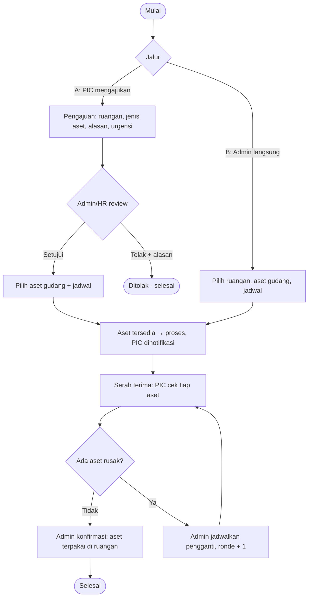
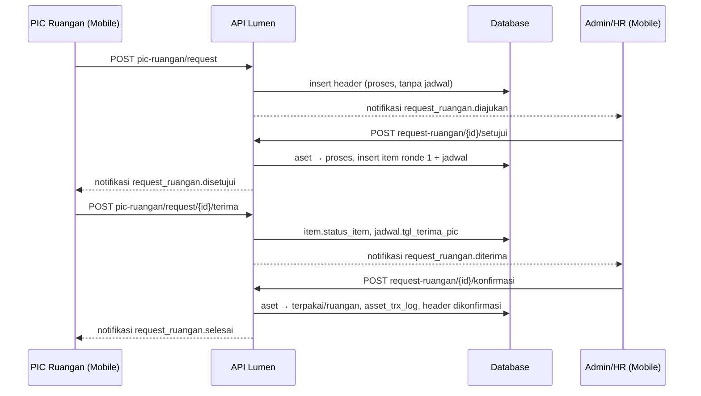
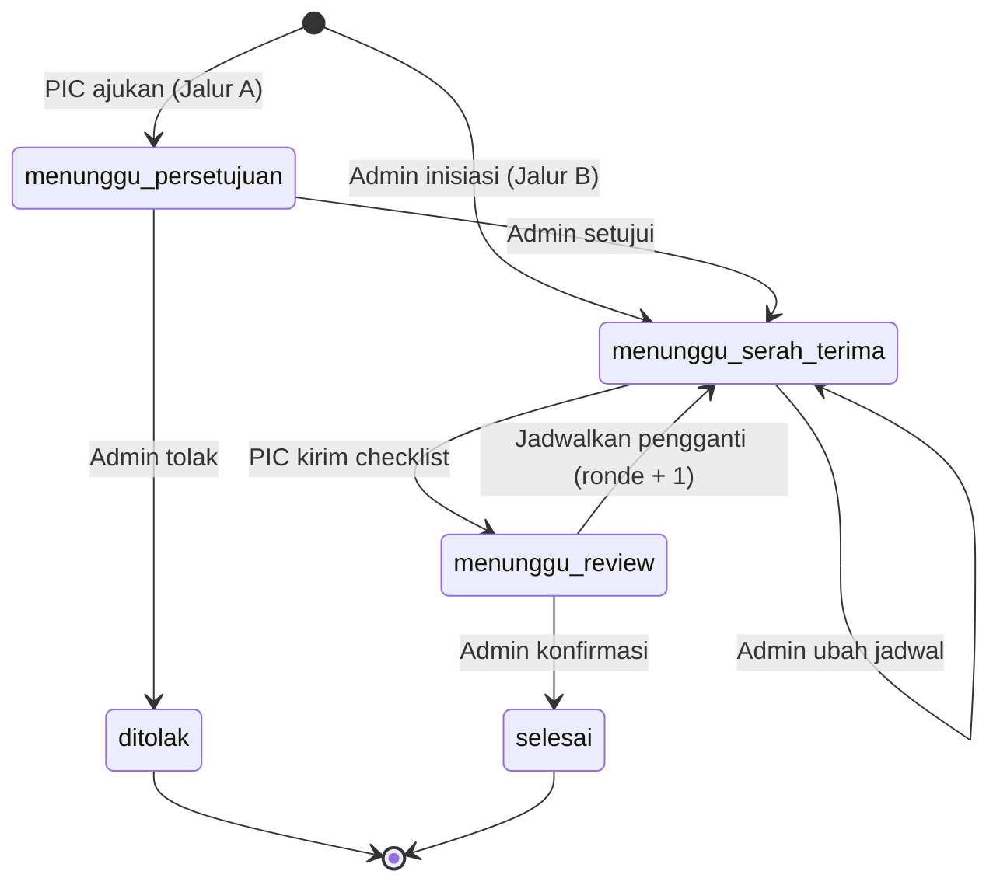
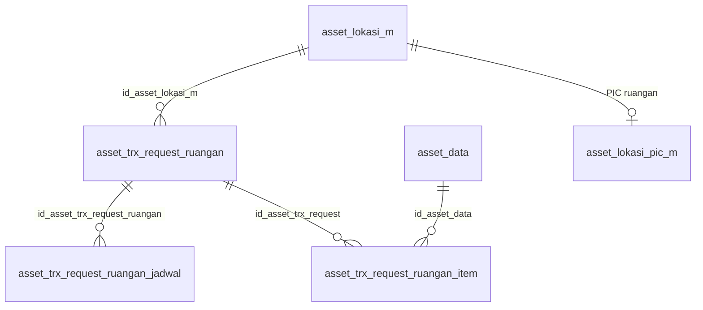

# Dokumentasi Teknis & Manual Book — Penambahan Asset ke Ruangan Aktif (ALK-RGN04)

> Dokumen ini disusun **dari source code lokal** (`API/` Lumen dan `MOBILE/` Flutter) per 14 Oktober 2026, dibandingkan dengan dokumen bisnis **"2.4 Ruangan - Penambahan Aset ke Ruangan Aktif (ALK-RGN04)" v1.0**.
> Cakupan implementasi: penambahan aset gudang ke **ruangan yang sudah aktif**, lewat pengajuan **PIC Ruangan** (Jalur A) atau inisiasi langsung **Admin/HR** (Jalur B). Bagian yang tidak ditemukan ditandai **⚠️ Belum ditemukan**, asumsi ditandai **⚠️ Asumsi**.
> Contoh ID/nama pada payload adalah **data sintetis**.

---

## 1. Informasi Dokumen

| Informasi | Nilai |
|---|---|
| Nama Fitur | Penambahan Asset ke Ruangan Aktif (UI Admin: item **"Penambahan"** di dashboard Ruangan; UI PIC: tombol **"Ajukan Penambahan Asset"** dan banner di halaman **"PIC Ruangan"**) |
| Kode Fitur | **ALK-RGN04** (nomor transaksi `RGN04-YYYYMMNNN`) |
| Modul | Asset Management — Ruangan |
| Backend | Laravel **Lumen ^10.0**, PHP ^8.1, JWT, Query Builder |
| Database | `API/diagram-asset.dbml` (tanda `[REVISI ALK-RGN04]`) + SQL manual `Claude outputs/sql-alk-rgn04-request-penambahan-ruangan.sql` |
| Mobile | Flutter (`professional_flutter_3_35`), `flutter_bloc`, `dio` |
| Web | ⚠️ Belum ditemukan: tidak ada source web di workspace |
| Test otomatis | API `tests/Asset/AssetRequestRuanganTest.php` (12 test) · Mobile `test/asset/asset_request_ruangan_test.dart` (11 test) |
| Versi dokumen | 1.0 — 14 Oktober 2026 |
| Dokumen terkait | Onboarding Ruangan (ALK-RGN01), Request & Penambahan Karyawan (KRY-03-1), Master Lokasi & PIC Ruangan |

## 2. Daftar Isi

Lihat panel navigasi di samping.

## 3. Quick Overview

Ruangan yang sudah beroperasi bisa **ditambah aset** lewat dua jalur dalam **satu tabel** (`asset_trx_request_ruangan`), dibedakan kolom `sumber_pengajuan` seperti request karyawan KRY-03-1. Pada **Jalur A** PIC Ruangan mengajukan (jenis aset, alasan, urgensi); Admin/HR menyetujui dengan memilih aset gudang dan jadwal, atau menolak dengan alasan. Pada **Jalur B** Admin/HR langsung memilih aset dan jadwal tanpa persetujuan. Setelah dijadwalkan, alurnya sama dengan RGN01: aset gudang `tersedia` → `proses`, PIC menilai **setiap aset Normal atau Rusak**, Admin/HR mereview lalu **mengonfirmasi** (aset menjadi `terpakai` di ruangan) atau **menjadwalkan pengganti** untuk aset rusak (ronde berikutnya) sampai semua normal.

| Aspek | Ringkasan |
|---|---|
| Aktor | Admin/HR (Admin Asset), PIC Ruangan, Sistem |
| Jalur | A = `sumber_pengajuan='karyawan'` (PIC mengajukan) · B = `sumber_pengajuan='admin'` (Admin langsung) |
| Fase (diturunkan dari data) | `menunggu_persetujuan` → `menunggu_serah_terima` → `menunggu_review` → `selesai`; cabang `ditolak` (Jalur A) |
| Status header | `status_approval`: `proses` → `dikonfirmasi` atau `ditolak` (enum `status_request_karyawan`, sama dengan KRY-03-1) |
| Status asset | `tersedia` → `proses` → `terpakai` (pemegang `ruangan`); aset rusak → `rusak` (kembali ke gudang) |
| Endpoint | 9 admin + 5 PIC |
| Notifikasi | 8 event (`request_ruangan.*`) |

## 4. Ringkasan Fitur

| Fitur | Aktor | Keterangan |
|---|---|---|
| Ajukan penambahan aset | PIC Ruangan | Pilih ruangan miliknya, jenis aset (kategori), alasan, urgensi. Status `proses`, belum ada jadwal. |
| Setujui pengajuan | Admin/HR | Memilih aset gudang `tersedia` + jadwal. Aset menjadi `proses`, PIC dinotifikasi. |
| Tolak pengajuan | Admin/HR | Alasan penolakan wajib. Status `ditolak`, tidak ada aset yang dikunci. |
| Inisiasi langsung | Admin/HR | Memilih ruangan aktif, aset, jadwal. PIC otomatis dari master PIC ruangan. |
| Ubah jadwal | Admin/HR | Selama PIC belum menerima. Riwayat jadwal bertambah satu baris. |
| Serah terima | PIC Ruangan | Checklist Normal/Rusak per aset; keterangan wajib bila rusak. |
| Jadwalkan pengganti | Admin/HR | Wajib mengganti semua aset rusak ronde ini; ronde bertambah. |
| Konfirmasi selesai | Admin/HR | Semua aset aktif menjadi `terpakai` di ruangan + log aset. |

## 5. Tujuan Fitur

- Menambah aset ke ruangan yang sudah aktif tanpa mengulang onboarding ruangan (RGN01).
- Memberi PIC Ruangan jalur resmi untuk meminta aset tambahan, lengkap dengan alasan dan urgensi.
- Memberi Admin/HR keputusan terdokumentasi: setujui (dengan aset dan jadwal) atau tolak (dengan alasan).
- Memastikan serah terima fisik tercatat (waktu dan identitas PIC) dan aset rusak diganti sebelum selesai.

## 6. Aktor

| Aktor | Peran |
|---|---|
| Admin/HR | Terdaftar di `asset_admin`. Menginisiasi (Jalur B), menyetujui/menolak (Jalur A), memilih aset, menetapkan dan mengubah jadwal, mereview checklist, menjadwalkan pengganti, mengonfirmasi. |
| PIC Ruangan | Karyawan di `asset_lokasi_pic_m` untuk ruangan tersebut. Mengajukan (Jalur A), menerima aset, mengisi checklist. |
| Sistem | Mengunci aset (`proses`), menurunkan fase dari data, mencatat log aset, mengirim notifikasi. |

## 7. Hak Akses

| Aksi | Admin/HR | PIC Ruangan | Keterangan |
|---|---|---|---|
| Lihat opsi/daftar/detail (admin) | ✔ | ✘ | `accessError` memeriksa `asset_admin`. |
| Inisiasi, setujui, tolak, ubah jadwal, pengganti, konfirmasi | ✔ | ✘ | Model memeriksa `findAssetAdmin`; pesan `Pengguna tidak terdaftar sebagai admin asset.` |
| Ajukan penambahan | ✘ | ✔ | Hanya untuk ruangan yang PIC-nya pengaju. |
| Lihat detail/daftar milik sendiri | ✘ | ✔ | Filter `id_karyawan_pic` = pengguna. PIC lain mendapat `NOT_FOUND`. |
| Terima & kirim checklist | ✘ | ✔ | Hanya PIC transaksi tersebut. |

## 8. Terminologi

| Istilah | Arti |
|---|---|
| Jalur A / Jalur B | Pengajuan PIC (`sumber_pengajuan='karyawan'`) / inisiasi Admin (`'admin'`). |
| Ronde | Putaran serah terima. Ronde 1 = aset awal; ronde berikutnya = unit pengganti. |
| Fase | Posisi alur yang **diturunkan dari data**, bukan kolom: lihat §14. |
| `parent_id` | Pada baris pengganti berisi id baris aset rusak yang digantikan. |
| DIALOKASIKAN | Istilah dokumen bisnis; di sistem = `asset_data.status_asset='proses'`. |
| Ruangan aktif | `asset_lokasi_m.tipe='ruangan'`, `status_aktif='1'`, punya PIC, dan sudah beroperasi (lihat §9). |

## 9. Business Rules

| No | Aturan | Implementasi |
|---|---|---|
| BR-01 | Hanya ruangan aktif yang bisa ditambah aset | `ruanganAktif()`: tipe `ruangan`, `status_aktif='1'`, ada baris `asset_lokasi_pic_m`. |
| BR-02 | Ruangan harus sudah beroperasi | Ada onboarding `dikonfirmasi` untuk ruangan itu **atau** ada `asset_data` dengan `pemegang_asset='ruangan'` di ruangan itu. |
| BR-03 | PIC pengaju harus PIC ruangan tersebut | `ajukanPic` memakai `ruanganAktif($idCompany, $idKaryawan)`; ruangan lain ditolak. |
| BR-04 | Pengajuan wajib berisi jenis aset, alasan, urgensi | Jenis aset harus ada di `asset_kategori_m`; alasan tidak kosong; urgensi ∈ `normal`, `secepatnya`, `mendesak`. |
| BR-05 | Jalur B tidak perlu persetujuan | `storeAdmin` langsung membuat item + jadwal + mengunci aset. |
| BR-06 | Penolakan wajib beralasan | `tolak` menolak alasan kosong (`Alasan penolakan wajib diisi.`). |
| BR-07 | Hanya aset `tersedia` di gudang yang dipilih | `getLockedAssets`: `status_asset='tersedia'` dan `pemegang_asset='gudang'`, dikunci `FOR UPDATE`. |
| BR-08 | Aset dipilih → langsung `proses` | `alokasikan()` mengubah status saat disetujui / diinisiasi. |
| BR-09 | PIC Jalur B = PIC master ruangan | `storeAdmin` mengambil PIC dari `asset_lokasi_pic_m`; Admin tidak dapat memilih PIC lain. |
| BR-10 | Jadwal tidak boleh sebelum tanggal pengajuan | `parseJadwalValue`: `Tanggal serah terima tidak boleh sebelum tanggal pengajuan.` |
| BR-11 | Jadwal hanya bisa diubah sebelum PIC menerima | Fase harus `menunggu_serah_terima`. |
| BR-12 | PIC wajib mengecek seluruh aset ronde berjalan | Jumlah dan id item harus lengkap; rusak wajib keterangan. |
| BR-13 | Tidak boleh selesai selama ada aset rusak | `konfirmasi` menolak bila `asetRusakRondeIni` tidak kosong. |
| BR-14 | Semua aset rusak wajib diganti sekaligus | `jadwalkanPengganti` mensyaratkan id item rusak = id item pengganti; pengganti tidak boleh ganda. |
| BR-15 | Setiap tindakan mencatat waktu dan pelaku | `user_input`, `user_approval`, `tgl_approval`, `tgl_terima_pic`, `asset_trx_log`. |

## 10. Business Flow

1. **Jalur A.** PIC mengisi form (ruangan, jenis aset, alasan, urgensi) dan mengirim. Admin/HR dinotifikasi (`request_ruangan.diajukan`).
2. Admin/HR membuka tab **Pengajuan**, mereview.
   - **Tolak:** isi alasan → status `ditolak`, PIC dinotifikasi. Selesai.
   - **Setujui:** pilih aset gudang dan jadwal → aset `proses`, item ronde 1 dan jadwal dibuat, PIC dinotifikasi (`disetujui`).
3. **Jalur B.** Admin/HR memilih ruangan aktif, aset, jadwal → langsung seperti langkah setujui; PIC dinotifikasi (`dikirim`).
4. Pada jadwal, HR menyerahkan aset di ruangan. PIC menilai tiap aset Normal/Rusak lalu **Terima & Kirim Checklist**. Admin dinotifikasi (`diterima`).
5. Admin/HR mereview:
   - Semua normal → **Konfirmasi Selesai**: aset `terpakai` di ruangan, log aset dicatat, PIC dinotifikasi (`selesai`).
   - Ada rusak → **Jadwalkan Pengganti**: aset rusak → `rusak` (gudang), pengganti → `proses`, item ronde + 1, jadwal baru; PIC dinotifikasi (`pengganti`). Kembali ke langkah 4.

## 11. Flow Berdasarkan Role

| Role | Langkah |
|---|---|
| PIC Ruangan | Ajukan → (tunggu keputusan) → terima notifikasi jadwal → periksa fisik → isi checklist → kirim → (bila ada pengganti, ulangi) → selesai. |
| Admin/HR | Tab Pengajuan → setujui/tolak → (tab Proses) ubah jadwal bila perlu → review checklist → konfirmasi atau jadwalkan pengganti → selesai. Atau tombol **Tambah Asset** untuk Jalur B. |
| Sistem | Mengunci/melepas aset, menurunkan fase, mencatat log, mengirim notifikasi. |

## 12. Flow Diagram



## 13. Sequence Diagram



## 14. Status Transaksi

Hanya `status_approval` yang disimpan. Fase diturunkan dari status header dan jadwal ronde terakhir.

| Fase | Kondisi data | Label |
|---|---|---|
| `menunggu_persetujuan` | `proses` dan **belum ada** baris jadwal (hanya Jalur A) | Menunggu Persetujuan |
| `menunggu_serah_terima` | `proses`, jadwal ronde terakhir `tgl_terima_pic` kosong | Menunggu Serah Terima |
| `menunggu_review` | `proses`, jadwal ronde terakhir `tgl_terima_pic` terisi | Menunggu Review Admin |
| `ditolak` | `status_approval='ditolak'` | Ditolak |
| `selesai` | `status_approval='dikonfirmasi'` | Selesai |

`draft` ada di enum tetapi tidak dipakai alur ini. Status aset: lihat §22.

## 15. State Transition



## 16. Struktur Database

| Tabel | Fungsi |
|---|---|
| `asset_trx_request_ruangan` | Header transaksi (kedua jalur). |
| `asset_trx_request_ruangan_jadwal` | Riwayat jadwal serah terima per ronde (append-only). |
| `asset_trx_request_ruangan_item` | Satu baris per aset utama; rantai penggantian lewat `parent_id`. |

Tabel lama `asset_trx_penambahan_ruangan` (+ `_item`) digantikan; perintah `DROP`-nya tersedia di SQL tetapi **dikomentari** dan datanya tidak dimigrasi.

## 17. Relasi Database



PIC pada header disimpan sebagai `id_karyawan_pic` (snapshot `nama_pic`, `nik_pic`); master PIC dibaca dari `asset_lokasi_pic_m`.

## 18. Data Dictionary

**`asset_trx_request_ruangan`**

| Kolom | Tipe | Keterangan |
|---|---|---|
| `id_asset_trx_request_ruangan` | varchar(50) PK | `id_company` + `YYYYMM` + 3 digit urut |
| `no_trx` | varchar(50) unik | `RGN04-YYYYMMNNN` |
| `sumber_pengajuan` | enum(`admin`,`karyawan`) | Jalur B / Jalur A |
| `id_asset_lokasi_m` + snapshot `nama_asset_ruangan`, `nama_cabang`, `nama_departemen` | varchar | Ruangan tujuan |
| `id_karyawan_pic`, `nama_pic`, `nik_pic` | varchar | PIC penerima/pengaju; dasar notifikasi dan hak akses |
| `id_asset_kategori_m`, `nama_kategori` | varchar | Jenis aset yang diminta (Jalur A); kosong pada Jalur B |
| `keterangan` | text | Jalur A: alasan (wajib). Jalur B: catatan opsional |
| `urgensi` | varchar(50) | `normal` / `secepatnya` / `mendesak` (Jalur A) |
| `ket_tolak` | varchar(255) | Alasan penolakan |
| `id_karyawan`, `nik_karyawan`, `nama_karyawan` | varchar | Pembuat transaksi (PIC pada Jalur A, Admin pada Jalur B) |
| `tgl_pengajuan` | date | Default tanggal hari ini |
| `tgl_serah_terima`, `jam_serah_terima` | date / time, NULL | Jadwal **terkini** (salinan baris jadwal terakhir) |
| `keterangan_serah_terima` | varchar(255) | Catatan untuk PIC |
| `status_approval` | enum(`draft`,`proses`,`ditolak`,`dikonfirmasi`) | Default `proses` |
| `user_approval`, `tgl_approval` | varchar / timestamp NULL | Diisi saat disetujui, ditolak, dan dikonfirmasi |
| `id_company`, `tgl_input`, `user_input`, `tgl_update`, `user_update` | | Audit standar |

**`asset_trx_request_ruangan_jadwal`**: `id_..._jadwal` (PK), `id_asset_trx_request_ruangan`, `ronde`, `tanggal`, `jam`, `tgl_terima_pic` (NULL = belum diterima), `keterangan`, audit.

**`asset_trx_request_ruangan_item`**: `id_asset_trx_request_item` (PK), `id_asset_trx_request`, `parent_id` (default `''`), `id_asset_data`, snapshot `nama_asset`, `deskripsi_asset`, `kategori_asset`, `ronde`, `status_item` (`normal`/`rusak`/`belum_dicek`), `ket_rusak`, audit.

## 19. Database Index

| Tabel | Index | Kegunaan |
|---|---|---|
| `asset_trx_request_ruangan` | unik `uq_req_rgn_no_trx (no_trx)` | Nomor transaksi unik |
| | `idx_req_rgn_status (id_company, sumber_pengajuan, status_approval, tgl_approval, tgl_input, id)` | Daftar admin per tab |
| | `idx_req_rgn_pic (id_company, id_karyawan_pic, status_approval)` | Daftar dan beranda PIC |
| | `idx_req_rgn_lokasi (id_company, id_asset_lokasi_m, status_approval)` | Pencarian per ruangan |
| `..._jadwal` | `idx_req_rgn_jadwal_trx (id_asset_trx_request_ruangan, ronde, id_company)` | Jadwal ronde terakhir |
| `..._item` | `idx_req_rgn_item_trx (id_asset_trx_request, id_company, status_item, parent_id)` | Checklist dan rantai pengganti |
| | `idx_req_rgn_item_asset (id_asset_data, id_company)` | Pencarian per aset |

## 20. Backend Architecture

| Lapisan | File |
|---|---|
| Route | `API/routes/modules/asset/RouteAsset.php` (`request-ruangan/*`, `karyawan/pic-ruangan/request*`) |
| Controller Admin | `app/Http/Controllers/Asset/Admin/AssetAdminRequestRuangan_c.php` |
| Controller PIC | `app/Http/Controllers/Asset/Karyawan/AssetKaryawanRequestRuangan_c.php` |
| Model | `app/Models/Asset/AssetRequestRuangan_m.php` (admin + PIC; mewarisi `Asset_m`) |
| Notifikasi | `app/Support/Asset/AssetNotification.php` (event `request_ruangan.*`) |
| Pendukung | `AssetAdminRuangan_m::getOptions` (aset gudang + kategori), `AssetLokasiPic_m::getAssetRuanganSaya` (beranda PIC memuat `request_ruangan`) |

Controller memvalidasi input, memanggil model dalam `DB::transaction`, lalu mengirim notifikasi **setelah** transaksi sukses. Aksi admin memakai `mutateAssetTrx`.

## 21. Backend Business Logic

- **`ajukanPic`**: kunci company; validasi karyawan aktif, ruangan milik PIC (BR-03), kategori, alasan, urgensi; buat header `proses` tanpa jadwal.
- **`storeAdmin`**: validasi admin dan ruangan; PIC dari master ruangan; buat header lalu `alokasikan()`.
- **`setujui`**: header harus fase `menunggu_persetujuan`; `alokasikan()`; isi `user_approval` dan `tgl_approval`.
- **`alokasikan`**: kunci aset `tersedia` (`FOR UPDATE`), pastikan jumlah sama dengan yang diminta, buat item ronde 1 (`belum_dicek`) + jadwal ronde 1, isi jadwal terkini di header, set aset `proses`.
- **`tolak`**: fase harus `menunggu_persetujuan`; alasan wajib; status `ditolak`. Tidak ada aset yang berubah.
- **`updateJadwal`**: fase `menunggu_serah_terima`; tambah baris jadwal; perbarui jadwal terkini header.
- **`terima`** (PIC): fase `menunggu_serah_terima`; semua item ronde harus dicek; isi `status_item`/`ket_rusak`; isi `tgl_terima_pic` pada jadwal terakhir. Status aset **tidak berubah** di sini.
- **`jadwalkanPengganti`**: fase `menunggu_review`; semua aset rusak ronde ini wajib punya pengganti unik; aset rusak → `rusak`, `id_pemegang_asset=''`; pengganti → `proses`; item ronde + 1 dengan `parent_id`; jadwal baru.
- **`konfirmasi`**: fase `menunggu_review` dan tidak ada aset rusak aktif; aset aktif (belum digantikan) → `terpakai`, `pemegang_asset='ruangan'`, `id_pemegang_asset` dan `id_asset_lokasi_m` = ruangan; `asset_trx_log` jenis `penambahan_ruangan`; header `dikonfirmasi`.

## 22. Dampak terhadap asset_data

| Tahap | `status_asset` | `pemegang_asset` | Catatan |
|---|---|---|---|
| Dipilih (setujui / Jalur B) | `tersedia` → `proses` | `gudang` | Tidak bisa dialokasikan ganda |
| PIC kirim checklist | tetap `proses` | `gudang` | Menunggu review |
| Aset rusak diganti | `proses` → `rusak` | `gudang` (`id_pemegang_asset` dikosongkan) | `ket_rusak` diisi dari checklist |
| Unit pengganti dipilih | `tersedia` → `proses` | `gudang` | Item ronde + 1 |
| Konfirmasi | `proses` → `terpakai` | `ruangan` | `id_pemegang_asset` = `id_asset_lokasi_m` = ruangan; log `penambahan_ruangan` |
| Pengajuan ditolak | tidak berubah | | Belum ada aset terkunci |

## 23. API Documentation

Base `asset/`. Semua memakai JWT dan envelope `ApiResponse`.

| ID | Method | Path | Peran | Fungsi |
|---|---|---|---|---|
| API-01 | GET | `request-ruangan/options` | Admin | Aset gudang, kategori, ruangan aktif |
| API-02 | GET | `request-ruangan?tab&limit&offset` | Admin | Daftar (`pengajuan`/`proses`/`selesai`) |
| API-03 | GET | `request-ruangan/{id}` | Admin | Detail + flag aksi |
| API-04 | POST | `request-ruangan` | Admin | Jalur B: kirim aset langsung |
| API-05 | POST | `request-ruangan/{id}/setujui` | Admin | Jalur A: setujui + aset + jadwal |
| API-06 | POST | `request-ruangan/{id}/tolak` | Admin | Jalur A: tolak + alasan |
| API-07 | PUT | `request-ruangan/{id}/jadwal` | Admin | Ubah jadwal |
| API-08 | POST | `request-ruangan/{id}/pengganti` | Admin | Jadwalkan pengganti |
| API-09 | POST | `request-ruangan/{id}/konfirmasi` | Admin | Konfirmasi selesai |
| API-10 | GET | `karyawan/pic-ruangan/request/options` | PIC | Ruangan miliknya, kategori, urgensi |
| API-11 | GET | `karyawan/pic-ruangan/request?tab` | PIC | Daftar milik PIC (`proses`/`selesai`) |
| API-12 | POST | `karyawan/pic-ruangan/request` | PIC | Ajukan penambahan |
| API-13 | GET | `karyawan/pic-ruangan/request/{id}` | PIC | Detail |
| API-14 | POST | `karyawan/pic-ruangan/request/{id}/terima` | PIC | Kirim checklist |

Tambahan: `GET karyawan/pic-ruangan` (beranda PIC) kini menyertakan key `request_ruangan`.

## 24. Detail Setiap API

**API-04 · POST `asset/request-ruangan`** (Jalur B)

```json
{ "id_asset_lokasi_m": "RGN-1", "asset_ids": ["AST-1", "AST-2"],
  "tanggal": "2026-10-20", "jam": "09:00", "catatan": "Bawa kunci", "keterangan": "" }
```
Respons `CREATED`: `{ "id": "COMP202610001", "no_trx": "RGN04-202610001", "fase": "menunggu_serah_terima" }`. Validasi: `asset_ids` wajib, minimal 1, tidak boleh ganda; `tanggal` `Y-m-d`; `jam` `H:i`.

**API-12 · POST `asset/karyawan/pic-ruangan/request`** (Jalur A)

```json
{ "id_asset_lokasi_m": "RGN-1", "id_asset_kategori_m": "KAT-KOM",
  "keterangan": "Tim bertambah dua orang", "urgensi": "mendesak" }
```
Respons `CREATED`: `{ "id": "...", "no_trx": "RGN04-...", "fase": "menunggu_persetujuan" }`. `urgensi` ∈ `normal|secepatnya|mendesak`.

**API-05 · POST `.../{id}/setujui`**

```json
{ "asset_ids": ["AST-1"], "tanggal": "2026-10-20", "jam": "09:00", "catatan": "Bawa kunci" }
```
Respons `UPDATED`: `{ "id", "no_trx", "fase": "menunggu_serah_terima" }`.

**API-06 · POST `.../{id}/tolak`**: `{ "ket_tolak": "Stok kosong" }` → `{ "status_approval": "ditolak", "fase": "ditolak" }`.

**API-07 · PUT `.../{id}/jadwal`**: `{ "tanggal", "jam", "keterangan" }`.

**API-08 · POST `.../{id}/pengganti`**

```json
{ "items": [{ "id_item": "<id baris rusak>", "id_asset_data": "AST-3" }],
  "tanggal": "2026-10-22", "jam": "10:00", "keterangan": "Unit pengganti" }
```
Respons: `{ "ronde": 2, "jumlah_pengganti": 1 }`.

**API-14 · POST `.../request/{id}/terima`**

```json
{ "items": [
  { "id_item": "ITM-1", "status_item": "normal" },
  { "id_item": "ITM-2", "status_item": "rusak", "ket_rusak": "Layar retak" } ] }
```
Respons: `{ "ada_rusak": true, "fase": "menunggu_review" }`.

**API-03 / API-13 · Detail** mengembalikan: `id`, `no_trx`, `sumber_pengajuan`, ruangan + cabang + departemen, PIC, `nama_kategori`, `alasan`, `urgensi`, `ket_tolak`, `tgl_pengajuan`, jadwal terkini, `ronde`, `fase`, `fase_label`, `jadwal[]` (riwayat), `items[]` (`id_item`, `parent_id`, `nama_asset`, `ronde`, `status_item`, `ket_rusak`, `diganti`, `perlu_dicek`). Khusus admin ditambah `bisa_setujui`, `bisa_ubah_jadwal`, `bisa_konfirmasi`, `perlu_pengganti[]`; khusus PIC `bisa_diterima`.

## 25. Mobile Architecture

Flutter + `flutter_bloc` + `dio`. Halaman RGN01 **dipakai ulang lewat parameter** agar tidak menggandakan kode.

| Komponen | Cara pakai ulang |
|---|---|
| `AssetAdminRuanganApi(base:)` | `requestBase = 'asset/request-ruangan'`; metode baru `setujui`, `tolak` |
| `HalamanAssetAdminOnboardingRuangan(untukRequest:)` | Daftar dengan tab Pengajuan/Proses/Selesai |
| `HalamanAssetAdminAddOnboardingRuangan(untukRequest:)` | Form Jalur B tanpa pemilih PIC |
| `HalamanAssetAdminDetailOnboardingRuangan` | Mendeteksi `isRequest`; panel Setujui + dialog Tolak |
| `AssetPicRuanganDetailBloc(jenis:)` | `AssetPicRuanganJenis.request` memanggil endpoint request |

File baru: `Bloc/Asset/AssetPicRuanganRequestFormBloc.dart`, `UI/Modul/Asset/PicRuangan/HalamanAjukanRequestPicRuangan.dart`.

## 26. Mobile Screen

| Layar | Rute | Pengguna |
|---|---|---|
| Dashboard Ruangan → item **Penambahan** | `/asset_admin_request_ruangan` | Admin/HR |
| Daftar penambahan (3 tab) | `/asset_admin_request_ruangan` | Admin/HR |
| Form Tambah Asset (Jalur B) | `/asset_admin_add_request_ruangan` | Admin/HR |
| Detail penambahan | `/asset_admin_detail_request_ruangan` | Admin/HR |
| PIC Ruangan + banner + tombol Ajukan | `/asset_pic_ruangan` | PIC |
| Form Ajukan Penambahan | `/asset_pic_ruangan_ajukan` | PIC |
| Detail / serah terima | `/asset_pic_ruangan_request` | PIC |

Detail Admin menampilkan kartu info pengajuan (jenis aset, urgensi, alasan, penolakan), stepper, dan timeline per aset. Saat `bisa_setujui`, muncul panel pilih aset gudang + jadwal serta tombol **Tolak** dan **Setujui & Jadwalkan**.

## 27. Mobile → API

| Aksi di layar | Pemanggilan |
|---|---|
| Buka daftar / pindah tab | `getPage(tab)` → API-02 |
| Buka form Jalur B | `getOptions()` → API-01; kirim → `store` → API-04 |
| Buka detail Admin | `getDetail` → API-03 |
| Setujui | `setujui` → API-05 |
| Tolak | `tolak` → API-06 |
| Ubah jadwal / pengganti / konfirmasi | API-07 / API-08 / API-09 |
| Buka form Ajukan (PIC) | `getRequestOptions` → API-10; kirim → `ajukanRequest` → API-12 |
| Buka detail PIC | `getDetailRequest` → API-13; kirim checklist → `terimaPenambahan` → API-14 |
| Beranda PIC | `getHome` (`request_ruangan`) |

## 28. API → Mobile

Model: `mAssetPicRuangan.dart` (`AssetPicRuanganRequest`, `AssetPicRuanganRequestOptions`, `AssetPicRuanganAjukanRequest`, detail diperluas dengan `sumberPengajuan`, `namaKategori`, `alasan`, `urgensi`, `ketTolak`) dan `mAssetAdminRuangan.dart` (`AssetAdminRuanganSetujuiRequest`, `bisaSetujui`, daftar membaca key `requests` selain `onboardings`). Fase baru: `menunggu_persetujuan` dan `ditolak`.

## 29. Mapping Mobile → API → Database

| Mobile | API | Tabel yang ditulis |
|---|---|---|
| Kirim Pengajuan | API-12 | `asset_trx_request_ruangan` |
| Setujui & Jadwalkan | API-05 | `..._item`, `..._jadwal`, `asset_data`, header |
| Tolak | API-06 | header (`ket_tolak`, `status_approval`) |
| Tambah Asset (Jalur B) | API-04 | header, `..._item`, `..._jadwal`, `asset_data` |
| Ubah Jadwal | API-07 | `..._jadwal`, header |
| Terima & Kirim Checklist | API-14 | `..._item`, `..._jadwal.tgl_terima_pic` |
| Jadwalkan Pengganti | API-08 | `..._item`, `..._jadwal`, `asset_data` |
| Konfirmasi Selesai | API-09 | `asset_data`, `asset_trx_log`, header |

## 30. Mapping Database → API → Mobile

| Kolom | API | Tampilan |
|---|---|---|
| `sumber_pengajuan` | `sumber_pengajuan` | "Diajukan Oleh": PIC Ruangan / Admin/HR |
| `nama_kategori`, `urgensi`, `keterangan` | `nama_kategori`, `urgensi`, `alasan` | Kartu info pengajuan |
| `ket_tolak` | `ket_tolak` | Kotak merah "Alasan Penolakan" |
| jadwal terakhir + `tgl_terima_pic` | `fase` | Chip fase, stepper, banner beranda |
| `status_item`, `ket_rusak`, `parent_id`, `ronde` | `items[]` | Timeline per aset |

## 31. Validation

| Field | Aturan | Pesan |
|---|---|---|
| `id_asset_lokasi_m` | wajib | Ruangan wajib dipilih. |
| `id_asset_kategori_m` | wajib (Jalur A) | Jenis aset wajib dipilih. |
| `keterangan` | wajib, ≤ 1000 (Jalur A) | Alasan wajib diisi. |
| `urgensi` | wajib, ∈ 3 nilai (Jalur A) | Urgensi wajib dipilih. / Urgensi pengajuan tidak valid. |
| `asset_ids` | wajib, ≥ 1, tidak ganda | Minimal satu asset wajib dipilih. |
| `tanggal` / `jam` | wajib, `Y-m-d` / `H:i` | Tanggal/Jam serah terima wajib diisi. |
| `ket_tolak` | wajib, ≤ 255 | Alasan penolakan wajib diisi. |
| `items.*.status_item` | `normal` atau `rusak` | Kondisi item harus normal atau rusak. |
| `items.*.ket_rusak` | wajib bila rusak | Keterangan kerusakan wajib diisi. |

Mobile menampilkan error wajib pada form pengajuan (ruangan, jenis, urgensi, alasan) dan menonaktifkan tombol **Setujui** sampai aset dan jadwal dipilih serta tombol **Tolak** pada dialog sampai alasan diisi.

## 32. Error Handling

| Kondisi | Kode | Pesan |
|---|---|---|
| Pengguna bukan admin | `BUSINESS_RULE_VIOLATION` | Pengguna tidak terdaftar sebagai admin asset. |
| Ruangan tidak sah | `BUSINESS_RULE_VIOLATION` | Ruangan tujuan tidak ditemukan, tidak aktif, atau belum memiliki aset. |
| Aset tidak tersedia | `BUSINESS_RULE_VIOLATION` | Satu atau beberapa asset tidak tersedia untuk dialokasikan. |
| Disetujui/ditolak dua kali | `BUSINESS_RULE_VIOLATION` | Pengajuan sudah tidak menunggu persetujuan. |
| Transaksi sudah ditutup | `BUSINESS_RULE_VIOLATION` | Penambahan aset sudah selesai. |
| Ubah jadwal terlambat | `BUSINESS_RULE_VIOLATION` | Jadwal hanya dapat diubah sebelum PIC Ruangan menerima asset. |
| Konfirmasi dengan aset rusak | `BUSINESS_RULE_VIOLATION` | Masih ada asset rusak. Jadwalkan penggantian sebelum menyelesaikan penambahan. |
| Pengganti tidak lengkap | `BUSINESS_RULE_VIOLATION` | Seluruh asset rusak wajib diberi asset pengganti. |
| Transaksi/PIC lain | `NOT_FOUND` / `BUSINESS_RULE_VIOLATION` | Penambahan asset ruangan tidak ditemukan. |
| Kesalahan sistem | `SYSTEM_ERROR` | Terjadi kesalahan saat ... (detail di log). |

## 33. Audit Trail

- Header: `user_input`, `tgl_input`, `user_update`, `tgl_update`; `user_approval` + `tgl_approval` (setujui, tolak, konfirmasi).
- Jadwal: satu baris per penetapan/perubahan; `tgl_terima_pic` = waktu PIC menerima.
- Item: `user_input` per baris; rantai pengganti lewat `parent_id`.
- `asset_trx_log` jenis `penambahan_ruangan` saat konfirmasi (posisi `gudang` → `ruangan`).

## 34. Notification

| Event | Penerima | Isi |
|---|---|---|
| `request_ruangan.diajukan` | Admin/HR | PIC mengajukan penambahan |
| `request_ruangan.disetujui` | PIC | Pengajuan disetujui, cek jadwal |
| `request_ruangan.ditolak` | PIC | Pengajuan ditolak, lihat alasan |
| `request_ruangan.dikirim` | PIC | Admin mengirim aset (Jalur B), cek jadwal |
| `request_ruangan.jadwal_diubah` | PIC | Jadwal diperbarui |
| `request_ruangan.pengganti` | PIC | Pengganti dijadwalkan |
| `request_ruangan.selesai` | PIC | Serah terima dikonfirmasi |
| `request_ruangan.diterima` | Admin/HR | PIC mengirim checklist |

Rute tujuan di aplikasi: `asset_pic_ruangan_request` (PIC) dan `asset_admin_detail_request_ruangan` (Admin). Notifikasi dibuat setelah transaksi database sukses; kegagalan kirim tidak membatalkan transaksi.

## 35. Security

- JWT wajib; `ctx` memuat `id_company` dan `id_karyawan`. Seluruh query dibatasi `id_company`.
- Aksi admin memeriksa keanggotaan `asset_admin`; sisi PIC dibatasi `id_karyawan_pic`.
- Aset dikunci `FOR UPDATE` dan company dikunci per transaksi untuk mencegah alokasi ganda dan nomor ganda.
- Input divalidasi di controller dan model; tidak ada query mentah dari input pengguna.
- Foto/berkas: tidak dipakai di alur ini.

## 36. Manual Book User/Admin

**PIC Ruangan: mengajukan penambahan**
1. Buka **Asset → PIC Ruangan**, ketuk **Ajukan Penambahan Asset**.
2. Pilih **Ruangan**, **Jenis Asset**, **Urgensi**, isi **Alasan**, ketuk **Kirim Pengajuan**.
3. Pantau status di banner beranda ("Menunggu persetujuan Admin/HR"). Bila ditolak, alasan terlihat di detail.

**PIC Ruangan: menerima aset**
1. Setelah disetujui/dikirim, banner berubah menjadi serah terima dengan jadwal.
2. Pada jadwal, periksa fisik tiap aset, pilih **Normal** atau **Rusak** (isi keterangan bila rusak).
3. Ketuk **Terima & Kirim Checklist**. Checklist tidak dapat diubah setelah dikirim.

**Admin/HR: memproses pengajuan**
1. Buka **Asset → Ruangan → Penambahan**, tab **Pengajuan**, pilih transaksi.
2. Tinjau jenis aset, urgensi, alasan. Pilih **Tolak** (isi alasan) atau pilih aset gudang + tanggal + jam lalu **Setujui & Jadwalkan**.

**Admin/HR: inisiasi langsung (Jalur B)**
1. Di daftar Penambahan, ketuk **Tambah Asset**.
2. Pilih ruangan (PIC tampil otomatis), tambah aset, tetapkan jadwal, **Kirim ke PIC Ruangan**.

**Admin/HR: review**
1. Tab **Proses**, buka transaksi. Bila PIC belum menerima, **Ubah Jadwal** tersedia.
2. Setelah checklist masuk: semua normal → **Konfirmasi Selesai**; ada rusak → pilih pengganti untuk setiap aset rusak, tetapkan jadwal, **Jadwalkan Pengganti**.

## 37. Kondisi Button

| Tombol | Tampil bila | Aktif bila |
|---|---|---|
| Ajukan Penambahan Asset (PIC) | PIC memegang minimal satu ruangan | selalu |
| Kirim Pengajuan | di form | tidak sedang mengirim; bila ada isian kosong menampilkan error |
| Tolak | `bisa_setujui` | tidak sedang bekerja; di dialog aktif setelah alasan diisi |
| Setujui & Jadwalkan | `bisa_setujui` | ≥ 1 aset + tanggal + jam dipilih |
| Ubah Jadwal | `bisa_ubah_jadwal` | tidak sedang bekerja |
| Konfirmasi Selesai | `bisa_konfirmasi` | tidak sedang bekerja |
| Jadwalkan Pengganti | `perlu_pengganti` tidak kosong | semua aset rusak berpengganti + jadwal |
| Terima & Kirim Checklist | `bisa_diterima` | semua aset dicek (rusak wajib keterangan) |

## 38. Testing Scenario

Hasil terakhir: API 207 test di `tests/Asset` lolos; mobile 29 test ruangan lolos.

| ID | Skenario | Hasil yang diharapkan | Otomatis |
|---|---|---|---|
| TC-01 | Opsi admin/PIC | Hanya ruangan aktif, punya PIC, sudah beraset | ✔ API |
| TC-02 | Jalur B | Aset `proses`, item + jadwal terbuat, fase serah terima | ✔ API |
| TC-03 | Jalur B ruangan/aset/jadwal tidak sah | Ditolak dengan pesan, aset tetap `tersedia` | ✔ API |
| TC-04 | Jalur A pengajuan | Fase menunggu persetujuan, tanpa item, masuk tab Pengajuan | ✔ API |
| TC-05 | Jalur A validasi | Ruangan milik PIC lain, alasan/urgensi/jenis salah ditolak | ✔ API |
| TC-06 | Setujui | Aset `proses`, `user_approval` terisi, pindah ke tab Proses, setujui ulang ditolak | ✔ API |
| TC-07 | Tolak | Alasan wajib; status `ditolak`; PIC melihat alasan | ✔ API |
| TC-08 | Ubah jadwal | Berhasil sebelum PIC menerima, ditolak sesudahnya | ✔ API |
| TC-09 | Konfirmasi | Aset `terpakai` di ruangan, 2 baris log | ✔ API |
| TC-10 | Aset rusak | Konfirmasi ditolak, pengganti ronde 2, rantai `parent_id`, selesai | ✔ API |
| TC-11 | Checklist PIC | Wajib lengkap, rusak wajib keterangan, PIC lain ditolak | ✔ API |
| TC-12 | Hak akses | Non-admin ditolak; PIC hanya melihat miliknya | ✔ API |
| TC-13 | Form PIC | Error wajib, kirim payload benar | ✔ Mobile |
| TC-14 | Daftar admin | Tab Pengajuan, kartu fase, buka detail | ✔ Mobile |
| TC-15 | Detail admin | Tombol Tolak/Setujui, Setujui nonaktif sebelum pilih, tolak wajib alasan, tampil alasan penolakan | ✔ Mobile |
| TC-16 | Model | Parsing `request_ruangan`, `requests`, `bisa_setujui`, payload | ✔ Mobile |
| TC-17 | Push notifikasi end-to-end | Notif tiba dan membuka rute yang benar | ✘ manual |
| TC-18 | Alur penuh di server/emulator | Jalur A dan B sampai selesai | ✘ manual |

## 39. Temuan Ketidaksesuaian

Perbandingan dengan dokumen bisnis RGN04 v1.0.

| ID | Dokumen bisnis | Implementasi | Dampak |
|---|---|---|---|
| INC-01 | Header menulis **ALK-RGN03**, judul file RGN04; ruang lingkup memakai RGN04 juga untuk "Pelaporan Kerusakan" | Kode **RGN04** (keputusan pengguna); `no_trx` `RGN04-` | Dokumen bisnis perlu dirapikan |
| INC-02 | Checklist per Daftar Atribut (Aset Utama + Kelengkapan) | Satu baris per **aset utama**, seperti RGN01 | Kelengkapan tidak dinilai terpisah |
| INC-03 | Pre-condition 3: "Aset **pengganti** berstatus TERSEDIA" | Dibaca sebagai aset yang dipilih Admin harus `tersedia` | Salah ketik di dokumen |
| INC-04 | Jenis aset "Teks / Dropdown" | Dipilih dari kategori master (`asset_kategori_m`), id + nama disimpan | Seragam dengan request karyawan |
| INC-05 | Status "DIALOKASIKAN" | `asset_data.status_asset='proses'` | Tidak ada nilai enum baru |
| INC-06 | Tabel status: item rusak → RUSAK saat ditemukan | Aset rusak berubah `rusak` saat Admin menjadwalkan pengganti, bukan saat PIC mengirim | Aset tetap `proses` selama menunggu review |
| INC-07 | "Ruangan sudah memiliki aset" | Onboarding `dikonfirmasi` **atau** ada aset berpemegang ruangan itu | Mencakup ruangan yang diisi lewat jalur lain |
| INC-08 | Jalur B: Admin memilih ruangan | PIC tidak dapat dipilih; selalu PIC master ruangan | PIC wajib sudah ditetapkan |
| INC-09 | Skenario penolakan tidak ada di tabel status akhir | Status header `ditolak`, aset tidak berubah | Konsisten dengan alur |

## 40. Edge Case

| Kasus | Perilaku |
|---|---|
| Pengajuan lebih dari satu untuk ruangan yang sama | Diperbolehkan; tiap transaksi berdiri sendiri (RISK-004). |
| Dua admin menyetujui bersamaan | Header dikunci `FOR UPDATE`; yang kedua mendapat "sudah tidak menunggu persetujuan". |
| Dua admin memilih aset yang sama | Aset dikunci; yang kedua gagal "tidak tersedia". |
| Aset dipilih berkategori beda dari permintaan | Tidak dicegah (RISK-003). |
| Seluruh aset rusak pada satu ronde | Semua wajib diganti sekaligus; ronde bertambah satu. |
| Pengganti rusak lagi | Ronde berikutnya; rantai `parent_id` berlanjut. |
| PIC ruangan diganti saat transaksi berjalan | Transaksi tetap pada `id_karyawan_pic` saat dibuat. |
| Jadwal tanggal hari ini | Diizinkan; tanggal sebelum pengajuan ditolak. |
| Pengajuan ditolak | Tidak ada aset terkunci; tidak dapat dibuka kembali. |
| Daftar kosong | Teks "Belum ada penambahan asset ruangan." |

## 41. Potential Bug / Technical Risk

| ID | Tingkat | Risiko | Saran |
|---|---|---|---|
| RISK-001 | TINGGI | Bergantung pada SQL manual: `status_approval` harus enum (`proses`/`ditolak`/`dikonfirmasi`). Bila masih `tinyint`, penyimpanan gagal. | Jalankan blok 1b SQL dan verifikasi tipe kolom sebelum rilis. |
| RISK-002 | SEDANG | Belum ada pembatalan oleh Admin; transaksi tertahan menahan aset di `proses`. | Tambahkan aksi batal yang melepas aset. |
| RISK-003 | SEDANG | Aset yang disetujui tidak diperiksa sesuai kategori yang diminta. | Peringatan di UI atau validasi kategori. |
| RISK-004 | RENDAH | Pengajuan ganda untuk satu ruangan dibolehkan. | Batasi satu pengajuan aktif per ruangan bila diperlukan. |
| RISK-005 | SEDANG | Belum diuji di server/emulator nyata, termasuk push notifikasi dan rute notifikasi. | Uji alur penuh dua jalur. |
| RISK-006 | RENDAH | `sumber_pengajuan='karyawan'` dipakai untuk PIC (enum dipakai bersama KRY-03-1). | Dokumentasikan; ubah bila enum dipisah. |
| RISK-007 | RENDAH | Data lama `asset_trx_penambahan_ruangan` tidak dimigrasi dan tabelnya hanya dihapus manual. | Periksa jumlah baris sebelum `DROP`. |

## 42. Dependency

- **Data master**: `asset_lokasi_m` (tipe `ruangan`, `status_aktif`), `asset_lokasi_pic_m`, `asset_kategori_m`, `data_karyawan`, `asset_admin`.
- **Modul lain**: Onboarding Ruangan RGN01 (syarat ruangan beroperasi dan pola serah terima), `asset_data`, `asset_trx_log`, notifikasi (`notif_data`, FCM).
- **Berbagi komponen**: `AssetAdminRuangan_m::getOptions`, `showAssetOnboardingAssetPicker`, `showAssetPickerSheet`, timeline `AssetRuanganTimeline`.

## 43. Source Code Reference

| Area | File |
|---|---|
| Model API | `API/app/Models/Asset/AssetRequestRuangan_m.php` |
| Controller | `API/app/Http/Controllers/Asset/Admin/AssetAdminRequestRuangan_c.php`, `.../Karyawan/AssetKaryawanRequestRuangan_c.php` |
| Route | `API/routes/modules/asset/RouteAsset.php` |
| Notifikasi | `API/app/Support/Asset/AssetNotification.php` |
| Skema | `API/diagram-asset.dbml`, `Claude outputs/sql-alk-rgn04-request-penambahan-ruangan.sql` |
| Test API | `API/tests/Asset/AssetRequestRuanganTest.php` |
| Mobile model | `MOBILE/lib/Repository/Model/Asset/mAssetPicRuangan.dart`, `mAssetAdminRuangan.dart` |
| Mobile API | `MOBILE/lib/Repository/Service/assetPicRuanganApi.dart`, `assetAdminRuanganApi.dart` |
| Mobile bloc | `MOBILE/lib/Bloc/Asset/AssetPicRuanganDetailBloc.dart`, `AssetPicRuanganRequestFormBloc.dart`, `AssetAdminRuanganDetailBloc.dart` |
| Mobile UI | `MOBILE/lib/UI/Modul/Asset/PicRuangan/*`, `.../AssetAdmin/AssetAdminRuangan/*` |
| Navigasi | `MOBILE/lib/Bloc/NavigatorBloc.dart`, `MOBILE/lib/Setting/router.dart` |
| Teks | `MOBILE/assets/id/asset.json`, `assets/en/asset.json` (grup `menu_asset.pic_ruangan`) |
| Test mobile | `MOBILE/test/asset/asset_request_ruangan_test.dart` |

## 44. Developer Notes

- Skema mengikuti pola KRY-03-1: satu tabel dua jalur lewat `sumber_pengajuan`, enum status dipakai bersama.
- Fase tidak disimpan. Bila menambah fase, ubah `AssetRequestRuangan_m::fase()` dan stepper mobile (`langkahAktifRuangan`).
- Aset tidak berpindah pemegang sebelum konfirmasi; PIC mengirim checklist tanpa mengubah `asset_data`.
- `terimaPenambahan` (bukan `terimaRequest`) adalah nama metode API mobile agar tidak bentrok dengan field pada fake API di test.
- Hook GateGuard menolak pembuatan/edit pertama setiap file; ulangi percobaan.
- Master PIC ruangan adalah `asset_lokasi_pic_m` (komentar lama SQL RGN01 menyebut `asset_ruangan_pic_m`).

## 45. End-to-End Traceability

| Kebutuhan bisnis | Aturan | API | Mobile | Test |
|---|---|---|---|---|
| PIC mengajukan penambahan | BR-03, BR-04 | API-12 | Form Ajukan | TC-04, TC-05, TC-13 |
| Admin setujui + pilih aset + jadwal | BR-07, BR-08, BR-10 | API-05 | Panel Setujui | TC-06, TC-15 |
| Admin tolak dengan alasan | BR-06 | API-06 | Dialog Tolak | TC-07, TC-15 |
| Inisiasi langsung | BR-05, BR-09 | API-04 | Form Tambah Asset | TC-02, TC-03 |
| Serah terima + checklist | BR-12 | API-14 | Detail PIC | TC-11 |
| Aset rusak diganti | BR-13, BR-14 | API-08 | Panel Pengganti | TC-10 |
| Selesai: aset terpakai | BR-15 | API-09 | Konfirmasi | TC-09 |

## 46. Ringkasan Database Impact

| Tabel | Operasi |
|---|---|
| `asset_trx_request_ruangan` | INSERT (ajukan/inisiasi), UPDATE (jadwal terkini, setujui, tolak, konfirmasi) |
| `asset_trx_request_ruangan_jadwal` | INSERT (jadwal awal, ubah, pengganti), UPDATE `tgl_terima_pic` |
| `asset_trx_request_ruangan_item` | INSERT (ronde 1 dan pengganti), UPDATE `status_item`/`ket_rusak` |
| `asset_data` | UPDATE `status_asset`, `pemegang_asset`, `id_pemegang_asset`, `id_asset_lokasi_m`, `ket_rusak` |
| `asset_trx_log` | INSERT saat konfirmasi |
| `notif_data` | INSERT per notifikasi |
| `asset_trx_penambahan_ruangan` (+ `_item`) | Digantikan; `DROP` manual opsional |

## 47. Checklist Implementasi

- [x] DBML diperbarui (`[REVISI ALK-RGN04]`)
- [x] SQL manual dibuat (`sql-alk-rgn04-request-penambahan-ruangan.sql`)
- [ ] SQL manual dijalankan lengkap, `status_approval` bertipe enum (**periksa**)
- [ ] `DROP` tabel lama penambahan (hanya bila kosong)
- [x] Model, controller, route, notifikasi API
- [x] Test API (12) dan seluruh `tests/Asset` (207) lolos
- [x] Model, API client, bloc, halaman, route, teks mobile
- [x] Test mobile (11) dan 29 test ruangan lolos
- [ ] Uji di server/emulator, termasuk push notifikasi
- [ ] Pembatalan oleh Admin (belum ada)

## 48. Changelog

| Versi | Tanggal | Perubahan |
|---|---|---|
| 1.0 | 14 Oktober 2026 | Dokumen awal ALK-RGN04: skema satu tabel dua jalur, API admin dan PIC, mobile, notifikasi, test. |
