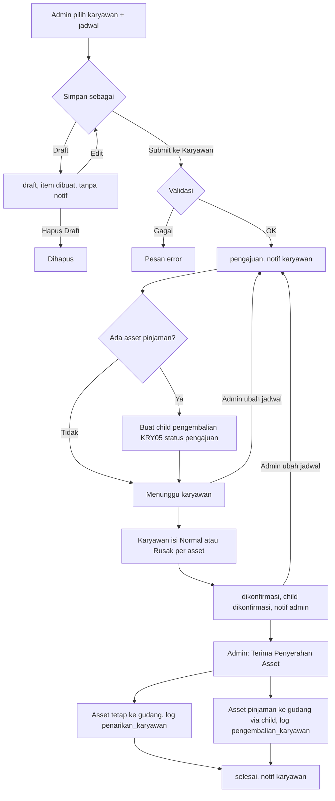
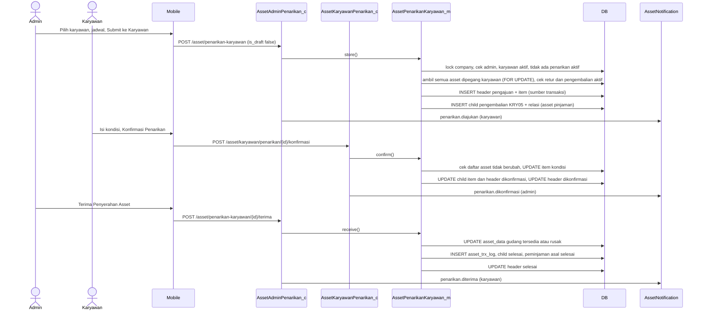
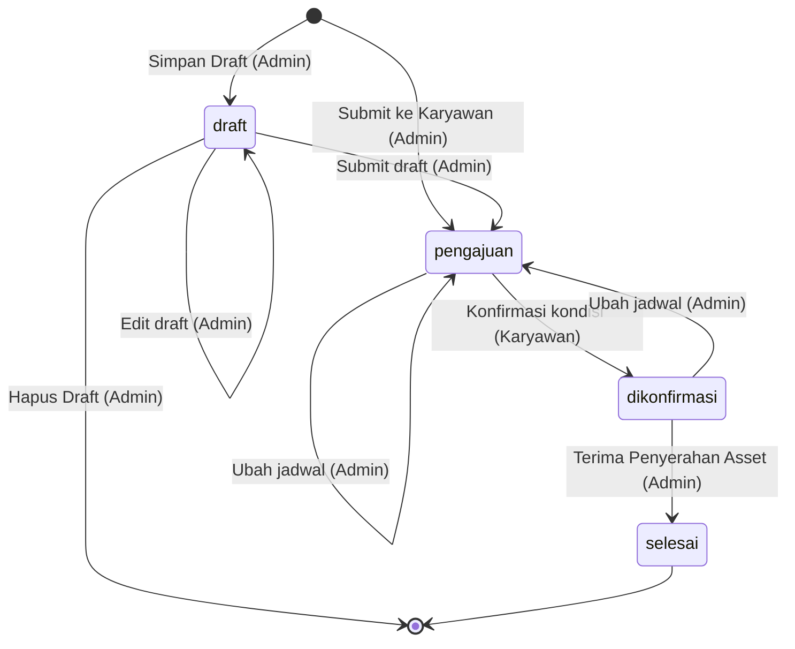
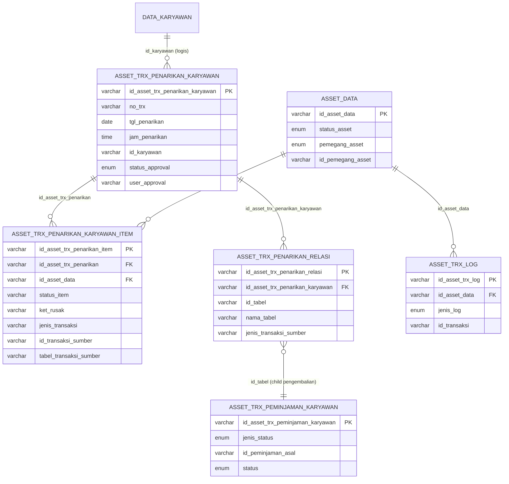

# Dokumentasi Teknis & Manual Book — Penarikan Asset Karyawan

> Dokumen ini disusun **murni dari source code lokal** (`API/` Lumen dan `MOBILE/` Flutter) per 28 September 2026.
> Business requirement dan kode fitur **diturunkan dari kode**. Bagian yang tidak ditemukan ditandai **⚠️ Belum ditemukan**, asumsi ditandai **⚠️ Asumsi**.
> Contoh ID/nama pada payload adalah **data sintetis**.

---

## 1. Informasi Dokumen

| Informasi | Nilai |
|---|---|
| Nama Fitur | Penarikan Asset Karyawan (UI: **"Penarikan Asset"**; menu karyawan **"Penarikan"** / en **"Retrieval"**; sebelumnya bernama Off Boarding) |
| Kode Fitur | **KRY02** (nomor transaksi `KRY02-YYYYMMNNN`) |
| Modul | Asset Management |
| Backend | Laravel **Lumen ^10.0**, PHP ^8.1, JWT, Query Builder |
| Database | `API/diagram-asset.dbml` + migration `2026_09_22_000001_create_asset_offboarding_tables.php` (nama lama, dibuat sebelum rename), `2026_11_16_000001_add_jenis_penarikan_to_offboarding_karyawan.php`, dan `2026_11_16_000002_rename_offboarding_to_penarikan_karyawan.php`; SQL manual `sql-offboarding-penarikan-sebagian.sql` dan `sql-rename-offboarding-ke-penarikan-karyawan.sql`. ⚠️ Asumsi: MySQL/MariaDB |
| Mobile | Flutter (`professional_flutter_3_35`), `flutter_bloc`, `dio` |
| Web | ⚠️ Belum ditemukan: tidak ada source web di workspace |
| Test otomatis | `API/tests/Asset/AssetPenarikanModelTest.php` (25 test), `AssetPenarikanRouteTest.php` (2), `PenarikanRenameMigrationTest.php` (2), `OffboardingStatusMigrationTest.php`, `OffboardingLegacyStatusMigrationTest.php`; MOBILE: `test/asset/asset_penarikan_{model,bloc,widget,route}_test.dart` (35 test) |
| Versi Dokumen | 2.0 |
| Tanggal Dokumentasi | 2026-11-16 |
| Dokumen terkait | Onboarding (KRY01), Request/Penambahan, Retur (KRY04), Peminjaman (KRY05), Kerusakan (KRY06), Upgrade (KRY03) |

---

## 2. Daftar Isi

1. Informasi Dokumen · 3. Quick Overview · 4. Ringkasan Fitur · 5. Tujuan · 6. Aktor · 7. Hak Akses · 8. Terminologi · 9. Business Rules · 10. Business Flow · 11. Flow per Role · 12. Flow Diagram · 13. Sequence Diagram · 14. Status Transaksi · 15. State Transition · 16. Struktur Database · 17. Relasi · 18. Data Dictionary · 19. Index · 20. Backend Architecture · 21. Backend Logic · 22. Dampak asset_data · 23. API · 24. Detail API · 25. Mobile Architecture · 26. Mobile Screen · 27. Mobile → API · 28. API → Mobile · 29. Mapping Mobile→API→DB · 30. Mapping DB→API→Mobile · 31. Validation · 32. Error Handling · 33. Audit Trail · 34. Notification · 35. Security · 36. Manual Book · 37. Kondisi Button · 38. Testing · 39. Temuan Ketidaksesuaian · 40. Edge Case · 41. Risk · 42. Dependency · 43. Source Reference · 44. Developer Notes · 45. Traceability · 46. DB Impact · 47. Checklist · 48. Changelog

---

## 3. Quick Overview

| Item | Informasi |
|---|---|
| Feature | Penarikan Asset Karyawan — penarikan asset yang dipegang karyawan ke gudang: **semua** asset atau **sebagian** asset yang dibawa |
| Module | Asset Management |
| Actor | Admin Asset (pembuat & penerima), Karyawan (konfirmasi kondisi), System |
| Main Transaction | `asset_trx_penarikan_karyawan` |
| Detail Transaction | `asset_trx_penarikan_karyawan_item` (satu baris per asset yang ditarik: semua asset bila `semua`, asset terpilih bila `sebagian`) |
| Relasi child | `asset_trx_penarikan_relasi` → transaksi **pengembalian pinjaman** (`asset_trx_peminjaman_karyawan`, `jenis_status = pengembalian`, KRY05) |
| Asset Master | `asset_data` |
| Log | `asset_trx_log`: `penarikan_karyawan` (asset tetap) dan `pengembalian_karyawan` (asset pinjaman) |
| Status | `draft → pengajuan → dikonfirmasi → selesai` (enum `PenarikanStatus`) |
| Inisiator | **Admin** (bukan karyawan) |
| Jenis penarikan | `semua` (default, seperti penarikan sebelumnya) atau `sebagian` (hanya asset yang dibawa, dipilih admin; asset pinjaman tidak ikut) |
| Konfirmasi kondisi | **Karyawan** mengisi Normal/Rusak per asset |
| Penyelesaian | **Admin** menekan **Terima Penyerahan Asset** |
| API | 9 endpoint admin + 3 endpoint karyawan |
| Mobile Screen | Admin: Penarikan Asset (list), Tambah Penarikan Asset (form/draft), Detail. Karyawan: Penarikan Asset (list), Detail + banner di Asset Saya |

```text
Admin: Pilih Karyawan + Jadwal Penyerahan (tanggal, jam) + Catatan
   ├─ Simpan Draft ─────────────────────────────────────────── draft (item sudah dibuat, asset "terkunci")
   └─ Submit ke Karyawan                                       pengajuan
        • jenis semua    : item = SEMUA asset yang dipegang karyawan (tetap + pinjaman)
        • jenis sebagian : item = asset yang DIBAWA dan dipilih admin (pinjaman tidak ikut)
        • asset pinjaman (jenis semua) → dibuatkan transaksi pengembalian KRY05 (child) otomatis
      │
      ▼  (Admin dapat Ubah Jadwal → kembali ke pengajuan)
Karyawan: isi kondisi tiap asset Normal / Rusak (+ keterangan) → Konfirmasi Penarikan
                                                               dikonfirmasi (child pengembalian → dikonfirmasi)
      │
      ▼
Admin: Terima Penyerahan Asset                                 selesai
   asset → gudang pilihan admin PER ASSET (tersedia / rusak) + asset_trx_log
   child pengembalian → selesai, peminjaman asal → selesai bila semua asset kembali
```

---

## 4. Ringkasan Fitur

Penarikan dipakai Admin Asset untuk **menarik asset** yang sedang dipegang seorang karyawan, baik **seluruhnya** (misalnya saat karyawan berhenti bekerja) maupun **sebagian** saja (hanya asset yang dibawa). Fitur ini sebelumnya bernama Off Boarding dan hanya mendukung penarikan seluruh asset. Berbeda dengan Retur (dipilih per asset oleh karyawan), Penarikan:

- **Dimulai admin**. Jenis `semua` otomatis mencakup **semua** asset yang `pemegang_asset = karyawan`, termasuk asset **pinjaman**. Jenis `sebagian` hanya mencakup asset **yang dibawa** (bukan pinjaman) yang dicentang admin.
- Dapat disimpan sebagai **Draft** (jadwal opsional) sebelum dikirim ke karyawan.
- Untuk asset pinjaman (jenis `semua`), sistem membuat **transaksi pengembalian pinjaman (KRY05) sebagai child** yang ikut bergerak bersama status penarikan, sehingga modul Peminjaman tetap konsisten.
- **Karyawan** yang menilai kondisi tiap asset (Normal/Rusak + keterangan); **admin** menutup transaksi dengan menerima asset secara fisik.

⚠️ Belum ditemukan: keterkaitan dengan proses HR (misalnya perubahan status karyawan menjadi resign). Penarikan **tidak** mengubah `data_karyawan`.

---

## 5. Tujuan Fitur

### 5.1 Tujuan Bisnis (diturunkan dari kode)
- Memastikan tidak ada asset perusahaan yang tertinggal pada karyawan yang keluar.
- Mendokumentasikan kondisi setiap asset saat diserahkan.
- Menjadwalkan waktu penyerahan yang disepakati.
- Menutup peminjaman aktif karyawan secara otomatis.

### 5.2 Tujuan Sistem
- Membuat snapshot seluruh asset yang dipegang karyawan beserta **sumber transaksinya** (onboarding/request/retur/peminjaman).
- Mencegah asset diproses di flow lain selama penarikan aktif.
- Memindahkan asset ke gudang dan mencatat `asset_trx_log`.
- Menjaga konsistensi dengan modul Peminjaman melalui transaksi child.

---

## 6. Aktor

| Aktor | Role | Fungsi |
|---|---|---|
| Admin Asset | `asset_admin` + karyawan aktif | Membuat/mengubah/menghapus draft, submit, ubah jadwal, menerima penyerahan |
| Karyawan | User login aktif, pemegang asset | Melihat penarikan miliknya, mengisi kondisi asset, konfirmasi |
| System | Backend + FCM | Validasi, lock, penomoran, deteksi sumber asset, transaksi child, update asset, log, notifikasi |

---

## 7. Hak Akses

| Action | Admin Asset | Karyawan | Keterangan |
|---|:---:|:---:|---|
| Melihat semua penarikan (termasuk draft) | ✅ | ❌ | `/asset/penarikan-karyawan` |
| Melihat penarikan sendiri | – | ✅ | Draft **tidak** terlihat karyawan |
| Membuat penarikan / draft | ✅ | ❌ | |
| Mengubah / menghapus draft | ✅ | ❌ | Hanya status `draft` |
| Membatalkan penarikan yang sudah disubmit | ❌ | ❌ | ⚠️ Belum ditemukan (RISK-003) |
| Ubah jadwal penyerahan | ✅ | ❌ | Status `pengajuan` / `dikonfirmasi` |
| Konfirmasi kondisi asset | ❌ | ✅ | Status `pengajuan`, karyawan harus **aktif** |
| Terima Penyerahan Asset | ✅ | ❌ | Status `dikonfirmasi` |
| Mengubah kondisi yang diisi karyawan | ❌ | – | ⚠️ Belum ditemukan (RISK-004) |

---

## 8. Terminologi

| Istilah | Arti di sistem |
|---|---|
| Penarikan | Transaksi penarikan asset karyawan ke gudang (KRY02); sebelumnya disebut Off Boarding / Off Board |
| Jadwal Penyerahan | `tgl_penarikan` + `jam_penarikan` |
| Draft | Penarikan tersimpan, belum dikirim ke karyawan; jadwal boleh kosong |
| Penarikan aktif | Status `draft`, `pengajuan`, atau `dikonfirmasi` |
| `jenis_penarikan` | `semua` (seluruh asset, termasuk pinjaman) atau `sebagian` (asset yang dibawa dan dipilih admin); enum DBML `cakupan_penarikan` |
| Asset dibawa | Asset yang dipegang karyawan dan **bukan** `status_asset = dipinjam`; satu-satunya asset yang boleh dipilih pada jenis `sebagian` |
| `jenis_transaksi` item | `onboarding` (asset tetap — termasuk hasil request/penambahan/retur) atau `peminjaman` |
| Sumber transaksi | `id_transaksi_sumber` + `tabel_transaksi_sumber`: transaksi yang membuat asset dipegang karyawan |
| Transaksi child | Header pengembalian pinjaman KRY05 yang dibuat otomatis oleh penarikan, dicatat di `asset_trx_penarikan_relasi` |
| `status_item` | `belum_dicek` → `normal` / `rusak` |

---

## 9. Business Rules

### BR-001 — Hanya admin yang membuat & menerima
Semua aksi admin memanggil `requireAdmin` → "Pengguna tidak terdaftar sebagai admin asset."

### BR-002 — Karyawan harus aktif dan memegang asset
Saat simpan/submit: "Karyawan tidak ditemukan atau tidak aktif." / "Karyawan tidak memiliki aset yang sedang dipegang." Opsi karyawan menampilkan karyawan aktif yang masih punya asset yang dapat ditarik (`bisa_penarikan_semua` atau `bisa_penarikan_sebagian`, lihat API-001).

### BR-003 — Penarikan aktif per karyawan: satu `semua` atau beberapa `sebagian`
Status aktif = `draft`, `pengajuan`, `dikonfirmasi`. Jenis `semua` ditolak bila karyawan punya penarikan aktif apa pun → "Karyawan masih memiliki penarikan aktif." Jenis `sebagian` ditolak bila karyawan punya penarikan `semua` aktif → "Karyawan masih memiliki penarikan aktif untuk semua aset.", atau bila salah satu aset terpilih sudah ada di item penarikan aktif lain → "Satu atau beberapa aset terpilih sudah ada pada penarikan aktif lain." Satu karyawan boleh punya beberapa penarikan `sebagian` aktif selama asetnya tidak tumpang tindih.

### BR-004 — Item = asset yang ditarik (semua atau sebagian)
`employeeAssets`: semua `asset_data` dengan `pemegang_asset = karyawan` dan `id_pemegang_asset = id_karyawan` (tanpa filter `status_asset`). Jenis `semua`: item = seluruh asset tersebut dan admin **tidak memilih** asset. Jenis `sebagian`: item = hanya asset yang dipilih admin (`id_asset_data[]`), lihat BR-015.

### BR-005 — Asset tidak boleh sedang diproses flow lain (`assertNoCrossFlow`)
Ditolak bila ada asset yang:
- berada di **retur aktif** (`status_transaksi = proses` dan `status_approval != ditolak`), atau
- berada di **pengembalian pinjaman** berstatus `pengajuan`/`dikonfirmasi`.

→ "Satu atau beberapa asset sedang diproses pada flow lain."

Selain itu (sejak v1.1) ditolak bila ada asset yang:
- berada di **upgrade aktif** (`hasActiveUpgradeAsset`) → "Satu atau beberapa asset sedang diproses pada upgrade."
- berada di **laporan kerusakan aktif** (`hasActiveRusakAsset`) → "Satu atau beberapa asset sedang diproses pada laporan kerusakan."
- berada di **pemeliharaan terjadwal aktif** PML01 (`hasActivePemeliharaanAsset`, fase ≠ `selesai`) → "Satu atau beberapa asset sedang diproses pada pemeliharaan."

Karena `employeeAssets` tidak memfilter status, asset `dalam_perbaikan` (sedang di teknisi lewat Upgrade atau PML01 mekanisme *diserahkan*) ikut tercek.

### BR-006 — Setiap asset harus punya sumber transaksi
`sourceForAsset` mencari berurutan: peminjaman aktif (bila `dipinjam`) → `asset_trx_log` terakhir ke karyawan → request/penambahan dikonfirmasi → onboarding dikonfirmasi → peminjaman aktif → fallback `asset_data` (data legacy). Pesan bila gagal: "Asset {nama} tidak memiliki sumber transaksi yang valid." (⚠️ praktis tidak terjadi karena ada fallback).

### BR-007 — Jadwal wajib saat submit, opsional saat draft
Controller: `tgl_penarikan` (Y-m-d) & `jam_penarikan` (H:i) `required` bila `is_draft = false`. Model: "Jadwal penarikan wajib diisi saat pengajuan." Backend **tidak** memvalidasi tanggal ≥ hari ini (mobile membatasi mulai hari ini).

### BR-008 — Draft hanya bisa diubah/dihapus saat berstatus draft
→ "Hanya penarikan berstatus draft yang dapat diubah." / "…dapat dihapus." Saat diubah, **seluruh item dibangun ulang** dari asset yang dipegang saat itu.

### BR-009 — Asset pinjaman menjadi transaksi child
Saat submit (bukan draft), per peminjaman sumber dibuat header pengembalian KRY05 (`jenis_status = pengembalian`, `status = pengajuan`, `keterangan_serah_terima = "Dibuat otomatis dari penarikan {id}"`) + item + baris `asset_trx_penarikan_relasi`. Pengembalian child **disembunyikan** dari list/pending admin Peminjaman dan **tidak dapat** dikonfirmasi lewat modul Peminjaman ("Pengembalian ini diproses melalui penarikan.").

### BR-010 — Ubah jadwal mengembalikan status ke pengajuan
Status `pengajuan`/`dikonfirmasi` → update jadwal, status → `pengajuan`, approval dikosongkan, child direset ke `pengajuan` dan kondisi item → `belum_dicek` (lihat INC-04). Status lain → "Jadwal penarikan sudah tidak dapat diubah."

### BR-011 — Konfirmasi karyawan
- Header harus milik karyawan dan berstatus `pengajuan` → "Penarikan tidak menunggu konfirmasi."
- Daftar asset yang dipegang saat ini harus **sama persis** dengan item → "Daftar asset yang dipegang karyawan sudah berubah."
- Semua item wajib diisi → "Seluruh kondisi asset penarikan wajib diisi."
- Kondisi `normal`/`rusak`; rusak wajib keterangan → "Keterangan kerusakan asset wajib diisi."
- Child pengembalian: item `normal → disetujui`, `rusak → ditolak` (+`ket_tolak` = keterangan rusak); header child → `dikonfirmasi`.
- Header → `dikonfirmasi`, `user_approval`/`tgl_approval` = karyawan.

### BR-012 — Penerimaan admin
- Status harus `dikonfirmasi` → "Penarikan belum dikonfirmasi karyawan."
- Daftar asset dipegang harus tetap sama; semua item `normal`/`rusak` → "Kondisi asset belum dikonfirmasi karyawan."
- Asset tetap: `rusak` → `status_asset = rusak` + `ket_rusak`; `normal` → `tersedia`; `pemegang = gudang`; log `penarikan_karyawan`.
- Asset pinjaman: diproses via child → asset ke gudang (tersedia/rusak), log `pengembalian_karyawan`, child → `selesai`.
- **Lokasi gudang tujuan dipilih admin per asset** (v1.2): `items[]` pada request wajib memuat **setiap** item tepat satu kali dengan `id_asset_lokasi_m` bertipe `gudang` pada company yang sama → "Lokasi gudang tujuan setiap asset wajib dipilih." / "Lokasi gudang tujuan tidak valid." Lokasi ditulis ke `asset_data.id_asset_lokasi_m` dan `asset_trx_penarikan_karyawan_item.id_asset_lokasi_m_tujuan`; asset pinjaman memakai pemetaan yang sama lewat child.
- Peminjaman sumber → `selesai` bila tidak ada lagi asset yang dipegang karyawan.
- Header → `selesai`.

### BR-013 — Penarikan aktif mengunci asset di modul lain
`hasActivePenarikanAsset` (status draft/pengajuan/dikonfirmasi) dipakai oleh: Retur (ajukan), Peminjaman (ajukan pengembalian), Kerusakan, Upgrade → "…sedang diproses pada penarikan." **Draft pun mengunci** (RISK-005).

### BR-014 — Penomoran
Header/item/relasi: `id_company + YYYYMM + 3 digit`; `no_trx = KRY02-YYYYMMNNN` (unique per company). Child pengembalian memakai penomoran KRY05. Log: 5 digit.

### BR-015 — Penarikan sebagian: asset yang boleh dipilih
`jenis_penarikan = sebagian` mewajibkan `id_asset_data[]` berisi minimal satu aset ("Pilih minimal satu aset yang akan ditarik.") tanpa duplikat ("Aset yang dipilih tidak boleh duplikat."). Setiap aset harus dipegang karyawan itu ("Aset {id} tidak sedang dipegang karyawan ini.") dan **bukan** `status_asset = dipinjam` ("Aset {nama} berstatus dipinjam dan tidak dapat ditarik sebagian."). Aset berstatus `rusak` yang masih dipegang karyawan dihitung sebagai aset yang dibawa. Nilai `jenis_penarikan` selain `semua`/`sebagian` → "Jenis penarikan harus semua atau sebagian." Pengecekan flow lain (BR-005) hanya berlaku untuk aset terpilih.

### BR-016 — Penarikan sebagian tidak membuat pengembalian pinjaman
Item penarikan sebagian selalu berjenis `onboarding`, termasuk aset non-dipinjam yang kebetulan masih punya item pinjaman `disetujui` pada header aktif (pinjamannya tidak disentuh). Karena tidak ada item `peminjaman`, `createLoanReturnChildren` tidak membuat child pengembalian dan tidak ada baris `asset_trx_penarikan_relasi`. Aset pinjaman tetap berada pada karyawan sampai ada penarikan `semua` atau pengembalian lewat modul Peminjaman.

### BR-017 — Pencocokan daftar asset saat konfirmasi dan terima
`assertCurrentHoldings`: jenis `semua` mewajibkan daftar item sama persis dengan asset yang dipegang ("Daftar aset yang dipegang karyawan sudah berubah."). Jenis `sebagian` cukup bila item tersimpan merupakan subset dari asset dibawa yang masih dipegang; asset lain boleh bertambah, tetapi asset terpilih yang sudah tidak dipegang ditolak.

---

## 10. Business Flow

```text
1. Admin: Asset Karyawan → Penarikan → (+) Tambah Penarikan Asset
   → Pilih Karyawan → Jenis Penarikan (Semua aset / Sebagian aset → centang aset yang dibawa) → Jadwal Serah Terima (Tanggal & Jam Penyerahan) → Catatan Tambahan
   → Simpan Draft                         [draft · tanpa notifikasi]
   → Submit ke Karyawan                   [pengajuan · child pengembalian pinjaman (jenis semua) · notif karyawan]
2. (Opsional) Admin: Ubah Jadwal Penyerahan  [kembali ke pengajuan · notif karyawan]
3. Karyawan: banner Asset Saya / menu Penarikan → Detail
   → isi kondisi tiap asset Normal / Rusak (+ Keterangan Kerusakan)
   → Konfirmasi Penarikan               [dikonfirmasi · notif admin]
4. Serah terima fisik sesuai jadwal
5. Admin: Detail → Terima Penyerahan Asset  [selesai · asset ke gudang · asset_trx_log · notif karyawan]
```

---

## 11. Flow Berdasarkan Role

### 11.1 Admin Asset
1. Halaman **Asset Karyawan** → aksi **Penarikan** atau panel **"Penarikan Perlu Diproses"** (berisi draft → tombol **Lanjutkan Draft**, dan yang sudah dikonfirmasi → tombol **Terima Asset**).
2. **Tambah Penarikan Asset** → pilih karyawan → pilih **Jenis Penarikan** (**Semua aset** atau **Sebagian aset**; pada Sebagian aset, centang asset yang ditarik) → **Simpan Draft** atau **Submit ke Karyawan**.
3. Draft dapat dibuka lagi (edit) atau dihapus (**Hapus Draft**).
4. Detail: **Ubah Jadwal Penyerahan** (pengajuan/dikonfirmasi), **Terima Penyerahan Asset** (dikonfirmasi).

### 11.2 Karyawan
1. **Asset Saya** menampilkan banner **Penarikan Asset** ("Periksa jadwal penyerahan dan konfirmasi setelah Anda siap menyerahkan seluruh asset.") atau menu **Penarikan**.
2. Detail → pilih kondisi **Normal/Rusak** setiap asset → **Konfirmasi Penarikan**.

### 11.3 Approver
Tidak ada approval terpisah; "konfirmasi" dilakukan karyawan, "penerimaan" oleh admin.

### 11.4 System
Deteksi asset & sumber, cek flow lain, buat/reset/konfirmasi/finalisasi child pengembalian, update asset & log, notifikasi.

---

## 12. Flow Diagram



---

## 13. Sequence Diagram



---

## 14. Status Transaksi

Enum PHP `App\Models\Asset\PenarikanStatus` (kolom `status_approval`, enum DB `draft`, `pengajuan`, `dikonfirmasi`, `selesai`).

| Status | Label API | Tab | Terlihat karyawan | Arti | Aksi berikutnya |
|---|---|---|:---:|---|---|
| `draft` | Draft | pengajuan (admin saja) | ❌ | Disimpan admin | Admin: edit, submit, hapus |
| `pengajuan` | Menunggu Diterima | pengajuan | ✅ | Menunggu konfirmasi kondisi karyawan | Karyawan: konfirmasi; Admin: ubah jadwal |
| `dikonfirmasi` | Dikonfirmasi Karyawan | dikonfirmasi | ✅ | Kondisi sudah diisi | Admin: terima atau ubah jadwal |
| `selesai` | Selesai | selesai | ✅ | Asset sudah di gudang | – |

Tidak ada status ditolak/dibatalkan (⚠️ Belum ditemukan).

Status item (`status_item`): `belum_dicek` → `normal` / `rusak`.

Status child pengembalian (tabel peminjaman): `pengajuan` → `dikonfirmasi` → `selesai`.

---

## 15. State Transition



| Status Awal | Action | Status Akhir | Actor |
|---|---|---|---|
| – | Simpan Draft | draft | Admin |
| – / draft | Submit ke Karyawan | pengajuan | Admin |
| draft | Hapus Draft | (terhapus) | Admin |
| pengajuan / dikonfirmasi | Ubah Jadwal | pengajuan | Admin |
| pengajuan | Konfirmasi | dikonfirmasi | Karyawan |
| dikonfirmasi | Terima Penyerahan Asset | selesai | Admin |

Status `asset_data`:
| Asset | Dari | Ke | Trigger |
|---|---|---|---|
| Asset tetap (terpakai @karyawan) | – | tidak berubah | Draft, submit, konfirmasi |
| Asset tetap | @karyawan | tersedia / rusak @gudang | Terima |
| Asset pinjaman (dipinjam @karyawan) | @karyawan | tersedia / rusak @gudang | Terima (via child) |

---

## 16. Struktur Database

**Rename v2.0 (16 Nov 2026):** tabel `asset_trx_offboarding_karyawan`, `_item`, dan `asset_trx_offboarding_relasi` kini bernama `asset_trx_penarikan_karyawan`, `_item`, dan `asset_trx_penarikan_relasi`; kolom `tgl_offboarding`/`jam_offboarding` menjadi `tgl_penarikan`/`jam_penarikan`; kolom kunci `id_asset_trx_offboarding_*` menjadi `id_asset_trx_penarikan_*`; nilai log `offboarding_karyawan` menjadi `penarikan_karyawan`; rute notifikasi `asset_*_detail_offboarding` menjadi `asset_*_detail_penarikan`. Alur Ruangan tidak berubah. Skrip: `sql-rename-offboarding-ke-penarikan-karyawan.sql` dan migration `2026_11_16_000002`. Nama index (`atok_*`, `atoki_*`, `atokr_*`) dan tabel marker `asset_offboarding_migration_state` tidak diganti.

| Table | Type | Fungsi |
|---|---|---|
| `asset_trx_penarikan_karyawan` | Transaction Header | Penarikan, jadwal, status |
| `asset_trx_penarikan_karyawan_item` | Transaction Detail | Snapshot asset, kondisi, sumber transaksi |
| `asset_trx_penarikan_relasi` | Relation | Transaksi child yang dibuat penarikan |
| `asset_trx_peminjaman_karyawan` / `_item` | Transaksi child | Pengembalian pinjaman otomatis (KRY05) |
| `asset_data` | Master | Status & pemegang asset |
| `asset_trx_log` | Log | `penarikan_karyawan`, `pengembalian_karyawan` |
| `asset_trx_onboarding_karyawan(_item)`, `asset_trx_request_karyawan(_item)`, `asset_trx_retur_karyawan(_item)` | Sumber / cek | Deteksi sumber & cek flow lain |
| `data_karyawan`, `master_cabang`, `master_departemen`, `master_jabatan` | Master HR | Karyawan aktif, cabang, departemen, jabatan |
| `asset_admin`, `master_company` | Akses / lock | Admin & mutex |
| `notif_data`, `users` | Notifikasi | Inbox & FCM |
| `asset_offboarding_migration_state` | Teknis | Marker rollback migration |

---

## 17. Relasi Database



---

## 18. Data Dictionary

### 18.1 asset_trx_penarikan_karyawan (migration)
| Field | Type | Null | Default | Key | Description |
|---|---|:---:|---|---|---|
| id_asset_trx_penarikan_karyawan | varchar(50) | No | – | PK | `id_company + YYYYMM + 3 digit` |
| no_trx | varchar(50) | No | '' | UNIQUE (id_company, no_trx) | `KRY02-YYYYMMNNN` |
| tgl_penarikan | date | Yes | NULL | IDX | Tanggal Penyerahan (NULL saat draft) |
| jam_penarikan | time | Yes | NULL | IDX | Jam Penyerahan (NULL saat draft) |
| keterangan | text | Yes | – | – | Catatan Tambahan admin |
| jenis_penarikan | enum('semua','sebagian') | No | 'semua' | – | **v2.0**: `semua` = seluruh asset; `sebagian` = hanya asset dibawa yang dipilih admin. Data lama otomatis `semua` (enum DBML `cakupan_penarikan`) |
| id_asset_lokasi_m_tujuan | varchar(50) | No | '' | – | **DEPRECATED (v1.2)**: tidak dipakai lagi; lokasi kini per asset di tabel item |
| id_karyawan | varchar(150) | No | '' | IDX | Karyawan |
| nik_karyawan, nama_karyawan | varchar(255) | No | '' | – | Snapshot |
| status_approval | enum(draft, pengajuan, dikonfirmasi, selesai) | No | pengajuan | IDX | Status |
| user_approval / tgl_approval | varchar / timestamp | – | '' / NULL | – | **Karyawan** yang mengonfirmasi |
| id_company | varchar(50) | No | '' | IDX | |
| tgl_input / user_input | timestamp / varchar | – | now / '' | – | Admin pembuat (`nik - nama`) |
| tgl_update / user_update | timestamp / varchar | Yes | NULL / '' | – | Pelaku terakhir |

### 18.2 asset_trx_penarikan_karyawan_item
| Field | Type | Default | Description |
|---|---|---|---|
| id_asset_trx_penarikan_item | varchar(50) PK | – | `id_company + YYYYMM + 3 digit` |
| id_asset_trx_penarikan | varchar(50) | – | → header |
| id_asset_data | varchar(50) | – | → asset_data |
| nama_asset, deskripsi_asset, kategori_asset | varchar(255) | '' | Snapshot |
| status_item | varchar(30) | `belum_dicek` | `belum_dicek` / `normal` / `rusak` |
| ket_rusak | varchar(255) | '' | Keterangan kerusakan dari karyawan |
| id_asset_lokasi_m_tujuan | varchar(50) | '' | Lokasi gudang tujuan asset ini, dipilih admin saat Terima (v1.2; migration `2026_10_05_000002`, SQL `sql-offboarding-lokasi-per-asset.sql`) |
| jenis_transaksi | varchar(50) | '' | `onboarding` / `peminjaman` |
| id_transaksi_sumber | varchar(50) | '' | ID transaksi asal |
| tabel_transaksi_sumber | varchar(100) | '' | Mis. `asset_trx_onboarding_karyawan`, `asset_trx_request_karyawan`, `asset_trx_retur_karyawan`, `asset_trx_peminjaman_karyawan`, fallback `asset_data` |
| id_company, tgl_input, user_input | – | – | – |

### 18.3 asset_trx_penarikan_relasi
| Field | Type | Description |
|---|---|---|
| id_asset_trx_penarikan_relasi | varchar(50) PK | `id_company + YYYYMM + 3 digit` |
| id_asset_trx_penarikan_karyawan | varchar(50) | → header penarikan |
| id_tabel | varchar(50) | ID header child pengembalian |
| nama_tabel | varchar(255) | `asset_trx_peminjaman_karyawan` |
| jenis_transaksi_sumber | varchar(50) | `peminjaman` |
| id_company, tgl_input, user_input | – | – |

### 18.4 asset_trx_log
| Asset | jenis_log | id_transaksi | kondisi_akhir | posisi |
|---|---|---|---|---|
| Tetap | `penarikan_karyawan` | id penarikan | normal/rusak | karyawan → gudang |
| Pinjaman | `pengembalian_karyawan` | id header child pengembalian | normal/rusak | karyawan → gudang |

---

## 19. Database Index

| Index | Table | Columns | Tujuan |
|---|---|---|---|
| `atok_company_status_schedule_idx` | header | (id_company, status_approval, tgl_penarikan, jam_penarikan) | List admin per status/jadwal |
| `atok_company_employee_status_idx` | header | (id_company, id_karyawan, status_approval) | List karyawan, cek penarikan aktif |
| `atok_company_no_trx_unique` | header | UNIQUE (id_company, no_trx) | Cegah nomor ganda |
| `atoki_company_header_asset_idx` | item | (id_company, id_asset_trx_penarikan, id_asset_data) | Item per header, cek asset aktif |
| `atokr_company_header_source_idx` | relasi | (id_company, id_asset_trx_penarikan_karyawan, nama_tabel, id_tabel) | Cari child |

---

## 20. Backend Architecture

```text
RouteAsset.php (prefix /asset, jwt.api + jwt.ctx)
   ↓
AssetAdminPenarikan_c (validatePenarikanForm / validateRequest → accessError)
AssetKaryawanPenarikan_c (penarikanAccessError: karyawan aktif)
   ↓
AssetPenarikanKaryawan_m ← Asset_m (lockCompany, nextSequence, findActiveKaryawan, findAssetAdmin)
   ↓   ↔ tabel peminjaman (child pengembalian), retur (cek flow), onboarding/request/asset_trx_log (sumber)
DB::transaction (retry 3) → ApiResponse + AssetNotification
```

| Layer | File/Class | Function |
|---|---|---|
| Controller | `AssetAdminPenarikan_c` | penarikanOptions, getPenarikanKaryawan, storePenarikanKaryawan, getDetailPenarikanKaryawan, updatePenarikanDraft, deletePenarikanDraft, updateJadwalPenarikan, terimaPenarikanKaryawan, validatePenarikanForm, penarikanPayload |
| Controller | `AssetKaryawanPenarikan_c` | getPenarikanSaya, getDetailPenarikanSaya, konfirmasiPenarikanSaya, penarikanAccessError |
| Model | `AssetPenarikanKaryawan_m` | getOptions, getPage, getDetail, store, updateDraft, deleteDraft, schedule, confirm, receive, getPendingForAdmin, countPendingForAdmin, hasActivePenarikanAsset + helper (employeeAssets, insertItems, sourceForAsset, create/reset/confirm/finalize/deleteLoanReturnChildren, assertNoCrossFlow, assertCurrentHoldings, completeLoanSources) |
| Enum | `PenarikanStatus` | value, label(), tab() |
| Support | `AssetNotification` | `penarikan.*` |

---

## 21. Backend Business Logic

### 21.1 Simpan / Submit — `store`
Lock company → admin → karyawan aktif → tidak ada penarikan aktif → ambil semua asset dipegang (FOR UPDATE) → minimal 1 → `assertNoCrossFlow` → `assertSchedule` → ID + `KRY02-…` → INSERT header (`draft`/`pengajuan`) → `insertItems` (snapshot + sumber, `status_item = belum_dicek`) → bila submit: `createLoanReturnChildren`. Notifikasi `penarikan.diajukan` hanya bila submit.

### 21.2 Edit draft — `updateDraft`
Header harus `draft` (FOR UPDATE) → validasi sama seperti store (mengecualikan dirinya sendiri) → hapus child, item, relasi lama → insert item baru → update header (karyawan boleh diganti) → bila submit: buat child + notifikasi.

### 21.3 Hapus draft — `deleteDraft`
Header harus `draft` → hapus item, child, relasi, header. Response `{id, no_trx}`.

### 21.4 Ubah jadwal — `schedule`
Header `pengajuan`/`dikonfirmasi` → update jadwal, status `pengajuan`, kosongkan approval → `resetLoanReturnChildren` (child → pengajuan, item child & item penarikan → `belum_dicek`; **hanya bila ada child**) → notifikasi `penarikan.dijadwalkan`.

### 21.5 Konfirmasi karyawan — `confirm`
Karyawan aktif → header miliknya `pengajuan` → `assertCurrentHoldings` → semua item diisi → update item → `confirmLoanReturnChildren` → header `dikonfirmasi` (approval = karyawan) → notifikasi `penarikan.dikonfirmasi`.

### 21.6 Terima admin — `receive`
Admin → header `dikonfirmasi` → `assertCurrentHoldings` → semua item normal/rusak → `resolveItemLocations` (lokasi gudang per item, v1.2) → lock asset → per item non-pinjaman: update asset (gudang, `id_asset_lokasi_m` sesuai pilihan, tersedia/rusak, `ket_rusak`, `tgl_dialokasikan = '0000-00-00'`) + log `penarikan_karyawan` → `finalizeLoanReturnChildren` (validasi child `dikonfirmasi`, status item cocok, update asset + log `pengembalian_karyawan`, child `selesai` + `tgl/jam_serah_terima = now`) → insert log → header `selesai` → `completeLoanSources` (peminjaman asal `aktif → selesai` bila tak ada asset tersisa) → notifikasi `penarikan.diterima`.

### 21.7 Query baca
- **Opsi**: karyawan aktif yang memegang asset dan tanpa penarikan aktif.
- **List**: tab `pengajuan` (admin: draft + pengajuan; karyawan: pengajuan), `dikonfirmasi`, `selesai`; tanpa tab = semua. `jumlah_asset` = jumlah item. Key array: `penarikans`.
- **Detail**: header + cabang/departemen/jabatan + items (dengan `jenis_transaksi` & sumber). Karyawan tidak dapat membuka draft.
- **Summary admin**: `penarikan_perlu_proses` & `penarikan_pending` = status `draft` + `dikonfirmasi`.

---

## 22. Dampak terhadap asset_data

| Field | Sebelum | Sesudah | Trigger |
|---|---|---|---|
| Semua field | @karyawan | tidak berubah | Draft, submit, jadwal, konfirmasi |
| status_asset (tetap) | terpakai | `tersedia` (normal) / `rusak` (rusak) | Terima |
| status_asset (pinjaman) | dipinjam | `tersedia` / `rusak` | Terima (child) |
| pemegang_asset / id_pemegang_asset | karyawan / id | gudang / '' | Terima |
| id_asset_lokasi_m | (kosong / lokasi lama) | lokasi gudang pilihan admin untuk asset itu (v1.2) | Terima |
| ket_rusak | – | keterangan karyawan / '' | Terima |
| tgl_update / user_update | – | now / admin | Terima |
| tgl_dialokasikan | tanggal alokasi / NULL | '0000-00-00' | Terima (asset tetap dan pinjaman) |

> `tgl_dialokasikan` (date, NULL) ditulis API setiap `pemegang_asset` berubah: masuk dari gudang ke karyawan = tanggal konfirmasi (Y-m-d); kembali ke gudang = `'0000-00-00'` (sengaja bukan NULL). Aset yang belum pernah dialokasikan, atau dipegang sebelum fitur ini dan belum di-backfill, bernilai NULL. Tidak ada endpoint, payload, atau layar mobile yang membaca kolom ini. Detail operasional dan backfill: lihat dokumen Onboarding Karyawan (KRY01), RISK-012. Pada penarikan hanya sisi kembali ke gudang yang relevan: semua aset (termasuk pinjaman lewat pengembalian turunan) di-reset menjadi `'0000-00-00'`.

> Selama penarikan aktif, asset **tidak** berubah status; perlindungan dari flow lain dilakukan lewat `hasActivePenarikanAsset`.

---

## 23. API Documentation

| ID | Method | Endpoint | Function | Auth |
|---|---|---|---|---|
| API-001 | GET | `/asset/penarikan-karyawan/options` | Opsi karyawan | Admin |
| API-002 | GET | `/asset/penarikan-karyawan` | List | Admin |
| API-003 | POST | `/asset/penarikan-karyawan` | Simpan draft / submit | Admin |
| API-004 | GET | `/asset/penarikan-karyawan/{id}` | Detail | Admin |
| API-005 | PUT | `/asset/penarikan-karyawan/{id}` | Edit draft / submit draft | Admin |
| API-006 | DELETE | `/asset/penarikan-karyawan/{id}` | Hapus draft | Admin |
| API-007 | PUT | `/asset/penarikan-karyawan/{id}/jadwal` | Ubah jadwal | Admin |
| API-008 | POST | `/asset/penarikan-karyawan/{id}/terima` | Terima penyerahan | Admin |
| API-009 | GET | `/asset/karyawan/penarikan` | List milik saya | JWT, karyawan aktif |
| API-010 | GET | `/asset/karyawan/penarikan/{id}` | Detail milik saya | JWT, karyawan aktif |
| API-011 | POST | `/asset/karyawan/penarikan/{id}/konfirmasi` | Konfirmasi kondisi | JWT, karyawan aktif |
| API-012 | GET | `/asset/penarikan-karyawan/aset-dibawa` | Aset yang dibawa karyawan (mode sebagian) | Admin |

Terkait: `GET /asset/summary` (`penarikan_perlu_proses`, `penarikan_pending`).

---

## 24. Detail Setiap API

Header umum: `Authorization: Bearer <token>`, `Content-Type: application/json`, `Accept`, `locale`, `versi-app`. Format `{ code, message, data }`.

### API-001 — Opsi
```http
GET /asset/penarikan-karyawan/options
```
```json
{ "code": "SUCCESS", "message": "Opsi penarikan asset berhasil ditemukan.",
  "data": {
    "karyawan": [ {"id_karyawan": "KRY0007", "nik": "EMP-007", "nama_karyawan": "Budi Contoh", "jumlah_asset_dibawa": 2, "jumlah_asset_dipinjam": 1, "bisa_penarikan_semua": true, "bisa_penarikan_sebagian": true} ],
    "lokasi_gudang": [ {"id_asset_lokasi_m": "CMP001202610001", "nama_lokasi": "Gudang Pusat", "id_cabang": "CAB-1"} ]
  } }
```

`lokasi_gudang` (v1.2): lokasi `tipe = gudang` milik company, diurutkan menurut nama; dipakai dropdown **Lokasi Tujuan Asset** saat Terima Penyerahan.

v2.0: setiap karyawan memuat `jumlah_asset_dibawa` (asset dibawa yang belum ada di penarikan aktif), `jumlah_asset_dipinjam` (seluruh pinjaman), `bisa_penarikan_semua`, dan `bisa_penarikan_sebagian`. Mobile memakai kedua flag untuk menonaktifkan jenis penarikan yang tidak diizinkan.

### API-002 / API-009 — List
```http
GET /asset/penarikan-karyawan?tab=pengajuan&limit=20&offset=0
GET /asset/karyawan/penarikan?tab=dikonfirmasi
```
`tab`: `pengajuan` | `dikonfirmasi` | `selesai` ("Filter penarikan tidak valid."); `limit` 1–50 ("Limit maksimal adalah 50 data.").
```json
{
  "code": "SUCCESS",
  "message": "Data penarikan asset berhasil ditemukan.",
  "data": {
    "penarikans": [
      {
        "id": "CMP001202609004",
        "no_trx": "KRY02-202609004",
        "tgl_penarikan": "2026-09-30",
        "jam_penarikan": "09:00:00",
        "jenis_penarikan": "semua",
        "id_karyawan": "KRY0007",
        "nik_karyawan": "EMP-007",
        "nama_karyawan": "Budi Contoh",
        "jumlah_asset": 3,
        "status": "pengajuan",
        "status_approval": "pengajuan",
        "status_label": "Menunggu Diterima",
        "tab": "pengajuan"
      }
    ],
    "filters": [
      {"value": "pengajuan", "label": "Pengajuan"},
      {"value": "dikonfirmasi", "label": "Dikonfirmasi"},
      {"value": "selesai", "label": "Selesai"}
    ],
    "pagination": {"limit": 20, "offset": 0, "next_offset": 1, "has_more": false}
  }
}
```

### API-003 / API-005 — Simpan / Submit / Edit Draft
```http
POST /asset/penarikan-karyawan
PUT  /asset/penarikan-karyawan/{id}
```
```json
{
  "id_karyawan": "KRY0007",
  "tgl_penarikan": "2026-09-30",
  "jam_penarikan": "09:00",
  "keterangan": "Karyawan mengakhiri kontrak",
  "is_draft": false
}
```
| Field | Rule | Message |
|---|---|---|
| id_karyawan | required\|string\|max:150 | – |
| tgl_penarikan | draft: nullable\|date_format:Y-m-d; submit: required | Tanggal penarikan wajib diisi saat pengajuan. |
| jam_penarikan | draft: nullable\|date_format:H:i; submit: required | Jam penarikan wajib diisi saat pengajuan. |
| keterangan | nullable\|string | – |
| is_draft | required\|boolean | – |
| jenis_penarikan | nullable\|string\|in:semua,sebagian (default `semua`) | Jenis penarikan harus semua atau sebagian. |
| id_asset_data | `sebagian`: required\|array\|min:1, elemen required\|string\|max:50\|distinct; `semua`: nullable\|array (diabaikan) | Pilih minimal satu aset yang akan ditarik. / Aset yang dipilih tidak boleh duplikat. |

Pesan umum validasi: "Data penarikan belum lengkap."

Contoh body jenis `sebagian` (v2.0); asset pinjaman tidak boleh dipilih:
```json
{
  "id_karyawan": "KRY0007",
  "tgl_penarikan": "2026-11-20",
  "jam_penarikan": "09:00",
  "keterangan": "Rotasi cabang, laptop ditarik",
  "is_draft": false,
  "jenis_penarikan": "sebagian",
  "id_asset_data": ["CMP00120260100012"]
}
```

Database impact (submit):
```text
INSERT/UPDATE asset_trx_penarikan_karyawan (draft/pengajuan)
INSERT asset_trx_penarikan_karyawan_item (jenis semua: semua asset dipegang; jenis sebagian: hanya asset terpilih)
INSERT asset_trx_peminjaman_karyawan + _item (child pengembalian, jenis semua dan ada pinjaman)
INSERT asset_trx_penarikan_relasi
INSERT notif_data (submit saja)
```
Response 201/200 = detail (lihat API-004). Pesan: "Draft penarikan berhasil disimpan." / "Draft penarikan berhasil diperbarui." / "Penarikan asset berhasil diajukan."
422: "Pengguna tidak terdaftar sebagai admin asset.", "Karyawan tidak ditemukan atau tidak aktif.", "Karyawan masih memiliki penarikan aktif.", "Karyawan tidak memiliki asset yang sedang dipegang.", "Satu atau beberapa asset sedang diproses pada flow lain.", "Satu atau beberapa asset sedang diproses pada upgrade." / "…laporan kerusakan." / "…pemeliharaan.", "Jadwal penarikan wajib diisi saat pengajuan.", "Hanya penarikan berstatus draft yang dapat diubah.", "Transaksi peminjaman sumber asset tidak ditemukan."
422 tambahan (v2.0): jenis `sebagian` → "Pilih minimal satu aset yang akan ditarik.", "Aset yang dipilih tidak boleh duplikat.", "Aset {id} tidak sedang dipegang karyawan ini.", "Aset {nama} berstatus dipinjam dan tidak dapat ditarik sebagian.", "Karyawan masih memiliki penarikan aktif untuk semua aset.", "Satu atau beberapa aset terpilih sudah ada pada penarikan aktif lain."; jenis `semua` → "Karyawan masih memiliki penarikan aktif." bila ada penarikan aktif apa pun; nilai lain → "Jenis penarikan harus semua atau sebagian."
500: "Terjadi kesalahan saat menyimpan penarikan asset." (POST; pesan exception tidak lagi dikirim ke klien sejak v1.3 — INC-01) / "Terjadi kesalahan saat memperbarui penarikan asset." (PUT).

### API-004 / API-010 — Detail
```http
GET /asset/penarikan-karyawan/{id}
GET /asset/karyawan/penarikan/{id}
```
```json
{
  "id": "CMP001202609004",
  "no_trx": "KRY02-202609004",
  "tgl_penarikan": "2026-09-30",
  "jam_penarikan": "09:00:00",
  "keterangan": "Karyawan mengakhiri kontrak",
  "jenis_penarikan": "semua",
  "id_karyawan": "KRY0007",
  "nik_karyawan": "EMP-007",
  "nama_karyawan": "Budi Contoh",
  "nama_cabang": "Kantor Pusat",
  "nama_divisi": "Finance",
  "nama_jabatan": "Staff Finance",
  "status": "pengajuan",
  "status_approval": "pengajuan",
  "status_label": "Menunggu Diterima",
  "tab": "pengajuan",
  "items": [
    {
      "id_asset_trx_penarikan_item": "CMP001202609010",
      "id_asset_data": "CMP00120260100012",
      "nama_asset": "Laptop 14 inch",
      "deskripsi_asset": "Charger",
      "kategori_asset": "Laptop",
      "status_item": "belum_dicek",
      "ket_rusak": "",
      "jenis_transaksi": "onboarding",
      "id_transaksi_sumber": "CMP001202601002",
      "tabel_transaksi_sumber": "asset_trx_onboarding_karyawan"
    },
    {
      "id_asset_trx_penarikan_item": "CMP001202609011",
      "id_asset_data": "CMP00120260100031",
      "nama_asset": "Proyektor Mini",
      "deskripsi_asset": "",
      "kategori_asset": "Proyektor",
      "status_item": "belum_dicek",
      "ket_rusak": "",
      "jenis_transaksi": "peminjaman",
      "id_transaksi_sumber": "CMP001202609002",
      "tabel_transaksi_sumber": "asset_trx_peminjaman_karyawan"
    }
  ]
}
```
404: "Penarikan asset tidak ditemukan." (termasuk draft untuk karyawan).

Mulai v1.2 detail memuat `id_cabang` karyawan (dipakai mobile untuk default lokasi) dan setiap `items[]` memuat `id_asset_lokasi_m_tujuan` serta `nama_lokasi_tujuan` (kosong sampai asset diterima).

v2.0: detail dan setiap item list memuat `jenis_penarikan` (`semua`/`sebagian`; baris lama tanpa nilai dibaca `semua`).

### API-006 — Hapus Draft
```http
DELETE /asset/penarikan-karyawan/{id}
```
Response `DELETED`: `{ "id": "...", "no_trx": "KRY02-..." }`, "Draft penarikan berhasil dihapus." 422: "Hanya penarikan berstatus draft yang dapat dihapus."

### API-007 — Ubah Jadwal
```http
PUT /asset/penarikan-karyawan/{id}/jadwal
```
```json
{ "tgl_penarikan": "2026-10-02", "jam_penarikan": "13:30" }
```
Rule: keduanya `required` + format ("Jadwal penarikan belum lengkap."). Database impact: header (jadwal, status `pengajuan`, approval kosong), child & item (reset), `notif_data`. Response detail, "Jadwal penarikan berhasil diperbarui." 422: "Jadwal penarikan sudah tidak dapat diubah."

### API-008 — Terima Penyerahan
```http
POST /asset/penarikan-karyawan/{id}/terima
```
Body (v1.2): lokasi gudang dipilih **per asset**.
```json
{
  "items": [
    {"id_asset_trx_penarikan_item": "CMP001202609010", "id_asset_lokasi_m": "CMP001202610001"},
    {"id_asset_trx_penarikan_item": "CMP001202609011", "id_asset_lokasi_m": "CMP001202610002"}
  ]
}
```
| Field | Rule | Message |
|---|---|---|
| items | required\|array\|min:1 | Lokasi gudang tujuan setiap asset wajib dipilih. |
| items.*.id_asset_trx_penarikan_item | required\|string\|max:50\|distinct | – |
| items.*.id_asset_lokasi_m | required\|string\|max:50 | Lokasi gudang tujuan wajib dipilih. |

Pesan umum validasi: "Data penerimaan penarikan belum lengkap." Setiap item penarikan wajib muncul tepat satu kali, dan lokasi harus bertipe `gudang` pada company yang sama. Database impact:
```text
UPDATE asset_data (gudang, id_asset_lokasi_m, tersedia/rusak, ket_rusak, tgl_dialokasikan = '0000-00-00')
UPDATE asset_trx_penarikan_karyawan_item (id_asset_lokasi_m_tujuan)
INSERT asset_trx_log (penarikan_karyawan / pengembalian_karyawan)
UPDATE asset_trx_peminjaman_karyawan child → selesai; peminjaman asal → selesai
UPDATE asset_trx_penarikan_karyawan → selesai
INSERT notif_data
```
Response detail (`status = selesai`), "Asset penarikan berhasil diterima."
422: "Penarikan belum dikonfirmasi karyawan.", "Daftar asset yang dipegang karyawan sudah berubah.", "Kondisi asset belum dikonfirmasi karyawan.", "Satu atau beberapa asset penarikan tidak ditemukan.", "Asset tidak lagi dipegang karyawan terkait.", "Pengembalian pinjaman belum dikonfirmasi.", "Kondisi pengembalian pinjaman tidak sesuai.", "Relasi pengembalian penarikan tidak valid.", "Transaksi pengembalian penarikan tidak ditemukan.", "Item pengembalian pinjaman penarikan tidak lengkap.", "Asset pinjaman tidak lagi dipegang karyawan terkait.", "Lokasi gudang tujuan setiap asset wajib dipilih.", "Lokasi gudang tujuan tidak valid.", "Lokasi gudang tujuan asset tidak sesuai."
500: "Terjadi kesalahan saat menerima penarikan asset."

### API-011 — Konfirmasi Karyawan
```http
POST /asset/karyawan/penarikan/{id}/konfirmasi
```
```json
{
  "items": [
    {"id_asset_trx_penarikan_item": "CMP001202609010", "status_item": "normal", "ket_rusak": ""},
    {"id_asset_trx_penarikan_item": "CMP001202609011", "status_item": "rusak", "ket_rusak": "Lensa retak"}
  ]
}
```
| Field | Rule | Message |
|---|---|---|
| items | required\|array\|min:1 | Kondisi asset wajib diisi. |
| items.*.id_asset_trx_penarikan_item | required\|max:50\|distinct | – |
| items.*.status_item | required\|in:normal,rusak | Kondisi asset harus normal atau rusak. |
| items.*.ket_rusak | nullable\|max:255\|required_if rusak | Keterangan kerusakan wajib diisi. |

Pesan umum: "Data konfirmasi penarikan belum lengkap." Database impact: item penarikan, item & header child, header penarikan, `notif_data`. Response detail (`dikonfirmasi`), "Penarikan asset berhasil dikonfirmasi."
403: "Karyawan tidak aktif atau tidak ditemukan." 422: "Penarikan tidak menunggu konfirmasi.", "Daftar asset yang dipegang karyawan sudah berubah.", "Seluruh kondisi asset penarikan wajib diisi.", "Keterangan kerusakan asset wajib diisi.", "Item pengembalian penarikan tidak sesuai." 500: "Terjadi kesalahan saat mengonfirmasi penarikan asset."

### API-012 — Aset yang dibawa (mode sebagian)
```http
GET /asset/penarikan-karyawan/aset-dibawa?id_karyawan=KRY0007&id_penarikan=CMP001202611004
```
Hanya admin asset (`accessError`). `id_karyawan` wajib ("Karyawan wajib dipilih."); `id_penarikan` opsional (maks 50): dipakai saat **mengedit draft** supaya asset milik draft itu sendiri tidak dikecualikan dari daftar. Respons berupa list asset yang dipegang karyawan, **bukan** `dipinjam`, dan belum ada di item penarikan aktif (draft/pengajuan/dikonfirmasi) milik transaksi lain. Seluruh query dibatasi `id_company`; `id_penarikan` yang tidak dikenal atau milik company lain tidak mengecualikan apa pun.
```json
{
  "code": "SUCCESS",
  "message": "Aset yang dibawa karyawan berhasil ditemukan.",
  "data": [
    {"id_asset_data": "CMP00120260100012", "nama_asset": "Laptop 14 inch", "deskripsi_asset": "Charger", "kategori_asset": "Laptop"},
    {"id_asset_data": "CMP00120260100045", "nama_asset": "Monitor 24 inch", "deskripsi_asset": "", "kategori_asset": "Monitor"}
  ]
}
```
403: bukan admin asset. 422: `id_karyawan` kosong.

---

## 25. Mobile Architecture

```text
Page → AssetPenarikanBloc (mode admin/employee) → AssetPenarikanApi → ApiClient → Backend
```

| Layer | File | Function |
|---|---|---|
| Api | `Repository/Service/assetPenarikanApi.dart` | getOptions, getAdminList, getEmployeeList, store, updateDraft, deleteDraft, getAdminDetail, getEmployeeDetail, updateSchedule, receive (request per asset), confirmEmployee |
| Model | `Repository/Model/Asset/mAssetPenarikan.dart` | AssetPenarikanEmployee, AssetPenarikanOptions, AssetPenarikanLocation, AssetPenarikanItem, AssetPenarikanRecord, AssetPenarikanFilter, AssetPenarikanPage, AssetPenarikanRequest, AssetPenarikanCondition, AssetPenarikanConfirmationRequest, AssetPenarikanReceiveItem, AssetPenarikanReceiveRequest |
| Bloc | `Bloc/Asset/AssetPenarikanBloc.dart` | LoadAssetPenarikanList, LoadMore…, LoadAssetPenarikanOptions, LoadAssetPenarikanEditor, LoadAssetPenarikanDetail, SaveAssetPenarikan, DeleteAssetPenarikanDraft, UpdateAssetPenarikanSchedule, ReceiveAssetPenarikan, ConfirmAssetPenarikan |
| UI | `UI/Modul/Asset/Penarikan/*` | HalamanAssetPenarikan (list, admin & karyawan), HalamanAssetPenarikanForm (tambah/edit draft), HalamanAssetPenarikanDetail, AssetPenarikanWidgets |
| Entry | `HalamanAssetSaya.dart`, `HalamanAssetAdminKaryawan.dart` | Banner karyawan, menu Penarikan, panel "Penarikan Perlu Diproses" |

| Route | Page | Event awal |
|---|---|---|
| `/asset_admin_penarikan` | List admin | LoadAssetPenarikanList() |
| `/asset_admin_add_penarikan` | Form (argumen `draftId` opsional) | LoadAssetPenarikanEditor |
| `/asset_admin_detail_penarikan` | Detail admin | LoadAssetPenarikanDetail(id) |
| `/asset_employee_penarikan` | List karyawan | LoadAssetPenarikanList(mode: employee) |
| `/asset_employee_detail_penarikan` | Detail karyawan | LoadAssetPenarikanDetail(id, mode: employee) |

---

## 26. Mobile Screen

### 26.1 Penarikan Asset — list
Tab **Pengajuan**, **Dikonfirmasi**, **Selesai**. Kartu: Data Karyawan (admin) / nomor (karyawan), Tanggal Penyerahan, "Jam Penyerahan: …", jumlah asset, badge status (Draft / Menunggu Diterima / Dikonfirmasi / Selesai). Admin: tombol **+** (Tambah penarikan) dan ikon **Hapus Draft** pada kartu draft (dialog "Draft penarikan akan dihapus dan tidak dapat dipulihkan."). Kosong: "Belum ada data penarikan asset."

### 26.2 Tambah Penarikan Asset (Admin)
| Field UI | Widget | Required | Source |
|---|---|:---:|---|
| Pilih Karyawan | Bottom sheet + Cari Karyawan | Ya ("Karyawan wajib dipilih") | `options.karyawan` |
| Jenis Penarikan | Chip **Semua aset** / **Sebagian aset** | Ya (default Semua aset) | `jenis_penarikan`; chip mengikuti `options.karyawan[].bisa_penarikan_semua` / `bisa_penarikan_sebagian` |
| Pilih aset yang ditarik | Daftar checkbox (hanya mode Sebagian aset) | Mode Sebagian: minimal satu ("Pilih minimal satu aset yang ditarik.") | GET `aset-dibawa` (kirim `id_penarikan` saat edit draft) → `id_asset_data[]` |
| Jadwal Serah Terima → Tanggal Penyerahan | Date picker (mulai hari ini) | Saat submit ("Tanggal serah terima wajib dipilih.") | Input |
| Jam Penyerahan | Time picker | Saat submit ("Jam serah terima wajib dipilih.") | Input |
| Catatan Tambahan | Text | Tidak | → `keterangan` |
| Tombol | **Simpan Draft** / **Submit ke Karyawan** | – | – |

> Pada mode **Semua aset**, form **tidak menampilkan daftar asset**; daftar muncul di detail setelah disimpan. Pada mode **Sebagian aset**, daftar asset yang dibawa dimuat dari `aset-dibawa` setelah karyawan dipilih: mengganti karyawan mengosongkan pilihan, asset pinjaman tidak ditampilkan, dan saat mengedit draft mode serta pilihan dimuat dari detail. Kartu list dan kartu jadwal di detail menampilkan label jenis ("Semua aset" / "Sebagian aset").

### 26.3 Detail Penarikan Asset
Header (nomor, status, jadwal), Catatan, Data Karyawan (Jabatan, Cabang, Departemen), daftar asset dipisah **Penarikan Asset** (asset tetap) dan **Asset yang Dipinjam** (pinjaman). Per asset: pilihan **Normal / Rusak** (+ **Keterangan Kerusakan**) saat karyawan mengonfirmasi, atau tampilan kondisi.

| Role | Status | Tombol |
|---|---|---|
| Karyawan | pengajuan | **Konfirmasi Penarikan** (dialog: "Dengan mengonfirmasi, Anda menyatakan seluruh asset pada daftar siap diserahkan kepada Admin/HR.") |
| Admin | pengajuan / dikonfirmasi | **Ubah Jadwal Penyerahan** (bila dikonfirmasi: dialog "Perubahan jadwal akan mengembalikan status ke Pengajuan dan membutuhkan konfirmasi ulang dari karyawan.") |
| Admin | dikonfirmasi | **Terima Penyerahan Asset** (info: "Periksa kondisi seluruh asset secara fisik sebelum menyelesaikan penarikan.") → membuka dialog **Lokasi Tujuan Asset** (lihat bawah) |

**Dialog Lokasi Tujuan Asset** (v1.2): setiap asset (tetap dan pinjaman) punya dropdown gudang sendiri; default-nya gudang yang `id_cabang`-nya sama dengan cabang karyawan. Tombol **Terima Penyerahan Asset** pada dialog baru aktif setelah semua asset terpilih, lalu mengirim `items[]` per asset. Bila belum ada lokasi bertipe gudang muncul "Belum ada lokasi gudang." dan dialog tidak dibuka. Setelah selesai, kartu tiap asset menampilkan "Lokasi Tujuan Asset: {nama gudang}".

**Alur status**: `AssetAlurStepper.penarikan` (Draft → Konfirmasi → Serah Terima → Selesai) dan satu kartu timeline per aset (`AssetPenarikanTimelineCards`): Draft (jenis aset; aset pinjaman dikembalikan otomatis) · Konfirmasi (kondisi Normal/Rusak; chip **Rusak**) · Serah Terima (jadwal) · Selesai (lokasi gudang tujuan). Kartu timeline disembunyikan saat karyawan mengisi konfirmasi atau admin menerima penyerahan, karena form per aset sudah ada di kartu aset. File: `Shared/Widgets/AssetAlurWidgets.dart`, `Shared/Widgets/AssetPenarikanTimeline.dart`.

### 26.4 Asset Saya (Karyawan)
Banner **Penarikan Asset** dari record pertama tab pengajuan + teks info dan jadwal; menu **Penarikan**.

### 26.5 Asset Karyawan (Admin)
Panel **Penarikan Perlu Diproses** (`summary.penarikan_pending`) dengan tombol **Lanjutkan Draft** (draft → form) atau **Terima Asset** (dikonfirmasi → detail).

---

## 27. Mobile → API

| UI Field | Mobile Variable | JSON Field | Type | Required |
|---|---|---|---|:---:|
| Pilih Karyawan | `AssetPenarikanRequest.idKaryawan` | `id_karyawan` | string | Ya |
| Tanggal Penyerahan | `tglPenarikan` | `tgl_penarikan` | Y-m-d | Saat submit |
| Jam Penyerahan | `jamPenarikan` | `jam_penarikan` | H:i | Saat submit |
| Catatan Tambahan | `keterangan` | `keterangan` | string | Tidak |
| Simpan Draft / Submit | `isDraft` | `is_draft` | bool | Ya |
| Kondisi Normal/Rusak | `AssetPenarikanCondition.statusItem` | `items[].status_item` | string | Ya |
| Keterangan Kerusakan | `ketRusak` | `items[].ket_rusak` | string | Bila rusak |
| (id item) | `itemId` | `items[].id_asset_trx_penarikan_item` | string | Ya |
| Ubah Jadwal | date, time | `tgl_penarikan`, `jam_penarikan` | – | Ya |

---

## 28. API → Mobile

| API JSON | Mobile Model | UI |
|---|---|---|
| `penarikans[]` | AssetPenarikanPage / AssetPenarikanRecord | Kartu list |
| `filters[]` | AssetPenarikanFilter | Tab |
| `status_approval`, `status_label`, `tab` | AssetPenarikanRecord.status | Badge, tombol |
| `tgl_penarikan`, `jam_penarikan` | tglPenarikan, jamPenarikan | Jadwal |
| `nama_cabang`, `nama_divisi`, `nama_jabatan` | namaCabang, namaDivisi, jabatan (dibaca dari `nama_jabatan` lalu `jabatan`; default `''`) | Data Karyawan: Jabatan, Cabang, Departemen |
| `items[]` | AssetPenarikanItem | Daftar asset (dipisah menurut `jenis_transaksi`) |
| `items[].status_item`, `ket_rusak` | statusItem, ketRusak | Kondisi |
| `karyawan[]` (options) | AssetPenarikanEmployee | Pilih Karyawan |
| `lokasi_gudang[]` (options) | AssetPenarikanLocation | Dropdown Lokasi Tujuan Asset |
| `id_cabang`, `items[].id_asset_lokasi_m_tujuan`, `nama_lokasi_tujuan` | idCabang, idLokasiTujuan, namaLokasiTujuan | Default lokasi; lokasi tujuan di kartu asset |

---

## 29. Mapping Mobile → API → Database

| UI | JSON | Backend | Table | Column |
|---|---|---|---|---|
| Pilih Karyawan | `id_karyawan` | `findActiveKaryawan` | header | id_karyawan, nik_karyawan, nama_karyawan |
| Tanggal Penyerahan | `tgl_penarikan` | `$data['tgl_penarikan']` | header / child | tgl_penarikan / tgl_serah_terima |
| Jam Penyerahan | `jam_penarikan` | `databaseTime()` (+`:00`) | header / child | jam_penarikan / jam_serah_terima |
| Catatan Tambahan | `keterangan` | trim | header | keterangan |
| Simpan Draft / Submit | `is_draft` | `PenarikanStatus` | header | status_approval |
| (otomatis) | – | `employeeAssets` + `sourceForAsset` | item | id_asset_data, snapshot, jenis_transaksi, sumber |
| Kondisi | `items[].status_item` | `confirm()` | item / child item / asset_data | status_item / status_item (disetujui/ditolak) / status_asset |
| Keterangan Kerusakan | `items[].ket_rusak` | trim | item / child item / asset_data | ket_rusak / ket_tolak / ket_rusak |
| Terima Penyerahan Asset + Lokasi Tujuan Asset | `items[].id_asset_lokasi_m` | `receive()` + `resolveItemLocations()` | asset_data, item, asset_trx_log, header, child | status, pemegang, tgl_dialokasikan, id_asset_lokasi_m, id_asset_lokasi_m_tujuan, log, selesai |

---

## 30. Mapping Database → API → Mobile

| Table | Column | API JSON | Mobile | UI |
|---|---|---|---|---|
| header | status_approval | `status`, `status_label`, `tab` | status | Badge, tab, tombol |
| header | tgl/jam_penarikan | `tgl_penarikan`, `jam_penarikan` | idem | Jadwal |
| item | COUNT | `jumlah_asset` | jumlahAsset | Jumlah asset |
| item | jenis_transaksi | `items[].jenis_transaksi` | jenisTransaksi | Kelompok "Penarikan Asset" / "Asset yang Dipinjam" |
| item | status_item, ket_rusak | idem | statusItem, ketRusak | Kondisi |
| master_cabang / master_departemen | nama | `nama_cabang`, `nama_divisi` | idem | Data Karyawan |
| master_jabatan (via `data_karyawan.id_jabatan`) | nama | `nama_jabatan` | jabatan | Data Karyawan |

---

## 31. Validation

### 31.1 Mobile
| Lokasi | Aturan | Pesan |
|---|---|---|
| Form | Karyawan wajib | "Karyawan wajib dipilih" |
| Form (Sebagian aset) | Minimal satu aset dipilih (draft maupun submit) | "Pilih minimal satu aset yang ditarik." |
| Form (Sebagian aset) | Karyawan dipilih lebih dulu sebelum daftar aset dimuat | "Pilih karyawan terlebih dahulu." |
| Form (Sebagian aset) | Daftar gagal dimuat / kosong | "Gagal memuat aset yang dibawa karyawan." (tombol Coba lagi) / "Karyawan ini tidak memiliki aset yang bisa ditarik." |
| Form (submit) | Tanggal & jam wajib; tanggal mulai hari ini | "Tanggal serah terima wajib dipilih." / "Jam serah terima wajib dipilih." |
| Detail karyawan | Semua asset diberi kondisi | "Pilih kondisi untuk seluruh asset." |
| Detail karyawan | Rusak wajib keterangan | "Keterangan kerusakan wajib diisi." |
| Ubah jadwal | Tanggal mulai hari ini; dialog bila dikonfirmasi | – |
| Detail admin (Terima) | Setiap asset wajib punya lokasi gudang (v1.2) | Tombol di dialog nonaktif sampai lengkap; "Belum ada lokasi gudang." bila daftar kosong |

### 31.2 Backend — lihat §9 & §24.
### 31.3 Database — enum `status_approval`; `no_trx` unique per company; `status_item` varchar(30).

### 31.4 Ringkasan per Field
| Field | Mobile | Backend | Database |
|---|---|---|---|
| id_karyawan | Wajib, dari opsi | aktif, memegang asset, tanpa penarikan aktif | varchar(150) |
| tgl_penarikan | ≥ hari ini, wajib saat submit | Y-m-d, wajib saat submit (tanpa cek ≥ hari ini) | date NULL |
| jam_penarikan | wajib saat submit | H:i | time NULL |
| status_item | wajib per asset | normal/rusak, semua item | varchar(30) |
| ket_rusak | wajib bila rusak | wajib bila rusak, ≤255 | varchar(255) |
| jenis_penarikan | Chip Semua/Sebagian aset | `in:semua,sebagian`, default `semua` | enum `semua`/`sebagian`, default `semua` |
| id_asset_data[] | Checkbox, minimal satu (mode Sebagian) | sebagian: array min 1, distinct, dipegang karyawan, bukan dipinjam | tidak disimpan di header; menjadi baris item |

---

## 32. Error Handling

| Error | HTTP | Backend | Mobile |
|---|---:|---|---|
| Field tidak valid | 422 | VALIDATION_ERROR | `firstError` |
| Aturan bisnis | 422 | BUSINESS_RULE_VIOLATION | Snackbar |
| Detail tidak ditemukan | 404 | NOT_FOUND | Halaman error |
| Token | 401 | UNAUTHORIZED | Refresh token |
| Bukan admin / karyawan tidak aktif | 403 | FORBIDDEN | Pesan |
| Exception | 500 | SYSTEM_ERROR + `Log::error` | Snackbar |
| Asset karyawan berubah setelah submit | 422 | "Daftar asset yang dipegang karyawan sudah berubah." | Snackbar (lihat RISK-006) |

---

## 33. Audit Trail

| Data | Disimpan? | Lokasi |
|---|:---:|---|
| Admin pembuat & waktu | ✅ | `user_input`, `tgl_input` |
| Admin pengubah jadwal / penerima | ✅ | `user_update`, `tgl_update` (tertimpa) |
| Karyawan yang mengonfirmasi | ✅ | `user_approval`, `tgl_approval` |
| Kondisi per asset | ✅ | item `status_item`, `ket_rusak` |
| Sumber asset | ✅ | item `jenis_transaksi`, `id/tabel_transaksi_sumber` |
| Perubahan asset | ✅ | `asset_trx_log` |
| Riwayat perubahan jadwal | ❌ | ⚠️ Belum ditemukan (hanya nilai terakhir) |
| Draft yang dihapus | ❌ | Hard delete |

---

## 34. Notification

| Event | Trigger | Penerima | Judul | Pesan | Rute |
|---|---|---|---|---|---|
| `penarikan.diajukan` | Submit (POST/PUT non-draft) | Karyawan | Penarikan Asset | Anda memiliki penarikan asset {no_trx}. Silakan konfirmasi kondisi asset. | `asset_employee_detail_penarikan` |
| `penarikan.dijadwalkan` | Ubah jadwal | Karyawan | Jadwal Penarikan Asset | Jadwal penarikan asset {no_trx} telah diperbarui. | `asset_employee_detail_penarikan` |
| `penarikan.dikonfirmasi` | Konfirmasi karyawan | Semua admin | Penarikan Asset Dikonfirmasi | {nama} telah mengonfirmasi penarikan asset {no_trx}. | `asset_admin_detail_penarikan` |
| `penarikan.diterima` | Terima admin | Karyawan | Penarikan Asset Selesai | Asset penarikan {no_trx} telah diterima admin. | `asset_employee_detail_penarikan` |

Draft tidak mengirim notifikasi. Child pengembalian pinjaman tidak mengirim notifikasi peminjaman tersendiri.

---

## 35. Security

| Aspek | Implementasi |
|---|---|
| Autentikasi | Bearer JWT |
| Isolasi company | Semua query `id_company` dari token |
| Otorisasi admin | `accessError` di controller + `requireAdmin` di model |
| Karyawan | `penarikanAccessError` (aktif) + filter `id_karyawan` + draft disembunyikan |
| Integritas | Lock company, FOR UPDATE pada header/item/asset/child, pengecekan ulang daftar asset |
| Catatan | Pesan 500 POST tidak lagi menyertakan `$exception->getMessage()` (INC-01 selesai v1.3); validasi request sebelum cek akses (INC-07) |

---

## 36. Manual Book User/Admin

> Label dari `assets/id/asset.json` (`menu_asset`). ⚠️ Asumsi: halaman **Asset Karyawan** diakses dari menu Asset Management. Screenshot menyusul.

### A. Admin — Membuat Penarikan
1. **Asset Karyawan** → **Penarikan** → tekan **+**.
2. **Pilih Karyawan** (gunakan **Cari Karyawan**). Hanya karyawan aktif yang memegang asset dan belum sedang di-penarikan yang muncul.
3. Isi **Jadwal Serah Terima**: **Tanggal Penyerahan** dan **Jam Penyerahan**.
4. Isi **Catatan Tambahan** bila perlu.
5. Tekan **Simpan Draft** untuk menyimpan dulu, atau **Submit ke Karyawan** untuk mengirim.
6. Seluruh asset yang dipegang karyawan (termasuk pinjaman) otomatis masuk daftar.

### B. Admin — Draft
- Lanjutkan dari kartu draft atau panel **Penarikan Perlu Diproses → Lanjutkan Draft**.
- Hapus dengan ikon **Hapus Draft** → konfirmasi.

### C. Karyawan — Konfirmasi Kondisi
1. Buka banner **Penarikan Asset** di **Asset Saya** atau menu **Penarikan**.
2. Periksa jadwal penyerahan.
3. Untuk setiap asset pilih **Normal** atau **Rusak** (isi **Keterangan Kerusakan** bila rusak).
4. Tekan **Konfirmasi Penarikan** → konfirmasi.

### D. Admin — Ubah Jadwal
Detail → **Ubah Jadwal Penyerahan** → pilih tanggal & jam. Bila sudah dikonfirmasi karyawan, status kembali ke **Pengajuan** dan karyawan harus konfirmasi ulang.

### E. Admin — Menyelesaikan
1. Terima asset secara fisik sesuai jadwal dan periksa kondisinya.
2. Detail → **Terima Penyerahan Asset**.
3. Pada dialog **Lokasi Tujuan Asset**, pilih gudang untuk **setiap asset** (default: gudang di cabang karyawan), lalu tekan **Terima Penyerahan Asset**.
4. Semua asset kembali ke gudang yang dipilih (Tersedia/Rusak), peminjaman aktif karyawan ikut selesai, status **Selesai**.

---

## 37. Kondisi Button

| Button | Role | Halaman | Condition | Action |
|---|---|---|---|---|
| + (Tambah penarikan) | Admin | List | Selalu | Form |
| Simpan Draft | Admin | Form | Tidak submitting | POST/PUT `is_draft = true` |
| Submit ke Karyawan | Admin | Form | Tidak submitting | POST/PUT `is_draft = false` |
| Hapus Draft | Admin | List | Status draft | DELETE |
| Lanjutkan Draft | Admin | Panel summary | Status draft | Form draft |
| Terima Asset (panel) | Admin | Panel summary | Status dikonfirmasi | Detail |
| Ubah Jadwal Penyerahan | Admin | Detail | pengajuan / dikonfirmasi | PUT jadwal |
| Terima Penyerahan Asset | Admin | Detail | dikonfirmasi | Dialog Lokasi Tujuan Asset → POST terima (`items[]` per asset) |
| Konfirmasi Penarikan | Karyawan | Detail | pengajuan | POST konfirmasi |
| Batalkan penarikan | – | – | ⚠️ Belum ditemukan | – |

---

## 38. Testing Scenario

v2.0 — tambahan test API (`AssetPenarikanModelTest`): `test_partial_withdrawal_skips_loan_items_and_children`, `test_partial_withdrawal_rejects_invalid_selection`, `test_non_overlapping_partial_withdrawals_are_allowed`, `test_full_and_partial_withdrawals_block_each_other`, `test_full_withdrawal_still_includes_loans_and_validates_holdings`, `test_partial_holdings_check_allows_extra_assets_but_not_missing`, `test_carried_assets_and_options_for_partial_withdrawal`, `test_partial_never_creates_loan_return_for_non_borrowed_asset`, `test_full_withdrawal_keeps_loan_source_for_non_borrowed_asset`, `test_controller_rejects_invalid_partial_payload`, `test_controller_stores_partial_and_maps_business_error`, `test_carried_assets_endpoint_is_admin_only_and_company_scoped`, `test_partial_schedule_and_delete_draft`, `test_update_draft_switches_between_full_and_partial`, `test_legacy_row_without_jenis_penarikan_reads_as_semua`; `PenarikanRenameMigrationTest` (data lama terbaca lewat nama baru, idempoten, `down()` memulihkan, Ruangan dan notifikasi lain tidak berubah). MOBILE: 35 test `asset_penarikan_*` (model 12, bloc 5, widget 17, route 1). Seluruh `tests/Asset` 598 test lulus pada 16 Nov 2026.

Test otomatis yang sudah ada (API): `test_penarikan_routes_are_registered`, `test_penarikan_requires_authentication`, `test_penarikan_lifecycle_uses_string_statuses`, `test_admin_pending_lists_draft_and_confirmed_penarikan`, `test_employee_list_hides_drafts`, `test_employee_reports_damage_before_admin_receives`, `test_penarikan_preserves_request_source`, `test_penarikan_orchestrates_loan_return_as_child_transaction`, `test_draft_does_not_create_loan_return_child`, `test_migration_converts_and_restores_offboarding_statuses`, `test_migration_converts_legacy_string_statuses`, `test_penarikan_rejects_assets_in_upgrade_or_damage_report` (v1.1). v1.2: `test_receive_requires_a_valid_warehouse_location`, `test_options_list_only_warehouse_locations`, lokasi per asset pada `test_penarikan_orchestrates_loan_return_as_child_transaction`; mobile `asset_penarikan_widget_test.dart` (admin memilih lokasi per asset) dan `asset_penarikan_model_test.dart`.

| TC | Scenario | Expected |
|---|---|---|
| TC-01 | Simpan draft tanpa jadwal | 201; `draft`; item dibuat; tanpa notif; tidak ada child |
| TC-02 | Submit dengan jadwal | 201; `pengajuan`; notif karyawan |
| TC-03 | Submit tanpa jadwal | 422 "Tanggal penarikan wajib diisi saat pengajuan." |
| TC-04 | Karyawan tanpa asset | 422 "Karyawan tidak memiliki asset yang sedang dipegang." |
| TC-05 | Karyawan sudah punya penarikan aktif (termasuk draft) | 422 "Karyawan masih memiliki penarikan aktif." |
| TC-06 | Asset karyawan sedang diretur | 422 "…sedang diproses pada flow lain." |
| TC-07 | Asset pinjaman sedang dalam pengembalian | 422 "…flow lain." |
| TC-08 | Karyawan punya pinjaman aktif | Child pengembalian KRY05 + relasi dibuat; tidak tampil di list pengembalian admin Peminjaman |
| TC-09 | Admin coba konfirmasi child lewat modul Peminjaman | 422 "Pengembalian ini diproses melalui penarikan." |
| TC-10 | Edit draft ganti karyawan | Item dibangun ulang untuk karyawan baru |
| TC-11 | Hapus draft | Header, item, relasi, child terhapus |
| TC-12 | Karyawan lihat list/detail | Draft tidak terlihat; detail draft 404 |
| TC-13 | Karyawan konfirmasi semua normal | `dikonfirmasi`; child item `disetujui`; notif admin |
| TC-14 | Konfirmasi rusak tanpa keterangan | 422 |
| TC-15 | Konfirmasi sebagian item | 422 "Seluruh kondisi asset penarikan wajib diisi." |
| TC-16 | Asset baru diberikan ke karyawan setelah submit | Konfirmasi/terima 422 "Daftar asset yang dipegang karyawan sudah berubah." |
| TC-17 | Ubah jadwal saat dikonfirmasi | Kembali `pengajuan`; notif karyawan; karyawan wajib konfirmasi ulang |
| TC-18 | Terima sebelum dikonfirmasi | 422 "Penarikan belum dikonfirmasi karyawan." |
| TC-19 | Terima normal & rusak | Asset → tersedia / rusak @gudang; log; `selesai`; notif karyawan |
| TC-20 | Terima dengan pinjaman | Child `selesai`; log `pengembalian_karyawan`; peminjaman asal `selesai` |
| TC-21 | Retur/Kerusakan/Upgrade/Pengembalian untuk asset dalam penarikan aktif | Ditolak modul tersebut |
| TC-22 | Karyawan dinonaktifkan sebelum konfirmasi | 403 — transaksi tertahan (RISK-001) |
| TC-23 | Asset sedang dalam Kerusakan/Upgrade/Pemeliharaan lalu di-penarikan | 422 "…sedang diproses pada upgrade." / "…laporan kerusakan." / "…pemeliharaan." |
| TC-24 | Tanpa token / bukan admin | 401 / 403 |
| TC-25 | Terima dengan lokasi gudang berbeda per asset (asset tetap dan pinjaman) | `asset_data.id_asset_lokasi_m` dan item `id_asset_lokasi_m_tujuan` sesuai pilihan masing-masing; log tercatat; `selesai` |
| TC-26 | Terima tanpa lokasi / sebagian item / lokasi bertipe ruangan / lokasi tidak ada | 422 "Lokasi gudang tujuan setiap asset wajib dipilih." atau "Lokasi gudang tujuan tidak valid."; status tetap `dikonfirmasi`, asset tidak berubah |
| TC-27 | Mobile: dialog Lokasi Tujuan Asset | Default gudang cabang karyawan; tombol aktif setelah semua asset terpilih; payload `items[]` per asset; kartu menampilkan lokasi setelah selesai |
| TC-28 | Simpan penarikan `sebagian` dengan asset dibawa terpilih | 201; header `jenis_penarikan = sebagian`; item hanya asset terpilih (`onboarding`); tanpa child pengembalian dan tanpa relasi; asset pinjaman tetap di karyawan |
| TC-29 | `sebagian` dengan asset dipinjam / bukan milik karyawan / duplikat / daftar kosong | 422 sesuai BR-015 ("…berstatus dipinjam…", "…tidak sedang dipegang karyawan ini.", "…tidak boleh duplikat.", "Pilih minimal satu aset yang akan ditarik.") |
| TC-30 | Dua penarikan `sebagian` aktif dengan asset berbeda untuk karyawan yang sama | Keduanya berhasil |
| TC-31 | Penarikan `sebagian` dengan asset yang sudah ada di penarikan aktif lain | 422 "Satu atau beberapa aset terpilih sudah ada pada penarikan aktif lain." |
| TC-32 | `semua` saat ada penarikan aktif apa pun; `sebagian` saat ada `semua` aktif | 422 "Karyawan masih memiliki penarikan aktif." / "Karyawan masih memiliki penarikan aktif untuk semua aset." |
| TC-33 | Ubah jenis draft `semua` ↔ `sebagian` | Item dan child pengembalian dibangun ulang sesuai jenis; draft tidak bentrok dengan dirinya sendiri |
| TC-34 | Konfirmasi/terima `sebagian` saat karyawan memegang asset tambahan, dan saat asset terpilih sudah tidak dipegang | Berhasil dan asset di luar item tidak berubah / 422 "Daftar aset yang dipegang karyawan sudah berubah." |
| TC-35 | `GET aset-dibawa` oleh non-admin, admin company lain, dan dengan `id_penarikan` draft sendiri | 403 / tidak ada data company lain / asset milik draft sendiri tetap muncul |
| TC-36 | Mobile mode Sebagian aset | Daftar dimuat setelah karyawan dipilih; asset pinjaman tidak tampil; minimal satu asset; ganti karyawan mengosongkan pilihan; chip mengikuti `bisa_penarikan_*`; error server `id_asset_data` tampil di form |
| TC-37 | Migrasi rename (sqlite, test) | Data bernama lama terbaca lewat nama baru; dijalankan ulang aman; `down()` memulihkan; tabel dan enum Ruangan tidak berubah |

---

## 39. Temuan Ketidaksesuaian

| ID | Component | Finding | Impact | Recommendation |
|---|---|---|---|---|
| INC-01 | Backend | **Sudah diperbaiki 2026-10-12**: sebelumnya pesan 500 POST menyertakan `$exception->getMessage()`; pesan umum kini sama dengan endpoint lain, detail hanya di log | – | – |
| INC-02 | Backend ↔ Mobile | Label status `pengajuan` di API "Menunggu Diterima", padahal yang ditunggu adalah **konfirmasi karyawan**; `dikonfirmasi` = "Dikonfirmasi Karyawan" | Membingungkan | Selaraskan label |
| INC-03 | DBML ↔ Migration | DBML: `status_item` enum `kondisi_awal`, `jenis_transaksi` enum; tidak ada unique `no_trx`. Migration: varchar & unique (id_company, no_trx) | Dokumen skema tidak akurat | Perbarui DBML |
| INC-04 | Backend | Reset kondisi item saat ubah jadwal hanya terjadi di `resetLoanReturnChildren`, yang **berhenti lebih awal bila tidak ada child** | Penarikan tanpa pinjaman: kondisi lama tetap tampil walau status kembali pengajuan | Reset item di `schedule()` langsung |
| INC-05 | Backend | Child pengembalian memakai `status_item = disetujui/ditolak` untuk arti normal/rusak dan `ket_tolak` untuk keterangan rusak | Semantik ganda di tabel peminjaman | Dokumentasikan / kolom kondisi |
| INC-06 | Backend ↔ Mobile | Backend tidak memvalidasi tanggal ≥ hari ini (mobile membatasi) | Jadwal lampau via API | Validasi `after_or_equal:today` |
| INC-07 | Backend | Validasi request sebelum cek admin/karyawan aktif | 422 bukan 403 | Pindahkan cek akses |
| INC-08 | Mobile | Label status tampil "Menunggu Diterima"; key `status.dikonfirmasi_karyawan` tidak ada di `asset.json` (mobile memakai "Dikonfirmasi") | Label beda dengan API | Satukan sumber label |
| INC-09 | Mobile | Form tidak menampilkan asset yang akan ditarik sebelum disimpan | Admin baru tahu daftar asset setelah simpan | Preview asset di form |
| INC-10 | Migration | Konversi legacy memetakan `dikonfirmasi` dan `ditolak` lama → `selesai` | Data lama berubah makna | Dokumentasikan untuk data historis |

---

## 40. Edge Case

| Edge Case | Current Behavior | Impact | Recommendation |
|---|---|---|---|
| Karyawan nonaktif sebelum konfirmasi | Konfirmasi 403; admin tidak bisa bypass | Transaksi macet | Izinkan admin konfirmasi atas nama karyawan |
| Admin memberi asset baru (onboarding/penambahan/peminjaman) setelah submit | Konfirmasi/terima gagal "Daftar asset … sudah berubah"; ubah jadwal tidak membangun ulang item | Transaksi macet | Sediakan "sinkron ulang daftar asset" |
| Draft terlupakan | Draft tetap "aktif" dan mengunci asset | Karyawan tidak bisa retur/lapor rusak/upgrade | Kedaluwarsa draft atau jangan kunci saat draft |
| Asset berstatus `proses` (mis. dalam alur lain) dipegang karyawan | Ikut ditarik | Konflik status | Filter/cek status |
| Asset dalam Kerusakan/Upgrade aktif | Tidak dicek | Dua flow pada asset sama | Tambahkan cek |
| Karyawan mengisi kondisi tidak sesuai | Admin tidak bisa mengoreksi, hanya ubah jadwal | Data kondisi salah | Admin dapat override kondisi saat terima |
| Peminjaman/onboarding yang belum diterima karyawan | Tidak ikut (asset belum dipegang) | Asset bisa sampai setelah penarikan | Cek transaksi pending lain |
| Belum ada lokasi bertipe gudang di `asset_lokasi_m` | Dialog tidak dibuka ("Belum ada lokasi gudang."); API 422 | Terima tidak bisa selesai | Siapkan master lokasi gudang |
| Asset yang sudah di gudang sebelum v1.2 | `id_asset_lokasi_m` kosong | Lokasi tidak diketahui sampai diproses lagi | Backfill (belum dikerjakan) |

---

## 41. Potential Bug / Technical Risk

### RISK-001 — Karyawan nonaktif menghentikan alur (TINGGI)
**Lokasi:** `AssetKaryawanPenarikan_c::penarikanAccessError`, `AssetPenarikanKaryawan_m::confirm` (`findActiveKaryawan`).
**Masalah:** Konfirmasi hanya bisa oleh karyawan **aktif**. Penarikan umumnya dilakukan saat karyawan keluar; bila status karyawan diubah lebih dulu, penarikan tidak bisa dikonfirmasi dan admin tidak punya jalan lain.
**Recommendation:** Tambah aksi admin untuk mengisi kondisi, atau izinkan karyawan nonaktif yang punya penarikan aktif.

### RISK-002 — Selesai (v1.1)
Sebelumnya Kerusakan & Upgrade tidak dicek saat membuat penarikan. `assertNoCrossFlow` kini memanggil `hasActiveUpgradeAsset`, `hasActiveRusakAsset`, dan `hasActivePemeliharaanAsset` (lihat BR-005). Diuji oleh `test_penarikan_rejects_assets_in_upgrade_or_damage_report`.

### RISK-003 — Tidak ada pembatalan setelah submit (SEDANG)
Hanya draft yang bisa dihapus. Penarikan yang salah karyawan/terlanjur dikirim tidak bisa dibatalkan dan terus mengunci asset.

### RISK-004 — Kondisi sepenuhnya dari karyawan (SEDANG)
Admin tidak dapat mengubah Normal/Rusak saat menerima; satu-satunya jalan adalah ubah jadwal (reset) dan meminta karyawan mengonfirmasi ulang.

### RISK-005 — Draft mengunci asset (SEDANG)
`activeStatuses()` memasukkan `draft`, sehingga draft yang belum dikirim (dan tidak terlihat karyawan) sudah memblokir Retur, Kerusakan, Upgrade, dan pengembalian pinjaman.

### RISK-006 — Daftar asset beku setelah submit (SEDANG)
Tidak ada mekanisme menyinkronkan item bila asset karyawan berubah; `assertCurrentHoldings` akan terus gagal.

### RISK-007 — Notifikasi di luar transaksi (RENDAH)
Dikirim setelah commit; kegagalan tidak membatalkan transaksi.

### RISK-008 — Kapasitas penomoran (RENDAH)
3 digit/bulan/company untuk header, item, relasi; item memakan satu nomor per asset.

### RISK-009 — Lokasi gudang belum tersedia (SEDANG)
Terima Penyerahan mewajibkan lokasi bertipe `gudang` dari `asset_lokasi_m`. Tabel ini hanya terdokumentasi di DBML (tidak ada migration pembuatnya di repo); bila tabel kosong, penarikan tidak dapat diselesaikan. Kolom header `asset_trx_penarikan_karyawan.id_asset_lokasi_m_tujuan` (v1.2 awal) kini tidak dipakai dan dapat dihapus.

### RISK-010 — Pengisian `tgl_dialokasikan = '0000-00-00'` ditolak bila `NO_ZERO_DATE` (SEDANG)
Nilai `'0000-00-00'` pada `asset_data.tgl_dialokasikan` (aset kembali ke gudang) ditolak MySQL/MariaDB bila `sql_mode` memuat `NO_ZERO_DATE` atau strict mode, sehingga transaksi terkait gagal. Server dev sudah dicek dan aman; periksa `SELECT @@sql_mode` di tiap environment sebelum deploy API. Status: Terbuka.

### RISK-011 — Rilis wajib bersamaan: rename tabel, kolom, dan route (TINGGI)
Tabel, kolom, rute notifikasi, dan route berganti nama tanpa alias. API baru gagal bila migration/SQL rename belum dijalankan; aplikasi mobile lama mendapat 404 pada `asset/offboarding-karyawan` dan `asset/karyawan/offboarding` serta tidak mengenal rute notifikasi `asset_*_detail_penarikan`. Jalankan `sql-offboarding-penarikan-sebagian.sql` lalu `sql-rename-offboarding-ke-penarikan-karyawan.sql` bersamaan dengan rilis API dan mobile; pertimbangkan versi minimum aplikasi.

### RISK-012 — SQL rename belum diuji di MariaDB 10.4 (SEDANG)
MariaDB 10.4 belum punya `RENAME COLUMN`, jadi SQL memakai `CHANGE COLUMN` dan menulis ulang definisi kolom id/FK sebagai `NOT NULL` tanpa collation dan komentar, sedangkan migration membaca definisi aktual (`SHOW FULL COLUMNS`) dan mempertahankannya. Cabang MySQL migration juga belum teruji (test hanya sqlite). Cocokkan pra-cek bagian 0 SQL, lalu coba pada salinan data produksi.

### RISK-013 — Asset rusak dan asset pinjaman pada penarikan sebagian (RENDAH)
Asset berstatus `rusak` yang masih dipegang karyawan dihitung "dibawa" sehingga bisa ditarik sebagian. Asset pinjaman tidak ikut penarikan sebagian dan tetap pada karyawan sampai ada penarikan `semua` atau pengembalian lewat Peminjaman; tidak ada peringatan di UI bila karyawan masih memegang pinjaman setelah semua asset dibawa ditarik.

### RISK-014 — Pengecekan tumpang tindih belum diuji konkurensi nyata (RENDAH)
Cek asset terpilih terhadap penarikan aktif lain berada di dalam transaksi dengan `lockCompany`, tetapi belum diuji dengan dua request bersamaan pada DB sungguhan.

---

## 42. Dependency

```text
Asset dipegang karyawan (Onboarding / Request-Penambahan / Retur pengganti / Peminjaman)
        ↓ deteksi sumber (asset_trx_log, onboarding, request, peminjaman)
Penarikan (draft → pengajuan → dikonfirmasi → selesai) ──► Notifikasi
        ├─ asset pinjaman → child Pengembalian KRY05 (via asset_trx_penarikan_relasi)
        ↓ Terima
Asset → gudang (tersedia / rusak) + asset_trx_log; Peminjaman asal → selesai

Aturan silang:
  - Penarikan mengecek: Retur aktif, Pengembalian pinjaman aktif, Upgrade aktif, Kerusakan aktif, Pemeliharaan (PML01) aktif
  - Dicek oleh: Retur, Pengembalian pinjaman, Kerusakan, Upgrade, Pemeliharaan PML01 (hasActivePenarikanAsset)
  - Modul Peminjaman menyembunyikan & menolak konfirmasi child milik penarikan
  - Summary admin: penarikan_perlu_proses / penarikan_pending
```

---

## 43. Source Code Reference

| File | Layer | Function |
|---|---|---|
| `API/routes/modules/asset/RouteAsset.php` (baris 83–92, 238–241) | Route | 12 endpoint |
| `API/app/Http/Controllers/Asset/Admin/AssetAdminPenarikan_c.php` | Controller | Admin penarikan |
| `API/app/Http/Controllers/Asset/Karyawan/AssetKaryawanPenarikan_c.php` | Controller | Karyawan penarikan |
| `API/app/Models/Asset/AssetPenarikanKaryawan_m.php` | Model | Seluruh logika |
| `API/app/Models/Asset/PenarikanStatus.php` | Enum | Status, label, tab |
| `API/app/Models/Asset/AssetPeminjamanKaryawan_m.php` | Model | Filter & guard child penarikan |
| `API/app/Models/Asset/AssetReturKaryawan_m.php`, `AssetRusakKaryawan_m.php`, `AssetUpgradeKaryawan_m.php`, `AssetPemeliharaanKaryawan_m.php` | Model | Pemakai `hasActivePenarikanAsset`; Rusak, Upgrade, dan Pemeliharaan juga dipanggil balik oleh `assertNoCrossFlow` |
| `API/app/Models/Asset/AssetAdmin_m.php` | Model | Summary |
| `API/app/Support/Asset/AssetNotification.php` | Support | `penarikan.*` |
| `API/database/migrations/2026_09_22_000001_create_asset_offboarding_tables.php` | Migration | Tabel, index, konversi status |
| `API/database/migrations/2026_11_16_000001_add_jenis_penarikan_to_offboarding_karyawan.php` | Migration | Kolom `jenis_penarikan` |
| `API/database/migrations/2026_11_16_000002_rename_offboarding_to_penarikan_karyawan.php` | Migration | Rename tabel/kolom/enum log/notifikasi (idempoten, `down()`) |
| `Claude outputs/sql-offboarding-penarikan-sebagian.sql` | SQL manual | Kolom `jenis_penarikan` |
| `Claude outputs/sql-rename-offboarding-ke-penarikan-karyawan.sql` | SQL manual | Rename MariaDB 10.4 + pra-cek, verifikasi, rollback |
| `API/diagram-asset.dbml` | DB | Struktur |
| `API/tests/Asset/*Penarikan*` | Test | 12 test |
| `MOBILE/lib/Repository/Service/assetPenarikanApi.dart` | Api | – |
| `MOBILE/lib/Repository/Model/Asset/mAssetPenarikan.dart` | Model | – |
| `MOBILE/lib/Bloc/Asset/AssetPenarikanBloc.dart` | Bloc | – |
| `MOBILE/lib/UI/Modul/Asset/Penarikan/*` | UI | List, form, detail, widgets |
| `MOBILE/lib/UI/Modul/Asset/AssetSaya/HalamanAssetSaya.dart`, `AssetAdmin/AssetAdminKaryawan/HalamanAssetAdminKaryawan.dart` | UI | Banner, menu, panel |

---

## 44. Developer Notes

- **Status sebagai enum PHP** (`PenarikanStatus`) — label & tab berasal dari enum, bukan dari tabel.
- **Item dibangun otomatis** dari `asset_data`; tidak ada input asset dari klien.
- **`sourceForAsset`** menentukan sumber dengan urutan prioritas; asset hasil retur pengganti biasanya terdeteksi lewat `asset_trx_log` (tabel `asset_trx_retur_karyawan`) dengan `jenis_transaksi = onboarding`.
- **Transaksi child** hanya dibuat saat submit, dihapus saat edit/hapus draft, direset saat ubah jadwal, dikonfirmasi saat karyawan konfirmasi, dan difinalisasi saat terima — semuanya dalam transaksi DB yang sama.
- **Migration idempotent** dengan tabel marker `asset_offboarding_migration_state` untuk rollback; mendukung konversi status numerik/legacy.
- **Summary admin** mengembalikan `[]`/`0` bila tabel belum ada (`penarikanTablesExist`).

---

## 45. End-to-End Traceability

```text
Admin memilih "Budi" + 30 Sep 09:00 → Submit ke Karyawan
  → AssetPenarikanRequest(idKaryawan, tglPenarikan, jamPenarikan, isDraft=false)
  → POST /asset/penarikan-karyawan
  → store(): employeeAssets() = [Laptop (onboarding), Proyektor (dipinjam)]
  → INSERT header KRY02-… (pengajuan) + 2 item (belum_dicek)
  → createLoanReturnChildren(): header pengembalian KRY05 + relasi
Karyawan: Laptop Normal, Proyektor Rusak "Lensa retak" → Konfirmasi Penarikan
  → items[].status_item / ket_rusak → confirm()
  → item: normal / rusak; child item: disetujui / ditolak(ket_tolak); header dikonfirmasi
Admin: Terima Penyerahan Asset → receive()
  → Laptop: tersedia @gudang + log penarikan_karyawan
  → Proyektor: rusak @gudang (ket_rusak "Lensa retak") + log pengembalian_karyawan; child selesai; peminjaman asal selesai
  → header selesai → Mobile: badge "Selesai"
```

### 45.4 Walkthrough Lengkap dengan Contoh Data

Bagian ini mengikuti **satu penarikan dari draft sampai asset kembali ke gudang**, langkah demi langkah: apa yang dilakukan pengguna di mobile, apa yang dikirim, apa yang diproses API, dan apa yang tersimpan di database. Data bersifat **sintetis**, tetapi format ID, nama kolom, urutan proses, label status, dan pesan diambil dari kode (`AssetPenarikanKaryawan_m`, `AssetAdminPenarikan_c`, `AssetKaryawanPenarikan_c`, `AssetNotification`).

**Skenario:** Budi berhenti bekerja dan memegang dua asset: laptop (asset tetap dari onboarding) dan proyektor (asset **pinjaman** aktif). Admin membuat penarikan, menyimpannya sebagai draft, lalu mengirimnya. Budi menilai laptop Normal dan proyektor Rusak. Admin menerima semua asset dan memilih gudang tujuan per asset.

| Langkah | Pelaku | Aksi | Endpoint |
|:---:|---|---|---|
| 0 | Admin | Membuka form, memuat opsi | API-001 `GET /asset/penarikan-karyawan/options` |
| 1 | Admin | **Simpan Draft** | API-003 `POST /asset/penarikan-karyawan` |
| 2 | Admin | Lanjutkan draft, isi jadwal, **Submit ke Karyawan** | API-005 `PUT /asset/penarikan-karyawan/{id}` |
| 3 | Karyawan | Membuka detail | API-010 `GET /asset/karyawan/penarikan/{id}` |
| 4 | Karyawan | Isi kondisi tiap asset, **Konfirmasi Penarikan** | API-011 `POST /asset/karyawan/penarikan/{id}/konfirmasi` |
| 5 | Admin | **Terima Penyerahan Asset** + gudang per asset | API-008 `POST /asset/penarikan-karyawan/{id}/terima` |

#### Data awal

Company `CMP001`. Draft dibuat 22 Oktober 2026, periode ID `202610`. Belum ada penarikan, pengembalian, log, atau notifikasi pada periode ini.

**`data_karyawan`**

| id_karyawan | nik | nama_lengkap | Peran |
|---|---|---|---|
| KRY0007 | EMP-007 | Budi Contoh | Karyawan yang penarikan |
| KRY0099 | ADM-001 | Siti Admin | Admin Asset (aktor) |
| KRY0100 | ADM-002 | Rudi Admin | Admin Asset lain (ikut menerima notifikasi) |

**`asset_data`** yang dipegang Budi

| Kode | id_asset_data | nama_asset | status_asset | pemegang_asset | id_pemegang_asset | Sumber |
|---|---|---|---|---|---|---|
| A20 | CMP00120260100020 (LPT-0020) | Laptop 14 inch | terpakai | karyawan | KRY0007 | Onboarding `CMP001202609001` |
| A21 | CMP00120260100021 (PRJ-0003) | Proyektor Mini | dipinjam | karyawan | KRY0007 | Peminjaman aktif `CMP001202609005` (`KRY05-202609005`) |

Lokasi gudang (`asset_lokasi_m`, tipe `gudang`): `CMP001202601001` = Gudang Pusat, `CMP001202601002` = Gudang Servis.

Penomoran: header, item, dan relasi `id_company + YYYYMM + 3 digit`, `no_trx = KRY02-YYYYMMNNN`; pengembalian turunan memakai penomoran peminjaman (`KRY05-…`); log dan notifikasi 5 digit.

---

#### Langkah 0 — Admin membuka form

**Mobile:** Asset Karyawan → **Penarikan** → **+** → form **Tambah Penarikan Asset** → `AssetPenarikanApi.getOptions()`.

**Dikirim**
```http
GET /asset/penarikan-karyawan/options
Authorization: Bearer <access_token_admin>
```

**Diproses API:** `accessError()` (admin asset) → `AssetPenarikanKaryawan_m::getOptions`: karyawan **aktif yang memegang minimal satu asset** dan **belum punya penarikan aktif** (draft, pengajuan, dikonfirmasi), ditambah `lokasi_gudang[]` (lokasi bertipe gudang milik company, urut nama).

**Database:** hanya `SELECT`.

**Diterima mobile**
```json
{ "code": "SUCCESS", "message": "Opsi penarikan asset berhasil ditemukan.",
  "data": {
    "karyawan": [ { "id_karyawan": "KRY0007", "nik": "EMP-007", "nama_karyawan": "Budi Contoh" } ],
    "lokasi_gudang": [
      { "id_asset_lokasi_m": "CMP001202601001", "nama_lokasi": "Gudang Pusat", "id_cabang": "CAB-1" },
      { "id_asset_lokasi_m": "CMP001202601002", "nama_lokasi": "Gudang Servis", "id_cabang": "CAB-1" }
    ] } }
```
Pada jenis `semua`, admin **tidak memilih asset**: seluruh asset yang dipegang karyawan otomatis ikut. Untuk jenis `sebagian`, lihat §45.5.

#### Langkah 1 — Admin menyimpan draft

**Mobile:** admin memilih Budi Contoh, mengisi Catatan Tambahan, lalu **Simpan Draft** (jadwal belum diisi) → `AssetPenarikanApi.store`.

**Dikirim**
```http
POST /asset/penarikan-karyawan
```
```json
{
  "id_karyawan": "KRY0007",
  "tgl_penarikan": null,
  "jam_penarikan": null,
  "keterangan": "Karyawan mengakhiri kontrak",
  "is_draft": true
}
```

**Diproses API** (`AssetAdminPenarikan_c::storePenarikanKaryawan` → `AssetPenarikanKaryawan_m::store`, satu `DB::transaction`)
1. Validasi: `id_karyawan` wajib; tanggal dan jam boleh kosong untuk draft (wajib bila bukan draft).
2. `lockCompany`; `requireAdmin` → `user_input = "ADM-001 - Siti Admin"`; `findActiveKaryawan("KRY0007")`.
3. `assertNoActivePenarikan`: Budi belum punya penarikan draft/pengajuan/dikonfirmasi.
4. `employeeAssets`: **semua** `asset_data` dengan `pemegang_asset = karyawan` dan `id_pemegang_asset = KRY0007` (tanpa filter status) → A20 dan A21. Minimal 1.
5. `assertNoCrossFlow`: asset tidak boleh ada di retur aktif, pengembalian pinjaman `pengajuan`/`dikonfirmasi`, upgrade, laporan kerusakan, atau pemeliharaan aktif.
6. `assertSchedule`: draft lolos tanpa jadwal.
7. Generate ID: header urutan 1 → `CMP001202610001`, `no_trx = KRY02-202610001`.
8. INSERT header (`draft`); `insertItems` mencari **sumber transaksi** tiap asset (`sourceForAsset`) lalu INSERT item dengan `status_item = belum_dicek`.
9. Draft **tidak** membuat pengembalian turunan dan **tidak** mengirim notifikasi. `asset_data` tidak diubah.

**Hasil database**

`asset_trx_penarikan_karyawan`

| Kolom | Nilai |
|---|---|
| id_asset_trx_penarikan_karyawan | CMP001202610001 |
| no_trx | KRY02-202610001 |
| tgl_penarikan / jam_penarikan | NULL / NULL |
| keterangan | Karyawan mengakhiri kontrak |
| id_karyawan / nik_karyawan / nama_karyawan | KRY0007 / EMP-007 / Budi Contoh |
| status_approval | **draft** |
| user_approval / tgl_approval | `''` / NULL |
| tgl_input / user_input | 2026-10-22 09:00:00 / ADM-001 - Siti Admin |
| tgl_update / user_update | NULL / `''` |

`asset_trx_penarikan_karyawan_item`

| id_asset_trx_penarikan_item | id_asset_trx_penarikan | id_asset_data | nama_asset | status_item | jenis_transaksi | id_transaksi_sumber | tabel_transaksi_sumber |
|---|---|---|---|---|---|---|---|
| CMP001202610001 | CMP001202610001 | A20 | Laptop 14 inch | belum_dicek | onboarding | CMP001202609001 | asset_trx_onboarding_karyawan |
| CMP001202610002 | CMP001202610001 | A21 | Proyektor Mini | belum_dicek | peminjaman | CMP001202609005 | asset_trx_peminjaman_karyawan |

(Urutan baris item mengikuti hasil query asset yang tidak memakai `ORDER BY`.) `asset_data`: tidak berubah (A20 `terpakai`, A21 `dipinjam`). Meski begitu, **draft sudah mengunci** asset untuk modul lain lewat `hasActivePenarikanAsset`.

**Diterima mobile** (HTTP 201): detail seperti API-004 dengan `status = draft`, `status_label = "Draft"`, `tab = "pengajuan"` (tab admin), `items[]` di atas, dan message "Draft penarikan berhasil disimpan.".

#### Langkah 2 — Admin mengirim ke karyawan

**Mobile:** panel **Penarikan Perlu Diproses** → **Lanjutkan Draft** → form terisi dari draft. Admin mengisi jadwal 30 Okt 2026 pukul 09:00, lalu **Submit ke Karyawan** → `AssetPenarikanApi.updateDraft`.

**Dikirim**
```http
PUT /asset/penarikan-karyawan/CMP001202610001
```
```json
{
  "id_karyawan": "KRY0007",
  "tgl_penarikan": "2026-10-30",
  "jam_penarikan": "09:00",
  "keterangan": "Karyawan mengakhiri kontrak",
  "is_draft": false
}
```

**Diproses API** (`updateDraft`)
1. Validasi: tanggal dan jam **wajib** karena `is_draft = false` ("Jadwal penarikan wajib diisi saat pengajuan."). Backend tidak memeriksa tanggal ≥ hari ini.
2. Header dikunci, harus `draft` ("Hanya penarikan berstatus draft yang dapat diubah.").
3. Validasi ulang seperti langkah 1 (karyawan aktif, tidak ada penarikan aktif **selain dirinya**, asset yang dipegang **saat ini**, tidak ada konflik flow lain).
4. **Seluruh item lama, relasi, dan pengembalian turunan dihapus**, lalu item dibangun ulang dari asset yang dipegang saat itu. Karena penghapusan terjadi **sebelum** penomoran dihitung, ID item **dipakai ulang** dari awal (`…001`, `…002`).
5. UPDATE header: jadwal, `status_approval = pengajuan`, `user_approval = ''`, `tgl_approval = NULL`, `tgl_update`, `user_update`; karyawan boleh diganti.
6. **`createLoanReturnChildren`**: untuk setiap peminjaman sumber (kelompok `id_transaksi_sumber`) dibuat satu header **pengembalian** di tabel peminjaman, item, dan satu baris relasi.
7. Setelah commit: `AssetNotification::send('penarikan.diajukan', …)` ke karyawan.

**Hasil database**

Header `CMP001202610001` (kolom yang berubah)

| Kolom | Sebelum | Sesudah |
|---|---|---|
| tgl_penarikan / jam_penarikan | NULL / NULL | 2026-10-30 / 09:00:00 |
| status_approval | draft | **pengajuan** |
| tgl_update / user_update | NULL / `''` | 2026-10-22 09:10:00 / ADM-001 - Siti Admin |

Item (dibuat ulang, ID dipakai ulang): `CMP001202610001` (A20, onboarding) dan `CMP001202610002` (A21, peminjaman), keduanya `belum_dicek`, `user_input` = ADM-001 - Siti Admin.

**Pengembalian turunan** (karena A21 adalah asset pinjaman)

`asset_trx_peminjaman_karyawan` (baris baru)

| Kolom | Nilai |
|---|---|
| id_asset_trx_peminjaman_karyawan / no_trx | CMP001202610001 / KRY05-202610001 |
| jenis_status / id_peminjaman_asal | **pengembalian** / CMP001202609005 |
| tgl_peminjaman / tgl_dikembalikan / keperluan / tujuan_peminjaman | disalin dari peminjaman asal |
| tgl_serah_terima / jam_serah_terima | 2026-10-30 / 09:00:00 (jadwal penarikan) |
| keterangan_serah_terima | Dibuat otomatis dari penarikan CMP001202610001 |
| id_karyawan / nik / nama | KRY0007 / EMP-007 / Budi Contoh |
| status | **pengajuan** |
| user_input | ADM-001 - Siti Admin |

`asset_trx_peminjaman_karyawan_item` (baru): `CMP001202610001`, `id_asset_trx_peminjaman = CMP001202610001`, A21, Proyektor Mini, `status_item = NULL`.

`asset_trx_penarikan_relasi` (baru)

| Kolom | Nilai |
|---|---|
| id_asset_trx_penarikan_relasi | CMP001202610001 |
| id_asset_trx_penarikan_karyawan | CMP001202610001 |
| id_tabel / nama_tabel | CMP001202610001 / asset_trx_peminjaman_karyawan |
| jenis_transaksi_sumber | peminjaman |

Pengembalian turunan ini **disembunyikan** dari daftar dan pending modul Peminjaman, dan tidak bisa dikonfirmasi dari sana ("Pengembalian ini diproses melalui penarikan.").

`notif_data` (1 baris)

| Kolom | Nilai |
|---|---|
| id_notif | CMP00120261000001 |
| id_karyawan | KRY0007 |
| id_ref | CMP001202610001 |
| rute | asset_employee_detail_penarikan |
| ket_notif_id | Anda memiliki penarikan asset KRY02-202610001. Silakan konfirmasi kondisi asset. |

**Diterima mobile** (HTTP 200): detail dengan `status = pengajuan`, `status_label = "Menunggu Diterima"`, `tab = "pengajuan"`, message "Penarikan asset berhasil diajukan.".

#### Langkah 3 — Budi membuka detail

**Mobile:** banner **Penarikan Asset** di Asset Saya (atau notifikasi) → detail → `GET /asset/karyawan/penarikan/CMP001202610001`.

**Diproses API:** `penarikanAccessError` (karyawan aktif, selain itu 403 "Karyawan tidak aktif atau tidak ditemukan."); detail hanya untuk transaksi milik Budi dan **bukan draft** (selain itu 404 "Penarikan asset tidak ditemukan."). `SELECT` saja.

**Diterima mobile** (ringkas)
```json
{
  "id": "CMP001202610001", "no_trx": "KRY02-202610001",
  "tgl_penarikan": "2026-10-30", "jam_penarikan": "09:00:00",
  "keterangan": "Karyawan mengakhiri kontrak",
  "status": "pengajuan", "status_label": "Menunggu Diterima", "tab": "pengajuan",
  "items": [
    { "id_asset_trx_penarikan_item": "CMP001202610001", "id_asset_data": "CMP00120260100020",
      "nama_asset": "Laptop 14 inch", "status_item": "belum_dicek", "ket_rusak": "",
      "jenis_transaksi": "onboarding", "id_transaksi_sumber": "CMP001202609001",
      "tabel_transaksi_sumber": "asset_trx_onboarding_karyawan" },
    { "id_asset_trx_penarikan_item": "CMP001202610002", "id_asset_data": "CMP00120260100021",
      "nama_asset": "Proyektor Mini", "status_item": "belum_dicek", "ket_rusak": "",
      "jenis_transaksi": "peminjaman", "id_transaksi_sumber": "CMP001202609005",
      "tabel_transaksi_sumber": "asset_trx_peminjaman_karyawan" }
  ]
}
```

#### Langkah 4 — Budi mengonfirmasi kondisi

**Mobile:** Budi memilih **Normal** pada laptop, **Rusak** pada proyektor dengan keterangan "Lensa retak", lalu **Konfirmasi Penarikan** → `AssetPenarikanApi` (karyawan) `konfirmasi`.

**Dikirim**
```http
POST /asset/karyawan/penarikan/CMP001202610001/konfirmasi
```
```json
{
  "items": [
    { "id_asset_trx_penarikan_item": "CMP001202610001", "status_item": "normal", "ket_rusak": "" },
    { "id_asset_trx_penarikan_item": "CMP001202610002", "status_item": "rusak", "ket_rusak": "Lensa retak" }
  ]
}
```

**Diproses API** (`AssetKaryawanPenarikan_c::konfirmasiPenarikanSaya` → `confirm`)
1. Validasi: `status_item` ∈ normal/rusak; `ket_rusak` wajib bila rusak.
2. `lockCompany`; karyawan aktif; header milik Budi, `FOR UPDATE`, harus `pengajuan` ("Penarikan tidak menunggu konfirmasi.").
3. `assertCurrentHoldings`: daftar asset yang dipegang **saat ini** harus sama persis dengan item ("Daftar asset yang dipegang karyawan sudah berubah.").
4. Semua item wajib dinilai ("Seluruh kondisi asset penarikan wajib diisi."); UPDATE `status_item` dan `ket_rusak`.
5. `confirmLoanReturnChildren`: item pengembalian turunan diterjemahkan (normal → `disetujui`, rusak → `ditolak` + `ket_tolak` = keterangan rusak); header turunan → `dikonfirmasi`.
6. UPDATE header penarikan → `dikonfirmasi`; `user_approval` dan `tgl_approval` = **karyawan** yang mengonfirmasi.
7. Notifikasi `penarikan.dikonfirmasi` ke seluruh admin. `asset_data` **belum** berubah.

**Hasil database**

| Tabel | Perubahan |
|---|---|
| item penarikan `…001` (laptop) | status_item `belum_dicek → normal`; ket_rusak `''` |
| item penarikan `…002` (proyektor) | status_item `belum_dicek → rusak`; ket_rusak = Lensa retak |
| item pengembalian turunan (A21) | status_item NULL → **ditolak**; ket_tolak = Lensa retak |
| header pengembalian turunan `…001` | status `pengajuan → dikonfirmasi`; user_approval = EMP-007 - Budi Contoh; tgl_approval = 2026-10-29 16:00:00 |
| header penarikan | status_approval `pengajuan → dikonfirmasi`; user_approval = EMP-007 - Budi Contoh; tgl_approval = 2026-10-29 16:00:00; tgl_update/user_update sama |
| asset_data A20, A21 | Tidak berubah |

`notif_data` (2 baris ke admin)

| id_notif | id_karyawan | id_ref | rute | ket_notif_id |
|---|---|---|---|---|
| CMP00120261000002 | KRY0099 | CMP001202610001 | asset_admin_detail_penarikan | Budi Contoh telah mengonfirmasi penarikan asset KRY02-202610001. |
| CMP00120261000003 | KRY0100 | CMP001202610001 | asset_admin_detail_penarikan | Budi Contoh telah mengonfirmasi penarikan asset KRY02-202610001. |

**Diterima mobile** (HTTP 200): detail dengan `status = dikonfirmasi`, `status_label = "Dikonfirmasi Karyawan"`, `tab = "dikonfirmasi"`, message "Penarikan asset berhasil dikonfirmasi.".

#### Langkah 5 — Admin menerima penyerahan

**Mobile:** panel **Penarikan Perlu Diproses** (tombol **Terima Asset**) atau detail → **Terima Penyerahan Asset** → dialog **Lokasi Tujuan Asset**: laptop → **Gudang Pusat**, proyektor → **Gudang Servis** (default gudang di cabang karyawan) → `AssetPenarikanAdminApi.terima`.

**Dikirim**
```http
POST /asset/penarikan-karyawan/CMP001202610001/terima
```
```json
{
  "items": [
    { "id_asset_trx_penarikan_item": "CMP001202610001", "id_asset_lokasi_m": "CMP001202601001" },
    { "id_asset_trx_penarikan_item": "CMP001202610002", "id_asset_lokasi_m": "CMP001202601002" }
  ]
}
```
**Setiap** item penarikan (termasuk asset pinjaman) muncul tepat satu kali.

**Diproses API** (`terimaPenarikanKaryawan` → `receive`)
1. `lockCompany`; `requireAdmin`; header harus `dikonfirmasi` ("Penarikan belum dikonfirmasi karyawan.").
2. `assertCurrentHoldings` lagi; semua item harus `normal`/`rusak` ("Kondisi asset belum dikonfirmasi karyawan.").
3. `resolveItemLocations`: lokasi tiap item bertipe `gudang`, company yang sama, satu kali per item.
4. Asset dikunci. **Asset tetap** (laptop): harus masih dipegang Budi; UPDATE `asset_data` → `gudang`, `id_pemegang_asset = ''`, `tgl_dialokasikan = '0000-00-00'`, `id_asset_lokasi_m` pilihan admin, `tersedia` (normal) atau `rusak` + `ket_rusak`; siapkan log `penarikan_karyawan`.
5. `finalizeLoanReturnChildren` untuk **asset pinjaman**: header turunan harus `dikonfirmasi` dan item cocok dengan kondisi; UPDATE `asset_data` (proyektor → `rusak`, `gudang`, `tgl_dialokasikan = '0000-00-00'`, lokasi, `ket_rusak`), siapkan log `pengembalian_karyawan`; header turunan → `selesai` dengan `tgl_serah_terima`/`jam_serah_terima` = sekarang.
6. UPDATE item penarikan `id_asset_lokasi_m_tujuan`; INSERT `asset_trx_log`; header penarikan → `selesai`.
7. `completeLoanSources`: peminjaman asal `aktif → selesai` bila tidak ada lagi asset pinjaman yang dipegang karyawan.
8. Notifikasi `penarikan.diterima` ke karyawan.

**Hasil database**

| Tabel | Perubahan |
|---|---|
| asset_data A20 (laptop) | status_asset `terpakai → tersedia`; pemegang_asset `karyawan → gudang`; id_pemegang_asset `KRY0007 → ''`; tgl_dialokasikan → `0000-00-00`; id_asset_lokasi_m `NULL → CMP001202601001`; ket_rusak `''`; user_update = ADM-001 - Siti Admin |
| asset_data A21 (proyektor) | status_asset `dipinjam → rusak`; pemegang_asset `karyawan → gudang`; id_pemegang_asset `KRY0007 → ''`; tgl_dialokasikan → `0000-00-00`; id_asset_lokasi_m `NULL → CMP001202601002`; ket_rusak = Lensa retak |
| item penarikan `…001` / `…002` | id_asset_lokasi_m_tujuan = CMP001202601001 / CMP001202601002 |
| header pengembalian turunan `…001` | status `dikonfirmasi → selesai`; tgl_serah_terima 2026-10-30; jam_serah_terima 09:30:00; user_approval/user_update = ADM-001 - Siti Admin |
| header penarikan | status_approval `dikonfirmasi → selesai`; tgl_update 2026-10-30 09:30:00; user_update = ADM-001 - Siti Admin (user_approval tetap karyawan) |
| header peminjaman asal `CMP001202609005` | status `aktif → selesai` |

`asset_trx_log` (2 baris)

| id_asset_trx_log | id_asset_data | jenis_log | id_transaksi | nama_tabel_transaksi | kondisi_akhir | posisi awal → akhir |
|---|---|---|---|---|---|---|
| CMP00120261000001 | A20 | penarikan_karyawan | CMP001202610001 | asset_trx_penarikan_karyawan | normal | karyawan → gudang |
| CMP00120261000002 | A21 | pengembalian_karyawan | CMP001202610001 (header turunan) | asset_trx_peminjaman_karyawan | **rusak** | karyawan → gudang |

`kondisi_awal` = `asset_data.kondisi_awal`; `pemegang_asset = gudang`, `id_pemegang = ''`; `user_input = ADM-001 - Siti Admin`.

`notif_data`: `CMP00120261000004` ke KRY0007, id_ref `CMP001202610001`, rute `asset_employee_detail_penarikan`, "Asset penarikan KRY02-202610001 telah diterima admin."

**Diterima mobile** (HTTP 200): detail dengan `status = selesai`, `status_label = "Selesai"`, `tab = "selesai"`, `items[].id_asset_lokasi_m_tujuan` dan `nama_lokasi_tujuan` terisi, message "Asset penarikan berhasil diterima.".

---

#### Kondisi akhir data

`asset_trx_penarikan_karyawan`: `CMP001202610001` / `KRY02-202610001`, status `selesai`, `user_approval = EMP-007 - Budi Contoh`.

`asset_trx_penarikan_karyawan_item`

| id | asset | status_item | ket_rusak | jenis_transaksi | id_asset_lokasi_m_tujuan |
|---|---|---|---|---|---|
| CMP001202610001 | A20 laptop | normal | `''` | onboarding | CMP001202601001 |
| CMP001202610002 | A21 proyektor | rusak | Lensa retak | peminjaman | CMP001202601002 |

`asset_data`: A20 → `tersedia` @Gudang Pusat; A21 → `rusak` @Gudang Servis (`ket_rusak = Lensa retak`). Pengembalian turunan `KRY05-202610001` → `selesai`; peminjaman `KRY05-202609005` → `selesai`. `asset_trx_log`: 2 baris. `notif_data`: 4 baris. Budi tidak lagi memegang asset apa pun.

---

#### Variasi

**Ubah jadwal (API-007).** `PUT /asset/penarikan-karyawan/{id}/jadwal` dengan `{"tgl_penarikan":"2026-11-02","jam_penarikan":"13:30"}` hanya untuk status `pengajuan` atau `dikonfirmasi` ("Jadwal penarikan sudah tidak dapat diubah." untuk status lain). **Efeknya mengulang proses**: header kembali `pengajuan` dengan `user_approval = ''` dan `tgl_approval = NULL`; pengembalian turunan kembali `pengajuan` dengan jadwal baru, item turunan `status_item = NULL`; **seluruh item penarikan kembali `belum_dicek`** dengan `ket_rusak = ''`. Karyawan harus mengisi kondisi lagi. Notifikasi `penarikan.dijadwalkan` ke karyawan ("Jadwal penarikan asset {no_trx} telah diperbarui."). Perilaku ini dicatat sebagai INC-04.

**Tanpa asset pinjaman.** Bila karyawan hanya memegang asset tetap, tidak ada pengembalian turunan dan tidak ada baris relasi; langkah lain sama, dan peminjaman asal tidak terlibat.

**Hapus draft (API-006).** `DELETE /asset/penarikan-karyawan/{id}` saat `draft`: item, pengembalian turunan, relasi, dan header dihapus; `asset_data` tidak pernah berubah; tanpa notifikasi. Karyawan kembali muncul di opsi.

**Draft mengunci asset.** Selama draft ada, retur, pengajuan pengembalian peminjaman, kerusakan, dan upgrade atas asset itu ditolak dengan "…sedang diproses pada penarikan." (RISK-005).

---

#### Kasus gagal yang umum

| Situasi | Langkah | HTTP | Pesan | Perubahan database |
|---|---|:---:|---|---|
| Pengguna bukan admin asset | 0–2, 5 | 403 / 422 | Pengguna tidak memiliki akses admin asset. / Pengguna tidak terdaftar sebagai admin asset. | Tidak ada |
| Karyawan tidak aktif | 1, 2 | 422 | Karyawan tidak ditemukan atau tidak aktif. | Tidak ada |
| Karyawan sudah punya penarikan aktif | 1, 2 | 422 | Karyawan masih memiliki penarikan aktif. | Tidak ada |
| Karyawan tidak memegang asset | 1, 2 | 422 | Karyawan tidak memiliki asset yang sedang dipegang. | Tidak ada |
| Asset di retur aktif / pengembalian pinjaman | 1, 2 | 422 | Satu atau beberapa asset sedang diproses pada flow lain. | Tidak ada |
| Asset di upgrade / kerusakan / pemeliharaan | 1, 2 | 422 | Satu atau beberapa asset sedang diproses pada upgrade. / …laporan kerusakan. / …pemeliharaan. | Tidak ada |
| Submit tanpa jadwal | 2 | 422 | Jadwal penarikan wajib diisi saat pengajuan. (field: Tanggal / Jam penarikan wajib diisi saat pengajuan.) | Tidak ada |
| Edit atau hapus yang bukan draft | 2 | 422 | Hanya penarikan berstatus draft yang dapat diubah. / …dihapus. | Tidak ada |
| Peminjaman sumber tidak ditemukan | 2 | 422 | Transaksi peminjaman sumber asset tidak ditemukan. | Tidak ada |
| Karyawan membuka draft atau milik orang lain | 3 | 404 | Penarikan asset tidak ditemukan. | Tidak ada |
| Karyawan tidak aktif | 3, 4 | 403 | Karyawan tidak aktif atau tidak ditemukan. | Tidak ada |
| Konfirmasi saat bukan `pengajuan` | 4 | 422 | Penarikan tidak menunggu konfirmasi. | Tidak ada |
| Asset yang dipegang berubah sejak dibuat | 4, 5 | 422 | Daftar asset yang dipegang karyawan sudah berubah. | Tidak ada |
| Ada item belum dinilai | 4 | 422 | Seluruh kondisi asset penarikan wajib diisi. | Tidak ada |
| Rusak tanpa keterangan | 4 | 422 | Keterangan kerusakan asset wajib diisi. | Tidak ada |
| Terima sebelum dikonfirmasi karyawan | 5 | 422 | Penarikan belum dikonfirmasi karyawan. / Kondisi asset belum dikonfirmasi karyawan. | Tidak ada |
| Lokasi gudang tidak lengkap atau tidak valid | 5 | 422 | Lokasi gudang tujuan setiap asset wajib dipilih. / …tidak valid. / …tidak sesuai. | Tidak ada |
| Pengembalian pinjaman belum dikonfirmasi atau tidak sesuai | 5 | 422 | Pengembalian pinjaman belum dikonfirmasi. / Kondisi pengembalian pinjaman tidak sesuai. / Item pengembalian pinjaman penarikan tidak lengkap. | Tidak ada |
| Token kedaluwarsa | semua | 401 | Token telah expired. Mobile me-refresh token sekali lalu mengulang request. | Tidak ada |

Semua pelanggaran aturan dilempar sebagai `InvalidArgumentException` di dalam `DB::transaction`, sehingga seluruh perubahan request itu dibatalkan. Pesan exception tidak dikirim mentah ke klien pada kegagalan sistem (500).

#### Ringkasan siapa mengerjakan apa

| Tahap | Mobile | API | Database |
|---|---|---|---|
| Draft / Submit | Pilih karyawan, jadwal, catatan; tanpa memilih asset | Deteksi seluruh asset dipegang, cek flow lain, tentukan sumber, buat pengembalian turunan untuk asset pinjaman | header, item, (pengembalian turunan + item + relasi), `notif_data` (submit) |
| Ubah jadwal | Sheet jadwal | Reset status dan kondisi item serta turunan | header, item, turunan, `notif_data` |
| Konfirmasi karyawan | Normal/Rusak per asset | Validasi daftar asset, terjemahkan kondisi ke turunan | item, turunan, header, `notif_data` |
| Terima admin | Dialog gudang per asset | Validasi lokasi, pindahkan asset ke gudang, tutup turunan dan peminjaman asal, log | `asset_data`, item, turunan, peminjaman asal, header, `asset_trx_log`, `notif_data` |
| Tampilan | JSON → model → widget; stepper | `PenarikanStatus` label dan tab | `SELECT` saja |

### 45.5 Walkthrough Penarikan Sebagian (v2.0)

Skenario sintetis: Budi Contoh (`KRY0007`) memegang tiga asset. Admin hanya menarik Laptop dan membiarkan Monitor serta Proyektor Mini.

| id_asset_data | Asset | Sumber | Status |
|---|---|---|---|
| CMP00120260100012 | Laptop 14 inch | onboarding | terpakai (dibawa) |
| CMP00120260100045 | Monitor 24 inch | request/penambahan | terpakai (dibawa) |
| CMP00120260100031 | Proyektor Mini | peminjaman | dipinjam |

Langkah 1 — Mobile (admin): pilih Budi, chip **Sebagian aset** → `GET /asset/penarikan-karyawan/aset-dibawa?id_karyawan=KRY0007`. Respons hanya Laptop dan Monitor (Proyektor Mini tidak muncul karena dipinjam). Admin mencentang Laptop.

Langkah 2 — Submit: `POST /asset/penarikan-karyawan` dengan body di bawah. API: validasi BR-015, `assertNoActivePenarikan` (sebagian), cek flow lain hanya untuk Laptop, lalu INSERT header (`jenis_penarikan = sebagian`, `status_approval = pengajuan`) dan **satu** item Laptop (`jenis_transaksi = onboarding`). Tidak ada child pengembalian dan tidak ada baris `asset_trx_penarikan_relasi`. Notifikasi `penarikan.diajukan` ke karyawan.
```json
{
  "id_karyawan": "KRY0007",
  "tgl_penarikan": "2026-11-20",
  "jam_penarikan": "09:00",
  "keterangan": "Rotasi cabang, laptop ditarik",
  "is_draft": false,
  "jenis_penarikan": "sebagian",
  "id_asset_data": ["CMP00120260100012"]
}
```

Langkah 3 — Karyawan: mengisi kondisi Laptop (Normal) dan menekan Konfirmasi → `dikonfirmasi`. Monitor dan Proyektor Mini tidak disentuh.

Langkah 4 — Admin: Terima Penyerahan Asset dengan `items[]` berisi item Laptop dan lokasi gudang. Hasil: `asset_data` Laptop → `tersedia`, `pemegang_asset = gudang`, `id_asset_lokasi_m` terisi; `asset_trx_log.jenis_log = penarikan_karyawan`; header → `selesai`.

Kondisi akhir: Budi masih memegang Monitor (dibawa) dan Proyektor Mini (pinjaman). Penarikan `sebagian` kedua untuk Monitor boleh dibuat kapan saja (asetnya berbeda). Penarikan `semua` untuk sisa asset baru boleh dibuat bila tidak ada penarikan aktif lain, dan baru pada saat itulah pengembalian pinjaman Proyektor Mini dibuat sebagai child.

Kasus gagal:

| Kasus | Hasil |
|---|---|
| Admin memilih Proyektor Mini pada mode `sebagian` | 422 "Aset Proyektor Mini berstatus dipinjam dan tidak dapat ditarik sebagian." (mobile tidak menampilkannya) |
| Admin membuat penarikan `sebagian` kedua dengan Laptop lagi | 422 "Satu atau beberapa aset terpilih sudah ada pada penarikan aktif lain." |
| Admin membuat penarikan `semua` saat penarikan `sebagian` masih aktif | 422 "Karyawan masih memiliki penarikan aktif." |
| Karyawan sudah tidak memegang Laptop saat konfirmasi | 422 "Daftar aset yang dipegang karyawan sudah berubah." |

---

## 46. Ringkasan Database Impact

| Event | INSERT | UPDATE | DELETE |
|---|---|---|---|
| Simpan draft | header, item | – | – |
| Simpan / submit penarikan `sebagian` | header (`jenis_penarikan = sebagian`), item hanya asset terpilih; tanpa child dan relasi | – | – |
| Submit (baru) | header, item, child header+item, relasi, notif | – | – |
| Edit draft / submit draft | item, (child, relasi), notif | header | item, child, relasi lama |
| Hapus draft | – | – | header, item, child, relasi |
| Ubah jadwal | notif | header, child header+item, item | – |
| Konfirmasi karyawan | notif | item, child item+header, header | – |
| Terima | asset_trx_log, notif | asset_data, child header, peminjaman asal, header | – |

---

## 47. Checklist Implementasi

### Database
- [x] Header, item, relasi + index + unique no_trx
- [x] Migration dengan rollback & konversi legacy
- [ ] Selaraskan DBML dengan migration
- [x] Lokasi gudang tujuan: `asset_data.id_asset_lokasi_m` + item `id_asset_lokasi_m_tujuan` (v1.2)
- [ ] Backfill lokasi asset yang sudah di gudang
- [ ] Hapus kolom header `id_asset_lokasi_m_tujuan` (deprecated)
- [x] Kolom `jenis_penarikan` (DBML, migration, SQL manual) (v2.0)
- [x] Rename `offboarding` → `penarikan` pada DBML, API, MOBILE, migration, dan SQL manual (v2.0)
- [ ] Jalankan `sql-offboarding-penarikan-sebagian.sql` lalu `sql-rename-offboarding-ke-penarikan-karyawan.sql` di server (uji dulu pada salinan data)

### Backend
- [x] Draft, submit, edit, hapus draft
- [x] Ubah jadwal, konfirmasi karyawan, terima admin
- [x] Orkestrasi pengembalian pinjaman sebagai child
- [x] Kunci asset untuk modul lain
- [x] Test otomatis (12)
- [x] Lokasi gudang tujuan dipilih per asset saat Terima (v1.2)
- [ ] Lokasi gudang untuk Retur & Peminjaman
- [x] Hilangkan pesan exception di response 500 (v1.3)
- [x] Cek Kerusakan/Upgrade/Pemeliharaan aktif (v1.1)
- [ ] Pembatalan setelah submit
- [ ] Jalan keluar untuk karyawan nonaktif / override kondisi oleh admin
- [ ] Reset kondisi item saat ubah jadwal tanpa child

### Mobile
- [x] List, form (draft/submit), detail, konfirmasi, terima, ubah jadwal
- [x] Banner Asset Saya & panel admin
- [x] Dialog Lokasi Tujuan Asset per asset (v1.2)
- [ ] Preview daftar asset di form
- [ ] Selaraskan label status

### Documentation
- [x] Business Flow, DB, API, Mobile, Mapping, Manual Book, Testing
- [ ] Screenshot

---

## 48. Changelog

| Version | Date | Changes |
|---|---|---|
| 2.0 | 2026-11-16 | Rename total Off Boarding → **Penarikan** (tabel `asset_trx_penarikan_*`, kolom `tgl_penarikan`/`jam_penarikan` dan `id_asset_trx_penarikan_*`, route `asset/penarikan-karyawan` dan `asset/karyawan/penarikan`, enum PHP `PenarikanStatus`, kelas `AssetPenarikanKaryawan_m`/`AssetAdminPenarikan_c`/`AssetKaryawanPenarikan_c`, event notifikasi `penarikan.*`, nilai log `penarikan_karyawan`, kunci ringkasan `penarikan_perlu_proses`/`penarikan_pending`, enum DBML `status_penarikan`/`jenis_sumber_penarikan`, folder mobile `Penarikan/`); alur Ruangan tidak berubah; route lama dihapus tanpa alias (RISK-011). Fitur baru: jenis penarikan **semua / sebagian** (`jenis_penarikan`, `id_asset_data[]`, endpoint `aset-dibawa` dengan `id_penarikan` opsional, flag `bisa_penarikan_semua`/`bisa_penarikan_sebagian` pada options), BR-015..017, TC-28..37, RISK-011..014, §45.5. Label menu karyawan "Penarikan" / "Retrieval" (kunci `menu.penarikan`). SQL: `sql-offboarding-penarikan-sebagian.sql` dan `sql-rename-offboarding-ke-penarikan-karyawan.sql`; migration `2026_11_16_000001` dan `000002`. Entri versi di bawah memakai istilah lama (Off Boarding) apa adanya. |
| 1.7 | 2026-11-05 | Kolom baru `asset_data.tgl_dialokasikan` (date, NULL): Terima Penyerahan (`receive`) dan pengembalian turunan untuk aset pinjaman (`finalizeLoanReturnChildren`) mengisinya `'0000-00-00'` saat aset kembali ke gudang. Menambah penyebutan di §21, §22, mapping, walkthrough §45.4, dan RISK-010. Tidak ada perubahan endpoint, payload, response, atau mobile. |
| 1.6 | 2026-10-22 | Menambah §45.4 *Walkthrough Lengkap dengan Contoh Data* (draft, submit dengan pengembalian turunan untuk asset pinjaman, konfirmasi karyawan, Terima Penyerahan dengan gudang per asset; variasi ubah jadwal, tanpa asset pinjaman, hapus draft; kasus gagal). Sinkronisasi kode: tabel log ternyata `asset_trx_log` (`id_asset_trx_log`), bukan `asset_log`; ID item dipakai ulang saat draft dikirim karena item lama dihapus sebelum penomoran. |
| 1.5 | 2026-10-20 | Detail off boarding: kartu Data Karyawan kini menampilkan Jabatan, Cabang, Departemen (label Divisi diganti Departemen). API: `nama_jabatan` ditambahkan di `getDetail` (sejajar `nama_cabang`/`nama_divisi`; leftJoin `master_jabatan`, tanpa SQL/migrasi); mobile: field `jabatan` di `AssetOffboardingRecord`; tes `AssetOffboardingModelTest` meng-assert `nama_jabatan`. |
| 1.4 | 2026-10-12 | Mobile: stepper alur status (`AssetAlurStepper.offboarding`) dan kartu timeline vertikal per aset (`AssetOffboardingTimelineCards`) di detail off boarding (§26.3). Teks langkah di grup JSON `alur`. Tidak ada perubahan API. |
| 1.3 | 2026-10-12 | INC-01 diperbaiki: respons 500 simpan off boarding tidak lagi memuat pesan exception. Sinkronisasi dengan kode 12 Okt 2026: path file mobile mengikuti struktur folder baru (`UI/Modul/Asset/<Fitur>/` berhuruf kapital, model di `Repository/Model/Asset/`). |
| 1.2 | 2026-10-05 | Lokasi gudang tujuan dipilih admin **per asset** saat Terima Penyerahan: kolom `asset_data.id_asset_lokasi_m` dan item `id_asset_lokasi_m_tujuan`; `POST .../terima` kini menerima `items[]` (kontrak berubah); `options` memuat `lokasi_gudang`; mobile menambah dialog Lokasi Tujuan Asset. RISK-009, TC-25..27, edge case, checklist ditambah. Nama controller disesuaikan dengan pemisahan file (`AssetAdminOffboarding_c`, `AssetKaryawanOffboarding_c`) |
| 1.1 | 2026-09-28 | BR-005 diperluas: off boarding kini menolak asset dalam Upgrade, Kerusakan, dan Pemeliharaan (PML01) aktif. RISK-002 selesai; TC-23, error 422, dependency, checklist disesuaikan |
| 1.0 | 2026-09-28 | Initial documentation — disusun dari source lokal API & MOBILE |
