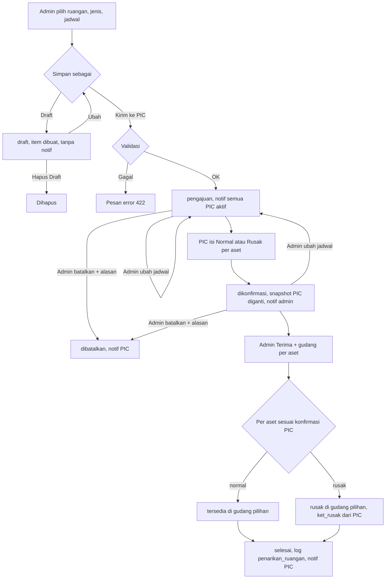
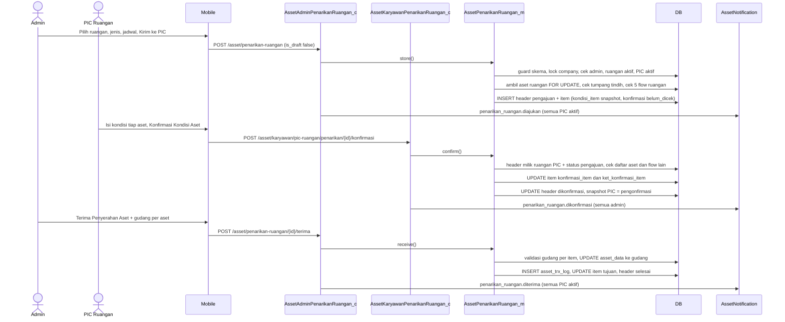
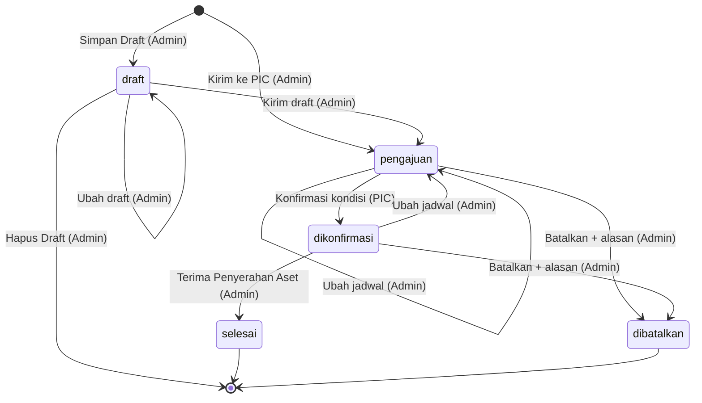
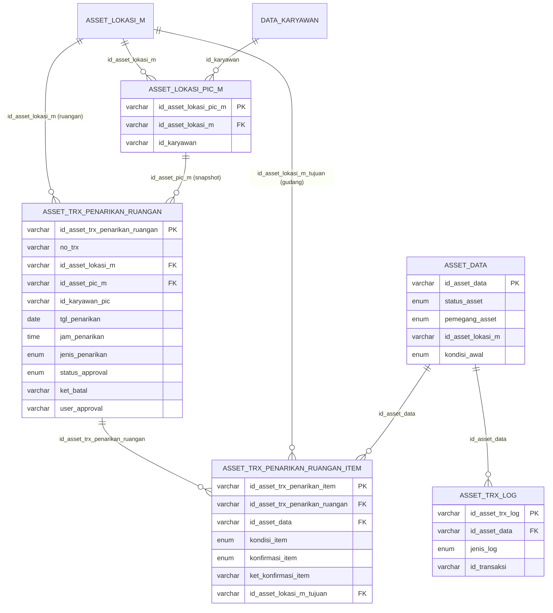

# Dokumentasi Teknis & Manual Book — Penarikan Asset Ruangan (ALK-RGN02)

> Dokumen ini disusun **dari source code lokal** (`API/` Lumen dan `MOBILE/` Flutter) per 19 November 2026. Seluruh klaim diverifikasi ke kode, DBML, SQL, dan test; dokumen bisnis RGN02 **tidak dibaca ulang**, sehingga istilah dan kode fase mengikuti komentar di kode.
> Cakupan: **konteks ruangan** (satu transaksi = satu ruangan, banyak aset). Penarikan sisi karyawan (KRY02) punya dokumen sendiri. Bagian yang tidak ditemukan ditandai **⚠️ Belum ditemukan**, asumsi ditandai **⚠️ Asumsi**.
> Contoh ID/nama pada payload adalah **data sintetis**.

---

## 1. Informasi Dokumen

| Informasi | Nilai |
|---|---|
| Nama Fitur | Penarikan Asset Ruangan (UI: **"Penarikan Aset Ruangan"**; admin dan PIC membukanya sebagai tab **Ruangan** pada halaman **Penarikan**) |
| Kode Fitur | **ALK-RGN02** (nomor transaksi `RGN02-YYYYMMNNN`) |
| Modul | Asset Management — Aset Ruangan |
| Backend | Laravel **Lumen ^10.0**, PHP ^8.1, JWT, Query Builder |
| Database | `API/diagram-asset.dbml` (tanda `[REVISI RGN02 dua tahap]` dan `[NEW RGN02 batal]`) + SQL manual `Claude outputs/sql-rgn02-penarikan-ruangan-batal.sql` (**belum dijalankan**). Tidak ada migration Lumen untuk tabel ini. SQL untuk kolom item dua tahap **tidak ditulis**: pengguna mengelola skema sendiri (lihat §16) |
| Mobile | Flutter (`professional_flutter_3_35`), `flutter_bloc`, `dio` |
| Web | ⚠️ Belum ditemukan: tidak ada source web di workspace |
| Test otomatis | API `tests/Asset/AssetPenarikanRuanganTest.php` (**46 test**, 525 assertion, lulus); `tests/Asset` seluruhnya **660 test** (6785 assertion) lulus; `tests/Routing` **15 test** lulus dan mengunci **576 route**. Mobile: `asset_penarikan_ruangan_{model,bloc,widget,api}_test.dart` (**23 / 23 / 45 / 7**), `asset_admin_penarikan_gabungan_test.dart` (**20**), `asset_user_penarikan_gabungan_test.dart` (**12**), `asset_pic_penarikan_pending_test.dart` (**10**), semuanya lulus. Dijalankan 19 Nov 2026; API memakai SQLite in-memory dan fake, **bukan MariaDB** |
| Versi Dokumen | 1.0 |
| Tanggal Dokumentasi | 2026-11-19 |
| Dokumen terkait | Penarikan Asset Karyawan (KRY02, pasangan terdekat), Retur Asset Ruangan (ALK-RGN06), Kerusakan Asset Ruangan (ALK-RGN05), Upgrade Komponen Ruangan (ALK-RGN07), Penambahan Asset Ruangan (ALK-RGN04), Pemeliharaan Terjadwal Asset Ruangan (PML01), Master Pendamping & Tugas PIC (tabel `asset_lokasi_pic_m`) |

---

## 2. Daftar Isi

1. Informasi Dokumen · 3. Quick Overview · 4. Ringkasan Fitur · 5. Tujuan · 6. Aktor · 7. Hak Akses · 8. Terminologi · 9. Business Rules · 10. Business Flow · 11. Flow per Role · 12. Flow Diagram · 13. Sequence Diagram · 14. Status Transaksi · 15. State Transition · 16. Struktur Database · 17. Relasi · 18. Data Dictionary · 19. Index · 20. Backend Architecture · 21. Backend Logic · 22. Dampak asset_data · 23. API · 24. Detail API · 25. Mobile Architecture · 26. Mobile Screen · 27. Mobile → API · 28. API → Mobile · 29. Mapping Mobile→API→DB · 30. Mapping DB→API→Mobile · 31. Validation · 32. Error Handling · 33. Audit Trail · 34. Notification · 35. Security · 36. Manual Book · 37. Kondisi Button · 38. Testing · 39. Temuan Ketidaksesuaian · 40. Edge Case · 41. Risk · 42. Dependency · 43. Source Reference · 44. Developer Notes · 45. Traceability · 46. DB Impact · 47. Checklist · 48. Changelog

---

## 3. Quick Overview

| Item | Informasi |
|---|---|
| Feature | Penarikan Asset Ruangan — penarikan aset yang dipegang sebuah ruangan ke gudang: **semua** aset ruangan atau **sebagian** aset yang dipilih admin |
| Module | Asset Management |
| Actor | Admin Asset (membuat, menjadwalkan, menerima, membatalkan), **PIC Ruangan** (konfirmasi kondisi), System |
| Main Transaction | `asset_trx_penarikan_ruangan` |
| Detail Transaction | `asset_trx_penarikan_ruangan_item` (satu baris per aset yang ditarik) |
| Asset Master | `asset_data` |
| Master PIC | `asset_lokasi_pic_m` (PIC terdaftar per ruangan) |
| Log | `asset_trx_log`, `jenis_log = penarikan_ruangan` (posisi `ruangan → gudang`) |
| Status | `draft → pengajuan → dikonfirmasi → selesai`, plus `dibatalkan` (batal admin) — enum `PenarikanStatus` **dibagi** dengan penarikan karyawan |
| Inisiator | **Admin** (bukan PIC) |
| Jenis penarikan | `semua` (default, seluruh aset ruangan) atau `sebagian` (aset terpilih) |
| Kondisi aset | **Dua tahap**: `kondisi_item` (snapshot otomatis dari `asset_data.kondisi_awal`) lalu `konfirmasi_item` (diisi PIC: normal/rusak) |
| Penyelesaian | **Admin** menekan **Terima Penyerahan Aset** dan memilih **gudang per aset** |
| API | **13 endpoint** (10 admin + 3 PIC) + 3 kunci aditif ringkasan (`penarikan_perlu_konfirmasi`, `ruangan_penarikan_perlu_proses`, `ruangan_penarikan_pending`) dan entri `berjalan` |
| Mobile Screen | Admin: halaman gabungan Penarikan (tab Karyawan \| Ruangan), form tambah/ubah draft, detail. PIC: tab Ruangan di halaman gabungan sisi karyawan, detail dengan checklist konfirmasi, kartu "Konfirmasi Penarikan Aset" di "Perlu tindakan Anda" |

```text
Admin: Pilih Ruangan + Jenis (semua / sebagian + pilih aset) + Jadwal Penyerahan (tanggal, jam) + Catatan
   ├─ Simpan Draft ─────────────────────────────── draft (item sudah dibuat, aset "terkunci", tanpa notifikasi)
   └─ Kirim ke PIC                                  pengajuan  ·  notif semua PIC ruangan
      │   (ruangan wajib punya minimal satu PIC aktif)
      ▼  (Admin dapat Ubah Jadwal -> kembali ke pengajuan;  Admin dapat Batalkan -> dibatalkan)
PIC Ruangan: tiap aset diberi Normal / Rusak (+ keterangan bila rusak) -> Konfirmasi Kondisi Aset
                                                dikonfirmasi  ·  notif semua admin
      │
      ▼  (Admin dapat Ubah Jadwal -> pengajuan;  Admin dapat Batalkan -> dibatalkan)
Admin: Terima Penyerahan Aset + pilih gudang per aset
                                                selesai  ·  aset -> gudang (tersedia / rusak) + asset_trx_log  ·  notif semua PIC
```

---

## 4. Ringkasan Fitur

Penarikan Asset Ruangan dipakai Admin Asset untuk **menarik aset dari sebuah ruangan kembali ke gudang**, baik **seluruhnya** (misalnya ruangan dikosongkan atau ditutup) maupun **sebagian** (hanya beberapa aset terpilih). Fitur ini **meniru Penarikan Karyawan (KRY02)** dengan perbedaan inti: targetnya ruangan, **tanpa peminjaman dan tanpa transaksi child**, dan yang mengonfirmasi kondisi adalah **PIC Ruangan** (`asset_lokasi_pic_m`), bukan pemegang aset perorangan.

- **Dimulai admin.** Jenis `semua` mencakup seluruh aset yang dipegang ruangan (`pemegang_asset = ruangan`), jenis `sebagian` hanya aset yang dicentang admin.
- Dapat disimpan sebagai **Draft** (jadwal opsional). Draft tidak terlihat PIC, tetapi **sudah mengunci** aset dari flow ruangan lain.
- **Dua tahap kondisi.** Saat item dibuat, sistem mencatat `kondisi_item` dari `asset_data.kondisi_awal` (hanya **informasi**). PIC lalu mengisi `konfirmasi_item` (normal/rusak) — **hasil konfirmasi PIC-lah** yang menentukan status aset di gudang.
- **Admin dapat membatalkan** transaksi `pengajuan` atau `dikonfirmasi` dengan alasan wajib; aset tidak berpindah dan kunci dilepas. Fitur batal ini **tidak ada** pada penarikan karyawan.
- Nomor transaksi `RGN02-YYYYMMNNN`. Posisi di seri dokumen: tahap **"Asset keluar dari ruangan"** (ruangan → gudang), berdampingan dengan Retur Ruangan (ALK-RGN06).

⚠️ Belum ditemukan: keterkaitan dengan proses master ruangan (penarikan **tidak** menonaktifkan ruangan dan **tidak** mengubah `asset_lokasi_m` atau `asset_lokasi_pic_m`).

---

## 5. Tujuan Fitur

### 5.1 Tujuan Bisnis (diturunkan dari kode)
- Mengembalikan aset yang tidak lagi dibutuhkan ruangan ke gudang secara terdokumentasi.
- Mendapat konfirmasi kondisi tiap aset dari PIC yang bertanggung jawab atas ruangan.
- Menjadwalkan waktu serah terima yang disepakati admin dan PIC.
- Memberi admin jalan keluar (batal) bila penarikan salah ruangan atau tidak jadi dilakukan.

### 5.2 Tujuan Sistem
- Membuat snapshot aset yang ditarik (nama, kategori, deskripsi, kondisi tercatat) pada baris item.
- Mencegah aset yang sedang ditarik diproses di flow ruangan lain (retur, penambahan, upgrade, kerusakan, pemeliharaan) dan sebaliknya.
- Memindahkan aset ke gudang pilihan admin per aset dan mencatat `asset_trx_log`.
- Menjaga hak akses: hanya PIC terdaftar ruangan itu yang melihat dan mengonfirmasi.

---

## 6. Aktor

| Aktor | Role | Fungsi |
|---|---|---|
| Admin Asset | `asset_admin` | Membuat, mengubah draft, menghapus draft, mengubah jadwal, menerima penyerahan, membatalkan |
| PIC Ruangan | Karyawan **aktif** yang terdaftar di `asset_lokasi_pic_m` untuk ruangan itu | Melihat penarikan ruangannya (tanpa draft), mengisi kondisi tiap aset, konfirmasi |
| System | Backend + FCM | Validasi, lock company, penomoran, snapshot, cek lintas flow, update aset, log, notifikasi |

Satu karyawan dapat berperan ganda (admin sekaligus PIC). Peran ditentukan per endpoint: endpoint `asset/penarikan-ruangan/*` memeriksa `asset_admin`, endpoint `asset/karyawan/pic-ruangan/penarikan/*` memeriksa karyawan aktif dan keanggotaan PIC pada ruangan transaksi.

---

## 7. Hak Akses

| Action | Admin Asset | PIC Ruangan | Keterangan |
|---|:---:|:---:|---|
| Melihat semua penarikan ruangan (termasuk draft) | ✅ | ❌ | `GET asset/penarikan-ruangan` |
| Melihat penarikan ruangan sendiri | – | ✅ | Hanya ruangan tempat ia terdaftar PIC; draft **tidak** terlihat |
| Membuat penarikan / draft | ✅ | ❌ | Ruangan wajib punya PIC aktif |
| Mengubah / menghapus draft | ✅ | ❌ | Hanya status `draft` |
| Ubah jadwal penyerahan | ✅ | ❌ | Status `pengajuan` / `dikonfirmasi` |
| Konfirmasi kondisi aset | ❌ | ✅ | Status `pengajuan`; karyawan harus aktif dan PIC ruangan itu |
| Terima Penyerahan Aset | ✅ | ❌ | Status `dikonfirmasi` |
| Batalkan penarikan | ✅ | ❌ | Status `pengajuan` / `dikonfirmasi`, alasan wajib |
| Melihat alasan batal | ✅ | ✅ | `ket_batal` pada list/detail; `jejak.batal` |
| Mengubah kondisi yang diisi PIC | ❌ | – | ⚠️ Belum ditemukan: admin hanya bisa ubah jadwal (status kembali `pengajuan`) lalu PIC mengonfirmasi ulang; atau batalkan (RISK-004) |

---

## 8. Terminologi

| Istilah | Arti di sistem |
|---|---|
| Penarikan ruangan | Transaksi penarikan aset dari ruangan ke gudang (ALK-RGN02) |
| Jadwal Penyerahan | `tgl_penarikan` + `jam_penarikan` (boleh NULL selama draft) |
| Draft | Tersimpan, belum dikirim ke PIC; terlihat admin saja |
| Penarikan aktif | Status `draft`, `pengajuan`, atau `dikonfirmasi` (`activeStatuses()`); **`dibatalkan` dan `selesai` bukan aktif** |
| `jenis_penarikan` | `semua` (seluruh aset ruangan) atau `sebagian` (aset terpilih); enum DBML `jenis_penarikan` |
| Aset ruangan | `asset_data` dengan `pemegang_asset = ruangan` dan `id_asset_lokasi_m = id ruangan`; **tanpa filter** `status_asset` |
| PIC Ruangan | Baris `asset_lokasi_pic_m` (`id_asset_lokasi_m`, `id_karyawan`); PIC **aktif** = karyawan berstatus `1–4` di `data_karyawan` |
| Snapshot PIC | Kolom `id_asset_pic_m`, `id_karyawan_pic`, `nama_pic`, `nik_pic` pada header: PIC aktif pertama (urut `id_asset_lokasi_pic_m`) saat dibuat, **diganti** PIC yang mengonfirmasi |
| `kondisi_item` | Tahap 1: snapshot `asset_data.kondisi_awal` saat item dibuat (`normal` / `rusak`; kosong atau tak dikenal → `belum_dicek`). **Informasi saja** |
| `konfirmasi_item` | Tahap 2: diisi PIC (`normal` / `rusak`); default `belum_dicek` |
| `ket_konfirmasi_item` | Keterangan PIC; **wajib bila rusak**, `''` bila normal |
| Batal admin | Transisi `pengajuan`/`dikonfirmasi` → `dibatalkan` dengan `ket_batal` |
| Gudang tujuan | `id_asset_lokasi_m_tujuan` per item, dipilih admin saat Terima; wajib lokasi bertipe `gudang` |

---

## 9. Business Rules

### BR-001 — Hanya admin yang membuat, mengubah, menjadwalkan, menerima, dan membatalkan
Semua aksi admin memanggil `requireAdmin` → "Pengguna tidak terdaftar sebagai admin aset." Controller admin memanggil `accessError` **lebih dulu** (403) baru validasi request (422); test `test_authorization_is_checked_before_validation` dan `test_every_controller_method_rejects_unauthorized_users`.

### BR-002 — Ruangan harus aktif dan punya PIC aktif
`findRuangan`: `asset_lokasi_m` bertipe `ruangan` dan `status_aktif = '1'`, kalau tidak → "Ruangan tidak ditemukan atau tidak aktif." `firstPic`: ruangan wajib punya minimal satu PIC aktif, kalau tidak → "Ruangan belum memiliki PIC aktif." (tidak ada yang berhak mengonfirmasi). Daftar `options` hanya memuat ruangan yang punya PIC aktif **dan** masih bisa ditarik (lihat BR-004).

### BR-003 — Hanya PIC terdaftar ruangan itu yang melihat dan mengonfirmasi
List dan detail sisi PIC difilter `wherePicRuangan` (`asset_lokasi_pic_m` ruangan transaksi memuat `id_karyawan`) dan **menyembunyikan draft**. Konfirmasi memakai filter yang sama: bukan PIC ruangan itu, admin yang bukan PIC, atau karyawan lain → "Penarikan tidak menunggu konfirmasi." Karyawan juga harus aktif (403 "Karyawan tidak aktif atau tidak ditemukan." di controller; "Karyawan tidak ditemukan atau tidak aktif." di model). Siapa pun dari PIC ruangan itu boleh mengonfirmasi (bukan hanya PIC snapshot header).

### BR-004 — `semua` vs `sebagian` dan aturan tumpang tindih
- `semua`: ditolak bila ruangan punya penarikan aktif apa pun → "Ruangan masih memiliki penarikan aktif."
- `sebagian`: ditolak bila ruangan punya penarikan `semua` aktif → "Ruangan masih memiliki penarikan aktif untuk semua aset."; atau bila salah satu aset terpilih sudah ada di item penarikan aktif lain → "Satu atau beberapa aset terpilih sudah ada pada penarikan aktif lain." Beberapa penarikan `sebagian` dengan aset berbeda boleh aktif bersamaan.
- `sebagian` wajib `id_asset_data[]` minimal satu ("Pilih minimal satu aset yang akan ditarik."), tanpa duplikat ("Aset yang dipilih tidak boleh duplikat."), dan setiap aset harus dipegang ruangan itu ("Aset {id} tidak sedang dipegang ruangan ini."). Jenis di luar `semua`/`sebagian` → "Jenis penarikan harus semua atau sebagian."; kosong → default `semua`.
- Ruangan tanpa aset → "Ruangan tidak memiliki aset yang sedang dipegang."
- `options` mengembalikan `bisa_penarikan_semua` (tanpa penarikan aktif dan ruangan punya aset) dan `bisa_penarikan_sebagian` (ada aset bebas dan tidak ada penarikan `semua` aktif); ruangan yang keduanya `false` tidak dimasukkan.

### BR-005 — Item = aset yang ditarik, dengan snapshot kondisi
`roomAssets`: semua `asset_data` dengan `pemegang_asset = ruangan` dan `id_asset_lokasi_m` ruangan itu (`FOR UPDATE`, **tanpa filter `status_asset`**). Jenis `semua`: item = seluruh aset itu. Jenis `sebagian`: item = aset terpilih. Tiap item menyimpan `nama_asset`, `deskripsi_asset`, `kategori_asset`, `kondisi_item` (snapshot, BR-014), `konfirmasi_item = belum_dicek`, `ket_konfirmasi_item = ''`. Tidak ada kolom `jenis_transaksi` / sumber transaksi (beda dengan KRY02).

### BR-006 — Aset tidak boleh sedang diproses flow ruangan lain (`assertNoCrossFlow`)
Dicek di **buat** (`store`), **ubah draft** (`updateDraft`), serta **konfirmasi** dan **terima** (lewat `assertCurrentHoldings`, sehingga flow yang dimulai **setelah** pengajuan menahan konfirmasi dan penerimaan). Urutan dan pesan:
1. Retur ruangan aktif → "Satu atau beberapa aset sedang diproses pada retur ruangan."
2. Penambahan aset ruangan aktif → "…pada penambahan aset ruangan."
3. Upgrade ruangan aktif → "…pada upgrade ruangan."
4. Kerusakan ruangan aktif → "…pada laporan kerusakan ruangan."
5. Pemeliharaan ruangan aktif → "…pada pemeliharaan ruangan."

`schedule`, `cancel`, dan `deleteDraft` **tidak** memanggil cek ini.

### BR-007 — Penarikan aktif mengunci aset di flow ruangan lain (kunci balik)
`hasActivePenarikanRuanganAsset` dan `activeAssetIds` dipanggil oleh Retur (`store`), Kerusakan, Upgrade, dan Pemeliharaan ruangan (`assetBlockMessage`, pesan "Aset sedang diproses pada penarikan ruangan.") serta oleh daftar pilihan (`lockedAssetIds` / `lockedByOtherFlows`) di keempat flow itu, sehingga aset yang sedang ditarik **tidak ditawarkan**. **Draft pun mengunci** (draft ∈ aktif). `dibatalkan` dan `selesai` melepas kunci.

### BR-008 — Jadwal wajib saat tidak draft
Controller: `tgl_penarikan` (`Y-m-d`) dan `jam_penarikan` (`H:i`) `required` bila `is_draft = false`; model `assertSchedule` → "Jadwal penarikan wajib diisi saat pengajuan." Backend **tidak** memvalidasi tanggal ≥ hari ini (mobile membatasi mulai hari ini). Jam disimpan `H:i:s` (`:00` ditambahkan).

### BR-009 — Draft: hanya draft yang bisa diubah/dihapus
→ "Hanya penarikan berstatus draft yang dapat diubah." / "…dihapus." Saat draft diubah, **seluruh item dihapus dan dibangun ulang** (aset dan `kondisi_item` diambil ulang dari kondisi saat itu), PIC snapshot diperbarui, dan ruangan boleh diganti. Draft yang dikirim (`is_draft = false`) menjadi `pengajuan` dan memicu notifikasi.

### BR-010 — Ubah jadwal mengembalikan status ke pengajuan
Status `pengajuan` atau `dikonfirmasi` → update jadwal, `status_approval = pengajuan`, `user_approval = ''`, `tgl_approval = NULL`. **Item (`konfirmasi_item`, `ket_konfirmasi_item`) tidak direset** (mengikuti KRY02); PIC mengonfirmasi ulang dan menimpa nilai lama. Status lain → "Jadwal penarikan sudah tidak dapat diubah."

### BR-011 — Konfirmasi PIC
- Header harus berstatus `pengajuan` dan milik ruangan PIC → "Penarikan tidak menunggu konfirmasi."
- Seluruh item wajib diisi tepat sekali → "Seluruh kondisi aset penarikan wajib diisi."
- Nilai hanya `normal` / `rusak` → "Kondisi aset harus normal atau rusak." (`belum_dicek` ditolak).
- `rusak` wajib keterangan tidak kosong (spasi saja ditolak) → "Keterangan kerusakan aset wajib diisi."; maksimal 255 karakter → "Keterangan kerusakan aset maksimal 255 karakter." `normal` menyimpan `ket_konfirmasi_item = ''` meski keterangan dikirim.
- Header → `dikonfirmasi`, `user_approval`/`tgl_approval` = PIC pengonfirmasi, dan **snapshot PIC header diganti** PIC itu.
- Nama field lama (`status_item`, `ket_rusak`) tidak diterima lagi (422).

### BR-012 — Pencocokan daftar aset saat konfirmasi dan terima (`assertCurrentHoldings`)
Jenis `semua`: daftar item harus **sama persis** dengan aset yang dipegang ruangan sekarang. Jenis `sebagian`: item harus tidak kosong dan merupakan **subset** aset yang masih dipegang ruangan (aset lain boleh bertambah). Pelanggaran → "Daftar aset yang dipegang ruangan sudah berubah." Sesudah itu `assertNoCrossFlow` dijalankan atas aset item (BR-006).

### BR-013 — Penerimaan admin
- Status harus `dikonfirmasi` → "Penarikan belum dikonfirmasi PIC ruangan."
- Setiap item harus `konfirmasi_item` ∈ {`normal`, `rusak`} → "Kondisi aset belum dikonfirmasi PIC ruangan."
- Body `items[]` wajib memuat **setiap** item tepat satu kali dengan `id_asset_lokasi_m` bertipe `gudang` pada company yang sama → "Lokasi gudang tujuan setiap aset wajib dipilih." / "Lokasi gudang tujuan tidak valid." / "Lokasi gudang tujuan aset tidak sesuai."
- Aset harus masih `pemegang_asset = ruangan` di ruangan transaksi → "Aset tidak lagi dipegang ruangan terkait."; aset tidak ditemukan → "Satu atau beberapa aset penarikan tidak ditemukan."
- Header → `selesai`; `user_update`/`tgl_update` = admin (tidak ada kolom approval khusus penerimaan).

### BR-014 — Efek ke `asset_data` mengikuti `konfirmasi_item`
`rusak` → `status_asset = rusak`, `ket_rusak = ket_konfirmasi_item`; `normal` → `status_asset = tersedia`, `ket_rusak = ''`. Selalu: `pemegang_asset = gudang`, `id_pemegang_asset = ''`, `tgl_dialokasikan = '0000-00-00'`, `id_asset_lokasi_m` = gudang pilihan, `tgl_update`/`user_update`. `kondisi_item` **tidak** dipakai untuk status aset. Log `asset_trx_log`: `jenis_log = penarikan_ruangan`, `nama_tabel_transaksi = asset_trx_penarikan_ruangan`, `posisi_awal = ruangan`, `posisi_akhir = gudang`, `kondisi_awal` = `kondisi_item` (bila kosong → `asset_data.kondisi_awal`), `kondisi_akhir` = `konfirmasi_item`.

### BR-015 — Batal admin
Hanya `pengajuan` / `dikonfirmasi` → "Penarikan tidak dapat dibatalkan." untuk status lain (draft, selesai, dibatalkan, id tak ada). Alasan `ket_batal` wajib (spasi saja ditolak) → "Alasan pembatalan wajib diisi.", maksimal 255 → "Alasan pembatalan maksimal 255 karakter." Hanya `status_approval`, `ket_batal`, `tgl_update`, `user_update` yang berubah: item, `asset_data`, log, dan jejak konfirmasi (`tgl_approval`/`user_approval`) **tidak tersentuh**; aset tidak berpindah. Status `dibatalkan` bukan aktif sehingga kunci aset lepas dan penarikan baru dapat dibuat. Tab = `selesai`. Notifikasi ke semua PIC aktif ruangan.

### BR-016 — Guard skema
`assertItemSchema` (awal setiap jalur tulis yang menyentuh item: `store`, `updateDraft`, `confirm`, `receive`): bila kolom `kondisi_item`, `konfirmasi_item`, atau `ket_konfirmasi_item` belum ada → `InvalidArgumentException` "Skema item penarikan ruangan belum diperbarui (kolom kondisi_item, konfirmasi_item, ket_konfirmasi_item). Jalankan SQL perubahan kondisi item penarikan ruangan terlebih dahulu." (controller → `BUSINESS_RULE_VIOLATION` 422, bukan 500; tidak ada penulisan sebagian). Guard `cancel()`: kolom `ket_batal` harus ada **dan** enum `status_approval` memuat `'dibatalkan'` (dicek lewat `SHOW COLUMNS` di MySQL/MariaDB; di driver lain dianggap aman) → "Fitur pembatalan belum aktif: skema database belum diperbarui (sql-rgn02-penarikan-ruangan-batal.sql)." Jalur **baca** tetap bekerja pada skema lama (nilai kosong). `deleteDraft` dan `schedule` tidak memakai guard.

### BR-017 — Transaksi, lock, dan penomoran
Semua tulis di `DB::transaction` (retry 3) dengan `lockCompany` (mutex `master_company`). Header dan item: `id_company + YYYYMM + 3 digit`; `no_trx = RGN02-YYYYMMNNN` (unik per company); log 5 digit. Kapasitas 3 digit/bulan/company: item memakan satu nomor per aset (`ensureSequenceCapacity`).

### BR-018 — Status tak dikenal dibaca sebagai `dibatalkan`
`statusOf` memakai `PenarikanStatus::tryFrom(...) ?? DIBATALKAN`. Nilai `''` muncul bila `dibatalkan` ditulis ke enum DB yang belum diperbarui (MySQL non-strict memotongnya); jalur baca ruangan menampilkannya sebagai `dibatalkan` (tab `selesai`) agar list tidak jatuh.

### BR-019 — Notifikasi best-effort
Dikirim sesudah commit oleh controller (`AssetNotification::send` menelan semua exception ke log). Draft tidak mengirim notifikasi. Lihat §34.

---

## 10. Business Flow

```text
1. Admin: Asset Ruangan -> Penarikan (tab Ruangan) -> (+) Tambah Penarikan Aset Ruangan
   -> Pilih Ruangan -> Jenis Penarikan (Semua aset / Sebagian aset -> centang aset)
   -> Jadwal Serah Terima (Tanggal & Jam Penyerahan) -> Catatan Tambahan
   -> Simpan Draft                         [draft · tanpa notifikasi]
   -> Kirim ke PIC                         [pengajuan · notif semua PIC aktif ruangan]
2. (Opsional) Admin: Ubah Jadwal Penyerahan [kembali ke pengajuan · notif PIC]
   (Opsional) Admin: Batalkan Penarikan      [dibatalkan · alasan wajib · notif PIC]
3. PIC Ruangan: kartu "Konfirmasi Penarikan Aset" di beranda / menu Penarikan -> tab Ruangan -> Detail
   -> tiap aset: lihat "Kondisi Tercatat", pilih Normal / Rusak (+ Keterangan kondisi rusak)
   -> Konfirmasi Kondisi Aset              [dikonfirmasi · notif semua admin]
4. Serah terima fisik sesuai jadwal
5. Admin: Detail -> Terima Penyerahan Aset -> dialog gudang per aset (Gudang yang Sama / Gudang Berbeda)
                                           [selesai · aset ke gudang · asset_trx_log · notif semua PIC]
```

---

## 11. Flow Berdasarkan Role

### 11.1 Admin Asset
1. Halaman **Asset Ruangan** → tile **Off Board** (membuka tab **Ruangan**) atau menu **Penarikan** pada Admin Asset (membuka tab **Karyawan**; pindah ke tab **Ruangan**) atau panel **"Penarikan Ruangan Perlu Diproses"** di beranda admin (draft → **Lanjutkan Draft**, dikonfirmasi → **Terima Aset**).
2. **Tambah Penarikan Aset Ruangan** → pilih ruangan → **Jenis Penarikan** (**Semua aset** / **Sebagian aset** + centang aset) → jadwal → **Simpan Draft** atau **Kirim ke PIC**.
3. Draft dapat dibuka lagi (ubah) atau dihapus (**Hapus Draft**).
4. Detail: **Ubah Jadwal Penyerahan** (pengajuan/dikonfirmasi), **Terima Penyerahan Aset** (dikonfirmasi), **Batalkan Penarikan** (pengajuan/dikonfirmasi).

### 11.2 PIC Ruangan
1. Beranda Aset: kartu **Konfirmasi Penarikan Aset** pada "Perlu tindakan Anda" (hanya penarikan berstatus `pengajuan` ruangannya), atau menu **Penarikan** → tab **Ruangan**.
2. Detail → untuk setiap aset pilih **Normal** atau **Rusak** (isi **Keterangan kondisi rusak** bila rusak) → **Konfirmasi Kondisi Aset**.
3. Setelah dibatalkan admin, PIC dapat melihat alasan di detail dan di tab **Selesai** (hanya baca).

### 11.3 Approver
Tidak ada approval terpisah: "konfirmasi" dilakukan PIC, "penerimaan" dan "pembatalan" oleh admin.

### 11.4 System
Snapshot aset dan kondisi, cek lintas flow, kunci aset, update aset dan log saat terima, notifikasi, guard skema.

---

## 12. Flow Diagram



---

## 13. Sequence Diagram



---

## 14. Status Transaksi

Enum PHP `App\Models\Asset\PenarikanStatus` (kolom `status_approval`; enum DB `draft`, `pengajuan`, `dikonfirmasi`, `selesai`, `dibatalkan`). Enum ini **dibagi** dengan penarikan karyawan; `dibatalkan` hanya dipakai ruangan.

| Status | Label API | Tab | Terlihat PIC | Arti | Aksi berikutnya |
|---|---|---|:---:|---|---|
| `draft` | Draft | pengajuan (admin saja) | ❌ | Disimpan admin | Admin: ubah, kirim, hapus |
| `pengajuan` | Menunggu Diterima | pengajuan | ✅ | Menunggu konfirmasi kondisi PIC | PIC: konfirmasi; Admin: ubah jadwal, batalkan |
| `dikonfirmasi` | Dikonfirmasi Karyawan (mobile menimpa menjadi **Dikonfirmasi PIC**) | dikonfirmasi | ✅ | Kondisi sudah diisi PIC | Admin: terima, ubah jadwal, batalkan |
| `selesai` | Selesai | selesai | ✅ | Aset sudah di gudang | – |
| `dibatalkan` | Dibatalkan | selesai | ✅ (hanya baca) | Dibatalkan admin; aset tetap di ruangan | – |

Status item (`konfirmasi_item`): `belum_dicek` → `normal` / `rusak`. Snapshot `kondisi_item`: `normal` / `rusak` / `belum_dicek` (tidak berubah setelah dibuat, kecuali draft diubah).

---

## 15. State Transition



| Status Awal | Action | Status Akhir | Actor |
|---|---|---|---|
| – | Simpan Draft | draft | Admin |
| – / draft | Kirim ke PIC | pengajuan | Admin |
| draft | Hapus Draft | (terhapus) | Admin |
| pengajuan / dikonfirmasi | Ubah Jadwal | pengajuan | Admin |
| pengajuan | Konfirmasi | dikonfirmasi | PIC Ruangan |
| pengajuan / dikonfirmasi | Batalkan | dibatalkan | Admin |
| dikonfirmasi | Terima Penyerahan Aset | selesai | Admin |

Status `asset_data`:
| Aset | Dari | Ke | Trigger |
|---|---|---|---|
| Aset ruangan (`terpakai` / status lain @ruangan) | – | tidak berubah | Draft, kirim, jadwal, konfirmasi, **batal** |
| Aset ruangan | @ruangan | `tersedia` (normal) / `rusak` (rusak) @gudang | Terima |

---

## 16. Struktur Database

Tabel penarikan ruangan **tidak punya migration Lumen** dan SQL pembuatnya **tidak ada** di `Claude outputs`; definisinya hanya di `API/diagram-asset.dbml` (pengguna mengelola skema sendiri). Test membuat skema SQLite sendiri.

| Table | Type | Fungsi |
|---|---|---|
| `asset_trx_penarikan_ruangan` | Transaction Header | Penarikan, jadwal, status, snapshot ruangan dan PIC, alasan batal |
| `asset_trx_penarikan_ruangan_item` | Transaction Detail | Snapshot aset, kondisi dua tahap, gudang tujuan |
| `asset_data` | Master | Status, pemegang, lokasi aset (berubah saat Terima) |
| `asset_trx_log` | Log | `jenis_log = penarikan_ruangan` |
| `asset_lokasi_m` | Master | Ruangan (`tipe = ruangan`) dan gudang (`tipe = gudang`) |
| `asset_lokasi_pic_m` | Master | PIC terdaftar per ruangan (dasar hak akses dan notifikasi) |
| `asset_kategori_m` | Master | Nama kategori untuk snapshot item |
| `data_karyawan`, `master_cabang`, `master_departemen` | Master HR | Karyawan aktif, nama cabang, departemen |
| `asset_admin`, `master_company` | Akses / lock | Admin aset dan mutex company |
| `notif_data`, `users` | Notifikasi | Inbox dan token FCM |
| `asset_trx_penarikan_karyawan` | Tabel lain | **Enum `status_approval` dibagi**: nilai `dibatalkan` ditambahkan juga di sini oleh SQL batal, tetapi alur karyawan tidak memakainya |
| `asset_trx_retur_ruangan(_item)`, penambahan, upgrade, kerusakan, pemeliharaan ruangan | Cek lintas flow | Dibaca saat buat/konfirmasi/terima |

### 16.1 Prasyarat database (deskriptif — bukan SQL siap-jalan)

Pengguna menolak penulisan SQL untuk perubahan kolom item dan mengelola skema sendiri. SQL batal (`sql-rgn02-penarikan-ruangan-batal.sql`) **sudah ditulis tetapi belum dijalankan**. Skema DB pengguna **belum tentu** sudah memakai skema di bawah; API menolak aksi tulis tertentu dengan pesan jelas sampai prasyarat terpenuhi (BR-016). Daftar perubahan:

| # | Perubahan | Tabel | Dibutuhkan oleh | Tersedia sebagai SQL? |
|:---:|---|---|---|---|
| 1 | Tambah kolom `kondisi_item` (enum `normal`/`rusak`/`belum_dicek`, boleh NULL) | `asset_trx_penarikan_ruangan_item` | `store`, `updateDraft`, `receive` | **Tidak** (deskriptif) |
| 2 | Tambah kolom `konfirmasi_item` (enum `normal`/`rusak`/`belum_dicek`, NOT NULL, default `belum_dicek`) | idem | `store`, `updateDraft`, `confirm`, `receive` | **Tidak** |
| 3 | Tambah kolom `ket_konfirmasi_item` (varchar(255), NOT NULL, default `''`) | idem | idem | **Tidak** |
| 4 | Tambah nilai enum `dibatalkan` di **akhir** daftar `status_approval` | `asset_trx_penarikan_ruangan` **dan** `asset_trx_penarikan_karyawan` (enum dibagi) | `cancel` | Ya, bagian 1 SQL batal |
| 5 | Tambah kolom `ket_batal` (varchar(255), NOT NULL, default `''`, setelah `tgl_approval`) | `asset_trx_penarikan_ruangan` | `cancel` | Ya, bagian 2 SQL batal |
| 6 | Pindahkan data lama: `status_item` → `konfirmasi_item` dan `ket_rusak` → `ket_konfirmasi_item` **hanya untuk penarikan berstatus dikonfirmasi, selesai, atau dibatalkan** (draft dan pengajuan masih `belum_dicek`) | item | Agar penarikan `dikonfirmasi` lama bisa diterima | **Tidak** |
| 7 | Hapus kolom lama `status_item` dan `ket_rusak` — **paling akhir**, setelah #6 diverifikasi | item | Kebersihan skema; kolom ini sudah **tidak ada** di DBML dan tidak dibaca/ditulis API | **Tidak** |

Catatan:
- `kondisi_item` baris lama boleh dibiarkan `NULL`: API membacanya sebagai `''`, mobile menampilkannya sebagai `belum_dicek` (tidak sebagai Normal), dan log `kondisi_awal` memakai `asset_data.kondisi_awal` bila snapshot kosong.
- Urutan aman: #1–#3 dan #4–#5 dulu atau bersamaan dengan deploy API; #6 sebelum #7; **jangan** menjalankan #7 sebelum #6 (kehilangan data).
- ⚠️ Asumsi / butuh verifikasi: bila kolom lama `status_item`/`ket_rusak` berstatus `NOT NULL` tanpa default, `INSERT` item oleh API baru bisa ditolak di strict mode sampai kolom itu diberi default atau dihapus (RISK-019).
- Nilai `penarikan_ruangan` pada enum `asset_trx_log.jenis_log` sudah ada di DBML; SQL batal hanya **memverifikasi**-nya (pra-cek 0d) dan tidak mengubahnya (RISK-005).

---

## 17. Relasi Database



---

## 18. Data Dictionary

### 18.1 asset_trx_penarikan_ruangan (header; sumber: DBML)
| Field | Type | Null | Default | Key | Description |
|---|---|:---:|---|---|---|
| id_asset_trx_penarikan_ruangan | varchar(50) | No | – | PK | `id_company + YYYYMM + 3 digit` |
| no_trx | varchar(50) | No | '' | UNIQUE (id_company, no_trx) | `RGN02-YYYYMMNNN` |
| id_asset_lokasi_m | varchar(50) | – | – | FK | Ruangan (wajib tipe `ruangan`, aktif) |
| nama_asset_ruangan, nama_cabang, nama_departemen | varchar(255) | – | – | – | Snapshot saat transaksi |
| id_asset_pic_m | varchar(50) | – | – | FK → `asset_lokasi_pic_m` | Snapshot PIC (PIC aktif pertama; diganti PIC pengonfirmasi) |
| id_karyawan_pic | varchar(150) | No | '' | IDX | PIC Ruangan; dasar tampilan |
| nama_pic, nik_pic | varchar(255) | – | – | – | Snapshot PIC |
| tgl_pengajuan | timestamp | – | CURRENT_TIMESTAMP | – | Diisi `now` saat dibuat (juga untuk draft) |
| tgl_penarikan | date | Yes | NULL | IDX | Tanggal Penyerahan (NULL saat draft) |
| jam_penarikan | time | Yes | NULL | IDX | Jam Penyerahan (NULL saat draft) |
| keterangan | text | – | – | – | Catatan Tambahan admin |
| jenis_penarikan | enum('semua','sebagian') | No | 'semua' | – | `semua` = seluruh aset ruangan; `sebagian` = aset terpilih |
| id_karyawan, nik_karyawan, nama_karyawan | varchar | – | '' | – | Pembuat transaksi (Admin/HR) |
| status_approval | enum(draft, pengajuan, dikonfirmasi, selesai, **dibatalkan**) | No | pengajuan | IDX | Status; nilai `dibatalkan` baru ada setelah SQL batal |
| user_approval / tgl_approval | varchar / timestamp | – | '' / NULL | – | **PIC** yang mengonfirmasi; dikosongkan saat ubah jadwal; **tidak** disentuh saat batal |
| ket_batal | varchar(255) | No | '' | – | Alasan batal admin (kolom baru; SQL batal). Waktu/pelaku batal = `tgl_update`/`user_update` |
| id_company | varchar(50) | No | '' | IDX | – |
| tgl_input / user_input | timestamp / varchar | – | now / '' | – | Admin pembuat (`nik - nama`) |
| tgl_update / user_update | timestamp / varchar | Yes | NULL / '' | – | Pelaku terakhir (jadwal, terima, batal tertimpa) |

### 18.2 asset_trx_penarikan_ruangan_item (sumber: DBML `[REVISI RGN02 dua tahap]`)
| Field | Type | Null | Default | Description |
|---|---|:---:|---|---|
| id_asset_trx_penarikan_item | varchar(50) PK | No | – | `id_company + YYYYMM + 3 digit` |
| id_asset_trx_penarikan_ruangan | varchar(50) | – | – | → header |
| id_asset_data | varchar(50) | – | – | → `asset_data` |
| nama_asset, deskripsi_asset, kategori_asset | varchar(255) | – | '' | Snapshot |
| kondisi_item | enum(normal, rusak, belum_dicek) | Yes | – | **Tahap 1**: snapshot `asset_data.kondisi_awal` saat item dibuat; kosong/tak dikenal → `belum_dicek` |
| konfirmasi_item | enum(normal, rusak, belum_dicek) | No | belum_dicek | **Tahap 2**: diisi PIC |
| ket_konfirmasi_item | varchar(255) | No | '' | Wajib bila `rusak`; `''` bila normal |
| id_asset_lokasi_m_tujuan | varchar(50) | Yes | NULL | Gudang tujuan, dipilih admin saat Terima |
| id_company, tgl_input, user_input | – | – | – | – |

Kolom lama **`status_item`** dan **`ket_rusak`** **tidak ada lagi** pada item ruangan (tetap ada pada item penarikan karyawan).

### 18.3 asset_trx_log
| Kolom | Nilai |
|---|---|
| jenis_log | `penarikan_ruangan` |
| id_transaksi / nama_tabel_transaksi | id penarikan / `asset_trx_penarikan_ruangan` |
| kondisi_awal | `kondisi_item`; bila kosong → `asset_data.kondisi_awal` |
| kondisi_akhir | `konfirmasi_item` (normal/rusak) |
| posisi_awal → posisi_akhir | `ruangan` → `gudang`; `pemegang_asset = gudang`, `id_pemegang = ''`, `nama_pemegang = ''` |

### 18.4 Enum terkait
| Enum | Nilai | Catatan |
|---|---|---|
| `status_penarikan` | draft, pengajuan, dikonfirmasi, selesai, dibatalkan | Dibagi dengan KRY02 |
| `jenis_penarikan` | semua, sebagian | – |
| `kondisi_awal` | normal, rusak, belum_dicek | Dipakai `kondisi_item`, `konfirmasi_item`, dan banyak tabel lain |

---

## 19. Database Index

Dari DBML (nama indeks nyata di DB ⚠️ Asumsi: hanya indeks unik yang bernama di DBML).

| Index | Table | Columns | Tujuan |
|---|---|---|---|
| `uq_penarikan_rgn_company_no_trx` | header | UNIQUE (id_company, no_trx) | Cegah nomor ganda |
| (tanpa nama) | header | (id_company, status_approval, tgl_penarikan, jam_penarikan) | List admin per status/jadwal |
| (tanpa nama) | header | (id_company, id_karyawan_pic, status_approval) | Dasar PIC dan penarikan aktif |
| (tanpa nama) | header | (id_company, id_asset_lokasi_m, status_approval) | Cek penarikan aktif per ruangan, kartu PIC |
| (tanpa nama) | item | (id_company, id_asset_trx_penarikan_ruangan, id_asset_data) | Item per header, cek aset terkunci |

---

## 20. Backend Architecture

```text
RouteAsset.php (prefix /asset; middleware localization, jwt.api, jwt.ctx)
   |-- group penarikan-ruangan  ->  AssetAdminPenarikanRuangan_c   (accessError: admin aset, lalu validasi request)
   |-- group karyawan/pic-ruangan/penarikan -> AssetKaryawanPenarikanRuangan_c (penarikanRuanganAccessError: karyawan aktif)
   v
AssetPenarikanRuangan_m  <- Asset_m (lockCompany, nextSequence, findActiveKaryawan, findAssetAdmin, resolveItemLocations, warehouseLocations)
   |   <-> AssetReturRuangan_m / AssetUpgradeRuangan_m / AssetKerusakanRuangan_m / AssetPemeliharaanRuangan_m (cek lintas flow dua arah)
   v
DB::transaction (retry 3) -> ApiResponse  ->  AssetNotification::send (setelah commit, best-effort)
```

| Layer | File/Class | Function |
|---|---|---|
| Route | `routes/modules/asset/RouteAsset.php` | 10 route admin (grup `penarikan-ruangan`, baris 75–86) dan 3 route PIC (grup `pic-ruangan/penarikan`) |
| Controller | `AssetAdminPenarikanRuangan_c` | penarikanRuanganOptions, penarikanAsetRuangan, getPenarikanRuangan, storePenarikanRuangan, getDetailPenarikanRuangan, updatePenarikanRuanganDraft, deletePenarikanRuanganDraft, updateJadwalPenarikanRuangan, batalPenarikanRuangan, terimaPenarikanRuangan, validatePenarikanRuanganForm, penarikanRuanganPayload |
| Controller | `AssetKaryawanPenarikanRuangan_c` | getPenarikanRuanganPic, getDetailPenarikanRuanganPic, konfirmasiPenarikanRuanganPic, penarikanRuanganAccessError |
| Model | `AssetPenarikanRuangan_m` | getOptions, getRoomAssets, getPage, getDetail, store, updateDraft, deleteDraft, schedule, confirm, cancel, receive, getPendingForAdmin, countPendingForAdmin, getPendingForPic, getBerjalanForAdmin, hasActivePenarikanRuanganAsset, activeAssetIds + helper (roomAssets, insertItems, resolveWithdrawalAssets, assertNoActivePenarikan, assertNoCrossFlow, assertCurrentHoldings, assertItemSchema, enumSupportsCancel, statusOf, firstPic, picByRuangan) |
| Enum | `PenarikanStatus` | value, label(), tab(); `DIBATALKAN` ditambahkan (dibagi dengan karyawan) |
| Support | `AssetNotification` | event `penarikan_ruangan.*` (5 event), penerima `semua_pic_ruangan` dan `ADMIN` |
| Support | `AssetJejak` | `jejak.pengajuan`, `jejak.konfirmasi`, `jejak.batal` |
| Model lain | `AssetLokasiPic_m` | key aditif `penarikan_perlu_konfirmasi` di `getAssetRuanganSaya` |
| Model lain | `AssetAdmin_m` | ringkasan `ruangan_penarikan_*` dan entri `berjalan` |

---

## 21. Backend Business Logic

### 21.1 Simpan / Kirim — `store`
Guard skema → lock company → admin → `findRuangan` → `firstPic` → `normalizeJenis` → `resolveWithdrawalAssets` (validasi pilihan, `assertNoActivePenarikan`, aset ruangan `FOR UPDATE`, subset untuk `sebagian`, tidak kosong) → `assertNoCrossFlow` → `assertSchedule` → ID header + `RGN02-…` → INSERT header (`draft`/`pengajuan`, snapshot ruangan dan PIC, `tgl_input` = `now`) → `insertItems` (snapshot kondisi) → kembalikan `getDetail`. Controller mengirim notifikasi `penarikan_ruangan.diajukan` bila bukan draft.

### 21.2 Ubah draft — `updateDraft`
Guard skema → header harus `draft` (`FOR UPDATE`) → validasi sama seperti store (mengecualikan penarikan itu sendiri dari cek tumpang tindih) → **hapus semua item lama**, insert item baru (snapshot kondisi diambil ulang) → update header (ruangan, PIC, jadwal, jenis, status draft/pengajuan, `tgl_update`). Notifikasi `diajukan` bila dikirim.

### 21.3 Hapus draft — `deleteDraft`
Header harus `draft` → hapus item dan header. Response `{id, no_trx}`. Tanpa notifikasi, tanpa guard skema.

### 21.4 Ubah jadwal — `schedule`
Header `pengajuan`/`dikonfirmasi` → update `tgl_penarikan`, `jam_penarikan`, status `pengajuan`, `user_approval = ''`, `tgl_approval = NULL`, `tgl_update`/`user_update`. Item tidak disentuh. Notifikasi `dijadwalkan`.

### 21.5 Konfirmasi PIC — `confirm`
Guard skema → karyawan aktif → header ruangan PIC itu (`wherePicRuangan`, `FOR UPDATE`) berstatus `pengajuan` → `assertCurrentHoldings` (+ `assertNoCrossFlow`) → item `FOR UPDATE` dicocokkan dengan `items[]` (jumlah dan id harus sama) → per item validasi kondisi/keterangan → update `konfirmasi_item`/`ket_konfirmasi_item` → header `dikonfirmasi` dengan snapshot PIC = PIC pengonfirmasi (`id_asset_pic_m` dari `asset_lokasi_pic_m`) → `getDetail` (dengan filter PIC). Notifikasi `dikonfirmasi`.

### 21.6 Batal — `cancel`
Validasi alasan (wajib, ≤255) → guard `ket_batal` + enum → transaksi: lock company, admin, header `FOR UPDATE`, status harus `pengajuan`/`dikonfirmasi` → update **hanya** `status_approval = dibatalkan`, `ket_batal`, `tgl_update`, `user_update`. Notifikasi `dibatalkan`.

### 21.7 Terima admin — `receive`
Guard skema → admin → header `dikonfirmasi` → `assertCurrentHoldings` → semua item `normal`/`rusak` → `resolveItemLocations` (gudang per item, tipe `gudang`, sekali per item) → aset dikunci → per item: periksa masih dipegang ruangan, UPDATE `asset_data` (BR-014), siapkan log → UPDATE `id_asset_lokasi_m_tujuan` per item → INSERT `asset_trx_log` → header `selesai`. Notifikasi `diterima`.

### 21.8 Query baca
- **Options**: ruangan aktif dengan PIC aktif, difilter `bisa_penarikan_*`, plus `lokasi_gudang` (lokasi tipe `gudang`, urut nama).
- **Aset ruangan**: aset yang dipegang ruangan dan belum ada di penarikan aktif mana pun, kecuali `id_penarikan` (draft yang sedang diubah).
- **List**: tab `pengajuan` (admin: draft + pengajuan; PIC: pengajuan), `dikonfirmasi`, `selesai` (**selesai + dibatalkan**); tanpa tab = semua. Urut `tgl_input` menurun lalu id menurun; `limit + 1` baris untuk `has_more`. Sisi PIC: filter ruangan PIC + tanpa draft. Filter tanggal (`range_tanggal_*`) hanya sisi admin, berlaku pada `tgl_penarikan`.
- **Detail**: header + item (join nama gudang tujuan) + `jejak`. PIC tidak dapat membuka draft atau ruangan lain (404).
- **Ringkasan admin**: `ruangan_penarikan_perlu_proses` / `ruangan_penarikan_pending` = status `draft` + `dikonfirmasi`; `berjalan` = aktif yang tidak termasuk pending (praktisnya `pengajuan`).
- **Kartu PIC**: `penarikan_perlu_konfirmasi` = status `pengajuan`, ruangan PIC itu, karyawan aktif, maksimal 20, urut `tgl_penarikan` (NULL terakhir), `tgl_input`, id.
- Seluruh jalur ringkasan mengembalikan `[]`/`0` bila tabel penarikan belum ada (`penarikanTablesExist`).

---

## 22. Dampak terhadap asset_data

| Field | Sebelum | Sesudah | Trigger |
|---|---|---|---|
| Semua field | @ruangan | tidak berubah | Draft, kirim, jadwal, konfirmasi, **batal** |
| status_asset | (apa pun) | `tersedia` (konfirmasi normal) / `rusak` (konfirmasi rusak) | Terima |
| pemegang_asset / id_pemegang_asset | ruangan / (kosong) | gudang / '' | Terima |
| id_asset_lokasi_m | id ruangan | id gudang pilihan admin untuk aset itu | Terima |
| ket_rusak | – | `ket_konfirmasi_item` (rusak) / '' (normal) | Terima |
| tgl_dialokasikan | tanggal alokasi / NULL | `'0000-00-00'` | Terima |
| tgl_update / user_update | – | now / `nik - nama` admin | Terima |

> `tgl_dialokasikan` ditulis `'0000-00-00'` (sengaja bukan NULL) setiap aset kembali ke gudang, sama dengan penarikan karyawan. Nilai ini ditolak MySQL/MariaDB bila `sql_mode` memuat `NO_ZERO_DATE` atau strict mode (RISK-022).

> Selama penarikan aktif, aset **tidak** berubah status; perlindungan dari flow lain dilakukan lewat `hasActivePenarikanRuanganAsset` (BR-007). `kondisi_item` **tidak** memengaruhi `status_asset`; hanya `konfirmasi_item`.

---

## 23. API Documentation

| ID | Method | Endpoint | Function | Auth |
|---|---|---|---|---|
| API-001 | GET | `/asset/penarikan-ruangan/options` | Opsi ruangan + gudang | Admin |
| API-002 | GET | `/asset/penarikan-ruangan/aset-ruangan` | Aset ruangan yang bisa dipilih (mode sebagian) | Admin |
| API-003 | GET | `/asset/penarikan-ruangan` | List (tab, pagination, filter tanggal) | Admin |
| API-004 | POST | `/asset/penarikan-ruangan` | Simpan draft / kirim | Admin |
| API-005 | GET | `/asset/penarikan-ruangan/{id}` | Detail | Admin |
| API-006 | PUT | `/asset/penarikan-ruangan/{id}` | Ubah draft / kirim draft | Admin |
| API-007 | DELETE | `/asset/penarikan-ruangan/{id}` | Hapus draft | Admin |
| API-008 | PUT | `/asset/penarikan-ruangan/{id}/jadwal` | Ubah jadwal | Admin |
| API-009 | POST | `/asset/penarikan-ruangan/{id}/terima` | Terima penyerahan + gudang per aset | Admin |
| API-010 | POST | `/asset/penarikan-ruangan/{id}/batal` | Batalkan | Admin |
| API-011 | GET | `/asset/karyawan/pic-ruangan/penarikan` | List milik PIC | JWT, karyawan aktif (PIC ruangan) |
| API-012 | GET | `/asset/karyawan/pic-ruangan/penarikan/{id}` | Detail milik PIC | JWT, karyawan aktif (PIC ruangan) |
| API-013 | POST | `/asset/karyawan/pic-ruangan/penarikan/{id}/konfirmasi` | Konfirmasi kondisi | JWT, karyawan aktif (PIC ruangan) |

**Jumlah endpoint = 13** (10 admin + 3 PIC), dihitung dari `RouteAsset.php` dan dikunci `test_routes_are_registered_with_expected_handlers` (middleware `localization`, `jwt.api`, `jwt.ctx`). Terkait (bukan endpoint baru): `GET /asset/karyawan/pic-ruangan` menambah key `penarikan_perlu_konfirmasi`; `GET /asset/summary` menambah `ruangan_penarikan_perlu_proses`, `ruangan_penarikan_pending`, dan entri `berjalan` (sisi `ruangan`, jenis `penarikan`, `status_key` `pengajuan`).

---

## 24. Detail Setiap API

Header umum: `Authorization: Bearer <token>`, `Content-Type: application/json`, `Accept`, `locale`, `versi-app`. Format `{ code, message, data }`. Kode HTTP: `SUCCESS` 200, `CREATED` 201, `UPDATED` 200, `DELETED` 200, `VALIDATION_ERROR` 422, `BUSINESS_RULE_VIOLATION` 422, `UNAUTHORIZED` 401, `FORBIDDEN` 403, `NOT_FOUND` 404, `SYSTEM_ERROR` 500.

### API-001 — Opsi
```http
GET /asset/penarikan-ruangan/options
```
Otorisasi: admin aset (403 "Pengguna tidak memiliki akses admin aset.").
```json
{ "code": "SUCCESS", "message": "Opsi penarikan aset berhasil ditemukan.",
  "data": {
    "ruangan": [ {
      "id_asset_lokasi_m": "CMP001202601010",
      "nama_asset_ruangan": "Ruang Finance",
      "nama_cabang": "Kantor Pusat",
      "nama_departemen": "Finance",
      "jumlah_asset_ruangan": 3,
      "bisa_penarikan_semua": true,
      "bisa_penarikan_sebagian": true,
      "pic": [
        { "id_asset_pic_m": "CMP001202602001", "id_karyawan": "KRY0021", "nik": "EMP-021", "nama_karyawan": "Dewi Contoh" },
        { "id_asset_pic_m": "CMP001202602002", "id_karyawan": "KRY0022", "nik": "EMP-022", "nama_karyawan": "Andi Contoh" }
      ]
    } ],
    "lokasi_gudang": [
      { "id_asset_lokasi_m": "CMP001202601001", "nama_lokasi": "Gudang Pusat", "id_cabang": "CAB-1" },
      { "id_asset_lokasi_m": "CMP001202601002", "nama_lokasi": "Gudang Servis", "id_cabang": "CAB-1" }
    ] } }
```
`ruangan` hanya memuat ruangan aktif bertipe `ruangan` yang punya PIC aktif **dan** masih bisa ditarik (`bisa_penarikan_semua` atau `bisa_penarikan_sebagian`), urut nama. `jumlah_asset_ruangan` = seluruh aset yang dipegang ruangan (termasuk yang sudah terkunci penarikan lain). `lokasi_gudang` = lokasi `tipe = gudang` company, urut nama; dipakai dialog **Lokasi Gudang Tujuan**.

### API-002 — Aset ruangan (mode sebagian)
```http
GET /asset/penarikan-ruangan/aset-ruangan?id_asset_lokasi_m=CMP001202601010&id_penarikan=CMP001202611001
```
| Param | Rule | Message |
|---|---|---|
| id_asset_lokasi_m | required\|string\|max:50 | Ruangan wajib dipilih. |
| id_penarikan | nullable\|string\|max:50 | – |

Pesan umum validasi: "Parameter aset ruangan tidak valid." `id_penarikan` (saat ubah draft) menyertakan aset milik draft itu sendiri.
```json
{ "code": "SUCCESS", "message": "Aset ruangan berhasil ditemukan.",
  "data": [
    { "id_asset_data": "CMP00120260100031", "nama_asset": "Monitor 24 inch", "deskripsi_asset": "Dell P2422H", "kategori_asset": "Monitor" },
    { "id_asset_data": "CMP00120260100032", "nama_asset": "Printer Laser", "deskripsi_asset": "", "kategori_asset": "Printer" }
  ] }
```
`data` adalah **array langsung** (bukan objek). Aset yang sudah masuk penarikan aktif lain tidak muncul.

### API-003 / API-011 — List
```http
GET /asset/penarikan-ruangan?tab=pengajuan&limit=20&offset=0&range_tanggal_mulai=2026-11-01&range_tanggal_selesai=2026-11-30
GET /asset/karyawan/pic-ruangan/penarikan?tab=dikonfirmasi
```
`tab`: `pengajuan` | `dikonfirmasi` | `selesai` ("Filter penarikan tidak valid."; `selesai` memuat **selesai dan dibatalkan**); `limit` 1–50 ("Limit maksimal adalah 50 data."); `offset` ≥ 0. `range_tanggal_mulai` dan `range_tanggal_selesai` (`Y-m-d`) hanya endpoint admin, **wajib berpasangan** ("Tanggal mulai wajib diisi bersama tanggal selesai." / "Tanggal selesai wajib diisi bersama tanggal mulai."), selesai ≥ mulai ("Tanggal selesai tidak boleh sebelum tanggal mulai."), dan memfilter `tgl_penarikan`. Pesan umum: "Parameter daftar penarikan tidak valid."
```json
{
  "code": "SUCCESS",
  "message": "Data penarikan aset berhasil ditemukan.",
  "data": {
    "penarikans": [
      {
        "id": "CMP001202611001",
        "no_trx": "RGN02-202611001",
        "tgl_penarikan": "2026-11-20",
        "jam_penarikan": "09:30:00",
        "jenis_penarikan": "sebagian",
        "id_asset_lokasi_m": "CMP001202601010",
        "nama_asset_ruangan": "Ruang Finance",
        "nama_cabang": "Kantor Pusat",
        "nama_departemen": "Finance",
        "id_karyawan_pic": "KRY0021",
        "nik_pic": "EMP-021",
        "nama_pic": "Dewi Contoh",
        "nik_karyawan": "ADM-001",
        "nama_karyawan": "Siti Admin",
        "jumlah_asset": 2,
        "ket_batal": "",
        "status": "pengajuan",
        "status_approval": "pengajuan",
        "status_label": "Menunggu Diterima",
        "tab": "pengajuan"
      }
    ],
    "filters": [
      {"value": "pengajuan", "label": "Pengajuan"},
      {"value": "dikonfirmasi", "label": "Dikonfirmasi"},
      {"value": "selesai", "label": "Selesai"}
    ],
    "pagination": {"limit": 20, "offset": 0, "next_offset": 1, "has_more": false}
  }
}
```
Key array: `penarikans` (bukan `data` langsung). `nik_karyawan`/`nama_karyawan` = admin pembuat; `*_pic` = snapshot PIC. Sisi PIC memakai bentuk yang sama tanpa draft.

### API-004 / API-006 — Simpan / Kirim / Ubah Draft
```http
POST /asset/penarikan-ruangan
PUT  /asset/penarikan-ruangan/{id}
```
```json
{
  "id_asset_lokasi_m": "CMP001202601010",
  "jenis_penarikan": "sebagian",
  "id_asset_data": ["CMP00120260100031", "CMP00120260100032"],
  "tgl_penarikan": "2026-11-20",
  "jam_penarikan": "09:30",
  "keterangan": "Kurangi unit lama, ganti dengan perangkat baru",
  "is_draft": false
}
```
| Field | Rule | Message |
|---|---|---|
| id_asset_lokasi_m | required\|string\|max:50 | – |
| tgl_penarikan | draft: nullable\|date_format:Y-m-d; kirim: required | Tanggal penarikan wajib diisi saat pengajuan. |
| jam_penarikan | draft: nullable\|date_format:H:i; kirim: required | Jam penarikan wajib diisi saat pengajuan. |
| keterangan | nullable\|string | – |
| is_draft | required\|boolean | – |
| jenis_penarikan | nullable\|string\|in:semua,sebagian (default `semua`) | Jenis penarikan harus semua atau sebagian. |
| id_asset_data | `sebagian`: required\|array\|min:1; `semua`: nullable\|array (diabaikan). Elemen required\|string\|max:50\|distinct | Pilih minimal satu aset yang akan ditarik. / Aset yang dipilih tidak boleh duplikat. |

Pesan umum: "Data penarikan belum lengkap." Database impact:
```text
INSERT/UPDATE asset_trx_penarikan_ruangan (draft/pengajuan)
INSERT asset_trx_penarikan_ruangan_item (jenis semua: semua aset ruangan; sebagian: aset terpilih)  [PUT: DELETE item lama dulu]
INSERT notif_data (kirim saja)
```
Response 201 (POST) / 200 (PUT) = detail (lihat API-005). Pesan: "Draft penarikan berhasil disimpan." / "Draft penarikan berhasil diperbarui." / "Penarikan aset berhasil diajukan."
422 (`BUSINESS_RULE_VIOLATION`): "Pengguna tidak terdaftar sebagai admin aset.", "Ruangan tidak ditemukan atau tidak aktif.", "Ruangan belum memiliki PIC aktif.", "Ruangan masih memiliki penarikan aktif.", "Ruangan masih memiliki penarikan aktif untuk semua aset.", "Satu atau beberapa aset terpilih sudah ada pada penarikan aktif lain.", "Aset {id} tidak sedang dipegang ruangan ini.", "Ruangan tidak memiliki aset yang sedang dipegang.", "Satu atau beberapa aset sedang diproses pada retur ruangan." / "…penambahan aset ruangan." / "…upgrade ruangan." / "…laporan kerusakan ruangan." / "…pemeliharaan ruangan.", "Jadwal penarikan wajib diisi saat pengajuan.", "Hanya penarikan berstatus draft yang dapat diubah." (PUT), "Skema item penarikan ruangan belum diperbarui (…)" (BR-016).
500: pesan "Terjadi kesalahan saat menyimpan penarikan aset." **diikuti pesan exception mentah** pada POST (INC-03).

### API-005 / API-012 — Detail
```http
GET /asset/penarikan-ruangan/{id}
GET /asset/karyawan/pic-ruangan/penarikan/{id}
```
```json
{
  "code": "SUCCESS",
  "message": "Detail penarikan aset berhasil ditemukan.",
  "data": {
    "id": "CMP001202611001",
    "no_trx": "RGN02-202611001",
    "tgl_penarikan": "2026-11-20",
    "jam_penarikan": "09:30:00",
    "keterangan": "Kurangi unit lama, ganti dengan perangkat baru",
    "jenis_penarikan": "sebagian",
    "id_asset_lokasi_m": "CMP001202601010",
    "nama_asset_ruangan": "Ruang Finance",
    "nama_cabang": "Kantor Pusat",
    "nama_departemen": "Finance",
    "id_karyawan_pic": "KRY0022",
    "nik_pic": "EMP-022",
    "nama_pic": "Andi Contoh",
    "id_karyawan": "KRY0099",
    "nik_karyawan": "ADM-001",
    "nama_karyawan": "Siti Admin",
    "ket_batal": "",
    "status": "dikonfirmasi",
    "status_approval": "dikonfirmasi",
    "status_label": "Dikonfirmasi Karyawan",
    "tab": "dikonfirmasi",
    "items": [
      {
        "id_asset_trx_penarikan_item": "CMP001202611001",
        "id_asset_data": "CMP00120260100031",
        "nama_asset": "Monitor 24 inch",
        "deskripsi_asset": "Dell P2422H",
        "kategori_asset": "Monitor",
        "kondisi_item": "normal",
        "konfirmasi_item": "normal",
        "ket_konfirmasi_item": "",
        "id_asset_lokasi_m_tujuan": "",
        "nama_lokasi_tujuan": ""
      },
      {
        "id_asset_trx_penarikan_item": "CMP001202611002",
        "id_asset_data": "CMP00120260100032",
        "nama_asset": "Printer Laser",
        "deskripsi_asset": "",
        "kategori_asset": "Printer",
        "kondisi_item": "normal",
        "konfirmasi_item": "rusak",
        "ket_konfirmasi_item": "Roller penarik kertas aus, sering macet",
        "id_asset_lokasi_m_tujuan": "",
        "nama_lokasi_tujuan": ""
      }
    ],
    "jejak": {
      "pengajuan": { "waktu": "2026-11-19 09:00:00", "pelaku": "Siti Admin" },
      "konfirmasi": { "waktu": "2026-11-19 14:10:00", "pelaku": "Andi Contoh" }
    }
  }
}
```
`status_label` untuk `dikonfirmasi` dari API adalah "Dikonfirmasi Karyawan" (label enum bersama); mobile menggantinya dengan "Dikonfirmasi PIC" (INC-02). `jejak` hanya memuat langkah yang waktunya terisi: `pengajuan` (`tgl_input`), `konfirmasi` (`tgl_approval`), `batal` (`tgl_update`, **hanya** bila status `dibatalkan`); pelaku dikirim sebagai nama saja. Penerimaan admin tidak punya langkah jejak karena hanya `tgl_update`/`user_update`. Kolom `kondisi_item`/`konfirmasi_item`/`ket_konfirmasi_item` bernilai `''` bila kolom DB belum ada (jalur baca tetap jalan).
404 `NOT_FOUND` "Penarikan aset tidak ditemukan." (id tak ada, company lain, bagi PIC: draft atau ruangan bukan miliknya).

### API-007 — Hapus draft
```http
DELETE /asset/penarikan-ruangan/{id}
```
Response `DELETED`: `{ "id": "CMP001202611003", "no_trx": "RGN02-202611003" }`, pesan "Draft penarikan berhasil dihapus." 422: "Hanya penarikan berstatus draft yang dapat dihapus."

### API-008 — Ubah jadwal
```http
PUT /asset/penarikan-ruangan/{id}/jadwal
```
```json
{ "tgl_penarikan": "2026-11-25", "jam_penarikan": "13:00" }
```
Keduanya `required|date_format` (`Y-m-d` / `H:i`); pesan umum "Jadwal penarikan belum lengkap." Response = detail dengan `status = pengajuan`, `tgl_approval` kosong; pesan "Jadwal penarikan berhasil diperbarui." 422: "Jadwal penarikan sudah tidak dapat diubah." (status bukan `pengajuan`/`dikonfirmasi`). Notifikasi `dijadwalkan` ke semua PIC aktif.

### API-009 — Terima penyerahan
```http
POST /asset/penarikan-ruangan/{id}/terima
```
```json
{
  "items": [
    { "id_asset_trx_penarikan_item": "CMP001202611001", "id_asset_lokasi_m": "CMP001202601001" },
    { "id_asset_trx_penarikan_item": "CMP001202611002", "id_asset_lokasi_m": "CMP001202601002" }
  ]
}
```
| Field | Rule | Message |
|---|---|---|
| items | required\|array\|min:1 | Lokasi gudang tujuan setiap aset wajib dipilih. |
| items.*.id_asset_trx_penarikan_item | required\|string\|max:50\|distinct | – |
| items.*.id_asset_lokasi_m | required\|string\|max:50 | Lokasi gudang tujuan wajib dipilih. |

Pesan umum: "Data penerimaan penarikan belum lengkap." **Setiap** item penarikan harus muncul tepat satu kali. Response = detail `status = selesai` dengan `items[].id_asset_lokasi_m_tujuan` dan `nama_lokasi_tujuan` terisi; pesan "Aset penarikan berhasil diterima."
422: "Pengguna tidak terdaftar sebagai admin aset.", "Penarikan belum dikonfirmasi PIC ruangan.", "Daftar aset yang dipegang ruangan sudah berubah.", flow lain (BR-006), "Kondisi aset belum dikonfirmasi PIC ruangan.", "Lokasi gudang tujuan setiap aset wajib dipilih.", "Lokasi gudang tujuan tidak valid.", "Lokasi gudang tujuan aset tidak sesuai.", "Aset tidak lagi dipegang ruangan terkait.", "Satu atau beberapa aset penarikan tidak ditemukan.", guard skema (BR-016).
Database impact: `UPDATE asset_data` (per aset), `UPDATE` item `id_asset_lokasi_m_tujuan`, `INSERT asset_trx_log`, `UPDATE` header `selesai`, `INSERT notif_data`.

### API-010 — Batalkan
```http
POST /asset/penarikan-ruangan/{id}/batal
```
```json
{ "ket_batal": "Ruangan batal dikosongkan, unit masih dipakai tim Finance" }
```
`ket_batal`: `required|string|max:255|regex:/\S/` ("Alasan pembatalan wajib diisi." / "Alasan pembatalan maksimal 255 karakter."); pesan umum "Data pembatalan penarikan belum lengkap." Response `UPDATED` = detail `status = dibatalkan`, `status_label = "Dibatalkan"`, `tab = selesai`, `ket_batal` terisi (di-`trim`), `jejak.batal`; pesan "Penarikan aset berhasil dibatalkan."
422: "Penarikan tidak dapat dibatalkan." (draft, selesai, dibatalkan, id tak ada), "Pengguna tidak terdaftar sebagai admin aset.", "Fitur pembatalan belum aktif: skema database belum diperbarui (sql-rgn02-penarikan-ruangan-batal.sql)."
Database impact: `UPDATE` header (4 kolom), `INSERT notif_data`; **tidak ada** perubahan item, `asset_data`, atau log.

### API-013 — Konfirmasi kondisi (PIC)
```http
POST /asset/karyawan/pic-ruangan/penarikan/{id}/konfirmasi
```
```json
{
  "items": [
    { "id_asset_trx_penarikan_item": "CMP001202611001", "konfirmasi_item": "normal", "ket_konfirmasi_item": "" },
    { "id_asset_trx_penarikan_item": "CMP001202611002", "konfirmasi_item": "rusak", "ket_konfirmasi_item": "Roller penarik kertas aus, sering macet" }
  ]
}
```
| Field | Rule | Message |
|---|---|---|
| items | required\|array\|min:1; elemen required\|array | Kondisi aset wajib diisi. |
| items.*.id_asset_trx_penarikan_item | required\|string\|max:50\|distinct | – |
| items.*.konfirmasi_item | required\|string\|in:normal,rusak | Kondisi aset harus normal atau rusak. |
| items.*.ket_konfirmasi_item | nullable\|string\|max:255\|required_if:…konfirmasi_item,rusak | Keterangan kerusakan wajib diisi. |

Pesan umum: "Data konfirmasi penarikan belum lengkap." Response = detail `status = dikonfirmasi` (dengan filter PIC); pesan "Penarikan aset berhasil dikonfirmasi."
403 `FORBIDDEN` "Karyawan tidak aktif atau tidak ditemukan." 422: "Penarikan tidak menunggu konfirmasi." (bukan PIC ruangan itu, bukan `pengajuan`), "Daftar aset yang dipegang ruangan sudah berubah.", flow lain, "Seluruh kondisi aset penarikan wajib diisi.", "Kondisi aset harus normal atau rusak.", "Keterangan kerusakan aset wajib diisi.", "Keterangan kerusakan aset maksimal 255 karakter.", guard skema.
Database impact: `UPDATE` item (`konfirmasi_item`, `ket_konfirmasi_item`), `UPDATE` header (`dikonfirmasi`, snapshot PIC, `user_approval`, `tgl_approval`), `INSERT notif_data`.

### Key aditif pada endpoint lain
`GET /asset/karyawan/pic-ruangan` → `data.penarikan_perlu_konfirmasi`:
```json
[ { "id": "CMP001202611001", "no_trx": "RGN02-202611001", "id_asset_lokasi_m": "CMP001202601010",
    "nama_asset_ruangan": "Ruang Finance", "tgl_penarikan": "2026-11-20", "jam_penarikan": "09:30:00",
    "jenis_penarikan": "sebagian", "jumlah_asset": 2, "status_approval": "pengajuan" } ]
```
`GET /asset/summary` → `data.ruangan_penarikan_perlu_proses` dan `data.ruangan_penarikan_pending`:
```json
{ "ruangan_penarikan_perlu_proses": 1,
  "ruangan_penarikan_pending": [ { "id": "CMP001202611001", "no_trx": "RGN02-202611001",
    "nama_asset": "Monitor 24 inch +1", "nama_ruangan": "Ruang Finance", "nama_karyawan": "Andi Contoh",
    "status_approval": "dikonfirmasi" } ] }
```
`nama_asset` = nama item pertama + ` +N` bila ada item lain; `nama_karyawan` pada ringkasan admin berisi **nama PIC**. Kartu PIC tidak memuat kolom item dua tahap sehingga aman di skema lama.

---

## 25. Mobile Architecture

```text
Page -> AssetPenarikanRuanganBloc (mode admin / pic) -> AssetPenarikanRuanganApi -> ApiClient -> Backend
```

| Layer | File | Function |
|---|---|---|
| Api | `Repository/Service/assetPenarikanRuanganApi.dart` | getOptions, getRoomAssets, getAdminList, getPicList, store, updateDraft, deleteDraft, getAdminDetail, getPicDetail, updateSchedule, receive, cancel, confirmPic (`adminBase = asset/penarikan-ruangan`, `picBase = asset/karyawan/pic-ruangan/penarikan`; id di-`Uri.encodeComponent`) |
| Model | `Repository/Model/Asset/mAssetPenarikanRuangan.dart` | AssetPenarikanRuanganPic, Option, Options, Item, Condition, ConfirmationRequest, Record, Page, Request, **Pending** (kartu PIC). Memakai ulang `AssetPenarikanStatus`, `AssetPenarikanWithdrawal`, `AssetPenarikanFilter`, `AssetPenarikanCarriedAsset`, `AssetPenarikanReceiveRequest` dari `mAssetPenarikan.dart` |
| Bloc | `Bloc/Asset/AssetPenarikanRuanganBloc.dart` | LoadAssetPenarikanRuanganList, LoadMore…, LoadAssetPenarikanRuanganOptions, LoadAssetPenarikanRuanganAssets, LoadAssetPenarikanRuanganEditor, LoadAssetPenarikanRuanganDetail, SaveAssetPenarikanRuangan, DeleteAssetPenarikanRuanganDraft, UpdateAssetPenarikanRuanganSchedule, ReceiveAssetPenarikanRuangan, ConfirmAssetPenarikanRuangan, CancelAssetPenarikanRuangan. Mode `admin`/`pic`; kode pesan lokal memakai konstanta bloc penarikan karyawan |
| UI | `UI/Modul/Asset/Penarikan/Ruangan/` | `HalamanAssetPenarikanRuangan` (daftar admin & PIC), `HalamanAssetPenarikanRuanganForm`, `HalamanAssetPenarikanRuanganDetail`, `AssetPenarikanRuanganWidgets` (label/warna status, kartu info, jadwal, timeline, kartu batal) |
| UI gabungan | `UI/Modul/Asset/AssetAdmin/HalamanAssetAdminGabungan.dart` + `AssetAdminTabKaryawanRuangan.dart` | Admin: tab Karyawan \| Ruangan |
| UI gabungan | `UI/Modul/Asset/AssetSaya/Gabungan/HalamanAssetUserGabungan.dart` | Karyawan/PIC: tab Karyawan \| Ruangan (`jenis = penarikan`) |
| UI | `UI/Modul/Asset/PicRuangan/PicRuanganSection.dart` + `mAssetPicRuangan.dart` | Kartu/banner "Konfirmasi Penarikan Aset" (`penarikanRuangan`), menu PIC |
| UI | `AssetSaya/Baru/AssetAdminBeranda.dart`, `AssetBerandaData.dart`, `AssetAdmin/AssetAdminRuangan/HalamanAssetAdminRuangan.dart` | Kartu admin pending/berjalan, tile Off Board admin ruangan |
| UI | `Shared/Widgets/AssetAlurWidgets.dart` | `AssetAlurStepper.penarikanRuangan` |
| Navigasi | `Bloc/NavigatorBloc.dart`, `Setting/router.dart` | Aksi dan route (tabel di bawah) |
| Teks | `assets/id|en/asset.json` | Grup `penarikan_ruangan` (52 kunci, id dan en seimbang), `pic_ruangan` (`penarikan_banner_title`, `penarikan_banner`), `beranda.jenis_penarikan_ruangan`; model `AssetPenarikanRuanganText` di `mAssetPage.dart` |

| Route | Page | Event awal |
|---|---|---|
| `/asset_admin_penarikan_gabungan` | `HalamanAssetAdminGabungan(jenis: penarikan, tabAwal)` (argumen int, di-clamp ke 0–1) | bloc dibuat halaman: `LoadAssetPenarikanRuanganList()` |
| `/asset_admin_add_penarikan_ruangan` | Form (argumen `draftId` opsional) | LoadAssetPenarikanRuanganEditor |
| `/asset_admin_detail_penarikan_ruangan` | Detail admin (argumen id; juga **rute notifikasi** admin) | LoadAssetPenarikanRuanganDetail(id) |
| `/asset_employee_penarikan` | argumen int → `HalamanAssetUserGabungan(penarikan, tabAwal)`; tanpa argumen → daftar karyawan biasa | bloc ruangan mode `pic` |
| `/asset_pic_ruangan_penarikan` | Daftar PIC; **bila argumen String id (dari notifikasi) langsung ke detail PIC** | LoadAssetPenarikanRuanganList(mode: pic) / Detail |
| `/asset_pic_ruangan_detail_penarikan` | Detail PIC | LoadAssetPenarikanRuanganDetail(id, mode: pic) |
| `/asset_admin_penarikan_ruangan` | Daftar admin mandiri | ⚠️ **Tidak ada pintu masuk** di UI (INC-07) |

Pola **tertanam**: `HalamanAssetPenarikanRuangan(tertanam: true)` tidak membuat AppBar sendiri karena dibungkus halaman gabungan (AppBar + tab bergaris bawah). Bloc dimiliki halaman gabungan (`BlocProvider.value`, `close()` di `dispose`), isi tab di `IndexedStack` agar state dan posisi scroll tiap tab terjaga, dan filter tanggal admin dibuat per tab (`DateRangePickerBloc` per tab).

---

## 26. Mobile Screen

### 26.1 Penarikan Aset — halaman gabungan admin (tab Ruangan)
AppBar "Penarikan Aset" dengan tab **Karyawan | Ruangan** dan tombol **+** ("Tambah penarikan") yang membuka form sesuai tab aktif (tab Ruangan → form ruangan). Daftar bertab **Pengajuan / Dikonfirmasi / Selesai** (tab Selesai memuat selesai **dan dibatalkan**), filter tanggal per tab (kirim rentang hanya berpasangan), tarik untuk muat ulang, paging otomatis saat sisa gulir < 240 px. Kartu: tanggal penyerahan (judul), chip status (Draft / Menunggu Diterima / Dikonfirmasi PIC / Selesai / **Dibatalkan** merah), Ruangan, PIC Ruangan, Jam Penyerahan, jumlah aset, jenis (Semua aset / Sebagian aset); draft punya tombol **Hapus Draft**. Ketuk kartu: draft → form ubah, selain draft → detail.

### 26.2 Tambah / Ubah Penarikan Aset Ruangan (Admin)
| Field UI | Widget | Required | Source |
|---|---|:---:|---|
| Pilih ruangan | Bottom sheet + "Cari ruangan" | Ya ("Ruangan wajib dipilih.") | `options.ruangan` (hanya `bisaDipilih`) |
| PIC Ruangan | Teks info | – | `options.ruangan[].pic` atau "Belum ada PIC Ruangan" |
| Jenis Penarikan | Chip **Semua aset** / **Sebagian aset** | Ya (default Semua) | `jenis_penarikan`; chip nonaktif bila `bisa_penarikan_*` = false; ganti ruangan memindahkan jenis ke yang diizinkan |
| Pilih aset yang ditarik | Daftar checkbox (mode Sebagian) | Minimal satu ("Pilih minimal satu aset yang ditarik.") | GET `aset-ruangan` (+ `id_penarikan` saat ubah draft); ganti ruangan mengosongkan pilihan; tombol coba lagi bila gagal; "Tidak ada aset yang dapat ditarik dari ruangan ini." bila kosong |
| Tanggal Penyerahan | Date picker (mulai hari ini) | Saat kirim | → `tgl_penarikan` |
| Jam Penyerahan | Time picker (awal 08:00) | Saat kirim | → `jam_penarikan` |
| Catatan Tambahan | Text | Tidak | → `keterangan` |
| Tombol | **Simpan Draft** / **Kirim ke PIC** | – | `is_draft` true / false |

> Pada mode **Semua aset** form **tidak menampilkan daftar aset**; daftar muncul di detail setelah disimpan. Saat memuat, form menunggu `options` dan (untuk ubah draft) detail draft sekaligus (`LoadAssetPenarikanRuanganEditor`).

### 26.3 Detail Penarikan Aset Ruangan
Header (nomor, status, jadwal), kartu **Data Ruangan** (nama ruangan, cabang, departemen, PIC Ruangan; **nama admin pembuat tidak ditampilkan**, kunci `label_dibuat_oleh` tidak dipakai di UI), kartu **Jadwal Serah Terima**, Catatan Tambahan, lalu:
- **Alur status**: `AssetAlurStepper.penarikanRuangan` (Draft → Konfirmasi → Serah Terima → Selesai). Bila **dibatalkan**, stepper dan timeline per aset **diganti** kartu pembatalan (waktu/pelaku dari `jejak.batal` + **Alasan Pembatalan**).
- **Timeline per aset** (`AssetPenarikanRuanganTimelineCards`): Draft · Konfirmasi (**Kondisi Tercatat**, **Hasil Konfirmasi PIC**, **Keterangan kondisi rusak**; chip "Rusak") · Serah Terima (jadwal) · Selesai (gudang tujuan). Disembunyikan saat PIC sedang mengonfirmasi, admin sedang menerima, atau dibatalkan.
- **Penarikan Aset**: satu kartu per aset (`_AssetConditionCard`): nama, kategori-deskripsi, **Kondisi Tercatat** (hanya bila snapshot `normal`/`rusak`; `belum_dicek` tidak ditampilkan sebagai Normal). Untuk **PIC pada status pengajuan** kartu menjadi form: tombol **Normal** / **Rusak** (**pilihan awal kosong**; `belum_dicek` bukan pilihan) dan, bila Rusak, kolom **Keterangan kondisi rusak** (maks 255). Untuk tampilan baca: **Hasil Konfirmasi PIC** (+ keterangan) dan gudang tujuan setelah selesai.
- Teks info di atas daftar: PIC "Periksa jadwal penarikan, lalu konfirmasi kondisi seluruh aset setelah aset siap diserahkan."; admin saat pengajuan "Menunggu PIC Ruangan mengonfirmasi kondisi seluruh aset."; admin saat dikonfirmasi "Periksa kondisi seluruh aset secara fisik sebelum menyelesaikan penarikan."; dibatalkan "Penarikan ini dibatalkan oleh Admin/HR dan tidak memerlukan tindakan lagi."

| Role | Status | Tombol |
|---|---|---|
| PIC | pengajuan | **Konfirmasi Kondisi Aset** (dialog: "Dengan mengonfirmasi, Anda menyatakan kondisi seluruh aset ruangan pada daftar sudah dicek dan siap diserahkan kepada Admin/HR.") |
| Admin | pengajuan / dikonfirmasi | **Ubah Jadwal Penyerahan** (bila dikonfirmasi: dialog "Perubahan jadwal akan mengembalikan status ke Pengajuan dan membutuhkan konfirmasi ulang dari PIC Ruangan.") |
| Admin | dikonfirmasi | **Terima Penyerahan Aset** → dialog **Lokasi Gudang Tujuan** |
| Admin | pengajuan / dikonfirmasi | **Batalkan Penarikan** → dialog alasan ("Tulis alasan pembatalan", wajib, maks 255, tombol **Kirim**) |

**Dialog Lokasi Gudang Tujuan**: dua tab **Gudang yang Sama** (satu gudang untuk semua aset) dan **Gudang Berbeda** (dropdown per aset). Gudang **default hanya bila ada tepat satu lokasi gudang**; bila lebih dari satu (atau kosong) tidak ada default dan admin harus memilih. Tombol aktif setelah semua aset terpilih; payload `items[]` per aset. Opsi dimuat dulu (`optionsLoaded`); ketukan ganda saat opsi masih dimuat hanya membuka satu dialog (`_receiving`); bila tidak ada lokasi gudang → peringatan "Belum ada lokasi bertipe gudang. Tambahkan lokasi gudang terlebih dahulu." Ketukan ganda pada dialog batal dicegah (`_cancelling`); batal gagal memuat ulang detail karena status mungkin sudah berubah.

### 26.4 Penarikan — sisi PIC (halaman gabungan karyawan/PIC)
Tab **Karyawan | Ruangan** hanya untuk karyawan yang juga PIC ruangan (`bisaUntukRuangan`); karyawan biasa mendapat daftar karyawan tanpa tab. Tab Ruangan memakai daftar yang sama dengan `isAdmin: false`: tanpa tombol +, tanpa filter tanggal, kartu menampilkan nomor transaksi dan catatan, detail **read-only** untuk status selain pengajuan (checklist hanya pada pengajuan). PIC tidak membuat penarikan (halaman gabungan menyembunyikan tombol tambah untuk jenis penarikan).

### 26.5 Beranda
- **PIC** (Beranda baru dan beranda lama): `bannerPicRuangan` menampilkan kartu **Konfirmasi Penarikan Aset** ("{no_trx} · {ruangan}: {jumlah} aset akan ditarik. Konfirmasi kondisi aset." + "Jadwal: …") di "Perlu tindakan Anda" (`AssetBerandaData` meneruskan `penarikanRuangan` apa adanya karena API sudah menyaring status pengajuan). Ketuk → detail PIC (`fromHome`). Penarikan pending membuat user terdeteksi sebagai PIC (`adalahPicRuangan`) dan dihitung di `tindakanPicRuangan`.
- **Admin**: grup **Penarikan Ruangan Perlu Diproses** (`ruangan_penarikan_pending`; draft → **Lanjutkan Draft** ke form, dikonfirmasi → **Terima Aset** ke detail) dan baris **Sedang berjalan** jenis "Penarikan Ruangan" (`berjalan`, status pengajuan) yang membuka detail admin. "Lihat semua" membuka halaman gabungan tab Ruangan.
- **Pintu masuk menu**: Admin Asset → **Penarikan** (halaman gabungan tab Karyawan); halaman **Asset Ruangan** admin → tile **Off Board** (`tab: 1`, langsung tab Ruangan); karyawan → **Penarikan** (beranda lama: `NavigateToAssetEmployeePenarikan(context)` **tanpa** tab ruangan; beranda baru: dengan `bisaUntukRuangan`); menu **PIC Ruangan** → **Penarikan Ruangan** (`tab: 1`) hanya bila `gabungKeKaryawan = false` dan PIC punya ruangan.

---

## 27. Mobile → API

| UI Field | Mobile Variable | JSON Field | Type | Required |
|---|---|---|---|:---:|
| Pilih ruangan | `AssetPenarikanRuanganRequest.idRuangan` | `id_asset_lokasi_m` | string | Ya |
| Jenis Penarikan | `jenisPenarikan` (`.name`) | `jenis_penarikan` | `semua`/`sebagian` | Ya |
| Pilih aset yang ditarik | `idAssetData` | `id_asset_data[]` | string[] | Hanya `sebagian` (tidak dikirim bila `semua`) |
| Tanggal Penyerahan | `tglPenarikan` | `tgl_penarikan` | Y-m-d (kosong → `null`) | Saat kirim |
| Jam Penyerahan | `jamPenarikan` | `jam_penarikan` | H:i (kosong → `null`) | Saat kirim |
| Catatan Tambahan | `keterangan` (di-`trim`) | `keterangan` | string | Tidak |
| Simpan Draft / Kirim | `isDraft` | `is_draft` | bool | Ya |
| Kondisi Normal/Rusak | `AssetPenarikanRuanganCondition.konfirmasiItem` | `items[].konfirmasi_item` | string | Ya |
| Keterangan kondisi rusak | `ketKonfirmasiItem` | `items[].ket_konfirmasi_item` | string | Bila rusak |
| (id item) | `itemId` | `items[].id_asset_trx_penarikan_item` | string | Ya |
| Ubah Jadwal | date, time | `tgl_penarikan`, `jam_penarikan` | – | Ya |
| Gudang per aset | `AssetPenarikanReceiveItem` | `items[].id_asset_lokasi_m` | string | Ya |
| Alasan Pembatalan | `ketBatal` (di-`trim`) | `ket_batal` | string ≤255 | Ya |
| Filter tanggal (admin) | `tanggalMulai`, `tanggalSelesai` | `range_tanggal_mulai`, `range_tanggal_selesai` | Y-m-d | Berpasangan |

---

## 28. API → Mobile

| API JSON | Mobile Model | UI |
|---|---|---|
| `penarikans[]` | AssetPenarikanRuanganPage / Record | Kartu list |
| `filters[]` | AssetPenarikanFilter | Tab |
| `status_approval` / `status`, `status_label`, `tab` | Record.status, isCancelled | Badge, tombol |
| `status_approval = dibatalkan` | `isCancelled = true`; `status` dipetakan ke **selesai** (enum mobile bersama karyawan tidak punya `dibatalkan`) | Tab Selesai, chip Dibatalkan; UI wajib memeriksa `isCancelled` lebih dulu |
| `ket_batal`, `jejak.batal` | ketBatal, jejak | Kartu pembatalan |
| `tgl_penarikan`, `jam_penarikan` | tglPenarikan, jamPenarikan | Jadwal |
| `nama_asset_ruangan`, `nama_cabang`, `nama_departemen` | namaRuangan, namaCabang, namaDepartemen | Data Ruangan |
| `id_karyawan_pic`, `nik_pic`, `nama_pic` | idKaryawanPic, nikPic, namaPic (`picDisplay`) | PIC Ruangan |
| `nik_karyawan`, `nama_karyawan` | nikKaryawan, namaKaryawan | Dibaca model, belum ditampilkan |
| `items[]` | AssetPenarikanRuanganItem | Daftar aset |
| `items[].kondisi_item` | kondisiItem (selain normal/rusak → `belum_dicek`) | Kondisi Tercatat |
| `items[].konfirmasi_item`, `ket_konfirmasi_item` | konfirmasiItem, ketKonfirmasiItem | Hasil Konfirmasi PIC |
| `items[].id_asset_lokasi_m_tujuan`, `nama_lokasi_tujuan` | idLokasiTujuan, namaLokasiTujuan | Gudang tujuan |
| `options.ruangan[]` | AssetPenarikanRuanganOption (`bisa_penarikan_*` bernilai true bila absen) | Pilih ruangan, chip jenis |
| `options.lokasi_gudang[]` | AssetWarehouseLocation | Dialog gudang |
| `penarikan_perlu_konfirmasi[]` | AssetPenarikanRuanganPending (entri tanpa id dilewati) | Kartu PIC |
| `ruangan_penarikan_pending[]`, `ruangan_penarikan_perlu_proses` | AssetPendingTrx, int | Panel admin |

---

## 29. Mapping Mobile → API → Database

| UI | JSON | Backend | Table | Column |
|---|---|---|---|---|
| Pilih ruangan | `id_asset_lokasi_m` | `findRuangan`, `firstPic` | header | id_asset_lokasi_m, nama_asset_ruangan, nama_cabang, nama_departemen, id_asset_pic_m, id_karyawan_pic, nama_pic, nik_pic |
| Jenis + pilih aset | `jenis_penarikan`, `id_asset_data[]` | `resolveWithdrawalAssets` | header / item | jenis_penarikan / id_asset_data + snapshot |
| Tanggal / Jam Penyerahan | `tgl_penarikan` / `jam_penarikan` | `databaseTime()` (+`:00`) | header | tgl_penarikan / jam_penarikan |
| Catatan Tambahan | `keterangan` | trim | header | keterangan |
| Simpan Draft / Kirim | `is_draft` | `PenarikanStatus` | header | status_approval |
| (otomatis) | – | `snapshotKondisi` | item | kondisi_item (dari `asset_data.kondisi_awal`) |
| Normal / Rusak | `items[].konfirmasi_item` | `confirm()` | item | konfirmasi_item; header: status_approval, id_karyawan_pic, user_approval, tgl_approval |
| Keterangan kondisi rusak | `items[].ket_konfirmasi_item` | trim, rusak saja | item | ket_konfirmasi_item |
| Terima + Gudang | `items[].id_asset_lokasi_m` | `receive()` + `resolveItemLocations()` | asset_data, item, asset_trx_log, header | status_asset, pemegang_asset, id_pemegang_asset, tgl_dialokasikan, id_asset_lokasi_m, ket_rusak / id_asset_lokasi_m_tujuan / log / selesai |
| Batalkan | `ket_batal` | `cancel()` | header | status_approval = dibatalkan, ket_batal, tgl_update, user_update |

---

## 30. Mapping Database → API → Mobile

| Table | Column | API JSON | Mobile | UI |
|---|---|---|---|---|
| header | status_approval | `status`, `status_approval`, `status_label`, `tab` | status, isCancelled | Badge, tab, tombol |
| header | tgl/jam_penarikan | `tgl_penarikan`, `jam_penarikan` | idem | Jadwal |
| item | COUNT | `jumlah_asset` | jumlahAsset | Jumlah aset |
| header | ket_batal | `ket_batal` | ketBatal | Kartu pembatalan |
| header | tgl_input, tgl_approval, tgl_update + user | `jejak.pengajuan/konfirmasi/batal` | jejak | Timeline |
| item | kondisi_item | `items[].kondisi_item` | kondisiItem | Kondisi Tercatat |
| item | konfirmasi_item, ket_konfirmasi_item | idem | konfirmasiItem, ketKonfirmasiItem | Hasil Konfirmasi PIC |
| item + asset_lokasi_m | id_asset_lokasi_m_tujuan, nama_lokasi | `items[].id_asset_lokasi_m_tujuan`, `nama_lokasi_tujuan` | idLokasiTujuan, namaLokasiTujuan | Gudang tujuan |
| asset_lokasi_pic_m + data_karyawan | PIC aktif | `options.ruangan[].pic[]` | AssetPenarikanRuanganPic | Info PIC di form |

---

## 31. Validation

### 31.1 Mobile
| Lokasi | Aturan | Pesan |
|---|---|---|
| Form | Ruangan wajib | "Ruangan wajib dipilih." |
| Form (Sebagian aset) | Ruangan dipilih dulu sebelum daftar aset | "Pilih ruangan terlebih dahulu." |
| Form (Sebagian aset) | Minimal satu aset (draft maupun kirim) | "Pilih minimal satu aset yang ditarik." |
| Form (Sebagian aset) | Daftar gagal dimuat / kosong | "Aset ruangan tidak dapat dimuat." (coba lagi) / "Tidak ada aset yang dapat ditarik dari ruangan ini." |
| Form (kirim) | Tanggal dan jam wajib; tanggal mulai hari ini | pesan tanggal/jam serah terima wajib |
| Form | Opsi gagal dimuat | "Opsi penarikan aset ruangan tidak dapat dimuat." |
| Detail PIC | Semua aset diberi kondisi | "Pilih kondisi untuk seluruh aset." |
| Detail PIC | Rusak wajib keterangan (spasi saja ditolak, maks 255 karakter; kembali ke Normal mengosongkan keterangan) | "Keterangan kerusakan wajib diisi." |
| Detail admin (Terima) | Setiap aset wajib punya gudang | Tombol dialog nonaktif sampai lengkap; peringatan bila tidak ada gudang |
| Detail admin (Batalkan) | Alasan wajib, maks 255 | "Alasan pembatalan wajib diisi." |

### 31.2 Backend — lihat §9 dan §24.
### 31.3 Database — enum `status_approval`, `kondisi_*`; `no_trx` unik per company; `ket_batal`/`ket_konfirmasi_item` varchar(255).

### 31.4 Ringkasan per Field
| Field | Mobile | Backend | Database |
|---|---|---|---|
| id_asset_lokasi_m | Wajib, dari opsi | aktif, tipe ruangan, PIC aktif | varchar(50) |
| jenis_penarikan | Chip | `in:semua,sebagian`, default `semua` | enum NOT NULL default `semua` |
| id_asset_data[] | Checkbox, minimal satu (sebagian) | array min 1, distinct, dipegang ruangan, tumpang tindih | tidak di header; menjadi baris item |
| tgl_penarikan | ≥ hari ini, wajib saat kirim | Y-m-d, wajib saat kirim (tanpa cek ≥ hari ini) | date NULL |
| jam_penarikan | wajib saat kirim | H:i | time NULL |
| konfirmasi_item | wajib per aset | normal/rusak, semua item | enum, default belum_dicek |
| ket_konfirmasi_item | wajib bila rusak | wajib bila rusak, ≤255 | varchar(255) |
| ket_batal | wajib, ≤255 | `required` + regex `\S` + `max:255` | varchar(255) NOT NULL |

---

## 32. Error Handling

| Error | HTTP | Backend | Mobile |
|---|---:|---|---|
| Field tidak valid | 422 | VALIDATION_ERROR | `firstError` / pesan per field |
| Aturan bisnis | 422 | BUSINESS_RULE_VIOLATION | Snackbar peringatan |
| Detail tidak ditemukan | 404 | NOT_FOUND | Halaman error + coba lagi |
| Token | 401 | UNAUTHORIZED | Refresh token |
| Bukan admin / karyawan tidak aktif | 403 | FORBIDDEN | Pesan |
| Exception | 500 | SYSTEM_ERROR + `Log::error` | Snackbar |
| Skema DB belum diperbarui | 422 | BUSINESS_RULE_VIOLATION "Skema item penarikan ruangan belum diperbarui…" / "Fitur pembatalan belum aktif…" | Snackbar |
| Daftar aset berubah setelah pengajuan | 422 | "Daftar aset yang dipegang ruangan sudah berubah." | Snackbar (lihat RISK-008) |
| Aksi pada status yang sudah berubah | 422 | "Penarikan tidak dapat dibatalkan." / "Penarikan tidak menunggu konfirmasi." / dll. | Snackbar; batal gagal memuat ulang detail |

---

## 33. Audit Trail

| Data | Disimpan? | Lokasi |
|---|:---:|---|
| Admin pembuat dan waktu (termasuk draft) | ✅ | `user_input`, `tgl_input`, `jejak.pengajuan` |
| PIC pengonfirmasi dan waktu | ✅ | `user_approval`, `tgl_approval`, snapshot PIC header, `jejak.konfirmasi` |
| Admin pengubah jadwal / penerima / pembatal | ✅ (tertimpa) | `user_update`, `tgl_update`; untuk batal juga `jejak.batal` |
| Alasan batal | ✅ | `ket_batal` |
| Kondisi tercatat dan hasil konfirmasi per aset | ✅ | item `kondisi_item`, `konfirmasi_item`, `ket_konfirmasi_item` |
| Gudang tujuan per aset | ✅ | item `id_asset_lokasi_m_tujuan` |
| Perubahan aset | ✅ | `asset_trx_log` (`penarikan_ruangan`) |
| Riwayat perubahan jadwal | ❌ | ⚠️ Belum ditemukan (hanya nilai terakhir) |
| Siapa yang menerima (admin) | ⚠️ Sebagian | Hanya `user_update`/`tgl_update`, tertimpa bila ada perubahan lain; tidak ada langkah `jejak` penerimaan |
| Draft yang dihapus | ❌ | Hard delete |

---

## 34. Notification

Dikirim setelah commit oleh controller lewat `AssetNotification::send` (menelan exception ke log). Penerima `semua_pic_ruangan` = **semua** PIC ruangan transaksi yang masih aktif (karyawan status `1–4`, `id_karyawan` tidak kosong, dibuat unik); `ADMIN` = semua baris `asset_admin` company. Tiap penerima mendapat satu baris `notif_data` (`jenis = asset`, `id_ref` = id penarikan, `ket_notif`, `ket_notif_id`, `ket_notif_en`) dan, bila punya `token_fcm`, push FCM dengan bahasa dari `users.lang`. Bila tidak ada penerima, hanya log peringatan.

| Event | Trigger | Penerima | Judul | Pesan (id) | Rute |
|---|---|---|---|---|---|
| `penarikan_ruangan.diajukan` | Kirim (POST/PUT non-draft) | Semua PIC ruangan | Penarikan Asset Ruangan | Ada penarikan aset {no_trx} untuk {ruangan}. Silakan konfirmasi kondisi aset. | `asset_pic_ruangan_penarikan` |
| `penarikan_ruangan.dijadwalkan` | Ubah jadwal | Semua PIC ruangan | Jadwal Penarikan Aset Ruangan | Jadwal penarikan aset {no_trx} untuk {ruangan} telah diperbarui. | `asset_pic_ruangan_penarikan` |
| `penarikan_ruangan.dikonfirmasi` | Konfirmasi PIC | Semua admin | Penarikan Aset Ruangan Dikonfirmasi | {pic} telah mengonfirmasi penarikan aset {no_trx} dari {ruangan}. | `asset_admin_detail_penarikan_ruangan` |
| `penarikan_ruangan.diterima` | Terima admin | Semua PIC ruangan | Penarikan Aset Ruangan Selesai | Aset penarikan {no_trx} dari {ruangan} telah diterima admin. | `asset_pic_ruangan_penarikan` |
| `penarikan_ruangan.dibatalkan` | Batal admin | Semua PIC ruangan | Penarikan Aset Ruangan Dibatalkan | Penarikan aset {no_trx} untuk {ruangan} dibatalkan admin. Alasan: {alasan} | `asset_pic_ruangan_penarikan` |

Placeholder: `{no_trx}`, `{ruangan}` (= `nama_asset_ruangan` snapshot), `{pic}` (= `nama_pic` header; pada `dikonfirmasi` sudah berisi PIC pengonfirmasi), `{alasan}` (= `ket_batal` **dipotong 120 karakter** dengan `mb_strimwidth(..., 0, 120, '...')`; alasan pendek tidak dipotong; alasan lengkap tetap ada di detail). Pemotongan dimaksudkan agar pesan muat di kolom `ket_notif*` (test memastikan panjang < 255). Rute notifikasi yang membawa id membuka **langsung detail** (admin: `/asset_admin_detail_penarikan_ruangan`; PIC: `/asset_pic_ruangan_penarikan` dengan argumen id → detail PIC). Draft tidak mengirim notifikasi.

---

## 35. Security

| Aspek | Implementasi |
|---|---|
| Autentikasi | Bearer JWT (`jwt.api`, `jwt.ctx`) |
| Isolasi company | Semua query memakai `id_company` dari token |
| Otorisasi admin | `accessError` di controller (sebelum validasi) + `requireAdmin` di model |
| Otorisasi PIC | `penarikanRuanganAccessError` (karyawan aktif) + `wherePicRuangan` di list/detail/konfirmasi + draft disembunyikan; bukan PIC → 404 (detail) atau 422 "Penarikan tidak menunggu konfirmasi." (konfirmasi) |
| Integritas | Lock company, `FOR UPDATE` pada header/item/aset, pengecekan ulang daftar aset dan flow lain saat konfirmasi dan terima |
| Guard skema | Penolakan 422 yang jelas, tanpa penulisan sebagian (BR-016) |
| Catatan | ⚠️ POST simpan menambahkan `$exception->getMessage()` ke pesan 500 (INC-03); pesan exception dapat membocorkan detail internal. Endpoint lain memakai pesan umum |

---

## 36. Manual Book User/Admin

> Label dari `assets/id/asset.json` (`menu_asset`). ⚠️ Asumsi: halaman **Asset Ruangan** diakses dari menu Asset Management. Screenshot menyusul.

### A. Admin — Membuat Penarikan
1. **Asset Ruangan** → tile **Off Board** (langsung ke tab **Ruangan**), atau **Penarikan** → tab **Ruangan**. Tekan **+**.
2. **Pilih ruangan** (gunakan **Cari ruangan**). Hanya ruangan aktif yang punya PIC aktif dan masih punya aset yang belum ditarik yang muncul. PIC Ruangan ditampilkan di bawah pilihan.
3. Pilih **Jenis Penarikan**: **Semua aset** atau **Sebagian aset** (centang aset yang ditarik).
4. Isi **Jadwal Serah Terima** (**Tanggal Penyerahan**, **Jam Penyerahan**) dan **Catatan Tambahan** bila perlu.
5. Tekan **Simpan Draft** untuk menyimpan dulu, atau **Kirim ke PIC** untuk mengirim.

### B. Admin — Draft
- Lanjutkan dari kartu draft atau panel **Penarikan Ruangan Perlu Diproses → Lanjutkan Draft**.
- Hapus dengan ikon **Hapus Draft** → konfirmasi (tidak dapat dipulihkan).

### C. PIC Ruangan — Konfirmasi Kondisi
1. Buka kartu **Konfirmasi Penarikan Aset** di beranda Aset, atau **Penarikan** → tab **Ruangan**.
2. Periksa jadwal penarikan.
3. Untuk setiap aset lihat **Kondisi Tercatat** (hanya informasi), lalu pilih **Normal** atau **Rusak** (pilihan awal kosong). Bila Rusak, isi **Keterangan kondisi rusak**.
4. Tekan **Konfirmasi Kondisi Aset** → konfirmasi. PIC mana pun dari ruangan itu boleh mengonfirmasi.

### D. Admin — Ubah Jadwal
Detail → **Ubah Jadwal Penyerahan** → pilih tanggal dan jam. Bila sudah dikonfirmasi PIC, status kembali ke **Pengajuan** dan PIC harus mengonfirmasi ulang.

### E. Admin — Menyelesaikan
1. Terima aset secara fisik sesuai jadwal dan periksa kondisinya.
2. Detail → **Terima Penyerahan Aset**.
3. Pada dialog **Lokasi Gudang Tujuan** pilih **Gudang yang Sama** atau **Gudang Berbeda** (per aset), lalu tekan **Terima Penyerahan Aset**.
4. Aset pindah ke gudang yang dipilih (**Tersedia** bila PIC menilai normal, **Rusak** + keterangan bila rusak), status **Selesai**, PIC mendapat notifikasi.

### F. Admin — Membatalkan
Detail (status pengajuan/dikonfirmasi) → **Batalkan Penarikan** → tulis alasan → **Kirim**. Aset tetap di ruangan dan terbuka lagi untuk flow lain; PIC mendapat notifikasi berisi alasan dan dapat membacanya di tab **Selesai**. Penarikan yang sudah **Selesai** tidak dapat dibatalkan.

---

## 37. Kondisi Button

| Button | Role | Halaman | Condition | Action |
|---|---|---|---|---|
| + (Tambah penarikan) | Admin | Gabungan | Selalu; tab Ruangan membuka form ruangan | Form |
| Simpan Draft | Admin | Form | Tidak submitting | POST/PUT `is_draft = true` |
| Kirim ke PIC | Admin | Form | Tidak submitting | POST/PUT `is_draft = false` |
| Hapus Draft | Admin | List | Status draft | Dialog → DELETE |
| Lanjutkan Draft | Admin | Panel beranda | Status draft | Form draft |
| Terima Aset (panel) | Admin | Panel beranda | Status dikonfirmasi | Detail |
| Ubah Jadwal Penyerahan | Admin | Detail | pengajuan / dikonfirmasi (dan belum dibatalkan) | PUT jadwal |
| Terima Penyerahan Aset | Admin | Detail | dikonfirmasi | Dialog gudang → POST terima |
| Batalkan Penarikan | Admin | Detail | pengajuan / dikonfirmasi | Dialog alasan → POST batal |
| Konfirmasi Kondisi Aset | PIC | Detail | pengajuan (dan belum dibatalkan) | Dialog → POST konfirmasi |
| Kartu Konfirmasi Penarikan Aset | PIC | Beranda | Ada penarikan `pengajuan` ruangannya | Detail PIC |

---

## 38. Testing Scenario

Test otomatis (dijalankan 19 Nov 2026, semuanya lulus):

| Suite | Jumlah | Catatan |
|---|---:|---|
| API `tests/Asset/AssetPenarikanRuanganTest.php` | **46** (525 assertion) | SQLite in-memory + fake; memanggil model dan controller langsung |
| API `tests/Asset` (seluruh modul Asset) | **660** (6785 assertion) | Regresi: flow ruangan lain ikut mengecek penarikan |
| API `tests/Routing` | **15** | Mengunci total **576 route** (`RouteContractTest`, `RoutesListCommandTest`, `RoutesCheckCommandTest`) |
| Mobile `asset_penarikan_ruangan_model_test.dart` | **23** | Parsing, payload, rute, lokalisasi |
| Mobile `asset_penarikan_ruangan_bloc_test.dart` | **23** | State, paging, aksi |
| Mobile `asset_penarikan_ruangan_widget_test.dart` | **45** | Daftar, form, detail, dialog, beranda |
| Mobile `asset_penarikan_ruangan_api_test.dart` | **7** | Path, query, encode |
| Mobile `asset_admin_penarikan_gabungan_test.dart` | **20** | Halaman gabungan admin |
| Mobile `asset_user_penarikan_gabungan_test.dart` | **12** | Halaman gabungan karyawan/PIC |
| Mobile `asset_pic_penarikan_pending_test.dart` | **10** | Kartu PIC "Perlu tindakan Anda" |
| Mobile penarikan karyawan (`asset_penarikan_{model,bloc,widget,route}_test.dart`) | 35 | Tidak diubah fitur ini; dokumen KRY02 |

Total mobile khusus ruangan: 23 + 23 + 45 + 7 + 20 + 12 + 10 = **140**. Semua test API memakai **SQLite/fake, bukan MariaDB** (RISK-003). Test API `PenarikanStatus`, `activeStatuses`, dan guard memakai `ReflectionMethod`.

| TC | Scenario | Expected | Test (nama) |
|---|---|---|---|
| TC-01 | 13 route terdaftar dengan handler dan middleware `localization`, `jwt.api`, `jwt.ctx` | Semua ada | `test_routes_are_registered_with_expected_handlers` |
| TC-02 | Semua endpoint tanpa token | 401 | `test_endpoints_require_authentication` |
| TC-03 | Opsi ruangan | Hanya ruangan aktif dengan PIC aktif dan aset; `bisa_penarikan_*` benar | `test_options_list_only_rooms_with_active_pic_and_assets` |
| TC-04 | Siklus penuh: kirim → PIC-3 konfirmasi → terima ke dua gudang | `RGN02-…001`, status berurutan; snapshot PIC diganti; R-2 `rusak` + `ket_rusak`; tiga aset `gudang`, `tgl_dialokasikan = '0000-00-00'`; 3 log `penarikan_ruangan`; aset ruangan lain tak tersentuh; setelah selesai RGN-1 (tanpa aset tersisa) tidak lagi muncul di opsi, RGN-2 tetap | `test_full_lifecycle_moves_room_assets_to_warehouse_and_writes_log` |
| TC-05 | Aturan penarikan sebagian | Ditolak: kosong, duplikat, aset bukan milik ruangan, bentrok aset aktif, `semua` saat ada aktif; ruangan lain tak terpengaruh | `test_partial_withdrawal_rules` |
| TC-06 | `semua` aktif lalu `sebagian` untuk ruangan sama | 422 "Ruangan masih memiliki penarikan aktif untuk semua aset." | `test_semua_active_blocks_partial_for_same_room` |
| TC-07 | Bukan admin, ruangan tidak valid, ruangan tanpa PIC | 422 sesuai pesan | `test_store_rejects_non_admin_invalid_room_and_room_without_pic` |
| TC-08 | Aset di retur/penambahan/upgrade/kerusakan/pemeliharaan ruangan | 422 per flow; aset yang tidak ikut tetap bisa ditarik sebagian | `test_store_rejects_assets_processed_in_other_room_flows` |
| TC-09 | Draft tanpa jadwal, kirim tanpa jadwal, ubah/hapus draft | Draft lolos; kirim 422 "Jadwal penarikan wajib diisi saat pengajuan."; draft tersembunyi dari PIC, terhitung pending admin; hanya draft yang bisa diubah/dihapus | `test_draft_flow_requires_schedule_only_on_submit` |
| TC-10 | Ubah jadwal | `dikonfirmasi` → `pengajuan`; terima ditolak sampai dikonfirmasi ulang; status lain 422 | `test_reschedule_moves_confirmed_back_to_pengajuan_and_rejects_other_states` |
| TC-11 | Konfirmasi: otorisasi, status, kondisi | Bukan PIC/admin non-PIC/PIC ruangan lain 422; rusak tanpa keterangan, `belum_dicek`, item kurang ditolak; dikonfirmasi ulang ditolak | `test_confirm_validates_authorization_status_and_conditions` |
| TC-12 | Aset ruangan berubah setelah pengajuan | Konfirmasi dan terima 422 "Daftar aset yang dipegang ruangan sudah berubah."; tanpa log | `test_confirm_and_receive_reject_changed_room_holdings` |
| TC-13 | Terima: admin dan gudang | Non-admin 422; gudang kurang/ruangan-sebagai-gudang ditolak; sukses; terima ulang 422 | `test_receive_requires_admin_and_a_valid_warehouse_for_every_item` |
| TC-14 | List PIC dan tab | PIC hanya ruangannya; tab `pengajuan`/`dikonfirmasi`/`selesai`; pagination | `test_page_scopes_pic_to_their_rooms_and_filters_by_tab` |
| TC-15 | Ringkasan admin | `pengajuan` = berjalan; `dikonfirmasi` = pending (`Komputer R1 +2`) | `test_admin_pending_and_berjalan_summaries` |
| TC-16 | `hasActivePenarikanRuanganAsset` | Mengabaikan transaksi selesai | `test_has_active_helper_ignores_completed_transactions` |
| TC-17 | Akses dicek sebelum validasi | 403 mendahului 422 | `test_authorization_is_checked_before_validation` |
| TC-18 | Setiap method controller | Menolak pengguna tak berwenang | `test_every_controller_method_rejects_unauthorized_users` |
| TC-19 | Opsi flow lain | Retur/upgrade/kerusakan menyembunyikan aset yang ditarik; muncul lagi setelah selesai | `test_other_room_flow_options_hide_assets_being_withdrawn` |
| TC-20 | Kunci balik | Retur `store` dan `assetBlockMessage` (kerusakan, upgrade, pemeliharaan) menolak; selesai melepas | `test_active_withdrawal_locks_assets_in_other_room_flows` |
| TC-21 | Flow lain dimulai setelah pengajuan | Konfirmasi dan terima ditahan sampai flow itu selesai | `test_confirm_and_receive_are_held_by_flows_started_after_submission` |
| TC-22 | Batal pengajuan dan dikonfirmasi | `dibatalkan`, tab `selesai`, `jejak` `batal`; aset tak berpindah; konfirmasi PIC tetap tersimpan | `test_admin_can_cancel_submitted_and_confirmed_withdrawal` |
| TC-23 | Batal ditolak | Alasan kosong/256 karakter/non-admin; draft, selesai, dibatalkan, id tak ada → "Penarikan tidak dapat dibatalkan."; 255 karakter diterima | `test_cancel_rejects_missing_reason_and_non_cancellable_states` |
| TC-24 | Controller batal | 403 sebelum 422; 200 `UPDATED`; PIC lihat alasan dan tab selesai; PIC tidak bisa konfirmasi | `test_cancel_controller_checks_access_then_validation_and_returns_contract` |
| TC-25 | Batal melepas kunci | Retur dan penarikan baru lolos | `test_cancel_releases_assets_for_new_withdrawal_and_other_flows` |
| TC-26 | Dibatalkan bukan pending/berjalan | Tampil di tab `selesai` | `test_cancelled_withdrawal_is_not_pending_or_berjalan_and_shows_in_selesai_tab` |
| TC-27 | Tanpa kolom `ket_batal` | List/detail jalan (nilai `''`); batal 422 "skema database belum diperbarui" | `test_list_and_detail_work_without_ket_batal_column_but_cancel_fails_clearly` |
| TC-28 | Notifikasi batal | Semua PIC aktif, memuat alasan | `test_cancel_notification_goes_to_all_active_pic_with_reason` |
| TC-29 | `DIBATALKAN` tidak mengubah semantik karyawan | Label/tab status lain tetap; `activeStatuses` tanpa `dibatalkan` | `test_cancelled_status_does_not_change_employee_withdrawal_semantics` |
| TC-30 | Batal hanya mengubah 4 kolom | `ket_batal`, `status_approval`, `tgl_update`, `user_update`; item/aset/log/`tgl_approval` utuh | `test_cancel_only_changes_status_reason_and_update_audit` |
| TC-31 | Batal ditolak tidak mengubah apa pun | Header dan aset utuh; alasan lama tak ditimpa | `test_rejected_cancel_leaves_header_untouched` |
| TC-32 | Urutan batal vs konfirmasi/terima | Konfirmasi lalu batal boleh, terima sesudahnya ditolak; selesai lalu batal ditolak | `test_cancel_order_relative_to_confirm_and_receive` |
| TC-33 | Guard enum batal; status `''` | `enumSupportsCancel` benar/salah/null; status `''` dibaca `dibatalkan`, list tidak jatuh | `test_cancel_guard_requires_enum_value_and_unknown_status_does_not_break_reads` |
| TC-34 | Alasan panjang pada notifikasi | Dipotong 120 karakter + `...`; detail menyimpan penuh; alasan pendek utuh | `test_cancel_notification_truncates_long_reason_but_detail_keeps_it` |
| TC-35 | Snapshot `kondisi_item` | `rusak` → `rusak`; kosong/tak dikenal → `belum_dicek`; tidak ada `status_item`/`ket_rusak`; urutan key item | `test_items_snapshot_kondisi_item_from_asset_kondisi_awal` |
| TC-36 | Ubah draft mengambil ulang snapshot | `kondisi_item` baru; `konfirmasi_item = belum_dicek`; item tidak ganda | `test_draft_edit_retakes_the_kondisi_snapshot` |
| TC-37 | Aturan `konfirmasi_item` | Rusak tanpa/spasi/256 ditolak; `belum_dicek`/`''` ditolak; normal + keterangan sukses dengan keterangan `''` | `test_confirm_rules_for_konfirmasi_item` |
| TC-38 | Endpoint konfirmasi: nama field | `status_item` lama 422; `belum_dicek` 422; rusak tanpa keterangan 422; sukses 200 | `test_confirm_endpoint_validates_new_field_names` |
| TC-39 | Terima mengikuti `konfirmasi_item` | Status aset dari konfirmasi, bukan `kondisi_item`; log `kondisi_awal` dari snapshot | `test_receive_follows_konfirmasi_item_not_kondisi_item` |
| TC-40 | Terima dengan item belum dikonfirmasi | 422 "Kondisi aset belum dikonfirmasi PIC ruangan."; tanpa perubahan | `test_receive_rejects_items_not_confirmed_by_pic` |
| TC-41 | Skema item lama | `store`, kirim draft, `confirm`, `receive` 422 dengan pesan skema; tanpa penulisan; baca tetap jalan; controller `BUSINESS_RULE_VIOLATION` | `test_write_paths_are_guarded_when_item_schema_is_old` |
| TC-42 | Guard dilewati / skema baru | Guard tidak melempar; terima sukses | `test_receive_tolerates_missing_konfirmasi_property_when_guard_is_bypassed` |
| TC-43 | Kartu PIC | Hanya `pengajuan` ruangan sendiri; bukan PIC/PIC nonaktif tanpa kartu; dikonfirmasi/selesai/dibatalkan hilang | `test_pic_home_lists_only_submitted_withdrawals_of_own_rooms` |
| TC-44 | Kartu PIC: urutan, batas 20, isolasi company, key aditif | 20 teratas menurut jadwal; company lain kosong | `test_pic_home_withdrawal_order_limit_isolation_and_additive_keys` |
| TC-45 | Kartu PIC tanpa tabel / skema item lama | `[]` / tetap jalan | `test_pic_home_withdrawal_is_empty_without_penarikan_tables_and_works_on_old_item_schema` |
| TC-46 | Notifikasi | `diajukan` ke PIC-1 dan PIC-3 (rute `asset_pic_ruangan_penarikan`); `dikonfirmasi` ke admin (rute admin, nama PIC) | `test_notifications_target_all_pic_of_room_and_admin` |
| TC-47 | Mobile model: opsi | Parsing ruangan, PIC, flag (absen = true), gudang; daftar kosong aman | `parses rooms with PIC…`, `room with both flags false…`, `tolerates missing lists` |
| TC-48 | Mobile model: kondisi dua tahap | Absen/tak dikenal → `belum_dicek`, tidak pernah Normal; tercatat vs hasil PIC terpisah; payload konfirmasi (rusak: keterangan di-trim, normal: kosong) | `absent or unknown keys…`, `parses recorded condition…`, `confirmation payload…` |
| TC-49 | Mobile model: dibatalkan | `ket_batal`, `jejak.batal` opsional; hanya aktif yang bisa dibatalkan; status dipetakan selesai + `isCancelled` | `parses dibatalkan…`, `ket_batal and jejak.batal…` |
| TC-50 | Mobile model: detail, list, pagination, request, kartu | Draft jadwal null; `next_offset` diturunkan; `semua` tanpa `id_asset_data`; `sebagian` mengirim id; key kartu absen → kosong; `copyWith` | 9 test sisanya |
| TC-51 | Mobile model: rute dan teks | Nama rute dan rute notifikasi; langkah stepper sama dengan karyawan; kunci `penarikan_ruangan` id/en seimbang; "Dikonfirmasi PIC" dan "Dibatalkan" dilokalkan; status lain memakai label API | 5 test terakhir |
| TC-52 | Mobile bloc: daftar | Admin muat/tambah halaman dengan tab dan rentang; PIC memakai endpoint PIC dan mengabaikan rentang; load more diabaikan tanpa `hasMore`; duplikat id dibuang; respons basi setelah ganti tab dibuang; rentang kosong menghapus filter, null mempertahankan | 9 test |
| TC-53 | Mobile bloc: aksi | Hapus draft, simpan baru/ubah draft (`id_asset_data` hanya `sebagian`), aksi kedua saat submitting diabaikan, konfirmasi PIC/jadwal/terima payload, batal (alasan, submitting, detail dipertahankan) | `delete draft…`, `store and updateDraft…`, `submits PIC conditions…`, `cancel posts…` dll. |
| TC-54 | Mobile bloc: kegagalan | Pesan server dipertahankan; error validasi per field; `BUSINESS_RULE_VIOLATION` berbahasa Indonesia; payload non-map aman; aset ruangan gagal ditandai | `preserves server validation errors…`, `non-map options…`, `loads room assets…` |
| TC-55 | Mobile API | Path, id di-encode, rentang hanya berpasangan, prefix PIC tanpa rentang, `id_penarikan` hanya bila ada, batal mengirim alasan ter-trim ke `{id}/batal` | 7 test `asset_penarikan_ruangan_api_test` |
| TC-56 | Mobile widget: daftar | Admin membuka form tambah, form draft, dan detail; hapus draft setelah konfirmasi; chip Dibatalkan di tab Selesai; PIC tanpa tombol + dan filter; kosong dan gagal dengan coba lagi | `admin list opens…`, `list shows a Dibatalkan chip…`, `admin deletes a draft…`, `PIC list hides add…`, `list shows empty state…` |
| TC-57 | Mobile widget: form | Picker hanya ruangan yang bisa ditarik; PIC dan flag; validasi ruangan/tanggal/jam; sebagian memuat aset dan wajib minimal satu; ganti ruangan mengosongkan pilihan; ubah draft memakai id draft; gagal opsi → coba lagi | 8 test form |
| TC-58 | Mobile widget: detail PIC | Pilihan awal kosong dan `belum_dicek` bukan pilihan; semua aset wajib dinilai; keterangan wajib (spasi ditolak, 255 karakter); Normal membersihkan keterangan; PIC tanpa aksi admin; baca-saja setelah status lain; PIC melihat batal baca-saja dengan alasan | 8 test |
| TC-59 | Mobile widget: detail admin | `pengajuan`: bisa ubah jadwal, tidak bisa terima; `dikonfirmasi`: label PIC, kondisi tercatat dan hasil, terima dan jadwal; `selesai`: tanpa aksi, tampil gudang | 4 test |
| TC-60 | Mobile widget: batal | Tombol hanya admin pada pengajuan/dikonfirmasi; alasan wajib dan maks 255; ketukan ganda kirim sekali; gagal memuat ulang detail; sukses pop String dan refresh | 5 test |
| TC-61 | Mobile widget: terima | Gudang per aset; ketukan ganda saat opsi dimuat → satu dialog; tanpa gudang → peringatan | 3 test |
| TC-62 | Mobile widget: layout | Tidak overflow pada lebar sempit (daftar admin, detail PIC, dikonfirmasi, dibatalkan, semua status) | test `fits … px` |
| TC-63 | Mobile widget: beranda admin dan menu | Tile Off Board membuka gabungan tab Ruangan; panel pending (draft → form, lainnya → detail); panel tersembunyi tanpa item; menu PIC hanya untuk PIC ruangan | 4 test |
| TC-64 | Gabungan admin: tab | Dua tab; tab Karyawan memuat karyawan, tab Ruangan memuat ruangan; `tabAwal 1`; tombol tambah mengikuti tab; pindah tab menjaga state; layar 320 px | 6 test |
| TC-65 | Gabungan admin: muat ulang | Hasil String dari form/detail memuat ulang **hanya** tab terkait, null tidak; panah AppBar tidak memuat ulang; kartu draft → form, non-draft → detail; hapus draft di tab Ruangan | 7 test |
| TC-66 | Gabungan admin: rute | Rute terdaftar; argumen int 1 → tab 1; null/non-int → tab 0; 5 di-clamp ke Ruangan; ikon Penarikan menu admin memicu aksi | 5 test |
| TC-67 | Gabungan user | Dua tab; tab Ruangan lewat endpoint PIC; tanpa tombol +; `tabAwal 1`; state tab terjaga; 320 px; muat ulang hanya tab terkait; panah AppBar tidak memuat ulang | 8 test |
| TC-68 | Gabungan user: pintu masuk | Tanpa data PIC → daftar karyawan biasa; PIC → tab awal dan kembali memuat ulang beranda PIC; rute sungguhan (int → gabungan, null → biasa) | 3 test |
| TC-69 | Kartu PIC: parsing dan deteksi | Field dan urutan dipertahankan; key absen/null/bentuk salah → kosong; entri tanpa id/bukan map dilewati; pending membuat user terdeteksi PIC dan dihitung | 4 test |
| TC-70 | Kartu PIC: tampilan | Entri peran PIC Ruangan bila `pengajuan`; tidak ada bila kosong/key absen; teks Inggris dan key id/en seimbang; ketuk → detail PIC, kembali memuat ulang beranda; layar 320 px | 6 test |

Catatan jujur: TC-47–TC-70 dirangkum per kelompok dari judul test (bukan satu baris per test); rincian per test ada di berkas test yang disebut di atas. Tidak ada test **end-to-end** terhadap server nyata atau perangkat.

---

## 39. Temuan Ketidaksesuaian

| ID | Component | Finding | Impact | Recommendation |
|---|---|---|---|---|
| INC-01 | Backend ↔ Mobile | Label API `pengajuan` = "Menunggu Diterima", padahal yang ditunggu adalah **konfirmasi PIC**; mobile menampilkan label API apa adanya untuk status ini | Membingungkan | Selaraskan label ruangan |
| INC-02 | Backend ↔ Mobile | Label API `dikonfirmasi` = "Dikonfirmasi Karyawan" (enum bersama); mobile menimpanya menjadi "Dikonfirmasi PIC" (`assetPenarikanRuanganStatusLabel`) | Label beda antara API dan layar | Label per konteks di API |
| INC-03 | Backend | `storePenarikanRuangan`: respons 500 berisi `'…penarikan aset.'. $exception->getMessage()` (tanpa spasi, pesan mentah). Endpoint lain dan penarikan karyawan (INC-01 KRY02) sudah memakai pesan umum | Pesan internal bocor ke klien | Samakan dengan endpoint lain; detail cukup di log |
| INC-04 | Backend ↔ Mobile | Ubah jadwal pada `dikonfirmasi` mengembalikan status ke `pengajuan` tetapi **tidak** mengosongkan `konfirmasi_item`/`ket_konfirmasi_item` (mengikuti KRY02); form PIC tidak menampilkan nilai lama (pilihan awal kosong), jadi data lama hanya terlihat di DB sampai ditimpa | Data kondisi lama bisa membingungkan saat audit | Reset item di `schedule()` bila diinginkan |
| INC-05 | Backend | Tanggal penarikan tidak divalidasi ≥ hari ini (mobile membatasi) | Jadwal lampau via API | `after_or_equal:today` |
| INC-06 | Mobile | Timeline per aset **disembunyikan** untuk penarikan `dibatalkan`; hasil konfirmasi PIC pada penarikan yang dibatalkan setelah dikonfirmasi tetap tampil di kartu aset di bawah, tetapi tidak di timeline | Tampilan tidak seragam | Tampilkan timeline hingga langkah konfirmasi |
| INC-07 | Mobile | Kode mati: `NavigateToAssetPicRuanganPenarikan`, aksi `NavigateToAssetAdminPenarikanRuangan`, dan route `/asset_admin_penarikan_ruangan` tidak punya pemanggil UI (hanya tes yang memakainya) | Beban pemeliharaan | Hapus atau pakai |
| INC-08 | Mobile | Beranda **lama** `HalamanAssetSaya`: ikon Penarikan karyawan membuka daftar karyawan biasa (tanpa tab Ruangan); PIC masuk lewat menu PIC Ruangan → Penarikan Ruangan | Dua pintu masuk berbeda | Samakan dengan beranda baru |
| INC-09 | Mobile | Enum `AssetPenarikanStatus` bersama karyawan tidak punya `dibatalkan`; status dipetakan ke `selesai` dengan flag `isCancelled`. Setiap layar baru wajib memeriksa flag itu lebih dulu | Rawan salah tampil "Selesai" | Tambah nilai enum |
| INC-10 | Database | SQL batal mengubah enum `asset_trx_penarikan_karyawan` juga (enum dibagi di DBML) walau alur karyawan tidak memakai `dibatalkan` | Dampak ke tabel yang bukan miliknya | Koordinasikan jadwal ALTER |
| INC-11 | Mobile | Kunci teks `label_dibuat_oleh` (dan ⚠️ `menu_admin`, `label_jumlah_aset_ruangan`) tidak ditemukan pemakainya di `lib/`; admin pembuat tidak ditampilkan di detail | Teks tak terpakai | Pakai atau hapus |
| INC-12 | Dokumen | Dokumen karyawan dan ringkasan matriks "Pengecekan lintas fitur" di index hanya mencakup sisi karyawan; kunci balik ruangan terdokumentasi di sini (§45.3) | – | Perluas matriks bila perlu |

---

## 40. Edge Case

| Edge Case | Current Behavior | Impact | Recommendation |
|---|---|---|---|
| Semua PIC ruangan dicopot setelah pengajuan | Tidak ada yang lolos `wherePicRuangan` → tidak bisa konfirmasi; admin masih bisa **membatalkan** atau mengubah jadwal | Transaksi macet sampai dibatalkan | Batalkan lalu buat ulang setelah PIC baru ditetapkan |
| PIC diganti setelah pengajuan | PIC baru melihat dan boleh mengonfirmasi; snapshot header diganti PIC pengonfirmasi; notifikasi `diajukan` sudah terkirim ke PIC lama | PIC baru tidak mendapat notifikasi awal | Kirim ulang notifikasi (ubah jadwal) |
| Aset ruangan bertambah/berkurang setelah pengajuan (`semua`) | Konfirmasi/terima 422 "Daftar aset yang dipegang ruangan sudah berubah."; ubah jadwal tidak membangun ulang item | Transaksi macet | Batalkan dan buat ulang |
| Flow ruangan lain menyentuh aset setelah pengajuan | Konfirmasi/terima ditahan 422 sampai flow itu selesai | Penarikan tertunda | Selesaikan/batalkan flow itu |
| Draft terlupakan | Draft ikut mengunci aset dari retur/kerusakan/upgrade/pemeliharaan | PIC tidak bisa memproses aset itu | Hapus draft; pertimbangkan tidak mengunci saat draft |
| Aset berstatus `rusak`/`dalam_perbaikan` dipegang ruangan | Ikut ditarik (tanpa filter status); cek lintas flow hanya menangkap flow aktif | Aset dalam perbaikan bisa tercatat ditarik | Filter status bila perlu |
| PIC menilai Rusak padahal snapshot Normal (atau sebaliknya) | Status aset mengikuti **konfirmasi PIC**; snapshot hanya informasi dan tampil sebagai "Kondisi Tercatat" | Admin tidak bisa mengoreksi | Izinkan override admin saat terima |
| Belum ada lokasi bertipe gudang | Dialog tidak dibuka (peringatan); API 422 "Lokasi gudang tujuan tidak valid." | Terima tidak bisa selesai | Siapkan master lokasi gudang |
| Admin yang juga PIC ruangan | Transaksi `pengajuan` tampil sebagai kartu PIC **dan** baris "Sedang berjalan" admin; admin bukan-PIC yang mencoba konfirmasi ditolak | Dua tampilan untuk satu transaksi | Dokumentasikan (pola sama dengan retur/upgrade/kerusakan) |
| Ruangan dinonaktifkan setelah pengajuan | Kartu PIC tetap muncul (PIC masih berwenang); `receive` tidak memeriksa status ruangan | Penarikan tetap bisa diselesaikan | – |
| Batal setelah dikonfirmasi | Konfirmasi PIC tetap tersimpan di item dan header; aset tetap di ruangan; kunci lepas | Data konfirmasi "yatim" | Informasi saja |
| Konfirmasi PIC dan batal admin bersamaan | Header dikunci `FOR UPDATE` dan status dicek ulang; yang kedua menerima 422 | Aman | – |
| Kartu PIC lebih dari 20 transaksi | Hanya 20 teratas (menurut jadwal) tampil, tanpa total | PIC tidak melihat sisanya di beranda | Tampilkan jumlah atau paging |
| `kondisi_awal` aset kosong/tak dikenal | Snapshot `belum_dicek`; UI menyembunyikan "Kondisi Tercatat" | – | – |
| Ruangan tanpa PIC saat notifikasi | `AssetNotification` hanya mencatat log peringatan; transaksi tetap sah | Tidak ada pemberitahuan | Pastikan PIC terdaftar sebelum kirim (API sudah mewajibkan saat dibuat) |
| Jadwal di masa lalu lewat API | Diterima | – | `after_or_equal:today` |

---

## 41. Potential Bug / Technical Risk

### RISK-001 — Prasyarat skema DB belum dijalankan (TINGGI)
**Lokasi:** `assertItemSchema`, `cancel()` guard; §16.1.
**Masalah:** Kolom `kondisi_item`, `konfirmasi_item`, `ket_konfirmasi_item`, kolom `ket_batal`, dan nilai enum `dibatalkan` **belum tentu ada** di database pengguna; SQL batal belum dijalankan dan SQL kolom item tidak ditulis. Sampai prasyarat terpenuhi, API menolak `store`, kirim draft, `confirm`, dan `receive` dengan 422 dan `cancel` dengan pesan "Fitur pembatalan belum aktif…". List dan detail tetap jalan.
**Recommendation:** Terapkan #1–#5 (§16.1) bersamaan atau sebelum deploy API; verifikasi dengan pra-cek SQL batal.

### RISK-002 — Penarikan lama berstatus dikonfirmasi macet bila data tidak dipindah (TINGGI, bersyarat)
**Masalah:** Bila ada penarikan ruangan berstatus `dikonfirmasi` dengan hasil kondisi masih di kolom lama `status_item`/`ket_rusak`, setelah kolom baru ditambah nilai `konfirmasi_item` tetap `belum_dicek` sehingga `receive` menolak "Kondisi aset belum dikonfirmasi PIC ruangan." Penarikan berstatus `selesai`/`dibatalkan` kehilangan hasil kondisi di tampilan. Menghapus kolom lama sebelum data dipindah menghilangkan hasil konfirmasi secara permanen.
**Recommendation:** Pindahkan data (#6) dan verifikasi sebelum menghapus kolom lama (#7). Bila tidak ada data lama, risiko ini tidak berlaku (⚠️ perlu dicek: jumlah baris per status).

### RISK-003 — Semua test memakai SQLite/fake (SEDANG)
Skema SQLite dibuat test sendiri. **Belum teruji di MariaDB asli:** `Schema::hasColumn`, `SHOW COLUMNS … LIKE` untuk enum `status_approval`, `ORDER BY tgl_penarikan IS NULL` pada kartu PIC, `lockForUpdate` pada `nextSequence`, cast enum/time, dan perilaku `'0000-00-00'`. Belum teruji di perangkat atau staging.

### RISK-004 — Kondisi sepenuhnya dari PIC (SEDANG)
Status aset mengikuti `konfirmasi_item`. Admin tidak dapat mengubah Normal/Rusak saat menerima; jalan satu-satunya: ubah jadwal (PIC mengisi ulang) atau batalkan.

### RISK-005 — Nilai enum log dan lebar kolom notifikasi perlu dicek (SEDANG)
`asset_trx_log.jenis_log = 'penarikan_ruangan'` harus ada di enum DB (di DBML ada; SQL batal hanya memverifikasi, tidak mengubah). Bila tidak, INSERT log gagal (strict) atau terpotong (non-strict) saat Terima. Tipe/lebar kolom `notif_data.ket_notif`, `ket_notif_id`, `ket_notif_en` harus menampung pesan terpanjang (alasan dipotong 120 karakter agar < 255; **tipe kolom nyata belum diverifikasi**, tidak ada di DBML yang dibaca).

### RISK-006 — Status tak dikenal dibaca sebagai `dibatalkan` (RENDAH)
Nilai `''` (akibat `dibatalkan` ditulis ke enum yang belum diperbarui pada MySQL non-strict) tampil sebagai Dibatalkan di tab Selesai. Itu mencegah list jatuh, tetapi bisa menyamarkan data rusak lain. Guard `cancel()` mencegah penulisan bila enum belum memuat nilai itu.

### RISK-007 — Draft mengunci aset (SEDANG)
`activeStatuses()` memuat `draft`: draft yang belum dikirim (dan tidak terlihat PIC) sudah memblokir retur, kerusakan, upgrade, dan pemeliharaan atas aset itu.

### RISK-008 — Daftar aset beku setelah pengajuan (SEDANG)
Tidak ada sinkronisasi item bila aset ruangan berubah; `assertCurrentHoldings` terus gagal. Satu-satunya jalan keluar (selain mengembalikan keadaan) adalah **batal** lalu buat ulang.

### RISK-009 — Ruangan tanpa PIC aktif setelah pengajuan (SEDANG)
Tidak ada yang berhak mengonfirmasi (`wherePicRuangan`/`findActiveKaryawan`). Admin dapat membatalkan. Karyawan PIC yang dinonaktifkan ditolak 403.

### RISK-010 — Kartu PIC dibatasi 20 tanpa total (RENDAH)
`getPendingForPic($limit = 20)`; beranda tidak menampilkan jumlah keseluruhan.

### RISK-011 — Admin yang juga PIC melihat dua tampilan (RENDAH)
Transaksi `pengajuan` muncul sebagai kartu PIC dan baris "Sedang berjalan" admin; pola yang sama dengan retur/upgrade/kerusakan ruangan.

### RISK-012 — Kartu bisa muncul untuk ruangan nonaktif (RENDAH)
`getPendingForPic` tidak memfilter status ruangan; PIC masih berwenang atas transaksi yang sudah ada.

### RISK-013 — Timeline mobile tidak menampilkan hasil konfirmasi saat dibatalkan (RENDAH)
Lihat INC-06; kartu detail aset tetap menampilkan hasil konfirmasi.

### RISK-014 — Beranda lama: ikon Penarikan karyawan tetap ke daftar karyawan (RENDAH)
PIC yang memakai beranda lama harus lewat menu PIC Ruangan (INC-08).

### RISK-015 — Kode mati (RENDAH)
`NavigateToAssetPicRuanganPenarikan`, `NavigateToAssetAdminPenarikanRuangan`, route `/asset_admin_penarikan_ruangan` (INC-07).

### RISK-016 — Jadwal diubah pada `dikonfirmasi` tidak mereset konfirmasi lama (RENDAH)
Mengikuti KRY02; status kembali `pengajuan` tetapi nilai lama bertahan di DB sampai PIC menimpa (INC-04).

### RISK-017 — Label bersama `PenarikanStatus` ditimpa di mobile (RENDAH)
"Dikonfirmasi Karyawan" (API) vs "Dikonfirmasi PIC" (mobile); status `pengajuan` memakai label API "Menunggu Diterima" (INC-01, INC-02).

### RISK-018 — Kegagalan test lama di luar fitur (INFO)
`HalamanAssetSayaBaru` (beranda baru, milik pengguna) memiliki **11 test lama gagal** dan **4 test lama lain** yang tidak terkait; diketahui dari keterangan pengguna dan **tidak dijalankan ulang** pada sesi dokumentasi ini. **Jangan** dikaitkan dengan fitur ini tanpa pengecekan; test ruangan di dokumen ini semuanya lulus.

### RISK-019 — Kolom lama NOT NULL tanpa default (SEDANG, butuh verifikasi)
Bila `status_item`/`ket_rusak` pada item ruangan bertipe `NOT NULL` tanpa default, `INSERT` item oleh API baru (yang tidak menulis kolom itu) bisa ditolak di strict mode sampai kolom diberi default atau dihapus.

### RISK-020 — Pesan 500 simpan membocorkan exception (RENDAH)
INC-03.

### RISK-021 — Kapasitas penomoran (RENDAH)
3 digit/bulan/company untuk header dan item; item memakan satu nomor per aset (`ensureSequenceCapacity`).

### RISK-022 — `tgl_dialokasikan = '0000-00-00'` ditolak bila `NO_ZERO_DATE` (SEDANG)
Terima menulis nilai ini pada `asset_data`; MySQL/MariaDB dengan `NO_ZERO_DATE` atau strict mode menolaknya sehingga seluruh transaksi Terima gagal (500). Periksa `SELECT @@sql_mode` di tiap environment sebelum deploy.

### RISK-023 — SQL batal mengubah tabel karyawan (RENDAH–SEDANG)
Enum `asset_trx_penarikan_karyawan.status_approval` ikut di-`MODIFY`. Penulisan ulang definisi kolom (collation, komentar, default) bisa menurunkan definisi bila tidak dicocokkan dengan pra-cek 0b; SQL belum diuji di MariaDB 10.4.

### RISK-024 — Notifikasi di luar transaksi dan tanpa penerima (RENDAH)
Gagal kirim tidak membatalkan transaksi; PIC yang baru ditetapkan tidak menerima notifikasi lama.

---

## 42. Dependency

```text
Aset dipegang ruangan (Alokasi/Onboarding Ruangan, Penambahan Ruangan, Retur pengganti, Upgrade, Kerusakan pengganti)
PIC Ruangan terdaftar (asset_lokasi_pic_m)  +  Gudang (asset_lokasi_m tipe gudang)
        |
        v
Penarikan Ruangan (draft -> pengajuan -> dikonfirmasi -> selesai | dibatalkan) ---> Notifikasi
        |
        v Terima
Aset -> gudang (tersedia / rusak) + asset_trx_log (penarikan_ruangan)

Aturan silang (ruangan):
  - Penarikan mengecek (buat, ubah draft, konfirmasi, terima): Retur, Penambahan, Upgrade, Kerusakan, Pemeliharaan ruangan aktif
  - Dicek oleh (buat + daftar pilihan): Retur, Kerusakan, Upgrade, Pemeliharaan ruangan  (hasActivePenarikanRuanganAsset / activeAssetIds)
  - Ringkasan admin: ruangan_penarikan_perlu_proses / ruangan_penarikan_pending / berjalan
  - Beranda PIC: penarikan_perlu_konfirmasi
```

Penarikan Karyawan (KRY02) berbagi: enum `PenarikanStatus`, enum `status_penarikan`, bloc/model mobile (`AssetPenarikanStatus`, `AssetPenarikanWithdrawal`, `resolveAssetPenarikanMessage`), halaman gabungan, dan `AssetAlurStepper`. ⚠️ Skrip pembersih transaksi (`sql-bersihkan-transaksi-asset-*.sql`) dibuat sebelum fitur ini dan tidak menyebut tabel penarikan (grep tidak menemukan kata "penarikan").

---

## 43. Source Code Reference

| File | Layer | Function |
|---|---|---|
| `API/routes/modules/asset/RouteAsset.php` (baris 75–86 admin, 281–285 PIC) | Route | 13 endpoint |
| `API/routes/modules/asset/README.md` | Dokumen | Bagian "Penarikan Asset Ruangan (ALK-RGN02)" |
| `API/app/Http/Controllers/Asset/Admin/AssetAdminPenarikanRuangan_c.php` | Controller | Admin |
| `API/app/Http/Controllers/Asset/Karyawan/AssetKaryawanPenarikanRuangan_c.php` | Controller | PIC |
| `API/app/Models/Asset/AssetPenarikanRuangan_m.php` | Model | Seluruh logika (1828 baris) |
| `API/app/Models/Asset/PenarikanStatus.php` | Enum | Status, label, tab (`DIBATALKAN`) |
| `API/app/Models/Asset/AssetLokasiPic_m.php` | Model | Key `penarikan_perlu_konfirmasi` |
| `API/app/Models/Asset/AssetAdmin_m.php` | Model | Ringkasan admin dan `berjalan` |
| `API/app/Models/Asset/AssetReturRuangan_m.php`, `AssetKerusakanRuangan_m.php`, `AssetUpgradeRuangan_m.php`, `AssetPemeliharaanRuangan_m.php` | Model | Pemakai kunci balik |
| `API/app/Support/Asset/AssetNotification.php` | Support | `penarikan_ruangan.*` |
| `API/app/Support/Asset/AssetJejak.php` | Support | `jejak` |
| `API/diagram-asset.dbml` (baris 882–938, enum 1667, 1712) | DB | Struktur |
| `Claude outputs/sql-rgn02-penarikan-ruangan-batal.sql` | SQL manual | Enum `dibatalkan` + `ket_batal` (belum dijalankan) |
| `API/tests/Asset/AssetPenarikanRuanganTest.php` | Test | 46 test |
| `API/tests/Routing/*` | Test | Pin 576 route |
| `MOBILE/lib/Repository/Service/assetPenarikanRuanganApi.dart` | Api | – |
| `MOBILE/lib/Repository/Model/Asset/mAssetPenarikanRuangan.dart` | Model | – |
| `MOBILE/lib/Bloc/Asset/AssetPenarikanRuanganBloc.dart` | Bloc | – |
| `MOBILE/lib/UI/Modul/Asset/Penarikan/Ruangan/*` | UI | Daftar, form, detail, widgets |
| `MOBILE/lib/UI/Modul/Asset/AssetAdmin/HalamanAssetAdminGabungan.dart`, `AssetAdminTabKaryawanRuangan.dart` | UI | Gabungan admin |
| `MOBILE/lib/UI/Modul/Asset/AssetSaya/Gabungan/HalamanAssetUserGabungan.dart` | UI | Gabungan karyawan/PIC |
| `MOBILE/lib/UI/Modul/Asset/PicRuangan/PicRuanganSection.dart`, `mAssetPicRuangan.dart` | UI/Model | Kartu/banner PIC |
| `MOBILE/lib/UI/Modul/Asset/AssetSaya/Baru/AssetAdminBeranda.dart`, `AssetBerandaData.dart` | UI | Panel admin, feed PIC |
| `MOBILE/lib/UI/Modul/Asset/AssetAdmin/AssetAdminRuangan/HalamanAssetAdminRuangan.dart` | UI | Tile Off Board, panel pending |
| `MOBILE/lib/Bloc/NavigatorBloc.dart`, `MOBILE/lib/Setting/router.dart` | Navigasi | Aksi, route, rute notifikasi |
| `MOBILE/assets/id/asset.json`, `assets/en/asset.json` | Teks | `penarikan_ruangan`, `pic_ruangan`, `beranda` |
| `MOBILE/test/asset/asset_penarikan_ruangan_{model,bloc,widget,api}_test.dart`, `asset_admin_penarikan_gabungan_test.dart`, `asset_user_penarikan_gabungan_test.dart`, `asset_pic_penarikan_pending_test.dart` | Test | 140 test |

---

## 44. Developer Notes

- **Status sebagai enum PHP** (`PenarikanStatus`): label dan tab dari enum; `DIBATALKAN` baru dan **dibagi** dengan karyawan (ubah label/tab hati-hati: `test_cancelled_status_does_not_change_employee_withdrawal_semantics`).
- **Item dibangun otomatis** dari `asset_data`; klien hanya memilih id aset (mode sebagian), tidak pernah mengirim snapshot.
- **Dua tahap kondisi**: `kondisi_item` = informasi (snapshot), `konfirmasi_item` = keputusan PIC. Efek ke `asset_data` selalu dari `konfirmasi_item`.
- **PIC tidak dikunci ke satu orang**: otorisasi memakai keanggotaan `asset_lokasi_pic_m` saat aksi, snapshot header hanya untuk tampilan/notifikasi.
- **Batal ≠ hapus**: batal mempertahankan item dan jejak konfirmasi; hanya empat kolom header berubah.
- **Guard skema** ada agar API baru bisa dirilis sebelum DB siap tanpa 500; jalur baca sengaja tidak diguard.
- **Ringkasan aman**: semua jalur ringkasan memeriksa `penarikanTablesExist`; kartu PIC tidak membaca kolom item dua tahap.
- **Mobile**: model memakai parsing toleran (flag absen = true, kondisi tak dikenal = `belum_dicek`); jangan menambahkan tampilan baru tanpa memeriksa `isCancelled` dulu.
- **Form dalam ListView** (detail PIC): `cacheExtent: 100000` menjaga isian TextField dan validasi saat kartu keluar layar.
- **Refresh sesudah kembali**: detail/form memanggil `Navigator.pop(context, message)` dengan String non-kosong → `NavigatorBloc` memuat ulang daftar (mode dan tab aktif) dan menampilkan snackbar; `fromAdminHome` memuat ulang ringkasan admin; `fromHome` memuat ulang beranda PIC; kembali lewat panah AppBar (tanpa String) tidak memuat ulang.

---

## 45. End-to-End Traceability

### 45.1 Jejak ujung ke ujung

```text
Admin memilih "Ruang Finance", jenis Sebagian aset (Monitor + Printer), 20 Nov 09:30 -> Kirim ke PIC
  -> AssetPenarikanRuanganRequest(idRuangan, jenis=sebagian, idAssetData=[A31, A32], tgl, jam, isDraft=false)
  -> POST /asset/penarikan-ruangan
  -> store(): roomAssets = [Monitor, Printer, Kipas] -> subset terpilih = [Monitor, Printer]
  -> INSERT header RGN02-202611001 (pengajuan, snapshot PIC = Dewi) + 2 item (kondisi_item=normal, konfirmasi=belum_dicek)
  -> notif diajukan ke Dewi dan Andi
PIC Andi: Monitor Normal, Printer Rusak "Roller penarik kertas aus, sering macet" -> Konfirmasi Kondisi Aset
  -> items[].konfirmasi_item / ket_konfirmasi_item -> confirm()
  -> item: normal / rusak; header dikonfirmasi, snapshot PIC = Andi; notif dikonfirmasi ke semua admin
Admin: Terima Penyerahan Aset, Monitor -> Gudang Pusat, Printer -> Gudang Servis -> receive()
  -> Monitor: tersedia @Gudang Pusat + log penarikan_ruangan (normal -> normal)
  -> Printer: rusak @Gudang Servis (ket_rusak dari PIC) + log penarikan_ruangan (normal -> rusak)
  -> header selesai -> Mobile: chip "Selesai"; Kipas tetap di ruangan
```

### 45.2 Dua tahap kondisi — pemetaan ke aset dan log

`kondisi_item` (snapshot) **tidak** menentukan status aset; hanya `konfirmasi_item`.

| `asset_data.kondisi_awal` saat item dibuat | `kondisi_item` | `konfirmasi_item` (PIC) | `status_asset` di gudang | `ket_rusak` | Log `kondisi_awal` → `kondisi_akhir` |
|---|---|---|---|---|---|
| normal | normal | normal | `tersedia` | `''` | normal → normal |
| normal | normal | rusak | `rusak` | keterangan PIC | normal → rusak |
| rusak | rusak | normal | `tersedia` | `''` (keterangan lama dihapus) | rusak → normal |
| rusak | rusak | rusak | `rusak` | keterangan PIC | rusak → rusak |
| kosong / tak dikenal | belum_dicek | normal / rusak | sesuai konfirmasi | sesuai konfirmasi | `asset_data.kondisi_awal` (bila kosong tetap kosong) → konfirmasi |
| (apa pun) | (apa pun) | belum_dicek | **Terima ditolak** | – | "Kondisi aset belum dikonfirmasi PIC ruangan." |

### 45.3 Kunci lintas flow ruangan (dua arah)

| Flow ruangan | Penarikan menolak bila flow ini aktif (buat, ubah draft, konfirmasi, terima) | Flow ini menolak aset yang sedang ditarik | Daftar pilihan flow ini menyembunyikan aset yang ditarik |
|---|---|---|---|
| Retur (ALK-RGN06) | Ya — "…retur ruangan." | Ya (`store`) — "…pada penarikan ruangan." | Ya (`lockedAssetIds`) |
| Penambahan / request (ALK-RGN04) | Ya — "…penambahan aset ruangan." | ⚠️ Tidak ditemukan pemanggil `hasActivePenarikanRuanganAsset` di model request | ⚠️ Tidak ditemukan |
| Upgrade (ALK-RGN07) | Ya — "…upgrade ruangan." | Ya (`assetBlockMessage`) — "Aset sedang diproses pada penarikan ruangan." | Ya (`lockedAssetIds`) |
| Kerusakan (ALK-RGN05) | Ya — "…laporan kerusakan ruangan." | Ya (`assetBlockMessage`) | Ya (`lockedAssetIds`) |
| Pemeliharaan (PML01) | Ya — "…pemeliharaan ruangan." | Ya (`assetBlockMessage`) | Ya (`lockedByOtherFlows`) |

Status aktif penarikan = `draft`, `pengajuan`, `dikonfirmasi`. `selesai` dan `dibatalkan` melepas kunci. Penarikan **karyawan** (KRY02) terpisah dan tidak memeriksa aset ruangan.

### 45.4 Walkthrough Lengkap dengan Contoh Data

Bagian ini mengikuti **satu penarikan sebagian dari pengajuan sampai aset kembali ke gudang**: apa yang dilakukan pengguna di mobile, apa yang dikirim, apa yang diproses API, dan apa yang tersimpan di database. Data bersifat **sintetis**, tanggal dibuat setara dengan tanggal dokumen, dan nilai dihitung dari kode (bukan dari DB nyata).

**Skenario:** Ruang Finance memegang tiga aset: monitor, printer, dan kipas angin. Siti (admin) menarik **sebagian**: monitor dan printer, dijadwalkan 20 November 2026 pukul 09:30. Ruangan punya dua PIC aktif: Dewi (PIC terdaftar pertama) dan Andi. Andi membuka kartu di beranda dan mengonfirmasi: monitor **Normal**, printer **Rusak** ("Roller penarik kertas aus, sering macet"). Pada hari penyerahan Siti menerima dan memilih **Gudang Pusat** untuk monitor dan **Gudang Servis** untuk printer. Kipas tidak ikut ditarik.

| Langkah | Pelaku | Aksi | Endpoint |
|:---:|---|---|---|
| 0 | Admin | Membuka form, memuat opsi dan aset ruangan | API-001 `GET /asset/penarikan-ruangan/options`, API-002 `GET …/aset-ruangan` |
| 1 | Admin | Pilih Sebagian aset + jadwal, **Kirim ke PIC** | API-004 `POST /asset/penarikan-ruangan` |
| 2 | PIC (Andi) | Melihat kartu di beranda lalu detail | `GET /asset/karyawan/pic-ruangan` (key aditif), API-012 `GET /asset/karyawan/pic-ruangan/penarikan/{id}` |
| 3 | PIC (Andi) | Isi kondisi tiap aset, **Konfirmasi Kondisi Aset** | API-013 `POST …/penarikan/{id}/konfirmasi` |
| 4 | Admin | **Terima Penyerahan Aset** + gudang per aset | API-009 `POST /asset/penarikan-ruangan/{id}/terima` |

#### Data awal

Company `CMP001`. Penarikan dikirim 19 November 2026 pukul 09:00, periode ID `202611`. Belum ada penarikan, log, atau notifikasi pada periode ini.

**`data_karyawan`**

| id_karyawan | nik | nama_lengkap | Peran |
|---|---|---|---|
| KRY0099 | ADM-001 | Siti Admin | Admin Asset (aktor) |
| KRY0100 | ADM-002 | Rudi Admin | Admin Asset lain (ikut menerima notifikasi) |
| KRY0021 | EMP-021 | Dewi Contoh | PIC Ruang Finance (terdaftar pertama) |
| KRY0022 | EMP-022 | Andi Contoh | PIC Ruang Finance (pengonfirmasi) |

**`asset_lokasi_m` dan `asset_lokasi_pic_m`**

| id | Jenis | Nama | Keterangan |
|---|---|---|---|
| CMP001202601010 | ruangan | Ruang Finance | aktif; cabang Kantor Pusat; departemen Finance |
| CMP001202601001 | gudang | Gudang Pusat | – |
| CMP001202601002 | gudang | Gudang Servis | – |
| CMP001202602001 | PIC (`asset_lokasi_pic_m`) | KRY0021 untuk Ruang Finance | PIC pertama |
| CMP001202602002 | PIC (`asset_lokasi_pic_m`) | KRY0022 untuk Ruang Finance | – |

**`asset_data`** yang dipegang ruangan

| Kode | id_asset_data | nama_asset | kategori | kondisi_awal | status_asset | pemegang_asset | id_asset_lokasi_m |
|---|---|---|---|---|---|---|---|
| A31 | CMP00120260100031 | Monitor 24 inch | Monitor | normal | terpakai | ruangan | CMP001202601010 |
| A32 | CMP00120260100032 | Printer Laser | Printer | normal | terpakai | ruangan | CMP001202601010 |
| A33 | CMP00120260100033 | Kipas Angin | Elektronik | normal | terpakai | ruangan | CMP001202601010 |

Penomoran: header dan item `id_company + YYYYMM + 3 digit` (tabel terpisah, masing-masing mulai 001), `no_trx = RGN02-YYYYMMNNN`; log dan notifikasi 5 digit.

---

#### Langkah 0 — Admin membuka form

**Mobile:** Asset Ruangan → tile **Off Board** → tab **Ruangan** → **+** → `LoadAssetPenarikanRuanganEditor` memuat `options`. Setelah memilih ruangan dan jenis **Sebagian aset**, `LoadAssetPenarikanRuanganAssets` memuat aset ruangan.

**Dikirim**
```http
GET /asset/penarikan-ruangan/options
GET /asset/penarikan-ruangan/aset-ruangan?id_asset_lokasi_m=CMP001202601010
Authorization: Bearer <access_token_admin>
```

**Diproses API:** `accessError()` (admin aset) → `getOptions`: ruangan aktif dengan PIC aktif, difilter `bisa_penarikan_semua/sebagian`, plus `lokasi_gudang`; `getRoomAssets`: aset ruangan yang belum terkunci penarikan aktif.

**Database:** hanya `SELECT`.

**Diterima mobile:** `options.ruangan[0]` = Ruang Finance (`jumlah_asset_ruangan = 3`, kedua flag `true`, `pic` = Dewi dan Andi), `lokasi_gudang` = Gudang Pusat dan Gudang Servis; `data` aset ruangan = Monitor, Printer, Kipas (lihat API-001 dan API-002). Admin mencentang Monitor dan Printer.

#### Langkah 1 — Admin mengirim ke PIC

**Mobile:** admin mengisi Tanggal Penyerahan 20 Nov 2026, Jam Penyerahan 09:30, Catatan Tambahan, lalu **Kirim ke PIC** → `AssetPenarikanRuanganApi.store`.

**Dikirim**
```http
POST /asset/penarikan-ruangan
```
```json
{
  "id_asset_lokasi_m": "CMP001202601010",
  "jenis_penarikan": "sebagian",
  "id_asset_data": ["CMP00120260100031", "CMP00120260100032"],
  "tgl_penarikan": "2026-11-20",
  "jam_penarikan": "09:30",
  "keterangan": "Kurangi unit lama, ganti dengan perangkat baru",
  "is_draft": false
}
```

**Diproses API** (`AssetAdminPenarikanRuangan_c::storePenarikanRuangan` → `AssetPenarikanRuangan_m::store`, satu `DB::transaction`)
1. Validasi: ruangan wajib; `sebagian` mewajibkan `id_asset_data` min 1 dan distinct; jadwal wajib karena `is_draft = false`.
2. `assertItemSchema` lolos (kolom item dua tahap ada); `lockCompany`; `requireAdmin` → `user_input = "ADM-001 - Siti Admin"`.
3. `findRuangan("CMP001202601010")` → aktif, tipe ruangan; `firstPic` → PIC aktif pertama urut `id_asset_lokasi_pic_m` = **Dewi** (`CMP001202602001`).
4. `resolveWithdrawalAssets`: jenis `sebagian`, tidak kosong/duplikat; `assertNoActivePenarikan` (tidak ada penarikan `semua` aktif; A31 dan A32 belum di penarikan aktif); `roomAssets` (A31, A32, A33, `FOR UPDATE`) difilter ke A31 dan A32.
5. `assertNoCrossFlow`: A31 dan A32 tidak ada di retur, penambahan, upgrade, kerusakan, atau pemeliharaan ruangan aktif.
6. `assertSchedule`: lolos. ID header urutan 1 → `CMP001202611001`, `no_trx = RGN02-202611001`.
7. INSERT header (`pengajuan`) dan `insertItems`: `kondisi_item` dari `asset_data.kondisi_awal` (normal), `konfirmasi_item = belum_dicek`.
8. Commit; controller mengirim notifikasi `penarikan_ruangan.diajukan`. `asset_data` **tidak diubah**.

**Hasil database**

`asset_trx_penarikan_ruangan`

| Kolom | Nilai |
|---|---|
| id_asset_trx_penarikan_ruangan | CMP001202611001 |
| no_trx | RGN02-202611001 |
| id_asset_lokasi_m / nama_asset_ruangan | CMP001202601010 / Ruang Finance |
| nama_cabang / nama_departemen | Kantor Pusat / Finance |
| id_asset_pic_m / id_karyawan_pic / nama_pic / nik_pic | CMP001202602001 / KRY0021 / Dewi Contoh / EMP-021 |
| tgl_pengajuan | 2026-11-19 09:00:00 |
| tgl_penarikan / jam_penarikan | 2026-11-20 / 09:30:00 |
| keterangan | Kurangi unit lama, ganti dengan perangkat baru |
| jenis_penarikan | **sebagian** |
| id_karyawan / nik_karyawan / nama_karyawan | KRY0099 / ADM-001 / Siti Admin |
| status_approval | **pengajuan** |
| user_approval / tgl_approval | `''` / NULL |
| ket_batal | `''` |
| tgl_input / user_input | 2026-11-19 09:00:00 / ADM-001 - Siti Admin |
| tgl_update / user_update | NULL / `''` |

`asset_trx_penarikan_ruangan_item`

| id_asset_trx_penarikan_item | id_asset_trx_penarikan_ruangan | id_asset_data | nama_asset | kondisi_item | konfirmasi_item | ket_konfirmasi_item | id_asset_lokasi_m_tujuan |
|---|---|---|---|---|---|---|---|
| CMP001202611001 | CMP001202611001 | A31 | Monitor 24 inch | normal | belum_dicek | `''` | NULL |
| CMP001202611002 | CMP001202611001 | A32 | Printer Laser | normal | belum_dicek | `''` | NULL |

`asset_data`: tidak berubah (A31, A32, A33 `terpakai` @ruangan). Meski begitu, A31 dan A32 **sudah terkunci** untuk retur, kerusakan, upgrade, dan pemeliharaan.

`notif_data` (2 baris, event `penarikan_ruangan.diajukan`): `CMP00120261100001` ke KRY0021 dan `CMP00120261100002` ke KRY0022; `jenis = asset`, `id_ref = CMP001202611001`, `rute = asset_pic_ruangan_penarikan`, `ket_notif_id` "Ada penarikan aset RGN02-202611001 untuk Ruang Finance. Silakan konfirmasi kondisi aset."

**Diterima mobile** (HTTP 201): detail seperti API-005 dengan `status = pengajuan`, `status_label = "Menunggu Diterima"`, `tab = "pengajuan"`, dua `items`, message "Penarikan aset berhasil diajukan." Form menutup dengan `Navigator.pop(context, message)` sehingga daftar dimuat ulang.

#### Langkah 2 — PIC membuka kartu dan detail

**Mobile:** beranda Aset Andi memuat `GET asset/karyawan/pic-ruangan`; key `penarikan_perlu_konfirmasi` berisi satu entri sehingga kartu **Konfirmasi Penarikan Aset** tampil di "Perlu tindakan Anda" ("RGN02-202611001 · Ruang Finance: 2 aset akan ditarik. Konfirmasi kondisi aset." + "Jadwal: …"). Ketuk kartu → `NavigateToAssetPicRuanganDetailPenarikan(fromHome: true)` → `LoadAssetPenarikanRuanganDetail(id, mode: pic)`.

**Dikirim**
```http
GET /asset/karyawan/pic-ruangan/penarikan/CMP001202611001
```

**Diproses API:** `penarikanRuanganAccessError` (Andi aktif) → `getDetail(..., 'KRY0022')`: header harus milik ruangan yang PIC-nya Andi (`wherePicRuangan`) dan bukan draft.

**Database:** hanya `SELECT`.

**Diterima mobile:** detail dengan `status = pengajuan`; `items[]` memuat `kondisi_item = normal` dan `konfirmasi_item = belum_dicek`. UI menampilkan **Kondisi Tercatat: Normal** sebagai info; pilihan **Normal/Rusak** masih **kosong**. Notifikasi dari Langkah 1 (rute `asset_pic_ruangan_penarikan` dengan id) juga langsung membuka detail ini.

#### Langkah 3 — PIC mengonfirmasi kondisi

**Mobile:** Andi memilih Monitor **Normal**, Printer **Rusak** dan mengetik keterangan, lalu **Konfirmasi Kondisi Aset** → dialog → `ConfirmAssetPenarikanRuangan`.

**Dikirim**
```http
POST /asset/karyawan/pic-ruangan/penarikan/CMP001202611001/konfirmasi
```
```json
{
  "items": [
    { "id_asset_trx_penarikan_item": "CMP001202611001", "konfirmasi_item": "normal", "ket_konfirmasi_item": "" },
    { "id_asset_trx_penarikan_item": "CMP001202611002", "konfirmasi_item": "rusak", "ket_konfirmasi_item": "Roller penarik kertas aus, sering macet" }
  ]
}
```

**Diproses API** (`konfirmasiPenarikanRuanganPic` → `confirm`)
1. Validasi: `konfirmasi_item` `in:normal,rusak`; keterangan wajib bila rusak (`required_if`), maks 255.
2. `assertItemSchema`; `lockCompany`; `findActiveKaryawan("KRY0022")`.
3. Header dikunci dengan filter `wherePicRuangan` dan harus `pengajuan`.
4. `assertCurrentHoldings` (jenis `sebagian`: A31 dan A32 masih subset aset ruangan; aset baru di ruangan tidak masalah) lalu `assertNoCrossFlow` (tidak ada flow lain pada A31/A32).
5. Item dikunci; jumlah dan id `items[]` harus sama dengan item (2 = 2).
6. Per item: UPDATE `konfirmasi_item` dan `ket_konfirmasi_item` (normal → `''`).
7. `id_asset_pic_m` dicari dari `asset_lokasi_pic_m` (Andi → `CMP001202602002`); UPDATE header → `dikonfirmasi`, snapshot PIC **diganti Andi**, `user_approval`/`tgl_approval`.
8. Commit; notifikasi `penarikan_ruangan.dikonfirmasi` ke semua admin.

**Hasil database**

| Tabel | Perubahan |
|---|---|
| item `…001` (Monitor) | konfirmasi_item `belum_dicek → normal`; ket_konfirmasi_item `''` |
| item `…002` (Printer) | konfirmasi_item `belum_dicek → rusak`; ket_konfirmasi_item = Roller penarik kertas aus, sering macet |
| header | status_approval `pengajuan → dikonfirmasi`; id_asset_pic_m `CMP001202602001 → CMP001202602002`; id_karyawan_pic `KRY0021 → KRY0022`; nama_pic `Dewi Contoh → Andi Contoh`; nik_pic `EMP-021 → EMP-022`; user_approval = EMP-022 - Andi Contoh; tgl_approval = 2026-11-19 14:10:00; tgl_update = 2026-11-19 14:10:00; user_update = EMP-022 - Andi Contoh |
| `asset_data` | tidak berubah |

`notif_data`: `CMP00120261100003` ke KRY0099 dan `CMP00120261100004` ke KRY0100; rute `asset_admin_detail_penarikan_ruangan`; "Andi Contoh telah mengonfirmasi penarikan aset RGN02-202611001 dari Ruang Finance."

**Diterima mobile** (HTTP 200): detail `status = dikonfirmasi`; layar menutup dengan pesan "Penarikan aset berhasil dikonfirmasi." sehingga beranda PIC dimuat ulang (kartu hilang karena bukan lagi `pengajuan`). Admin kini melihat penarikan di panel **Penarikan Ruangan Perlu Diproses** (tombol **Terima Aset**).

#### Langkah 4 — Admin menerima penyerahan

**Mobile:** pada 20 November 2026 pukul 09:45 Siti membuka detail → **Terima Penyerahan Aset** → bloc detail memuat opsi dulu bila belum (`LoadAssetPenarikanRuanganOptions` → `GET …/options`, mengambil `lokasi_gudang`) → dialog **Lokasi Gudang Tujuan** → tab **Gudang Berbeda**: Monitor → Gudang Pusat, Printer → Gudang Servis → **Terima Penyerahan Aset**.

**Dikirim** (setelah `GET /asset/penarikan-ruangan/options` bila opsi belum termuat)
```http
POST /asset/penarikan-ruangan/CMP001202611001/terima
```
```json
{
  "items": [
    { "id_asset_trx_penarikan_item": "CMP001202611001", "id_asset_lokasi_m": "CMP001202601001" },
    { "id_asset_trx_penarikan_item": "CMP001202611002", "id_asset_lokasi_m": "CMP001202601002" }
  ]
}
```
**Setiap** item muncul tepat satu kali.

**Diproses API** (`terimaPenarikanRuangan` → `receive`)
1. `assertItemSchema`; `lockCompany`; `requireAdmin`; header harus `dikonfirmasi` ("Penarikan belum dikonfirmasi PIC ruangan.").
2. `assertCurrentHoldings` lagi (+ `assertNoCrossFlow`); setiap item `konfirmasi_item` ∈ {normal, rusak}.
3. `resolveItemLocations`: tiap item tepat sekali, lokasi bertipe `gudang` pada company yang sama.
4. Aset dikunci; tiap aset harus masih `pemegang_asset = ruangan` di ruangan transaksi.
5. UPDATE `asset_data` (A31 → tersedia, A32 → rusak + `ket_rusak`), semuanya `pemegang_asset = gudang`, `tgl_dialokasikan = '0000-00-00'`, lokasi gudang pilihan.
6. UPDATE item `id_asset_lokasi_m_tujuan`; INSERT `asset_trx_log` (2 baris); header → `selesai`.
7. Notifikasi `penarikan_ruangan.diterima` ke semua PIC aktif.

**Hasil database**

| Tabel | Perubahan |
|---|---|
| asset_data A31 (Monitor) | status_asset `terpakai → tersedia`; pemegang_asset `ruangan → gudang`; id_pemegang_asset → `''`; tgl_dialokasikan → `0000-00-00`; id_asset_lokasi_m `CMP001202601010 → CMP001202601001`; ket_rusak `''`; tgl_update 2026-11-20 09:45:00; user_update ADM-001 - Siti Admin |
| asset_data A32 (Printer) | status_asset `terpakai → rusak`; pemegang_asset `ruangan → gudang`; id_pemegang_asset → `''`; tgl_dialokasikan → `0000-00-00`; id_asset_lokasi_m `CMP001202601010 → CMP001202601002`; ket_rusak = Roller penarik kertas aus, sering macet |
| asset_data A33 (Kipas) | **tidak berubah** (tetap `terpakai` @ruangan) |
| item `…001` / `…002` | id_asset_lokasi_m_tujuan = CMP001202601001 / CMP001202601002 |
| header | status_approval `dikonfirmasi → selesai`; tgl_update 2026-11-20 09:45:00; user_update = ADM-001 - Siti Admin (`user_approval` tetap Andi) |

`asset_trx_log` (2 baris)

| id_asset_trx_log | id_asset_data | jenis_log | id_transaksi | nama_tabel_transaksi | kondisi_awal | kondisi_akhir | posisi awal → akhir |
|---|---|---|---|---|---|---|---|
| CMP00120261100001 | A31 | penarikan_ruangan | CMP001202611001 | asset_trx_penarikan_ruangan | normal | normal | ruangan → gudang |
| CMP00120261100002 | A32 | penarikan_ruangan | CMP001202611001 | asset_trx_penarikan_ruangan | normal | **rusak** | ruangan → gudang |

`pemegang_asset = gudang`, `id_pemegang = ''`, `nama_pemegang = ''`, `user_input = ADM-001 - Siti Admin`.

`notif_data`: `CMP00120261100005` ke KRY0021 dan `CMP00120261100006` ke KRY0022, rute `asset_pic_ruangan_penarikan`, "Aset penarikan RGN02-202611001 dari Ruang Finance telah diterima admin."

**Diterima mobile** (HTTP 200): detail `status = selesai`, `status_label = "Selesai"`, `tab = "selesai"`, `items[].id_asset_lokasi_m_tujuan` dan `nama_lokasi_tujuan` terisi, message "Aset penarikan berhasil diterima."

---

#### Kondisi akhir data

`asset_trx_penarikan_ruangan`: `CMP001202611001` / `RGN02-202611001`, `jenis_penarikan = sebagian`, status `selesai`, `user_approval = EMP-022 - Andi Contoh`, snapshot PIC = Andi.

`asset_trx_penarikan_ruangan_item`

| id | aset | kondisi_item | konfirmasi_item | ket_konfirmasi_item | id_asset_lokasi_m_tujuan |
|---|---|---|---|---|---|
| CMP001202611001 | A31 monitor | normal | normal | `''` | CMP001202601001 |
| CMP001202611002 | A32 printer | normal | rusak | Roller penarik kertas aus, sering macet | CMP001202601002 |

`asset_data`: A31 → `tersedia` @Gudang Pusat; A32 → `rusak` @Gudang Servis (`ket_rusak` terisi); A33 tetap di Ruang Finance. `asset_trx_log`: 2 baris. `notif_data`: 6 baris. Kunci A31 dan A32 sudah lepas; Ruang Finance masih muncul di opsi penarikan karena masih memegang A33.

---

### 45.5 Walkthrough Variasi (draft, ubah jadwal, batal, jenis semua)

**Skenario B (Ruang Marketing, jenis `semua`, 3 aset, PIC Bayu `KRY0031`):** Siti menyimpan **draft** tanpa jadwal, lalu mengirimnya; Bayu mengonfirmasi semua Normal; Siti **mengubah jadwal** (status kembali pengajuan); Bayu mengonfirmasi ulang; Siti lalu **membatalkan** karena ruangan batal dikosongkan.

| Langkah | Aksi | Endpoint | Status header | Hal penting di database |
|:---:|---|---|---|---|
| B1 | Simpan draft (`is_draft = true`, jadwal null) | `POST /asset/penarikan-ruangan`, `jenis_penarikan = semua` | `draft` | Header + 3 item (seluruh aset ruangan); `tgl_penarikan`/`jam_penarikan` NULL; **tanpa notifikasi**; aset terkunci; tersembunyi dari PIC (list/detail PIC kosong/404) |
| B2 | Buka draft, isi jadwal 21 Nov 10:00, **Kirim ke PIC** | `PUT /asset/penarikan-ruangan/{id}` (`is_draft = false`) | `pengajuan` | **Item dihapus dan dibuat ulang** (snapshot kondisi diambil ulang), snapshot PIC diperbarui, `tgl_update` terisi; notifikasi `diajukan` |
| B3 | Bayu mengonfirmasi 3 aset Normal | API-013 | `dikonfirmasi` | `konfirmasi_item = normal` ×3; `user_approval = EMP-031 - Bayu Contoh`; notif ke admin |
| B4 | Siti **Ubah Jadwal** ke 24 Nov 13:00 (dialog peringatan muncul karena sudah dikonfirmasi) | API-008 | `pengajuan` | `user_approval = ''`, `tgl_approval = NULL`; **item tetap `normal`** (tidak direset); notifikasi `dijadwalkan` ke Bayu |
| B5 | Bayu membuka detail (pilihan **kosong** lagi) dan mengonfirmasi ulang | API-013 | `dikonfirmasi` | Nilai item ditimpa; `tgl_approval` baru |
| B6 | Siti **Batalkan Penarikan**, alasan "Ruangan batal dikosongkan, unit masih dipakai tim Marketing" | API-010 | `dibatalkan` | Hanya `status_approval`, `ket_batal`, `tgl_update`, `user_update` berubah; `tgl_approval`/`user_approval`/item/`asset_data`/log **tidak berubah**; tab `selesai`; notifikasi ke Bayu: "…dibatalkan admin. Alasan: Ruangan batal dikosongkan, unit masih dipakai tim Marketing" |

Setelah B6: tiga aset Marketing **tidak terkunci lagi** (retur/kerusakan/upgrade/pemeliharaan lolos) dan penarikan baru untuk Ruang Marketing dapat dibuat. Bayu melihat penarikan itu di tab **Selesai** dengan chip **Dibatalkan** dan alasan (read-only). Timeline per aset tidak ditampilkan untuk penarikan dibatalkan; kartu aset di bawah tetap menampilkan hasil konfirmasi terakhir.

**Hapus draft (API-007).** `DELETE /asset/penarikan-ruangan/{id}` saat `draft`: item dan header dihapus (hard delete), `asset_data` tidak pernah berubah, tanpa notifikasi; aset terbuka lagi untuk flow lain.

---

#### Kasus gagal yang umum

| Situasi | Langkah | HTTP | Pesan | Perubahan database |
|---|---|:---:|---|---|
| Pengguna bukan admin asset | 0, 1, 4, B6 | 403 / 422 | Pengguna tidak memiliki akses admin aset. / Pengguna tidak terdaftar sebagai admin aset. | Tidak ada |
| Ruangan tidak aktif / tidak ada | 1 | 422 | Ruangan tidak ditemukan atau tidak aktif. | Tidak ada |
| Ruangan tanpa PIC aktif | 1 | 422 | Ruangan belum memiliki PIC aktif. | Tidak ada |
| Ruangan sudah punya penarikan aktif / aset sudah ditarik | 1, B1 | 422 | Ruangan masih memiliki penarikan aktif. / …untuk semua aset. / Satu atau beberapa aset terpilih sudah ada pada penarikan aktif lain. | Tidak ada |
| Aset bukan milik ruangan | 1 | 422 | Aset {id} tidak sedang dipegang ruangan ini. | Tidak ada |
| Aset di flow ruangan lain | 1, 3, 4 | 422 | Satu atau beberapa aset sedang diproses pada retur ruangan. / …penambahan aset ruangan. / …upgrade ruangan. / …laporan kerusakan ruangan. / …pemeliharaan ruangan. | Tidak ada |
| Kirim tanpa jadwal | 1, B2 | 422 | Jadwal penarikan wajib diisi saat pengajuan. | Tidak ada |
| Ubah atau hapus yang bukan draft | B2 | 422 | Hanya penarikan berstatus draft yang dapat diubah. / …dihapus. | Tidak ada |
| PIC membuka draft atau ruangan lain | 2 | 404 | Penarikan aset tidak ditemukan. | Tidak ada |
| Karyawan tidak aktif | 2, 3 | 403 | Karyawan tidak aktif atau tidak ditemukan. | Tidak ada |
| Konfirmasi bukan oleh PIC ruangan itu / bukan `pengajuan` | 3 | 422 | Penarikan tidak menunggu konfirmasi. | Tidak ada |
| Aset ruangan berubah sejak dibuat | 3, 4 | 422 | Daftar aset yang dipegang ruangan sudah berubah. | Tidak ada |
| Ada item belum dinilai | 3 | 422 | Seluruh kondisi aset penarikan wajib diisi. | Tidak ada |
| Rusak tanpa keterangan / nilai `belum_dicek` | 3 | 422 | Keterangan kerusakan aset wajib diisi. / Kondisi aset harus normal atau rusak. | Tidak ada |
| Terima sebelum dikonfirmasi PIC | 4 | 422 | Penarikan belum dikonfirmasi PIC ruangan. / Kondisi aset belum dikonfirmasi PIC ruangan. | Tidak ada |
| Gudang tidak lengkap atau bukan gudang | 4 | 422 | Lokasi gudang tujuan setiap aset wajib dipilih. / …tidak valid. / …aset tidak sesuai. | Tidak ada |
| Batal tanpa alasan / terlalu panjang | B6 | 422 | Alasan pembatalan wajib diisi. / …maksimal 255 karakter. | Tidak ada |
| Batal pada status lain (draft, selesai, dibatalkan) | B6 | 422 | Penarikan tidak dapat dibatalkan. | Tidak ada |
| Skema DB belum diperbarui | 1, 3, 4, B6 | 422 | Skema item penarikan ruangan belum diperbarui (…). / Fitur pembatalan belum aktif: skema database belum diperbarui (…). | Tidak ada |
| Token kedaluwarsa | semua | 401 | Token telah expired. Mobile me-refresh token sekali lalu mengulang request. | Tidak ada |

Semua pelanggaran aturan dilempar sebagai `InvalidArgumentException` di dalam `DB::transaction` sehingga seluruh perubahan request itu dibatalkan (pengecualian: `cancel()` memvalidasi alasan dan guard **sebelum** membuka transaksi). Pesan exception tidak dikirim mentah ke klien pada kegagalan sistem (500), **kecuali** pada `POST` simpan (INC-03).

#### Ringkasan siapa mengerjakan apa

| Tahap | Mobile | API | Database |
|---|---|---|---|
| Draft / Kirim | Pilih ruangan, jenis (+ aset), jadwal, catatan | Cek admin, ruangan, PIC; tumpang tindih; 5 flow lain; snapshot item dan kondisi | header, item, `notif_data` (kirim) |
| Ubah jadwal | Sheet jadwal (dialog peringatan bila dikonfirmasi) | Status ke pengajuan, kosongkan approval | header, `notif_data` |
| Konfirmasi PIC | Normal/Rusak per aset (+ keterangan) | Validasi PIC, daftar aset, flow lain; simpan konfirmasi; ganti snapshot PIC | item, header, `notif_data` |
| Terima admin | Dialog gudang per aset | Validasi gudang; pindahkan aset; log | `asset_data`, item, `asset_trx_log`, header, `notif_data` |
| Batal admin | Dialog alasan | Status `dibatalkan` + alasan; kunci dilepas | header, `notif_data` |
| Tampilan | JSON → model → widget; stepper; kartu batal | `PenarikanStatus` label dan tab; `jejak` | `SELECT` saja |

---

## 46. Ringkasan Database Impact

| Event | INSERT | UPDATE | DELETE |
|---|---|---|---|
| Simpan draft | header, item | – | – |
| Kirim (baru) | header, item, notif | – | – |
| Ubah draft / kirim draft | item, (notif bila dikirim) | header | item lama |
| Hapus draft | – | – | header, item |
| Ubah jadwal | notif | header | – |
| Konfirmasi PIC | notif | item, header | – |
| Terima admin | asset_trx_log, notif | asset_data, item (`id_asset_lokasi_m_tujuan`), header | – |
| Batal admin | notif | header (`status_approval`, `ket_batal`, `tgl_update`, `user_update`) | – |

---

## 47. Checklist Implementasi

### Database
- [x] Header dan item penarikan ruangan di DBML (indeks + unik `no_trx`)
- [x] Kolom `id_karyawan_pic`, `jenis_penarikan`, `ket_batal` di DBML
- [x] Kondisi dua tahap di DBML (`kondisi_item`, `konfirmasi_item`, `ket_konfirmasi_item`); `status_item`/`ket_rusak` dihapus dari DBML item ruangan
- [x] Enum `dibatalkan` di DBML (`status_penarikan`)
- [x] SQL batal ditulis (`sql-rgn02-penarikan-ruangan-batal.sql`: pra-cek, enum dua tabel, `ket_batal`, verifikasi, rollback)
- [ ] Jalankan SQL batal di server (uji pada salinan data dulu)
- [ ] Terapkan perubahan kolom item dua tahap di DB (deskriptif, §16.1; SQL tidak ditulis)
- [ ] Pindahkan data lama `status_item`/`ket_rusak` → `konfirmasi_item`/`ket_konfirmasi_item` untuk penarikan dikonfirmasi/selesai/dibatalkan
- [ ] Hapus kolom lama `status_item` dan `ket_rusak` (paling akhir)

### Backend
- [x] Draft, kirim, ubah draft, hapus draft
- [x] Ubah jadwal, konfirmasi PIC, terima admin, batal admin
- [x] Dua tahap kondisi dan efek ke `asset_data` mengikuti konfirmasi PIC
- [x] Kunci aset dua arah dengan retur, penambahan, upgrade, kerusakan, pemeliharaan ruangan
- [x] Guard skema item dan guard `cancel()` (kolom + enum)
- [x] Notifikasi 5 event; alasan batal dipotong 120 karakter
- [x] Ringkasan admin (`ruangan_penarikan_*`, `berjalan`) dan kartu PIC (`penarikan_perlu_konfirmasi`)
- [x] Test otomatis (46 test API; 660 test `tests/Asset` hijau; 576 route terkunci)
- [ ] Hilangkan pesan exception di respons 500 `POST` simpan (INC-03)
- [ ] Jalan keluar untuk koreksi kondisi oleh admin (RISK-004)
- [ ] Validasi tanggal ≥ hari ini (INC-05)

### Mobile
- [x] Daftar, form (draft/kirim), detail, konfirmasi PIC, terima + gudang per aset, ubah jadwal, hapus draft, batal
- [x] Halaman gabungan admin (tab Karyawan | Ruangan) dan gabungan karyawan/PIC
- [x] Kartu "Konfirmasi Penarikan Aset" (beranda baru dan lama), panel admin pending/berjalan, notifikasi
- [x] Lokalisasi id/en (52 kunci `penarikan_ruangan`)
- [x] Test otomatis (140 test ruangan)
- [ ] Tampilkan timeline untuk penarikan dibatalkan (INC-06)
- [ ] Selaraskan label status dengan API (INC-01, INC-02)
- [ ] Bersihkan kode mati dan kunci teks tak terpakai (INC-07, INC-11)

### Rilis
Urutan deploy yang disarankan:
- [ ] 1. Backup tabel terkait; periksa `SELECT @@sql_mode` (RISK-022)
- [ ] 2. Verifikasi enum `asset_trx_log.jenis_log` memuat `penarikan_ruangan` (pra-cek 0d SQL batal); bila tidak, hentikan dan putuskan perubahan terpisah
- [ ] 3. Cek tipe/lebar kolom `notif_data.ket_notif`, `ket_notif_id`, `ket_notif_en` (RISK-005)
- [ ] 4. Terapkan skema: kolom item dua tahap, enum `dibatalkan` (dua tabel), `ket_batal` — **sebelum atau bersamaan** dengan deploy API
- [ ] 5. Jalankan pemindahan data lama bila ada penarikan berstatus dikonfirmasi/selesai/dibatalkan; verifikasi; baru hapus kolom lama
- [ ] 6. Deploy API, lalu mobile (API baru menolak aksi tulis item dengan 422 jelas bila skema belum siap; mobile lama tidak mengenal `dibatalkan` dan kunci baru)
- [ ] 7. Uji manual di staging: tambah (semua dan sebagian), simpan draft lalu kirim, ubah jadwal, konfirmasi PIC (satu normal, satu rusak, tanpa keterangan ditolak), terima ke dua gudang berbeda, batal (dari pengajuan dan dari dikonfirmasi), kartu PIC di beranda baru dan lama, notifikasi ke PIC dan admin, kunci aset di retur/kerusakan/upgrade/pemeliharaan, melihat dibatalkan di tab Selesai sisi PIC
- [ ] 8. Terbitkan ulang artifact index setelah dokumen ini disetujui

### Documentation
- [x] Business Flow, DB, API, Mobile, Mapping, Manual Book, Testing, Walkthrough
- [ ] Screenshot

---

## 48. Changelog

| Version | Date | Changes |
|---|---|---|
| 1.0 | 2026-11-19 | Dokumen awal Penarikan Asset Ruangan (ALK-RGN02), disusun dari source lokal API dan MOBILE; 13 endpoint, 46 test API, 140 test mobile, 24 RISK, 12 INC. Fitur sendiri dikerjakan bertahap (⚠️ tanggal tiap tahap tidak tercatat di kode; urutan di bawah dari riwayat pengerjaan): |
| (tahap 1) | – | **Versi awal satu tahap**: alur meniru KRY02 (`draft → pengajuan → dikonfirmasi → selesai`), PIC mengisi kondisi lewat `status_item` + `ket_rusak`, jenis `semua`/`sebagian`, gudang per aset saat terima |
| (tahap 2) | – | **Batal admin**: status `dibatalkan`, `ket_batal`, endpoint `POST …/{id}/batal`, notifikasi `dibatalkan`, tab Selesai memuat dibatalkan, SQL `sql-rgn02-penarikan-ruangan-batal.sql` (enum dua tabel + kolom) |
| (tahap 3) | – | **Kondisi dua tahap**: `kondisi_item` (snapshot `kondisi_awal`) dan `konfirmasi_item`/`ket_konfirmasi_item` menggantikan `status_item`/`ket_rusak` di item ruangan; "Kondisi Tercatat" sebagai info dan pilihan PIC mulai kosong; status aset mengikuti konfirmasi |
| (tahap 4) | – | **Halaman gabungan admin** (Penarikan Karyawan \| Ruangan) dengan filter tanggal per tab; tile Off Board admin ruangan membuka tab Ruangan |
| (tahap 5) | – | **Gabungan karyawan/PIC**: tab Ruangan hanya untuk PIC; detail read-only selain pengajuan; label "Dikonfirmasi PIC" |
| (tahap 6) | – | **Kartu "Konfirmasi Penarikan Aset"** di "Perlu tindakan Anda" PIC (beranda baru dan lama) dari key aditif `penarikan_perlu_konfirmasi`; kartu admin pending/berjalan |
| (tahap 7) | – | **Guard**: `assertItemSchema` (422 jelas bila kolom item belum ada), guard `cancel()` (kolom + enum), status tak dikenal dibaca `dibatalkan`, cek lintas flow juga saat konfirmasi dan terima |
