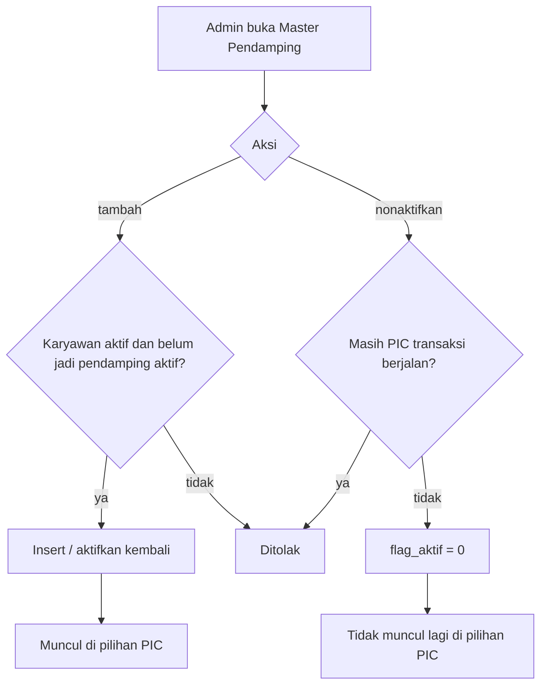
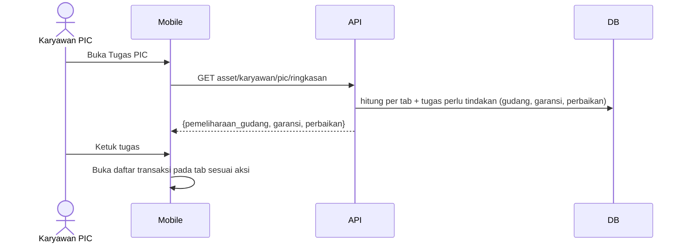
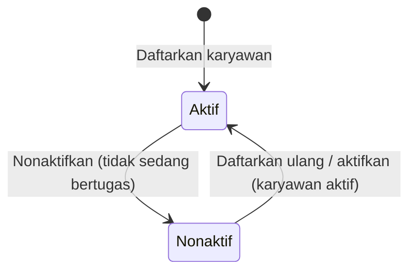
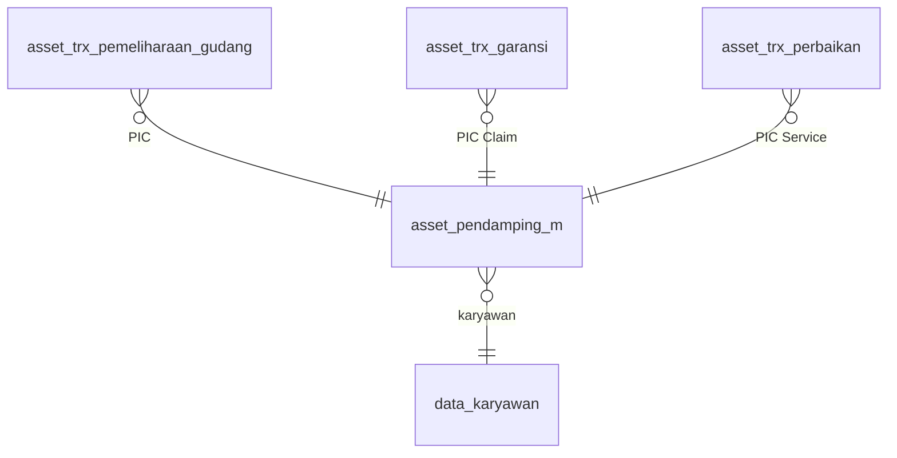

# Dokumentasi Teknis & Manual Book — Master Pendamping & Tugas PIC

> Dokumen ini disusun **dari source code lokal** (`API/` Lumen dan `MOBILE/` Flutter) per 8 Oktober 2026. Cakupan: **master PIC Pendamping** (`asset_pendamping_m`) dan **dashboard Tugas PIC** yang menggabungkan tugas Pemeliharaan Gudang (PML01), Klaim Garansi (PML03), dan Perbaikan (PML02).
> Bagian yang tidak ditemukan ditandai **⚠️ Belum ditemukan**, asumsi ditandai **⚠️ Asumsi**.
> Contoh ID/nama pada payload adalah **data sintetis**.

---

## 1. Informasi Dokumen

| Informasi | Nilai |
|---|---|
| Nama Fitur | Master Pendamping (admin) dan Tugas PIC (karyawan) |
| Kode Fitur | Pendukung PML01 gudang, PML02, PML03 (tanpa nomor transaksi sendiri) |
| Modul | Asset Management — Pemeliharaan Aset |
| Backend | Laravel **Lumen ^10.0**, PHP ^8.1, JWT, Query Builder |
| Database | Tabel `asset_pendamping_m` (di-ALTER lewat `Claude outputs/sql-pml01-pemeliharaan-gudang.sql`, blok 0). ⚠️ SQL manual |
| Mobile | Flutter (`professional_flutter_3_35`), `flutter_bloc`, `dio` |
| Web | ⚠️ Belum ditemukan |
| Test otomatis | API: `AssetPemeliharaanGudangTest::test_pendamping_master_store_and_reactivate` (+ ringkasan PIC di `AssetGaransiTest`, `AssetPerbaikanTest`, `AssetPemeliharaanGudangTest`) · Mobile: `test/asset/asset_pic_dashboard_test.dart` (5 test) |
| Versi dokumen | 1.3 — 22 Oktober 2026 |
| Dokumen terkait | Pemeliharaan Gudang, Klaim Garansi, Perbaikan |

## 2. Daftar Isi

Lihat panel navigasi di samping.

## 3. Quick Overview

Tiga alur pemeliharaan membutuhkan **PIC** yang menjalankan tugas di lapangan: PIC Pendamping (PML01 gudang), PIC Claim (PML03), dan PIC Service (PML02). Ketiganya dipilih dari satu **master pendamping**. Admin mendaftarkan karyawan aktif sebagai pendamping, dan dapat menonaktifkannya (tidak dihapus karena dirujuk FK). Karyawan yang menjadi PIC melihat semua tugasnya di satu halaman **Tugas PIC**: jumlah per tab (Jadwal/Proses/Selesai) dan daftar tugas yang menunggu tindakannya.

| Aspek | Ringkasan |
|---|---|
| Aktor | Admin Asset (master), Karyawan PIC (dashboard), Sistem |
| Tabel utama | `asset_pendamping_m` |
| Endpoint | 4 master (admin) + 1 ringkasan (karyawan) |
| Pembatasan | Pendamping yang masih menjadi PIC transaksi berjalan tidak bisa dinonaktifkan |

## 4. Ringkasan Fitur

| No | Fitur | Aktor |
|---|---|---|
| 1 | Lihat master pendamping (filter aktif) | Admin |
| 2 | Daftarkan karyawan aktif sebagai pendamping / aktifkan kembali | Admin |
| 3 | Nonaktifkan / aktifkan pendamping | Admin |
| 4 | Dashboard Tugas PIC: jumlah per tab dan tugas perlu tindakan | Karyawan PIC |
| 5 | Pintasan dari tugas ke daftar transaksi yang sesuai | Karyawan PIC |

## 5. Tujuan Fitur

### 5.1 Tujuan Bisnis (diturunkan dari kode)

- Penanggung jawab lapangan dipilih dari daftar resmi, bukan karyawan sembarang.
- Satu karyawan satu baris master; riwayat penugasan tetap utuh walau pendamping dinonaktifkan.
- PIC cukup membuka satu halaman untuk semua tugasnya.

### 5.2 Tujuan Sistem

- Menjaga integritas FK dari tiga tabel transaksi ke master.
- Mencegah penonaktifan pendamping yang sedang bertugas.
- Menyediakan ringkasan tugas dengan satu panggilan API.

## 6. Aktor

| Aktor | Peran |
|---|---|
| Admin Asset | Mengelola master pendamping |
| Karyawan PIC | Karyawan yang ditunjuk pada transaksi; memakai dashboard Tugas PIC |
| Sistem | Memvalidasi status karyawan dan penugasan aktif |

## 7. Hak Akses

| Aksi | Admin | Karyawan |
|---|---|---|
| Master pendamping (daftar, opsi, tambah, status) | ✅ | ❌ |
| Ringkasan Tugas PIC | ❌ (bukan tujuan) | ✅ (hanya tugas milik sendiri) |

Ringkasan PIC dihitung dari `id_karyawan` pada token; karyawan tanpa penugasan mendapat nol dan daftar kosong.

## 8. Terminologi

| Istilah | Arti |
|---|---|
| Pendamping | Baris master `asset_pendamping_m` |
| PIC | Pendamping yang ditunjuk pada transaksi (`id_pic_pendamping`) |
| Perlu tindakan | Transaksi yang menunggu langkah PIC (mis. terima, kirim, isi hasil) |
| Aktif | `flag_aktif = 1` |

## 9. Business Rules

### BR-001 — Satu baris per karyawan
Unik `(id_company, id_karyawan)`. Mendaftarkan ulang karyawan nonaktif mengaktifkannya kembali dan menyegarkan NIK/nama.

### BR-002 — Hanya karyawan aktif
Mendaftarkan atau mengaktifkan pendamping mensyaratkan karyawan berstatus aktif. Pesan: *"Karyawan tidak ditemukan atau tidak aktif."*

### BR-003 — Tidak ganda
Karyawan yang sudah menjadi pendamping aktif ditolak: *"Karyawan sudah terdaftar sebagai pendamping."*

### BR-004 — Nonaktifkan dengan syarat
Pendamping tidak bisa dinonaktifkan bila masih menjadi PIC transaksi berjalan di PML01 gudang, PML03, atau PML02 (`hasActivePic`). Pesan: *"Pendamping masih menjadi PIC pemeliharaan gudang yang berjalan. Ganti PIC terlebih dahulu."*

### BR-005 — Hanya pendamping aktif yang dapat dipilih
Form buat/ubah PML01 gudang, PML03, dan PML02 hanya menawarkan pendamping aktif yang karyawannya masih aktif.

### BR-006 — Tidak dihapus
Pendamping dinonaktifkan, tidak dihapus, karena dirujuk FK transaksi.

### BR-007 — Ringkasan PIC
Menampilkan, per alur, jumlah transaksi milik PIC per tab dan daftar tugas yang perlu tindakan. Tab: `jadwal` (menunggu serah terima/penjadwalan), `proses`, `selesai`.

## 10. Business Flow

1. Admin membuka Pemeliharaan → ikon **Master Pendamping**.
2. Admin menambahkan karyawan aktif sebagai pendamping.
3. Admin memilih pendamping tersebut sebagai PIC saat membuat PM gudang, klaim garansi, atau perbaikan.
4. Karyawan PIC menerima notifikasi, membuka **Tugas PIC**, dan mengikuti tugas.
5. Bila pendamping tidak lagi bertugas, admin menonaktifkannya (setelah mengganti PIC pada transaksi berjalan).

## 11. Flow Berdasarkan Role

### 11.1 Admin Asset
Tambah/aktifkan/nonaktifkan pendamping; pilih PIC pada transaksi.

### 11.2 Karyawan PIC
Buka Tugas PIC → lihat jumlah per tab dan tugas → ketuk tugas/angka untuk membuka daftar transaksi pada tab yang sesuai.

### 11.3 System
Validasi karyawan aktif, cegah penonaktifan bertugas, hitung ringkasan.

## 12. Flow Diagram



## 13. Sequence Diagram



## 14. Status Transaksi

Master tidak punya alur status; hanya `flag_aktif` (`1` aktif, `0` nonaktif). Status tugas mengikuti fase masing-masing alur.

## 15. State Transition



## 16. Struktur Database

| Tabel | Fungsi |
|---|---|
| `asset_pendamping_m` | Master pendamping |
| `asset_trx_pemeliharaan_gudang`, `asset_trx_garansi`, `asset_trx_perbaikan` | Merujuk master lewat `id_asset_pendamping_m` dan menyimpan snapshot PIC |
| `data_karyawan` | Sumber identitas dan status karyawan |

## 17. Relasi Database



## 18. Data Dictionary

### 18.1 asset_pendamping_m

| Kolom | Tipe | Keterangan |
|---|---|---|
| `id_asset_pendamping_m` | varchar(50) PK | `id_company`+`YYYYMM`+3 digit |
| `id_karyawan` | varchar(150) | Karyawan; unik per perusahaan |
| `nama_karyawan`, `nik` | varchar | Snapshot saat didaftarkan/diaktifkan |
| `flag_aktif` | enum('0','1') | Default `1`; `0` = tidak dapat dipilih lagi |
| `id_company` | varchar(50) | |
| `tgl_input`, `user_input` | timestamp, varchar | Pendaftaran |
| `tgl_update`, `user_update` | timestamp null, varchar | Perubahan status |

Indeks: unik `apm_company_karyawan_uq (id_company, id_karyawan)`.

### 18.2 Respons master (list)

`{id_asset_pendamping_m, id_karyawan, nik, nama_karyawan, flag_aktif (bool), karyawan_aktif (bool)}`; `karyawan_aktif` dari status `data_karyawan`.

## 19. Database Index

Unik `apm_company_karyawan_uq`; indeks PIC pada tabel transaksi (`…_company_pic_fase_idx`) mendukung ringkasan tugas.

## 20. Backend Architecture

| Lapisan | File |
|---|---|
| Route | `RouteAsset.php` (`pendamping/*`, `karyawan/pic/ringkasan`) |
| Controller master | `Asset/Admin/AssetAdminPendamping_c.php` |
| Controller ringkasan | `Asset/Karyawan/AssetKaryawanPic_c.php` |
| Model | `Models/Asset/AssetPendamping_m.php` |
| Sumber ringkasan | `countByTabForPic` dan `getPendingForPic` di `AssetPemeliharaanGudang_m`, `AssetGaransi_m`, `AssetPerbaikan_m` |

## 21. Backend Business Logic

### 21.1 Daftar — `getList`
Gabung `data_karyawan` untuk `karyawan_aktif`; filter opsional `aktif`; urut nama.

### 21.2 Opsi — `getOptions`
Karyawan aktif yang belum menjadi pendamping aktif.

### 21.3 Tambah — `store`
Validasi karyawan aktif; bila baris ada: nonaktif → diaktifkan kembali (NIK/nama disegarkan), aktif → ditolak; bila belum ada → insert dengan nomor urut.

### 21.4 Status — `setAktif`
Aktivasi butuh karyawan aktif; nonaktif ditolak bila `hasActivePic` benar di salah satu dari tiga alur.

### 21.5 Pendamping untuk pilihan PIC — `getList(…, true)` + `findAktif`
Dipakai `getAdminOptions` setiap alur dan `picFields` saat menyimpan.

### 21.6 Ringkasan PIC — `getRingkasanPic`
Memanggil tiga pasang fungsi hitung/daftar dengan `id_company` dan `id_karyawan` token.

## 22. Dampak terhadap asset_data

Tidak ada. Fitur ini tidak mengubah `asset_data`.

## 23. API Documentation

| Kode | Method | Path | Aktor |
|---|---|---|---|
| API-001 | GET | `asset/pendamping` | Admin |
| API-002 | GET | `asset/pendamping/options` | Admin |
| API-003 | POST | `asset/pendamping` | Admin |
| API-004 | POST | `asset/pendamping/{id}/status` | Admin |
| API-005 | GET | `asset/karyawan/pic/ringkasan` | Karyawan |

## 24. Detail Setiap API

### API-001 — Daftar
Query `aktif` (`0|1`, opsional). Respons `{records: [...]}` (lihat §18.2).

### API-002 — Opsi
`{karyawan: [{id_karyawan, nik, nama_karyawan}]}`.

### API-003 — Tambah
```json
{"id_karyawan": "EMP-2"}
```
Respons: baris master hasil tambah/aktivasi.

### API-004 — Status
```json
{"flag_aktif": "0"}
```
`flag_aktif` ∈ `0|1`.

### API-005 — Ringkasan Tugas PIC
```json
{
  "pemeliharaan_gudang": {"jumlah": {"jadwal": 1, "proses": 0, "selesai": 3},
    "perlu_tindakan": [{"id": "…", "no_trx": "PML01-3-202610001", "fase_pemeliharaan": "penjadwalan",
      "tgl_pemeliharaan": "…", "jam_pemeliharaan": "…", "jumlah_asset": 2, "aksi": "hasil"}]},
  "garansi": {"jumlah": {"jadwal": 0, "proses": 1, "selesai": 0}, "perlu_tindakan": [...]},
  "perbaikan": {"jumlah": {"jadwal": 0, "proses": 0, "selesai": 0}, "perlu_tindakan": []}
}
```
Nilai `aksi`: `hasil` (gudang; langkah Mulai sudah dihapus), `terima`/`klaim` (garansi), `terima`/`service` (perbaikan).

## 25. Mobile Architecture

| Lapisan | File |
|---|---|
| Master: model/API | `AssetPendamping` di `mAssetPemeliharaanGudang.dart`; `AssetPendampingApi` di `assetPemeliharaanGudangApi.dart` |
| Master: bloc/UI | `Bloc/Asset/AssetPendampingBloc.dart`; `UI/Modul/Asset/Pemeliharaan/Pic/HalamanPendampingAsset.dart` |
| Tugas PIC: model/API | `lib/Repository/Model/Asset/mAssetPic.dart`; `lib/Repository/Service/assetPicApi.dart` |
| Tugas PIC: bloc/UI | `Bloc/Asset/AssetPicBloc.dart`; `UI/Modul/Asset/Pemeliharaan/Pic/HalamanAssetPic.dart` |
| Navigasi | `NavigateToAssetPendamping`, `NavigateToAssetPic`; rute `/asset_admin_pendamping`, `/asset_pic` |

## 26. Mobile Screen

### 26.1 Master Pendamping — `HalamanPendampingAsset`
Daftar pendamping (aktif/nonaktif), tombol tambah (memilih karyawan dari opsi), saklar status. Menonaktifkan meminta konfirmasi dahulu. Karyawan yang tidak aktif lagi ditandai dan saklarnya tidak dapat diaktifkan.

### 26.2 Tugas PIC — `HalamanAssetPic`
Ringkasan jumlah Jadwal/Proses/Selesai per alur (ketuk angka membuka daftar pada tab itu), bagian **Perlu Tindakan** berisi kartu tugas (label aksi: Isi Hasil, Terima Aset, Urus Klaim, Urus Service), keadaan kosong, dan keadaan gagal dengan coba lagi.

### 26.3 Entry point
Master: ikon **Kelola Pendamping** pada halaman **Pemeliharaan** admin (tampil di tab Gudang). Tugas PIC: satu kartu **Tugas PIC** di beranda Asset (menggantikan kartu terpisah per alur).

## 27. Mobile → API

| Aksi UI | Method | Endpoint |
|---|---|---|
| Muat master | GET | `asset/pendamping` |
| Muat opsi karyawan | GET | `asset/pendamping/options` |
| Tambah | POST | `asset/pendamping` |
| Aktif/nonaktif | POST | `asset/pendamping/{id}/status` |
| Muat Tugas PIC | GET | `asset/karyawan/pic/ringkasan` |

## 28. API → Mobile

Master dipetakan ke `AssetPendamping`; ringkasan ke `AssetPicRingkasan` (`AssetPicSection` per alur: `AssetPicJumlah` + `AssetPicTugas`). Data yang hilang menjadi nol/kosong.

## 29. Mapping Mobile → API → Database

| Aksi UI | Field API | Kolom DB |
|---|---|---|
| Pilih karyawan | `id_karyawan` | `asset_pendamping_m.id_karyawan` |
| Saklar status | `flag_aktif` | `flag_aktif` |

## 30. Mapping Database → API → Mobile

| Kolom DB | Field API | Tampil di |
|---|---|---|
| `flag_aktif` | `flag_aktif` | Saklar/penanda |
| `data_karyawan.status` | `karyawan_aktif` | Penanda karyawan tidak aktif |
| Jumlah per fase PIC | `jumlah.jadwal/proses/selesai` | Angka ringkasan |

## 31. Validation

### 31.1 Mobile
Karyawan wajib dipilih saat menambah.

### 31.2 Backend
`id_karyawan` wajib (≤150), `flag_aktif` ∈ `0|1`, `aktif` ∈ `0|1`; aturan bisnis §9.

### 31.3 Database
Enum `flag_aktif`; unik per karyawan; FK dari tabel transaksi.

## 32. Error Handling

| Kondisi | Kode | Contoh pesan |
|---|---|---|
| Validasi | 422 | "Karyawan wajib dipilih." |
| Aturan bisnis | 422 `BUSINESS_RULE_VIOLATION` | "Karyawan sudah terdaftar sebagai pendamping." |
| Bukan admin | 403 | "Pengguna tidak memiliki akses admin asset." |
| Tidak terautentikasi | 401 `UNAUTHORIZED` | — |
| Sistem | 500 `SYSTEM_ERROR` | Pesan umum |

## 33. Audit Trail

`user_input`/`tgl_input` saat didaftarkan; `user_update`/`tgl_update` saat diaktifkan ulang atau status berubah (format `nik - nama`).

## 34. Notification

Fitur ini tidak mengirim notifikasi sendiri. Penugasan PIC memicu notifikasi dari alur masing-masing: `pemeliharaan_gudang.ditugaskan`, `garansi.ditugaskan`, `perbaikan.ditugaskan`.

## 35. Security

JWT; master admin-only; ringkasan dibatasi ke `id_karyawan` token dan `id_company`; transaksi + kunci perusahaan pada tulis.

## 36. Manual Book User/Admin

### A. Admin — Mendaftarkan pendamping
Pemeliharaan → ikon **Master Pendamping** → tambah → pilih karyawan aktif.

### B. Admin — Menonaktifkan pendamping
Matikan saklar. Bila ditolak karena masih bertugas, ganti PIC pada transaksi berjalan lebih dulu.

### C. Karyawan — Memakai Tugas PIC
Beranda Asset → **Tugas PIC**. Ketuk angka untuk membuka daftar pada tab itu, atau ketuk kartu **Perlu Tindakan** untuk membuka daftar yang sesuai langkah.

## 37. Kondisi Button

| Tombol | Syarat |
|---|---|
| Tambah pendamping | Admin |
| Saklar nonaktif | Pendamping tidak sedang menjadi PIC transaksi berjalan |
| Kartu tugas | Ada tugas perlu tindakan |

## 38. Testing Scenario

| No | Skenario | Hasil |
|---|---|---|
| T-01 | Tambah karyawan aktif | Baris master aktif |
| T-02 | Tambah karyawan yang sudah aktif | Ditolak |
| T-03 | Daftarkan ulang karyawan nonaktif | Aktif kembali |
| T-04 | Nonaktifkan pendamping yang masih PIC | Ditolak |
| T-05 | Ringkasan PIC dengan tugas dan tanpa tugas | Jumlah dan daftar sesuai; nol bila kosong |
| T-06 | Ketuk tugas/angka | Membuka daftar tab yang sesuai |
| T-07 | Gagal memuat ringkasan | Pesan + coba lagi |

## 39. Temuan Ketidaksesuaian

| ID | Temuan |
|---|---|
| INC-01 | PML01 karyawan (konteks karyawan) memakai PIC Pendamping dari alurnya sendiri dan tidak termasuk dashboard Tugas PIC |
| INC-02 | Tugas diketuk membuka **daftar**, bukan detail, karena navigasi detail memanggil bloc daftar milik halaman asal |
| INC-03 | Pesan penolakan nonaktif menyebut "pemeliharaan gudang" walau pemeriksaan mencakup garansi dan perbaikan |

## 40. Edge Case

- Karyawan pendamping menjadi tidak aktif: tetap di master tetapi tidak muncul sebagai pilihan PIC (`karyawan_aktif = false`).
- Pendamping didaftarkan ulang setelah dinonaktifkan: baris lama dipakai, FK transaksi lama tetap valid.
- PIC tanpa tugas: ringkasan nol dan keadaan kosong.

## 41. Potential Bug / Technical Risk

### RISK-001 — Skema dari SQL manual (TINGGI)
ALTER `asset_pendamping_m` ada di SQL PML01 gudang; tanpa itu `flag_aktif` tidak ada.

### RISK-002 — Pesan penolakan menyesatkan (RENDAH)
Lihat INC-03.

### RISK-003 — Ringkasan memanggil banyak query (RENDAH)
Enam fungsi hitung/daftar per panggilan; aman pada volume saat ini.

## 42. Dependency

`Asset_m/Asset_c`, `AssetPemeliharaanGudang_m`, `AssetGaransi_m`, `AssetPerbaikan_m`, `data_karyawan`.

## 43. Source Code Reference

| Area | Lokasi |
|---|---|
| Model master | `API/app/Models/Asset/AssetPendamping_m.php` |
| Controller | `API/app/Http/Controllers/Asset/Admin/AssetAdminPendamping_c.php`, `Karyawan/AssetKaryawanPic_c.php` |
| SQL | `Claude outputs/sql-pml01-pemeliharaan-gudang.sql` (blok 0) |
| Mobile master | `MOBILE/lib/UI/Modul/Asset/Pemeliharaan/Pic/HalamanPendampingAsset.dart` |
| Mobile PIC | `MOBILE/lib/UI/Modul/Asset/Pemeliharaan/Pic/HalamanAssetPic.dart`, `Bloc/Asset/AssetPicBloc.dart` |
| Test mobile | `MOBILE/test/asset/asset_pic_dashboard_test.dart` |

## 44. Developer Notes

- Menambah alur baru yang memakai PIC: tambahkan `countByTabForPic`/`getPendingForPic`/`hasActivePic` di modelnya, daftarkan ke `getRingkasanPic` dan `AssetPendamping_m::setAktif`.
- Kunci teks dashboard ada di grup `garansi` asset.json (`pic_*`, `menu_pic_gabungan*`); cek duplikat kunci JSON sebelum menambah.
- `fromAssetPic` pada event navigasi memicu pemuatan ulang dashboard saat kembali.

## 45. End-to-End Traceability

| Kebutuhan | Rule | API | Mobile | DB |
|---|---|---|---|---|
| PIC dari daftar resmi | BR-005 | API-001/002 | Form PIC alur | `asset_pendamping_m` |
| Tidak menonaktifkan yang bertugas | BR-004 | API-004 | Saklar status | `…_pic`, `flag_aktif` |
| Satu halaman tugas | BR-007 | API-005 | `HalamanAssetPic` | tabel transaksi |

### 45.4 Walkthrough Lengkap dengan Contoh Data

Berbeda dari dokumen transaksi lain, fitur ini **tidak memiliki nomor transaksi, status asset, `asset_trx_log`, maupun notifikasi sendiri**. Walkthrough berikut mengikuti **siklus hidup master pendamping**: admin mendaftarkan dua karyawan, mencoba mendaftarkan ulang, mencoba menonaktifkan pendamping yang masih bertugas, mengganti PIC lalu menonaktifkannya, mengaktifkan kembali, dan terakhir PIC melihat ringkasan tugasnya. Setiap langkah menjelaskan apa yang dilakukan di mobile, apa yang dikirim, apa yang diproses API, dan apa yang tersimpan di database. Data bersifat **sintetis**, tetapi nama kolom, urutan proses, dan pesan diambil dari kode (`AssetPendamping_m`, `AssetAdminPendamping_c`, `AssetKaryawanPic_c`).

| Langkah | Pelaku | Aksi | Endpoint |
|:---:|---|---|---|
| 0 | Admin | Membuka **Master Pendamping**, memuat daftar dan opsi | API-001 `GET /asset/pendamping`, API-002 `GET …/options` |
| 1 | Admin | **Tambah** Tono sebagai pendamping | API-003 `POST /asset/pendamping` |
| 2 | Admin | **Tambah** Rina sebagai pendamping | API-003 |
| 3 | Admin | Menambah Tono lagi (ditolak) | API-003 |
| 4 | Admin | **Nonaktifkan** Tono saat masih menjadi PIC (ditolak) | API-004 `POST /asset/pendamping/{id}/status` |
| 5 | Admin | Ganti PIC pada transaksi, lalu **Nonaktifkan** Tono | API-004 |
| 6 | Admin | **Aktifkan kembali** Tono | API-004 atau API-003 |
| 7 | Karyawan PIC | Membuka **Tugas PIC** | API-005 `GET /asset/karyawan/pic/ringkasan` |

#### Data awal

Company `CMP001`. Tanggal 22 Oktober 2026, periode ID `202610`. Tabel `asset_pendamping_m` masih kosong.

**`data_karyawan`** (semua aktif)

| id_karyawan | nik | nama_lengkap | Peran |
|---|---|---|---|
| KRY0020 | EMP-020 | Tono Pendamping | Calon pendamping |
| KRY0021 | EMP-021 | Rina Pendamping | Calon pendamping |
| KRY0099 | ADM-001 | Siti Admin | Admin Asset (aktor) |

Penomoran: `id_asset_pendamping_m = id_company + YYYYMM + 3 digit`. Satu karyawan hanya boleh punya **satu baris** per company (unik `id_company, id_karyawan`).

---

#### Langkah 0 — Admin membuka Master Pendamping

**Mobile:** Pemeliharaan → ikon **Master Pendamping** → `/asset_admin_pendamping` → `AssetPendampingBloc` memuat daftar dan opsi (`AssetPendampingApi`).

**Dikirim**
```http
GET /asset/pendamping
GET /asset/pendamping/options
Authorization: Bearer <access_token_admin>
```
`aktif=0|1` bersifat opsional pada daftar; nilai lain ditolak ("Filter pendamping tidak valid.").

**Diproses API:** `getList` menggabungkan `data_karyawan` untuk `karyawan_aktif`, urut nama; `getOptions` mengembalikan **karyawan aktif yang belum menjadi pendamping aktif**. **Database:** hanya `SELECT`.

**Diterima mobile:** daftar `{"records": []}` (kosong) dan opsi
```json
{ "code": "SUCCESS", "message": "Opsi pendamping berhasil ditemukan.",
  "data": { "karyawan": [
    { "id_karyawan": "KRY0020", "nik": "EMP-020", "nama_karyawan": "Tono Pendamping" },
    { "id_karyawan": "KRY0021", "nik": "EMP-021", "nama_karyawan": "Rina Pendamping" } ] } }
```

#### Langkah 1 — Admin mendaftarkan Tono

**Dikirim**
```http
POST /asset/pendamping
```
```json
{ "id_karyawan": "KRY0020" }
```

**Diproses API** (`AssetAdminPendamping_c::store` → `AssetPendamping_m::store`, satu `DB::transaction`)
1. Validasi: `id_karyawan` wajib ("Karyawan wajib dipilih.").
2. `lockCompany`; `actorAdmin` (harus admin asset); `findActiveKaryawan` ("Karyawan tidak ditemukan atau tidak aktif.").
3. Cari baris yang sudah ada untuk karyawan itu (`FOR UPDATE`); belum ada → INSERT baris baru dengan nomor urut, `flag_aktif = 1`, snapshot NIK dan nama.

**Hasil database** — `asset_pendamping_m` (1 baris baru)

| Kolom | Nilai |
|---|---|
| id_asset_pendamping_m | CMP001202610001 |
| id_karyawan / nik / nama_karyawan | KRY0020 / EMP-020 / Tono Pendamping |
| flag_aktif | **1** |
| id_company | CMP001 |
| tgl_input / user_input | 2026-10-22 09:00:00 / ADM-001 - Siti Admin |
| tgl_update / user_update | NULL / `''` |

**Diterima mobile** (HTTP 201)
```json
{ "code": "CREATED", "message": "Pendamping berhasil ditambahkan.",
  "data": { "id_asset_pendamping_m": "CMP001202610001", "id_karyawan": "KRY0020", "nik": "EMP-020",
            "nama_karyawan": "Tono Pendamping", "flag_aktif": true } }
```

#### Langkah 2 — Admin mendaftarkan Rina

Permintaan dan proses sama dengan langkah 1 dengan `{"id_karyawan": "KRY0021"}`. **Hasil database:** baris kedua `CMP001202610002` (KRY0021, EMP-021, Rina Pendamping, `flag_aktif = 1`, `tgl_input` 2026-10-22 09:05:00). Respons `CREATED` "Pendamping berhasil ditambahkan.".

Kedua pendamping kini ditawarkan sebagai pilihan **PIC** pada form buat atau ubah Pemeliharaan Gudang (PML01), Klaim Garansi (PML03), dan Perbaikan (PML02), hanya bila **karyawannya masih aktif** (`findAktif`).

#### Langkah 3 — Admin mencoba mendaftarkan Tono lagi

**Dikirim:** `POST /asset/pendamping` dengan `{"id_karyawan": "KRY0020"}`.

**Diproses API:** baris sudah ada dan `flag_aktif = 1` → ditolak. **Respons** (HTTP 422)
```json
{ "code": "BUSINESS_RULE_VIOLATION", "message": "Karyawan sudah terdaftar sebagai pendamping." }
```
**Database:** tidak berubah. Karyawan ini juga sudah tidak muncul di opsi (API-002).

#### Langkah 4 — Admin mencoba menonaktifkan Tono yang masih menjadi PIC

Misalkan Tono (`CMP001202610001`) masih menjadi PIC Perbaikan `PML02-202610001` yang berjalan.

**Dikirim**
```http
POST /asset/pendamping/CMP001202610001/status
```
```json
{ "flag_aktif": "0" }
```

**Diproses API** (`setAktif`): baris dikunci ("Pendamping tidak ditemukan." bila tidak ada). Karena menonaktifkan, API memeriksa **`hasActivePic`** pada ketiga alur (PML01 gudang, PML03 garansi, PML02 perbaikan). PIC masih memegang transaksi yang belum selesai/dibatalkan → ditolak. **Respons** (HTTP 422)
```json
{ "code": "BUSINESS_RULE_VIOLATION",
  "message": "Pendamping masih menjadi PIC pemeliharaan gudang yang berjalan. Ganti PIC terlebih dahulu." }
```
Pesan ini **selalu menyebut "pemeliharaan gudang"** walaupun penyebabnya klaim garansi atau perbaikan. **Database:** tidak berubah.

#### Langkah 5 — Admin mengganti PIC lalu menonaktifkan Tono

**Mobile:** admin membuka transaksi yang bersangkutan (di sini Perbaikan `PML02-202610001`, masih `menunggu_serah_terima`) → **Ubah** → memilih Rina sebagai PIC (lihat dokumen Perbaikan, API-004). Setelah tidak ada transaksi berjalan yang memakai Tono, admin mengulang permintaan status:

**Dikirim**
```http
POST /asset/pendamping/CMP001202610001/status
```
```json
{ "flag_aktif": "0" }
```

**Diproses API:** `hasActivePic` kini salah di ketiga alur, sehingga UPDATE dijalankan.

**Hasil database**

| Kolom (`asset_pendamping_m` `…001`) | Sebelum | Sesudah |
|---|---|---|
| flag_aktif | 1 | **0** |
| tgl_update | NULL | 2026-10-22 10:00:00 |
| user_update | `''` | ADM-001 - Siti Admin |

**Diterima mobile** (HTTP 200)
```json
{ "code": "UPDATED", "message": "Status pendamping berhasil diperbarui.",
  "data": { "id_asset_pendamping_m": "CMP001202610001", "id_karyawan": "KRY0020", "nik": "EMP-020",
            "nama_karyawan": "Tono Pendamping", "flag_aktif": false } }
```
Pendamping **tidak dihapus** karena dirujuk foreign key transaksi lama. Tono tidak lagi muncul di pilihan PIC, dan transaksi lama tetap menyimpan snapshot PIC-nya.

#### Langkah 6 — Admin mengaktifkan kembali Tono

Ada dua jalur dengan hasil sama:

- **Lewat status:** `POST /asset/pendamping/CMP001202610001/status` dengan `{"flag_aktif": "1"}`. API memeriksa karyawan masih aktif ("Karyawan tidak ditemukan atau tidak aktif.").
- **Lewat tambah:** `POST /asset/pendamping` dengan `{"id_karyawan": "KRY0020"}`. Karena baris lama berstatus nonaktif, API **mengaktifkan kembali** baris itu (bukan membuat baris baru) dan menyegarkan NIK dan nama dari `data_karyawan`.

**Hasil database** (jalur tambah)

| Kolom (`asset_pendamping_m` `…001`) | Sebelum | Sesudah |
|---|---|---|
| flag_aktif | 0 | **1** |
| nik / nama_karyawan | EMP-020 / Tono Pendamping | disegarkan dari `data_karyawan` |
| tgl_update / user_update | 2026-10-22 10:00:00 / ADM-001 - Siti Admin | 2026-10-22 11:00:00 / ADM-001 - Siti Admin |

Tidak ada baris baru: tetap satu baris per karyawan. Respons HTTP 201 `CREATED` pada jalur tambah, 200 `UPDATED` pada jalur status.

#### Langkah 7 — PIC membuka Tugas PIC

**Mobile:** karyawan PIC (Tono, `KRY0020`) → **Tugas PIC** → `/asset_pic` → `AssetPicBloc` → `AssetPicApi` memanggil ringkasan.

**Dikirim**
```http
GET /asset/karyawan/pic/ringkasan
Authorization: Bearer <access_token_tono>
```

**Diproses API** (`AssetKaryawanPic_c::getRingkasanPic`): memakai `id_company` dan `id_karyawan` dari token, lalu memanggil `countByTabForPic` dan `getPendingForPic` pada **tiga** model: `AssetPemeliharaanGudang_m`, `AssetGaransi_m`, `AssetPerbaikan_m`. Transaksi dihitung bila `id_pic_pendamping` header = karyawan itu. **Database:** hanya `SELECT`. Pemeliharaan **karyawan** (PML01 karyawan) tidak masuk ringkasan ini; PIC Pendamping-nya memakai menu dan endpoint karyawan tersendiri.

**Diterima mobile** (contoh: Tono punya 1 pemeliharaan gudang di tab jadwal, 1 klaim garansi dalam proses, dan 3 pemeliharaan gudang selesai)
```json
{
  "code": "SUCCESS", "message": "Ringkasan tugas PIC berhasil ditemukan.",
  "data": {
    "pemeliharaan_gudang": {
      "jumlah": { "jadwal": 1, "proses": 0, "selesai": 3 },
      "perlu_tindakan": [ { "id": "CMP001202610003", "no_trx": "PML01-3-202610003",
        "fase_pemeliharaan": "penjadwalan", "tgl_pemeliharaan": "2026-10-24", "jam_pemeliharaan": "09:00:00",
        "jumlah_asset": 1, "aksi": "hasil" } ] },
    "garansi": {
      "jumlah": { "jadwal": 0, "proses": 1, "selesai": 0 },
      "perlu_tindakan": [ { "id": "CMP001202610001", "no_trx": "PML03-202610001", "aksi": "klaim" } ] },
    "perbaikan": { "jumlah": { "jadwal": 0, "proses": 0, "selesai": 0 }, "perlu_tindakan": [] }
  }
}
```
Nilai `aksi`: `hasil` (gudang), `terima` atau `klaim` (garansi), `terima` atau `service` (perbaikan). Tab: `jadwal` (menunggu serah terima atau penjadwalan), `proses`, `selesai`. Mobile menampilkan kartu per alur dan membuka detail transaksi sesuai `no_trx`.

---

#### Kondisi akhir data

`asset_pendamping_m`

| id | id_karyawan | nama_karyawan | flag_aktif | tgl_update |
|---|---|---|:---:|---|
| CMP001202610001 | KRY0020 | Tono Pendamping | 1 | 2026-10-22 11:00:00 |
| CMP001202610002 | KRY0021 | Rina Pendamping | 1 | NULL |

`asset_data`, `asset_trx_log`, dan `notif_data`: **tidak ada perubahan** dari fitur ini. Pendamping juga dapat terbuat otomatis oleh **Pemeliharaan Karyawan** saat admin mengatur pelaksanaan (`pendampingMasterId` menambah baris bila pendamping belum ada), tanpa melalui Master Pendamping.

---

#### Variasi

**Karyawan nonaktif di HR.** Pendamping tetap tercatat dengan `flag_aktif = 1`, tetapi `karyawan_aktif = false` pada daftar; ia **tidak** muncul di pilihan PIC (`findAktif` mensyaratkan karyawan aktif) dan tidak bisa diaktifkan kembali sampai karyawannya aktif.

**Filter daftar.** `GET /asset/pendamping?aktif=1` hanya pendamping aktif, `?aktif=0` hanya yang nonaktif; tanpa filter semuanya.

---

#### Kasus gagal yang umum

| Situasi | Langkah | HTTP | Pesan | Perubahan database |
|---|---|:---:|---|---|
| Filter `aktif` bukan 0/1 | 0 | 422 | Filter pendamping tidak valid. | Tidak ada |
| `id_karyawan` kosong | 1 | 422 | Karyawan wajib dipilih. | Tidak ada |
| Karyawan tidak ada atau tidak aktif | 1, 6 | 422 | Karyawan tidak ditemukan atau tidak aktif. | Tidak ada |
| Karyawan sudah menjadi pendamping aktif | 3 | 422 | Karyawan sudah terdaftar sebagai pendamping. | Tidak ada |
| `flag_aktif` bukan 0/1 | 4 | 422 | Status pendamping tidak valid. | Tidak ada |
| Pendamping tidak ditemukan | 4–6 | 422 | Pendamping tidak ditemukan. | Tidak ada |
| Nonaktifkan saat masih PIC transaksi berjalan | 4 | 422 | Pendamping masih menjadi PIC pemeliharaan gudang yang berjalan. Ganti PIC terlebih dahulu. | Tidak ada |
| Pengguna bukan admin asset | 0–6 | 403 / 422 | Pengguna tidak memiliki akses admin asset. / Pengguna tidak terdaftar sebagai admin asset. | Tidak ada |
| Kesalahan tak terduga | semua | 500 | Terjadi kesalahan saat memproses data pendamping. | Tidak ada |
| Token kedaluwarsa | semua | 401 | Token telah expired. Mobile me-refresh token sekali lalu mengulang request. | Tidak ada |

Semua pelanggaran aturan dilempar sebagai `InvalidArgumentException` di dalam `DB::transaction` dan dijawab `BUSINESS_RULE_VIOLATION`, sehingga seluruh perubahan request itu dibatalkan.

#### Ringkasan siapa mengerjakan apa

| Tahap | Mobile | API | Database |
|---|---|---|---|
| Daftar dan opsi | Master Pendamping | Gabung status karyawan, saring yang belum aktif | `SELECT` saja |
| Tambah | Pilih karyawan dari opsi | Validasi aktif, tolak ganda, aktifkan kembali baris lama | `asset_pendamping_m` (insert atau update) |
| Aktif/nonaktif | Saklar status | Cek karyawan aktif, cek `hasActivePic` tiga alur | `asset_pendamping_m` (`flag_aktif`) |
| Pilihan PIC | Dropdown PIC di form PM gudang, klaim, perbaikan | `getList` aktif dan `findAktif` saat menyimpan | `SELECT` saja |
| Tugas PIC | Kartu per alur dan daftar tugas | `countByTabForPic`, `getPendingForPic` pada tiga model | `SELECT` saja |

## 46. Ringkasan Database Impact

`asset_pendamping_m` di-ALTER: `flag_aktif`, `tgl_update`, `user_update`, unik `(id_company, id_karyawan)`. Tidak ada tabel baru.

## 47. Checklist Implementasi

### Database
- [x] SQL ALTER (di SQL PML01 gudang)
- [ ] SQL dijalankan di setiap environment

### Backend
- [x] Model, controller master, controller ringkasan, route, test

### Mobile
- [x] Master Pendamping, Tugas PIC, test

### Documentation
- [x] Dokumen ini

## 48. Changelog

| Versi | Tanggal | Perubahan |
|---|---|---|
| 1.0 | 8 Okt 2026 | Dokumen awal Master Pendamping & Tugas PIC |
| 1.1 | 12 Okt 2026 | Sinkronisasi dengan kode 12 Okt 2026: path file mobile mengikuti struktur folder baru (`UI/Modul/Asset/<Fitur>/` berhuruf kapital, model di `Repository/Model/Asset/`). `HalamanPendampingAsset` kini di `Pemeliharaan/Pic/` |
| 1.2 | 12 Okt 2026 | Tugas PIC pemeliharaan gudang: aksi `mulai` dihapus, kini selalu `hasil` (langkah Mulai PM dihapus); tab kartu tugas mengikuti `fase_pemeliharaan`. |
| 1.3 | 22 Okt 2026 | Menambah §45.4 *Walkthrough Lengkap dengan Contoh Data* (siklus master pendamping: daftar dan opsi, tambah, tolak ganda, nonaktif ditolak saat masih PIC, ganti PIC lalu nonaktifkan, aktifkan kembali, ringkasan Tugas PIC; kasus gagal). Catatan kode: ringkasan PIC hanya mencakup pemeliharaan gudang, garansi, dan perbaikan; pesan penolakan nonaktif selalu menyebut pemeliharaan gudang. |
