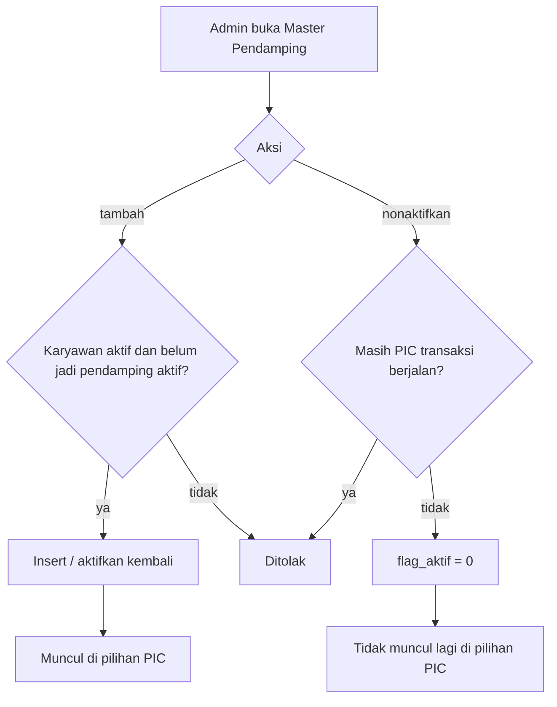
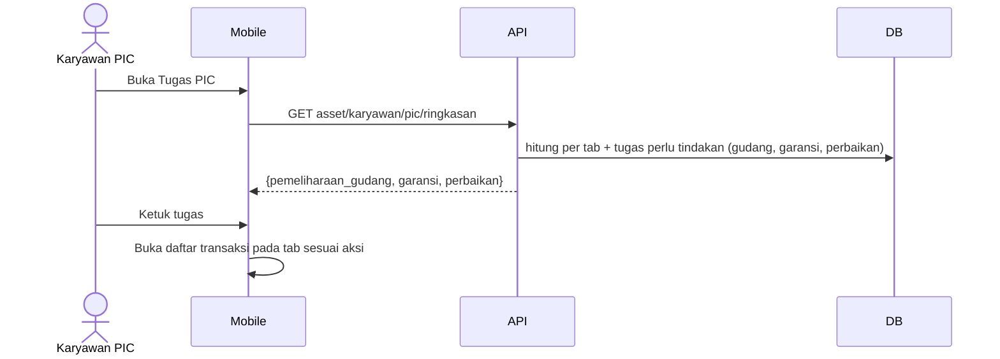
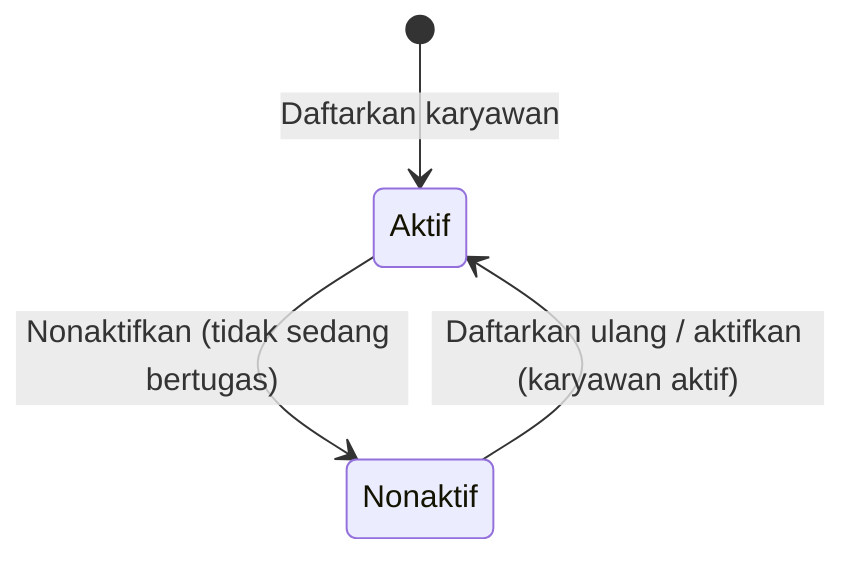
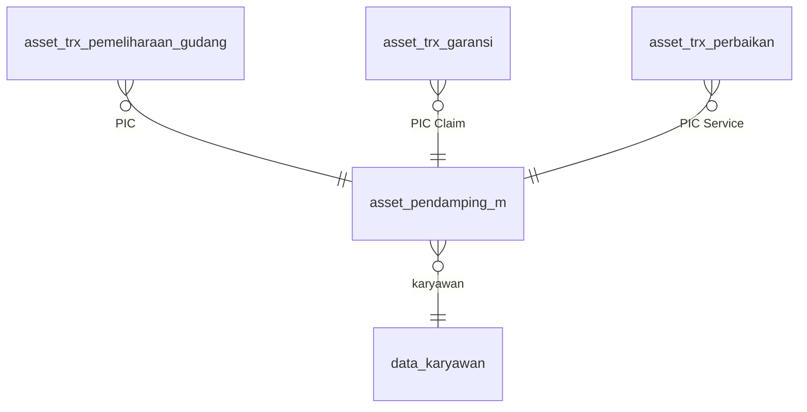

# Dokumentasi Teknis & Manual Book — Master Pendamping & Tugas PIC

> Dokumen ini disusun **dari source code lokal** (`API/` Lumen dan `MOBILE/` Flutter) per 8 Oktober 2026. Cakupan: **master PIC Pendamping** (`asset_pendamping_m`) dan **dashboard Tugas PIC** yang menggabungkan tugas Pemeliharaan Gudang (PML01), Klaim Garansi (PML03), dan Perbaikan (PML02).
> Bagian yang tidak ditemukan ditandai **⚠️ Belum ditemukan**, asumsi ditandai **⚠️ Asumsi**.
> Contoh ID/nama pada payload adalah **data sintetis**.

---

## 1. Informasi Dokumen

| Informasi | Nilai |
|---|---|
| Nama Fitur | Master Pendamping (admin) dan Tugas PIC (karyawan) |
| Kode Fitur | Pendukung PML01 gudang, PML02, PML03 (tanpa nomor transaksi sendiri) |
| Modul | Asset Management — Pemeliharaan Aset |
| Backend | Laravel **Lumen ^10.0**, PHP ^8.1, JWT, Query Builder |
| Database | Tabel `asset_pendamping_m` (di-ALTER lewat `Claude outputs/sql-pml01-pemeliharaan-gudang.sql`, blok 0). ⚠️ SQL manual |
| Mobile | Flutter (`professional_flutter_3_35`), `flutter_bloc`, `dio` |
| Web | ⚠️ Belum ditemukan |
| Test otomatis | API: `AssetPemeliharaanGudangTest::test_pendamping_master_store_and_reactivate` (+ ringkasan PIC di `AssetGaransiTest`, `AssetPerbaikanTest`, `AssetPemeliharaanGudangTest`) · Mobile: `test/asset/asset_pic_dashboard_test.dart` (5 test) |
| Versi dokumen | 1.2 — 12 Oktober 2026 |
| Dokumen terkait | Pemeliharaan Gudang, Klaim Garansi, Perbaikan |

## 2. Daftar Isi

Lihat panel navigasi di samping.

## 3. Quick Overview

Tiga alur pemeliharaan membutuhkan **PIC** yang menjalankan tugas di lapangan: PIC Pendamping (PML01 gudang), PIC Claim (PML03), dan PIC Service (PML02). Ketiganya dipilih dari satu **master pendamping**. Admin mendaftarkan karyawan aktif sebagai pendamping, dan dapat menonaktifkannya (tidak dihapus karena dirujuk FK). Karyawan yang menjadi PIC melihat semua tugasnya di satu halaman **Tugas PIC**: jumlah per tab (Jadwal/Proses/Selesai) dan daftar tugas yang menunggu tindakannya.

| Aspek | Ringkasan |
|---|---|
| Aktor | Admin Asset (master), Karyawan PIC (dashboard), Sistem |
| Tabel utama | `asset_pendamping_m` |
| Endpoint | 4 master (admin) + 1 ringkasan (karyawan) |
| Pembatasan | Pendamping yang masih menjadi PIC transaksi berjalan tidak bisa dinonaktifkan |

## 4. Ringkasan Fitur

| No | Fitur | Aktor |
|---|---|---|
| 1 | Lihat master pendamping (filter aktif) | Admin |
| 2 | Daftarkan karyawan aktif sebagai pendamping / aktifkan kembali | Admin |
| 3 | Nonaktifkan / aktifkan pendamping | Admin |
| 4 | Dashboard Tugas PIC: jumlah per tab dan tugas perlu tindakan | Karyawan PIC |
| 5 | Pintasan dari tugas ke daftar transaksi yang sesuai | Karyawan PIC |

## 5. Tujuan Fitur

### 5.1 Tujuan Bisnis (diturunkan dari kode)

- Penanggung jawab lapangan dipilih dari daftar resmi, bukan karyawan sembarang.
- Satu karyawan satu baris master; riwayat penugasan tetap utuh walau pendamping dinonaktifkan.
- PIC cukup membuka satu halaman untuk semua tugasnya.

### 5.2 Tujuan Sistem

- Menjaga integritas FK dari tiga tabel transaksi ke master.
- Mencegah penonaktifan pendamping yang sedang bertugas.
- Menyediakan ringkasan tugas dengan satu panggilan API.

## 6. Aktor

| Aktor | Peran |
|---|---|
| Admin Asset | Mengelola master pendamping |
| Karyawan PIC | Karyawan yang ditunjuk pada transaksi; memakai dashboard Tugas PIC |
| Sistem | Memvalidasi status karyawan dan penugasan aktif |

## 7. Hak Akses

| Aksi | Admin | Karyawan |
|---|---|---|
| Master pendamping (daftar, opsi, tambah, status) | ✅ | ❌ |
| Ringkasan Tugas PIC | ❌ (bukan tujuan) | ✅ (hanya tugas milik sendiri) |

Ringkasan PIC dihitung dari `id_karyawan` pada token; karyawan tanpa penugasan mendapat nol dan daftar kosong.

## 8. Terminologi

| Istilah | Arti |
|---|---|
| Pendamping | Baris master `asset_pendamping_m` |
| PIC | Pendamping yang ditunjuk pada transaksi (`id_pic_pendamping`) |
| Perlu tindakan | Transaksi yang menunggu langkah PIC (mis. terima, kirim, isi hasil) |
| Aktif | `flag_aktif = 1` |

## 9. Business Rules

### BR-001 — Satu baris per karyawan
Unik `(id_company, id_karyawan)`. Mendaftarkan ulang karyawan nonaktif mengaktifkannya kembali dan menyegarkan NIK/nama.

### BR-002 — Hanya karyawan aktif
Mendaftarkan atau mengaktifkan pendamping mensyaratkan karyawan berstatus aktif. Pesan: *"Karyawan tidak ditemukan atau tidak aktif."*

### BR-003 — Tidak ganda
Karyawan yang sudah menjadi pendamping aktif ditolak: *"Karyawan sudah terdaftar sebagai pendamping."*

### BR-004 — Nonaktifkan dengan syarat
Pendamping tidak bisa dinonaktifkan bila masih menjadi PIC transaksi berjalan di PML01 gudang, PML03, atau PML02 (`hasActivePic`). Pesan: *"Pendamping masih menjadi PIC pemeliharaan gudang yang berjalan. Ganti PIC terlebih dahulu."*

### BR-005 — Hanya pendamping aktif yang dapat dipilih
Form buat/ubah PML01 gudang, PML03, dan PML02 hanya menawarkan pendamping aktif yang karyawannya masih aktif.

### BR-006 — Tidak dihapus
Pendamping dinonaktifkan, tidak dihapus, karena dirujuk FK transaksi.

### BR-007 — Ringkasan PIC
Menampilkan, per alur, jumlah transaksi milik PIC per tab dan daftar tugas yang perlu tindakan. Tab: `jadwal` (menunggu serah terima/penjadwalan), `proses`, `selesai`.

## 10. Business Flow

1. Admin membuka Pemeliharaan → ikon **Master Pendamping**.
2. Admin menambahkan karyawan aktif sebagai pendamping.
3. Admin memilih pendamping tersebut sebagai PIC saat membuat PM gudang, klaim garansi, atau perbaikan.
4. Karyawan PIC menerima notifikasi, membuka **Tugas PIC**, dan mengikuti tugas.
5. Bila pendamping tidak lagi bertugas, admin menonaktifkannya (setelah mengganti PIC pada transaksi berjalan).

## 11. Flow Berdasarkan Role

### 11.1 Admin Asset
Tambah/aktifkan/nonaktifkan pendamping; pilih PIC pada transaksi.

### 11.2 Karyawan PIC
Buka Tugas PIC → lihat jumlah per tab dan tugas → ketuk tugas/angka untuk membuka daftar transaksi pada tab yang sesuai.

### 11.3 System
Validasi karyawan aktif, cegah penonaktifan bertugas, hitung ringkasan.

## 12. Flow Diagram



## 13. Sequence Diagram



## 14. Status Transaksi

Master tidak punya alur status; hanya `flag_aktif` (`1` aktif, `0` nonaktif). Status tugas mengikuti fase masing-masing alur.

## 15. State Transition



## 16. Struktur Database

| Tabel | Fungsi |
|---|---|
| `asset_pendamping_m` | Master pendamping |
| `asset_trx_pemeliharaan_gudang`, `asset_trx_garansi`, `asset_trx_perbaikan` | Merujuk master lewat `id_asset_pendamping_m` dan menyimpan snapshot PIC |
| `data_karyawan` | Sumber identitas dan status karyawan |

## 17. Relasi Database



## 18. Data Dictionary

### 18.1 asset_pendamping_m

| Kolom | Tipe | Keterangan |
|---|---|---|
| `id_asset_pendamping_m` | varchar(50) PK | `id_company`+`YYYYMM`+3 digit |
| `id_karyawan` | varchar(150) | Karyawan; unik per perusahaan |
| `nama_karyawan`, `nik` | varchar | Snapshot saat didaftarkan/diaktifkan |
| `flag_aktif` | enum('0','1') | Default `1`; `0` = tidak dapat dipilih lagi |
| `id_company` | varchar(50) | |
| `tgl_input`, `user_input` | timestamp, varchar | Pendaftaran |
| `tgl_update`, `user_update` | timestamp null, varchar | Perubahan status |

Indeks: unik `apm_company_karyawan_uq (id_company, id_karyawan)`.

### 18.2 Respons master (list)

`{id_asset_pendamping_m, id_karyawan, nik, nama_karyawan, flag_aktif (bool), karyawan_aktif (bool)}`; `karyawan_aktif` dari status `data_karyawan`.

## 19. Database Index

Unik `apm_company_karyawan_uq`; indeks PIC pada tabel transaksi (`…_company_pic_fase_idx`) mendukung ringkasan tugas.

## 20. Backend Architecture

| Lapisan | File |
|---|---|
| Route | `RouteAsset.php` (`pendamping/*`, `karyawan/pic/ringkasan`) |
| Controller master | `Asset/Admin/AssetAdminPendamping_c.php` |
| Controller ringkasan | `Asset/Karyawan/AssetKaryawanPic_c.php` |
| Model | `Models/Asset/AssetPendamping_m.php` |
| Sumber ringkasan | `countByTabForPic` dan `getPendingForPic` di `AssetPemeliharaanGudang_m`, `AssetGaransi_m`, `AssetPerbaikan_m` |

## 21. Backend Business Logic

### 21.1 Daftar — `getList`
Gabung `data_karyawan` untuk `karyawan_aktif`; filter opsional `aktif`; urut nama.

### 21.2 Opsi — `getOptions`
Karyawan aktif yang belum menjadi pendamping aktif.

### 21.3 Tambah — `store`
Validasi karyawan aktif; bila baris ada: nonaktif → diaktifkan kembali (NIK/nama disegarkan), aktif → ditolak; bila belum ada → insert dengan nomor urut.

### 21.4 Status — `setAktif`
Aktivasi butuh karyawan aktif; nonaktif ditolak bila `hasActivePic` benar di salah satu dari tiga alur.

### 21.5 Pendamping untuk pilihan PIC — `getList(…, true)` + `findAktif`
Dipakai `getAdminOptions` setiap alur dan `picFields` saat menyimpan.

### 21.6 Ringkasan PIC — `getRingkasanPic`
Memanggil tiga pasang fungsi hitung/daftar dengan `id_company` dan `id_karyawan` token.

## 22. Dampak terhadap asset_data

Tidak ada. Fitur ini tidak mengubah `asset_data`.

## 23. API Documentation

| Kode | Method | Path | Aktor |
|---|---|---|---|
| API-001 | GET | `asset/pendamping` | Admin |
| API-002 | GET | `asset/pendamping/options` | Admin |
| API-003 | POST | `asset/pendamping` | Admin |
| API-004 | POST | `asset/pendamping/{id}/status` | Admin |
| API-005 | GET | `asset/karyawan/pic/ringkasan` | Karyawan |

## 24. Detail Setiap API

### API-001 — Daftar
Query `aktif` (`0|1`, opsional). Respons `{records: [...]}` (lihat §18.2).

### API-002 — Opsi
`{karyawan: [{id_karyawan, nik, nama_karyawan}]}`.

### API-003 — Tambah
```json
{"id_karyawan": "EMP-2"}
```
Respons: baris master hasil tambah/aktivasi.

### API-004 — Status
```json
{"flag_aktif": "0"}
```
`flag_aktif` ∈ `0|1`.

### API-005 — Ringkasan Tugas PIC
```json
{
  "pemeliharaan_gudang": {"jumlah": {"jadwal": 1, "proses": 0, "selesai": 3},
    "perlu_tindakan": [{"id": "…", "no_trx": "PML01-3-202610001", "fase_pemeliharaan": "penjadwalan",
      "tgl_pemeliharaan": "…", "jam_pemeliharaan": "…", "jumlah_asset": 2, "aksi": "hasil"}]},
  "garansi": {"jumlah": {"jadwal": 0, "proses": 1, "selesai": 0}, "perlu_tindakan": [...]},
  "perbaikan": {"jumlah": {"jadwal": 0, "proses": 0, "selesai": 0}, "perlu_tindakan": []}
}
```
Nilai `aksi`: `hasil` (gudang; langkah Mulai sudah dihapus), `terima`/`klaim` (garansi), `terima`/`service` (perbaikan).

## 25. Mobile Architecture

| Lapisan | File |
|---|---|
| Master: model/API | `AssetPendamping` di `mAssetPemeliharaanGudang.dart`; `AssetPendampingApi` di `assetPemeliharaanGudangApi.dart` |
| Master: bloc/UI | `Bloc/Asset/AssetPendampingBloc.dart`; `UI/Modul/Asset/Pemeliharaan/Pic/HalamanPendampingAsset.dart` |
| Tugas PIC: model/API | `lib/Repository/Model/Asset/mAssetPic.dart`; `lib/Repository/Service/assetPicApi.dart` |
| Tugas PIC: bloc/UI | `Bloc/Asset/AssetPicBloc.dart`; `UI/Modul/Asset/Pemeliharaan/Pic/HalamanAssetPic.dart` |
| Navigasi | `NavigateToAssetPendamping`, `NavigateToAssetPic`; rute `/asset_admin_pendamping`, `/asset_pic` |

## 26. Mobile Screen

### 26.1 Master Pendamping — `HalamanPendampingAsset`
Daftar pendamping (aktif/nonaktif), tombol tambah (memilih karyawan dari opsi), saklar status. Menonaktifkan meminta konfirmasi dahulu. Karyawan yang tidak aktif lagi ditandai dan saklarnya tidak dapat diaktifkan.

### 26.2 Tugas PIC — `HalamanAssetPic`
Ringkasan jumlah Jadwal/Proses/Selesai per alur (ketuk angka membuka daftar pada tab itu), bagian **Perlu Tindakan** berisi kartu tugas (label aksi: Isi Hasil, Terima Aset, Urus Klaim, Urus Service), keadaan kosong, dan keadaan gagal dengan coba lagi.

### 26.3 Entry point
Master: ikon **Kelola Pendamping** pada halaman **Pemeliharaan** admin (tampil di tab Gudang). Tugas PIC: satu kartu **Tugas PIC** di beranda Asset (menggantikan kartu terpisah per alur).

## 27. Mobile → API

| Aksi UI | Method | Endpoint |
|---|---|---|
| Muat master | GET | `asset/pendamping` |
| Muat opsi karyawan | GET | `asset/pendamping/options` |
| Tambah | POST | `asset/pendamping` |
| Aktif/nonaktif | POST | `asset/pendamping/{id}/status` |
| Muat Tugas PIC | GET | `asset/karyawan/pic/ringkasan` |

## 28. API → Mobile

Master dipetakan ke `AssetPendamping`; ringkasan ke `AssetPicRingkasan` (`AssetPicSection` per alur: `AssetPicJumlah` + `AssetPicTugas`). Data yang hilang menjadi nol/kosong.

## 29. Mapping Mobile → API → Database

| Aksi UI | Field API | Kolom DB |
|---|---|---|
| Pilih karyawan | `id_karyawan` | `asset_pendamping_m.id_karyawan` |
| Saklar status | `flag_aktif` | `flag_aktif` |

## 30. Mapping Database → API → Mobile

| Kolom DB | Field API | Tampil di |
|---|---|---|
| `flag_aktif` | `flag_aktif` | Saklar/penanda |
| `data_karyawan.status` | `karyawan_aktif` | Penanda karyawan tidak aktif |
| Jumlah per fase PIC | `jumlah.jadwal/proses/selesai` | Angka ringkasan |

## 31. Validation

### 31.1 Mobile
Karyawan wajib dipilih saat menambah.

### 31.2 Backend
`id_karyawan` wajib (≤150), `flag_aktif` ∈ `0|1`, `aktif` ∈ `0|1`; aturan bisnis §9.

### 31.3 Database
Enum `flag_aktif`; unik per karyawan; FK dari tabel transaksi.

## 32. Error Handling

| Kondisi | Kode | Contoh pesan |
|---|---|---|
| Validasi | 422 | "Karyawan wajib dipilih." |
| Aturan bisnis | 422 `BUSINESS_RULE_VIOLATION` | "Karyawan sudah terdaftar sebagai pendamping." |
| Bukan admin | 403 | "Pengguna tidak memiliki akses admin asset." |
| Tidak terautentikasi | 401 `UNAUTHORIZED` | — |
| Sistem | 500 `SYSTEM_ERROR` | Pesan umum |

## 33. Audit Trail

`user_input`/`tgl_input` saat didaftarkan; `user_update`/`tgl_update` saat diaktifkan ulang atau status berubah (format `nik - nama`).

## 34. Notification

Fitur ini tidak mengirim notifikasi sendiri. Penugasan PIC memicu notifikasi dari alur masing-masing: `pemeliharaan_gudang.ditugaskan`, `garansi.ditugaskan`, `perbaikan.ditugaskan`.

## 35. Security

JWT; master admin-only; ringkasan dibatasi ke `id_karyawan` token dan `id_company`; transaksi + kunci perusahaan pada tulis.

## 36. Manual Book User/Admin

### A. Admin — Mendaftarkan pendamping
Pemeliharaan → ikon **Master Pendamping** → tambah → pilih karyawan aktif.

### B. Admin — Menonaktifkan pendamping
Matikan saklar. Bila ditolak karena masih bertugas, ganti PIC pada transaksi berjalan lebih dulu.

### C. Karyawan — Memakai Tugas PIC
Beranda Asset → **Tugas PIC**. Ketuk angka untuk membuka daftar pada tab itu, atau ketuk kartu **Perlu Tindakan** untuk membuka daftar yang sesuai langkah.

## 37. Kondisi Button

| Tombol | Syarat |
|---|---|
| Tambah pendamping | Admin |
| Saklar nonaktif | Pendamping tidak sedang menjadi PIC transaksi berjalan |
| Kartu tugas | Ada tugas perlu tindakan |

## 38. Testing Scenario

| No | Skenario | Hasil |
|---|---|---|
| T-01 | Tambah karyawan aktif | Baris master aktif |
| T-02 | Tambah karyawan yang sudah aktif | Ditolak |
| T-03 | Daftarkan ulang karyawan nonaktif | Aktif kembali |
| T-04 | Nonaktifkan pendamping yang masih PIC | Ditolak |
| T-05 | Ringkasan PIC dengan tugas dan tanpa tugas | Jumlah dan daftar sesuai; nol bila kosong |
| T-06 | Ketuk tugas/angka | Membuka daftar tab yang sesuai |
| T-07 | Gagal memuat ringkasan | Pesan + coba lagi |

## 39. Temuan Ketidaksesuaian

| ID | Temuan |
|---|---|
| INC-01 | PML01 karyawan (konteks karyawan) memakai PIC Pendamping dari alurnya sendiri dan tidak termasuk dashboard Tugas PIC |
| INC-02 | Tugas diketuk membuka **daftar**, bukan detail, karena navigasi detail memanggil bloc daftar milik halaman asal |
| INC-03 | Pesan penolakan nonaktif menyebut "pemeliharaan gudang" walau pemeriksaan mencakup garansi dan perbaikan |

## 40. Edge Case

- Karyawan pendamping menjadi tidak aktif: tetap di master tetapi tidak muncul sebagai pilihan PIC (`karyawan_aktif = false`).
- Pendamping didaftarkan ulang setelah dinonaktifkan: baris lama dipakai, FK transaksi lama tetap valid.
- PIC tanpa tugas: ringkasan nol dan keadaan kosong.

## 41. Potential Bug / Technical Risk

### RISK-001 — Skema dari SQL manual (TINGGI)
ALTER `asset_pendamping_m` ada di SQL PML01 gudang; tanpa itu `flag_aktif` tidak ada.

### RISK-002 — Pesan penolakan menyesatkan (RENDAH)
Lihat INC-03.

### RISK-003 — Ringkasan memanggil banyak query (RENDAH)
Enam fungsi hitung/daftar per panggilan; aman pada volume saat ini.

## 42. Dependency

`Asset_m/Asset_c`, `AssetPemeliharaanGudang_m`, `AssetGaransi_m`, `AssetPerbaikan_m`, `data_karyawan`.

## 43. Source Code Reference

| Area | Lokasi |
|---|---|
| Model master | `API/app/Models/Asset/AssetPendamping_m.php` |
| Controller | `API/app/Http/Controllers/Asset/Admin/AssetAdminPendamping_c.php`, `Karyawan/AssetKaryawanPic_c.php` |
| SQL | `Claude outputs/sql-pml01-pemeliharaan-gudang.sql` (blok 0) |
| Mobile master | `MOBILE/lib/UI/Modul/Asset/Pemeliharaan/Pic/HalamanPendampingAsset.dart` |
| Mobile PIC | `MOBILE/lib/UI/Modul/Asset/Pemeliharaan/Pic/HalamanAssetPic.dart`, `Bloc/Asset/AssetPicBloc.dart` |
| Test mobile | `MOBILE/test/asset/asset_pic_dashboard_test.dart` |

## 44. Developer Notes

- Menambah alur baru yang memakai PIC: tambahkan `countByTabForPic`/`getPendingForPic`/`hasActivePic` di modelnya, daftarkan ke `getRingkasanPic` dan `AssetPendamping_m::setAktif`.
- Kunci teks dashboard ada di grup `garansi` asset.json (`pic_*`, `menu_pic_gabungan*`); cek duplikat kunci JSON sebelum menambah.
- `fromAssetPic` pada event navigasi memicu pemuatan ulang dashboard saat kembali.

## 45. End-to-End Traceability

| Kebutuhan | Rule | API | Mobile | DB |
|---|---|---|---|---|
| PIC dari daftar resmi | BR-005 | API-001/002 | Form PIC alur | `asset_pendamping_m` |
| Tidak menonaktifkan yang bertugas | BR-004 | API-004 | Saklar status | `…_pic`, `flag_aktif` |
| Satu halaman tugas | BR-007 | API-005 | `HalamanAssetPic` | tabel transaksi |

## 46. Ringkasan Database Impact

`asset_pendamping_m` di-ALTER: `flag_aktif`, `tgl_update`, `user_update`, unik `(id_company, id_karyawan)`. Tidak ada tabel baru.

## 47. Checklist Implementasi

### Database
- [x] SQL ALTER (di SQL PML01 gudang)
- [ ] SQL dijalankan di setiap environment

### Backend
- [x] Model, controller master, controller ringkasan, route, test

### Mobile
- [x] Master Pendamping, Tugas PIC, test

### Documentation
- [x] Dokumen ini

## 48. Changelog

| Versi | Tanggal | Perubahan |
|---|---|---|
| 1.0 | 8 Okt 2026 | Dokumen awal Master Pendamping & Tugas PIC |
| 1.1 | 12 Okt 2026 | Sinkronisasi dengan kode 12 Okt 2026: path file mobile mengikuti struktur folder baru (`UI/Modul/Asset/<Fitur>/` berhuruf kapital, model di `Repository/Model/Asset/`). `HalamanPendampingAsset` kini di `Pemeliharaan/Pic/` |
| 1.2 | 12 Okt 2026 | Tugas PIC pemeliharaan gudang: aksi `mulai` dihapus, kini selalu `hasil` (langkah Mulai PM dihapus); tab kartu tugas mengikuti `fase_pemeliharaan`. |
