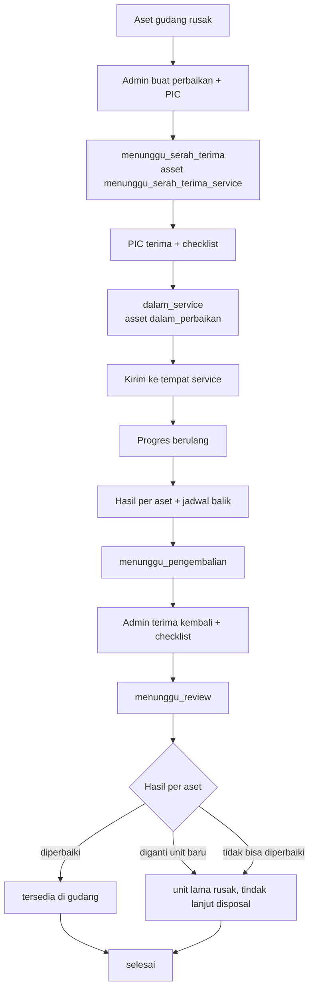
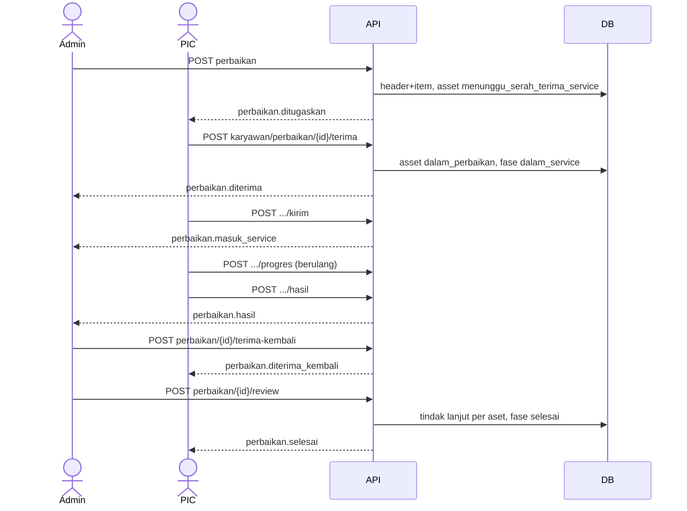
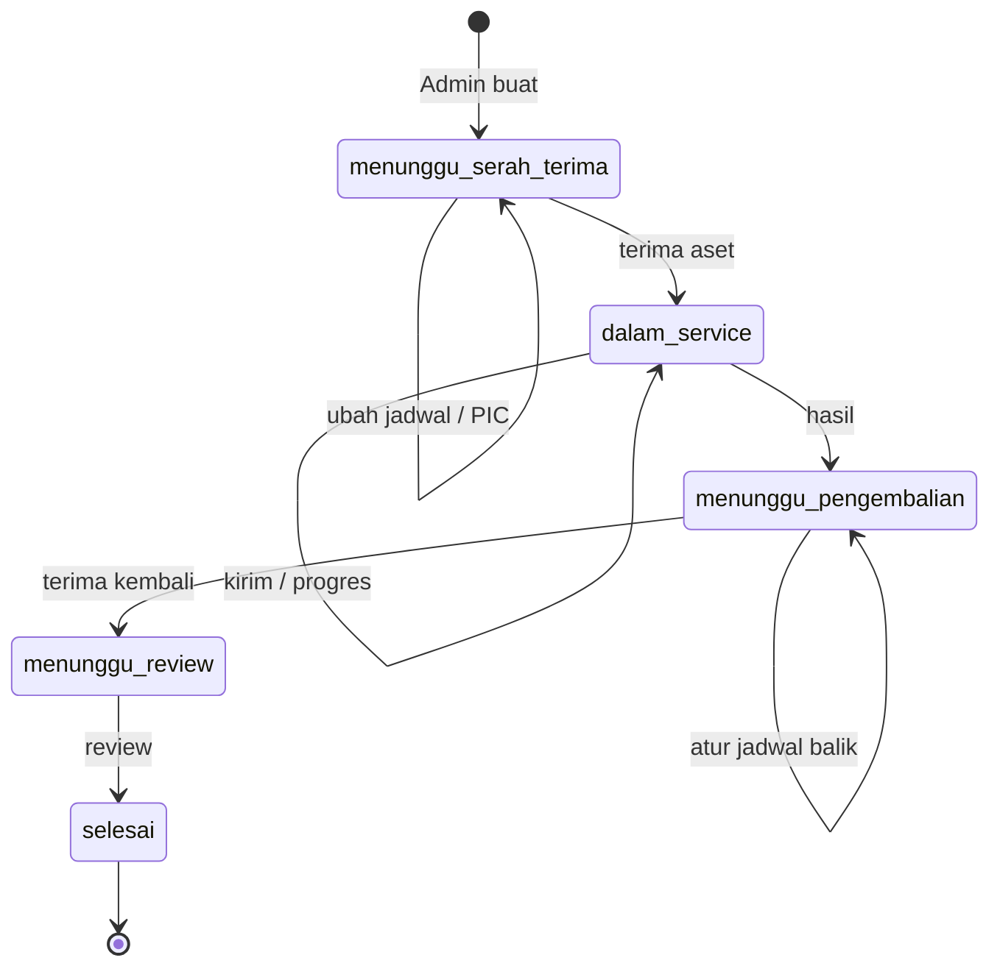
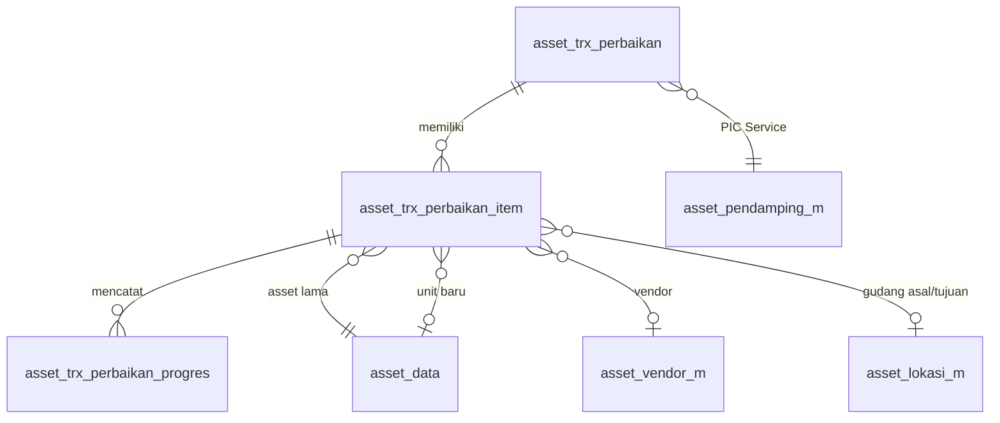

# Dokumentasi Teknis & Manual Book — Perbaikan Asset (PML02)

> Dokumen ini disusun **dari source code lokal** (`API/` Lumen dan `MOBILE/` Flutter) per 8 Oktober 2026, dibandingkan dengan dokumen bisnis **"4.2 Pemeliharaan - Perbaikan (PML02)"**.
> Cakupan implementasi: **aset gudang berstatus `rusak`**. Aset ruangan/karyawan tidak dicakup karena aset rusak selalu sudah ditarik ke gudang. Bagian yang tidak ditemukan ditandai **⚠️ Belum ditemukan**, asumsi ditandai **⚠️ Asumsi**.
> Contoh ID/nama pada payload adalah **data sintetis**.

---

## 1. Informasi Dokumen

| Informasi | Nilai |
|---|---|
| Nama Fitur | Perbaikan Asset (UI: **"Perbaikan"**; menu PIC: **"Tugas PIC Service"**) |
| Kode Fitur | **PML02** (nomor transaksi `PML02-YYYYMMNNN`) |
| Modul | Asset Management — Pemeliharaan Aset |
| Backend | Laravel **Lumen ^10.0**, PHP ^8.1, JWT, Query Builder |
| Database | `API/diagram-asset.dbml` (tanda `[NEW PML02]`) + SQL manual `Claude outputs/sql-pml02-perbaikan.sql`. ⚠️ SQL harus dijalankan manual (belum dijalankan saat dokumen ditulis) |
| Mobile | Flutter (`professional_flutter_3_35`), `flutter_bloc`, `dio`, `image_picker` |
| Web | ⚠️ Belum ditemukan: tidak ada source web di workspace |
| Test otomatis | API `tests/Asset/AssetPerbaikanTest.php` (6 test) · Mobile `test/asset/asset_perbaikan_test.dart` (10 test) |
| Versi dokumen | 1.1 — 12 Oktober 2026 |
| Dokumen terkait | Pemeliharaan Gudang (PML01), Klaim Garansi (PML03), Disposal (PML04), Master Pendamping & Tugas PIC |

## 2. Daftar Isi

Lihat panel navigasi di samping.

## 3. Quick Overview

Aset gudang yang **rusak** diperbaiki oleh vendor atau tim internal. Admin membuat transaksi perbaikan (satu atau banyak aset), menunjuk **PIC Service** dari master pendamping, dan menetapkan jadwal serah terima. PIC menerima aset dengan checklist, mengirimnya ke tempat service (data vendor, bukti), memantau **progres**, lalu mengisi **hasil service** dan mengajukan jadwal serah terima balik. Admin menerima aset kembali dengan checklist kondisi, lalu menentukan **tindak lanjut** per aset.

| Aspek | Ringkasan |
|---|---|
| Aktor | Admin Asset, PIC Service, Sistem |
| Fase | `menunggu_serah_terima` → `dalam_service` → `menunggu_pengembalian` → `menunggu_review` → `selesai` |
| Status asset | `rusak` → `menunggu_serah_terima_service` → `dalam_perbaikan` (DALAM SERVICE) → `tersedia` / tetap `rusak` |
| Hasil service | `diperbaiki`, `diganti_unit_baru`, `tidak_bisa_diperbaiki` |
| Endpoint | 12 admin + 7 PIC |
| Notifikasi | 10 event (`perbaikan.*`) |

## 4. Ringkasan Fitur

| No | Fitur | Aktor |
|---|---|---|
| 1 | Buat perbaikan dari aset gudang rusak (multi-aset) | Admin |
| 2 | Ubah jadwal dan PIC sebelum aset diterima | Admin |
| 3 | Terima aset dengan checklist kondisi dan kelengkapan | PIC (admin cadangan) |
| 4 | Isi data pengiriman ke tempat service | PIC (admin cadangan) |
| 5 | Catat progres service (berulang) | PIC (admin cadangan) |
| 6 | Isi hasil service dan jadwal serah terima balik | PIC (admin cadangan) |
| 7 | Atur ulang jadwal serah terima balik | Admin |
| 8 | Terima aset kembali dengan checklist | Admin |
| 9 | Review dan tindak lanjut per aset | Admin |

## 5. Tujuan Fitur

### 5.1 Tujuan Bisnis (diturunkan dari kode)

- Aset rusak punya jalur perbaikan yang tercatat dan bisa diaudit.
- Perpindahan fisik aset admin → PIC → tempat service → PIC → admin terdokumentasi dengan checklist.
- Hasil service menentukan nasib aset: kembali tersedia, diganti unit baru, atau disposal.

### 5.2 Tujuan Sistem

- Mengunci aset sepanjang proses lewat `status_asset`.
- Memvalidasi data vendor, bukti, dan hasil sesuai jenis pelaksana dan hasil.
- Mencatat `asset_log` dan memberi notifikasi pada tiap perpindahan tanggung jawab.

## 6. Aktor

| Aktor | Peran |
|---|---|
| Admin Asset | Membuat, mengubah, menetapkan jadwal balik, menerima aset kembali, mereview; cadangan PIC |
| PIC Service | Karyawan dari master pendamping aktif; menerima aset, mengirim ke service, progres, hasil |
| Sistem | Mengunci status aset, menautkan unit pengganti, menulis log dan notifikasi |

## 7. Hak Akses

| Aksi | Admin | PIC Service |
|---|---|---|
| Opsi, daftar semua, buat, ubah, jadwal balik, terima kembali, review | ✅ | ❌ |
| Daftar dan detail | ✅ (semua) | ✅ (hanya yang ditugaskan) |
| Terima, kirim, progres, hasil | ✅ (cadangan) | ✅ (hanya PIC transaksi) |
| Opsi vendor | ✅ (opsi lengkap) | ✅ (hanya vendor) |

## 8. Terminologi

| Istilah | Arti |
|---|---|
| PIC Service | Pendamping yang ditunjuk admin untuk satu perbaikan |
| DALAM SERVICE | Status aset `dalam_perbaikan` setelah PIC menerima aset |
| Pelaksana | `vendor` (eksternal) atau `internal` (tim sendiri) |
| Progres | Catatan perkembangan service; dapat mengubah estimasi selesai |
| Unit baru | Aset gudang `tersedia` yang menggantikan unit lama (`id_asset_data_baru`) |
| Tindak lanjut | Keputusan admin per aset: `simpan_gudang` atau `disposal` |

## 9. Business Rules

### BR-001 — Aset yang boleh diperbaiki
Hanya `pemegang_asset = gudang` dan `status_asset = rusak`; tidak boleh masih dalam onboarding aktif. Pelanggaran: *"Hanya asset rusak di gudang yang dapat diperbaiki."*

### BR-002 — PIC Service
Dipilih dari pendamping aktif. Dapat berubah hanya selama `menunggu_serah_terima`.

### BR-003 — Penerimaan aset
Checklist `status_kesesuaian_item` dan `status_kelengkapan_aset` (`ya`/`tidak`) untuk **semua** aset. Bila ada `tidak`, keterangan wajib. Aset menjadi `dalam_perbaikan`.

### BR-004 — Pengiriman ke tempat service
Per aset wajib: pelaksana, tanggal mulai, estimasi selesai (tidak sebelum mulai), lokasi. Bila **vendor**: nomor referensi dan foto tanda terima wajib. Boleh diperbarui berulang selama `dalam_service`.

### BR-005 — Progres
Hanya setelah data pengiriman seluruh aset terisi. Minimal satu aset; keterangan wajib; estimasi baru (opsional) tidak boleh sebelum tanggal mulai dan memperbarui estimasi item.

### BR-006 — Hasil service
Seluruh aset wajib diisi. `diperbaiki`/`diganti_unit_baru`: komponen dan kondisi akhir wajib. `tidak_bisa_diperbaiki`: keterangan wajib. PIC sekaligus mengajukan jadwal serah terima balik (tidak boleh sebelum hari ini). Fase → `menunggu_pengembalian`.

### BR-007 — Terima kembali
Admin mengisi checklist kesesuaian kondisi dengan hasil service; `tidak` memerlukan keterangan. Fase → `menunggu_review`.

### BR-008 — Review per aset
- `diperbaiki`: aset `tersedia` di gudang tujuan (default gudang asal; admin boleh pilih gudang lain), `kondisi_awal = normal`, `ket_rusak`/`status_rusak` dikosongkan. Tindak lanjut `simpan_gudang`.
- `diganti_unit_baru`: admin memilih unit baru (gudang, `tersedia`, belum dipakai perbaikan/klaim lain). Unit lama tetap `rusak`, tindak lanjut `disposal` (`asset_trx_disposal`).
- `tidak_bisa_diperbaiki`: aset tetap `rusak`, tindak lanjut `disposal`.

### BR-009 — Penomoran
`id` = `id_company` + `YYYYMM` + 3 digit; `no_trx` = `PML02-YYYYMMNNN`. Batas 999 per bulan per perusahaan.

### BR-010 — Skema harus sudah diterapkan
`skemaSiap()` menjaga dashboard tetap berjalan sebelum SQL diterapkan.

## 10. Business Flow

1. Admin memilih aset gudang rusak, mengisi jadwal serah terima dan PIC Service → `menunggu_serah_terima`, aset `menunggu_serah_terima_service`.
2. PIC menerima aset dengan checklist → `dalam_service`, aset `dalam_perbaikan`.
3. PIC mengisi data pengiriman ke tempat service, lalu mencatat progres sesuai perkembangan.
4. PIC mengisi hasil per aset dan jadwal serah terima balik → `menunggu_pengembalian`.
5. Admin menerima aset kembali dengan checklist → `menunggu_review`.
6. Admin mereview dan menentukan tindak lanjut → `selesai`.

## 11. Flow Berdasarkan Role

### 11.1 Admin Asset
Buat → (ubah) → (cadangan terima/kirim/hasil) → atur jadwal balik → terima kembali → review.

### 11.2 PIC Service
Terima notifikasi → terima aset → kirim ke service → progres → hasil.

### 11.3 System
Kunci status aset per tahap, validasi, tautkan unit pengganti, log, notifikasi.

## 12. Flow Diagram



## 13. Sequence Diagram



## 14. Status Transaksi

| `fase_perbaikan` | Label | Tab | `status` |
|---|---|---|---|
| `menunggu_serah_terima` | Menunggu Serah Terima | jadwal | proses |
| `dalam_service` | Dalam Service | proses | proses |
| `menunggu_pengembalian` | Menunggu Pengembalian | proses | proses |
| `menunggu_review` | Menunggu Review | proses | proses |
| `selesai` | Selesai | selesai | selesai |

Status per item (`status_perbaikan`): `proses` → `selesai` saat review.

## 15. State Transition



## 16. Struktur Database

| Tabel | Fungsi |
|---|---|
| `asset_trx_perbaikan` | Header transaksi |
| `asset_trx_perbaikan_item` | Satu baris per aset (penerimaan, service, hasil, kembali, tindak lanjut) |
| `asset_trx_perbaikan_progres` | Log progres service per item |
| `asset_pendamping_m` | Master PIC Service |
| `asset_data` | Status dan kondisi aset |
| `asset_log` | Jejak (`perbaikan_gudang`, `perbaikan_karyawan` dicadangkan) |

## 17. Relasi Database



## 18. Data Dictionary

### 18.1 asset_trx_perbaikan

| Kolom | Tipe | Keterangan |
|---|---|---|
| `id_asset_trx_perbaikan` | varchar(50) PK | `id_company`+`YYYYMM`+3 digit |
| `no_trx` | varchar(50) | `PML02-YYYYMMNNN` |
| `fase_perbaikan` | enum | 5 fase (lihat §14) |
| `id_asset_pendamping_m` | varchar(50) FK | PIC Service |
| `id_pic_pendamping`, `nama_pic_pendamping`, `nik_pic_pendamping` | varchar | Snapshot PIC |
| `tgl_serah_terima`, `jam_serah_terima`, `keterangan_serah_terima` | date, time, varchar | Jadwal admin → PIC |
| `tgl_terima`, `user_terima` | timestamp, varchar | PIC menerima aset |
| `tgl_pengembalian_perbaikan`, `jam_pengembalian` | date, time null | Jadwal balik PIC → admin |
| `user_ajukan_pengembalian` | varchar | Pengaju jadwal balik |
| `tgl_terima_kembali`, `user_terima_kembali` | timestamp, varchar | Admin menerima kembali |
| `tgl_review`, `user_review`, `keterangan_review` | timestamp, varchar, text | Review |
| `status` | enum | proses/selesai |
| `id_company`, `tgl_input`, `user_input`, `tgl_update`, `user_update` | | Audit |

### 18.2 asset_trx_perbaikan_item

| Kelompok | Kolom |
|---|---|
| Identitas | `id_asset_trx_perbaikan_item`, `id_asset_trx_perbaikan`, `id_asset_data`, snapshot `nama_asset`/`deskripsi_asset`/`kategori_asset`/`keterangan_rusak` |
| Asal | `pemegang_asset_asal`, `id_pemegang_asset_asal` (tidak dipakai, selalu gudang), `id_asset_lokasi_m_asal` |
| Penerimaan | `status_kesesuaian_item`, `status_kelengkapan_aset`, `keterangan_perbaikan_pendamping` |
| Pengiriman | `jenis_pelaksana`, `id_asset_vendor_m`, `nama_vendor`, `keterangan_vendor`, `tgl_mulai_perbaikan`, `tgl_estimasi_selesai_perbaikan`, `lokasi_perbaikan`, `nomor_referensi`, `foto_tanda_terima` |
| Hasil | `hasil_perbaikan`, `komponen_diperbaiki`, `komponen_watchlist`, `kondisi_akhir`, `keterangan_hasil` |
| Kembali | `status_kesesuaian_kembali`, `ket_kesesuaian_kembali` |
| Tindak lanjut | `tindak_lanjut_akhir`, `id_asset_lokasi_m_tujuan`, `tgl_pengiriman_kembali`, `id_asset_data_baru`, `id_trx_tindak_lanjut`, `nama_tabel_tindak_lanjut`, `status_perbaikan` |

### 18.3 asset_trx_perbaikan_progres

`id_asset_trx_perbaikan_progres` (PK), `id_asset_trx_perbaikan_item` (FK), `keterangan_progres`, `tgl_estimasi_selesai_baru`, `id_company`, `tgl_input`, `user_input`.

## 19. Database Index

| Index | Kolom | Fungsi |
|---|---|---|
| `atp_company_fase_idx` | `id_company, fase_perbaikan, tgl_input, id` | Daftar per tab |
| `atp_company_pic_fase_idx` | `id_company, id_pic_pendamping, fase_perbaikan, tgl_input` | Tugas PIC |
| `atpi_trx_asset_uq` | `id_trx, id_asset_data` | Unik per transaksi |
| `atpi_company_asset_status_idx` | `id_company, id_asset_data, status_perbaikan` | Cek proses aktif |
| `atpp_item_tgl_idx` | `id_item, tgl_input` | Riwayat progres |

## 20. Backend Architecture

| Lapisan | File |
|---|---|
| Route | `RouteAsset.php` (`perbaikan/*`, `karyawan/perbaikan/*`) |
| Controller admin | `Asset/Admin/AssetAdminPerbaikan_c.php` |
| Controller PIC | `Asset/Karyawan/AssetKaryawanPerbaikan_c.php` |
| Model | `Models/Asset/AssetPerbaikan_m.php` |
| Aturan validasi bersama | `Asset_c` (`PERBAIKAN_*_RULES`, helper `perbaikanAssetsPayload` untuk foto) |
| Notifikasi | `Support/Asset/AssetNotification.php` |

## 21. Backend Business Logic

### 21.1 Buat — `store`
Kunci aset (`lockForUpdate`), validasi BR-001, PIC, jadwal; nomor urut; insert header dan item (snapshot, gudang asal); aset → `menunggu_serah_terima_service` + log.

### 21.2 Ubah — `ubah`
Hanya `menunggu_serah_terima`; mengembalikan `pic_berubah`.

### 21.3 Terima — `terima`
Aktor PIC atau admin (`lockForActor`); checklist per aset; aset → `dalam_perbaikan`; fase `dalam_service`.

### 21.4 Kirim — `kirim`
Boleh berulang; `baru = true` bila ada item yang pertama kali diisi (menentukan event `masuk_service` vs `progres`).

### 21.5 Progres — `progres`
Memasukkan baris progres dan memperbarui estimasi item bila ada estimasi baru.

### 21.6 Hasil — `hasil`
Validasi per hasil (BR-006); mengajukan jadwal balik; fase `menunggu_pengembalian`.

### 21.7 Jadwal balik / terima kembali
Admin: `jadwalKembali` (ubah jadwal), `terimaKembali` (checklist, fase `menunggu_review`).

### 21.8 Review — `review`
Per item sesuai BR-008; unit baru divalidasi (`assertUnitBaru`: gudang, `tersedia`, tidak dipakai perbaikan/klaim lain); gudang tujuan divalidasi (`assertGudang`); item `status_perbaikan = selesai`; fase `selesai`.

### 21.9 Query baca
`getPage`, `getDetail` (dengan objek `aksi` per peran), `getAdminOptions`, `getVendorOptions`, `getPendingForPic/Admin`, `countByTabForPic`, `countPendingForAdmin`, `hasActivePic`.

## 22. Dampak terhadap asset_data

| Kejadian | `status_asset` | Kolom lain |
|---|---|---|
| Perbaikan dibuat | `rusak` → `menunggu_serah_terima_service` | — |
| PIC menerima | → `dalam_perbaikan` | — |
| Review `diperbaiki` | → `tersedia` | `id_asset_lokasi_m` = gudang tujuan, `kondisi_awal=normal`, `ket_rusak`/`status_rusak` kosong |
| Review `diganti_unit_baru` / `tidak_bisa_diperbaiki` | → `rusak` | Tidak berubah; tindak lanjut disposal |

## 23. API Documentation

| Kode | Method | Path | Aktor |
|---|---|---|---|
| API-001 | GET | `asset/perbaikan/options` | Admin |
| API-002 | GET | `asset/perbaikan` | Admin |
| API-003 | POST | `asset/perbaikan` | Admin |
| API-004 | PUT | `asset/perbaikan/{id}` | Admin |
| API-005 | POST | `asset/perbaikan/{id}/terima` | Admin (cadangan) |
| API-006 | POST | `asset/perbaikan/{id}/kirim` | Admin (cadangan) |
| API-007 | POST | `asset/perbaikan/{id}/progres` | Admin (cadangan) |
| API-008 | POST | `asset/perbaikan/{id}/hasil` | Admin (cadangan) |
| API-009 | POST | `asset/perbaikan/{id}/jadwal-kembali` | Admin |
| API-010 | POST | `asset/perbaikan/{id}/terima-kembali` | Admin |
| API-011 | POST | `asset/perbaikan/{id}/review` | Admin |
| API-012 | GET | `asset/perbaikan/{id}` | Admin |
| API-013 | GET | `asset/karyawan/perbaikan/options` | PIC |
| API-014 | GET | `asset/karyawan/perbaikan` | PIC |
| API-015 | POST | `asset/karyawan/perbaikan/{id}/terima` | PIC |
| API-016 | POST | `asset/karyawan/perbaikan/{id}/kirim` | PIC |
| API-017 | POST | `asset/karyawan/perbaikan/{id}/progres` | PIC |
| API-018 | POST | `asset/karyawan/perbaikan/{id}/hasil` | PIC |
| API-019 | GET | `asset/karyawan/perbaikan/{id}` | PIC |

## 24. Detail Setiap API

### API-001/013 — Opsi
Admin: `{vendor, pendamping, asset (gudang rusak), asset_baru (gudang tersedia), gudang, hasil, pelaksana}`. PIC: hanya vendor.

### API-002/014 — Daftar
Query `tab` (`jadwal|proses|selesai`), `limit` (1–50), `offset`. Respons `{filters, records[], pagination}`; record memuat `fase_perbaikan`, jadwal, `peran`, `jumlah_asset`, ringkasan aset, PIC.

### API-003 — Buat
```json
{
  "asset_ids": ["AC-1", "AC-2"],
  "tgl_jadwal": "2026-10-12",
  "jam_jadwal": "09:00",
  "id_asset_pendamping_m": "PDM-1",
  "keterangan_serah_terima": "Bawa kelengkapan"
}
```

### API-004 — Ubah
Body sama tanpa `asset_ids`.

### API-005/015 — Terima
```json
{"assets": [{"id_asset_data": "AC-1", "status_kesesuaian_item": "ya", "status_kelengkapan_aset": "tidak", "keterangan": "Kabel daya tidak ada"}]}
```

### API-006/016 — Kirim
```json
{"assets": [{
  "id_asset_data": "AC-1", "jenis_pelaksana": "vendor", "id_asset_vendor_m": "VND-1",
  "keterangan_vendor": "0812-0000", "tgl_mulai_perbaikan": "2026-10-13",
  "tgl_estimasi_selesai_perbaikan": "2026-10-20", "lokasi_perbaikan": "Bengkel Vendor",
  "nomor_referensi": "SRV-001", "foto_tanda_terima": "<base64 atau file multipart>"
}]}
```
Foto disimpan di object storage dengan key `<company>/asset/perbaikan/<id_karyawan>/<hex>.<ext>`; kolom menyimpan key; kosong = foto lama dipertahankan.

### API-007/017 — Progres
```json
{"assets": [{"id_asset_data": "AC-1", "keterangan_progres": "Menunggu sparepart", "tgl_estimasi_selesai_baru": "2026-10-25"}]}
```

### API-008/018 — Hasil
```json
{
  "tgl_pengembalian": "2026-10-26", "jam_pengembalian": "13:00",
  "assets": [{"id_asset_data": "AC-1", "hasil_perbaikan": "diperbaiki",
    "komponen_diperbaiki": "Roller", "komponen_watchlist": "", "kondisi_akhir": "Normal",
    "keterangan_hasil": ""}]
}
```

### API-009 — Jadwal balik
`{tgl_pengembalian, jam_pengembalian}`.

### API-010 — Terima kembali
`{assets: [{id_asset_data, status_kesesuaian_kembali: ya|tidak, ket_kesesuaian_kembali}]}`.

### API-011 — Review
```json
{"keterangan_review": "Selesai",
 "items": [{"id_asset_data": "AC-2", "id_asset_data_baru": "AC-NEW", "id_asset_lokasi_m_tujuan": ""}]}
```
Aset `diperbaiki` memakai `id_asset_lokasi_m_tujuan` (kosong = gudang asal); aset `diganti_unit_baru` wajib `id_asset_data_baru`.

### API-012/019 — Detail
Header, PIC, `serah_terima`, `pengembalian`, `review`, `assets[]` (penerimaan, service, progres, hasil, kembali, tindak lanjut), dan `aksi` (ubah, terima, kirim, progres, hasil, jadwal_kembali, terima_kembali, review).

## 25. Mobile Architecture

| Lapisan | File |
|---|---|
| Model | `lib/Repository/Model/Asset/mAssetPerbaikan.dart` |
| API client | `lib/Repository/Service/assetPerbaikanApi.dart` (`admin: true/false`) |
| Bloc | `lib/Bloc/Asset/AssetPerbaikanBloc.dart` |
| UI | `lib/UI/Modul/Asset/Pemeliharaan/Perbaikan/*` (termasuk `AssetPerbaikanProsesWidgets`; pratinjau foto layar penuh memakai `Pemeliharaan/AssetFotoPreview.dart`) |
| Teks | grup `perbaikan` di `assets/{id,en}/asset.json` (134 kunci) |
| Navigasi | `NavigatorBloc`, `router.dart` |

## 26. Mobile Screen

### 26.1 Daftar
`HalamanAssetPerbaikan` (admin dan PIC): tab Serah Terima/Proses/Selesai, kartu `AssetPerbaikanRecordCard`.

### 26.2 Buat Perbaikan (admin)
`HalamanBuatPerbaikan`: pilih aset gudang rusak (multi), lalu sheet jadwal + PIC.

### 26.3 Detail
`HalamanDetailAssetPerbaikan`: hero, stepper proses, timeline per aset (`AssetPerbaikanAssetTimeline`), tombol sesuai `aksi`.

### 26.4 Sheet aksi
`AssetPerbaikanActionSheets`: terima, kirim (vendor terdaftar/manual, foto kamera/galeri), progres, hasil, terima kembali, review.

### 26.5 Entry point
Admin: menu **Perbaikan** dan kartu "perlu diproses" beranda. PIC: kartu Tugas PIC.

## 27. Mobile → API

| Aksi UI | Method | Endpoint |
|---|---|---|
| Daftar/detail/opsi | GET | `…/perbaikan`, `/{id}`, `/options` |
| Buat/ubah | POST/PUT | `…/perbaikan`, `/{id}` |
| Terima/kirim/progres/hasil | POST | `…/{id}/{aksi}` |
| Jadwal balik/terima kembali/review | POST | `…/{id}/jadwal-kembali`, `/terima-kembali`, `/review` |

Prefix `asset/perbaikan` (admin) atau `asset/karyawan/perbaikan` (PIC).

## 28. API → Mobile

Dipetakan ke `AssetPerbaikanRecord/Page/Options`; objek `aksi` menentukan tombol. 422 tampil sebagai snackbar warning, kegagalan lain sebagai error; sukses menutup halaman dengan pesan.

## 29. Mapping Mobile → API → Database

| Field UI | Field API | Kolom DB |
|---|---|---|
| Jadwal serah terima | `tgl_jadwal`/`jam_jadwal` | `tgl_serah_terima`/`jam_serah_terima` |
| PIC Service | `id_asset_pendamping_m` | `id_asset_pendamping_m` + snapshot |
| Checklist terima | `status_kesesuaian_item`, `status_kelengkapan_aset` | kolom sama di item |
| Foto tanda terima | `foto_tanda_terima` | `foto_tanda_terima` (path) |
| Progres | `keterangan_progres` | `asset_trx_perbaikan_progres` |
| Jadwal balik | `tgl_pengembalian`/`jam_pengembalian` | `tgl_pengembalian_perbaikan`/`jam_pengembalian` |
| Unit baru | `id_asset_data_baru` | `id_asset_data_baru` |

## 30. Mapping Database → API → Mobile

| Kolom DB | Field API | Tampil di |
|---|---|---|
| `fase_perbaikan` | `fase_perbaikan`, `status_label` | Badge, stepper |
| `hasil_perbaikan` | `assets[].hasil.status` | Timeline tahap hasil |
| `foto_tanda_terima` | `foto_tanda_terima_url` | Timeline tahap service |
| `tindak_lanjut_akhir` | `assets[].tindak_lanjut.jenis` | Timeline tindak lanjut |

## 31. Validation

### 31.1 Mobile
Form sheet memvalidasi wajib-isi (tanggal, jam, PIC, lokasi, vendor, nomor referensi, foto bila vendor, estimasi ≥ mulai, hasil, komponen, kondisi akhir).

### 31.2 Backend
Aturan Laravel di `Asset_c`/controller (format `Y-m-d`, `H:i`, `in:` untuk enum) ditambah aturan bisnis di model (§9).

### 31.3 Database
Enum fase/status/hasil/pelaksana/tindak lanjut; FK PIC, vendor, lokasi, aset; unik `(trx, asset)`.

## 32. Error Handling

| Kondisi | Kode | Contoh pesan |
|---|---|---|
| Validasi request | 422 | "Tanggal serah terima wajib diisi." |
| Aturan bisnis | 422 `BUSINESS_RULE_VIOLATION` | "Nomor referensi wajib diisi jika service ke vendor." |
| Bukan admin | 403 | "Pengguna tidak memiliki akses admin asset." |
| Tidak ditemukan | 404 | "Perbaikan tidak ditemukan." |
| Sistem | 500 `SYSTEM_ERROR` | Pesan umum |

## 33. Audit Trail

`user_terima`, `user_ajukan_pengembalian`, `user_terima_kembali`, `user_review` beserta timestamp; `user_input`/`user_update` per baris; `asset_log` (`perbaikan_gudang`) saat dibuat dan saat review.

## 34. Notification

| Event | Penerima | Rute mobile |
|---|---|---|
| `perbaikan.ditugaskan` | PIC | `asset_detail_perbaikan` |
| `perbaikan.diubah` | PIC | idem |
| `perbaikan.diterima` | Admin | `asset_admin_detail_perbaikan` |
| `perbaikan.diterima_admin` | PIC | `asset_detail_perbaikan` |
| `perbaikan.masuk_service` | Admin | `asset_admin_detail_perbaikan` |
| `perbaikan.progres` | Admin | idem |
| `perbaikan.hasil` | Admin | idem |
| `perbaikan.jadwal_kembali` | PIC | `asset_detail_perbaikan` |
| `perbaikan.diterima_kembali` | PIC | idem |
| `perbaikan.selesai` | PIC | idem |

## 35. Security

JWT; admin diperiksa per request; PIC dibatasi ke `id_pic_pendamping` miliknya dan harus karyawan aktif; foto diunggah ke bucket MinIO privat lewat `Asset_c::uploadAssetImage` (`AssetImageStorage`): hanya JPEG/PNG/WebP valid, maks 5 MB dan 25 megapiksel; key memuat `id_company` dan `id_karyawan` dari JWT; URL foto berupa presigned URL berumur singkat (lihat `dokumentasi-minio-object-storage.md`); semua query memfilter `id_company`; transaksi + `lockForUpdate`.

## 36. Manual Book User/Admin

### A. Admin — Membuat perbaikan
Perbaikan → tombol **+** → pilih aset rusak → isi jadwal serah terima dan PIC → simpan.

### B. PIC — Menerima aset
Tugas PIC → transaksi → **Terima Aset** → isi checklist kondisi dan kelengkapan.

### C. PIC — Service
**Isi Data Pengiriman** (pelaksana, tanggal, lokasi; vendor wajib nomor referensi dan foto) → **Update Progres** bila ada perkembangan → **Isi Hasil Service** dan jadwal serah terima balik.

### D. Admin — Menerima kembali dan review
**Terima Aset Kembali** (checklist) → **Review & Tindak Lanjut**: pilih gudang tujuan (aset diperbaiki) atau unit baru (aset diganti).

## 37. Kondisi Button

| Tombol | Syarat |
|---|---|
| Ubah | admin, `menunggu_serah_terima` |
| Terima Aset | `menunggu_serah_terima` |
| Isi Data Pengiriman / Update Progres / Isi Hasil | `dalam_service` (progres dan hasil setelah semua aset dikirim) |
| Atur Jadwal Pengembalian, Terima Aset Kembali | admin, `menunggu_pengembalian` |
| Review & Tindak Lanjut | admin, `menunggu_review` |

## 38. Testing Scenario

| No | Skenario | Hasil |
|---|---|---|
| T-01 | Buat dengan aset non-gudang/tidak rusak | Ditolak |
| T-02 | Buat valid | `PML02-…`, aset `menunggu_serah_terima_service` |
| T-03 | Terima dengan checklist `tidak` tanpa keterangan | Ditolak |
| T-04 | Kirim vendor tanpa nomor/foto | Ditolak |
| T-05 | Hasil sebelum semua aset dikirim | Ditolak |
| T-06 | Review `diperbaiki` | Aset `tersedia` di gudang tujuan |
| T-07 | Review `diganti_unit_baru` tanpa/dengan unit tidak valid | Ditolak |
| T-08 | PIC lain mengakses transaksi | Tidak ditemukan |
| T-09 | Alur penuh via route admin dan PIC | Fase berurutan, notifikasi terkirim |

## 39. Temuan Ketidaksesuaian

| ID | Temuan |
|---|---|
| INC-01 | PML01 (hasil 4) dan PML03 (ditolak) baru mencatat nama tabel tindak lanjut; **tidak membuat perbaikan otomatis** |
| INC-02 | Tidak ada pembatalan perbaikan |
| INC-03 | Kolom `pemegang_asset_asal`/`id_pemegang_asset_asal` tidak dipakai (scope gudang saja); `kembali_lokasi_asal` ada di enum tetapi tidak dipakai |
| INC-04 | Tidak ada pencatatan biaya perbaikan |

## 40. Edge Case

- PIC menghapus/mengganti data pengiriman setelah progres: diperbolehkan selama `dalam_service`.
- Dua unit lama memakai unit baru yang sama: ditolak (`penggantiDipakai`).
- Unit baru sudah dipakai perbaikan atau klaim garansi lain: ditolak.
- Aset berubah status di luar alur: ditolak "Status asset sudah berubah…".

## 41. Potential Bug / Technical Risk

### RISK-001 — Skema dari SQL manual (TINGGI)
SQL belum dijalankan; jalankan setelah SQL PML01 gudang dan PML03 karena blok enum menulis ulang seluruh daftar.

### RISK-002 — Tidak ada pembatalan (SEDANG)
Perbaikan yang tertahan mengunci aset.

### RISK-003 — Foto lama di disk lokal (RENDAH)
Foto baru disimpan di object storage. Foto lama di `UPLOAD_DIR` tetap terbaca lewat fallback URL lokal. Object lama tidak dihapus saat foto diganti; object baru yang yatim dibersihkan otomatis bila transaksi gagal.

### RISK-004 — Notifikasi di luar transaksi (RENDAH)
### RISK-005 — Kapasitas penomoran 999/bulan (RENDAH)

## 42. Dependency

`Asset_m/Asset_c`, `AssetPendamping_m`, `AssetPemeliharaanKaryawan_m` (vendor, format tanggal), `AssetImageStorage`, `AssetNotification`, tabel `asset_vendor_m`, `asset_lokasi_m`, `asset_data`.

## 43. Source Code Reference

| Area | Lokasi |
|---|---|
| Model | `API/app/Models/Asset/AssetPerbaikan_m.php` |
| Controller | `API/app/Http/Controllers/Asset/Admin/AssetAdminPerbaikan_c.php`, `Karyawan/AssetKaryawanPerbaikan_c.php` |
| SQL | `Claude outputs/sql-pml02-perbaikan.sql` |
| Test API | `API/tests/Asset/AssetPerbaikanTest.php` |
| Mobile UI | `MOBILE/lib/UI/Modul/Asset/Pemeliharaan/Perbaikan/` |
| Test mobile | `MOBILE/test/asset/asset_perbaikan_test.dart` |

## 44. Developer Notes

- Pola dasar sama dengan PML01 gudang dan PML03 (`lockHeader`, `lockAssets($status)`, `updateItem`, `headerResult`).
- `lockForActor` memungkinkan satu method melayani PIC dan admin cadangan.
- Aksi `kirim` idempotent-update; `progres` menambah baris.
- Jangan mengubah urutan enum `status_asset`; nilai baru ditambah di akhir.

## 45. End-to-End Traceability

| Kebutuhan | Rule | API | Mobile | DB |
|---|---|---|---|---|
| Kunci aset | BR-001/003 | API-003/005 | Buat, Terima | `asset_data.status_asset` |
| Bukti vendor | BR-004 | API-006 | Sheet kirim | `nomor_referensi`, `foto_tanda_terima` |
| Progres | BR-005 | API-007 | Sheet progres | `asset_trx_perbaikan_progres` |
| Unit pengganti | BR-008 | API-011 | Sheet review | `id_asset_data_baru` |

## 46. Ringkasan Database Impact

Tabel baru: `asset_trx_perbaikan`, `_item`, `_progres` (struktur lama di-drop bila kosong). `asset_data.status_asset` +`menunggu_serah_terima_service`; `asset_log.jenis_log` +`perbaikan_gudang`, `perbaikan_karyawan`.

## 47. Checklist Implementasi

### Database
- [x] DBML diperbarui
- [x] SQL manual + guard + rollback
- [ ] SQL dijalankan di setiap environment

### Backend
- [x] Model, controller admin dan PIC, route, notifikasi
- [x] Test otomatis

### Mobile
- [x] Daftar, buat, detail, sheet aksi
- [x] Teks id/en, test otomatis

### Documentation
- [x] Dokumen ini

## 48. Changelog

| Versi | Tanggal | Perubahan |
|---|---|---|
| 1.0 | 8 Okt 2026 | Dokumen awal PML02 |
| 1.1 | 12 Okt 2026 | Sinkronisasi dengan kode: foto tanda terima kini disimpan di object storage MinIO (RISK-003 diturunkan ke RENDAH); path UI/model mobile mengikuti struktur folder baru; `AssetPerbaikanProsesWidgets` dan `AssetFotoPreview` dicatat |
