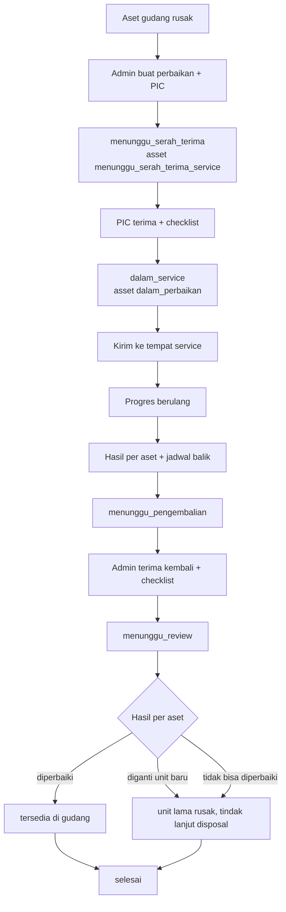
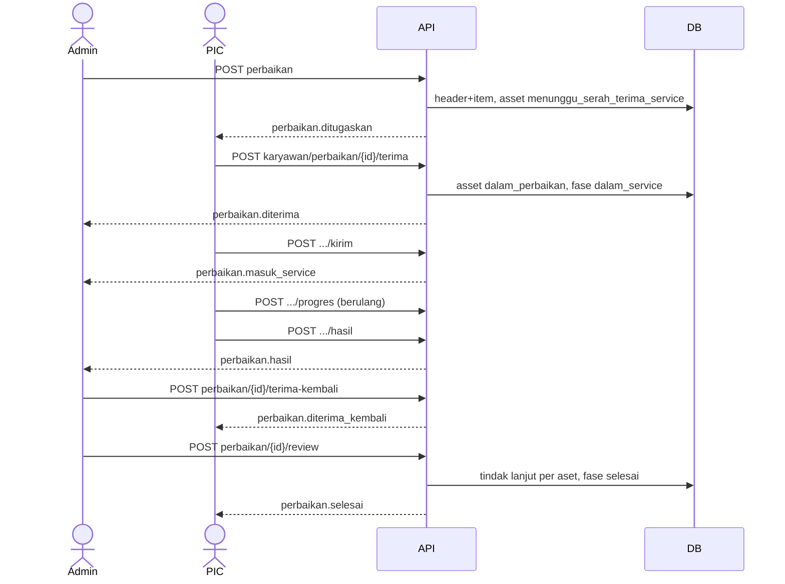
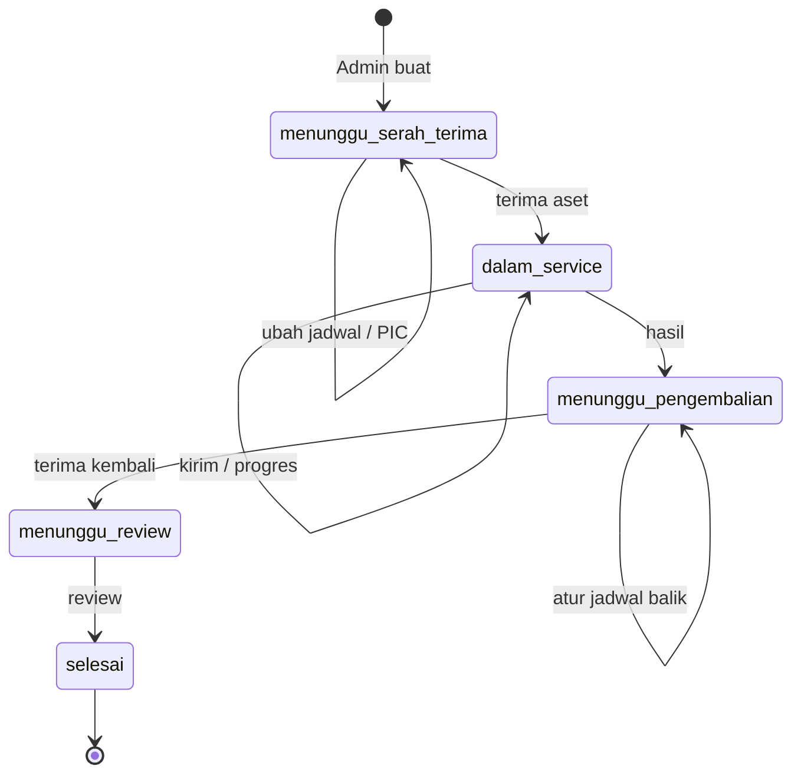
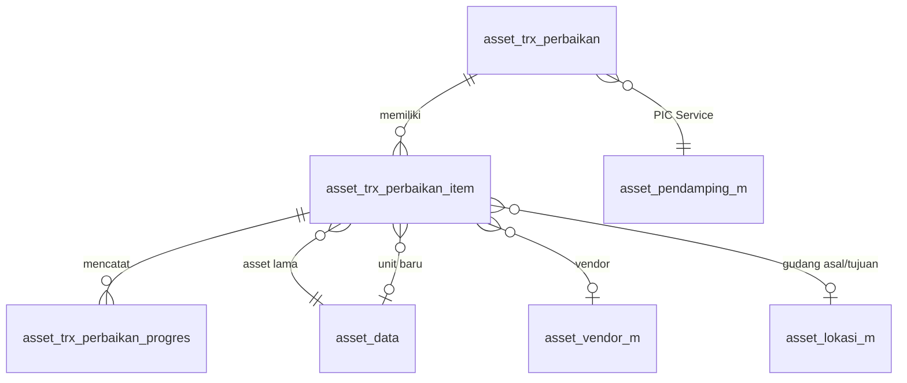

# Dokumentasi Teknis & Manual Book — Perbaikan Asset (PML02)

> Dokumen ini disusun **dari source code lokal** (`API/` Lumen dan `MOBILE/` Flutter) per 8 Oktober 2026, dibandingkan dengan dokumen bisnis **"4.2 Pemeliharaan - Perbaikan (PML02)"**.
> Cakupan implementasi: **aset gudang berstatus `rusak`**. Aset ruangan/karyawan tidak dicakup karena aset rusak selalu sudah ditarik ke gudang. Bagian yang tidak ditemukan ditandai **⚠️ Belum ditemukan**, asumsi ditandai **⚠️ Asumsi**.
> Contoh ID/nama pada payload adalah **data sintetis**.

---

## 1. Informasi Dokumen

| Informasi | Nilai |
|---|---|
| Nama Fitur | Perbaikan Asset (UI: **"Perbaikan"**; menu PIC: **"Tugas PIC Service"**) |
| Kode Fitur | **PML02** (nomor transaksi `PML02-YYYYMMNNN`) |
| Modul | Asset Management — Pemeliharaan Aset |
| Backend | Laravel **Lumen ^10.0**, PHP ^8.1, JWT, Query Builder |
| Database | `API/diagram-asset.dbml` (tanda `[NEW PML02]`) + SQL manual `Claude outputs/sql-pml02-perbaikan.sql`. ⚠️ SQL harus dijalankan manual (belum dijalankan saat dokumen ditulis) |
| Mobile | Flutter (`professional_flutter_3_35`), `flutter_bloc`, `dio`, `image_picker` |
| Web | ⚠️ Belum ditemukan: tidak ada source web di workspace |
| Test otomatis | API `tests/Asset/AssetPerbaikanTest.php` (13 test) + `AssetPerbaikanLocaleTest.php` (11 test) · Mobile `test/asset/asset_perbaikan_test.dart` (17 test) |
| Versi dokumen | 1.3 — 22 Oktober 2026 |
| Dokumen terkait | Pemeliharaan Gudang (PML01), Klaim Garansi (PML03), Disposal (PML04), Master Pendamping & Tugas PIC |

## 2. Daftar Isi

Lihat panel navigasi di samping.

## 3. Quick Overview

Aset gudang yang **rusak** diperbaiki oleh vendor atau tim internal. Admin membuat transaksi perbaikan (dipilih satu atau banyak aset sekaligus; sistem membuat satu transaksi per aset dengan jadwal dan PIC masing-masing), menunjuk **PIC Service** dari master pendamping, dan menetapkan jadwal serah terima. PIC menerima aset dengan checklist, mengirimnya ke tempat service (data vendor, bukti), memantau **progres**, lalu mengisi **hasil service** dan mengajukan jadwal serah terima balik. Admin menerima aset kembali dengan checklist kondisi, lalu menentukan **tindak lanjut** per aset.

| Aspek | Ringkasan |
|---|---|
| Aktor | Admin Asset, PIC Service, Sistem |
| Fase | `menunggu_serah_terima` → `dalam_service` → `menunggu_pengembalian` → `menunggu_review` → `selesai` |
| Status asset | `rusak` → `menunggu_serah_terima_service` → `dalam_perbaikan` (DALAM SERVICE) → `tersedia` / tetap `rusak` |
| Hasil service | `diperbaiki`, `diganti_unit_baru`, `tidak_bisa_diperbaiki` |
| Endpoint | 12 admin + 7 PIC |
| Notifikasi | 10 event (`perbaikan.*`) |

## 4. Ringkasan Fitur

| No | Fitur | Aktor |
|---|---|---|
| 1 | Buat perbaikan dari aset gudang rusak (pilih banyak aset, 1 transaksi per aset) | Admin |
| 2 | Ubah jadwal dan PIC sebelum aset diterima | Admin |
| 3 | Terima aset dengan checklist kondisi dan kelengkapan | PIC (admin cadangan) |
| 4 | Isi data pengiriman ke tempat service | PIC (admin cadangan) |
| 5 | Catat progres service (berulang) | PIC (admin cadangan) |
| 6 | Isi hasil service dan jadwal serah terima balik | PIC (admin cadangan) |
| 7 | Atur ulang jadwal serah terima balik | Admin |
| 8 | Terima aset kembali dengan checklist | Admin |
| 9 | Review dan tindak lanjut per aset | Admin |

## 5. Tujuan Fitur

### 5.1 Tujuan Bisnis (diturunkan dari kode)

- Aset rusak punya jalur perbaikan yang tercatat dan bisa diaudit.
- Perpindahan fisik aset admin → PIC → tempat service → PIC → admin terdokumentasi dengan checklist.
- Hasil service menentukan nasib aset: kembali tersedia, diganti unit baru, atau disposal.

### 5.2 Tujuan Sistem

- Mengunci aset sepanjang proses lewat `status_asset`.
- Memvalidasi data vendor, bukti, dan hasil sesuai jenis pelaksana dan hasil.
- Mencatat `asset_trx_log` dan memberi notifikasi pada tiap perpindahan tanggung jawab.

## 6. Aktor

| Aktor | Peran |
|---|---|
| Admin Asset | Membuat, mengubah, menetapkan jadwal balik, menerima aset kembali, mereview; cadangan PIC |
| PIC Service | Karyawan dari master pendamping aktif; menerima aset, mengirim ke service, progres, hasil |
| Sistem | Mengunci status aset, menautkan unit pengganti, menulis log dan notifikasi |

## 7. Hak Akses

| Aksi | Admin | PIC Service |
|---|---|---|
| Opsi, daftar semua, buat, ubah, jadwal balik, terima kembali, review | ✅ | ❌ |
| Daftar dan detail | ✅ (semua) | ✅ (hanya yang ditugaskan) |
| Terima, kirim, progres, hasil | ✅ (cadangan) | ✅ (hanya PIC transaksi) |
| Opsi vendor | ✅ (opsi lengkap) | ✅ (hanya vendor) |

## 8. Terminologi

| Istilah | Arti |
|---|---|
| PIC Service | Pendamping yang ditunjuk admin untuk satu perbaikan |
| DALAM SERVICE | Status aset `dalam_perbaikan` setelah PIC menerima aset |
| Pelaksana | `vendor` (eksternal) atau `internal` (tim sendiri) |
| Progres | Catatan perkembangan service; dapat mengubah estimasi selesai |
| Unit baru | Aset gudang `tersedia` yang menggantikan unit lama (`id_asset_data_baru`) |
| Tindak lanjut | Keputusan admin per aset: `simpan_gudang` atau `disposal` |

## 9. Business Rules

### BR-001 — Aset yang boleh diperbaiki
Hanya `pemegang_asset = gudang` dan `status_asset = rusak`; tidak boleh masih dalam onboarding aktif. Pelanggaran: *"Hanya asset rusak di gudang yang dapat diperbaiki."*

### BR-002 — PIC Service
Dipilih dari pendamping aktif. Dapat berubah hanya selama `menunggu_serah_terima`.

### BR-003 — Penerimaan aset
Checklist `status_kesesuaian_item` dan `status_kelengkapan_aset` (`ya`/`tidak`) untuk **semua** aset. Bila ada `tidak`, keterangan wajib. Aset menjadi `dalam_perbaikan`.

### BR-004 — Pengiriman ke tempat service
Per aset wajib: pelaksana, tanggal mulai, estimasi selesai (tidak sebelum mulai), lokasi. Bila **vendor**: nomor referensi dan foto tanda terima wajib. Boleh diperbarui berulang selama `dalam_service`.

### BR-005 — Progres
Hanya setelah data pengiriman seluruh aset terisi. Minimal satu aset; keterangan wajib; estimasi baru (opsional) tidak boleh sebelum tanggal mulai dan memperbarui estimasi item.

### BR-006 — Hasil service
Seluruh aset wajib diisi. `diperbaiki`/`diganti_unit_baru`: komponen dan kondisi akhir wajib. `tidak_bisa_diperbaiki`: keterangan wajib. PIC sekaligus mengajukan jadwal serah terima balik (tidak boleh sebelum hari ini). Fase → `menunggu_pengembalian`.

### BR-007 — Terima kembali
Admin mengisi checklist kesesuaian kondisi dengan hasil service; `tidak` memerlukan keterangan. Fase → `menunggu_review`.

### BR-008 — Review per aset
- `diperbaiki`: aset `tersedia` di gudang tujuan (default gudang asal; admin boleh pilih gudang lain), `kondisi_awal = normal`, `ket_rusak`/`status_rusak` dikosongkan. Tindak lanjut `simpan_gudang`.
- `diganti_unit_baru`: admin memilih unit baru (gudang, `tersedia`, belum dipakai perbaikan/klaim lain). Unit lama tetap `rusak`, tindak lanjut `disposal` (`asset_trx_disposal`).
- `tidak_bisa_diperbaiki`: aset tetap `rusak`, tindak lanjut `disposal`.

### BR-009 — Penomoran
`id` = `id_company` + `YYYYMM` + 3 digit; `no_trx` = `PML02-YYYYMMNNN`. Batas 999 per bulan per perusahaan.

### BR-010 — Skema harus sudah diterapkan
`skemaSiap()` menjaga dashboard tetap berjalan sebelum SQL diterapkan.

## 10. Business Flow

1. Admin memilih aset gudang rusak, mengisi jadwal serah terima dan PIC Service → `menunggu_serah_terima`, aset `menunggu_serah_terima_service`.
2. PIC menerima aset dengan checklist → `dalam_service`, aset `dalam_perbaikan`.
3. PIC mengisi data pengiriman ke tempat service, lalu mencatat progres sesuai perkembangan.
4. PIC mengisi hasil per aset dan jadwal serah terima balik → `menunggu_pengembalian`.
5. Admin menerima aset kembali dengan checklist → `menunggu_review`.
6. Admin mereview dan menentukan tindak lanjut → `selesai`.

## 11. Flow Berdasarkan Role

### 11.1 Admin Asset
Buat → (ubah) → (cadangan terima/kirim/hasil) → atur jadwal balik → terima kembali → review.

### 11.2 PIC Service
Terima notifikasi → terima aset → kirim ke service → progres → hasil.

### 11.3 System
Kunci status aset per tahap, validasi, tautkan unit pengganti, log, notifikasi.

## 12. Flow Diagram



## 13. Sequence Diagram



## 14. Status Transaksi

| `fase_perbaikan` | Label | Tab | `status` |
|---|---|---|---|
| `menunggu_serah_terima` | Menunggu Serah Terima | jadwal | proses |
| `dalam_service` | Dalam Service | proses | proses |
| `menunggu_pengembalian` | Menunggu Pengembalian | proses | proses |
| `menunggu_review` | Menunggu Review | proses | proses |
| `selesai` | Selesai | selesai | selesai |

Status per item (`status_perbaikan`): `proses` → `selesai` saat review.

## 15. State Transition



## 16. Struktur Database

| Tabel | Fungsi |
|---|---|
| `asset_trx_perbaikan` | Header transaksi |
| `asset_trx_perbaikan_item` | Satu baris per aset (penerimaan, service, hasil, kembali, tindak lanjut) |
| `asset_trx_perbaikan_progres` | Log progres service per item |
| `asset_pendamping_m` | Master PIC Service |
| `asset_data` | Status dan kondisi aset |
| `asset_trx_log` | Jejak (`perbaikan_gudang`, `perbaikan_karyawan` dicadangkan) |

## 17. Relasi Database



## 18. Data Dictionary

### 18.1 asset_trx_perbaikan

| Kolom | Tipe | Keterangan |
|---|---|---|
| `id_asset_trx_perbaikan` | varchar(50) PK | `id_company`+`YYYYMM`+3 digit |
| `no_trx` | varchar(50) | `PML02-YYYYMMNNN` |
| `fase_perbaikan` | enum | 5 fase (lihat §14) |
| `id_asset_pendamping_m` | varchar(50) FK | PIC Service |
| `id_pic_pendamping`, `nama_pic_pendamping`, `nik_pic_pendamping` | varchar | Snapshot PIC |
| `tgl_serah_terima`, `jam_serah_terima`, `keterangan_serah_terima` | date, time, varchar | Jadwal admin → PIC |
| `tgl_terima`, `user_terima` | timestamp, varchar | PIC menerima aset |
| `tgl_pengembalian_perbaikan`, `jam_pengembalian` | date, time null | Jadwal balik PIC → admin |
| `user_ajukan_pengembalian` | varchar | Pengaju jadwal balik |
| `tgl_terima_kembali`, `user_terima_kembali` | timestamp, varchar | Admin menerima kembali |
| `tgl_review`, `user_review`, `keterangan_review` | timestamp, varchar, text | Review |
| `status` | enum | proses/selesai |
| `id_company`, `tgl_input`, `user_input`, `tgl_update`, `user_update` | | Audit |

### 18.2 asset_trx_perbaikan_item

| Kelompok | Kolom |
|---|---|
| Identitas | `id_asset_trx_perbaikan_item`, `id_asset_trx_perbaikan`, `id_asset_data`, snapshot `nama_asset`/`deskripsi_asset`/`kategori_asset`/`keterangan_rusak` |
| Asal | `pemegang_asset_asal`, `id_pemegang_asset_asal` (tidak dipakai, selalu gudang), `id_asset_lokasi_m_asal` |
| Penerimaan | `status_kesesuaian_item`, `status_kelengkapan_aset`, `keterangan_perbaikan_pendamping` |
| Pengiriman | `jenis_pelaksana`, `id_asset_vendor_m`, `nama_vendor`, `keterangan_vendor`, `tgl_mulai_perbaikan`, `tgl_estimasi_selesai_perbaikan`, `lokasi_perbaikan`, `nomor_referensi`, `foto_tanda_terima` |
| Hasil | `hasil_perbaikan`, `komponen_diperbaiki`, `komponen_watchlist`, `kondisi_akhir`, `keterangan_hasil` |
| Kembali | `status_kesesuaian_kembali`, `ket_kesesuaian_kembali` |
| Tindak lanjut | `tindak_lanjut_akhir`, `id_asset_lokasi_m_tujuan`, `tgl_pengiriman_kembali`, `id_asset_data_baru`, `id_trx_tindak_lanjut`, `nama_tabel_tindak_lanjut`, `status_perbaikan` |

### 18.3 asset_trx_perbaikan_progres

`id_asset_trx_perbaikan_progres` (PK), `id_asset_trx_perbaikan_item` (FK), `keterangan_progres`, `tgl_estimasi_selesai_baru`, `id_company`, `tgl_input`, `user_input`.

## 19. Database Index

| Index | Kolom | Fungsi |
|---|---|---|
| `atp_company_fase_idx` | `id_company, fase_perbaikan, tgl_input, id` | Daftar per tab |
| `atp_company_pic_fase_idx` | `id_company, id_pic_pendamping, fase_perbaikan, tgl_input` | Tugas PIC |
| `atpi_trx_asset_uq` | `id_trx, id_asset_data` | Unik per transaksi |
| `atpi_company_asset_status_idx` | `id_company, id_asset_data, status_perbaikan` | Cek proses aktif |
| `atpp_item_tgl_idx` | `id_item, tgl_input` | Riwayat progres |

## 20. Backend Architecture

| Lapisan | File |
|---|---|
| Route | `RouteAsset.php` (`perbaikan/*`, `karyawan/perbaikan/*`) |
| Controller admin | `Asset/Admin/AssetAdminPerbaikan_c.php` |
| Controller PIC | `Asset/Karyawan/AssetKaryawanPerbaikan_c.php` |
| Model | `Models/Asset/AssetPerbaikan_m.php` |
| Aturan validasi bersama | `Asset_c` (`PERBAIKAN_*_RULES`, helper `perbaikanAssetsPayload` untuk foto) |
| Notifikasi | `Support/Asset/AssetNotification.php` |

## 21. Backend Business Logic

### 21.1 Buat — `store`
Menerima daftar `perbaikan[]` (1–50 elemen). Semua aset dikunci (`lockForUpdate`) dan seluruh elemen divalidasi lebih dulu (BR-001, PIC, jadwal per aset); lalu per aset dibuat satu header + satu item (snapshot, gudang asal) dengan nomor urut sendiri; aset → `menunggu_serah_terima_service` + log. Pesan batas nomor urut mengikuti locale.

### 21.2 Ubah — `ubah`
Hanya `menunggu_serah_terima`; mengembalikan `pic_berubah`.

### 21.3 Terima — `terima`
Aktor PIC atau admin (`lockForActor`); checklist per aset; aset → `dalam_perbaikan`; fase `dalam_service`.

### 21.4 Kirim — `kirim`
Boleh berulang; `baru = true` bila ada item yang pertama kali diisi (menentukan event `masuk_service` vs `progres`).

### 21.5 Progres — `progres`
Memasukkan baris progres dan memperbarui estimasi item bila ada estimasi baru.

### 21.6 Hasil — `hasil`
Validasi per hasil (BR-006); mengajukan jadwal balik; fase `menunggu_pengembalian`.

### 21.7 Jadwal balik / terima kembali
Admin: `jadwalKembali` (ubah jadwal), `terimaKembali` (checklist, fase `menunggu_review`).

### 21.8 Review — `review`
Per item sesuai BR-008; unit baru divalidasi (`assertUnitBaru`: gudang, `tersedia`, tidak dipakai perbaikan/klaim lain); gudang tujuan divalidasi (`assertGudang`); item `status_perbaikan = selesai`; fase `selesai`.

### 21.9 Query baca
`getPage`, `getDetail` (dengan objek `aksi` per peran), `getAdminOptions`, `getVendorOptions`, `getPendingForPic/Admin`, `countByTabForPic`, `countPendingForAdmin`, `hasActivePic`.

## 22. Dampak terhadap asset_data

| Kejadian | `status_asset` | Kolom lain |
|---|---|---|
| Perbaikan dibuat | `rusak` → `menunggu_serah_terima_service` | — |
| PIC menerima | → `dalam_perbaikan` | — |
| Review `diperbaiki` | → `tersedia` | `id_asset_lokasi_m` = gudang tujuan, `kondisi_awal=normal`, `ket_rusak`/`status_rusak` kosong |
| Review `diganti_unit_baru` / `tidak_bisa_diperbaiki` | → `rusak` | Tidak berubah; tindak lanjut disposal |

## 23. API Documentation

| Kode | Method | Path | Aktor |
|---|---|---|---|
| API-001 | GET | `asset/perbaikan/options` | Admin |
| API-002 | GET | `asset/perbaikan` | Admin |
| API-003 | POST | `asset/perbaikan` | Admin |
| API-004 | PUT | `asset/perbaikan/{id}` | Admin |
| API-005 | POST | `asset/perbaikan/{id}/terima` | Admin (cadangan) |
| API-006 | POST | `asset/perbaikan/{id}/kirim` | Admin (cadangan) |
| API-007 | POST | `asset/perbaikan/{id}/progres` | Admin (cadangan) |
| API-008 | POST | `asset/perbaikan/{id}/hasil` | Admin (cadangan) |
| API-009 | POST | `asset/perbaikan/{id}/jadwal-kembali` | Admin |
| API-010 | POST | `asset/perbaikan/{id}/terima-kembali` | Admin |
| API-011 | POST | `asset/perbaikan/{id}/review` | Admin |
| API-012 | GET | `asset/perbaikan/{id}` | Admin |
| API-013 | GET | `asset/karyawan/perbaikan/options` | PIC |
| API-014 | GET | `asset/karyawan/perbaikan` | PIC |
| API-015 | POST | `asset/karyawan/perbaikan/{id}/terima` | PIC |
| API-016 | POST | `asset/karyawan/perbaikan/{id}/kirim` | PIC |
| API-017 | POST | `asset/karyawan/perbaikan/{id}/progres` | PIC |
| API-018 | POST | `asset/karyawan/perbaikan/{id}/hasil` | PIC |
| API-019 | GET | `asset/karyawan/perbaikan/{id}` | PIC |

## 24. Detail Setiap API

### API-001/013 — Opsi
Admin: `{vendor, pendamping, asset (gudang rusak), asset_baru (gudang tersedia), gudang, hasil, pelaksana}`. PIC: hanya vendor.

### API-002/014 — Daftar
Query `tab` (`jadwal|proses|selesai`), `limit` (1–50), `offset`. Respons `{filters, records[], pagination}`; record memuat `fase_perbaikan`, jadwal, `peran`, `jumlah_asset`, ringkasan aset, PIC.

### API-003 — Buat
```json
{"perbaikan": [
  {"id_asset_data": "AC-1", "tgl_jadwal": "2026-10-12", "jam_jadwal": "09:00",
   "id_asset_pendamping_m": "PDM-1", "keterangan_serah_terima": "Bawa kelengkapan"},
  {"id_asset_data": "AC-2", "tgl_jadwal": "2026-10-13", "jam_jadwal": "10:00",
   "id_asset_pendamping_m": "PDM-2", "keterangan_serah_terima": ""}
]}
```

Array `perbaikan` berisi 1–50 elemen dengan `id_asset_data` unik; jadwal, PIC Service, dan keterangan diisi **per aset**. Server membuat **satu transaksi (header + satu item) per aset** dalam satu transaksi database: bila satu elemen gagal validasi, tidak ada yang tersimpan. Field lama `asset_ids` sudah dihapus (request lama → 422). Respons sukses `201 CREATED`: `{"records": [{id, no_trx, fase_perbaikan, status_label, tab, id_asset_data}], "jumlah": N}`. Pesan error aturan bisnis diawali nama aset, mis. *"Asset Laptop A: …"*. Notifikasi `perbaikan.ditugaskan` dikirim per transaksi. Transaksi lama yang berisi banyak aset tetap dapat diproses pada fase terima sampai review.

### API-004 — Ubah
Body satu objek: `tgl_jadwal`, `jam_jadwal`, `id_asset_pendamping_m`, `keterangan_serah_terima` (tanpa `perbaikan[]` dan `id_asset_data`).

### API-005/015 — Terima
```json
{"assets": [{"id_asset_data": "AC-1", "status_kesesuaian_item": "ya", "status_kelengkapan_aset": "tidak", "keterangan": "Kabel daya tidak ada"}]}
```

### API-006/016 — Kirim
```json
{"assets": [{
  "id_asset_data": "AC-1", "jenis_pelaksana": "vendor", "id_asset_vendor_m": "VND-1",
  "keterangan_vendor": "0812-0000", "tgl_mulai_perbaikan": "2026-10-13",
  "tgl_estimasi_selesai_perbaikan": "2026-10-20", "lokasi_perbaikan": "Bengkel Vendor",
  "nomor_referensi": "SRV-001", "foto_tanda_terima": "<base64 atau file multipart>"
}]}
```
Foto disimpan di object storage dengan key `<company>/asset/perbaikan/<id_karyawan>/<hex>.<ext>`; kolom menyimpan key; kosong = foto lama dipertahankan.

### API-007/017 — Progres
```json
{"assets": [{"id_asset_data": "AC-1", "keterangan_progres": "Menunggu sparepart", "tgl_estimasi_selesai_baru": "2026-10-25"}]}
```

### API-008/018 — Hasil
```json
{
  "tgl_pengembalian": "2026-10-26", "jam_pengembalian": "13:00",
  "assets": [{"id_asset_data": "AC-1", "hasil_perbaikan": "diperbaiki",
    "komponen_diperbaiki": "Roller", "komponen_watchlist": "", "kondisi_akhir": "Normal",
    "keterangan_hasil": ""}]
}
```

### API-009 — Jadwal balik
`{tgl_pengembalian, jam_pengembalian}`.

### API-010 — Terima kembali
`{assets: [{id_asset_data, status_kesesuaian_kembali: ya|tidak, ket_kesesuaian_kembali}]}`.

### API-011 — Review
```json
{"keterangan_review": "Selesai",
 "items": [{"id_asset_data": "AC-2", "id_asset_data_baru": "AC-NEW", "id_asset_lokasi_m_tujuan": ""}]}
```
Aset `diperbaiki` memakai `id_asset_lokasi_m_tujuan` (kosong = gudang asal); aset `diganti_unit_baru` wajib `id_asset_data_baru`.

### API-012/019 — Detail
Header, PIC, `serah_terima`, `pengembalian`, `review`, `assets[]` (penerimaan, service, progres, hasil, kembali, tindak lanjut), dan `aksi` (ubah, terima, kirim, progres, hasil, jadwal_kembali, terima_kembali, review).

## 25. Mobile Architecture

| Lapisan | File |
|---|---|
| Model | `lib/Repository/Model/Asset/mAssetPerbaikan.dart` |
| API client | `lib/Repository/Service/assetPerbaikanApi.dart` (`admin: true/false`) |
| Bloc | `lib/Bloc/Asset/AssetPerbaikanBloc.dart` |
| UI | `lib/UI/Modul/Asset/Pemeliharaan/Perbaikan/*` (termasuk `AssetPerbaikanProsesWidgets`; pratinjau foto layar penuh memakai `Pemeliharaan/AssetFotoPreview.dart`) |
| Teks | grup `perbaikan` di `assets/{id,en}/asset.json` (134 kunci) |
| Navigasi | `NavigatorBloc`, `router.dart` |

## 26. Mobile Screen

### 26.1 Daftar
`HalamanAssetPerbaikan` (admin dan PIC): tab Serah Terima/Proses/Selesai, kartu `AssetPerbaikanRecordCard`.

### 26.2 Buat Perbaikan (admin)
`HalamanBuatPerbaikan`: pilih satu atau banyak aset gudang rusak (checkbox, maks. 50), lalu **Lanjut** membuka `HalamanFormBuatPerbaikan` dengan satu kartu per aset (tanggal, jam, PIC Service, keterangan). Submit mengirim satu request `perbaikan[]`; server membuat satu transaksi per aset.

### 26.3 Detail
`HalamanDetailAssetPerbaikan`: hero, stepper proses, timeline per aset (`AssetPerbaikanAssetTimeline`), tombol sesuai `aksi`.

### 26.4 Sheet aksi
`AssetPerbaikanActionSheets`: terima, kirim (vendor terdaftar/manual, foto kamera/galeri), progres, hasil, terima kembali, review.

### 26.5 Entry point
Admin: menu **Perbaikan** dan kartu "perlu diproses" beranda. PIC: kartu Tugas PIC.

## 27. Mobile → API

| Aksi UI | Method | Endpoint |
|---|---|---|
| Daftar/detail/opsi | GET | `…/perbaikan`, `/{id}`, `/options` |
| Buat/ubah | POST/PUT | `…/perbaikan`, `/{id}` |
| Terima/kirim/progres/hasil | POST | `…/{id}/{aksi}` |
| Jadwal balik/terima kembali/review | POST | `…/{id}/jadwal-kembali`, `/terima-kembali`, `/review` |

Prefix `asset/perbaikan` (admin) atau `asset/karyawan/perbaikan` (PIC).

## 28. API → Mobile

Dipetakan ke `AssetPerbaikanRecord/Page/Options`; objek `aksi` menentukan tombol. 422 tampil sebagai snackbar warning, kegagalan lain sebagai error; sukses menutup halaman dengan pesan.

## 29. Mapping Mobile → API → Database

| Field UI | Field API | Kolom DB |
|---|---|---|
| Jadwal serah terima | `tgl_jadwal`/`jam_jadwal` | `tgl_serah_terima`/`jam_serah_terima` |
| PIC Service | `id_asset_pendamping_m` | `id_asset_pendamping_m` + snapshot |
| Checklist terima | `status_kesesuaian_item`, `status_kelengkapan_aset` | kolom sama di item |
| Foto tanda terima | `foto_tanda_terima` | `foto_tanda_terima` (path) |
| Progres | `keterangan_progres` | `asset_trx_perbaikan_progres` |
| Jadwal balik | `tgl_pengembalian`/`jam_pengembalian` | `tgl_pengembalian_perbaikan`/`jam_pengembalian` |
| Unit baru | `id_asset_data_baru` | `id_asset_data_baru` |

## 30. Mapping Database → API → Mobile

| Kolom DB | Field API | Tampil di |
|---|---|---|
| `fase_perbaikan` | `fase_perbaikan`, `status_label` | Badge, stepper |
| `hasil_perbaikan` | `assets[].hasil.status` | Timeline tahap hasil |
| `foto_tanda_terima` | `foto_tanda_terima_url` | Timeline tahap service |
| `tindak_lanjut_akhir` | `assets[].tindak_lanjut.jenis` | Timeline tindak lanjut |

## 31. Validation

### 31.1 Mobile
Form sheet memvalidasi wajib-isi (tanggal, jam, PIC, lokasi, vendor, nomor referensi, foto bila vendor, estimasi ≥ mulai, hasil, komponen, kondisi akhir).

### 31.2 Backend
Aturan Laravel di `Asset_c`/controller (format `Y-m-d`, `H:i`, `in:` untuk enum) ditambah aturan bisnis di model (§9).

### 31.3 Database
Enum fase/status/hasil/pelaksana/tindak lanjut; FK PIC, vendor, lokasi, aset; unik `(trx, asset)`.

## 32. Error Handling

| Kondisi | Kode | Contoh pesan |
|---|---|---|
| Validasi request | 422 | "Tanggal serah terima wajib diisi." |
| Aturan bisnis | 422 `BUSINESS_RULE_VIOLATION` | "Nomor referensi wajib diisi jika service ke vendor." |
| Bukan admin | 403 | "Pengguna tidak memiliki akses admin asset." |
| Tidak ditemukan | 404 | "Perbaikan tidak ditemukan." |
| Sistem | 500 `SYSTEM_ERROR` | Pesan umum |

## 33. Audit Trail

`user_terima`, `user_ajukan_pengembalian`, `user_terima_kembali`, `user_review` beserta timestamp; `user_input`/`user_update` per baris; `asset_trx_log` (`perbaikan_gudang`) saat dibuat dan saat review.

## 34. Notification

| Event | Penerima | Rute mobile |
|---|---|---|
| `perbaikan.ditugaskan` | PIC | `asset_detail_perbaikan` |
| `perbaikan.diubah` | PIC | idem |
| `perbaikan.diterima` | Admin | `asset_admin_detail_perbaikan` |
| `perbaikan.diterima_admin` | PIC | `asset_detail_perbaikan` |
| `perbaikan.masuk_service` | Admin | `asset_admin_detail_perbaikan` |
| `perbaikan.progres` | Admin | idem |
| `perbaikan.hasil` | Admin | idem |
| `perbaikan.jadwal_kembali` | PIC | `asset_detail_perbaikan` |
| `perbaikan.diterima_kembali` | PIC | idem |
| `perbaikan.selesai` | PIC | idem |

## 35. Security

JWT; admin diperiksa per request; PIC dibatasi ke `id_pic_pendamping` miliknya dan harus karyawan aktif; foto diunggah ke bucket MinIO privat lewat `Asset_c::uploadAssetImage` (`AssetImageStorage`): hanya JPEG/PNG/WebP valid, maks 5 MB dan 25 megapiksel; key memuat `id_company` dan `id_karyawan` dari JWT; URL foto berupa presigned URL berumur singkat (lihat `dokumentasi-minio-object-storage.md`); semua query memfilter `id_company`; transaksi + `lockForUpdate`.

## 36. Manual Book User/Admin

### A. Admin — Membuat perbaikan
Perbaikan → tombol **+** → centang satu atau banyak aset rusak → **Lanjut** → isi tanggal, jam, PIC Service, dan keterangan **untuk tiap aset** → **Buat Perbaikan**. Setiap aset menjadi satu transaksi perbaikan sendiri.

### B. PIC — Menerima aset
Tugas PIC → transaksi → **Terima Aset** → isi checklist kondisi dan kelengkapan.

### C. PIC — Service
**Isi Data Pengiriman** (pelaksana, tanggal, lokasi; vendor wajib nomor referensi dan foto) → **Update Progres** bila ada perkembangan → **Isi Hasil Service** dan jadwal serah terima balik.

### D. Admin — Menerima kembali dan review
**Terima Aset Kembali** (checklist) → **Review & Tindak Lanjut**: pilih gudang tujuan (aset diperbaiki) atau unit baru (aset diganti).

## 37. Kondisi Button

| Tombol | Syarat |
|---|---|
| Ubah | admin, `menunggu_serah_terima` |
| Terima Aset | `menunggu_serah_terima` |
| Isi Data Pengiriman / Update Progres / Isi Hasil | `dalam_service` (progres dan hasil setelah semua aset dikirim) |
| Atur Jadwal Pengembalian, Terima Aset Kembali | admin, `menunggu_pengembalian` |
| Review & Tindak Lanjut | admin, `menunggu_review` |

## 38. Testing Scenario

| No | Skenario | Hasil |
|---|---|---|
| T-01 | Buat dengan aset non-gudang/tidak rusak | Ditolak |
| T-02 | Buat valid | `PML02-…`, aset `menunggu_serah_terima_service` |
| T-03 | Terima dengan checklist `tidak` tanpa keterangan | Ditolak |
| T-04 | Kirim vendor tanpa nomor/foto | Ditolak |
| T-05 | Hasil sebelum semua aset dikirim | Ditolak |
| T-06 | Review `diperbaiki` | Aset `tersedia` di gudang tujuan |
| T-07 | Review `diganti_unit_baru` tanpa/dengan unit tidak valid | Ditolak |
| T-08 | PIC lain mengakses transaksi | Tidak ditemukan |
| T-09 | Alur penuh via route admin dan PIC | Fase berurutan, notifikasi terkirim |

## 39. Temuan Ketidaksesuaian

| ID | Temuan |
|---|---|
| INC-01 | PML01 (hasil 4) dan PML03 (ditolak) baru mencatat nama tabel tindak lanjut; **tidak membuat perbaikan otomatis** |
| INC-02 | Tidak ada pembatalan perbaikan |
| INC-03 | Kolom `pemegang_asset_asal`/`id_pemegang_asset_asal` tidak dipakai (scope gudang saja); `kembali_lokasi_asal` ada di enum tetapi tidak dipakai |
| INC-04 | Tidak ada pencatatan biaya perbaikan |

## 40. Edge Case

- PIC menghapus/mengganti data pengiriman setelah progres: diperbolehkan selama `dalam_service`.
- Dua unit lama memakai unit baru yang sama: ditolak (`penggantiDipakai`).
- Unit baru sudah dipakai perbaikan atau klaim garansi lain: ditolak.
- Aset berubah status di luar alur: ditolak "Status asset sudah berubah…".

## 41. Potential Bug / Technical Risk

### RISK-001 — Skema dari SQL manual (TINGGI)
SQL belum dijalankan; jalankan setelah SQL PML01 gudang dan PML03 karena blok enum menulis ulang seluruh daftar.

### RISK-002 — Tidak ada pembatalan (SEDANG)
Perbaikan yang tertahan mengunci aset.

### RISK-003 — Foto lama di disk lokal (RENDAH)
Foto baru disimpan di object storage. Foto lama di `UPLOAD_DIR` tetap terbaca lewat fallback URL lokal. Object lama tidak dihapus saat foto diganti; object baru yang yatim dibersihkan otomatis bila transaksi gagal.

### RISK-004 — Notifikasi di luar transaksi (RENDAH)
### RISK-005 — Kapasitas penomoran 999/bulan (RENDAH)

## 42. Dependency

`Asset_m/Asset_c`, `AssetPendamping_m`, `AssetPemeliharaanKaryawan_m` (vendor, format tanggal), `AssetImageStorage`, `AssetNotification`, tabel `asset_vendor_m`, `asset_lokasi_m`, `asset_data`.

## 43. Source Code Reference

| Area | Lokasi |
|---|---|
| Model | `API/app/Models/Asset/AssetPerbaikan_m.php` |
| Controller | `API/app/Http/Controllers/Asset/Admin/AssetAdminPerbaikan_c.php`, `Karyawan/AssetKaryawanPerbaikan_c.php` |
| SQL | `Claude outputs/sql-pml02-perbaikan.sql` |
| Test API | `API/tests/Asset/AssetPerbaikanTest.php` |
| Mobile UI | `MOBILE/lib/UI/Modul/Asset/Pemeliharaan/Perbaikan/` |
| Test mobile | `MOBILE/test/asset/asset_perbaikan_test.dart` |

## 44. Developer Notes

- Pola dasar sama dengan PML01 gudang dan PML03 (`lockHeader`, `lockAssets($status)`, `updateItem`, `headerResult`).
- `lockForActor` memungkinkan satu method melayani PIC dan admin cadangan.
- Aksi `kirim` idempotent-update; `progres` menambah baris.
- Jangan mengubah urutan enum `status_asset`; nilai baru ditambah di akhir.

## 45. End-to-End Traceability

| Kebutuhan | Rule | API | Mobile | DB |
|---|---|---|---|---|
| Kunci aset | BR-001/003 | API-003/005 | Buat, Terima | `asset_data.status_asset` |
| Bukti vendor | BR-004 | API-006 | Sheet kirim | `nomor_referensi`, `foto_tanda_terima` |
| Progres | BR-005 | API-007 | Sheet progres | `asset_trx_perbaikan_progres` |
| Unit pengganti | BR-008 | API-011 | Sheet review | `id_asset_data_baru` |

### 45.4 Walkthrough Lengkap dengan Contoh Data

Bagian ini mengikuti **satu permintaan perbaikan untuk dua asset gudang rusak**: satu asset diperbaiki sampai kembali `tersedia` (alur lengkap, dengan progres service), sedangkan variasi menunjukkan hasil "diganti unit baru" dan "tidak bisa diperbaiki". Setiap langkah menjelaskan apa yang dilakukan pengguna di mobile, apa yang dikirim, apa yang diproses API, dan apa yang tersimpan di database. Data bersifat **sintetis**, tetapi format ID, nama kolom, urutan proses, label status, dan pesan diambil dari kode (`AssetPerbaikan_m`, `AssetAdminPerbaikan_c`, `AssetKaryawanPerbaikan_c`, `AssetNotification`).

**Skenario:** Admin membuat perbaikan untuk printer dan monitor yang rusak di gudang (satu transaksi per asset, masing-masing dengan jadwal dan PIC Service). PIC printer menerima asset dengan checklist, mengirimkannya ke vendor, mencatat progres, dan mengisi hasil "diperbaiki". Admin mengatur ulang jadwal serah terima balik, menerima asset kembali, lalu mereview sehingga printer kembali `tersedia`.

| Langkah | Pelaku | Aksi | Endpoint |
|:---:|---|---|---|
| 0 | Admin | Memuat opsi | API-001 `GET /asset/perbaikan/options` |
| 1 | Admin | **Buat Perbaikan** untuk 2 asset | API-003 `POST /asset/perbaikan` |
| 2 | PIC Service | **Terima Aset** + checklist | API-015 `POST /asset/karyawan/perbaikan/{id}/terima` |
| 3 | PIC Service | **Kirim** ke tempat service | API-016 `POST /asset/karyawan/perbaikan/{id}/kirim` |
| 4 | PIC Service | **Catat Progres** | API-017 `POST /asset/karyawan/perbaikan/{id}/progres` |
| 5 | PIC Service | **Isi Hasil** + jadwal balik | API-018 `POST /asset/karyawan/perbaikan/{id}/hasil` |
| 6 | Admin | **Atur Jadwal Balik** | API-009 `POST /asset/perbaikan/{id}/jadwal-kembali` |
| 7 | Admin | **Terima Kembali** + checklist | API-010 `POST /asset/perbaikan/{id}/terima-kembali` |
| 8 | Admin | **Review & Tindak Lanjut** | API-011 `POST /asset/perbaikan/{id}/review` |

#### Data awal

Company `CMP001`. Perbaikan dibuat 22 Oktober 2026, periode ID `202610`. Belum ada transaksi perbaikan, progres, log, atau notifikasi pada periode ini.

**`asset_data`** (semua `pemegang_asset = gudang`, `status_asset = rusak`, `kondisi_awal = rusak`, `id_asset_lokasi_m = CMP001202601001` = Gudang Pusat)

| Kode | id_asset_data | nama_asset | ket_rusak |
|---|---|---|---|
| A50 | CMP00120260100050 (PRN-0001) | Printer Laser | Roller macet |
| A51 | CMP00120260100051 (MON-0007) | Monitor 24 inch | Panel bergaris |

**`asset_pendamping_m`** (PIC Service): `CMP001202601001` = Tono Pendamping (KRY0020, EMP-020) untuk printer, `CMP001202601002` = Rina Pendamping (KRY0021, EMP-021) untuk monitor. **Vendor:** `asset_vendor_m` `CMP001VND001` = PT Servis Printer. **Admin:** KRY0099 (ADM-001, Siti Admin), KRY0100 (ADM-002, Rudi Admin).

Penomoran: header, item, dan progres `id_company + YYYYMM + 3 digit`, `no_trx = PML02-YYYYMMNNN`; log dan notifikasi 5 digit. **Satu transaksi = satu asset.**

---

#### Langkah 0 — Admin memuat opsi

**Mobile:** Pemeliharaan (admin) → **Perbaikan** → buat → `AssetPerbaikanApi` memuat opsi.

**Dikirim**
```http
GET /asset/perbaikan/options
Authorization: Bearer <access_token_admin>
```

**Diproses API** (`AssetPerbaikan_m::getAdminOptions`): `vendor`, `pendamping` (aktif), `asset` (gudang berstatus `rusak`), `asset_baru` (gudang `tersedia`, untuk unit pengganti), `gudang`, `hasil`, dan `pelaksana`. Untuk PIC, opsi hanya memuat vendor. **Database:** hanya `SELECT`.

#### Langkah 1 — Admin membuat perbaikan untuk dua asset

**Mobile:** admin memilih printer dan monitor; untuk **setiap asset** mengisi jadwal serah terima, PIC Service, dan keterangan → **Simpan**.

**Dikirim**
```http
POST /asset/perbaikan
```
```json
{
  "perbaikan": [
    { "id_asset_data": "CMP00120260100050", "tgl_jadwal": "2026-10-23", "jam_jadwal": "09:00",
      "id_asset_pendamping_m": "CMP001202601001", "keterangan_serah_terima": "Bawa kelengkapan" },
    { "id_asset_data": "CMP00120260100051", "tgl_jadwal": "2026-10-23", "jam_jadwal": "10:00",
      "id_asset_pendamping_m": "CMP001202601002", "keterangan_serah_terima": "" }
  ]
}
```

**Diproses API** (`AssetAdminPerbaikan_c` → `AssetPerbaikan_m::store`, **satu** `DB::transaction` untuk semua elemen)
1. Validasi: `perbaikan` 1–50 elemen, `id_asset_data` unik ("Asset yang sama tidak boleh dipilih lebih dari sekali."). Field lama `asset_ids` ditolak (422).
2. `lockCompany`; cek admin. Semua asset dikunci `FOR UPDATE`.
3. **Seluruh elemen divalidasi lebih dulu sebelum ada yang ditulis:** asset dipegang `gudang` dan berstatus `rusak` ("Hanya asset rusak di gudang yang dapat diperbaiki."), tidak ada di onboarding aktif, PIC dari pendamping aktif, jadwal tidak sebelum hari ini. Pesan error diawali `Asset <nama>:`.
4. Nomor urut header dan item dihitung sekali untuk N transaksi: `…001` dan `…002`.
5. Per asset: INSERT header (`fase_perbaikan = menunggu_serah_terima`, snapshot PIC, jadwal), INSERT item (snapshot asset, `keterangan_rusak` dari `asset_data.ket_rusak`, `pemegang_asset_asal = gudang`, `id_asset_lokasi_m_asal`), UPDATE `asset_data` → **`menunggu_serah_terima_service`**, INSERT `asset_trx_log` (gudang → gudang).
6. Notifikasi `perbaikan.ditugaskan` ke PIC tiap transaksi. Bila satu asset gagal, **tidak ada** transaksi yang tersimpan.

**Hasil database**

`asset_trx_perbaikan` (2 baris)

| Kolom | Transaksi 1 | Transaksi 2 |
|---|---|---|
| id_asset_trx_perbaikan / no_trx | CMP001202610001 / PML02-202610001 | CMP001202610002 / PML02-202610002 |
| fase_perbaikan / status | **menunggu_serah_terima** / proses | **menunggu_serah_terima** / proses |
| id_asset_pendamping_m | CMP001202601001 | CMP001202601002 |
| id_pic_pendamping / nama_pic_pendamping / nik_pic_pendamping | KRY0020 / Tono Pendamping / EMP-020 | KRY0021 / Rina Pendamping / EMP-021 |
| tgl_serah_terima / jam_serah_terima | 2026-10-23 / 09:00:00 | 2026-10-23 / 10:00:00 |
| keterangan_serah_terima | Bawa kelengkapan | `''` |
| tgl_input / user_input | 2026-10-22 09:00:00 / ADM-001 - Siti Admin | sama |

`asset_trx_perbaikan_item` (2 baris)

| id_asset_trx_perbaikan_item | id_asset_trx_perbaikan | id_asset_data | nama_asset | keterangan_rusak | pemegang_asset_asal | id_asset_lokasi_m_asal |
|---|---|---|---|---|---|---|
| CMP001202610001 | CMP001202610001 | A50 | Printer Laser | Roller macet | gudang | CMP001202601001 |
| CMP001202610002 | CMP001202610002 | A51 | Monitor 24 inch | Panel bergaris | gudang | CMP001202601001 |

`asset_data`: A50 dan A51 `status_asset` **rusak → menunggu_serah_terima_service**.

`asset_trx_log` (2 baris, `jenis_log = perbaikan_gudang`): `CMP00120261000001` (A50, `id_transaksi = CMP001202610001`) dan `CMP00120261000002` (A51, `CMP001202610002`), kondisi awal → akhir rusak → rusak, posisi gudang → gudang, `user_input` = ADM-001 - Siti Admin.

`notif_data` (2 baris, ke PIC masing-masing)

| id_notif | id_karyawan | id_ref | rute | ket_notif_id |
|---|---|---|---|---|
| CMP00120261000001 | KRY0020 | CMP001202610001 | asset_detail_perbaikan | Anda ditunjuk sebagai PIC service perbaikan PML02-202610001. Silakan terima aset sesuai jadwal. |
| CMP00120261000002 | KRY0021 | CMP001202610002 | asset_detail_perbaikan | Anda ditunjuk sebagai PIC service perbaikan PML02-202610002. Silakan terima aset sesuai jadwal. |

**Diterima mobile** (HTTP 201)
```json
{ "code": "CREATED", "message": "…",
  "data": { "records": [
    { "id": "CMP001202610001", "no_trx": "PML02-202610001", "fase_perbaikan": "menunggu_serah_terima",
      "status_label": "Menunggu Serah Terima", "tab": "jadwal", "id_asset_data": "CMP00120260100050" },
    { "id": "CMP001202610002", "no_trx": "PML02-202610002", "fase_perbaikan": "menunggu_serah_terima",
      "status_label": "Menunggu Serah Terima", "tab": "jadwal", "id_asset_data": "CMP00120260100051" } ],
    "jumlah": 2 } }
```
Selama fase ini admin dapat **Ubah** jadwal dan PIC (API-004, `PUT /asset/perbaikan/{id}`; body satu objek: `tgl_jadwal`, `jam_jadwal`, `id_asset_pendamping_m`, `keterangan_serah_terima`). Bila PIC berganti dikirim `perbaikan.ditugaskan`, selain itu `perbaikan.diubah`.

#### Langkah 2 — PIC menerima asset

**Mobile:** menu **Tugas PIC Service** → detail transaksi printer → checklist penerimaan → **Terima**.

**Dikirim**
```http
POST /asset/karyawan/perbaikan/CMP001202610001/terima
```
```json
{ "assets": [ { "id_asset_data": "CMP00120260100050", "status_kesesuaian_item": "ya",
                "status_kelengkapan_aset": "tidak", "keterangan": "Kabel daya tidak ada" } ] }
```

**Diproses API** (`terima`)
1. `lockForActor`: aktor PIC (header harus miliknya) atau admin sebagai cadangan.
2. Fase harus `menunggu_serah_terima` ("Perbaikan tidak menunggu serah terima."); asset harus `menunggu_serah_terima_service` di gudang.
3. **Semua** asset wajib diperiksa ("Seluruh asset wajib diperiksa."); `status_kesesuaian_item` dan `status_kelengkapan_aset` ∈ ya/tidak; bila ada `tidak`, keterangan wajib ("Keterangan wajib diisi jika ada checklist yang tidak sesuai.").
4. UPDATE item (checklist, `keterangan_perbaikan_pendamping`) dan UPDATE `asset_data` → **`dalam_perbaikan`**.
5. UPDATE header: `fase_perbaikan = dalam_service`, `tgl_terima`, `user_terima`. Notifikasi `perbaikan.diterima` ke admin.

**Hasil database**

| Tabel | Perubahan |
|---|---|
| item `…001` | status_kesesuaian_item = ya; status_kelengkapan_aset = tidak; keterangan_perbaikan_pendamping = Kabel daya tidak ada |
| asset_data A50 | status_asset `menunggu_serah_terima_service → dalam_perbaikan`; user_update = EMP-020 - Tono Pendamping |
| header `…001` | fase `menunggu_serah_terima → dalam_service`; tgl_terima = 2026-10-23 09:10:00; user_terima = EMP-020 - Tono Pendamping |
| notif_data | + `CMP00120261000003` (KRY0099) dan `CMP00120261000004` (KRY0100), rute `asset_admin_detail_perbaikan`, "Tono Pendamping telah menerima aset perbaikan PML02-202610001." |

**Diterima mobile** (HTTP 200): `fase_perbaikan = dalam_service`, `status_label = "Dalam Service"`, `tab = "proses"`.

#### Langkah 3 — PIC mengirim asset ke tempat service

**Mobile:** form pengiriman: pelaksana **Vendor**, vendor dari master, tanggal mulai dan estimasi, lokasi, nomor referensi, **foto tanda terima** (kamera atau galeri) → **Simpan**.

**Dikirim** (multipart, karena ada foto)
```http
POST /asset/karyawan/perbaikan/CMP001202610001/kirim
```
```json
{ "assets": [ {
    "id_asset_data": "CMP00120260100050", "jenis_pelaksana": "vendor", "id_asset_vendor_m": "CMP001VND001",
    "keterangan_vendor": "0812-0000-0000", "tgl_mulai_perbaikan": "2026-10-24",
    "tgl_estimasi_selesai_perbaikan": "2026-10-30", "lokasi_perbaikan": "Bengkel Vendor",
    "nomor_referensi": "SRV-001", "foto_tanda_terima": "<file multipart atau base64>" } ] }
```

**Diproses API** (`perbaikanAssetsPayload` lalu `kirim`)
1. `prepareImageUpload` memvalidasi dulu bahwa fase `dalam_service`, asset `dalam_perbaikan`, dan data pengiriman **semua** asset lengkap, **sebelum** foto diunggah.
2. Foto diunggah ke object storage dengan key `CMP001/asset/perbaikan/<id_karyawan>/<hex>.<ext>`; hanya key yang disimpan. Foto kosong = foto lama dipertahankan.
3. `kirim`: per asset wajib `jenis_pelaksana` ∈ vendor/internal, tanggal mulai, estimasi selesai (tidak sebelum mulai), dan lokasi. **Bila vendor:** nomor referensi dan foto tanda terima wajib. Vendor dari master atau teks bebas.
4. UPDATE item. Endpoint ini boleh dipanggil **berulang** selama `dalam_service` untuk memperbarui data; `baru = true` bila ada item yang pertama kali diisi.
5. Notifikasi `perbaikan.masuk_service` (pengiriman pertama) atau `perbaikan.progres` (pembaruan) ke admin. Fase tidak berubah.

**Hasil database**

| Tabel | Perubahan |
|---|---|
| item `…001` | jenis_pelaksana = vendor; id_asset_vendor_m = CMP001VND001; nama_vendor = PT Servis Printer; keterangan_vendor = 0812-0000-0000; tgl_mulai_perbaikan = 2026-10-24; tgl_estimasi_selesai_perbaikan = 2026-10-30; lokasi_perbaikan = Bengkel Vendor; nomor_referensi = SRV-001; foto_tanda_terima = `CMP001/asset/perbaikan/KRY0020/ab12cd34.jpg` |
| header | tgl_update/user_update diisi PIC (fase tetap `dalam_service`) |
| notif_data | + `CMP00120261000005` (KRY0099) dan `CMP00120261000006` (KRY0100), "Tono Pendamping telah mengirim aset perbaikan PML02-202610001 ke tempat service." |

**Diterima mobile** (HTTP 200): header ringkas, fase `dalam_service`.

#### Langkah 4 — PIC mencatat progres

**Mobile:** **Catat Progres**: "Menunggu sparepart", estimasi baru 3 Nov 2026.

**Dikirim**
```http
POST /asset/karyawan/perbaikan/CMP001202610001/progres
```
```json
{ "assets": [ { "id_asset_data": "CMP00120260100050", "keterangan_progres": "Menunggu sparepart",
                "tgl_estimasi_selesai_baru": "2026-11-03" } ] }
```

**Diproses API** (`progres`): fase `dalam_service`; data pengiriman **semua** asset harus sudah terisi ("Data pengiriman ke tempat service harus diisi sebelum memperbarui progres."); minimal satu asset (tidak wajib semuanya); keterangan wajib; estimasi baru tidak boleh sebelum tanggal mulai. INSERT baris progres; bila ada estimasi baru, `tgl_estimasi_selesai_perbaikan` item ikut diperbarui. Notifikasi `perbaikan.progres` ke admin.

**Hasil database**

| Tabel | Perubahan |
|---|---|
| asset_trx_perbaikan_progres (baru) | `CMP001202610001`: id_asset_trx_perbaikan_item = CMP001202610001, keterangan_progres = Menunggu sparepart, tgl_estimasi_selesai_baru = 2026-11-03, user_input = EMP-020 - Tono Pendamping |
| item `…001` | tgl_estimasi_selesai_perbaikan `2026-10-30 → 2026-11-03` |
| notif_data | + `CMP00120261000007` (KRY0099) dan `CMP00120261000008` (KRY0100), "Tono Pendamping memperbarui progres perbaikan PML02-202610001." |

#### Langkah 5 — PIC mengisi hasil service dan jadwal balik

**Mobile:** **Isi Hasil**: hasil **Diperbaiki**, komponen "Roller", kondisi akhir "Normal", jadwal serah terima balik 4 Nov 2026 pukul 13:00.

**Dikirim**
```http
POST /asset/karyawan/perbaikan/CMP001202610001/hasil
```
```json
{ "tgl_pengembalian": "2026-11-04", "jam_pengembalian": "13:00",
  "assets": [ { "id_asset_data": "CMP00120260100050", "hasil_perbaikan": "diperbaiki",
                "komponen_diperbaiki": "Roller", "komponen_watchlist": "", "kondisi_akhir": "Normal",
                "keterangan_hasil": "" } ] }
```

**Diproses API** (`hasil`)
1. Fase `dalam_service`; data pengiriman semua asset sudah terisi; **hasil seluruh asset** wajib diisi.
2. `hasil_perbaikan` ∈ diperbaiki/diganti_unit_baru/tidak_bisa_diperbaiki. Untuk dua hasil pertama, `komponen_diperbaiki` dan `kondisi_akhir` wajib; untuk `tidak_bisa_diperbaiki`, `keterangan_hasil` wajib.
3. Jadwal serah terima balik wajib dan tidak boleh sebelum hari ini.
4. UPDATE item (hasil) dan header: `fase_perbaikan = menunggu_pengembalian`, jadwal balik, `user_ajukan_pengembalian`. Notifikasi `perbaikan.hasil` ke admin.

**Hasil database**

| Tabel | Perubahan |
|---|---|
| item `…001` | hasil_perbaikan = diperbaiki; komponen_diperbaiki = Roller; komponen_watchlist `''`; kondisi_akhir = Normal; keterangan_hasil `''` |
| header | fase `dalam_service → menunggu_pengembalian`; tgl_pengembalian_perbaikan = 2026-11-04; jam_pengembalian = 13:00:00; user_ajukan_pengembalian = EMP-020 - Tono Pendamping |
| notif_data | + `CMP00120261000009` (KRY0099) dan `CMP00120261000010` (KRY0100), "Hasil service perbaikan PML02-202610001 telah diisi. Jadwal serah terima balik menunggu konfirmasi." |

**Diterima mobile** (HTTP 200): `fase_perbaikan = menunggu_pengembalian`, `status_label = "Menunggu Pengembalian"`.

#### Langkah 6 — Admin mengatur ulang jadwal balik

**Dikirim**
```http
POST /asset/perbaikan/CMP001202610001/jadwal-kembali
```
```json
{ "tgl_pengembalian": "2026-11-05", "jam_pengembalian": "10:00" }
```

**Diproses API** (`jadwalKembali`): hanya fase `menunggu_pengembalian` ("Jadwal pengembalian hanya dapat diubah sebelum aset diterima kembali."). UPDATE `tgl_pengembalian_perbaikan` dan `jam_pengembalian`. Notifikasi `perbaikan.jadwal_kembali` ke PIC.

**Hasil database:** header `tgl_pengembalian_perbaikan 2026-11-04 → 2026-11-05`, `jam_pengembalian 13:00:00 → 10:00:00`; notifikasi `CMP00120261000011` ke KRY0020, "Jadwal serah terima balik perbaikan PML02-202610001 telah ditetapkan admin.".

#### Langkah 7 — Admin menerima asset kembali

**Dikirim**
```http
POST /asset/perbaikan/CMP001202610001/terima-kembali
```
```json
{ "assets": [ { "id_asset_data": "CMP00120260100050", "status_kesesuaian_kembali": "ya", "ket_kesesuaian_kembali": "" } ] }
```

**Diproses API** (`terimaKembali`): fase `menunggu_pengembalian` ("Perbaikan tidak menunggu serah terima balik."); asset masih `dalam_perbaikan`; semua asset diperiksa; bila `tidak`, keterangan wajib ("Keterangan wajib diisi jika kondisi asset tidak sesuai."). Fase → `menunggu_review`. Notifikasi `perbaikan.diterima_kembali` ke PIC. **`asset_data` belum berubah.**

**Hasil database**

| Tabel | Perubahan |
|---|---|
| item `…001` | status_kesesuaian_kembali = ya; ket_kesesuaian_kembali `''` |
| header | fase `menunggu_pengembalian → menunggu_review`; tgl_terima_kembali = 2026-11-05 10:20:00; user_terima_kembali = ADM-001 - Siti Admin |
| notif_data | + `CMP00120261000012` ke KRY0020, "Admin telah menerima kembali aset perbaikan PML02-202610001." |

#### Langkah 8 — Admin mereview dan menentukan tindak lanjut

**Mobile:** detail admin (`aksi.review = true`) → **Review**; gudang tujuan dibiarkan default (gudang asal).

**Dikirim**
```http
POST /asset/perbaikan/CMP001202610001/review
```
```json
{ "keterangan_review": "Selesai", "items": [ { "id_asset_data": "CMP00120260100050", "id_asset_lokasi_m_tujuan": "" } ] }
```

**Diproses API** (`review`)
1. Fase harus `menunggu_review` ("Aset belum diterima kembali dari PIC Service."); `items[]` hanya boleh memuat asset transaksi ini.
2. Per asset menurut `hasil_perbaikan`. **`diperbaiki`:** gudang tujuan = pilihan admin, bila kosong = gudang asal (`id_asset_lokasi_m_asal`); wajib gudang bertipe `gudang` pada company yang sama (`assertGudang`). UPDATE `asset_data` → `tersedia`, `id_asset_lokasi_m` = tujuan, `kondisi_awal = normal`, `ket_rusak = ''`, `status_rusak = ''`; INSERT `asset_trx_log` (kondisi akhir normal); item `tindak_lanjut_akhir = simpan_gudang`.
3. UPDATE item `status_perbaikan = selesai` dan header `fase_perbaikan = selesai`, `status = selesai`, `tgl_review`, `user_review`, `keterangan_review`.
4. Notifikasi `perbaikan.selesai` ke PIC.

**Hasil database**

| Tabel | Perubahan |
|---|---|
| asset_data A50 | status_asset `dalam_perbaikan → tersedia`; id_asset_lokasi_m = CMP001202601001; kondisi_awal `rusak → normal`; ket_rusak dan status_rusak dikosongkan; user_update = ADM-001 - Siti Admin |
| item `…001` | status_perbaikan = selesai; tindak_lanjut_akhir = simpan_gudang; id_asset_lokasi_m_tujuan = CMP001202601001 |
| header `…001` | fase `menunggu_review → selesai`; status `proses → selesai`; tgl_review = 2026-11-05 11:00:00; user_review = ADM-001 - Siti Admin; keterangan_review = Selesai |
| asset_trx_log | + `CMP00120261000003`: A50, `perbaikan_gudang`, id_transaksi `CMP001202610001`, kondisi rusak → **normal**, posisi gudang → gudang |
| notif_data | + `CMP00120261000013` ke KRY0020, "Perbaikan PML02-202610001 telah direview dan selesai." |

**Diterima mobile** (HTTP 200): `fase_perbaikan = selesai`, `status_label = "Selesai"`, `tab = "selesai"`.

---

#### Kondisi akhir data

`asset_trx_perbaikan`: `CMP001202610001` / `PML02-202610001` `selesai`; `CMP001202610002` / `PML02-202610002` masih `menunggu_serah_terima` (belum dikerjakan dalam contoh ini).

`asset_data`: A50 → `tersedia` @Gudang Pusat, `kondisi_awal = normal`; A51 → `menunggu_serah_terima_service`. `asset_trx_perbaikan_progres`: 1 baris. `asset_trx_log`: 3 baris. `notif_data`: 13 baris.

---

#### Variasi

**Diganti unit baru.** Pada hasil, `hasil_perbaikan = diganti_unit_baru` (komponen dan kondisi akhir wajib). Pada review, admin **wajib** memilih `id_asset_data_baru` per asset: harus berbeda dari asset lama, belum dipakai di asset lain pada review yang sama, bukan salah satu asset transaksi ini, dan lolos `assertUnitBaru` (gudang, `tersedia`, belum dipakai perbaikan atau klaim lain). Efeknya: unit **lama** tetap `rusak` (log kondisi akhir rusak), item `id_asset_data_baru` terisi, `tindak_lanjut_akhir = disposal`, `nama_tabel_tindak_lanjut = asset_trx_disposal`. Unit baru **hanya ditautkan**; statusnya tidak diubah oleh review ini.

**Tidak bisa diperbaiki.** `hasil_perbaikan = tidak_bisa_diperbaiki` (keterangan wajib; komponen dan kondisi akhir dikosongkan). Review: asset tetap `rusak`, log kondisi akhir rusak, `tindak_lanjut_akhir = disposal`, `nama_tabel_tindak_lanjut = asset_trx_disposal`. Transaksi Disposal **tidak dibuat otomatis**.

**Pelaksana internal.** `jenis_pelaksana = internal`: nomor referensi dan foto tanda terima **tidak wajib**.

**Admin sebagai cadangan.** API-005 sampai API-008 (`POST /asset/perbaikan/{id}/terima|kirim|progres|hasil`) memakai logika yang sama untuk admin tanpa pemeriksaan kepemilikan PIC.

**Ganti PIC.** Lewat Ubah (API-004) hanya selama `menunggu_serah_terima`.

---

#### Kasus gagal yang umum

| Situasi | Langkah | HTTP | Pesan | Perubahan database |
|---|---|:---:|---|---|
| Asset bukan `rusak` di gudang | 1 | 422 | Asset <nama>: Hanya asset rusak di gudang yang dapat diperbaiki. | Tidak ada (seluruh request) |
| Asset di onboarding aktif | 1 | 422 | Asset <nama>: Satu atau beberapa asset sedang diproses pada onboarding. | Tidak ada |
| Jadwal serah terima kosong atau sebelum tanggal pembuatan | 1 | 422 | Jadwal serah terima wajib diisi dan tidak boleh sebelum tanggal pembuatan. | Tidak ada |
| Jadwal serah terima balik kosong atau sebelum hari ini | 5 | 422 | Jadwal serah terima balik wajib diisi dan tidak boleh sebelum hari ini. | Tidak ada |
| PIC bukan pendamping aktif | 1 | 422 | PIC Service wajib dipilih dari daftar pendamping aktif. | Tidak ada |
| Payload lama `asset_ids` | 1 | 422 | Validasi `perbaikan` | Tidak ada |
| Terima di luar fase | 2 | 422 | Perbaikan tidak menunggu serah terima. | Tidak ada |
| Checklist tidak lengkap | 2, 7 | 422 | Seluruh asset wajib diperiksa. | Tidak ada |
| Ada `tidak` tanpa keterangan | 2, 7 | 422 | Keterangan wajib diisi jika ada checklist yang tidak sesuai. / …kondisi asset tidak sesuai. | Tidak ada |
| Kirim di luar fase `dalam_service` | 3, 4, 5 | 422 | Perbaikan belum berada pada tahap dalam service. | Tidak ada |
| Data pengiriman tidak lengkap | 3 | 422 | Data pengiriman seluruh asset wajib diisi. / Tanggal mulai, estimasi selesai, dan lokasi service wajib diisi. | Tidak ada |
| Pelaksana belum dipilih | 3 | 422 | Pelaksana service wajib dipilih (vendor atau internal). | Tidak ada |
| Estimasi sebelum mulai | 3, 4 | 422 | Estimasi selesai tidak boleh sebelum tanggal mulai service. | Tidak ada |
| Vendor tanpa nomor referensi atau foto | 3 | 422 | Nomor referensi wajib diisi jika service ke vendor. / Foto tanda terima wajib diunggah jika service ke vendor. | Tidak ada (foto tidak diunggah) |
| Foto tidak valid | 3 | 422 | Foto tanda terima tidak valid. | Tidak ada |
| Progres sebelum data pengiriman lengkap | 4 | 422 | Data pengiriman ke tempat service harus diisi sebelum memperbarui progres. | Tidak ada |
| Progres tanpa keterangan / tanpa asset | 4 | 422 | Keterangan progres wajib diisi. / Progres minimal untuk satu asset wajib diisi. | Tidak ada |
| Hasil belum lengkap | 5 | 422 | Hasil service seluruh asset wajib diisi. / Hasil service tidak valid. | Tidak ada |
| Komponen atau kondisi akhir kosong | 5 | 422 | Komponen yang diperbaiki / diganti wajib diisi. / Kondisi akhir aset wajib diisi. | Tidak ada |
| Tidak bisa diperbaiki tanpa keterangan | 5 | 422 | Keterangan wajib diisi jika aset tidak bisa diperbaiki. | Tidak ada |
| Ubah jadwal balik di luar fase | 6 | 422 | Jadwal pengembalian hanya dapat diubah sebelum aset diterima kembali. | Tidak ada |
| Terima kembali di luar fase | 7 | 422 | Perbaikan tidak menunggu serah terima balik. | Tidak ada |
| Review sebelum asset diterima kembali | 8 | 422 | Aset belum diterima kembali dari PIC Service. | Tidak ada |
| Gudang tujuan kosong atau tidak valid | 8 | 422 | Gudang tujuan wajib dipilih untuk asset yang sudah diperbaiki. | Tidak ada |
| Unit baru tidak dipilih atau tidak valid | 8 | 422 | Unit baru pengganti wajib dipilih untuk setiap asset yang diganti. / Unit baru harus sudah diregistrasi dan tersedia di gudang. | Tidak ada |
| Asset pada review bukan bagian transaksi | 8 | 422 | Asset pada review tidak termasuk transaksi ini. | Tidak ada |
| Transaksi tidak ditemukan atau bukan milik PIC | semua | 422 | Perbaikan tidak ditemukan. | Tidak ada |
| Pengguna bukan admin asset | semua | 403 / 422 | Pengguna tidak memiliki akses admin asset. / Pengguna tidak terdaftar sebagai admin asset. | Tidak ada |
| Token kedaluwarsa | semua | 401 | Token telah expired. Mobile me-refresh token sekali lalu mengulang request. | Tidak ada |

Semua pelanggaran aturan dilempar sebagai `InvalidArgumentException` di dalam `DB::transaction`, sehingga seluruh perubahan request itu dibatalkan. Pesan tersedia dalam bahasa Indonesia dan Inggris mengikuti header `locale`.

#### Ringkasan siapa mengerjakan apa

| Tahap | Mobile | API | Database |
|---|---|---|---|
| Buat | Pilih asset rusak, jadwal, PIC per asset | Validasi semua elemen sebelum menulis, satu transaksi per asset | header (N), item (N), `asset_data → menunggu_serah_terima_service`, `asset_trx_log`, `notif_data` |
| Terima aset | Checklist kesesuaian dan kelengkapan | Validasi checklist, asset → `dalam_perbaikan` | item, `asset_data`, header, `notif_data` |
| Kirim / progres | Form pengiriman dengan foto, catatan progres | Unggah foto setelah validasi, simpan data dan estimasi | item, `asset_trx_perbaikan_progres`, `notif_data` |
| Hasil | Hasil per asset dan jadwal balik | Validasi per jenis hasil, fase `menunggu_pengembalian` | item, header, `notif_data` |
| Jadwal balik / terima kembali | Jadwal dan checklist admin | Validasi fase dan checklist | header, item, `notif_data` |
| Review | Gudang tujuan atau unit baru | Asset → `tersedia` atau tetap `rusak`, tindak lanjut | `asset_data`, item, header, `asset_trx_log`, `notif_data` |
| Tampilan | JSON → model → widget; objek `aksi` per peran | `statusFase`, `peran`, foto sebagai URL | `SELECT` saja |

## 46. Ringkasan Database Impact

Tabel baru: `asset_trx_perbaikan`, `_item`, `_progres` (struktur lama di-drop bila kosong). `asset_data.status_asset` +`menunggu_serah_terima_service`; `asset_trx_log.jenis_log` +`perbaikan_gudang`, `perbaikan_karyawan`.

## 47. Checklist Implementasi

### Database
- [x] DBML diperbarui
- [x] SQL manual + guard + rollback
- [ ] SQL dijalankan di setiap environment

### Backend
- [x] Model, controller admin dan PIC, route, notifikasi
- [x] Test otomatis

### Mobile
- [x] Daftar, buat, detail, sheet aksi
- [x] Teks id/en, test otomatis

### Documentation
- [x] Dokumen ini

## 48. Changelog

| Versi | Tanggal | Perubahan |
|---|---|---|
| 1.0 | 8 Okt 2026 | Dokumen awal PML02 |
| 1.1 | 12 Okt 2026 | Sinkronisasi dengan kode: foto tanda terima kini disimpan di object storage MinIO (RISK-003 diturunkan ke RENDAH); path UI/model mobile mengikuti struktur folder baru; `AssetPerbaikanProsesWidgets` dan `AssetFotoPreview` dicatat |
| 1.2 | 22 Okt 2026 | Buat perbaikan multi-aset: `POST asset/perbaikan` memakai `perbaikan[]` (1–50 elemen, jadwal/PIC/keterangan per aset), server membuat satu transaksi per aset secara atomik, respons `{records, jumlah}`; field `asset_ids` dihapus. Fase lain tidak berubah (transaksi lama multi-aset tetap berfungsi). Mobile: pilih banyak aset (checkbox) lalu form per aset (`HalamanFormBuatPerbaikan`). Pesan batas nomor urut dilokalisasi. Test: API 13 + 11 lokalisasi, mobile 17 |
| 1.3 | 22 Okt 2026 | Menambah §45.4 *Walkthrough Lengkap dengan Contoh Data* (buat untuk dua asset, terima dengan checklist, kirim ke vendor dengan foto, progres, hasil, jadwal balik, terima kembali, review; variasi diganti unit baru, tidak bisa diperbaiki, pelaksana internal; kasus gagal). Sinkronisasi kode: tabel log ternyata `asset_trx_log` (`id_asset_trx_log`), bukan `asset_log`. |
