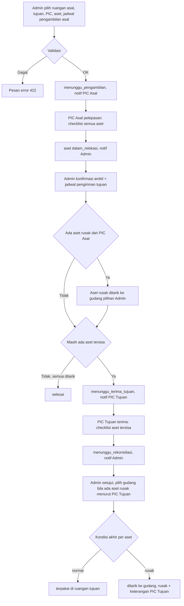
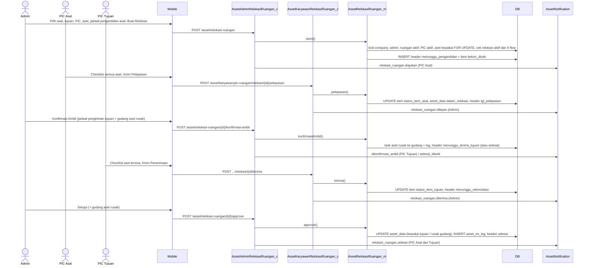
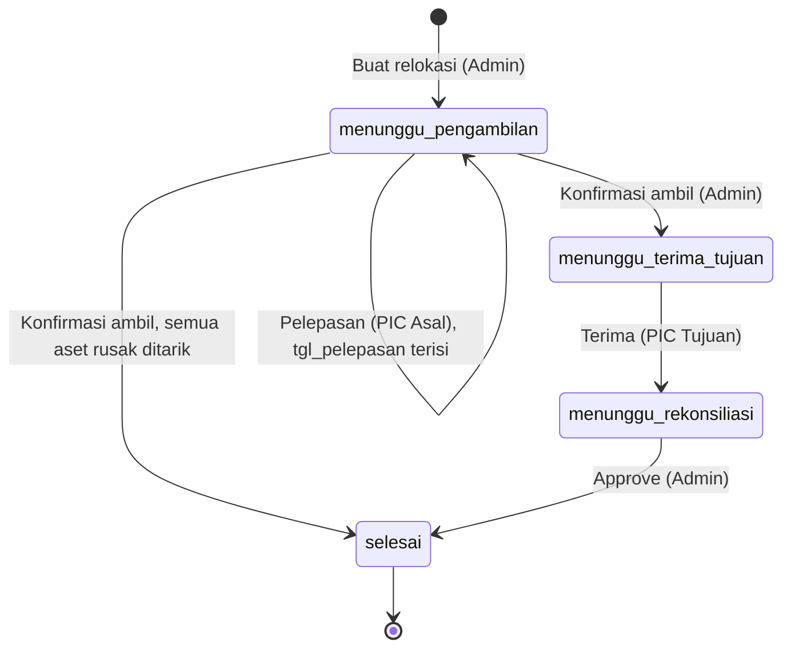
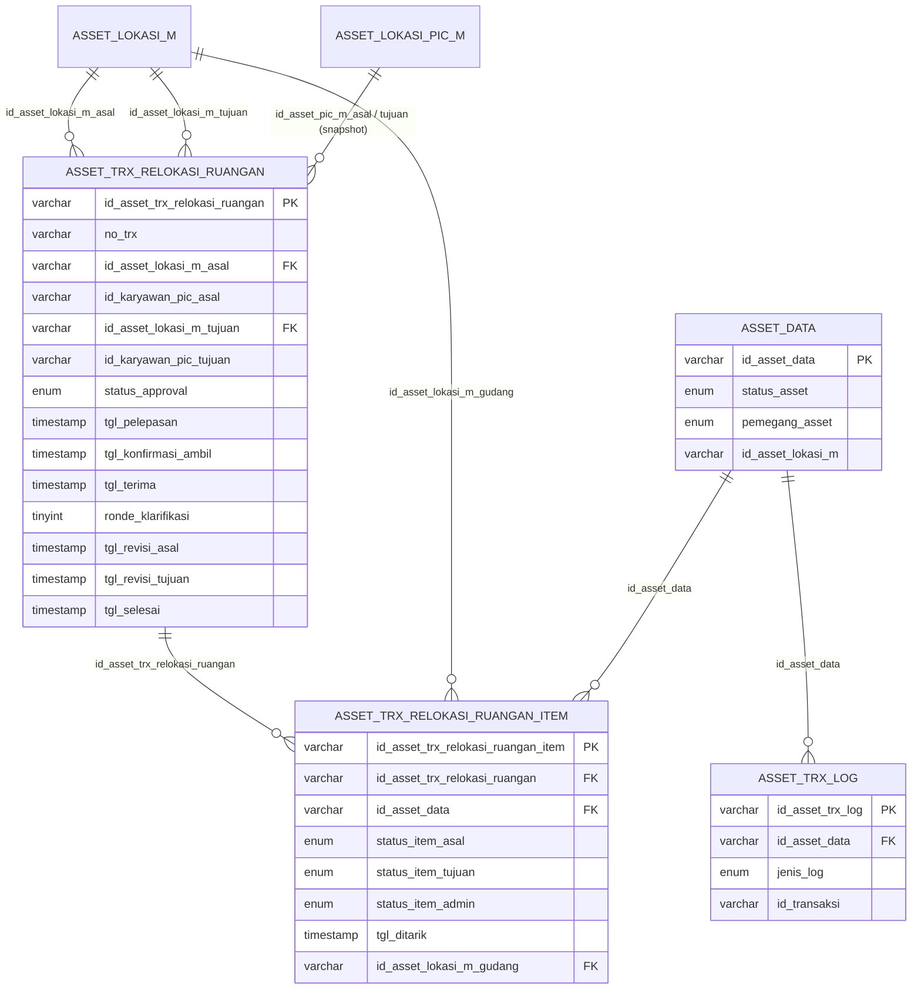

# Dokumentasi Teknis & Manual Book — Relokasi Asset Ruangan (ALK-RGN03)

> Dokumen ini disusun **dari source code lokal** (`API/` Lumen dan `MOBILE/` Flutter) per 25 November 2026. Seluruh klaim diverifikasi ke kode, DBML, SQL, dan test; dokumen bisnis RGN03 (docx awal) **tidak dijadikan sumber**, sehingga istilah dan kode fase mengikuti komentar di kode.
> Cakupan: **konteks ruangan → ruangan** (satu transaksi = satu ruangan asal, satu ruangan tujuan, banyak aset utuh). Relokasi sisi karyawan tidak ada. Bagian yang tidak ditemukan ditandai **⚠️ Belum ditemukan**, asumsi ditandai **⚠️ Asumsi**.
> Dokumen menggambarkan **keadaan sekarang**. Konsep yang pernah ada lalu dihapus (riwayat/perubahan jadwal: tabel `asset_trx_relokasi_ruangan_jadwal`, route `PUT {id}/jadwal`, notifikasi jadwal; serta pembatalan Admin) hanya disebut di §48 Changelog dan §44 Developer Notes. **Jadwal awal tetap ada**: jadwal pengambilan di ruangan asal diisi Admin saat relokasi dibuat, jadwal pengiriman ke ruangan tujuan diisi Admin saat konfirmasi ambil; keduanya disimpan di kolom header dan tidak dapat diubah setelah tersimpan.
> Contoh ID/nama pada payload adalah **data sintetis**.

---

## 1. Informasi Dokumen

| Informasi | Nilai |
|---|---|
| Nama Fitur | Relokasi Asset Ruangan (UI: **"Relokasi Aset Ruangan"**; admin membukanya dari menu **Relokasi** pada Kelola Aset, PIC dari menu **Relokasi** pada beranda Aset atau dari kartu "Perlu tindakan Anda") |
| Kode Fitur | **ALK-RGN03** (nomor transaksi `RGN03-YYYYMMNNN`) |
| Modul | Asset Management — Aset Ruangan |
| Backend | Laravel **Lumen ^10.0**, PHP ^8.1, JWT, Query Builder |
| Database | `API/diagram-asset.dbml` (bagian `[REVISI ALK-RGN03]`) + SQL manual di `Claude outputs/`: `sql-alk-rgn03-relokasi-ruangan.sql` (**sudah dijalankan**); `-hapus-jadwal.sql`, `-hapus-tiba.sql`, `-hapus-klarifikasi.sql` (**belum dijalankan**); `-revisi.sql` dan `-checklist-admin.sql` **usang, tidak perlu dijalankan**. Tidak ada migration Lumen untuk tabel ini |
| Mobile | Flutter (`professional_flutter_3_35`), `flutter_bloc`, `dio` |
| Web | ⚠️ Belum ditemukan: tidak ada source web di workspace |
| Test otomatis | API `tests/Asset/AssetRelokasiRuanganTest.php` (**24 test**, 379 assertion, lulus; dijalankan 27 Nov 2026, PHP 8.2.31). Kunci lintas-flow: **11 test** di 5 file test flow ruangan lain (lulus). `tests/Routing` **15 test** lulus dan mengunci **590 route**. Suite `tests/Asset`: **700 test**, 7315 assertion, 0 gagal (§38, RISK-008). Mobile: `test/asset/asset_relokasi_ruangan_test.dart` (**70 deklarasi → 74 test dieksekusi**) dan grup `Relokasi di beranda baru` di `test/asset/asset_saya_baru_test.dart` (**10 deklarasi → 12 test dieksekusi**): hasil run terakhir yang diketahui (SDK 3.35.6) semuanya lulus; `test/asset` seluruhnya 1203 lulus / 15 gagal lama (§38) |
| Versi Dokumen | 1.3 |
| Tanggal Dokumentasi | 2026-11-25 |
| Dokumen terkait | Penarikan Asset Ruangan (ALK-RGN02), Retur Asset Ruangan (ALK-RGN06), Kerusakan Asset Ruangan (ALK-RGN05), Upgrade Komponen Ruangan (ALK-RGN07), Penambahan Asset Ruangan (ALK-RGN04), Pemeliharaan Terjadwal Asset Ruangan (PML01), Master Pendamping & Tugas PIC (tabel `asset_lokasi_pic_m`) |

---

## 2. Daftar Isi

1. Informasi Dokumen · 3. Quick Overview · 4. Ringkasan Fitur · 5. Tujuan · 6. Aktor · 7. Hak Akses · 8. Terminologi · 9. Business Rules · 10. Business Flow · 11. Flow per Role · 12. Flow Diagram · 13. Sequence Diagram · 14. Status Transaksi · 15. State Transition · 16. Struktur Database · 17. Relasi · 18. Data Dictionary · 19. Index · 20. Backend Architecture · 21. Backend Logic · 22. Dampak asset_data · 23. API · 24. Detail API · 25. Mobile Architecture · 26. Mobile Screen · 27. Mobile → API · 28. API → Mobile · 29. Mapping Mobile→API→DB · 30. Mapping DB→API→Mobile · 31. Validation · 32. Error Handling · 33. Audit Trail · 34. Notification · 35. Security · 36. Manual Book · 37. Kondisi Button · 38. Testing · 39. Temuan Ketidaksesuaian · 40. Edge Case · 41. Risk · 42. Dependency · 43. Source Reference · 44. Developer Notes · 45. Traceability · 46. DB Impact · 47. Checklist · 48. Changelog

---

## 3. Quick Overview

| Item | Informasi |
|---|---|
| Feature | Relokasi Asset Ruangan — memindahkan aset utuh dari **Ruangan 1 (asal)** ke **Ruangan 2 (tujuan)** dengan dua serah terima (PIC Asal → Admin/HR, Admin/HR → PIC Tujuan), dua checklist kondisi, dan rekonsiliasi Admin |
| Module | Asset Management |
| Actor | Admin Asset (membuat, konfirmasi ambil, approve + pilih gudang aset rusak), **PIC Ruangan Asal** (pelepasan), **PIC Ruangan Tujuan** (terima), System |
| Main Transaction | `asset_trx_relokasi_ruangan` |
| Detail Transaction | `asset_trx_relokasi_ruangan_item` (satu baris = satu aset utuh) |
| Asset Master | `asset_data` |
| Master PIC | `asset_lokasi_pic_m` (PIC dipilih saat relokasi dibuat; disimpan sebagai snapshot header) |
| Log | `asset_trx_log`, `jenis_log = relokasi_ruangan` (posisi `ruangan → gudang` untuk aset rusak yang ditarik, `ruangan → ruangan` untuk aset normal saat approve) |
| Status | `menunggu_pengambilan → menunggu_terima_tujuan → menunggu_rekonsiliasi → selesai` (enum `RelokasiRuanganStatus`; `menunggu_pengiriman` dan `menunggu_klarifikasi` legacy) |
| Status aset | `terpakai → dalam_relokasi` (saat pelepasan) `→ terpakai` @ruangan tujuan (approve, normal) atau `rusak` @gudang (rusak) |
| Inisiator | **Admin/HR** (bukan PIC) |
| Penentu hasil akhir | **Checklist PIC Tujuan** (`status_item_tujuan`); Admin hanya memilih gudang untuk aset rusak |
| Jadwal | **Jadwal awal wajib**: pengambilan di ruangan asal (`tgl/jam_pengambilan_asal`, + `keterangan_pengambilan_asal` opsional) saat dibuat; pengiriman ke ruangan tujuan (`tgl/jam_pengambilan_tujuan`, + keterangan opsional) saat konfirmasi ambil. Tersimpan di 6 kolom header; tidak ada ubah jadwal dan tidak ada tabel riwayat |
| Tanpa | Riwayat/perubahan jadwal, pembatalan Admin, penggantian aset, jenis item/`parent_id` |
| API | **11 endpoint** (7 admin + 4 PIC) + kunci aditif ringkasan (`relokasi_perlu_tindakan`, `ruangan_relokasi_perlu_proses`, `ruangan_relokasi_pending`). Total route API: **589** |
| Mobile Screen | Admin: daftar, form buat, detail (konfirmasi ambil, setujui). PIC: daftar, detail (pelepasan, terima). Beranda: kartu "Perlu tindakan Anda" (PIC), panel dan badge menu Relokasi (Admin) |

```text
Admin/HR: Pilih Ruangan Asal + PIC Asal + Aset  ->  Ruangan Tujuan + PIC Tujuan  ->  Jadwal Pengambilan Asal (tgl + jam)  ->  Buat Relokasi
   │   RGN03-YYYYMMNNN  ·  menunggu_pengambilan  ·  notif PIC Asal   (aset belum berubah, tetapi terkunci dari flow ruangan lain)
   ▼
PIC Asal: Pelepasan  — checklist Normal / Rusak (+ keterangan) untuk SEMUA aset
   │   semua aset -> dalam_relokasi  ·  notif Admin  ·  status tetap menunggu_pengambilan (tgl_pelepasan terisi)
   ▼
Admin: Konfirmasi Ambil  (isi jadwal pengiriman ke tujuan; aset yang dinyatakan RUSAK oleh PIC Asal ditarik ke gudang pilihan Admin)
   ├─ masih ada aset tersisa ──────────── menunggu_terima_tujuan ·  notif PIC Tujuan
   └─ semua aset rusak & ditarik ──────── selesai (relokasi langsung tuntas)
   ▼
   ▼
PIC Tujuan: Terima — checklist Normal / Rusak untuk aset yang belum ditarik
                                         menunggu_rekonsiliasi  ·  notif Admin
   ▼
Admin: bandingkan checklist Asal vs Tujuan
   └─ Setujui (pilih gudang bila ada aset rusak) ─ selesai
          normal -> terpakai di ruangan tujuan   ·   rusak -> gudang pilihan Admin (keterangan PIC Tujuan)
```

---

## 4. Ringkasan Fitur

Relokasi Asset Ruangan dipakai Admin/HR untuk **memindahkan aset yang sedang terpakai di satu ruangan ke ruangan lain**, dengan serah terima terdokumentasi di kedua ujung dan pemeriksaan kondisi oleh PIC masing-masing ruangan. Admin/HR adalah **pembawa fisik** aset di antara kedua ruangan.

- **Dimulai Admin.** Admin memilih ruangan asal, ruangan tujuan (harus berbeda), PIC Asal dan PIC Tujuan (opsional; default PIC aktif pertama), dan aset yang dipindahkan. Tidak ada status draft: transaksi langsung `menunggu_pengambilan`.
- **1 baris item = 1 aset utuh.** Tidak ada `jenis_item` atau `parent_id`, dan **tidak ada penggantian aset**.
- **Dua checklist PIC.** PIC Asal mengisi `status_item_asal` saat pelepasan, PIC Tujuan mengisi `status_item_tujuan` saat terima. Nilai hanya `normal` atau `rusak`; `rusak` wajib keterangan.
- **Aset rusak sejak asal ditarik ke gudang.** Saat Admin konfirmasi ambil, item yang dinyatakan rusak oleh PIC Asal ditarik ke gudang pilihan Admin (status `rusak`). Bila **semua** item ditarik, relokasi langsung `selesai`.
- **Rekonsiliasi Admin.** Admin melihat checklist Asal dan Tujuan lalu menyetujui. Perbedaan hanya ditandai sebagai informasi; tidak ada klarifikasi.
- **Checklist PIC Tujuan menentukan hasil akhir.** `normal` → `terpakai` di ruangan tujuan, `rusak` → ditarik ke gudang pilihan Admin dengan keterangan PIC Tujuan.
- **Kunci lintas-flow dua arah.** Relokasi aktif mengunci aset dari lima flow ruangan lain (retur, penarikan, kerusakan, upgrade, pemeliharaan) dan sebaliknya.
- Nomor transaksi `RGN03-YYYYMMNNN`. Posisi di seri dokumen: tahap **"Asset berpindah antar ruangan"**, berdampingan dengan Penarikan Ruangan (RGN02) dan Retur Ruangan (RGN06).

⚠️ Belum ditemukan: keterkaitan dengan master ruangan (relokasi **tidak** mengubah `asset_lokasi_m` atau `asset_lokasi_pic_m`) dan keterkaitan dengan peminjaman atau penarikan karyawan.

---

## 5. Tujuan Fitur

### 5.1 Tujuan Bisnis (diturunkan dari kode)
- Memindahkan aset antar ruangan secara terdokumentasi, dengan bukti serah terima dan kondisi di kedua ujung.
- Mendeteksi aset yang berubah kondisi selama perpindahan (perbedaan checklist Asal vs Tujuan) sebagai informasi bagi Admin.
- Memastikan aset rusak tidak masuk ke ruangan tujuan, melainkan ditarik ke gudang.
- Memberi Admin keputusan akhir atas kondisi tiap aset.

### 5.2 Tujuan Sistem
- Membuat snapshot aset (nama, deskripsi, kategori) dan snapshot ruangan/PIC pada header dan item.
- Mencegah aset yang sedang direlokasi diproses di flow ruangan lain dan sebaliknya.
- Memindahkan aset (`asset_data`) hanya pada dua titik: pelepasan (status `dalam_relokasi`) dan penyelesaian (`terpakai` di tujuan, atau `rusak` di gudang), serta mencatat `asset_trx_log`.
- Menjaga hak akses: hanya PIC Asal/PIC Tujuan yang tercatat pada header yang melihat dan bertindak.

---

## 6. Aktor

| Aktor | Role | Fungsi |
|---|---|---|
| Admin Asset (Admin/HR) | `asset_admin` | Membuat relokasi, konfirmasi ambil (+ pilih gudang aset rusak), approve (+ pilih gudang aset rusak menurut PIC Tujuan) |
| PIC Ruangan Asal | Karyawan **aktif** yang tercatat di `id_karyawan_pic_asal` header | Melihat relokasinya, pelepasan (checklist) |
| PIC Ruangan Tujuan | Karyawan **aktif** yang tercatat di `id_karyawan_pic_tujuan` header | Melihat relokasinya, terima (checklist) |
| System | Backend + FCM | Validasi, lock company, penomoran, snapshot, cek lintas flow, update aset, log, notifikasi |

Satu karyawan dapat berperan ganda: admin sekaligus PIC, atau **PIC Asal sekaligus PIC Tujuan**. Endpoint `asset/relokasi-ruangan/*` memeriksa `asset_admin`; endpoint `asset/karyawan/pic-ruangan/relokasi/*` memeriksa karyawan aktif lalu peran pada header (`rolesOf`).

---

## 7. Hak Akses

| Action | Admin Asset | PIC Asal | PIC Tujuan | Keterangan |
|---|:---:|:---:|:---:|---|
| Melihat semua relokasi | ✅ | ❌ | ❌ | `GET asset/relokasi-ruangan` |
| Melihat relokasi sendiri | – | ✅ | ✅ | Hanya header yang memuat `id_karyawan` mereka sebagai PIC Asal/Tujuan |
| Membuat relokasi | ✅ | ❌ | ❌ | Ruangan asal/tujuan wajib punya PIC aktif |
| Pelepasan (checklist asal) | ❌ | ✅ | ❌ | `menunggu_pengambilan`, sekali |
| Konfirmasi ambil | ✅ | ❌ | ❌ | Setelah `tgl_pelepasan` terisi |
| Terima (checklist tujuan) | ❌ | ❌ | ✅ | `menunggu_terima_tujuan` |
| Approve | ✅ | ❌ | ❌ | `menunggu_rekonsiliasi` |
| Membatalkan relokasi | ❌ | ❌ | ❌ | ⚠️ Tidak ada fitur batal (RISK-003) |
| Mengubah jadwal | ❌ | ❌ | ❌ | ⚠️ Tidak ada fitur ubah jadwal (route `PUT {id}/jadwal` dan tabel riwayat dihapus); jadwal hanya diisi sekali: saat dibuat (asal) dan saat konfirmasi ambil (tujuan) |

---

## 8. Terminologi

| Istilah | Arti di sistem |
|---|---|
| Relokasi | Transaksi pemindahan aset ruangan → ruangan (ALK-RGN03) |
| Ruangan Asal / Tujuan | `id_asset_lokasi_m_asal` / `id_asset_lokasi_m_tujuan`: `asset_lokasi_m` bertipe `ruangan`, `status_aktif = '1'` |
| PIC Asal / PIC Tujuan | Karyawan di `id_karyawan_pic_asal` / `id_karyawan_pic_tujuan` header. Dipilih Admin saat membuat, default PIC aktif pertama (urut `id_asset_lokasi_pic_m`) |
| Pelepasan | Handoff 1: PIC Asal mengisi checklist semua item (`tgl_pelepasan`, `user_pelepasan`) |
| Konfirmasi ambil | Admin mengambil aset dari ruangan asal (`tgl_konfirmasi_ambil`); item rusak asal ditarik ke gudang |
| Terima | Handoff 2: PIC Tujuan mengisi checklist item yang belum ditarik (`tgl_terima`, `user_terima`) |
| Rekonsiliasi | Admin membandingkan checklist Asal vs Tujuan dan memutuskan |
| Perbedaan (`beda_kondisi`) | Item belum ditarik, kedua checklist terisi `normal`/`rusak`, dan nilainya tidak sama (`isBeda`) |
| Item ditarik | Item dengan `tgl_ditarik` terisi: aset rusak yang sudah dipindah ke gudang (`id_asset_lokasi_m_gudang`) |
| Relokasi aktif | Status selain `selesai` (`RelokasiRuanganStatus::isFinal`) |
| `dalam_relokasi` | Nilai baru `asset_data.status_asset`: aset sedang dibawa Admin antar ruangan |

---

## 9. Business Rules

### BR-001 — Hanya admin yang membuat, konfirmasi ambil, dan approve
Aksi admin memanggil `requireAdmin` → "Pengguna tidak terdaftar sebagai admin aset." Controller admin memanggil `accessError` **lebih dulu** (403 "Pengguna tidak memiliki akses admin aset.") baru validasi request (422); test `test_controllers_check_authorization_before_validation`. Aksi PIC memanggil `relokasiAccessError` (karyawan aktif, 403 "Karyawan tidak aktif atau tidak ditemukan.") lalu `requireRole`.

### BR-002 — Ruangan asal dan tujuan
- Harus berbeda: "Ruangan tujuan harus berbeda dari ruangan asal." (validasi `different` di controller dan cek di model).
- `findRuangan`: bertipe `ruangan` dan `status_aktif = '1'`, kalau tidak → "Ruangan asal tidak ditemukan atau tidak aktif." / "Ruangan tujuan tidak ditemukan atau tidak aktif."
- `pickPic`: ruangan wajib punya PIC aktif → "Ruangan asal belum memiliki PIC aktif." / "Ruangan tujuan belum memiliki PIC aktif." PIC aktif = karyawan berstatus `1–4` di `data_karyawan`.
- Daftar `options` hanya memuat ruangan yang punya PIC aktif (ruangan tanpa PIC dilewati).

### BR-003 — PIC dipilih saat dibuat dan menjadi satu-satunya penerima hak akses
`id_karyawan_pic_asal` / `id_karyawan_pic_tujuan` opsional; kosong → PIC aktif pertama ruangan itu. Bila diisi harus PIC aktif ruangan tersebut → "PIC ruangan asal yang dipilih bukan PIC aktif ruangan tersebut." (juga untuk tujuan). Nilai disimpan sebagai snapshot (`id_asset_pic_m_*`, `nama_pic_*`, `nik_pic_*`, `id_karyawan_pic_*`). **Hak akses dan notifikasi memakai kolom `id_karyawan_pic_*` ini saja**, bukan keanggotaan ruangan: PIC lain di ruangan yang sama tidak dapat bertindak (beda dengan RGN02; RISK-014). Karyawan yang bukan PIC relokasi itu mendapat "Relokasi tidak ditemukan." (aksi) atau 404 (detail).

### BR-004 — Aset yang dapat direlokasi
`roomAssets`: `asset_data` dengan `pemegang_asset = ruangan`, **`status_asset = terpakai`**, dan `id_asset_lokasi_m` = ruangan asal (dikunci `FOR UPDATE` saat buat). Pelanggaran → "Aset {id} tidak berstatus terpakai di ruangan asal." Wajib minimal satu aset dan tanpa duplikat: "Pilih minimal satu aset yang akan direlokasi." / "Aset yang dipilih tidak boleh duplikat." Aset yang sudah ada di relokasi aktif lain → "Satu atau beberapa aset terpilih sudah ada pada relokasi aktif lain." Beberapa relokasi aktif dari ruangan yang sama diperbolehkan selama asetnya berbeda.

### BR-005 — Item = satu aset utuh dengan snapshot
`insertItems`: tiap aset menjadi satu baris dengan `nama_asset`, `deskripsi_asset`, `kategori_asset`, `status_item_asal = status_item_tujuan = belum_dicek`, `ket_rusak_asal = ket_rusak_tujuan = ''`. `tgl_ditarik = NULL`. Tidak ada kolom jenis item, `parent_id`, atau aset pengganti.

### BR-006 — Pelepasan (PIC Asal)
- Hanya PIC Asal (`requireRole(..., 'asal')`): "Aksi ini hanya untuk PIC ruangan asal."
- Status harus `menunggu_pengambilan` → "Pelepasan hanya dapat dilakukan saat menunggu pengambilan."; hanya satu kali → "Pelepasan aset sudah dilakukan." (`tgl_pelepasan` sudah terisi).
- Checklist **semua** item wajib (`normalizeChecklist`, `requireAll`): "Kondisi setiap aset wajib diisi."; nilai `normal`/`rusak`: "Kondisi aset harus normal atau rusak."; `rusak` wajib keterangan ≤255: "Keterangan kerusakan wajib diisi." / "Keterangan kerusakan maksimal 255 karakter."; `normal` menyimpan keterangan `''`; id item harus milik relokasi ini dan tidak duplikat.
- Aset harus masih `terpakai` di ruangan asal (`assertAssetsHeld`): "Status aset {nama} sudah berubah atau tidak lagi dipegang ruangan asal."
- Efek: `status_item_asal`/`ket_rusak_asal` per item; **seluruh** aset → `status_asset = dalam_relokasi`; header `tgl_pelepasan`, `user_pelepasan`. **Status header tetap `menunggu_pengambilan`.** Tidak ada baris `asset_trx_log` pada langkah ini (RISK-005).

### BR-007 — Konfirmasi ambil (Admin) dan penarikan aset rusak asal
- Body wajib memuat `tgl_pengambilan_tujuan` (`Y-m-d`) dan `jam_pengambilan_tujuan` (`H:i`); `keterangan_pengambilan_tujuan` opsional (≤255). Divalidasi di controller sebelum transaksi dibuka, sehingga bila ditolak tidak ada jadwal yang tersimpan. ⚠️ Berlaku juga bila semua aset rusak ditarik dan relokasi langsung `selesai` (jadwal tujuan tetap wajib; lihat RISK-013).
- Status `menunggu_pengambilan` → "Konfirmasi pengambilan hanya dapat dilakukan saat menunggu pengambilan."; `tgl_pelepasan` wajib terisi → "PIC ruangan asal belum mengisi checklist pelepasan."
- Item dengan `status_item_asal = rusak` **wajib** ditarik ke gudang: body `items[]` memuat tepat satu pasangan `id_asset_trx_relokasi_ruangan_item` + `id_asset_lokasi_m_gudang` per item rusak ("Lokasi gudang tujuan setiap aset wajib dipilih."), lokasi bertipe `gudang` ("Lokasi gudang tujuan tidak valid."). Pasangan untuk item **bukan rusak** ditolak: "Hanya aset yang dinyatakan rusak oleh PIC Asal yang ditarik ke gudang."
- Item rusak ditarik (`moveToGudang`): lihat §22. Header: `tgl_konfirmasi_ambil`, `user_konfirmasi_ambil`, serta jadwal tujuan (`tgl_pengambilan_tujuan`, `jam_pengambilan_tujuan` + `:00`, `keterangan_pengambilan_tujuan`) dalam `updateHeader` yang sama dengan perubahan status.
- Bila item tersisa (belum ditarik) = 0 → status `selesai` + `tgl_selesai` (tanpa `user_approval`); selain itu → `menunggu_terima_tujuan`. Notifikasi berbeda (§34).

### BR-008 — (dihapus di versi 1.2)
Langkah **Tandai Tiba** tidak ada lagi: konfirmasi ambil langsung membuka giliran PIC Tujuan. Nomor aturan tidak dipakai ulang.

### BR-009 — Terima (PIC Tujuan)
- Hanya PIC Tujuan: "Aksi ini hanya untuk PIC ruangan tujuan."; status `menunggu_terima_tujuan` → "Terima hanya dapat dilakukan saat menunggu diterima tujuan."
- Checklist wajib untuk **semua item yang belum ditarik** (item `ditarik` tidak boleh dikirim: "Aset pada checklist tidak termasuk relokasi ini atau sudah ditarik."), aturan nilai dan keterangan sama dengan BR-006.
- Efek: `status_item_tujuan`/`ket_rusak_tujuan`; header → `menunggu_rekonsiliasi`, `tgl_terima`, `user_terima`. Aset **tidak** berubah.

### BR-010 — Perbedaan checklist hanya informasi
`isBeda(item)`: item belum ditarik, kedua checklist `normal`/`rusak`, dan nilainya tidak sama. `ada_perbedaan` pada detail = ada minimal satu item beda. Perbedaan **tidak** memblokir approve.

### BR-011 — (dihapus di versi 1.3)
Klarifikasi tidak ada lagi.

### BR-012 — (dihapus di versi 1.3)
Revisi checklist PIC tidak ada lagi.

### BR-013 — Approve mengikuti checklist PIC Tujuan
- Status `menunggu_rekonsiliasi`; semua item belum ditarik wajib sudah dinilai PIC Tujuan.
- Body `items[]` berisi **tepat satu** pasangan `id_asset_trx_relokasi_ruangan_item` + `id_asset_lokasi_m_gudang` untuk tiap item belum ditarik yang `status_item_tujuan = rusak`; kosong bila semua normal. Pasangan untuk item normal, sudah ditarik, transaksi lain, atau duplikat, serta pasangan yang kurang, ditolak 422.
- `normal` → `terpakai` di ruangan tujuan; `rusak` → gudang pilihan Admin dengan `ket_rusak = ket_rusak_tujuan`.
- Seluruh approve dalam satu transaksi (`test_approve_rolls_back_fully_when_a_later_item_fails`).
- Header: `selesai`, `user_approval`, `tgl_approval`, `tgl_selesai`.

### BR-014 — Efek ke `asset_data` dan log
Lihat §22. Ringkas: pelepasan → `dalam_relokasi` (tanpa log); tarik ke gudang → `rusak` @gudang + log `ruangan → gudang`; approve normal → `terpakai` @ruangan tujuan + log `ruangan → ruangan`.

### BR-015 — Relokasi aktif mengunci aset di flow ruangan lain (dua arah)
- **Arah 1** (relokasi menolak aset di flow lain, hanya saat **buat**): `assertNoCrossFlow` memeriksa penarikan, retur, penambahan, upgrade, kerusakan, dan pemeliharaan ruangan aktif → "Satu atau beberapa aset sedang diproses pada penarikan ruangan." / "…retur ruangan." / "…penambahan aset ruangan." / "…upgrade ruangan." / "…laporan kerusakan ruangan." / "…pemeliharaan ruangan."
- **Arah 2** (flow lain menolak aset yang sedang direlokasi): `AssetRelokasiRuangan_m::hasActiveRelokasiRuanganAsset` / `activeAssetIds` dipanggil oleh **lima** flow: Retur, Penarikan (pesan "Satu atau beberapa aset sedang diproses pada relokasi ruangan."), serta Kerusakan, Upgrade, Pemeliharaan (pesan "Aset sedang dalam proses relokasi ruangan."), dan oleh daftar pilihan flow-flow itu agar aset tidak ditawarkan. **Penambahan (RGN04)** tidak memanggilnya (⚠️ tidak ditemukan pemanggil; penambahan menambah aset baru, bukan memproses aset ruangan).
- Status aktif = semua selain `selesai`. `selesai` melepas kunci.

### BR-016 — Jadwal awal wajib; tanpa riwayat ubah jadwal dan tanpa pembatalan
- **Saat dibuat (Admin):** `tgl_pengambilan_asal` (`Y-m-d`) dan `jam_pengambilan_asal` (`H:i`) **wajib**; `keterangan_pengambilan_asal` opsional (≤255). Pesan: "Tanggal pengambilan di ruangan asal wajib diisi.", "Format tanggal pengambilan ruangan asal harus YYYY-MM-DD.", "Jam pengambilan di ruangan asal wajib diisi.", "Format jam pengambilan ruangan asal harus HH:mm.", "Keterangan pengambilan ruangan asal maksimal 255 karakter."
- **Saat konfirmasi ambil (Admin):** `tgl/jam/keterangan_pengambilan_tujuan` dengan aturan yang sama (BR-007); pesan memakai kata "ruangan tujuan".
- Jam disimpan sebagai `HH:mm:00`. API **tidak** membatasi tanggal (tanggal lampau diterima); picker mobile membatasi tanggal minimal hari ini.
- Tidak ada ubah jadwal: tabel riwayat `asset_trx_relokasi_ruangan_jadwal`, route `PUT {id}/jadwal`, aksi `ubah_jadwal_*`, dan notifikasi jadwal **tidak ada**. Relokasi tidak dapat dibatalkan. Admin juga tidak punya aksi darurat di `menunggu_terima_tujuan` (RISK-003).
- Relokasi yang dibuat **sebelum** perubahan ini tidak punya jadwal (kolom tetap default) → respons `null`.

### BR-017 — Transaksi, lock, dan penomoran
Semua tulis di `DB::transaction` (retry 3) dengan `lockCompany`. Header dan item: `id_company + YYYYMM + 3 digit` (tabel terpisah); `no_trx = RGN03-YYYYMMNNN` (unik per company, indeks `uq_relokasi_rgn_company_no_trx`); log dan notifikasi 5 digit. Kapasitas 3 digit/bulan/company (`ensureSequenceCapacity`); item memakan satu nomor per aset.

### BR-018 — Status tak dikenal dibaca `menunggu_pengambilan`
`statusOf` memakai `RelokasiRuanganStatus::tryFrom(...) ?? MENUNGGU_PENGAMBILAN` agar list/detail tidak jatuh pada nilai enum yang tidak dikenal.

### BR-019 — Notifikasi best-effort
Dikirim sesudah commit oleh controller (`AssetNotification::send` menelan semua exception ke log). Penerima: PIC Asal/Tujuan snapshot header dan semua admin. Lihat §34.

### BR-020 — Tabel belum ada tidak menjatuhkan ringkasan
Jalur ringkasan (`getPendingForPic`, `getPendingForAdmin`, `countPendingForAdmin`, `activeAssetIds`) memeriksa `relokasiTablesExist()` (memo per koneksi) dan mengembalikan `[]`/`0` bila tabel belum ada.

---

## 10. Business Flow

```text
1. Admin: menu Relokasi (Kelola Aset) -> (+) Buat Relokasi Aset
   -> Pilih Ruangan Asal (+ PIC Asal) -> centang Aset yang direlokasi
   -> Pilih Ruangan Tujuan (+ PIC Tujuan) -> Jadwal Pengambilan Asal (tgl + jam, keterangan opsional) -> Catatan -> Buat Relokasi
                                          [menunggu_pengambilan · notif PIC Asal]
2. PIC Asal: kartu "Lepas aset relokasi" / menu Relokasi -> Detail
   -> tiap aset Normal / Rusak (+ keterangan) -> Kirim Pelepasan
                                          [tgl_pelepasan terisi · aset dalam_relokasi · notif Admin]
3. Admin: Detail -> Konfirmasi Ambil
   -> isi Jadwal Pengiriman ke Ruangan Tujuan (tgl + jam, keterangan opsional)
   -> bila ada aset rusak dari PIC Asal: pilih gudang per aset rusak (ditarik ke gudang)
                                          [menunggu_terima_tujuan · notif PIC Tujuan]   atau  [selesai bila semua aset ditarik]
4. PIC Tujuan: Detail -> tiap aset Normal / Rusak -> Kirim Penerimaan
                                          [menunggu_rekonsiliasi · notif Admin]
5. Admin: Detail (perbedaan ditandai "Kondisi berbeda", hanya informasi)
   -> Setujui -> bila PIC Tujuan menilai ada aset rusak: pilih gudang per aset rusak
        normal -> terpakai di ruangan tujuan;  rusak -> ditarik ke gudang
                                          [selesai · asset_trx_log · notif PIC Asal & Tujuan]
```

---

## 11. Flow Berdasarkan Role

### 11.1 Admin Asset
1. Beranda Aset → grup **Kelola Aset** → ikon **Relokasi** (badge = `ruangan_relokasi_perlu_proses`), atau panel **Relokasi Aset Ruangan** pada halaman Asset Ruangan admin.
2. **+** → **Buat Relokasi Aset**: ruangan asal, PIC Asal, aset, ruangan tujuan, PIC Tujuan, **jadwal pengambilan di ruangan asal** (tanggal + jam wajib, keterangan opsional), catatan → **Buat Relokasi**.
3. Detail: **Konfirmasi Ambil** (setelah PIC Asal melepas; mengisi jadwal pengiriman ke ruangan tujuan) dan **Setujui** (saat rekonsiliasi; memilih gudang bila ada aset rusak).

### 11.2 PIC Ruangan Asal
1. Kartu **Lepas aset relokasi** pada "Perlu tindakan Anda" atau menu **Relokasi** pada beranda Aset.
2. Detail → tiap aset **Normal/Rusak** → **Kirim Pelepasan**.

### 11.3 PIC Ruangan Tujuan
1. Kartu **Terima aset relokasi** (muncul setelah Admin mengonfirmasi pengambilan).
2. Detail → tiap aset yang belum ditarik **Normal/Rusak** → **Kirim Penerimaan**.

### 11.4 Approver
Tidak ada approver terpisah: **Admin** melakukan rekonsiliasi dan approve.

### 11.5 System
Snapshot aset dan PIC, cek lintas flow, kunci aset, update aset dan log, notifikasi, ringkasan beranda.

---

## 12. Flow Diagram



---

## 13. Sequence Diagram



---

## 14. Status Transaksi

Enum PHP `App\Models\Asset\RelokasiRuanganStatus` (kolom `status_approval`; enum DB `status_relokasi_ruangan`, **6 nilai**). Tidak ada `draft`, `ditolak`, maupun `dibatalkan`.

| Status | Label API | Tab | Arti | Aksi berikutnya |
|---|---|---|---|---|
| `menunggu_pengambilan` | Menunggu Pengambilan | berjalan | Transaksi dibuat; PIC Asal menyiapkan dan melepas, Admin belum mengambil | PIC Asal: pelepasan; Admin: konfirmasi ambil (setelah pelepasan) |
| `menunggu_pengiriman` | Menunggu Pengiriman | berjalan | **Legacy** (sebelum versi 1.2). Tidak dihasilkan lagi dan tidak ditawarkan sebagai filter | Tidak ada; dipindahkan lewat `sql-alk-rgn03-relokasi-hapus-tiba.sql` |
| `menunggu_terima_tujuan` | Menunggu Terima Ruangan Tujuan | berjalan | Admin sudah mengambil dan menjadwalkan pengiriman; PIC Tujuan belum mengisi checklist | PIC Tujuan: terima |
| `menunggu_rekonsiliasi` | Menunggu Rekonsiliasi | berjalan | Kedua checklist masuk; Admin membandingkan | Admin: approve |
| `menunggu_klarifikasi` | Menunggu Klarifikasi | berjalan | **Legacy** (sebelum versi 1.3). Tidak dihasilkan lagi dan tidak ditawarkan sebagai filter | Tidak ada; dipindahkan lewat `sql-alk-rgn03-relokasi-hapus-klarifikasi.sql` |
| `selesai` | Selesai | selesai | Approve, atau semua aset rusak ditarik saat konfirmasi ambil | – |

Label mobile (kunci `status_*` di `asset.json`) sedikit berbeda untuk `menunggu_terima_tujuan`: "Menunggu Diterima Tujuan" (INC-03).

Status item: `status_item_asal`, `status_item_tujuan` ∈ `belum_dicek` → `normal`/`rusak`. Status aset: lihat §22.

---

## 15. State Transition



| Status Awal | Action | Status Akhir | Actor |
|---|---|---|---|
| – | Buat relokasi | menunggu_pengambilan | Admin |
| menunggu_pengambilan | Pelepasan | menunggu_pengambilan (`tgl_pelepasan` terisi) | PIC Asal |
| menunggu_pengambilan | Konfirmasi ambil (ada item tersisa) | menunggu_terima_tujuan | Admin |
| menunggu_pengambilan | Konfirmasi ambil (semua item ditarik) | selesai | Admin |
| menunggu_terima_tujuan | Terima | menunggu_rekonsiliasi | PIC Tujuan |
| menunggu_rekonsiliasi | Approve | selesai | Admin |

Status `asset_data`:

| Aset | Dari | Ke | Trigger |
|---|---|---|---|
| Aset ruangan asal | `terpakai` @ruangan asal | tidak berubah | Buat relokasi (hanya terkunci) |
| Semua aset relokasi | `terpakai` @ruangan asal | `dalam_relokasi` | Pelepasan PIC Asal |
| Aset rusak (checklist PIC Asal) | `dalam_relokasi` | `rusak` @gudang | Konfirmasi ambil |
| Aset normal (checklist PIC Tujuan) | `dalam_relokasi` | `terpakai` @ruangan tujuan | Approve |
| Aset rusak (checklist PIC Tujuan) | `dalam_relokasi` | `rusak` @gudang | Approve |

---

## 16. Struktur Database

Tabel relokasi **tidak punya migration Lumen**; skema dikelola lewat SQL manual di `Claude outputs/` dan didefinisikan di `API/diagram-asset.dbml` (bagian `[REVISI ALK-RGN03]`, baris 821–911; enum `status_relokasi_ruangan` baris 1864). Test membuat skema SQLite sendiri.

| Table | Type | Fungsi |
|---|---|---|
| `asset_trx_relokasi_ruangan` | Transaction Header | Relokasi, snapshot ruangan dan PIC Asal/Tujuan, jejak handoff (pelepasan, ambil, terima, approval, selesai) |
| `asset_trx_relokasi_ruangan_item` | Transaction Detail | Snapshot aset, tiga checklist (asal, tujuan, Admin), penarikan ke gudang |
| `asset_data` | Master | Status, pemegang, lokasi aset (berubah saat pelepasan dan penyelesaian); `status_asset` + nilai `dalam_relokasi` |
| `asset_trx_log` | Log | `jenis_log = relokasi_ruangan` (enum DBML memuat `relokasi_ruangan`) |
| `asset_lokasi_m` | Master | Ruangan asal/tujuan (`tipe = ruangan`) dan gudang (`tipe = gudang`) |
| `asset_lokasi_pic_m` | Master | PIC terdaftar per ruangan (sumber pilihan PIC saat membuat) |
| `asset_kategori_m` | Master | Nama kategori untuk snapshot item |
| `data_karyawan`, `master_cabang`, `master_departemen` | Master HR | Karyawan aktif, nama cabang, departemen |
| `asset_admin`, `master_company` | Akses / lock | Admin aset dan mutex company |
| `notif_data`, `users` | Notifikasi | Inbox dan token FCM |
| `asset_trx_penarikan_ruangan(_item)`, retur, penambahan (request), upgrade, kerusakan, pemeliharaan ruangan | Cek lintas flow | Dibaca saat buat relokasi; membaca tabel relokasi untuk kunci balik |

Tabel `asset_trx_relokasi_ruangan_jadwal` (riwayat jadwal) **sudah tidak dipakai** dan dibuang oleh `sql-alk-rgn03-relokasi-hapus-jadwal.sql`; tidak ada di DBML.

### 16.1 Prasyarat database, urutan jalan, guard, dan rollback

Empat SQL manual. **Hanya file 1 yang sudah dijalankan pengguna**; file 2–4 **belum dijalankan** (dan tidak dijalankan Claude). Semua file memuat guard hanya-SELECT di blok 0, verifikasi, dan rollback (dikomentari). Komentar sengaja ASCII (tabel `latin1`); `ALTER TABLE` dan `DROP TABLE` MariaDB bersifat auto-commit dan **tidak aman diulang**.

| # | File | Status | Isi | Dibutuhkan oleh |
|:---:|---|:---:|---|---|
| 1 | `sql-alk-rgn03-relokasi-ruangan.sql` | **Sudah dijalankan** | Header: `id_karyawan_pic_asal/tujuan`, `status_approval` tinyint → enum 6 nilai (kolom sementara `status_approval_baru`, data lama 1 → `menunggu_pengambilan`, 2 dan 3 → `selesai`), kolom handoff (`tgl/user_pelepasan`, `tgl/user_konfirmasi_ambil`, `tgl/user_terima`), `ronde_klarifikasi`, `ket_klarifikasi`, `tgl_selesai`, 4 indeks. Item: `DROP parent_id`, tambah `tgl_ditarik`, `id_asset_lokasi_m_gudang`, 2 indeks. `asset_data.status_asset` + `dalam_relokasi`. Juga **membuat** tabel jadwal (kini dibuang file 4) | Seluruh fitur |
| 2 | `sql-alk-rgn03-relokasi-revisi.sql` | **Usang** | Kolom revisi klarifikasi | Tidak perlu dijalankan sejak 1.3 |
| 3 | `sql-alk-rgn03-relokasi-checklist-admin.sql` | **Usang** | Kolom checklist Admin | Tidak perlu dijalankan sejak 1.3 |
| 4 | `sql-alk-rgn03-relokasi-hapus-jadwal.sql` | **Belum** | `DROP TABLE asset_trx_relokasi_ruangan_jadwal` | Kebersihan skema. **Urutan: deploy API dulu, baru SQL ini** (API lama masih membaca tabel jadwal) |
| 5 | `sql-alk-rgn03-relokasi-hapus-tiba.sql` | **Belum** | Data saja: `status_approval` `menunggu_pengiriman` → `menunggu_terima_tujuan` (tanpa ubah skema) | **Setelah** deploy API dan mobile. PIC Tujuan baris yang dipindahkan tidak dinotifikasi otomatis |
| 6 | `sql-alk-rgn03-relokasi-hapus-klarifikasi.sql` | **Belum** | Data saja: `menunggu_klarifikasi` → `menunggu_rekonsiliasi` | **Setelah** deploy API dan mobile |

Urutan aman untuk database yang sudah menjalankan file 1: **file 2 dan file 3 (boleh bersamaan, sebelum API versi ini dipakai) → deploy API → file 4**.

Guard dan catatan per file:
- **File 4**, guard 0: (a) tabel jadwal harus ada (hasil 1; bila 0 file ini sudah pernah dijalankan → berhenti); (b) jumlah baris jadwal yang akan hilang; (c) FK yang merujuk **ke** tabel jadwal harus kosong; (d) FK milik tabel jadwal (informasi); (e) enam kolom jadwal di header harus `NOT NULL` ber-default atau nullable (tanpa default insert relokasi baru gagal). ⚠️ **`DROP TABLE` menghapus riwayat jadwal secara permanen**; rollback hanya membuat ulang struktur kosong, **data jadwal tidak kembali** — lakukan backup (`mysqldump` atau `CREATE TABLE ... AS SELECT`) bila perlu arsip.
- **Rollback file 1** hanya aman bila tidak ada relokasi non-`selesai` dan tidak ada aset `dalam_relokasi` (guard di bagian rollback file itu); urutan rollback: file 3 → file 2 → file 1.
- **Instalasi baru**: file 1 masih membuat tabel jadwal (ada catatan di kepala file); jalankan file 4 sesudahnya atau lewati pembuatan tabel itu.
- Enam kolom jadwal di header (`tgl_pengambilan_asal`, `jam_pengambilan_asal`, `keterangan_pengambilan_asal`, `tgl_pengambilan_tujuan`, `jam_pengambilan_tujuan`, `keterangan_pengambilan_tujuan`) **dipertahankan dan dipakai** untuk jadwal awal (diisi API dan dibaca di detail/list); hanya tabel riwayat yang dibuang file 4. Kolom `ket_tolak` legacy. File 1 harus dicocokkan dengan struktur nyata (`SHOW CREATE TABLE`) karena memakai `AFTER ...` dan `DROP parent_id`.

---

## 17. Relasi Database



---

## 18. Data Dictionary

### 18.1 asset_trx_relokasi_ruangan (header; sumber: DBML)
| Field | Type | Null | Default | Key | Description |
|---|---|:---:|---|---|---|
| id_asset_trx_relokasi_ruangan | varchar(50) | No | – | PK | `id_company + YYYYMM + 3 digit` |
| no_trx | varchar(50) | No | '' | UNIQUE (id_company, no_trx) | `RGN03-YYYYMMNNN` |
| id_asset_lokasi_m_asal | varchar(50) | – | – | FK | Ruangan asal (tipe ruangan, aktif) |
| nama_asset_ruangan_asal, nama_cabang_asal, nama_departemen_asal | varchar(255) | – | – | – | Snapshot saat transaksi |
| id_asset_pic_m_asal | varchar(50) | – | – | FK → `asset_lokasi_pic_m` | Snapshot PIC Asal |
| nama_pic_asal, nik_pic_asal | varchar(255) | – | – | – | Snapshot PIC Asal |
| id_karyawan_pic_asal | varchar(150) | No | '' | IDX | **Dasar hak akses dan notifikasi PIC Asal** |
| id_asset_lokasi_m_tujuan | varchar(50) | – | – | FK | Ruangan tujuan |
| nama_asset_ruangan_tujuan, nama_cabang_tujuan, nama_departemen_tujuan | varchar(255) | – | – | – | Snapshot |
| id_asset_pic_m_tujuan, nama_pic_tujuan, nik_pic_tujuan | varchar | – | – | – | Snapshot PIC Tujuan |
| id_karyawan_pic_tujuan | varchar(150) | No | '' | IDX | **Dasar hak akses dan notifikasi PIC Tujuan** |
| keterangan | text | – | – | – | Catatan Admin |
| ket_tolak | varchar(255) | – | '' | – | **Legacy**, tidak dipakai alur sekarang |
| id_karyawan, nik_karyawan, nama_karyawan | varchar | – | '' | – | Admin pembuat |
| tgl_pengajuan | date | No | CURRENT_DATE | – | Tanggal relokasi dibuat |
| tgl/jam/keterangan_pengambilan_asal | date / time / varchar(255) | No | '0000-00-00' / '00:00:00' / '' | – | **Jadwal pengambilan di ruangan asal**; diisi `store` (wajib tgl + jam). Default berarti belum ada jadwal (relokasi lama) |
| tgl/jam/keterangan_pengambilan_tujuan | date / time / varchar(255) | No | '0000-00-00' / '00:00:00' / '' | – | **Jadwal pengiriman ke ruangan tujuan**; diisi `konfirmasiAmbil` (wajib tgl + jam). Default sebelum konfirmasi ambil |
| status_approval | enum `status_relokasi_ruangan` | No | menunggu_pengambilan | IDX | 6 nilai (§14) |
| tgl_pelepasan / user_pelepasan | timestamp / varchar | Yes / No | NULL / '' | – | Handoff 1 (PIC Asal) |
| tgl_konfirmasi_ambil / user_konfirmasi_ambil | timestamp / varchar | Yes / No | NULL / '' | – | Admin mengambil aset |
| tgl_terima / user_terima | timestamp / varchar | Yes / No | NULL / '' | – | Handoff 2 (PIC Tujuan) |
| ronde_klarifikasi | tinyint(3) | No | 0 | – | Tidak dipakai API sejak 1.3 (kolom boleh ada atau tidak) |
| ket_klarifikasi | varchar(255) | No | '' | – | Tidak dipakai API sejak 1.3 (kolom boleh ada atau tidak) |
| tgl_revisi_asal / tgl_revisi_tujuan | timestamp | Yes | NULL | – | Tidak dipakai API sejak 1.3 (kolom boleh ada atau tidak) |
| user_approval / tgl_approval | varchar / timestamp | No / Yes | '' / NULL | – | Admin yang approve (tidak terisi bila selesai lewat konfirmasi ambil) |
| tgl_selesai | timestamp | Yes | NULL | – | Waktu relokasi selesai |
| id_company | varchar(50) | No | '' | IDX | – |
| tgl_input / user_input | timestamp / varchar | – | now / '' | – | Admin pembuat (`nik - nama`) |
| tgl_update / user_update | timestamp / varchar | Yes / No | NULL / '' | – | Pelaku langkah terakhir (tertimpa tiap langkah) |

### 18.2 asset_trx_relokasi_ruangan_item (sumber: DBML)
| Field | Type | Null | Default | Description |
|---|---|:---:|---|---|
| id_asset_trx_relokasi_ruangan_item | varchar(50) PK | No | – | `id_company + YYYYMM + 3 digit` |
| id_asset_trx_relokasi_ruangan | varchar(50) | – | – | → header |
| id_asset_data | varchar(50) | – | – | → `asset_data` |
| nama_asset, deskripsi_asset, kategori_asset | varchar(255) | – | '' | Snapshot |
| status_item_asal | enum `kondisi_awal` | – | – | Checklist PIC Asal; awal `belum_dicek` |
| ket_rusak_asal | varchar(255) | No | '' | Wajib bila rusak |
| status_item_tujuan | enum `kondisi_awal` | – | – | Checklist PIC Tujuan; awal `belum_dicek` |
| ket_rusak_tujuan | varchar(255) | No | '' | Wajib bila rusak |
| status_item_admin | enum `kondisi_awal` | Yes | NULL | Tidak dipakai API sejak 1.3 (kolom boleh ada atau tidak) |
| ket_rusak_admin | varchar(255) | No | '' | Tidak dipakai API sejak 1.3 (kolom boleh ada atau tidak) |
| tgl_ditarik | timestamp | Yes | NULL | Waktu item rusak ditarik ke gudang; NULL = tidak ditarik |
| id_asset_lokasi_m_gudang | varchar(50) | Yes | NULL | Gudang tujuan item yang ditarik |
| id_company, tgl_input, user_input | – | – | – | – |

Kolom `parent_id` **sudah tidak ada** (dibuang SQL file 1).

### 18.3 asset_trx_log
| Kolom | Nilai |
|---|---|
| jenis_log | `relokasi_ruangan` |
| id_transaksi / nama_tabel_transaksi | id relokasi / `asset_trx_relokasi_ruangan` |
| kondisi_awal | `asset_data.kondisi_awal` (default `normal`) |
| kondisi_akhir | `rusak` (tarik ke gudang) atau `normal` (approve normal) |
| posisi_awal → posisi_akhir | `ruangan` → `gudang` (aset rusak) atau `ruangan` → `ruangan` (aset normal) |
| pemegang_asset / id_pemegang / nama_pemegang | = `posisi_akhir` / id gudang kosong `''` untuk gudang, atau id dan nama ruangan tujuan untuk ruangan |

### 18.4 Enum terkait
| Enum | Nilai | Catatan |
|---|---|---|
| `status_relokasi_ruangan` | menunggu_pengambilan, menunggu_pengiriman, menunggu_terima_tujuan, menunggu_rekonsiliasi, menunggu_klarifikasi, selesai | Enam nilai (`menunggu_pengiriman` dan `menunggu_klarifikasi` legacy); tanpa `dibatalkan` |
| `status_asset` | …, `dalam_relokasi` | Nilai baru (SQL file 1, ditambahkan di akhir daftar) |
| `kondisi_awal` | normal, rusak, belum_dicek | Dipakai `status_item_asal/tujuan` dan tabel lain |
| `jenis_log` | …, `relokasi_ruangan` | Sudah ada di DBML |

---

## 19. Database Index

Dari DBML dan SQL file 1.

| Index | Table | Columns | Tujuan |
|---|---|---|---|
| `uq_relokasi_rgn_company_no_trx` | header | UNIQUE (id_company, no_trx) | Cegah nomor ganda |
| `atrr_admin_list_idx` | header | (id_company, status_approval, tgl_input) | List admin per status |
| `atrr_pic_asal_idx` | header | (id_company, id_karyawan_pic_asal, status_approval) | List/feed PIC Asal |
| `atrr_pic_tujuan_idx` | header | (id_company, id_karyawan_pic_tujuan, status_approval) | List/feed PIC Tujuan |
| `atrri_status_idx` | item | (id_asset_trx_relokasi_ruangan, id_company, status_item_asal, status_item_tujuan) | Item per header dan perbandingan checklist |
| `atrri_asset_idx` | item | (id_asset_data, id_company) | Cek aset terkunci relokasi aktif |

FK ke `asset_lokasi_m` pada `id_asset_lokasi_m_gudang` **tidak dibuat di DB** (mengikuti tabel item ruangan lain; DBML memuat `ref`).

---

## 20. Backend Architecture

```text
RouteAsset.php (prefix /asset; middleware localization, jwt.api, jwt.ctx)
   |-- group relokasi-ruangan               ->  AssetAdminRelokasiRuangan_c   (accessError: admin aset, lalu validasi request)
   |-- group karyawan/pic-ruangan/relokasi  ->  AssetKaryawanRelokasiRuangan_c (relokasiAccessError: karyawan aktif; peran dicek di model)
   v
AssetRelokasiRuangan_m  <- Asset_m (lockCompany, nextSequence, findActiveKaryawan, findAssetAdmin, resolveItemLocations, warehouseLocations, insertAssetLog)
   |   <-> AssetPenarikanRuangan_m / AssetReturRuangan_m / AssetUpgradeRuangan_m / AssetKerusakanRuangan_m / AssetPemeliharaanRuangan_m (kunci dua arah; AssetReturRuangan_m juga memegang cek penambahan)
   v
DB::transaction (retry 3) -> ApiResponse  ->  AssetNotification::send (setelah commit, best-effort)
```

| Layer | File/Class | Function |
|---|---|---|
| Route | `routes/modules/asset/RouteAsset.php` | 9 route admin (grup `relokasi-ruangan`, baris 87–96) dan 5 route PIC (grup `pic-ruangan/relokasi`, baris 297–303) |
| Controller | `AssetAdminRelokasiRuangan_c` | relokasiRuanganOptions, relokasiAsetRuangan, getRelokasiRuangan, getDetailRelokasiRuangan, storeRelokasiRuangan, konfirmasiAmbilRelokasiRuangan, approveRelokasiRuangan, handle |
| Controller | `AssetKaryawanRelokasiRuangan_c` | getRelokasiRuanganPic, getDetailRelokasiRuanganPic, pelepasanRelokasiRuanganPic, terimaRelokasiRuanganPic, checklistAction, relokasiAccessError |
| Model | `AssetRelokasiRuangan_m` | getOptions, getRoomAssets, getPage, getDetail, store, konfirmasiAmbil, approve, pelepasan, terima, hasActiveRelokasiRuanganAsset, activeAssetIds, getPendingForPic, getPendingForAdmin, countPendingForAdmin + helper (lockHeader, lockItems, lockAssets, assertAssetsHeld, rolesOf, requireRole, normalizeChecklist, resolveGudang, moveToGudang, isBeda, resolveAssets, assertNoCrossFlow, buildAksi, revisiStatus) |
| Enum | `RelokasiRuanganStatus` | value, label(), tab(), isFinal() |
| Support | `AssetNotification` | event `relokasi_ruangan.*` (**10 event**), penerima `pic_asal`, `pic_tujuan`, `pic_asal_tujuan`, `ADMIN`; placeholder khusus lewat `relokasiReplacements` |
| Support | `AssetJejak` | `jejak.pengajuan`, `pelepasan`, `konfirmasi_ambil`, `terima`, `approval` |
| Model lain | `AssetLokasiPic_m` | key aditif `relokasi_perlu_tindakan` di `getAssetRuanganSaya` |
| Model lain | `AssetAdmin_m` | ringkasan `ruangan_relokasi_perlu_proses` (int) dan `ruangan_relokasi_pending` (3 teratas) di `getSummary` |

---

## 21. Backend Business Logic

### 21.1 Buat — `store`
Lock company → `requireAdmin` → asal ≠ tujuan → `findRuangan` asal dan tujuan → `pickPic` asal dan tujuan → `resolveAssets` (aset terpilih, `FOR UPDATE`, status `terpakai`, tidak di relokasi aktif, `assertNoCrossFlow`) → ID header + `RGN03-YYYYMMNNN` → INSERT header (`menunggu_pengambilan`, snapshot, `tgl_pengajuan` = hari ini, jadwal pengambilan asal: `tgl_pengambilan_asal`, `jam_pengambilan_asal` + `:00`, `keterangan_pengambilan_asal`) → `insertItems` → kembalikan `getDetail`. Controller mengirim notifikasi `relokasi_ruangan.diajukan`. `asset_data` tidak diubah.

### 21.2 Pelepasan — `pelepasan` (PIC Asal)
Lock company → karyawan aktif → header `FOR UPDATE` → `requireRole(asal)` → status `menunggu_pengambilan` dan `tgl_pelepasan` masih kosong → item `FOR UPDATE` → `normalizeChecklist(requireAll)` → aset `FOR UPDATE` dan `assertAssetsHeld(terpakai)` → UPDATE item asal, UPDATE seluruh aset → `dalam_relokasi`, UPDATE header `tgl_pelepasan`/`user_pelepasan`. Notifikasi `dilepas`.

### 21.3 Konfirmasi ambil — `konfirmasiAmbil` (Admin)
Header `menunggu_pengambilan` dan `tgl_pelepasan` terisi → item `FOR UPDATE`; `rusak` = item `status_item_asal = rusak` → `resolveGudang` (pasangan item+gudang hanya untuk item rusak, tiap item sekali, gudang bertipe `gudang`) → aset `FOR UPDATE`, `assertAssetsHeld(dalam_relokasi)` → `moveToGudang` per item rusak → header `tgl_konfirmasi_ambil` + jadwal tujuan (`tgl/jam/keterangan_pengambilan_tujuan`); `selesai` + `tgl_selesai` bila item tersisa = 0, selain itu `menunggu_terima_tujuan`. Notifikasi `selesai_ditarik` bila selesai, selain itu `dikonfirmasi_ambil`.

### 21.4 (dihapus di versi 1.2)
Method `tiba` dan `tibaRelokasiRuangan` tidak ada lagi.

### 21.5 Terima — `terima` (PIC Tujuan)
Header + `requireRole(tujuan)` + status `menunggu_terima_tujuan` → item belum ditarik → `normalizeChecklist(requireAll)` → UPDATE `status_item_tujuan`/`ket_rusak_tujuan` → header `menunggu_rekonsiliasi`, `tgl_terima`, `user_terima`. Notifikasi `diterima` (Admin) berisi `{ringkasan}` jumlah item beda.

### 21.6 dan 21.7 (dihapus di versi 1.3)
Method `klarifikasi` dan `revisi` tidak ada lagi.

### 21.8 Approve — `approve` (Admin)
Status `menunggu_rekonsiliasi` → checklist PIC Tujuan lengkap → `resolveGudang` untuk item belum ditarik yang rusak menurut PIC Tujuan → aset `FOR UPDATE` dan `assertAssetsHeld(dalam_relokasi)` → per item: `moveToGudang` (rusak, `ket_rusak_tujuan`) atau UPDATE `asset_data` ke `terpakai` @ruangan tujuan + log (normal) → header `selesai`. Notifikasi `selesai`.

### 21.9 Query baca
- **Options**: ruangan aktif yang punya PIC aktif (urut nama), tiap ruangan dengan `jumlah_asset_tersedia` (aset `terpakai` di ruangan itu yang belum ada di relokasi aktif) dan `pic[]`; `lokasi_gudang` (tipe `gudang`, urut nama). Ruangan dengan 0 aset tersedia tetap tercantum.
- **Aset ruangan**: aset `terpakai` ruangan asal yang belum di relokasi aktif.
- **List**: filter `status` (6 nilai), pencarian `q` (no_trx, nama ruangan asal/tujuan, nama aset item; karakter `%`/`_` di-escape), urut `tgl_input` menurun lalu id menurun, `limit + 1` baris untuk `has_more`. Sisi PIC memfilter header yang memuat karyawan itu sebagai PIC Asal atau PIC Tujuan.
- **Detail**: header + item (join nama gudang) + `ada_perbedaan` + `aksi` (4 flag) + `jejak` + `peran`. PIC non-peserta mendapat 404.
- **Feed PIC** (`getPendingForPic`, maks 20, tertua dulu): status `menunggu_pengambilan`, `menunggu_terima_tujuan`; `aksi` ∈ `pelepasan` | `terima` dari flag `buildAksi` (header yang tidak punya aksi untuk PIC itu dibuang).
- **Feed Admin** (`pendingAdminRecords`, tertua dulu): status `menunggu_pengambilan`, `menunggu_rekonsiliasi`; `aksi` ∈ `konfirmasi_ambil` | `rekonsiliasi` (baris `menunggu_pengambilan` tanpa pelepasan tidak muncul). `ruangan_relokasi_perlu_proses` = jumlah seluruhnya, `ruangan_relokasi_pending` = 3 teratas.

---

## 22. Dampak terhadap asset_data

| Field | Sebelum | Sesudah | Trigger |
|---|---|---|---|
| Semua field | `terpakai` @ruangan asal | tidak berubah | Buat relokasi (aset hanya terkunci lewat `activeAssetIds`) |
| status_asset | `terpakai` | `dalam_relokasi` | Pelepasan PIC Asal (seluruh aset relokasi), `tgl_update`/`user_update` = PIC Asal |
| status_asset | `dalam_relokasi` | `rusak` | Tarik ke gudang (konfirmasi ambil atau approve rusak) |
| pemegang_asset / id_pemegang_asset | ruangan / (id ruangan asal) | gudang / `''` | Tarik ke gudang |
| id_asset_lokasi_m | id ruangan asal | id gudang pilihan Admin | Tarik ke gudang |
| ket_rusak | – | `ket_rusak_asal` (konfirmasi ambil) atau `ket_rusak_tujuan` (approve) | Tarik ke gudang |
| tgl_dialokasikan | tanggal alokasi | `'0000-00-00'` | Tarik ke gudang |
| status_asset | `dalam_relokasi` | `terpakai` | Approve, checklist PIC Tujuan normal |
| pemegang_asset / id_pemegang_asset / id_asset_lokasi_m | ruangan asal | ruangan / id ruangan tujuan / id ruangan tujuan | Approve normal |
| ket_rusak | – | `''` | Approve normal |
| tgl_dialokasikan | tanggal lama | tanggal approve (`Y-m-d`) | Approve normal |
| tgl_update / user_update | – | now / `nik - nama` pelaku | Setiap perubahan |

> `tgl_dialokasikan` ditulis `'0000-00-00'` (sengaja bukan NULL) setiap aset kembali ke gudang, sama dengan Penarikan Ruangan. Nilai ini ditolak MySQL/MariaDB bila `sql_mode` memuat `NO_ZERO_DATE` atau strict mode (RISK-012).

> Selama relokasi aktif aset ruangan asal **belum** `dalam_relokasi` sampai PIC Asal melepas; kunci dari flow lain tetap berlaku sejak relokasi dibuat (BR-015). **Pelepasan tidak menulis `asset_trx_log`** (RISK-005).

---

## 23. API Documentation

| ID | Method | Endpoint | Function | Auth |
|---|---|---|---|---|
| API-001 | GET | `/asset/relokasi-ruangan/options` | Opsi ruangan (+ PIC) dan gudang | Admin |
| API-002 | GET | `/asset/relokasi-ruangan/aset-ruangan` | Aset terpakai ruangan asal yang dapat dipilih | Admin |
| API-003 | GET | `/asset/relokasi-ruangan` | List (status, pencarian, pagination) | Admin |
| API-004 | POST | `/asset/relokasi-ruangan` | Buat relokasi | Admin |
| API-005 | GET | `/asset/relokasi-ruangan/{id}` | Detail | Admin |
| API-006 | POST | `/asset/relokasi-ruangan/{id}/konfirmasi-ambil` | Konfirmasi ambil (+ gudang aset rusak asal) | Admin |
| API-009 | POST | `/asset/relokasi-ruangan/{id}/approve` | Approve (+ gudang aset rusak) | Admin |
| API-010 | GET | `/asset/karyawan/pic-ruangan/relokasi` | List milik PIC | JWT, karyawan aktif |
| API-011 | GET | `/asset/karyawan/pic-ruangan/relokasi/{id}` | Detail milik PIC | JWT, karyawan aktif |
| API-012 | POST | `/asset/karyawan/pic-ruangan/relokasi/{id}/pelepasan` | Pelepasan (PIC Asal) | JWT, PIC Asal |
| API-013 | POST | `/asset/karyawan/pic-ruangan/relokasi/{id}/terima` | Terima (PIC Tujuan) | JWT, PIC Tujuan |

**Jumlah endpoint = 14** (9 admin + 5 PIC), dihitung dari `RouteAsset.php` (baris 87–96 dan 297–303) dan dikunci `test_routes_are_registered_with_expected_handlers` (middleware `localization`, `jwt.api`, `jwt.ctx`). **Total route API = 590**, dikunci `tests/Routing` (`RouteContractTest::ROUTE_COUNT`, `RoutesListCommandTest`, `RoutesCheckCommandTest`). Tidak ada route jadwal (`PUT {id}/jadwal`) maupun batal (`POST {id}/batal`): `test_jadwal_route_and_schema_are_gone` dan `test_cancel_flow_is_removed_from_routes_model_payload_and_notifications`.

Terkait (bukan endpoint baru): `GET /asset/karyawan/pic-ruangan` menambah key `relokasi_perlu_tindakan`; `GET /asset/summary` menambah `ruangan_relokasi_perlu_proses` dan `ruangan_relokasi_pending`.

---

## 24. Detail Setiap API

Header umum: `Authorization: Bearer <token>`, `Content-Type: application/json`, `Accept`, `locale`, `versi-app`. Format `{ code, message, data }`. Kode HTTP: `SUCCESS` 200, `CREATED` 201, `UPDATED` 200, `VALIDATION_ERROR` 422, `BUSINESS_RULE_VIOLATION` 422, `UNAUTHORIZED` 401, `FORBIDDEN` 403, `NOT_FOUND` 404, `SYSTEM_ERROR` 500. Respons 500 memakai pesan umum per endpoint (tidak membocorkan pesan exception).

### API-001 — Opsi
```http
GET /asset/relokasi-ruangan/options
```
Otorisasi: admin aset (403 "Pengguna tidak memiliki akses admin aset.").
```json
{ "code": "SUCCESS", "message": "Opsi relokasi aset berhasil ditemukan.",
  "data": {
    "ruangan": [ {
      "id_asset_lokasi_m": "CMP001202601020",
      "nama_asset_ruangan": "Pantry Lantai 1",
      "nama_cabang": "Kantor Pusat",
      "nama_departemen": "General Affairs",
      "jumlah_asset_tersedia": 4,
      "pic": [
        { "id_asset_pic_m": "CMP001202603001", "id_karyawan": "KRY0041", "nik": "EMP-041", "nama_karyawan": "Maya Contoh" }
      ]
    } ],
    "lokasi_gudang": [
      { "id_asset_lokasi_m": "CMP001202601001", "nama_lokasi": "Gudang Pusat", "id_cabang": "CAB-1" },
      { "id_asset_lokasi_m": "CMP001202601002", "nama_lokasi": "Gudang Servis", "id_cabang": "CAB-1" }
    ] } }
```
`ruangan` memuat ruangan aktif bertipe `ruangan` yang punya PIC aktif (urut nama). `jumlah_asset_tersedia` = aset `terpakai` ruangan itu yang belum di relokasi aktif. `lokasi_gudang` dipakai dialog gudang.

### API-002 — Aset ruangan
```http
GET /asset/relokasi-ruangan/aset-ruangan?id_asset_lokasi_m=CMP001202601020
```
| Param | Rule | Message |
|---|---|---|
| id_asset_lokasi_m | required\|string\|max:50 | Ruangan asal wajib dipilih. |

Pesan umum validasi: "Parameter aset ruangan tidak valid."
```json
{ "code": "SUCCESS", "message": "Aset ruangan berhasil ditemukan.",
  "data": [
    { "id_asset_data": "CMP00120260100041", "nama_asset": "Laptop Kerja 14 inch", "deskripsi_asset": "", "kategori_asset": "Laptop" }
  ] }
```
`data` adalah **array langsung**. Hanya aset `terpakai` yang belum di relokasi aktif.

### API-003 / API-010 — List
```http
GET /asset/relokasi-ruangan?status=menunggu_rekonsiliasi&q=laptop&limit=20&offset=0
GET /asset/karyawan/pic-ruangan/relokasi?status=menunggu_rekonsiliasi
```
`status`: salah satu dari 6 nilai ("Filter status relokasi tidak valid."); `q` ≤100 karakter; `limit` 1–50 ("Limit maksimal adalah 50 data."); `offset` ≥ 0. Pesan umum: "Parameter daftar relokasi tidak valid." **Tidak ada** parameter `tab` atau rentang tanggal.
```json
{
  "code": "SUCCESS",
  "message": "Data relokasi aset berhasil ditemukan.",
  "data": {
    "relokasis": [
      {
        "id": "CMP001202611003", "no_trx": "RGN03-202611003",
        "status": "menunggu_rekonsiliasi", "status_approval": "menunggu_rekonsiliasi",
        "status_label": "Menunggu Rekonsiliasi", "tab": "berjalan",
        "id_asset_lokasi_m_asal": "CMP001202601020", "nama_asset_ruangan_asal": "Pantry Lantai 1",
        "nama_cabang_asal": "Kantor Pusat", "nama_departemen_asal": "General Affairs",
        "id_karyawan_pic_asal": "KRY0041", "nik_pic_asal": "EMP-041", "nama_pic_asal": "Maya Contoh",
        "id_asset_lokasi_m_tujuan": "CMP001202601021", "nama_asset_ruangan_tujuan": "Ruang Administrasi",
        "nama_cabang_tujuan": "Kantor Pusat", "nama_departemen_tujuan": "Administrasi",
        "id_karyawan_pic_tujuan": "KRY0042", "nik_pic_tujuan": "EMP-042", "nama_pic_tujuan": "Doni Contoh",
        "keterangan": "Pindahkan laptop untuk staf administrasi baru",
        "id_karyawan": "KRY0099", "nik_karyawan": "ADM-001", "nama_karyawan": "Siti Admin",
        "tgl_pengajuan": "2026-11-25",
        "tgl_pengambilan_asal": "2026-11-26", "jam_pengambilan_asal": "09:30:00",
        "keterangan_pengambilan_asal": "Ambil di pantry lantai 1",
        "tgl_pengambilan_tujuan": "2026-11-26", "jam_pengambilan_tujuan": "13:00:00",
        "keterangan_pengambilan_tujuan": "Kirim ke Ruang Administrasi",
        "tgl_pelepasan": "2026-11-25 13:20:00", "tgl_konfirmasi_ambil": "2026-11-25 13:40:00",
        "tgl_terima": "2026-11-25 14:10:00", "tgl_selesai": null,
        "jumlah_asset": 1, "peran": []
      }
    ],
    "filters": [
      { "value": "menunggu_pengambilan", "label": "Menunggu Pengambilan" },
      { "value": "menunggu_terima_tujuan", "label": "Menunggu Terima Ruangan Tujuan" },
      { "value": "menunggu_rekonsiliasi", "label": "Menunggu Rekonsiliasi" },
      { "value": "selesai", "label": "Selesai" }
    ],
    "pagination": { "limit": 20, "offset": 0, "next_offset": 1, "has_more": false }
  }
}
```
Key array: `relokasis`. `filters` berisi 6 status (tanpa "Semua"; mobile menambahkannya). `peran` = `[]` untuk admin; untuk PIC `["asal"]`, `["tujuan"]`, atau keduanya. `tgl_*` handoff berupa string timestamp DB atau `null`.

### API-004 — Buat relokasi
```http
POST /asset/relokasi-ruangan
```
```json
{
  "id_asset_lokasi_m_asal": "CMP001202601020",
  "id_asset_lokasi_m_tujuan": "CMP001202601021",
  "id_karyawan_pic_asal": "KRY0041",
  "id_karyawan_pic_tujuan": "KRY0042",
  "id_asset_data": ["CMP00120260100041"],
  "keterangan": "Pindahkan laptop untuk staf administrasi baru",
  "tgl_pengambilan_asal": "2026-11-26",
  "jam_pengambilan_asal": "09:30",
  "keterangan_pengambilan_asal": "Ambil di pantry lantai 1"
}
```
| Field | Rule | Message |
|---|---|---|
| id_asset_lokasi_m_asal | required\|string\|max:50 | Ruangan asal wajib dipilih. |
| id_asset_lokasi_m_tujuan | required\|string\|max:50\|different:id_asset_lokasi_m_asal | Ruangan tujuan wajib dipilih. / Ruangan tujuan harus berbeda dari ruangan asal. |
| id_karyawan_pic_asal, id_karyawan_pic_tujuan | nullable\|string\|max:150 | – (kosong = PIC aktif pertama) |
| id_asset_data | required\|array\|min:1; elemen required\|string\|max:50\|distinct | Pilih minimal satu aset yang akan direlokasi. / Aset yang dipilih tidak boleh duplikat. |
| keterangan | nullable\|string | – |
| tgl_pengambilan_asal | required\|date_format:Y-m-d | Tanggal pengambilan di ruangan asal wajib diisi. / Format tanggal pengambilan ruangan asal harus YYYY-MM-DD. |
| jam_pengambilan_asal | required\|date_format:H:i | Jam pengambilan di ruangan asal wajib diisi. / Format jam pengambilan ruangan asal harus HH:mm. |
| keterangan_pengambilan_asal | nullable\|string\|max:255 | Keterangan pengambilan ruangan asal maksimal 255 karakter. |

Pesan umum: "Data relokasi belum lengkap." Response **201** `CREATED` = detail (API-005) dengan `status = menunggu_pengambilan`; pesan "Relokasi aset berhasil diajukan."
Database impact:
```text
INSERT asset_trx_relokasi_ruangan (menunggu_pengambilan)
INSERT asset_trx_relokasi_ruangan_item (1 baris per aset; status_item_asal/tujuan = belum_dicek)
INSERT notif_data (relokasi_ruangan.diajukan -> PIC Asal)
```
422 (`BUSINESS_RULE_VIOLATION`): "Pengguna tidak terdaftar sebagai admin aset.", "Ruangan tujuan harus berbeda dari ruangan asal.", "Ruangan asal/tujuan tidak ditemukan atau tidak aktif.", "Ruangan asal/tujuan belum memiliki PIC aktif.", "PIC ruangan asal/tujuan yang dipilih bukan PIC aktif ruangan tersebut.", "Pilih minimal satu aset yang akan direlokasi.", "Aset yang dipilih tidak boleh duplikat.", "Aset {id} tidak berstatus terpakai di ruangan asal.", "Satu atau beberapa aset terpilih sudah ada pada relokasi aktif lain.", pesan lintas flow (BR-015). 500: "Terjadi kesalahan saat menyimpan relokasi aset."

### API-005 / API-011 — Detail
```http
GET /asset/relokasi-ruangan/{id}
GET /asset/karyawan/pic-ruangan/relokasi/{id}
```
Contoh (relokasi `menunggu_rekonsiliasi` dengan perbedaan, dilihat Admin):
```json
{
  "code": "SUCCESS",
  "message": "Detail relokasi aset berhasil ditemukan.",
  "data": {
    "id": "CMP001202611003", "no_trx": "RGN03-202611003",
    "status": "menunggu_rekonsiliasi", "status_approval": "menunggu_rekonsiliasi",
    "status_label": "Menunggu Rekonsiliasi", "tab": "berjalan",
    "id_asset_lokasi_m_asal": "CMP001202601020", "nama_asset_ruangan_asal": "Pantry Lantai 1",
    "nama_cabang_asal": "Kantor Pusat", "nama_departemen_asal": "General Affairs",
    "id_karyawan_pic_asal": "KRY0041", "nik_pic_asal": "EMP-041", "nama_pic_asal": "Maya Contoh",
    "id_asset_lokasi_m_tujuan": "CMP001202601021", "nama_asset_ruangan_tujuan": "Ruang Administrasi",
    "nama_cabang_tujuan": "Kantor Pusat", "nama_departemen_tujuan": "Administrasi",
    "id_karyawan_pic_tujuan": "KRY0042", "nik_pic_tujuan": "EMP-042", "nama_pic_tujuan": "Doni Contoh",
    "keterangan": "Pindahkan laptop untuk staf administrasi baru",
    "id_karyawan": "KRY0099", "nik_karyawan": "ADM-001", "nama_karyawan": "Siti Admin",
    "tgl_pengajuan": "2026-11-25",
    "tgl_pengambilan_asal": "2026-11-26", "jam_pengambilan_asal": "09:30:00",
    "keterangan_pengambilan_asal": "Ambil di pantry lantai 1",
    "tgl_pengambilan_tujuan": "2026-11-26", "jam_pengambilan_tujuan": "13:00:00",
    "keterangan_pengambilan_tujuan": "Kirim ke Ruang Administrasi",
    "tgl_pelepasan": "2026-11-25 13:20:00", "tgl_konfirmasi_ambil": "2026-11-25 13:40:00",
    "tgl_terima": "2026-11-25 14:10:00", "tgl_selesai": null,
    "jumlah_asset": 1, "peran": [],
    "items": [
      {
        "id_asset_trx_relokasi_ruangan_item": "CMP001202611004",
        "id_asset_data": "CMP00120260100044",
        "nama_asset": "Laptop Kerja 13 inch", "deskripsi_asset": "", "kategori_asset": "Laptop",
        "status_item_asal": "normal", "ket_rusak_asal": "",
        "status_item_tujuan": "rusak", "ket_rusak_tujuan": "Layar bergaris",
        "ditarik": false, "tgl_ditarik": null,
        "id_asset_lokasi_m_gudang": "", "nama_lokasi_gudang": "",
        "beda_kondisi": true
      }
    ],
    "ada_perbedaan": true,
    "aksi": {
      "konfirmasi_ambil": false, "approve": true,
      "pelepasan": false, "terima": false
    },
    "jejak": {
      "pengajuan": { "waktu": "2026-11-25 13:10:00", "pelaku": "Siti Admin" },
      "pelepasan": { "waktu": "2026-11-25 13:20:00", "pelaku": "Maya Contoh" },
      "konfirmasi_ambil": { "waktu": "2026-11-25 13:40:00", "pelaku": "Siti Admin" },
      "terima": { "waktu": "2026-11-25 14:10:00", "pelaku": "Doni Contoh" }
    }
  }
}
```
Catatan: `aksi` memuat **4** flag (`konfirmasi_ambil`, `approve`, `pelepasan`, `terima`); sisi Admin dan sisi PIC dipisah. `jejak` hanya memuat langkah yang waktunya terisi; pelaku berupa nama saja. Enam field jadwal ada **flat** di header: `tgl_pengambilan_*` dan `jam_pengambilan_*` bernilai `null` bila masih default (juga untuk jam `00:00` yang sengaja dipilih, lihat RISK-013), `jam` berformat `HH:mm:ss`, keterangan berupa string; field `*_tujuan` `null` sebelum konfirmasi ambil.
404 `NOT_FOUND` "Relokasi aset tidak ditemukan." (id tak ada, company lain; bagi PIC: bukan PIC Asal/Tujuan header itu).

### API-006 — Konfirmasi ambil
```http
POST /asset/relokasi-ruangan/{id}/konfirmasi-ambil
```
```json
{
  "items": [
    { "id_asset_trx_relokasi_ruangan_item": "CMP001202611003", "id_asset_lokasi_m_gudang": "CMP001202601002" }
  ],
  "tgl_pengambilan_tujuan": "2026-11-26",
  "jam_pengambilan_tujuan": "13:00",
  "keterangan_pengambilan_tujuan": "Kirim ke Ruang Administrasi"
}
```
Jadwal pengiriman ke ruangan tujuan (**wajib**): `tgl_pengambilan_tujuan` required\|date_format:Y-m-d ("Tanggal pengambilan di ruangan tujuan wajib diisi." / "Format tanggal pengambilan ruangan tujuan harus YYYY-MM-DD."), `jam_pengambilan_tujuan` required\|date_format:H:i ("Jam pengambilan di ruangan tujuan wajib diisi." / "Format jam pengambilan ruangan tujuan harus HH:mm."), `keterangan_pengambilan_tujuan` nullable\|string\|max:255 ("Keterangan pengambilan ruangan tujuan maksimal 255 karakter."). Karena ada field wajib, body **tidak pernah kosong**.
`items` opsional (`nullable|array`); **wajib berisi satu pasangan per item yang dinyatakan rusak oleh PIC Asal**, dan tidak boleh memuat item lain. Aturan: `items.*.id_asset_trx_relokasi_ruangan_item` required\|string\|max:50\|distinct ("Item relokasi wajib diisi."); `items.*.id_asset_lokasi_m_gudang` required\|string\|max:50 ("Lokasi gudang tujuan wajib dipilih."). Pesan umum: "Data konfirmasi pengambilan belum lengkap." Bila tidak ada item rusak, body hanya berisi jadwal tujuan (tanpa `items`).
Response `UPDATED` = detail dengan `status = menunggu_terima_tujuan` (atau `selesai` bila semua item ditarik); pesan "Pengambilan aset relokasi berhasil dikonfirmasi."
422: "Pengguna tidak terdaftar sebagai admin aset.", "Konfirmasi pengambilan hanya dapat dilakukan saat menunggu pengambilan.", "PIC ruangan asal belum mengisi checklist pelepasan.", "Lokasi gudang tujuan setiap aset wajib dipilih.", "Lokasi gudang tujuan tidak valid.", "Lokasi gudang tujuan aset tidak sesuai." (id item ganda), "Hanya aset yang dinyatakan rusak oleh PIC Asal yang ditarik ke gudang.", "Status aset {nama} sudah berubah atau tidak lagi dipegang ruangan asal."
Database impact: `UPDATE asset_data` (aset rusak), `UPDATE` item (`tgl_ditarik`, `id_asset_lokasi_m_gudang`), `INSERT asset_trx_log`, `UPDATE` header (status, `tgl_konfirmasi_ambil`, **`tgl/jam/keterangan_pengambilan_tujuan`**), `INSERT notif_data`.

### API-007 — (dihapus di versi 1.2)
Endpoint tandai tiba tidak ada lagi. Nomor API tidak dipakai ulang.

### API-008 — (dihapus di versi 1.3)
Endpoint klarifikasi tidak ada lagi. Nomor API tidak dipakai ulang.

### API-009 — Approve
```http
POST /asset/relokasi-ruangan/{id}/approve
```
```json
{
  "items": [
    { "id_asset_trx_relokasi_ruangan_item": "CMP001202611004", "id_asset_lokasi_m_gudang": "CMP001202601002" }
  ]
}
```
`items` opsional: tepat satu pasangan untuk tiap item belum ditarik yang `status_item_tujuan = rusak`; kosong bila semua normal. `status_item_admin`/`ket_rusak_admin` diabaikan. Response `UPDATED` = detail `status = selesai`. Pasangan yang berlebih, kurang, duplikat, atau gudang tidak valid → 422. Database impact: `UPDATE` item rusak (`tgl_ditarik` + gudang), `UPDATE asset_data`, `INSERT asset_trx_log`, `UPDATE` header, `INSERT notif_data`. Atomik.

### API-012 / API-013 — Pelepasan dan Terima (PIC)
```http
POST /asset/karyawan/pic-ruangan/relokasi/{id}/pelepasan
POST /asset/karyawan/pic-ruangan/relokasi/{id}/terima
```
```json
{
  "items": [
    { "id_asset_trx_relokasi_ruangan_item": "CMP001202611001", "status_item": "normal", "ket_rusak": "" }
  ]
}
```
| Field | Rule | Message |
|---|---|---|
| items | required\|array\|min:1; elemen required\|array | Kondisi aset wajib diisi. |
| items.*.id_asset_trx_relokasi_ruangan_item | required\|string\|max:50\|distinct | – |
| items.*.status_item | required\|string\|in:normal,rusak | Kondisi aset wajib dipilih. / Kondisi aset harus normal atau rusak. |
| items.*.ket_rusak | nullable\|string\|max:255\|required_if:…status_item,rusak | Keterangan kerusakan wajib diisi. |

Pesan umum: "Data checklist relokasi belum lengkap." **Pelepasan** mewajibkan semua item; **terima** mewajibkan semua item yang belum ditarik. Response `UPDATED` = detail (dengan filter PIC: `peran` terisi, flag admin `false`); pesan "Pelepasan aset berhasil dicatat." / "Penerimaan aset berhasil dicatat."
403 "Karyawan tidak aktif atau tidak ditemukan." 422: "Relokasi tidak ditemukan." (bukan PIC relokasi itu), "Aksi ini hanya untuk PIC ruangan asal." / "…tujuan.", "Pelepasan hanya dapat dilakukan saat menunggu pengambilan.", "Pelepasan aset sudah dilakukan.", "Terima hanya dapat dilakukan saat menunggu diterima tujuan.", "Kondisi setiap aset wajib diisi.", "Aset pada checklist tidak termasuk relokasi ini atau sudah ditarik.", "Aset pada checklist tidak boleh duplikat.", "Kondisi aset harus normal atau rusak.", "Keterangan kerusakan wajib diisi.", "Keterangan kerusakan maksimal 255 karakter.", "Status aset {nama} sudah berubah atau tidak lagi dipegang ruangan asal."
Database impact: pelepasan — `UPDATE` item asal, `UPDATE asset_data` (`dalam_relokasi`), `UPDATE` header, `INSERT notif_data`; terima — `UPDATE` item tujuan, `UPDATE` header, `INSERT notif_data`.

### API-014 — (dihapus di versi 1.3)
Endpoint revisi PIC tidak ada lagi.

### Key aditif pada endpoint lain
`GET /asset/karyawan/pic-ruangan` → `data.relokasi_perlu_tindakan` (maks 20, tertua dulu):
```json
[ { "id": "CMP001202611001", "no_trx": "RGN03-202611001",
    "nama_ruangan_asal": "Pantry Lantai 1", "nama_ruangan_tujuan": "Ruang Administrasi",
    "jumlah_asset": 1, "status_approval": "menunggu_pengambilan",
    "status_label": "Menunggu Pengambilan", "aksi": "pelepasan" } ]
```
`aksi` ∈ `pelepasan` | `terima`.
`GET /asset/summary` → `data.ruangan_relokasi_perlu_proses` (int, seluruh yang menunggu Admin) dan `data.ruangan_relokasi_pending` (3 teratas, bentuk sama dengan di atas; `aksi` ∈ `konfirmasi_ambil` | `rekonsiliasi`):
```json
{ "ruangan_relokasi_perlu_proses": 1,
  "ruangan_relokasi_pending": [ { "id": "CMP001202611001", "no_trx": "RGN03-202611001",
    "nama_ruangan_asal": "Pantry Lantai 1", "nama_ruangan_tujuan": "Ruang Administrasi",
    "jumlah_asset": 1, "status_approval": "menunggu_pengambilan",
    "status_label": "Menunggu Pengambilan", "aksi": "konfirmasi_ambil" } ] }
```
Relokasi **belum** ada di daftar `berjalan` ("Sedang berjalan") admin (RISK-006).

---

## 25. Mobile Architecture

```text
Page -> AssetRelokasiRuanganBloc (mode admin / pic) -> AssetRelokasiRuanganApi -> ApiClient -> Backend
```

| Layer | File | Function |
|---|---|---|
| Api | `Repository/Service/assetRelokasiRuanganApi.dart` | getOptions, getRoomAssets, getAdminList, getPicList, store, getAdminDetail, getPicDetail, confirmPickup, markArrived, requestClarification, approve, release, receive, revise (`adminBase = asset/relokasi-ruangan`, `picBase = asset/karyawan/pic-ruangan/relokasi`; id di-`Uri.encodeComponent`; query list: `status`, `q`, `limit`, `offset`) |
| Model | `Repository/Model/Asset/mAssetRelokasiRuangan.dart` | `AssetRelokasiStatus`, `AssetRelokasiPic`, `AssetRelokasiRuanganOption`, `AssetRelokasiOptions`, `AssetRelokasiAsset`, `AssetRelokasiItem`, `AssetRelokasiAksi`, `AssetRelokasiRecord`, `AssetRelokasiPage`, `AssetRelokasiRequest`, `AssetRelokasiGudangItem`, `AssetRelokasiKonfirmasiAmbilRequest`, `AssetRelokasiApproveItem`, `AssetRelokasiApproveRequest`, `AssetRelokasiChecklistItem`, `AssetRelokasiChecklistRequest`, `AssetRelokasiTugas` (kartu beranda). Parsing toleran: kondisi tak dikenal → `belum_dicek`; keputusan Admin hanya `normal`/`rusak` selain itu `null`; flag aksi absen → `false` |
| Bloc | `Bloc/Asset/AssetRelokasiRuanganBloc.dart` | 13 event: `LoadAssetRelokasiRuanganList`, `LoadMoreAssetRelokasiRuanganList`, `LoadAssetRelokasiRuanganOptions`, `LoadAssetRelokasiRuanganAssets`, `LoadAssetRelokasiRuanganDetail`, `SaveAssetRelokasiRuangan`, `ConfirmPickupAssetRelokasiRuangan`, `MarkArrivedAssetRelokasiRuangan`, `ClarifyAssetRelokasiRuangan`, `ApproveAssetRelokasiRuangan`, `ReleaseAssetRelokasiRuangan`, `ReceiveAssetRelokasiRuangan`, `ReviseAssetRelokasiRuangan`. Mode `admin`/`pic`; status `initial/loading/loaded/submitting/success/validationError/failure`; `resolveAssetRelokasiMessage` menerjemahkan kode pesan lokal, pesan server (422) ditampilkan apa adanya |
| UI | `UI/Modul/Asset/Relokasi/` | `HalamanAssetRelokasi` (daftar admin & PIC), `HalamanAssetRelokasiForm` (buat), `HalamanAssetRelokasiDetail` (detail + semua aksi), `AssetRelokasiWidgets` (chip status, baris/tombol kondisi, pemilih ruangan) |
| UI | `UI/Modul/Asset/Shared/Widgets/AssetAlurWidgets.dart` | `AssetAlurStepper.relokasiRuangan` (5 langkah) |
| UI | `UI/Modul/Asset/AssetSaya/Baru/AssetAdminBeranda.dart` | Ikon **Relokasi** (+ badge) pada menu Kelola Aset admin (5 ikon: Alokasi, Penarikan, Pemeliharaan, Relokasi, Tinjauan) |
| UI | `UI/Modul/Asset/AssetSaya/Baru/AssetBerandaData.dart` | Feed "Perlu tindakan Anda" PIC (`_tindakanRelokasiPic`) |
| UI | `UI/Modul/Asset/AssetSaya/HalamanAssetSayaBaru.dart` | Ikon **Relokasi** pada menu PIC (hanya bila `bisaUntukRuangan`) |
| UI | `UI/Modul/Asset/AssetAdmin/AssetAdminRuangan/HalamanAssetAdminRuangan.dart` | Panel **Relokasi Aset Ruangan** (`assetAdminRuanganRelokasiSection`) |
| UI | `UI/Modul/Asset/PicRuangan/PicRuanganSection.dart` | `relokasiPerluTindakan` ikut menentukan user dikenali sebagai PIC Ruangan |
| Navigasi | `Bloc/NavigatorBloc.dart`, `Setting/router.dart` | Aksi dan route (tabel di bawah) |
| Teks | `assets/id|en/asset.json` | Grup `menu_asset.relokasi_ruangan` (id dan en seimbang; kunci tiba dihapus di 1.2), `menu_asset.aksi_relokasi` ("Relokasi"/"Relocation"), `alur.langkah_pengambilan/terima/rekonsiliasi`; model `AssetRelokasiRuanganText` (`bahasa.relokasiRuangan`) |

| Route | Page | Event awal |
|---|---|---|
| `/asset_admin_relokasi_ruangan` | `HalamanAssetRelokasi` (admin) | bloc dibuat di router: `LoadAssetRelokasiRuanganList()` |
| `/asset_admin_add_relokasi_ruangan` | `HalamanAssetRelokasiForm` | `LoadAssetRelokasiRuanganOptions` (dari `initState` form) |
| `/asset_admin_detail_relokasi_ruangan` | `HalamanAssetRelokasiDetail` (argumen String id; juga **rute notifikasi** admin) | `LoadAssetRelokasiRuanganDetail(id)` |
| `/asset_pic_ruangan_relokasi` | `HalamanAssetRelokasi(isAdmin: false)`; **bila argumen String id (dari notifikasi) langsung ke detail PIC** | `LoadAssetRelokasiRuanganList(mode: pic)` / `LoadAssetRelokasiRuanganDetail(id, mode: pic)` |
| `/asset_pic_ruangan_detail_relokasi` | `HalamanAssetRelokasiDetail(isAdmin: false)` | `LoadAssetRelokasiRuanganDetail(id, mode: pic)` |

Aksi `NavigatorBloc`: `NavigateToAssetAdminRelokasiRuangan(context)`, `NavigateToAssetAdminAddRelokasiRuangan(context)`, `NavigateToAssetAdminDetailRelokasiRuangan(context, id, {fromAdminHome})`, `NavigateToAssetPicRuanganRelokasi(context)`, `NavigateToAssetPicRuanganDetailRelokasi(context, id, {fromHome})`. **Flag asal navigasi**:
- `fromAdminHome = true` (dari kartu/panel beranda admin): sesudah kembali, **muat ulang ringkasan** (`AssetSummaryBloc` ← `LoadAssetSummary`), tanpa menyentuh `AssetRelokasiRuanganBloc` karena bloc daftar tidak ada di beranda.
- `fromHome = true` (dari kartu "Perlu tindakan Anda" PIC): sesudah kembali, **muat ulang beranda PIC** (`AssetPicRuanganBloc` ← `LoadAssetPicRuangan`), juga tanpa menyentuh bloc relokasi.
- Tanpa flag (dari halaman daftar): `_refreshRelokasiList` memuat ulang daftar sesuai mode bloc; form yang `pop` dengan String non-kosong menampilkan snackbar sukses.
Rute `/asset_pic_ruangan_relokasi` dan `/asset_admin_detail_relokasi_ruangan` terdaftar sebagai **rute notifikasi** yang membawa id.

---

## 26. Mobile Screen

### 26.1 Daftar Relokasi (admin dan PIC)
AppBar "Relokasi Aset Ruangan" dengan tombol **+** (tooltip "Buat Relokasi Aset", **hanya admin**). Kolom cari "Cari no. transaksi atau ruangan" (maks 100 karakter, tanpa penghitung), deretan **ChoiceChip** filter (**Semua** + 6 status, teks lokal `status_*`, fallback label API), tarik untuk muat ulang, paging otomatis saat sisa gulir < 240 px. Kartu: nomor transaksi, chip status, ruangan asal → tujuan, jumlah aset; untuk PIC ditambah baris **Peran Anda** (PIC Ruangan Asal / PIC Ruangan Tujuan). Keadaan kosong: "Belum ada data relokasi aset ruangan." / "Tidak ada relokasi yang cocok dengan pencarian."; gagal: pesan + coba lagi. Ketuk kartu → detail (admin atau PIC sesuai mode).

### 26.2 Form Buat Relokasi Aset (admin)
| Field UI | Widget | Required | Source |
|---|---|:---:|---|
| Pilih ruangan asal | Bottom sheet + "Cari ruangan" (mengecualikan ruangan tujuan) | Ya ("Ruangan asal wajib dipilih.") | `options.ruangan` |
| PIC Ruangan Asal | Dropdown, default **"Otomatis (PIC utama)"**; info PIC pertama atau "Belum ada PIC Ruangan" | – | `options.ruangan[].pic` |
| Pilih aset yang direlokasi | Daftar checkbox (nama, kategori - deskripsi) | Minimal satu ("Pilih minimal satu aset.") | GET `aset-ruangan`; ganti ruangan asal mengosongkan pilihan dan PIC; "Pilih ruangan asal terlebih dahulu." sebelum dipilih; "Tidak ada aset terpakai di ruangan ini." / "Aset ruangan tidak dapat dimuat." (coba lagi) |
| Pilih ruangan tujuan | Bottom sheet (mengecualikan ruangan asal) | Ya ("Ruangan tujuan wajib dipilih."; "Ruangan tujuan harus berbeda dari ruangan asal.") | `options.ruangan` |
| PIC Ruangan Tujuan | Dropdown, default Otomatis | – | `options.ruangan[].pic` |
| Catatan (opsional) | Text 1–4 baris | Tidak | → `keterangan` |
| Tanggal Pengambilan di Ruangan Asal | Date picker (`firstDate` = hari ini, `lastDate` = +5 tahun) | Ya ("Tanggal wajib dipilih.") | → `tgl_pengambilan_asal` (`Y-m-d`) |
| Jam Pengambilan di Ruangan Asal | Time picker | Ya ("Jam wajib dipilih.") | → `jam_pengambilan_asal` (`HH:mm`) |
| Keterangan Pengambilan (opsional) | Text, ≤255 | Tidak | → `keterangan_pengambilan_asal` |
| Tombol | **Buat Relokasi** | – | POST (tidak ada draft) |

Saat berhasil, form `pop` dengan pesan sukses sehingga daftar dimuat ulang. Kesalahan validasi server ditampilkan per field (`_serverErrors`); 422 `BUSINESS_RULE_VIOLATION` ditampilkan sebagai snackbar.

### 26.3 Detail Relokasi (admin dan PIC)
Header (nomor, chip status, tanggal pengajuan, **Dibuat Oleh**, **Peran Anda** untuk PIC), `AssetAlurStepper.relokasiRuangan` (**Pengambilan → Diterima → Rekonsiliasi → Selesai**; `menunggu_klarifikasi` memakai langkah Rekonsiliasi), kartu **Data Relokasi** (ruangan asal + PIC, ruangan tujuan + PIC, cabang, departemen, catatan, jadwal asal dan tujuan), teks info per mode, lalu satu kartu per aset (`_ItemCard`):
- Nama, kategori; **Kondisi di ruangan asal** (+ keterangan), **Kondisi di ruangan tujuan** (+ keterangan), **Ditarik ke gudang: {nama gudang}** bila `ditarik`, chip **Kondisi berbeda** bila `beda_kondisi` (informasi).
- Mode checklist (tombol **Normal** / **Rusak**, pilihan awal kosong, kolom **Keterangan** bila Rusak): `pelepasan` (semua aset) dan `terima` (aset belum ditarik).
- **Jejak Proses**: Diajukan, Dilepas PIC Asal, Diambil, Diterima PIC Tujuan, Disetujui (dari `jejak`).
- Admin tidak mengisi checklist apa pun.

| Role | Kondisi (`aksi.*`) | Tombol |
|---|---|---|
| Admin | `konfirmasi_ambil` | **Konfirmasi Ambil** (dialog **Jadwal Pengiriman ke Ruangan Tujuan**: tanggal dan jam wajib, keterangan opsional; lalu bila ada aset rusak asal: dialog **Gudang untuk Aset Rusak** per aset). Dialog jadwal muncul **lebih dulu**; membatalkan salah satu dialog membatalkan aksi |
| Admin | `approve` | **Setujui** (ada aset rusak menurut PIC Tujuan: dialog gudang per aset berisi nama dan keterangan; semua normal: dialog konfirmasi) |
| PIC Asal | `pelepasan` | **Kirim Pelepasan** |
| PIC Tujuan | `terima` | **Kirim Penerimaan** |

Dialog gudang (`_pickWarehouses`, dialog bersama `showAssetWarehouseLocationDialog` berjudul **Gudang untuk Aset Rusak**): dua mode **Gudang yang Sama** / **Gudang Berbeda**, satu gudang per aset rusak, default gudang bila hanya ada satu lokasi (`AssetWarehouseLocation.defaultId`); bila tidak ada lokasi gudang → "Lokasi gudang belum tersedia." Pada **Konfirmasi Ambil** dialog konfirmasi tampil dulu, lalu dialog gudang bila ada aset rusak asal; pada **Setujui** dialog gudang menggantikan dialog konfirmasi bila ada aset yang Admin tetapkan rusak. Semua kirim checklist PIC memunculkan konfirmasi "Kirim hasil cek aset sekarang? Hasil tidak dapat diubah kecuali diminta klarifikasi." Ketukan beruntun dicegah (`_dialogOpen`, `_guarded`); aksi yang gagal memuat ulang detail karena status server mungkin sudah berubah. Bila status `selesai` tidak ada tombol; keputusan Admin tampil read-only. Saat **Setujui**, dialog hanya menampilkan satu pilihan gudang per aset (tanpa mode gudang yang sama), berisi nama aset dan keterangan PIC Tujuan.

### 26.4 Beranda
- **PIC** (beranda Aset baru): feed **Perlu tindakan Anda** menampilkan kartu per relokasi dengan judul **Lepas aset relokasi** (`pelepasan`), **Terima aset relokasi** (`terima`), subjudul `{no_trx} · {asal} → {tujuan} · {jumlah} aset`; aksi tak dikenal jatuh ke `status_label` API. Ketuk → detail PIC (`fromHome: true`). Relokasi tidak muncul di "Sedang berjalan", jadi tidak ada duplikasi. Ikon **Relokasi** pada menu PIC (`aksi_relokasi`) membuka daftar PIC, hanya bila user PIC Ruangan (`bisaUntukRuangan`).
- **Admin**: ikon **Relokasi** (ungu) pada menu Kelola Aset dengan **badge** = `ruangan_relokasi_perlu_proses`; panel **Relokasi Aset Ruangan** pada halaman Asset Ruangan admin memuat `ruangan_relokasi_pending` (3 teratas; baris `{asal} → {tujuan}` · nomor, label aksi **Konfirmasi ambil** / **Rekonsiliasi**) yang membuka detail (`fromAdminHome: true`); **Lihat semua** membuka daftar admin. **Relokasi belum ada di "Sedang berjalan" admin** (RISK-006).

---

## 27. Mobile → API

| UI Field | Mobile Variable | JSON Field | Type | Required |
|---|---|---|---|:---:|
| Ruangan asal | `AssetRelokasiRequest.idRuanganAsal` | `id_asset_lokasi_m_asal` | string | Ya |
| Ruangan tujuan | `idRuanganTujuan` | `id_asset_lokasi_m_tujuan` | string | Ya |
| PIC Asal | `idKaryawanPicAsal` | `id_karyawan_pic_asal` | string (dibuang bila kosong) | Tidak |
| PIC Tujuan | `idKaryawanPicTujuan` | `id_karyawan_pic_tujuan` | string (dibuang bila kosong) | Tidak |
| Aset yang direlokasi | `idAssetData` | `id_asset_data[]` | string[] | Ya |
| Catatan | `keterangan` (di-`trim`, dibuang bila kosong) | `keterangan` | string | Tidak |
| Tanggal pengambilan asal | `AssetRelokasiRequest.tglPengambilanAsal` | `tgl_pengambilan_asal` | string `Y-m-d` | Ya |
| Jam pengambilan asal | `jamPengambilanAsal` | `jam_pengambilan_asal` | string `HH:mm` | Ya |
| Keterangan pengambilan asal | `keteranganPengambilanAsal` (dibuang bila kosong) | `keterangan_pengambilan_asal` | string ≤255 | Tidak |
| Jadwal pengiriman tujuan (konfirmasi ambil) | `AssetRelokasiKonfirmasiAmbilRequest.tglPengambilanTujuan` / `jamPengambilanTujuan` / `keteranganPengambilanTujuan` | `tgl_pengambilan_tujuan` / `jam_pengambilan_tujuan` / `keterangan_pengambilan_tujuan` | string (`Y-m-d` / `HH:mm` / ≤255) | Tanggal dan jam wajib; keterangan opsional |
| Gudang aset rusak (konfirmasi ambil) | `AssetRelokasiGudangItem.itemId` / `idLokasiGudang` | `items[].id_asset_trx_relokasi_ruangan_item` / `items[].id_asset_lokasi_m_gudang` | string | Bila ada item rusak asal; `items` tidak dikirim bila kosong |
| Gudang aset rusak Admin | `idLokasiGudang` | `items[].id_asset_lokasi_m_gudang` (hanya item rusak) | string | Bila rusak |
| Kondisi checklist PIC | `AssetRelokasiChecklistItem.statusItem` | `items[].status_item` | `normal`/`rusak` | Ya (pelepasan, terima) |
| Keterangan rusak PIC | `ketRusak` (normal selalu `''`) | `items[].ket_rusak` | string | Bila rusak |
| Filter / cari | `status`, `query` | `status`, `q`, `limit`, `offset` | – | Tidak |

---

## 28. API → Mobile

| API JSON | Mobile Model | UI |
|---|---|---|
| `relokasis[]` | `AssetRelokasiPage` / `AssetRelokasiRecord` | Kartu list |
| `filters[]` | `AssetPenarikanFilter` (dipakai ulang) | Chip filter (+ "Semua") |
| `status`, `status_label`, `tab` | `status`, `statusLabel` | Chip status (teks lokal `status_*`), tombol |
| `peran[]` | `picAsal`, `picTujuan`, `picKeduaPeran` | Peran Anda, mode checklist, pemilih sisi |
| `nama_asset_ruangan_asal/tujuan`, `nama_cabang_*`, `nama_departemen_*` | idem | Data Relokasi |
| `id_karyawan_pic_*`, `nik_pic_*`, `nama_pic_*` | `picAsalDisplay`, `picTujuanDisplay` | PIC |
| `nik_karyawan`, `nama_karyawan` | `namaKaryawan` | Dibuat Oleh |
| `items[]` | `AssetRelokasiItem` | Kartu aset |
| `items[].status_item_asal/tujuan` | kondisi (selain normal/rusak → `belum_dicek`) | Kondisi di ruangan asal/tujuan |
| `items[].ditarik`, `id_asset_lokasi_m_gudang`, `nama_lokasi_gudang` | `ditarik`, `idLokasiGudang`, `namaLokasiGudang` | "Ditarik ke gudang" |
| `items[].beda_kondisi`, `ada_perbedaan` | `bedaKondisi` | Chip "Kondisi berbeda" |
| `aksi{}` (7 flag) | `AssetRelokasiAksi` | Tombol |
| `jejak{}` | `AssetJejak` (dipakai ulang) | Jejak Proses |
| `options.ruangan[]`, `options.lokasi_gudang[]` | `AssetRelokasiRuanganOption`, `AssetWarehouseLocation` | Pemilih ruangan, PIC, dialog gudang |
| `data[]` aset-ruangan | `AssetRelokasiAsset` | Checkbox aset |
| `relokasi_perlu_tindakan[]` | `AssetRelokasiTugas` (entri tanpa id dilewati) | Kartu PIC |
| `ruangan_relokasi_pending[]`, `ruangan_relokasi_perlu_proses` | `AssetRelokasiTugas`, int | Panel dan badge admin |

---

## 29. Mapping Mobile → API → Database

| UI | JSON | Backend | Table | Column |
|---|---|---|---|---|
| Ruangan asal + PIC Asal | `id_asset_lokasi_m_asal`, `id_karyawan_pic_asal` | `findRuangan`, `pickPic` | header | id_asset_lokasi_m_asal, nama_*_asal, id_asset_pic_m_asal, id_karyawan_pic_asal, nama_pic_asal, nik_pic_asal |
| Ruangan tujuan + PIC Tujuan | `id_asset_lokasi_m_tujuan`, `id_karyawan_pic_tujuan` | idem | header | kolom `*_tujuan` setara |
| Aset yang direlokasi | `id_asset_data[]` | `resolveAssets`, `insertItems` | item | id_asset_data, nama_asset, deskripsi_asset, kategori_asset, status_item_asal/tujuan = belum_dicek |
| Catatan | `keterangan` | trim | header | keterangan |
| Jadwal pengambilan asal | `tgl_pengambilan_asal`, `jam_pengambilan_asal`, `keterangan_pengambilan_asal` | `store` (jam + `:00`) | header | tgl_pengambilan_asal, jam_pengambilan_asal, keterangan_pengambilan_asal |
| Buat Relokasi | – | `store` | header | status_approval = menunggu_pengambilan, tgl_pengajuan, tgl_input, user_input |
| Kirim Pelepasan | `items[].status_item`, `ket_rusak` | `pelepasan()` | item / asset_data / header | status_item_asal, ket_rusak_asal / status_asset = dalam_relokasi / tgl_pelepasan, user_pelepasan |
| Konfirmasi Ambil (+ gudang) | `items[].id_asset_lokasi_m_gudang` | `konfirmasiAmbil()`, `moveToGudang()` | asset_data, item, asset_trx_log, header | status_asset = rusak, pemegang_asset = gudang, id_asset_lokasi_m, ket_rusak, tgl_dialokasikan / tgl_ditarik, id_asset_lokasi_m_gudang / log / tgl_konfirmasi_ambil, user_konfirmasi_ambil, status_approval, (tgl_selesai) |
| Konfirmasi Ambil (jadwal tujuan) | `tgl_pengambilan_tujuan`, `jam_pengambilan_tujuan`, `keterangan_pengambilan_tujuan` | `konfirmasiAmbil()` (jam + `:00`) | header | tgl_pengambilan_tujuan, jam_pengambilan_tujuan, keterangan_pengambilan_tujuan |
| Kirim Penerimaan | `items[].status_item`, `ket_rusak` | `terima()` | item / header | status_item_tujuan, ket_rusak_tujuan / tgl_terima, user_terima, status_approval = menunggu_rekonsiliasi |
| Setujui (+ gudang) | `items[].id_asset_lokasi_m_gudang` | `approve()` | item, asset_data, asset_trx_log, header | (tgl_ditarik, id_asset_lokasi_m_gudang) / status_asset, status_approval = selesai |

---

## 30. Mapping Database → API → Mobile

| Table | Column | API JSON | Mobile | UI |
|---|---|---|---|---|
| header | status_approval | `status`, `status_approval`, `status_label`, `tab` | `status`, `statusLabel` | Chip status, tombol |
| header | `*_asal` / `*_tujuan` snapshot | `nama_asset_ruangan_*`, `nama_pic_*`, … | idem | Data Relokasi |
| header | id_karyawan_pic_asal/tujuan (+ karyawan login) | `peran[]` | `picAsal`, `picTujuan` | Peran, mode checklist |
| item | COUNT | `jumlah_asset` | `jumlahAsset` | Jumlah aset |
| header | tgl_pelepasan, tgl_konfirmasi_ambil, tgl_terima, tgl_selesai | `tgl_*` | string / null | Jejak, logika tombol |
| header | tgl/jam/keterangan_pengambilan_asal dan _tujuan | idem (flat; `null` bila default) | `tglPengambilanAsal`, `jamPengambilanAsal`, … (`String?`) | Kartu Data Relokasi: Jadwal Pengambilan (Asal) / Pengiriman (Tujuan) |
| item | status_item_asal, ket_rusak_asal | `items[].status_item_asal`, `ket_rusak_asal` | idem | Kondisi di ruangan asal |
| item | status_item_tujuan, ket_rusak_tujuan | idem | idem | Kondisi di ruangan tujuan |
| item + asset_lokasi_m | tgl_ditarik, id_asset_lokasi_m_gudang, nama_lokasi | `ditarik`, `id_asset_lokasi_m_gudang`, `nama_lokasi_gudang` | idem | Ditarik ke gudang |
| item | status_item_asal vs tujuan | `beda_kondisi`, `ada_perbedaan` | `bedaKondisi` | Kondisi berbeda |
| header + item | (dihitung `buildAksi`) | `aksi{}` | `AssetRelokasiAksi` | Tombol |
| header, user_* | tgl_input/pelepasan/…/approval + user_* | `jejak.*` | `AssetJejak` | Jejak Proses |
| asset_lokasi_pic_m + data_karyawan | PIC aktif | `options.ruangan[].pic[]` | `AssetRelokasiPic` | Dropdown PIC |

---

## 31. Validation

### 31.1 Mobile
| Lokasi | Aturan | Pesan |
|---|---|---|
| Form | Ruangan asal wajib | "Ruangan asal wajib dipilih." |
| Form | Ruangan tujuan wajib dan ≠ asal | "Ruangan tujuan wajib dipilih." / "Ruangan tujuan harus berbeda dari ruangan asal." |
| Form | Aset sebelum ruangan asal dipilih | "Pilih ruangan asal terlebih dahulu." |
| Form | Minimal satu aset | "Pilih minimal satu aset." |
| Form | Tanggal dan jam pengambilan asal wajib | "Tanggal wajib dipilih." / "Jam wajib dipilih." |
| Dialog jadwal (konfirmasi ambil) | Tanggal dan jam pengiriman tujuan wajib; tidak mengirim tanpa keduanya | "Tanggal wajib dipilih." / "Jam wajib dipilih." |
| Form | Opsi/aset gagal dimuat | "Opsi relokasi aset ruangan tidak dapat dimuat." / "Aset ruangan tidak dapat dimuat." |
| Detail PIC/Admin | Semua aset dinilai | "Pilih kondisi untuk seluruh aset." |
| Detail PIC/Admin | Rusak wajib keterangan | "Keterangan kerusakan wajib diisi." |
| Dialog gudang | Setiap aset rusak wajib punya gudang | Tombol dialog nonaktif sampai lengkap; "Lokasi gudang belum tersedia." bila tidak ada |

### 31.2 Backend — lihat §9 dan §24.
### 31.3 Database — enum `status_approval`, `status_item_*`; `no_trx` unik per company; `ket_*` varchar(255).

### 31.4 Ringkasan per Field
| Field | Mobile | Backend | Database |
|---|---|---|---|
| id_asset_lokasi_m_asal / tujuan | Wajib, beda, dari opsi | aktif, tipe ruangan, PIC aktif, `different` | varchar(50) |
| id_karyawan_pic_* | Dropdown (default otomatis) | PIC aktif ruangan itu | varchar(150) NOT NULL default '' |
| tgl_pengambilan_asal / tgl_pengambilan_tujuan | Date picker wajib, ≥ hari ini | `required` + `date_format:Y-m-d` (tanggal lampau diterima) | date NOT NULL default '0000-00-00' |
| jam_pengambilan_asal / jam_pengambilan_tujuan | Time picker wajib | `required` + `date_format:H:i` | time NOT NULL default '00:00:00' |
| keterangan_pengambilan_asal / _tujuan | Opsional | `nullable` + `max:255` | varchar(255) NOT NULL default '' |
| id_asset_data[] | Checkbox, min 1 | array min 1, distinct, `terpakai` di asal, bukan relokasi aktif, 6 flow | baris item |
| status_item | Normal/Rusak per aset | `in:normal,rusak`; semua item wajib (pelepasan, terima) | enum `kondisi_awal` (menerima juga `belum_dicek`) |
| ket_rusak | Wajib bila rusak | wajib bila rusak, ≤255 | varchar(255) NOT NULL |
| id_asset_lokasi_m_gudang | Per aset rusak | bertipe `gudang`, hanya item rusak | varchar(50) NULL |

---

## 32. Error Handling

| Error | HTTP | Backend | Mobile |
|---|---:|---|---|
| Field tidak valid | 422 | VALIDATION_ERROR | Pesan per field (form) / snackbar peringatan (detail) |
| Aturan bisnis | 422 | BUSINESS_RULE_VIOLATION | Pesan server apa adanya (snackbar) |
| Detail tidak ditemukan | 404 | NOT_FOUND "Relokasi aset tidak ditemukan." | Halaman galat + coba lagi |
| Token | 401 | UNAUTHORIZED | Refresh token |
| Bukan admin / karyawan tidak aktif | 403 | FORBIDDEN | Pesan |
| Exception | 500 | SYSTEM_ERROR (pesan umum per endpoint) + `Log::error` | Snackbar |
| Aksi pada status yang sudah berubah | 422 | "Pelepasan hanya dapat…", "Approve hanya dapat…", dll. | Snackbar; detail dimuat ulang (`_awaitingResult`) |
| Aset berubah sejak pelepasan | 422 | "Status aset {nama} sudah berubah atau tidak lagi dipegang ruangan asal." | Snackbar |

Semua pelanggaran aturan dilempar sebagai `InvalidArgumentException` di dalam `DB::transaction` sehingga seluruh perubahan request itu dibatalkan.

---

## 33. Audit Trail

| Data | Disimpan? | Lokasi |
|---|:---:|---|
| Admin pembuat dan waktu | ✅ | `user_input`, `tgl_input`, `jejak.pengajuan` |
| PIC Asal yang melepas dan waktu | ✅ | `user_pelepasan`, `tgl_pelepasan`, `jejak.pelepasan` |
| Admin yang mengambil | ✅ | `user_konfirmasi_ambil`, `tgl_konfirmasi_ambil`, `jejak.konfirmasi_ambil` |
| PIC Tujuan yang menerima | ✅ | `user_terima`, `tgl_terima`, `jejak.terima` |
| Admin yang approve | ✅ | `user_approval`, `tgl_approval`, `jejak.approval` (kosong bila selesai lewat konfirmasi ambil) |
| Tiga checklist per aset | ✅ | item `status_item_asal/tujuan/admin`, `ket_rusak_*` |
| Aset yang ditarik dan gudangnya | ✅ | item `tgl_ditarik`, `id_asset_lokasi_m_gudang` |
| Perubahan aset | ✅ sebagian | `asset_trx_log` (`relokasi_ruangan`) saat tarik ke gudang dan approve normal; **pelepasan tidak dilog** |

---

## 34. Notification

Dikirim setelah commit oleh controller lewat `AssetNotification::send` (menelan exception ke log). Penerima `pic_asal` / `pic_tujuan` = **satu** karyawan snapshot header (`id_karyawan_pic_asal` / `id_karyawan_pic_tujuan`; `pic_asal_tujuan` digabung dan di-`unique`, sehingga satu orang yang berperan ganda menerima satu notifikasi); `ADMIN` = semua baris `asset_admin` company. Tiap penerima mendapat satu baris `notif_data` (`jenis = asset`, `id_ref` = id relokasi, `ket_notif`, `ket_notif_id`, `ket_notif_en`) dan, bila punya `token_fcm`, push FCM dengan bahasa dari `users.lang`. Bila tidak ada penerima, hanya log peringatan.

| Event | Trigger | Penerima | Judul (id) | Pesan (id) | Rute |
|---|---|---|---|---|---|
| `relokasi_ruangan.diajukan` | Buat relokasi | PIC Asal | Relokasi Aset Ruangan | Relokasi {no_trx} dari {asal} ke {tujuan}: {daftar_aset}. Silakan lakukan checklist pelepasan. | `asset_pic_ruangan_relokasi` |
| `relokasi_ruangan.dilepas` | Pelepasan | Semua admin | Aset Relokasi Siap Diambil | {nama_pic_asal} telah melepas aset relokasi {no_trx} dari {asal}. Silakan konfirmasi pengambilan. | `asset_admin_detail_relokasi_ruangan` |
| `relokasi_ruangan.dikonfirmasi_ambil` | Konfirmasi ambil (masih ada aset) | PIC Tujuan | Aset Relokasi Dalam Perjalanan | Aset relokasi {no_trx} dari {asal} telah diambil: {daftar_aset}. (ditambah permintaan melakukan checklist penerimaan) | `asset_pic_ruangan_relokasi` |
| `relokasi_ruangan.selesai_ditarik` | Konfirmasi ambil (semua aset ditarik) | PIC Asal dan PIC Tujuan | Relokasi Selesai | Semua aset relokasi {no_trx} rusak dan ditarik ke gudang. Relokasi dinyatakan selesai. | `asset_pic_ruangan_relokasi` |
| `relokasi_ruangan.diterima` | Terima | Semua admin | Rekonsiliasi Relokasi | Checklist relokasi {no_trx} masuk dari PIC Asal ({nama_pic_asal}) dan PIC Tujuan ({nama_pic_tujuan}). {ringkasan} | `asset_admin_detail_relokasi_ruangan` |
| `relokasi_ruangan.selesai` | Approve | PIC Asal dan PIC Tujuan | Relokasi Selesai | Relokasi {no_trx} dari {asal} ke {tujuan} telah disetujui dan selesai. | `asset_pic_ruangan_relokasi` |

Placeholder (`relokasiReplacements`): `{no_trx}`, `{asal}` / `{tujuan}` (= `nama_asset_ruangan_asal/tujuan` snapshot), `{daftar_aset}` (maks 3 nama aset, lebihnya "dan N aset lain"), `{nama_pic_asal}`, `{nama_pic_tujuan}`, `{ringkasan}` ("N dari M aset berbeda kondisi antara checklist PIC Asal dan PIC Tujuan." atau "Tidak ada perbedaan kondisi antara checklist PIC Asal dan PIC Tujuan.")..., '...')`). Rute notifikasi yang membawa id membuka **langsung detail** (admin: `/asset_admin_detail_relokasi_ruangan`; PIC: `/asset_pic_ruangan_relokasi` dengan argumen id → detail PIC). Tidak ada notifikasi jadwal maupun pembatalan (`EVENTS` tidak memuat `relokasi_ruangan.dibatalkan`; dikunci `test_cancel_flow_is_removed_from_routes_model_payload_and_notifications`).

---

## 35. Security

| Aspek | Implementasi |
|---|---|
| Autentikasi | Bearer JWT (`jwt.api`, `jwt.ctx`) |
| Isolasi company | Semua query memakai `id_company` dari token; `test_other_company_cannot_revise_or_clarify_relokasi` |
| Otorisasi admin | `accessError` di controller (sebelum validasi) + `requireAdmin` di model |
| Otorisasi PIC | `relokasiAccessError` (karyawan aktif, 403) + `requireRole`/`rolesOf` di model; bukan PIC relokasi itu → 404 (detail) atau 422 "Relokasi tidak ditemukan." (aksi) sehingga keberadaan relokasi disembunyikan |
| Integritas | Lock company, `FOR UPDATE` pada header/item/aset, `assertAssetsHeld` pada pelepasan, konfirmasi ambil, dan approve, transaksi atomik (retry 3) |
| Validasi gudang | Hanya lokasi `tipe = gudang` pada company yang sama (`resolveItemLocations`) |
| Pesan 500 | Pesan umum per endpoint; exception hanya ke log |
| Catatan | ⚠️ Hak akses PIC mengikuti `id_karyawan_pic_*` header, bukan keanggotaan ruangan; PIC resign tidak difilter pada daftar/feed (RISK-004) |

---

## 36. Manual Book User/Admin

> Label dari `assets/id/asset.json` (`menu_asset.relokasi_ruangan`). ⚠️ Asumsi: menu Relokasi ada pada grup Kelola Aset beranda Aset admin. Screenshot menyusul.

### A. Admin — Membuat Relokasi
1. Beranda Aset → **Kelola Aset** → ikon **Relokasi**. Tekan **+** (**Buat Relokasi Aset**).
2. **Pilih ruangan asal** (gunakan **Cari ruangan**); pilih **PIC Ruangan Asal** atau biarkan **Otomatis (PIC utama)**.
3. Centang **aset yang direlokasi** (hanya aset terpakai yang belum di relokasi lain).
4. **Pilih ruangan tujuan** dan **PIC Ruangan Tujuan** (ruangan tujuan tidak boleh sama dengan asal).
5. Pilih **Tanggal** dan **Jam Pengambilan di Ruangan Asal** (wajib); isi **Keterangan Pengambilan** bila perlu.
6. Isi **Catatan** bila perlu, tekan **Buat Relokasi**. PIC Asal mendapat notifikasi. Jadwal tidak dapat diubah setelah relokasi dibuat.

### B. PIC Ruangan Asal — Pelepasan
1. Buka kartu **Lepas aset relokasi** di beranda Aset atau menu **Relokasi**.
2. Untuk setiap aset pilih **Normal** atau **Rusak** (isi **Keterangan** bila Rusak).
3. Tekan **Kirim Pelepasan** → konfirmasi. Pelepasan hanya dapat dilakukan satu kali. Aset berubah menjadi "dalam relokasi".

### C. Admin — Konfirmasi Ambil
1. Setelah PIC Asal melepas, buka detail → **Konfirmasi Ambil**. Isi **Tanggal** dan **Jam Pengiriman ke Ruangan Tujuan** (wajib) dan keterangan bila perlu, lalu lanjutkan.
2. Bila ada aset yang dinyatakan **Rusak** oleh PIC Asal, pilih **gudang** untuk tiap aset itu (aset rusak langsung ditarik ke gudang). Bila semua aset ditarik, relokasi langsung **Selesai**.
3. Bawa aset ke ruangan tujuan, lalu serahkan ke PIC Tujuan. Tidak ada tombol tambahan: PIC Tujuan sudah mendapat notifikasi sejak konfirmasi ambil dan bisa langsung mengisi checklist terima.

### D. PIC Ruangan Tujuan — Terima
1. Buka kartu **Terima aset relokasi**.
2. Periksa aset yang diterima (aset rusak yang sudah ditarik tidak ikut), pilih **Normal/Rusak** + keterangan.
3. Tekan **Kirim Penerimaan**.

### E. Admin — Rekonsiliasi
1. Buka detail. Aset dengan perbedaan checklist ditandai **Kondisi berbeda** (informasi saja).
2. Tekan **Setujui**. Bila PIC Tujuan menilai ada aset rusak, pilih gudang per aset rusak; bila semua normal, cukup konfirmasi.

### F. (dihapus di versi 1.3)

> Tidak ada fitur membatalkan relokasi dan tidak ada ubah jadwal. Relokasi yang macet hanya dapat diselesaikan dengan menuntaskan langkah berikutnya atau intervensi DB (RISK-003).

---

## 37. Kondisi Button

| Button | Role | Halaman | Condition | Action |
|---|---|---|---|---|
| + (Buat Relokasi Aset) | Admin | Daftar | Selalu (hanya admin) | Form |
| Buat Relokasi | Admin | Form | Tidak submitting | POST `relokasi-ruangan` |
| Konfirmasi Ambil | Admin | Detail | `aksi.konfirmasi_ambil` (`menunggu_pengambilan` + `tgl_pelepasan` terisi) | Dialog jadwal pengiriman tujuan (+ gudang aset rusak asal) → POST `konfirmasi-ambil` (dengan jadwal) |
| Setujui | Admin | Detail | `aksi.approve` (`menunggu_rekonsiliasi`) | Dialog gudang atau konfirmasi → POST `approve` |
| Kirim Pelepasan | PIC Asal | Detail | `aksi.pelepasan` | Dialog → POST `pelepasan` |
| Kirim Penerimaan | PIC Tujuan | Detail | `aksi.terima` | Dialog → POST `terima` |
| Kartu Lepas / Terima | PIC | Beranda | Ada entri `relokasi_perlu_tindakan` | Detail PIC (`fromHome`) |
| Ikon Relokasi (+ badge) | Admin | Kelola Aset | Selalu; badge = `ruangan_relokasi_perlu_proses` | Daftar admin |
| Ikon Relokasi | PIC | Menu PIC | `bisaUntukRuangan` | Daftar PIC |
| Panel Relokasi Aset Ruangan | Admin | Asset Ruangan admin | `ruangan_relokasi_pending` tidak kosong | Detail admin (`fromAdminHome`) |

Tidak ada tombol Batalkan, Ubah Jadwal, atau Draft (jadwal hanya diisi sekali: saat membuat dan saat konfirmasi ambil).

---

## 38. Testing Scenario

Test otomatis. **Sumber angka** dibedakan: (A) **dijalankan pada sesi dokumentasi ini** (25 Nov 2026, `php vendor/bin/phpunit` dari `API/`, PHP 8.2.31); (B) **dihitung dari source** dengan `grep`; (C) **hasil run terakhir yang diketahui**, bukan dijalankan ulang pada sesi ini (folder `MOBILE` asli tidak dijalankan karena `.dart_tool` kini bersumber Flutter 3.43.3; log run di salinan SDK 3.35.6 tersimpan di scratchpad sesi).

| Suite | Jumlah | Sumber | Catatan |
|---|---:|:---:|---|
| API `tests/Asset/AssetRelokasiRuanganTest.php` | **24** (379 assertion), lulus (27 Nov 2026) | A | SQLite in-memory + fake; memanggil model dan controller langsung |
| API kunci lintas-flow di 5 flow ruangan | **11**, lulus | A | `AssetPenarikanRuanganTest` 3, `AssetKerusakanRuanganTest` 2, `AssetReturRuanganTest` 2, `AssetUpgradeRuanganTest` 2, `AssetPemeliharaanRuanganTest` 2 (filter `--filter relokasi`) |
| API `tests/Routing` | **15** (37 assertion), lulus | A | Mengunci **589 route** (`RouteContractTest::ROUTE_COUNT`, `RoutesListCommandTest`, `RoutesCheckCommandTest`) |
| API `tests/Asset` (seluruh modul Asset) | **700** (7315 assertion), **0 gagal** | A | Tiga kegagalan lama diperbaiki 25 Nov 2026 (hanya file tes, tidak terkait relokasi): `AssetPemeliharaanKaryawanTest::test_hadir_langsung_flow_with_negotiation_and_pendamping` (tanggal nyata vs waktu beku → `Carbon::today()`), `AssetModelTest::test_asset_context_ignores_spoofed_identity_headers` dan `test_login_token_can_access_the_asset_pilot` (harapan `/asset/summary` usang) — RISK-008 |
| Mobile `test/asset/asset_relokasi_ruangan_test.dart` | **61 test** lulus (27 Nov 2026); angka versi 1.1: **70 deklarasi** `test()`/`testWidgets()` → **74 test dieksekusi** | A / B | Selisih 4 = tiga loop parameter (`for` lebar 320/360/411, dan dua loop viewport 320×568 / 800×1024). Dijalankan 25 Nov 2026 (SDK 3.35.6, `--no-pub`): **+74 lulus**; `flutter analyze` hanya info lint |
| Mobile grup `Relokasi di beranda baru` di `test/asset/asset_saya_baru_test.dart` | **10 deklarasi → 12 dieksekusi** | B / C | Selisih 2 = loop aksi PIC (angka versi lama). Run terakhir: **+12 lulus** |
| Mobile `test/asset` (seluruhnya, SDK 3.35.6) | 1203 lulus / **15 gagal lama** | C | 10 di `asset_saya_baru_test.dart` (beranda baru) + 5 di `asset_data`, `asset_pemeliharaan_gudang_dashboard`, `asset_peminjaman_admin`, `asset_peminjaman`, `asset_retur_ruangan`; tidak terkait relokasi |
| Mobile di Flutter 3.43.3 | +48 gagal | C (keterangan pengguna) | Karena shader `ink_sparkle` (masalah SDK, bukan kode) |

Rincian deklarasi mobile per grup `asset_relokasi_ruangan_test.dart`: model 8, api 2, bloc 5, navigasi dan lokalisasi 4 (→ 6 dieksekusi), list 3 (→ 4), detail admin 10, detail PIC 6 (→ 7), list lokalisasi/filter/load more 4, form buat relokasi 5, aksi admin di detail 16, aksi PIC di detail 1, rute RGN03 3. Semua test API memakai **SQLite/fake, bukan MariaDB** (RISK-007).

| TC | Scenario | Expected | Test (nama) |
|---|---|---|---|
| TC-01 | 14 route terdaftar dengan handler dan middleware `localization`, `jwt.api`, `jwt.ctx` | Semua ada | `test_routes_are_registered_with_expected_handlers` |
| TC-02 | Endpoint tanpa token | 401 | `test_endpoints_require_authentication` |
| TC-03 | Opsi dan aset ruangan | Ruangan tanpa PIC dikecualikan; `jumlah_asset_tersedia` dan daftar aset berkurang saat aset masuk relokasi aktif | `test_options_and_room_assets_exclude_rooms_without_pic_and_assets_in_active_relokasi` |
| TC-04 | Buat relokasi | `RGN03-YYYYMM001`, `menunggu_pengambilan`, snapshot ruangan/PIC, item `belum_dicek`, jadwal pengambilan asal tersimpan dan tampil (juga di list), tanpa key `jadwal`, aset belum berubah; nomor ke-2 `002` dan PIC dipilih | `test_store_creates_header_and_items_with_snapshots` |
| TC-05 | Buat ditolak | Ruangan sama, tak aktif, tanpa PIC, PIC bukan milik ruangan, aset kosong/duplikat/bukan terpakai, relokasi aktif lain, penarikan aktif, bukan admin | `test_store_rejects_invalid_input_and_duplicate_active_assets` |
| TC-06 | Siklus penuh dengan aset rusak ditarik saat ambil | Urutan status benar; PIC lain/tujuan ditolak; semua aset `dalam_relokasi`; aset rusak → gudang (`rusak`, `0000-00-00`, ket); approve → normal `terpakai` @RGN-2 `tgl_dialokasikan` hari itu; 3 log; setelah selesai aset bebas lagi | `test_full_lifecycle_with_damaged_item_pulled_at_pickup` |
| TC-07 | Perbedaan asal vs tujuan | Approve tetap boleh dan mengikuti PIC Tujuan | `test_approve_follows_tujuan_checklist_even_when_it_differs_from_asal` |
| TC-08 | Pasangan gudang tidak valid | Kurang, berlebih, duplikat, item asing ditolak tanpa efek | `test_approve_rejects_invalid_gudang_pairs_without_side_effects` |
| TC-09 | Approve dengan item sudah ditarik/duplikat/id asing | 422 tanpa efek samping (item, aset, status, log tak berubah) | `test_approve_rejects_pulled_duplicate_and_foreign_items_without_side_effects` |
| TC-10 | Kegagalan di item kedua saat approve | Rollback penuh (item, aset, log, status) | `test_approve_rolls_back_fully_when_a_later_item_fails` |
| TC-11 | Controller approve | 5 body tak valid → 422 | `test_approve_controller_validates_admin_checklist` |
| TC-12 | Semua aset rusak ditarik saat ambil | Relokasi langsung `selesai`, `tgl_selesai` terisi, semua flag `aksi` false | `test_all_damaged_items_pulled_at_pickup_complete_relokasi_immediately` |
| TC-13 | Riwayat jadwal dihapus | Route `PUT {id}/jadwal`, method controller/model, tabel jadwal, key `jadwal` tidak ada | `test_jadwal_route_and_schema_are_gone` |
| TC-13a | Validasi jadwal: create tanpa jadwal, tanggal `01-12-2026`, jam `9.30`; konfirmasi ambil tanpa jadwal tujuan, tanggal `x`, jam `25:99` | 422 | `test_controllers_validate_pickup_schedule_fields` |
| TC-13b | Konfirmasi ambil menyimpan jadwal tujuan dan menampilkannya di detail | `tgl/jam/keterangan_pengambilan_tujuan` terisi (jam `HH:mm:ss`); sebelum konfirmasi `null` | tes konfirmasi ambil di `AssetRelokasiRuanganTest` |
| TC-13c | Mobile: model parse jadwal (null toleran), `toJson` request create dan konfirmasi ambil, form menolak submit tanpa jadwal, detail menampilkan jadwal | Payload memuat jadwal; validasi "Tanggal wajib dipilih."/"Jam wajib dipilih." | grup `model`, `api`, form, dan detail di `asset_relokasi_ruangan_test.dart` |
| TC-14 | List dan visibilitas | Filter status, pencarian (no_trx, nama aset), pagination, 5 filter tanpa `dibatalkan` dan `menunggu_pengiriman`; PIC hanya relokasinya; detail non-peserta/company lain `null` | `test_list_filters_and_pic_visibility` |
| TC-15 | Feed beranda | PIC: pelepasan/terima; Admin: konfirmasi_ambil/rekonsiliasi; tidak muncul bila selesai; isolasi company | `test_pending_feed_per_status_role_and_action_for_pic_and_admin` |
| TC-16 | Klarifikasi dan checklist Admin dihapus | Route, aksi, field tidak ada | `test_clarification_and_admin_checklist_are_removed` |
| TC-17 | Status legacy | Terbaca, terkunci, tanpa aksi | `test_legacy_status_rows_stay_readable_locked_and_without_actions` |
| TC-18 | Notifikasi | Penerima, rute, dan teks (nama ruangan, daftar aset, ringkasan beda) | `test_notifications_go_to_expected_recipients_with_snapshot_text` |
| TC-19 | Akses sebelum validasi | 403 mendahului 422; 401 tanpa konteks; non-PIC detail 404 | `test_controllers_check_authorization_before_validation` |
| TC-20 | Alur controller | 201 buat, 422 bisnis, 200 aksi, notifikasi terkirim | `test_controller_flow_returns_business_errors_as_422_and_success_payload` |
| TC-24 | Pembatalan dihapus | Route `batal`, method, status `dibatalkan`, key `ket_batal/tgl_batal/user_batal`, event notifikasi tidak ada | `test_cancel_flow_is_removed_from_routes_model_payload_and_notifications` |
| TC-25 | Kunci balik: Penarikan | Relokasi aktif memblokir penarikan (semua/sebagian), menyembunyikan aset, mematikan opsi "semua" tetapi sebagian tetap; `selesai` tidak memblokir | `test_active_relokasi_blocks_withdrawal_and_hides_asset_but_finished_does_not`, `test_finished_relokasi_does_not_block_withdrawal`, `test_active_relokasi_disables_withdraw_all_option_but_keeps_partial` |
| TC-26 | Kunci balik: Kerusakan | Memblokir laporan dan menyembunyikan aset; selesai tidak | `test_active_relokasi_blocks_report_and_hides_asset_but_finished_does_not`, `test_finished_relokasi_does_not_block_report` |
| TC-27 | Kunci balik: Retur | idem | `test_active_relokasi_blocks_retur_and_hides_asset_but_finished_does_not`, `test_finished_relokasi_does_not_block_retur` |
| TC-28 | Kunci balik: Upgrade | idem | `test_active_relokasi_blocks_upgrade_and_hides_asset_but_finished_does_not`, `test_finished_relokasi_does_not_block_upgrade` |
| TC-29 | Kunci balik: Pemeliharaan | idem | `test_active_relokasi_blocks_pm_and_hides_asset_but_finished_does_not`, `test_finished_relokasi_does_not_block_pm` |
| TC-30 | Mobile model | Detail admin (aksi, jejak), payload approve pasangan gudang, kondisi tak dikenal → `belum_dicek`, field lama diabaikan, halaman list, opsi | grup model |
| TC-31 | Mobile API | Path, id di-encode, query `status`/`q`/`limit`/`offset`, body tiap aksi sesuai kontrak (admin dan PIC) | 2 test grup `api` |
| TC-32 | Mobile bloc | Muat list + filter/cari, aksi sukses menyimpan detail, 422 `BUSINESS_RULE_VIOLATION` menampilkan pesan, 422 `VALIDATION_ERROR` per field, detail gagal → pesan lokal | 5 test grup `bloc` |
| TC-33 | Navigasi dan lokalisasi | Rute dan rute notifikasi terpetakan; teks id dan en berkunci sama; menu Kelola Aset admin 5 ikon dan Relokasi membuka daftar; layout 320/360/411 px | 4 deklarasi (6 dieksekusi) |
| TC-34 | Daftar | Admin: tombol tambah dan keadaan kosong; gagal + coba lagi; layar 320 px dan 800×1024; PIC tanpa tombol tambah | 3 deklarasi (4 dieksekusi) + 4 test grup `list: lokalisasi filter, pencarian, load more` (chip filter lokal, cari ≤100, scroll muat berikutnya, `LoadMore` bloc) |
| TC-35 | Detail admin | Tombol sesuai `aksi.*`; kondisi asal vs tujuan, `beda_kondisi`, gudang; kartu ruangan; galat muat | 10 test grup `detail admin` |
| TC-36 | Detail PIC | Form pelepasan di beberapa lebar; validasi kondisi dan keterangan wajib; PIC tanpa aksi tanpa tombol | grup detail PIC |
| TC-37 | Form buat | Multi-pilih aset, dropdown PIC, payload; ruangan sama ditolak; submit kosong tidak memanggil API; ganti ruangan asal; 422 snackbar | 5 test grup `form buat relokasi` |
| TC-38 | Aksi admin di detail | Konfirmasi ambil (gudang per aset rusak), setujui (gudang untuk rusak menurut PIC Tujuan, semua normal, dibatalkan) | grup aksi admin |
| TC-39 | Aksi PIC di detail | Terima hanya aset belum ditarik, validasi, kirim | 1 test grup `aksi PIC di detail` |
| TC-40 | Rute RGN03 | Rute notifikasi; lima rute membuka halaman yang benar; notifikasi PIC dengan id langsung ke detail PIC | 3 test grup `rute RGN03` |
| TC-41 | Beranda: model | `AssetRelokasiTugas.fromJson/listFrom` toleran; key absen → kosong (`AssetPicRuanganHome`, `AssetSummary`) | 2 test grup `Relokasi di beranda baru` |
| TC-42 | Beranda PIC | Pelepasan/terima tampil di feed dan membuka detail PIC; aksi tak dikenal jatuh ke `status_label`; kembali dari detail memuat ulang beranda PIC; key absen tidak crash | 6 deklarasi (8 dieksekusi) |
| TC-43 | Beranda Admin | Daftar pending, chip aksi, badge menu, buka detail; tanpa key tidak crash dan tanpa badge | 2 test |

Catatan jujur: TC-30–TC-43 dirangkum per kelompok dari judul test (bukan satu baris per test); rincian ada di berkas test. Tidak ada test **end-to-end** terhadap server nyata atau perangkat, dan test API tidak mencakup SQL file 2–4.

---

## 39. Temuan Ketidaksesuaian

| ID | Component | Finding | Impact | Recommendation |
|---|---|---|---|---|
| INC-01 | Dokumen | Dokumen bisnis awal (docx) ALK-RGN03 memakai **kode yang salah (RGN05)** dan merujuk **penggantian aset** yang sudah ditiadakan; belum dikoreksi | Kekeliruan rujukan lintas dokumen | Koreksi docx atau tandai usang |
| INC-02 | Backend ↔ Dokumen awal | **Selesai di 1.2**: aksi tambahan Tandai Tiba dihapus. Status `menunggu_terima_tujuan` tetap, kini dicapai langsung dari konfirmasi ambil | – | – |
| INC-03 | Backend ↔ Mobile | Label API `menunggu_terima_tujuan` = "Menunggu Terima Ruangan Tujuan", teks lokal mobile = "Menunggu Diterima Tujuan" | Label beda antara filter API dan layar | Selaraskan salah satunya |
| INC-04 | Database | Kolom `ket_tolak` legacy masih ada; komentar kepala file 1 masih menyebut tabel jadwal dan file 1 masih membuat tabel jadwal (dibuang file 4); catatan DBML pada kolom `tgl_pengambilan_*` berbunyi "tidak dipakai lagi (jadwal relokasi dihapus)" padahal kolom itu kini dipakai | Membingungkan pembaca skema | Perbarui catatan DBML dan komentar SQL; hapus `ket_tolak` di perubahan terpisah |
| INC-05 | Database ↔ Backend | **Selesai di 1.3**: `status_item_admin` tidak dipakai lagi | – | – |
| INC-06 | Backend ↔ Mobile | `/asset/summary` membawa `ruangan_relokasi_*` dan badge Relokasi, tetapi relokasi **tidak** masuk daftar `berjalan` ("Sedang berjalan") admin | Relokasi `menunggu_terima_tujuan` (menunggu PIC) tidak terlihat di beranda admin | Tambahkan entri `berjalan` bila diinginkan |
| INC-07 | Backend | Nama field berbeda per aksi: PIC `status_item`/`ket_rusak`, gudang `id_asset_lokasi_m_gudang` (RGN02 memakai `id_asset_lokasi_m`) | Rawan salah kirim | Dokumentasikan (§24) |
| INC-08 | Backend ↔ Mobile | `filters` API memuat 6 status tanpa "Semua"; mobile menambahkan chip "Semua" sendiri | – | Informasi |
| INC-09 | Backend | Notifikasi dan hak akses hanya untuk **satu** PIC snapshot per sisi (RGN02: semua PIC ruangan) | PIC lain ruangan itu tidak diberi tahu dan tidak dapat bertindak | Lihat RISK-014 |

---

## 40. Edge Case

| Edge Case | Current Behavior | Impact | Recommendation |
|---|---|---|---|
| PIC Asal tidak pernah melepas | Status tetap `menunggu_pengambilan`; Admin tidak punya aksi (konfirmasi ambil butuh `tgl_pelepasan`); aset tetap terkunci | Relokasi macet | Intervensi DB / fitur batal (RISK-003) |
| PIC Tujuan tidak pernah menerima | `menunggu_terima_tujuan` tanpa aksi Admin | Macet; aset `dalam_relokasi` | idem |
| PIC resign/nonaktif setelah dibuat | Kartu/daftar tetap merujuk id; aksi PIC itu 403 "Karyawan tidak aktif atau tidak ditemukan."; notifikasi tetap dikirim ke id itu | Macet | Pilih ulang PIC tidak tersedia (RISK-004, RISK-014) |
| Semua aset dinyatakan rusak oleh PIC Asal | Konfirmasi ambil menarik semuanya dan relokasi langsung `selesai` (tanpa terima/approve; `user_approval` kosong) | Alur terpotong | Perilaku disengaja |
| Sebagian aset rusak oleh PIC Asal | Hanya yang rusak ditarik; PIC Tujuan hanya menilai sisanya; approve hanya sisa | – | – |
| PIC Tujuan menilai berbeda dari PIC Asal | `ada_perbedaan`; approve tetap boleh | Hasil mengikuti PIC Tujuan | – |
| PIC Tujuan salah mengisi checklist | Admin tidak bisa mengoreksi atau menolak | Hanya approve atau menggantung | Intervensi DB bila perlu |
| PIC yang sama menjadi PIC Asal dan Tujuan | Satu notifikasi (di-unique) | Aksi ganda | Dokumentasikan |
| Aset berubah di luar relokasi (mis. edit DB) | `assertAssetsHeld` menolak: "Status aset {nama} sudah berubah atau tidak lagi dipegang ruangan asal." | Aksi tertahan | Pulihkan data |
| Aset di-flow lain sebelum relokasi dibuat | Ditolak saat buat dengan pesan flow terkait; setelah dibuat, flow lain ditolak lewat kunci balik | – | – |
| Kegagalan di tengah approve | Rollback seluruh approve | Aman | – |
| Belum ada lokasi gudang | Dialog gudang menampilkan "Lokasi gudang belum tersedia."; API 422 "Lokasi gudang tujuan tidak valid." | Aset rusak tidak dapat ditarik | Siapkan master gudang |
| Relokasi lama (data sebelum SQL file 1) | `status_approval` lama dipetakan: 1 → `menunggu_pengambilan`, 2/3 → `selesai`; `id_karyawan_pic_*` tetap `''` | PIC tidak melihat transaksi lama | Isi manual dari master PIC |
| Kartu PIC lebih dari 20 | Hanya 20 tertua tampil | PIC tidak melihat sisanya di beranda | Lihat daftar |
| Admin yang juga PIC | Relokasi tampil sebagai kartu PIC (sesuai peran) dan kartu/panel admin | Dua tampilan | Dokumentasikan |

---

## 41. Potential Bug / Technical Risk

### RISK-001 — (ditutup di versi 1.3)
Kolom revisi dan checklist Admin tidak lagi dibaca atau ditulis API.

### RISK-002 — DROP tabel jadwal permanen dan urutan deploy (SEDANG)
File 4 menghapus riwayat jadwal **tanpa bisa dikembalikan** (rollback hanya struktur kosong). **Deploy API dulu, baru jalankan file 4**; menjalankannya sebelum deploy membuat API lama gagal pada detail/ajukan/konfirmasi-ambil. Guard 0e: enam kolom jadwal header harus `NOT NULL` ber-default atau nullable, kalau tidak insert relokasi baru gagal. Backup tabel dulu bila perlu arsip.

### RISK-003 — Tanpa pembatalan dan tanpa aksi darurat Admin (TINGGI)
Keputusan desain: Admin tidak punya route batal dan **tidak punya aksi di `menunggu_terima_tujuan`**; di `menunggu_pengambilan` Admin hanya bisa konfirmasi ambil **setelah** PIC Asal melepas. Relokasi yang macet (PIC tidak merespons, salah ruangan/aset, PIC resign) **tidak punya jalan keluar dari aplikasi**; aset ikut terkunci dari flow lain (dan berstatus `dalam_relokasi` sejak pelepasan) sampai diperbaiki lewat DB.
**Recommendation:** Tetapkan prosedur intervensi DB atau tambahkan aksi batal/darurat bila kebutuhan muncul.

### RISK-004 — PIC resign tidak difilter pada daftar/feed (SEDANG)
Daftar dan feed memfilter hanya `id_karyawan_pic_*`, tanpa memeriksa status aktif karyawan; PIC nonaktif tetap mendapat kartu/notifikasi tetapi tidak dapat bertindak (403). Berpadu dengan RISK-003 membuat relokasi macet.

### RISK-005 — Pelepasan tidak menulis `asset_trx_log` (RENDAH–SEDANG)
Aset berpindah ke `dalam_relokasi` tanpa log. Log baru muncul saat tarik ke gudang dan approve normal. Riwayat aset tidak memuat fase transit.

### RISK-006 — Badge ringkasan ada, "Sedang berjalan" admin belum (RENDAH)
`ruangan_relokasi_perlu_proses` dan panel/badge menu ada, tetapi relokasi tidak masuk `berjalan` admin (INC-06); relokasi yang menunggu PIC tidak terlihat dari beranda admin.

### RISK-007 — Semua test API memakai SQLite/fake (SEDANG)
**Belum teruji di MariaDB asli:** `lockForUpdate`, cast enum/timestamp, perilaku `'0000-00-00'`, dan khususnya **prepared statement di SQL file 3** (`SET @ddl := CONCAT(...)`, `PREPARE`) serta seluruh SQL file 1–4. Belum teruji di perangkat atau staging.

### RISK-008 — Kegagalan test lama di luar fitur (INFO)
Mobile `test/asset`: **15 gagal lama** (10 di `asset_saya_baru_test.dart`, 5 di lima berkas lain) pada SDK 3.35.6 (tidak dijalankan ulang pada pembaruan 1.1); API: 3 kegagalan lama di `tests/Asset` **sudah diperbaiki** 25 Nov 2026 (suite 700 test, 0 gagal; §38). Di Flutter 3.43.3 muncul **48 kegagalan tambahan** akibat shader `ink_sparkle` (masalah SDK). **Jangan** dikaitkan dengan fitur ini tanpa pengecekan; test relokasi semuanya lulus pada run yang diketahui.

### RISK-009 — Dokumen bisnis awal usang (INFO)
Docx ALK-RGN03 awal salah kode (RGN05) dan merujuk penggantian aset (INC-01); belum dikoreksi.

### RISK-010 — Enum `kondisi_awal` menerima `belum_dicek` pada kolom checklist (RENDAH)
INC-05: DB tidak menolak; API membatasi `normal`|`rusak`. Penulisan di luar API dapat menghasilkan nilai yang tidak diharapkan; mobile memperlakukan nilai tak dikenal sebagai `belum_dicek`.

### RISK-011 — Cek lintas flow hanya saat membuat (RENDAH)
`assertNoCrossFlow` hanya dipanggil di `store`; setelah itu perlindungan bertumpu pada kunci balik dan status `dalam_relokasi`. Penambahan (RGN04) tidak memanggil kunci balik (⚠️ tidak ditemukan pemanggil).

### RISK-012 — `tgl_dialokasikan = '0000-00-00'` ditolak bila `NO_ZERO_DATE` (SEDANG)
`moveToGudang` menulis nilai ini; MySQL/MariaDB dengan `NO_ZERO_DATE` atau strict mode menolaknya sehingga konfirmasi ambil/approve yang menarik aset ke gudang gagal (500). Periksa `SELECT @@sql_mode` di tiap environment.

### RISK-013 — Jadwal awal: default DB, jadwal tujuan selalu wajib, jam 00:00, tanggal lampau (RENDAH)
- **Default DB:** insert relokasi tetap bergantung pada default kolom jadwal header (`'0000-00-00'`/`'00:00:00'`/`''`) untuk kolom `*_tujuan` yang belum diisi; valid hanya bila default itu diterima `sql_mode` environment (guard 0e file 4 memeriksa tipe dan default).
- **Jadwal tujuan wajib walau relokasi langsung `selesai`:** bila semua aset rusak ditarik saat konfirmasi ambil, status langsung `selesai` dan tidak ada pengiriman, tetapi API dan dialog mobile tetap mewajibkan jadwal tujuan. Admin harus mengisi nilai yang tidak bermakna. Keputusan produk: jadikan opsional bila semua item rusak.
- **Jam `00:00`:** pembacaan memetakan `00:00:00` ke `null` (sama dengan default), sehingga jam tengah malam yang sengaja dipilih tampil sebagai "belum ada" (mobile hanya menampilkan tanggal bila jam `null`). Perbaikan: jadikan jam `null` hanya bila tanggal juga `null`.
- **Tanggal lampau:** API hanya memeriksa format; picker mobile membatasi tanggal minimal hari ini, jam yang sudah lewat di hari ini tetap lolos, dan klien non-mobile dapat mengirim tanggal bebas.
- **Relokasi lama** (dibuat saat jadwal belum ada) tidak punya jadwal; respons `null`.
- **422 jadwal tujuan:** dialog jadwal tertutup sebelum request dikirim, sehingga galat validasi server untuk jadwal tujuan hanya tampil sebagai pesan umum bloc (tidak per field). Belum diverifikasi di perangkat.
- **Rilis bersamaan:** create dan konfirmasi ambil kini mewajibkan jadwal; klien mobile lama yang tidak mengirimnya menerima 422, jadi API dan mobile harus dirilis berbarengan.

### RISK-014 — Hak akses terikat pada PIC snapshot (SEDANG)
Hanya `id_karyawan_pic_asal/tujuan` yang dapat bertindak dan diberi tahu. Bila PIC itu diganti di master ruangan, relokasi berjalan tidak ikut berpindah; PIC lain di ruangan yang sama tidak dapat membantu (INC-09).

### RISK-015 — (ditutup di versi 1.3)
Alur klarifikasi tidak ada lagi.

### RISK-016 — Admin tidak bisa mengoreksi checklist PIC Tujuan (SEDANG)
Hasil akhir mengikuti PIC Tujuan. Bila salah isi, Admin hanya bisa approve atau membiarkan relokasi menggantung dengan aset terkunci. Pelapor aset rusak hasil approve juga tercatat atas nama Admin.

### RISK-017 — Kapasitas penomoran (RENDAH)
3 digit/bulan/company untuk header dan item; item memakan satu nomor per aset (`ensureSequenceCapacity`).

### RISK-018 — Notifikasi di luar transaksi dan satu penerima PIC (RENDAH)
Gagal kirim tidak membatalkan transaksi; tidak ada penerima cadangan.

---

## 42. Dependency

```text
Aset terpakai di ruangan asal (Alokasi/Penambahan Ruangan, Retur pengganti, Upgrade)
PIC Ruangan terdaftar (asset_lokasi_pic_m) di asal dan tujuan  +  Gudang (asset_lokasi_m tipe gudang) untuk aset rusak
        |
        v
Relokasi Ruangan (menunggu_pengambilan -> menunggu_terima_tujuan
                  -> menunggu_rekonsiliasi -> selesai) ---> Notifikasi
        |
        v Approve / Konfirmasi ambil (semua rusak)
Aset normal -> terpakai @ruangan tujuan ; aset rusak -> rusak @gudang  + asset_trx_log (relokasi_ruangan)

Aturan silang (ruangan):
  - Relokasi menolak saat BUAT: Penarikan, Retur, Penambahan, Upgrade, Kerusakan, Pemeliharaan ruangan aktif
  - Dicek oleh (buat + daftar pilihan): Retur, Penarikan, Kerusakan, Upgrade, Pemeliharaan ruangan (hasActiveRelokasiRuanganAsset / activeAssetIds)
  - Ringkasan admin: ruangan_relokasi_perlu_proses / ruangan_relokasi_pending (tanpa entri berjalan)
  - Beranda PIC: relokasi_perlu_tindakan
```

Relokasi berbagi dengan flow ruangan lain: `Asset_m` (lock, penomoran, log, lokasi gudang), `AssetJejak`, `AssetNotification`, model/komponen mobile bersama (`AssetPenarikanFilter`, `AssetJejak`, `AssetWarehouseLocation`, `AssetAlurStepper`, widget Peminjaman/Penarikan untuk kartu dan dialog). Enum status **tidak** dibagi dengan flow lain (enum sendiri `RelokasiRuanganStatus`).

---

## 43. Source Code Reference

| File | Layer | Function |
|---|---|---|
| `API/routes/modules/asset/RouteAsset.php` (baris 87–96 admin, 297–303 PIC) | Route | 11 endpoint |
| `API/app/Http/Controllers/Asset/Admin/AssetAdminRelokasiRuangan_c.php` | Controller | Admin (370 baris) |
| `API/app/Http/Controllers/Asset/Karyawan/AssetKaryawanRelokasiRuangan_c.php` | Controller | PIC (224 baris) |
| `API/app/Models/Asset/AssetRelokasiRuangan_m.php` | Model | Seluruh logika (1721 baris) |
| `API/app/Models/Asset/RelokasiRuanganStatus.php` | Enum | Status, label, tab, `isFinal` |
| `API/app/Models/Asset/AssetLokasiPic_m.php` (baris 102–103) | Model | Key `relokasi_perlu_tindakan` |
| `API/app/Models/Asset/AssetAdmin_m.php` (baris 82–83) | Model | `ruangan_relokasi_perlu_proses`, `ruangan_relokasi_pending` |
| `API/app/Models/Asset/AssetPenarikanRuangan_m.php`, `AssetReturRuangan_m.php`, `AssetKerusakanRuangan_m.php`, `AssetUpgradeRuangan_m.php`, `AssetPemeliharaanRuangan_m.php` | Model | Pemakai kunci balik |
| `API/app/Support/Asset/AssetNotification.php` | Support | `relokasi_ruangan.*` (10 event), `relokasiReplacements` |
| `API/app/Support/Asset/AssetJejak.php` | Support | `jejak` |
| `API/diagram-asset.dbml` (baris 821–911; `dalam_relokasi` baris 1840; enum baris 1864) | DB | Struktur |
| `Claude outputs/sql-alk-rgn03-relokasi-ruangan.sql` | SQL manual | Skema utama (sudah dijalankan) |
| `Claude outputs/sql-alk-rgn03-relokasi-revisi.sql` | SQL manual | Usang |
| `Claude outputs/sql-alk-rgn03-relokasi-checklist-admin.sql` | SQL manual | Usang |
| `Claude outputs/sql-alk-rgn03-relokasi-hapus-jadwal.sql` | SQL manual | DROP tabel jadwal (belum) |
| `API/tests/Asset/AssetRelokasiRuanganTest.php` | Test | 25 test (1421 baris) |
| `API/tests/Asset/Asset{Penarikan,Kerusakan,Retur,Upgrade,Pemeliharaan}RuanganTest.php` | Test | 11 test kunci lintas-flow |
| `API/tests/Routing/*` | Test | Pin 590 route |
| `MOBILE/lib/Repository/Service/assetRelokasiRuanganApi.dart` | Api | 120 baris |
| `MOBILE/lib/Repository/Model/Asset/mAssetRelokasiRuangan.dart` | Model | 716 baris |
| `MOBILE/lib/Bloc/Asset/AssetRelokasiRuanganBloc.dart` | Bloc | 591 baris |
| `MOBILE/lib/UI/Modul/Asset/Relokasi/{HalamanAssetRelokasi,HalamanAssetRelokasiForm,HalamanAssetRelokasiDetail,AssetRelokasiWidgets}.dart` | UI | Daftar, form, detail, widget |
| `MOBILE/lib/UI/Modul/Asset/Shared/Widgets/AssetAlurWidgets.dart` | UI | `AssetAlurStepper.relokasiRuangan`, `langkahAktifRelokasiRuangan` |
| `MOBILE/lib/UI/Modul/Asset/AssetSaya/Baru/AssetAdminBeranda.dart`, `AssetBerandaData.dart`, `AssetSaya/HalamanAssetSayaBaru.dart` | UI | Menu admin/PIC, feed PIC |
| `MOBILE/lib/UI/Modul/Asset/AssetAdmin/AssetAdminRuangan/HalamanAssetAdminRuangan.dart` | UI | Panel admin |
| `MOBILE/lib/UI/Modul/Asset/PicRuangan/PicRuanganSection.dart` | UI | Deteksi PIC |
| `MOBILE/lib/Bloc/NavigatorBloc.dart`, `MOBILE/lib/Setting/router.dart` | Navigasi | Aksi, 5 route, rute notifikasi |
| `MOBILE/assets/id/asset.json`, `assets/en/asset.json` | Teks | `menu_asset.relokasi_ruangan` (104 kunci), `aksi_relokasi`, `alur.langkah_*` |
| `MOBILE/test/asset/asset_relokasi_ruangan_test.dart` | Test | 70 deklarasi / 74 test (2623 baris) |
| `MOBILE/test/asset/asset_saya_baru_test.dart` (grup `Relokasi di beranda baru`) | Test | 10 deklarasi / 12 test |

---

## 44. Developer Notes

- **Status sebagai enum PHP** (`RelokasiRuanganStatus`): label dan tab dari enum; enum **tidak** dibagi dengan flow lain. `statusOf` memetakan nilai tak dikenal ke `menunggu_pengambilan`.
- **Item dibangun otomatis** dari `asset_data`; klien hanya memilih id aset, tidak pernah mengirim snapshot.
- **PIC Tujuan penentu.** `status_item_tujuan` menentukan hasil akhir; Admin hanya mengirim pasangan item + gudang untuk aset rusak.
- **Pelepasan tidak mengubah status header** — hanya mengisi `tgl_pelepasan`; flag `aksi.pelepasan` dan `aksi.konfirmasi_ambil` bergantung pada kolom itu.
- **Aksi per peran dihitung server** (`buildAksi`): mobile hanya merender flag `aksi.*`; jangan menduplikasi aturan server di klien.
- **Form dalam ListView** (detail): `cacheExtent: 100000` menjaga isian TextField dan validasi saat kartu keluar layar.
- **Refresh sesudah kembali**: detail dari daftar memuat ulang daftar (`_refreshRelokasiList`); detail dari beranda memakai flag `fromHome` / `fromAdminHome` dan memuat ulang beranda, **bukan** `AssetRelokasiRuanganBloc`.
- **Ringkasan aman**: semua jalur ringkasan memeriksa `relokasiTablesExist()` (memo `WeakMap` per koneksi; `flushTableCache()` untuk test).

### 44.1 Keputusan desain final (keadaan sekarang)
1. Relokasi aset ruangan 1 → ruangan 2; **1 baris item = 1 aset utuh**, tanpa `jenis_item`/`parent_id`, tanpa penggantian aset.
2. Enum `status_approval` **6 nilai**; `status_asset` ditambah `dalam_relokasi`.
3. Alur: Admin membuat → PIC Asal pelepasan → Admin konfirmasi ambil (aset rusak ditarik; semua rusak → selesai) → PIC Tujuan terima → rekonsiliasi → approve.
4. **Checklist PIC Tujuan** menentukan hasil akhir; tidak ada checklist Admin dan tidak ada klarifikasi.
5. **Jadwal awal wajib** (asal saat dibuat, tujuan saat konfirmasi ambil; tanpa ubah jadwal dan tanpa tabel riwayat) dan **tanpa pembatalan**; Admin sengaja tidak punya aksi darurat di `menunggu_terima_tujuan` (RISK-003).
6. Kunci lintas-flow dua arah dengan lima flow ruangan; `selesai` tidak mengunci.
7. Beranda: feed PIC lewat `relokasi_perlu_tindakan`, ringkasan admin lewat `ruangan_relokasi_*`; relokasi belum di "Sedang berjalan" admin.

---

## 45. End-to-End Traceability

### 45.1 Jejak ujung ke ujung

```text
Admin memilih Pantry Lantai 1 (PIC Maya) -> Ruang Administrasi (PIC Doni), aset: Laptop Kerja 14 inch -> Buat Relokasi
  -> AssetRelokasiRequest(idRuanganAsal, idRuanganTujuan, idKaryawanPic*, idAssetData=[A41], keterangan)
  -> POST /asset/relokasi-ruangan
  -> store(): roomAssets (terpakai @Pantry) -> subset terpilih -> cek relokasi aktif + 6 flow
  -> INSERT header RGN03-202611001 (menunggu_pengambilan, snapshot PIC) + 1 item (belum_dicek)
  -> notif diajukan ke Maya
PIC Maya: Laptop Normal -> Kirim Pelepasan
  -> POST .../relokasi/{id}/pelepasan -> pelepasan()
  -> item.status_item_asal = normal; asset_data A41 -> dalam_relokasi; header.tgl_pelepasan; notif dilepas ke admin
Admin: Konfirmasi Ambil (tanpa aset rusak, + jadwal tujuan) -> POST .../konfirmasi-ambil -> menunggu_terima_tujuan; notif ke Doni
PIC Doni: Laptop Normal -> Kirim Penerimaan -> POST .../terima -> item.status_item_tujuan = normal; menunggu_rekonsiliasi; notif ke admin
Admin: Setujui (semua normal) -> POST .../approve -> approve()
  -> asset_data A41: terpakai @Ruang Administrasi + asset_trx_log (ruangan -> ruangan)
  -> header selesai; notif ke Maya dan Doni -> Mobile: chip "Selesai", tanpa tombol
```

### 45.2 Penentu hasil akhir

Nilai PIC Asal menentukan penarikan aset rusak **saat konfirmasi ambil**; nilai PIC Tujuan menentukan hasil **saat approve**.

| Checklist PIC Asal | Checklist PIC Tujuan | Hasil di `asset_data` |
|---|---|---|
| rusak | – (item tidak ikut) | `rusak` @gudang, keterangan PIC Asal |
| normal | normal | `terpakai` @ruangan tujuan |
| normal | rusak | `rusak` @gudang pilihan Admin, keterangan PIC Tujuan |

### 45.3 Kunci lintas flow ruangan (dua arah)

| Flow ruangan | Relokasi menolak saat **buat** bila flow ini aktif | Flow ini menolak aset yang sedang direlokasi | Daftar pilihan flow ini menyembunyikan aset yang direlokasi |
|---|---|---|---|
| Penarikan (ALK-RGN02) | Ya — "…pada penarikan ruangan." | Ya — "Satu atau beberapa aset sedang diproses pada relokasi ruangan." (juga mematikan opsi penarikan **semua**, sebagian tetap) | Ya |
| Retur (ALK-RGN06) | Ya — "…pada retur ruangan." | Ya (`store`) — "Satu atau beberapa aset sedang diproses pada relokasi ruangan." | Ya (`lockedAssetIds`) |
| Penambahan / request (ALK-RGN04) | Ya — "…pada penambahan aset ruangan." | ⚠️ Tidak ditemukan pemanggil `hasActiveRelokasiRuanganAsset` | ⚠️ Tidak ditemukan |
| Upgrade (ALK-RGN07) | Ya — "…pada upgrade ruangan." | Ya (`assetBlockMessage`) — "Aset sedang dalam proses relokasi ruangan." | Ya (`lockedAssetIds`) |
| Kerusakan (ALK-RGN05) | Ya — "…pada laporan kerusakan ruangan." | Ya (`assetBlockMessage`) — "Aset sedang dalam proses relokasi ruangan." | Ya (`lockedAssetIds`) |
| Pemeliharaan (PML01) | Ya — "…pada pemeliharaan ruangan." | Ya (`assetBlockMessage`) — "Aset sedang dalam proses relokasi ruangan." | Ya |

Status aktif relokasi = semua selain `selesai`. `selesai` melepas kunci. Penarikan **karyawan** dan relokasi tidak saling memeriksa.

### 45.4 Walkthrough Lengkap dengan Contoh Data

Bagian ini mengikuti **satu relokasi dari pembuatan sampai selesai** (skenario A) lalu dua variasi di §45.5: **B** (satu aset rusak saat pelepasan lalu ditarik) dan **C** (PIC Tujuan menemukan aset rusak → Admin memilih gudang). Data bersifat **sintetis**, tanggal dibuat setara dengan tanggal dokumen (25 November 2026), dan nilai dihitung dari kode (bukan dari DB nyata).

**Skenario A:** Ruang **Pantry Lantai 1** memegang empat aset terpakai. Siti (admin) merelokasi **satu laptop** ke **Ruang Administrasi**. PIC Asal adalah Maya, PIC Tujuan adalah Doni. Semua checklist **normal**; Siti menyetujui dengan kondisi akhir normal.

| Langkah | Pelaku | Aksi | Endpoint |
|:---:|---|---|---|
| 0 | Admin | Membuka form, memuat opsi dan aset ruangan | API-001 `GET /asset/relokasi-ruangan/options`, API-002 `GET …/aset-ruangan` |
| 1 | Admin | Buat Relokasi | API-004 `POST /asset/relokasi-ruangan` |
| 2 | PIC Asal (Maya) | Melihat kartu dan detail | `GET /asset/karyawan/pic-ruangan` (key aditif), API-011 `GET …/relokasi/{id}` |
| 3 | PIC Asal | Kirim Pelepasan | API-012 `POST …/relokasi/{id}/pelepasan` |
| 4 | Admin | Konfirmasi Ambil | API-006 `POST …/{id}/konfirmasi-ambil` |
| 6 | PIC Tujuan (Doni) | Kirim Penerimaan | API-013 `POST …/relokasi/{id}/terima` |
| 7 | Admin | Setujui | API-009 `POST …/{id}/approve` |

#### Data awal

Company `CMP001`. Periode ID `202611`. Belum ada relokasi, log, atau notifikasi pada periode ini. Skenario A berjalan 25 November 2026 pukul 09:00–11:00.

**`data_karyawan`**

| id_karyawan | nik | nama_lengkap | Peran |
|---|---|---|---|
| KRY0099 | ADM-001 | Siti Admin | Admin Asset (aktor) |
| KRY0100 | ADM-002 | Rudi Admin | Admin Asset lain (ikut menerima notifikasi) |
| KRY0041 | EMP-041 | Maya Contoh | PIC Pantry Lantai 1 (PIC Asal) |
| KRY0042 | EMP-042 | Doni Contoh | PIC Ruang Administrasi (PIC Tujuan) |

**`asset_lokasi_m` dan `asset_lokasi_pic_m`**

| id | Jenis | Nama | Keterangan |
|---|---|---|---|
| CMP001202601020 | ruangan | Pantry Lantai 1 | aktif; cabang Kantor Pusat; departemen General Affairs |
| CMP001202601021 | ruangan | Ruang Administrasi | aktif; cabang Kantor Pusat; departemen Administrasi |
| CMP001202601001 | gudang | Gudang Pusat | – |
| CMP001202601002 | gudang | Gudang Servis | – |
| CMP001202603001 | PIC (`asset_lokasi_pic_m`) | KRY0041 untuk Pantry Lantai 1 | – |
| CMP001202603002 | PIC (`asset_lokasi_pic_m`) | KRY0042 untuk Ruang Administrasi | – |

**`asset_data`** yang dipegang Pantry Lantai 1 (semua `terpakai`, `pemegang_asset = ruangan`, `id_asset_lokasi_m = CMP001202601020`, `kondisi_awal = normal`)

| Kode | id_asset_data | nama_asset | kategori | Dipakai di |
|---|---|---|---|---|
| A41 | CMP00120260100041 | Laptop Kerja 14 inch | Laptop | Skenario A |
| B42 | CMP00120260100042 | Laptop Kerja 15 inch | Laptop | Skenario B |
| B43 | CMP00120260100043 | Printer Inkjet | Printer | Skenario B |
| C44 | CMP00120260100044 | Laptop Kerja 13 inch | Laptop | Skenario C |

Penomoran: header dan item `id_company + YYYYMM + 3 digit` (tabel terpisah, masing-masing mulai 001), `no_trx = RGN03-YYYYMMNNN`; log dan notifikasi 5 digit.

---

#### Langkah 0 — Admin membuka form

**Mobile:** Kelola Aset → **Relokasi** → **+** → `LoadAssetRelokasiRuanganOptions` (dari `initState` form). Setelah memilih ruangan asal, `LoadAssetRelokasiRuanganAssets` memuat aset ruangan.

**Dikirim**
```http
GET /asset/relokasi-ruangan/options
GET /asset/relokasi-ruangan/aset-ruangan?id_asset_lokasi_m=CMP001202601020
Authorization: Bearer <access_token_admin>
```

**Diproses API:** `accessError()` (admin aset) → `getOptions` (ruangan aktif dengan PIC aktif + `lokasi_gudang`) dan `getRoomAssets` (aset `terpakai` yang belum di relokasi aktif).

**Database:** hanya `SELECT`.

**Diterima mobile:** `options.ruangan` memuat Pantry Lantai 1 (`jumlah_asset_tersedia = 4`, PIC Maya) dan Ruang Administrasi (`jumlah_asset_tersedia = 0`, PIC Doni); `lokasi_gudang` = Gudang Pusat dan Gudang Servis; `data` aset ruangan = A41, B42, B43, C44. Siti memilih ruangan asal Pantry Lantai 1, PIC **Otomatis**, mencentang **Laptop Kerja 14 inch**, memilih ruangan tujuan Ruang Administrasi, PIC **Otomatis**.

#### Langkah 1 — Admin membuat relokasi (09:00)

**Mobile:** **Buat Relokasi** → `AssetRelokasiRuanganApi.store`. PIC kosong dibuang dari body (server memakai PIC aktif pertama).

**Dikirim**
```http
POST /asset/relokasi-ruangan
```
```json
{
  "id_asset_lokasi_m_asal": "CMP001202601020",
  "id_asset_lokasi_m_tujuan": "CMP001202601021",
  "id_asset_data": ["CMP00120260100041"],
  "keterangan": "Pindahkan laptop untuk staf administrasi baru",
  "tgl_pengambilan_asal": "2026-11-26",
  "jam_pengambilan_asal": "09:30",
  "keterangan_pengambilan_asal": "Ambil di pantry lantai 1"
}
```

**Diproses API** (`AssetAdminRelokasiRuangan_c::storeRelokasiRuangan` → `AssetRelokasiRuangan_m::store`, satu `DB::transaction`)
1. Validasi: asal dan tujuan wajib, tujuan `different` dari asal, `id_asset_data` min 1 dan distinct, `tgl_pengambilan_asal` (`Y-m-d`) dan `jam_pengambilan_asal` (`H:i`) wajib, `keterangan_pengambilan_asal` ≤255.
2. `lockCompany`; `requireAdmin` → `actorName = "ADM-001 - Siti Admin"`.
3. Asal ≠ tujuan; `findRuangan` asal dan tujuan (aktif, tipe ruangan).
4. `pickPic`: PIC kosong → PIC aktif pertama: **Maya** (`CMP001202603001`) untuk asal, **Doni** (`CMP001202603002`) untuk tujuan.
5. `resolveAssets`: A41 `terpakai` @Pantry (dikunci `FOR UPDATE`), tidak di relokasi aktif, `assertNoCrossFlow` lolos (penarikan, retur, penambahan, upgrade, kerusakan, pemeliharaan).
6. ID header urutan 1 → `CMP001202611001`, `no_trx = RGN03-202611001`; INSERT header (`menunggu_pengambilan`) dan item (`belum_dicek`). `asset_data` **tidak diubah**.
7. Commit; controller mengirim notifikasi `relokasi_ruangan.diajukan`.

**Hasil database**

`asset_trx_relokasi_ruangan`

| Kolom | Nilai |
|---|---|
| id_asset_trx_relokasi_ruangan | CMP001202611001 |
| no_trx | RGN03-202611001 |
| id_asset_lokasi_m_asal / nama_asset_ruangan_asal | CMP001202601020 / Pantry Lantai 1 |
| nama_cabang_asal / nama_departemen_asal | Kantor Pusat / General Affairs |
| id_asset_pic_m_asal / id_karyawan_pic_asal / nama_pic_asal / nik_pic_asal | CMP001202603001 / KRY0041 / Maya Contoh / EMP-041 |
| id_asset_lokasi_m_tujuan / nama_asset_ruangan_tujuan | CMP001202601021 / Ruang Administrasi |
| nama_cabang_tujuan / nama_departemen_tujuan | Kantor Pusat / Administrasi |
| id_asset_pic_m_tujuan / id_karyawan_pic_tujuan / nama_pic_tujuan / nik_pic_tujuan | CMP001202603002 / KRY0042 / Doni Contoh / EMP-042 |
| keterangan | Pindahkan laptop untuk staf administrasi baru |
| id_karyawan / nik_karyawan / nama_karyawan | KRY0099 / ADM-001 / Siti Admin |
| tgl_pengajuan | 2026-11-25 |
| status_approval | **menunggu_pengambilan** |
| tgl_pelepasan / tgl_konfirmasi_ambil / tgl_terima / tgl_selesai | NULL |
| user_pelepasan / user_konfirmasi_ambil / user_terima / user_approval | `''` |
| tgl_input / user_input | 2026-11-25 09:00:00 / ADM-001 - Siti Admin |
| tgl_update / user_update | NULL / `''` |
| tgl_pengambilan_asal / jam_pengambilan_asal / keterangan_pengambilan_asal | 2026-11-26 / 09:30:00 / Ambil di pantry lantai 1 |
| tgl/jam/keterangan_pengambilan_tujuan | default DB (`0000-00-00` / `00:00:00` / `''`), diisi saat konfirmasi ambil |

`asset_trx_relokasi_ruangan_item`

| id_asset_trx_relokasi_ruangan_item | id_asset_trx_relokasi_ruangan | id_asset_data | nama_asset | kategori_asset | status_item_asal | status_item_tujuan | tgl_ditarik | id_asset_lokasi_m_gudang |
|---|---|---|---|---|---|---|---|---|
| CMP001202611001 | CMP001202611001 | A41 | Laptop Kerja 14 inch | Laptop | belum_dicek | belum_dicek | NULL | NULL |

`asset_data`: A41 tidak berubah (`terpakai` @Pantry). Meski begitu A41 **sudah terkunci** untuk penarikan, retur, kerusakan, upgrade, dan pemeliharaan, dan tidak lagi muncul di `aset-ruangan` maupun `jumlah_asset_tersedia`.

`notif_data` (1 baris, `relokasi_ruangan.diajukan`): `CMP00120261100001` ke KRY0041; `jenis = asset`, `id_ref = CMP001202611001`, `rute = asset_pic_ruangan_relokasi`, `ket_notif_id` "Relokasi RGN03-202611001 dari Pantry Lantai 1 ke Ruang Administrasi: Laptop Kerja 14 inch. Silakan lakukan checklist pelepasan."

**Diterima mobile** (HTTP 201): detail dengan `status = menunggu_pengambilan`, jadwal pengambilan asal terisi (`jam_pengambilan_asal = 09:30:00`), jadwal tujuan `null`, `peran = []`, `aksi` semua `false` (konfirmasi ambil menunggu pelepasan), message "Relokasi aset berhasil diajukan." Form `pop` dengan pesan sehingga daftar dimuat ulang.

#### Langkah 2 — PIC Asal membuka kartu dan detail

**Mobile:** beranda Aset Maya memuat `GET asset/karyawan/pic-ruangan`; key `relokasi_perlu_tindakan` berisi satu entri (`aksi = pelepasan`) sehingga kartu **Lepas aset relokasi** tampil di "Perlu tindakan Anda" ("RGN03-202611001 · Pantry Lantai 1 → Ruang Administrasi · 1 aset"). Ketuk → `NavigateToAssetPicRuanganDetailRelokasi(fromHome: true)` → `LoadAssetRelokasiRuanganDetail(id, mode: pic)`.

**Dikirim**
```http
GET /asset/karyawan/pic-ruangan/relokasi/CMP001202611001
```

**Diproses API:** `relokasiAccessError` (Maya aktif) → `getDetail(..., 'KRY0041')`: header harus memuat `KRY0041` sebagai PIC Asal atau Tujuan; `peran = ["asal"]`; `buildAksi`: `pelepasan = true` (status `menunggu_pengambilan`, `tgl_pelepasan` kosong).

**Database:** hanya `SELECT`.

**Diterima mobile:** detail dengan `aksi.pelepasan = true`; layar menampilkan teks "Periksa seluruh aset, tandai Normal atau Rusak…" dan kartu aset dengan tombol **Normal/Rusak** (pilihan awal kosong). Notifikasi dari Langkah 1 (rute `asset_pic_ruangan_relokasi` dengan id) juga langsung membuka detail ini.

#### Langkah 3 — PIC Asal melakukan pelepasan (09:20)

**Mobile:** Maya memilih laptop **Normal** → **Kirim Pelepasan** → dialog konfirmasi → `ReleaseAssetRelokasiRuangan`.

**Dikirim**
```http
POST /asset/karyawan/pic-ruangan/relokasi/CMP001202611001/pelepasan
```
```json
{
  "items": [
    { "id_asset_trx_relokasi_ruangan_item": "CMP001202611001", "status_item": "normal", "ket_rusak": "" }
  ]
}
```

**Diproses API** (`pelepasanRelokasiRuanganPic` → `checklistAction` → `pelepasan`)
1. Validasi: `status_item` `in:normal,rusak`; keterangan wajib bila rusak, maks 255.
2. `lockCompany`; `requireKaryawan("KRY0041")`; header `FOR UPDATE`; `requireRole(asal)` lolos.
3. Status `menunggu_pengambilan` dan `tgl_pelepasan` masih NULL.
4. Item dikunci; `normalizeChecklist(requireAll)`: 1 dari 1 item terisi.
5. Aset dikunci; `assertAssetsHeld(terpakai)`: A41 `terpakai` @Pantry.
6. UPDATE item `status_item_asal`/`ket_rusak_asal`; UPDATE `asset_data` → `dalam_relokasi`; UPDATE header `tgl_pelepasan`/`user_pelepasan` (**status header tetap**).
7. Commit; notifikasi `relokasi_ruangan.dilepas` ke semua admin.

**Hasil database**

| Tabel | Perubahan |
|---|---|
| item `…001` | status_item_asal `belum_dicek → normal`; ket_rusak_asal `''` |
| `asset_data` A41 | status_asset `terpakai → dalam_relokasi`; tgl_update 2026-11-25 09:20:00; user_update EMP-041 - Maya Contoh |
| header | tgl_pelepasan = 2026-11-25 09:20:00; user_pelepasan = EMP-041 - Maya Contoh; tgl_update 2026-11-25 09:20:00; user_update EMP-041 - Maya Contoh; **status_approval tetap menunggu_pengambilan** |
| `asset_trx_log` | **tidak ada baris** (RISK-005) |

`notif_data`: `CMP00120261100002` ke KRY0099 dan `CMP00120261100003` ke KRY0100; rute `asset_admin_detail_relokasi_ruangan`; "Maya Contoh telah melepas aset relokasi RGN03-202611001 dari Pantry Lantai 1. Silakan konfirmasi pengambilan."

**Diterima mobile** (HTTP 200): detail dengan `peran = ["asal"]`, `aksi.pelepasan = false`, `tgl_pelepasan` terisi; layar menutup dengan pesan "Pelepasan aset berhasil dicatat." sehingga beranda PIC dimuat ulang (kartu hilang). Beranda admin kini menampilkan relokasi di panel dengan aksi **Konfirmasi ambil** dan badge Relokasi = 1.

#### Langkah 4 — Admin mengonfirmasi pengambilan (10:00)

**Mobile:** Siti membuka detail → **Konfirmasi Ambil** → dialog **Jadwal Pengiriman ke Ruangan Tujuan** (diisi tanggal 26 Nov 2026, jam 13:00, keterangan "Kirim ke Ruang Administrasi"; tidak ada aset rusak sehingga dialog gudang tidak muncul) → `ConfirmPickupAssetRelokasiRuangan`.

**Dikirim**
```http
POST /asset/relokasi-ruangan/CMP001202611001/konfirmasi-ambil
```
```json
{
  "tgl_pengambilan_tujuan": "2026-11-26",
  "jam_pengambilan_tujuan": "13:00",
  "keterangan_pengambilan_tujuan": "Kirim ke Ruang Administrasi"
}
```
`items` tidak dikirim (tidak ada aset rusak).

**Diproses API** (`konfirmasiAmbilRelokasiRuangan` → `konfirmasiAmbil`)
1. `requireAdmin`; header `menunggu_pengambilan` dan `tgl_pelepasan` terisi.
2. Item `FOR UPDATE`; item rusak asal = 0 → `resolveGudang` kosong; item tersisa = 1.
3. `assertAssetsHeld(dalam_relokasi)` lolos.
4. UPDATE header: `tgl_konfirmasi_ambil`, `user_konfirmasi_ambil`, `status_approval = menunggu_terima_tujuan`, `tgl_pengambilan_tujuan = 2026-11-26`, `jam_pengambilan_tujuan = 13:00:00`, `keterangan_pengambilan_tujuan`.
5. Commit; karena status hasil `menunggu_terima_tujuan` (bukan `selesai`), controller mengirim `relokasi_ruangan.dikonfirmasi_ambil` ke PIC Tujuan.

**Hasil database**

| Tabel | Perubahan |
|---|---|
| header | status_approval `menunggu_pengambilan → menunggu_terima_tujuan`; tgl_konfirmasi_ambil = 2026-11-25 10:00:00; user_konfirmasi_ambil = ADM-001 - Siti Admin; tgl/jam/keterangan_pengambilan_tujuan = 2026-11-26 / 13:00:00 / Kirim ke Ruang Administrasi; tgl_update 10:00:00; user_update ADM-001 - Siti Admin |
| `asset_data`, item, `asset_trx_log` | tidak berubah |

`notif_data`: `CMP00120261100004` ke KRY0042; "Aset relokasi RGN03-202611001 dari Pantry Lantai 1 telah diambil: Laptop Kerja 14 inch. Silakan lakukan checklist penerimaan."

**Diterima mobile** (HTTP 200): `status = menunggu_terima_tujuan`; pesan "Pengambilan aset relokasi berhasil dikonfirmasi." Beranda Doni kini menampilkan kartu **Terima aset relokasi** (`aksi = terima`).

#### Langkah 5 — (dihapus di versi 1.2)

Tidak ada langkah tandai tiba; Doni langsung lanjut ke langkah 6. Nomor notifikasi pada contoh sesudahnya tidak dinomori ulang (ID contoh hanya ilustrasi).

#### Langkah 6 — PIC Tujuan menerima (10:45)

**Mobile:** Doni membuka kartu/notifikasi → detail PIC (`peran = ["tujuan"]`) → laptop **Normal** → **Kirim Penerimaan** → `ReceiveAssetRelokasiRuangan`.

**Dikirim**
```http
POST /asset/karyawan/pic-ruangan/relokasi/CMP001202611001/terima
```
```json
{
  "items": [
    { "id_asset_trx_relokasi_ruangan_item": "CMP001202611001", "status_item": "normal", "ket_rusak": "" }
  ]
}
```

**Diproses API** (`terimaRelokasiRuanganPic` → `terima`): `requireKaryawan("KRY0042")`; `requireRole(tujuan)`; status `menunggu_terima_tujuan`; item **belum ditarik** = 1; `normalizeChecklist(requireAll)` lolos; UPDATE `status_item_tujuan`; UPDATE header `status_approval = menunggu_rekonsiliasi`, `tgl_terima`, `user_terima`. `asset_data` **tidak berubah**. Notifikasi `relokasi_ruangan.diterima` ke admin.

**Hasil database**

| Tabel | Perubahan |
|---|---|
| item `…001` | status_item_tujuan `belum_dicek → normal`; ket_rusak_tujuan `''` |
| header | status_approval `menunggu_terima_tujuan → menunggu_rekonsiliasi`; tgl_terima = 2026-11-25 10:45:00; user_terima = EMP-042 - Doni Contoh; tgl_update 10:45:00; user_update EMP-042 - Doni Contoh |

`notif_data`: `CMP00120261100006` ke KRY0099 dan `CMP00120261100007` ke KRY0100; "Checklist relokasi RGN03-202611001 masuk dari PIC Asal (Maya Contoh) dan PIC Tujuan (Doni Contoh). Tidak ada perbedaan kondisi antara checklist PIC Asal dan PIC Tujuan."

**Diterima mobile** (HTTP 200): `peran = ["tujuan"]`, `ada_perbedaan = false`; pesan "Penerimaan aset berhasil dicatat."

#### Langkah 7 — Admin menyetujui (11:00)

**Mobile:** Siti membuka detail → **Setujui** → dialog konfirmasi (semua normal).

**Dikirim**
```http
POST /asset/relokasi-ruangan/CMP001202611001/approve
```
```json
{ "items": [] }
```

**Diproses API** (`approveRelokasiRuangan` → `approve`, satu transaksi)
1. Validasi pasangan gudang (kosong).
2. `requireAdmin`; status `menunggu_rekonsiliasi`; semua `status_item_tujuan` terisi.
3. Tidak ada aset rusak → `resolveGudang` kosong.
4. Aset dikunci; `assertAssetsHeld(dalam_relokasi)` lolos.
5. UPDATE `asset_data` A41 → `terpakai` @Ruang Administrasi; INSERT `asset_trx_log`; UPDATE header `selesai`.
6. Commit; notifikasi `relokasi_ruangan.selesai` ke PIC Asal dan PIC Tujuan.

**Hasil database**

| Tabel | Perubahan |
|---|---|
| `asset_data` A41 | status_asset `dalam_relokasi → terpakai`; pemegang_asset `ruangan`; id_pemegang_asset `CMP001202601021`; id_asset_lokasi_m `CMP001202601020 → CMP001202601021`; tgl_dialokasikan = 2026-11-25; ket_rusak `''`; tgl_update 2026-11-25 11:00:00; user_update ADM-001 - Siti Admin |
| header | status_approval `menunggu_rekonsiliasi → selesai`; user_approval = ADM-001 - Siti Admin; tgl_approval = 2026-11-25 11:00:00; tgl_selesai = 2026-11-25 11:00:00; tgl_update 11:00:00; user_update ADM-001 - Siti Admin |

`asset_trx_log` (1 baris)

| id_asset_trx_log | id_asset_data | jenis_log | id_transaksi | nama_tabel_transaksi | kondisi_awal | kondisi_akhir | posisi awal → akhir | pemegang_asset / id_pemegang / nama_pemegang |
|---|---|---|---|---|---|---|---|---|
| CMP00120261100001 | A41 | relokasi_ruangan | CMP001202611001 | asset_trx_relokasi_ruangan | normal | normal | ruangan → ruangan | ruangan / CMP001202601021 / Ruang Administrasi |

`notif_data`: `CMP00120261100008` ke KRY0041 dan `CMP00120261100009` ke KRY0042; rute `asset_pic_ruangan_relokasi`; "Relokasi RGN03-202611001 dari Pantry Lantai 1 ke Ruang Administrasi telah disetujui dan selesai."

**Diterima mobile** (HTTP 200): detail `status = selesai`, `tab = selesai`, `aksi` semua `false`, `jejak` memuat `pengajuan`, `pelepasan`, `konfirmasi_ambil`, `terima`, `approval`; pesan "Relokasi aset berhasil disetujui."

---

#### Kondisi akhir data (skenario A)

`asset_trx_relokasi_ruangan`: `CMP001202611001` / `RGN03-202611001`, status `selesai`, snapshot PIC Maya dan Doni, `user_approval = ADM-001 - Siti Admin`.

`asset_trx_relokasi_ruangan_item`

| id | aset | status_item_asal | status_item_tujuan | tgl_ditarik |
|---|---|---|---|---|
| CMP001202611001 | A41 laptop 14 inch | normal | normal | NULL |

`asset_data`: A41 → `terpakai` @Ruang Administrasi (tgl_dialokasikan 2026-11-25); B42, B43, C44 tetap `terpakai` @Pantry. `asset_trx_log`: 1 baris. `notif_data`: 9 baris. Kunci A41 sudah lepas; Pantry masih muncul di opsi karena memegang B42, B43, C44.

---

### 45.5 Walkthrough Variasi (aset rusak saat pelepasan; aset rusak menurut PIC Tujuan)

#### Skenario B — satu aset rusak saat pelepasan lalu ditarik

Relokasi `CMP001202611002` / `RGN03-202611002` (dibuat 11:30) memuat **dua aset**: B42 laptop 15 inch (item `CMP001202611002`) dan B43 printer inkjet (item `CMP001202611003`). PIC sama (Maya, Doni).

| Langkah | Aksi | Endpoint | Status header | Hal penting di database |
|:---:|---|---|---|---|
| B1 | Siti membuat relokasi dua aset (11:30) | API-004 | `menunggu_pengambilan` | Header + 2 item `belum_dicek`; jadwal pengambilan asal terisi; aset belum berubah; notif `diajukan` ke Maya |
| B2 | Maya pelepasan (11:45): laptop **Normal**, printer **Rusak** "Tinta bocor, head macet" | API-012 | `menunggu_pengambilan` | Item `…002` asal `normal`, item `…003` asal `rusak` + ket; **kedua aset** → `dalam_relokasi`; `tgl_pelepasan` terisi; notif ke admin |
| B3 | Siti **Konfirmasi Ambil** (12:15): dialog gudang hanya untuk printer → **Gudang Servis** | API-006 body (+ `tgl/jam_pengambilan_tujuan`) `{"items":[{"id_asset_trx_relokasi_ruangan_item":"CMP001202611003","id_asset_lokasi_m_gudang":"CMP001202601002"}]}` | `menunggu_terima_tujuan` | Printer B43: `rusak`, `pemegang_asset = gudang`, `id_pemegang_asset = ''`, `id_asset_lokasi_m = CMP001202601002`, `ket_rusak = Tinta bocor, head macet`, `tgl_dialokasikan = '0000-00-00'`; item `…003`: `tgl_ditarik` = 12:15:00, `id_asset_lokasi_m_gudang = CMP001202601002`; log `CMP00120261100002` (B43, normal → rusak, ruangan → gudang); laptop B42 tetap `dalam_relokasi`; notif ke Doni dengan `{daftar_aset}` "Laptop Kerja 15 inch, Printer Inkjet" |
| B5 | Doni **Kirim Penerimaan** (12:45): hanya laptop **Normal** (printer tidak ikut daftar) | API-013 | `menunggu_rekonsiliasi` | Item `…002` tujuan `normal`; item `…003` tujuan tetap `belum_dicek`; `ada_perbedaan = false` |
| B6 | Siti **Setujui** (13:00): hanya laptop, **Normal** | API-009 `{"items":[]}` | `selesai` | B42 → `terpakai` @Ruang Administrasi; log (ruangan → ruangan) |

Bila **semua** aset rusak (mis. hanya printer yang direlokasi), B3 langsung membuat relokasi `selesai` tanpa langkah B5–B6: `tgl_selesai` terisi, `user_approval` kosong, notifikasi `selesai_ditarik` ke Maya dan Doni.

#### Skenario C — PIC Tujuan menemukan aset rusak

Relokasi `CMP001202611003` / `RGN03-202611003` memuat C44 laptop 13 inch (item `CMP001202611004`).

| Langkah | Aksi | Endpoint | Status header | Hal penting di database |
|:---:|---|---|---|---|
| C1 | Siti membuat relokasi | API-004 | `menunggu_pengambilan` | Header + 1 item |
| C2 | Maya pelepasan: **Normal** | API-012 | `menunggu_pengambilan` | C44 → `dalam_relokasi` |
| C3 | Siti **Konfirmasi Ambil** | API-006 | `menunggu_terima_tujuan` | Header (+ jadwal tujuan) |
| C4 | Doni **Kirim Penerimaan**: **Rusak** "Layar bergaris" | API-013 | `menunggu_rekonsiliasi` | `ada_perbedaan = true`, `aksi.approve = true` |
| C5 | Siti **Setujui**, memilih **Gudang Servis** | API-009 | `selesai` | C44 → `rusak` @gudang, `ket_rusak` = "Layar bergaris" |

#### Kasus gagal yang umum

| Situasi | Langkah | HTTP | Pesan | Perubahan database |
|---|---|:---:|---|---|
| Pengguna bukan admin asset | 0, 1, 4, 5, 7, C7 | 403 / 422 | Pengguna tidak memiliki akses admin aset. / Pengguna tidak terdaftar sebagai admin aset. | Tidak ada |
| Ruangan asal = tujuan | 1 | 422 | Ruangan tujuan harus berbeda dari ruangan asal. | Tidak ada |
| Ruangan tidak aktif / tanpa PIC aktif | 1 | 422 | Ruangan asal/tujuan tidak ditemukan atau tidak aktif. / …belum memiliki PIC aktif. | Tidak ada |
| PIC bukan milik ruangan | 1 | 422 | PIC ruangan asal/tujuan yang dipilih bukan PIC aktif ruangan tersebut. | Tidak ada |
| Aset kosong / duplikat / bukan terpakai di asal | 1 | 422 | Pilih minimal satu aset yang akan direlokasi. / Aset yang dipilih tidak boleh duplikat. / Aset {id} tidak berstatus terpakai di ruangan asal. | Tidak ada |
| Aset sudah di relokasi aktif / flow lain | 1 | 422 | Satu atau beberapa aset terpilih sudah ada pada relokasi aktif lain. / Satu atau beberapa aset sedang diproses pada penarikan/retur/penambahan aset/upgrade/laporan kerusakan/pemeliharaan ruangan. | Tidak ada |
| Pelepasan oleh bukan PIC Asal | 3 | 422 | Aksi ini hanya untuk PIC ruangan asal. / Relokasi tidak ditemukan. (bukan PIC relokasi itu) | Tidak ada |
| Pelepasan ganda / bukan status | 3 | 422 | Pelepasan aset sudah dilakukan. / Pelepasan hanya dapat dilakukan saat menunggu pengambilan. | Tidak ada |
| Checklist tidak lengkap / rusak tanpa keterangan | 3, 6 | 422 | Kondisi setiap aset wajib diisi. / Keterangan kerusakan wajib diisi. | Tidak ada |
| Konfirmasi ambil sebelum pelepasan | 4 | 422 | PIC ruangan asal belum mengisi checklist pelepasan. | Tidak ada |
| Aset rusak asal tanpa gudang / gudang bukan tipe gudang / gudang untuk aset bukan rusak | 4, B3 | 422 | Lokasi gudang tujuan setiap aset wajib dipilih. / Lokasi gudang tujuan tidak valid. / Hanya aset yang dinyatakan rusak oleh PIC Asal yang ditarik ke gudang. | Tidak ada |
| Terima pada status yang salah | 6 | 422 | Terima hanya dapat dilakukan saat menunggu diterima tujuan. | Tidak ada |
| Terima oleh bukan PIC Tujuan | 6 | 422 | Aksi ini hanya untuk PIC ruangan tujuan. | Tidak ada |
| Item yang sudah ditarik dikirim di terima/approve | B5, B6 | 422 | Aset pada checklist tidak termasuk relokasi ini atau sudah ditarik. | Tidak ada |
| Approve dengan pasangan gudang kurang / berlebih / tidak valid | 7, C5 | 422 | Pesan validasi gudang | Tidak ada |
| Aset berubah sejak pelepasan | 3, 4, 7 | 422 | Status aset {nama} sudah berubah atau tidak lagi dipegang ruangan asal. | Tidak ada |
| Karyawan tidak aktif | 2, 3, 6, C8 | 403 | Karyawan tidak aktif atau tidak ditemukan. | Tidak ada |
| PIC membuka relokasi orang lain | 2 | 404 | Relokasi aset tidak ditemukan. | Tidak ada |
| Token kedaluwarsa | semua | 401 | Token telah expired. Mobile me-refresh token sekali lalu mengulang request. | Tidak ada |

Semua pelanggaran aturan dilempar sebagai `InvalidArgumentException` di dalam `DB::transaction` sehingga seluruh perubahan request itu dibatalkan; pada `approve`, kegagalan di tengah juga membatalkan seluruhnya (TC-10). Pesan exception tidak dikirim mentah ke klien pada kegagalan sistem (500).

#### Ringkasan siapa mengerjakan apa

| Tahap | Mobile | API | Database |
|---|---|---|---|
| Buat | Ruangan asal/tujuan, PIC, aset, catatan | Cek admin, ruangan, PIC, aset, relokasi aktif, 6 flow; snapshot | header, item, `notif_data` |
| Pelepasan | Normal/Rusak per aset | Validasi PIC Asal, checklist semua item; aset → `dalam_relokasi` | item, `asset_data`, header, `notif_data` |
| Konfirmasi ambil | Dialog (+ gudang aset rusak) | Tarik aset rusak ke gudang; `menunggu_terima_tujuan` atau `selesai` | `asset_data`, item, `asset_trx_log`, header, `notif_data` |
| Terima | Normal/Rusak aset tersisa | Validasi PIC Tujuan; `menunggu_rekonsiliasi` | item, header, `notif_data` |
| Approve | Pilih gudang aset rusak atau konfirmasi | Hasil mengikuti PIC Tujuan; atomik | item, `asset_data`, `asset_trx_log`, header, `notif_data` |
| Tampilan | JSON → model → widget; stepper; flag `aksi` | `RelokasiRuanganStatus` label dan tab; `buildAksi`; `jejak` | `SELECT` saja |

---

## 46. Ringkasan Database Impact

| Event | INSERT | UPDATE | DELETE |
|---|---|---|---|
| Buat relokasi | header, item, notif | – | – |
| Pelepasan (PIC Asal) | notif | item (`status_item_asal`, `ket_rusak_asal`), `asset_data` (`dalam_relokasi`), header (`tgl_pelepasan`, `user_pelepasan`) | – |
| Konfirmasi ambil | `asset_trx_log` (aset rusak), notif | `asset_data` (aset rusak → gudang), item (`tgl_ditarik`, `id_asset_lokasi_m_gudang`), header (`tgl_konfirmasi_ambil`, status, `tgl_selesai` bila semua ditarik) | – |
| Terima (PIC Tujuan) | notif | item (`status_item_tujuan`, `ket_rusak_tujuan`), header (`tgl_terima`, status) | – |
| Approve | `asset_trx_log` (tiap aset belum ditarik), notif | item (tarik bila rusak), `asset_data`, header (`selesai`) | – |

Tidak ada `DELETE` pada fitur ini (tanpa draft, tanpa pembatalan).

---

## 47. Checklist Implementasi

### Database
- [x] Header dan item relokasi di DBML (indeks + unik `no_trx`), enum `status_relokasi_ruangan` 6 nilai, `dalam_relokasi` di `status_asset`
- [x] DBML sinkron; kolom klarifikasi/checklist Admin tidak dipakai API
- [x] SQL utama (`sql-alk-rgn03-relokasi-ruangan.sql`) **sudah dijalankan**
- [x] SQL hapus jadwal, hapus tiba, hapus klarifikasi ditulis lengkap (guard, verifikasi, rollback)
- [ ] Jalankan `sql-alk-rgn03-relokasi-hapus-klarifikasi.sql` (**setelah** deploy API dan mobile)
- [ ] Jalankan `sql-alk-rgn03-relokasi-hapus-jadwal.sql` (**setelah** deploy API; data jadwal hilang permanen)
- [ ] Jalankan `sql-alk-rgn03-relokasi-hapus-tiba.sql` (**setelah** deploy API dan mobile)

### Backend
- [x] Buat, pelepasan, konfirmasi ambil (+ tarik aset rusak), terima, approve (+ gudang)
- [x] Kunci aset dua arah dengan lima flow ruangan; relokasi menolak enam flow saat dibuat
- [x] Notifikasi event relokasi; placeholder `{daftar_aset}`, `{ringkasan}`
- [x] Feed PIC (`relokasi_perlu_tindakan`) dan ringkasan admin (`ruangan_relokasi_*`)
- [x] Jadwal awal: create (asal) dan konfirmasi ambil (tujuan) wajib, tersimpan di header, tampil di detail/list
- [x] Test otomatis (25 test relokasi + 11 test kunci; 590 route terkunci)
- [ ] Jalan keluar untuk relokasi macet: aksi batal/darurat Admin (RISK-003)
- [ ] Catat `asset_trx_log` saat pelepasan (RISK-005)
- [ ] Relokasi di daftar `berjalan` admin (RISK-006, INC-06)
- [ ] Filter PIC nonaktif pada daftar/feed (RISK-004)

### Mobile
- [x] Daftar, form buat, detail, pelepasan, terima, konfirmasi ambil (+ gudang), setujui (+ gudang)
- [x] Stepper `AssetAlurStepper.relokasiRuangan`; kartu "Perlu tindakan Anda" PIC; menu + badge admin; panel admin
- [x] Navigasi dengan flag `fromHome` / `fromAdminHome`
- [x] Lokalisasi id/en (104 kunci `relokasi_ruangan`)
- [x] Form create (tanggal/jam/keterangan asal) dan dialog jadwal pengiriman tujuan pada Konfirmasi Ambil; tampil di detail; kunci i18n id/en
- [x] Test otomatis (74 + 12 test dieksekusi; relokasi lulus di SDK 3.35.6)
- [ ] Selaraskan label status `menunggu_terima_tujuan` dengan API (INC-03)
- [ ] Putuskan: jadwal tujuan opsional bila semua aset rusak (RISK-013); jam `00:00`; tanggal lampau
- [ ] Verifikasi di perangkat/staging

### Rilis
Urutan deploy yang disarankan:
- [ ] 1. Backup tabel terkait; periksa `SELECT @@sql_mode` (RISK-012, RISK-013)
- [ ] 2. Verifikasi enum `asset_trx_log.jenis_log` memuat `relokasi_ruangan` dan lebar kolom `notif_data.ket_notif`, `ket_notif_id`, `ket_notif_en` (pesan `diterima` berisi `{ringkasan}`)
- [ ] 3. Deploy API dan mobile bersamaan, lalu jalankan SQL hapus-tiba dan hapus-klarifikasi
- [ ] 4. Deploy API, lalu mobile
- [ ] 5. Jalankan file hapus-jadwal (setelah guard 0a–0e; backup tabel jadwal bila perlu arsip)
- [ ] 6. Uji manual di staging: skenario A, B, C; kunci aset di lima flow lain; kartu PIC di beranda; badge dan panel admin
- [ ] 7. Terbitkan ulang artifact index setelah dokumen ini disetujui (**belum dilakukan**: `index.html`, `README.md`, dan penerbitan artifact tidak disentuh)

### Documentation
- [x] Business Flow, DB, API, Mobile, Mapping, Manual Book, Testing, Walkthrough (3 skenario)
- [ ] Screenshot
- [ ] Koreksi docx bisnis ALK-RGN03 awal (kode RGN05 dan penggantian aset; INC-01)

---

## 48. Changelog

| Version | Date | Changes |
|---|---|---|
| 1.0 | 2026-11-25 | Dokumen awal Relokasi Asset Ruangan (ALK-RGN03), disusun dari source lokal API dan MOBILE; 14 endpoint, 24 test API (+ 11 test kunci), 71 test mobile relokasi (+ 12 beranda), 18 RISK, 9 INC (angka versi 1.0; angka terbaru ada di versi 1.1). Fitur dikerjakan bertahap (⚠️ tanggal tiap tahap tidak tercatat kecuali yang tertulis di kepala file SQL; urutan di bawah dari riwayat pengerjaan dan keterangan pengguna). Status DB: file 1 sudah dijalankan; file 2–4 belum |
| (tahap 1) | 2026-11-24 (kepala SQL) | **Skema utama** (`sql-alk-rgn03-relokasi-ruangan.sql`): dua handoff, enum status 6 nilai (termasuk `menunggu_terima_tujuan` dan aksi Admin **Tandai Tiba**, tambahan di luar dokumen bisnis awal), PIC Asal/Tujuan, klarifikasi dan ronde, item satu aset utuh (tanpa `parent_id`), `tgl_ditarik` + gudang, `dalam_relokasi`; saat itu **masih ada jadwal pengambilan/pengiriman** (tabel `asset_trx_relokasi_ruangan_jadwal`, kolom jadwal di header) |
| (tahap 2) | – | **Pembatalan Admin sempat ada** (status `dibatalkan`, route `POST {id}/batal`, kolom `ket_batal`/`tgl_batal`/`user_batal`, notifikasi dibatalkan; file lama `sql-alk-rgn03-relokasi-revisi-batal.sql`). **Dihapus**: enum kembali 6 nilai; bila file lama itu pernah dijalankan gunakan blok 10 `sql-alk-rgn03-relokasi-revisi.sql` |
| (tahap 3) | 2026-11-25 (kepala SQL) | **Revisi klarifikasi dari kedua sisi**: `tgl_revisi_asal`/`tgl_revisi_tujuan`, status kembali ke rekonsiliasi hanya setelah keduanya; `sql-alk-rgn03-relokasi-revisi.sql` |
| (tahap 4) | 2026-11-25 (kepala SQL) | **Checklist Admin saat approve**: `status_item_admin` + `ket_rusak_admin` menjadi penentu hasil akhir; body approve per item; default UI dari PIC Tujuan; `sql-alk-rgn03-relokasi-checklist-admin.sql` |
| (tahap 5) | 2026-11-25 (kepala SQL) | **Konsep jadwal dihapus**: route `PUT {id}/jadwal`, notifikasi jadwal, field tgl/jam/keterangan pengambilan/pengiriman dan aksi ubah jadwal; tabel `asset_trx_relokasi_ruangan_jadwal` dibuang lewat `sql-alk-rgn03-relokasi-hapus-jadwal.sql`; enam kolom jadwal lama di header sengaja dibiarkan  **Dikoreksi tahap 7 (v1.1)**: yang dimaksud dihapus hanya riwayat/ubah jadwal; jadwal awal dikembalikan dan memakai kolom header itu |
| (tahap 6) | – | **Kunci lintas-flow dua arah** dengan lima flow ruangan (retur, penarikan, kerusakan, upgrade, pemeliharaan) dan **beranda**: kartu PIC (`relokasi_perlu_tindakan`), panel dan badge admin (`ruangan_relokasi_*`), navigasi `fromHome`/`fromAdminHome`; relokasi belum di "Sedang berjalan" admin |
| 1.1 | 2026-11-25 | **Jadwal awal dikembalikan** (koreksi tahap 5: yang dihapus hanya riwayat/perubahan jadwal). Create admin mewajibkan `tgl_pengambilan_asal` + `jam_pengambilan_asal` (+ `keterangan_pengambilan_asal` opsional); konfirmasi ambil mewajibkan `tgl/jam_pengambilan_tujuan` (+ keterangan opsional); keenam field tampil flat di detail/list (`null` bila default). Mobile: field jadwal di form create, dialog jadwal pengiriman pada Konfirmasi Ambil, tampil di detail, kunci i18n id/en. Tabel `asset_trx_relokasi_ruangan_jadwal`, route `PUT {id}/jadwal`, ubah jadwal, dan notifikasi jadwal tetap dihapus; tanpa migrasi (kolom sudah ada). Tes: API relokasi 25 (448 assertion), `tests/Asset` 700 (0 gagal setelah 3 tes lama diperbaiki), mobile relokasi 74. Review independen APPROVED. Risiko baru: RISK-013. Artifact online dan `index.html` belum diterbitkan ulang |
| 1.2 | 2026-11-27 | **Langkah "Tandai Tiba" dihapus.** Konfirmasi ambil (masih ada aset) langsung `menunggu_terima_tujuan` sehingga PIC Tujuan bisa checklist terima saat itu juga, termasuk sebelum tanggal jadwal pengiriman. Route `POST {id}/tiba`, method `tiba`, flag `aksi.tiba`, notifikasi `relokasi_ruangan.tiba`, dan tombol/dialog mobile dihapus; notifikasi `dikonfirmasi_ambil` meminta checklist penerimaan. `menunggu_pengiriman` tinggal nilai legacy (bukan filter); data lama dipindahkan `sql-alk-rgn03-relokasi-hapus-tiba.sql` (belum dijalankan). Tes: API relokasi 27, suite API 748, mobile relokasi 76, stepper 23; review disetujui |
| 1.3 | 2026-11-27 | **Checklist Admin dan alur klarifikasi/revisi dihapus.** Hasil akhir mengikuti checklist PIC Tujuan; Admin hanya memilih gudang untuk aset rusak. Route klarifikasi dan revisi dibuang (11 endpoint). `menunggu_klarifikasi` legacy; data lama dipindahkan `sql-alk-rgn03-relokasi-hapus-klarifikasi.sql` (belum dijalankan); SQL revisi dan checklist Admin usang. Aplikasi lama tidak bisa approve. Tes: API relokasi 24, suite 745, mobile relokasi 61, stepper 23. Baris changelog di atas menggambarkan keadaan saat itu |
