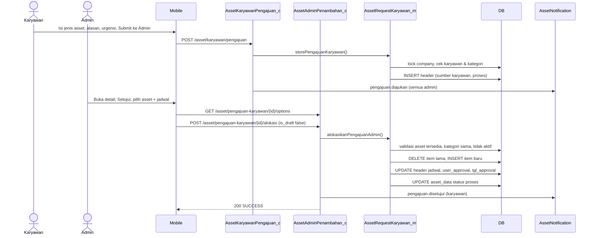
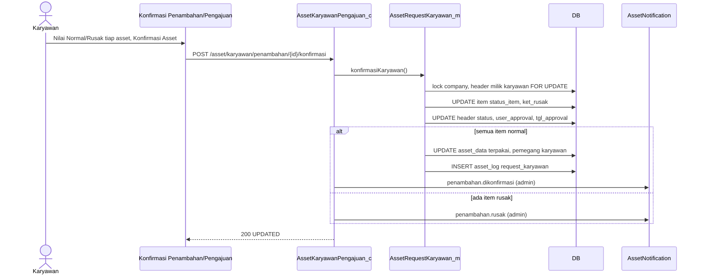
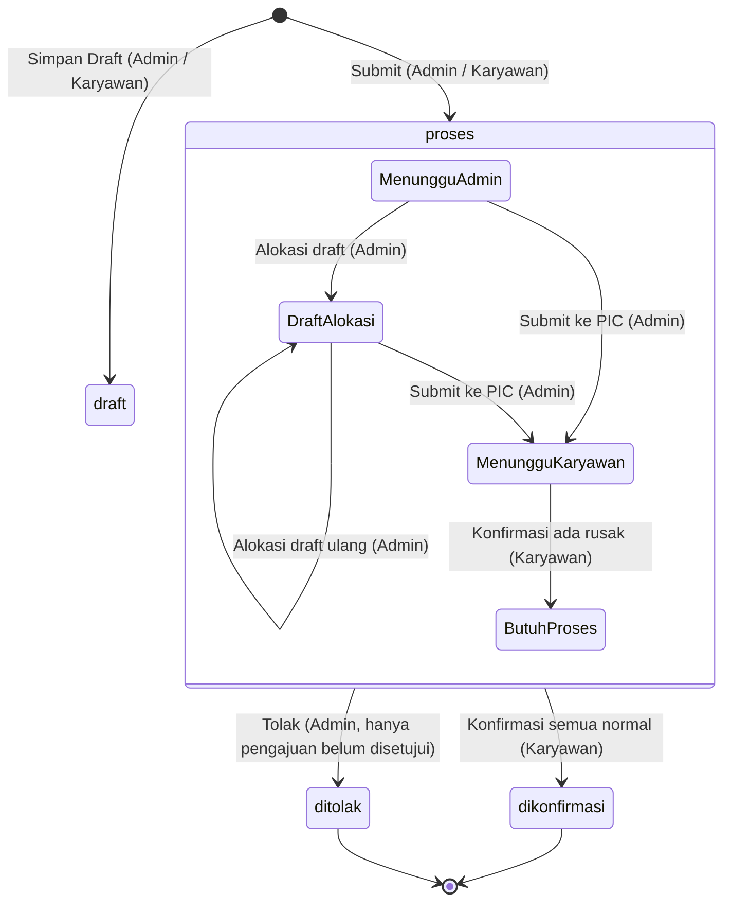
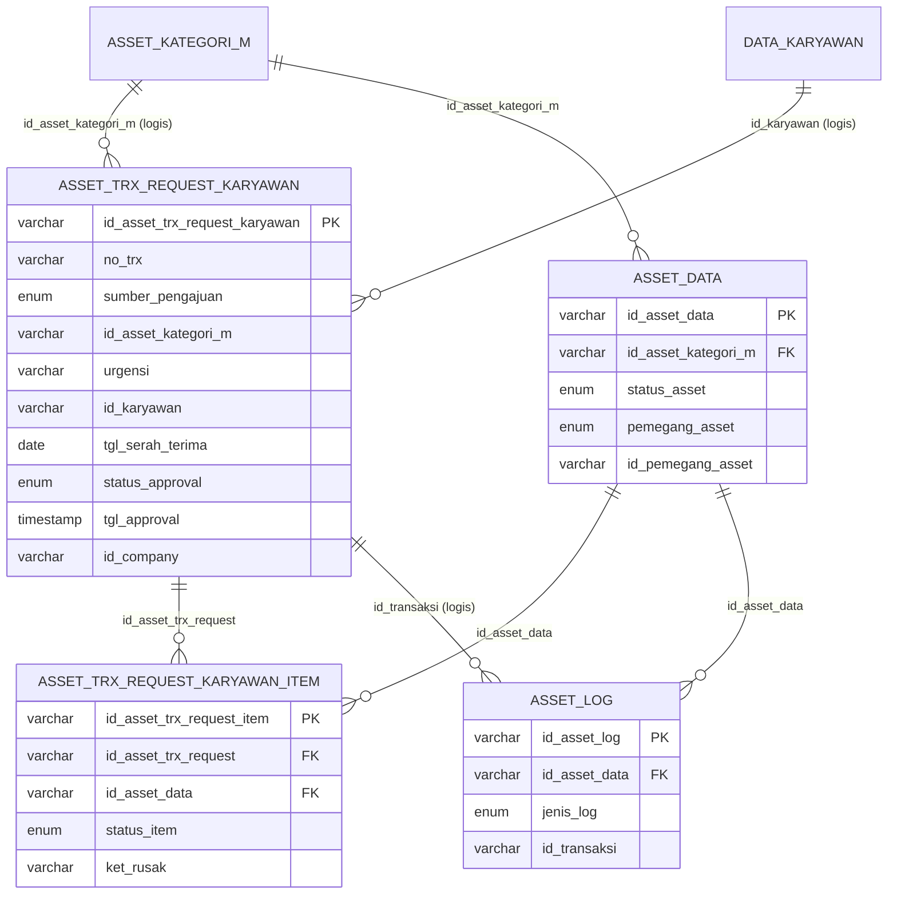

# Dokumentasi Teknis & Manual Book — Request / Penambahan Asset Karyawan

> Dokumen ini disusun **murni dari source code lokal** (`API/` Lumen dan `MOBILE/` Flutter) per 26 September 2026.
> Business requirement dan kode fitur **diturunkan dari kode**. Bagian yang tidak ditemukan ditandai **⚠️ Belum ditemukan**, asumsi ditandai **⚠️ Asumsi**.
> Contoh ID/nama pada payload adalah **data sintetis**.

---

## 1. Informasi Dokumen

| Informasi | Nilai |
|---|---|
| Nama Fitur | Request / Penambahan Asset Karyawan (UI: **"Penambahan Asset"** dan **"Pengajuan Asset"**) |
| Kode Fitur | **KRY-03-1** (prefix nomor transaksi `KRY-03-1-YYYYMMNNN`, dipakai kedua alur) |
| Modul | Asset Management |
| Backend | Laravel **Lumen ^10.0**, PHP ^8.1, JWT `tymon/jwt-auth ^2.3`, Query Builder (`DB::table`) |
| Database | Struktur mengacu `API/diagram-asset.dbml` + migrations. ⚠️ Asumsi: MySQL/MariaDB |
| Mobile | Flutter (package `professional_flutter_3_35`), `flutter_bloc`, `dio` |
| Web | ⚠️ Belum ditemukan: tidak ada source web di workspace |
| Versi Dokumen | 1.3 |
| Tanggal Dokumentasi | 2026-09-26 |
| Dokumen terkait | `dokumentasi-asset-onboarding-karyawan.md` (fitur serupa, banyak helper bersama) |

---

## 2. Daftar Isi

1. Informasi Dokumen · 3. Quick Overview · 4. Ringkasan Fitur · 5. Tujuan · 6. Aktor · 7. Hak Akses · 8. Terminologi · 9. Business Rules · 10. Business Flow · 11. Flow per Role · 12. Flow Diagram · 13. Sequence Diagram · 14. Status Transaksi · 15. State Transition · 16. Struktur Database · 17. Relasi · 18. Data Dictionary · 19. Index · 20. Backend Architecture · 21. Backend Logic · 22. Dampak asset_data · 23. API · 24. Detail API · 25. Mobile Architecture · 26. Mobile Screen · 27. Mobile → API · 28. API → Mobile · 29. Mapping Mobile→API→DB · 30. Mapping DB→API→Mobile · 31. Validation · 32. Error Handling · 33. Audit Trail · 34. Notification · 35. Security · 36. Manual Book · 37. Kondisi Button · 38. Testing · 39. Temuan Ketidaksesuaian · 40. Edge Case · 41. Risk · 42. Dependency · 43. Source Reference · 44. Developer Notes · 45. Traceability · 46. DB Impact · 47. Checklist · 48. Changelog

---

## 3. Quick Overview

| Item | Informasi |
|---|---|
| Feature | Request / Penambahan Asset Karyawan |
| Module | Asset Management |
| Actor | Admin Asset, Karyawan, System |
| Main Transaction | `asset_trx_request_karyawan` |
| Detail Transaction | `asset_trx_request_karyawan_item` |
| Pembeda alur | Kolom `sumber_pengajuan`: `admin` = **Penambahan** (inisiatif admin), `karyawan` = **Pengajuan** (permintaan karyawan) |
| Asset Master | `asset_data` |
| Log | `asset_log` (`jenis_log = request_karyawan`) |
| Initial Status | `draft` atau `proses` |
| Final Status | `dikonfirmasi` (UI: "Selesai") atau `ditolak` (hanya Pengajuan) |
| Approval | Hanya pada **Pengajuan**: Admin **Tolak** atau **Setujui (alokasi asset)** |
| API | 10 endpoint admin + 7 endpoint karyawan |
| Mobile Screen | Admin: Penambahan Asset (list, tambah, detail), Pengajuan Asset (list, detail, setujui). Karyawan: Pengajuan Asset (list, tambah, detail), Konfirmasi Penambahan/Pengajuan Asset, banner Asset Saya |

Satu tabel, dua pintu masuk, satu pintu keluar:

```text
PENAMBAHAN (sumber_pengajuan = admin)            PENGAJUAN (sumber_pengajuan = karyawan)
Admin: pilih karyawan + asset + jadwal            Karyawan: pilih jenis asset + alasan + urgensi
        │ Submit ke Karyawan                              │ Submit ke Admin
        │ asset_data → proses                             ▼
        │                                         Admin: Tolak ──► status ditolak (selesai)
        │                                                 │ Setujui → alokasi asset + jadwal
        │                                                 │ Submit ke PIC → asset_data → proses
        ▼                                                 ▼
        └──────────────► Karyawan: Konfirmasi Asset (Normal / Rusak per item) ◄──┘
                                          │
              ┌── semua Normal ───────────┴───────── ada Rusak ──┐
              ▼                                                  ▼
  status dikonfirmasi ("Selesai")                     status tetap proses ("Butuh Proses")
  semua asset → terpakai, pemegang karyawan           TIDAK ada asset diserahkan
  + asset_log                                         ⚠️ tidak ada mekanisme lanjutan (RISK-001)
```

---

## 4. Ringkasan Fitur

Fitur ini mencatat **pemberian asset tambahan kepada karyawan yang sudah bekerja** (berbeda dari Onboarding yang untuk penyerahan awal). Ada dua jalur yang disimpan di tabel yang sama:

- **Penambahan Asset (admin)** — Admin Asset langsung memilih karyawan, asset dari gudang (boleh lintas kategori), dan jadwal serah terima, lalu mengirim ke karyawan.
- **Pengajuan Asset (karyawan)** — Karyawan mengajukan **jenis asset** (kategori) beserta alasan dan urgensi. Admin meninjau: **menolak** dengan alasan, atau **menyetujui** dengan mengalokasikan asset fisik dari kategori yang sama dan menentukan jadwal serah terima. Alokasi dapat disimpan sebagai draft terlebih dulu.

Kedua jalur berakhir di **konfirmasi karyawan**: tiap asset dinilai Normal atau Rusak. Berbeda dengan Onboarding, serah terima di fitur ini bersifat **all-or-nothing**: asset baru berpindah ke karyawan jika **semua** item Normal. Jika ada item Rusak, transaksi berhenti di status "Butuh Proses" dan **tidak ada endpoint lanjutan** di source.

---

## 5. Tujuan Fitur

### 5.1 Tujuan Bisnis (diturunkan dari kode)
- Karyawan dapat meminta asset tambahan secara tercatat dengan alasan dan tingkat urgensi (Normal / Secepatnya / Mendesak).
- Admin dapat menyetujui atau menolak permintaan dengan alasan yang tersimpan.
- Admin dapat memberikan asset tambahan tanpa menunggu permintaan.
- Penyerahan asset dijadwalkan (tanggal & jam) dan diverifikasi fisik oleh karyawan.
- Setiap perpindahan asset ke karyawan tercatat di `asset_log`.

### 5.2 Tujuan Sistem
- Menyimpan pengajuan/penambahan dengan nomor `KRY-03-1-...`.
- Mengalokasikan asset fisik yang tersedia di gudang, sesuai kategori pengajuan.
- Mengunci asset (`status_asset = proses`) setelah dikirim ke karyawan.
- Memindahkan pemegang asset ke karyawan setelah konfirmasi normal.
- Mengirim notifikasi inbox + push ke pihak terkait.

---

## 6. Aktor

| Aktor | Role (di sistem) | Fungsi |
|---|---|---|
| Admin Asset | Terdaftar di `asset_admin` + karyawan aktif (`data_karyawan.status` ∈ '1'–'4') | Membuat penambahan; meninjau, menolak, dan mengalokasikan pengajuan |
| Karyawan | User login (JWT) | Membuat pengajuan; mengonfirmasi asset yang diterima |
| System | Backend + FCM | Validasi, lock, penomoran, update `asset_data`, `asset_log`, notifikasi |

> Admin Asset berperan sebagai **approver** untuk Pengajuan. Tidak ada approver lain.

---

## 7. Hak Akses

| Action | Admin Asset | Karyawan | Keterangan |
|---|:---:|:---:|---|
| Melihat daftar Penambahan (semua) | ✅ | ❌ | `/asset/penambahan-karyawan` |
| Melihat daftar Pengajuan (semua, kecuali draft) | ✅ | ❌ | `/asset/pengajuan-karyawan` |
| Melihat pengajuan milik sendiri | – | ✅ | `/asset/karyawan/pengajuan` |
| Membuat Penambahan (draft/kirim) | ✅ | ❌ | |
| Membuat Pengajuan (draft/kirim) | – | ✅ | |
| Edit draft (simpan ulang / kirim) | ✅ (Penambahan) | ✅ (Pengajuan) | `PUT /asset/penambahan-karyawan/{id}`, `PUT /asset/karyawan/pengajuan/{id}`; hapus draft: ⚠️ belum ada (RISK-003) |
| Tolak pengajuan | ✅ (status Pengajuan) | ❌ | Wajib alasan |
| Setujui / alokasi asset | ✅ (status Pengajuan / Draft Alokasi) | ❌ | Asset harus kategori sama |
| Konfirmasi asset (Normal/Rusak) | ❌ | ✅ (transaksi miliknya) | |
| Menindaklanjuti asset rusak | ❌ | ❌ | ⚠️ Belum ditemukan (RISK-001) |

---

## 8. Terminologi

| Istilah | Arti di sistem |
|---|---|
| Penambahan | Transaksi `sumber_pengajuan = admin` |
| Pengajuan | Transaksi `sumber_pengajuan = karyawan` |
| Jenis asset | Kategori (`asset_kategori_m`) yang diajukan karyawan; hanya kategori **bukan parent** |
| Urgensi | `normal`, `secepatnya`, `mendesak` (Pengajuan) |
| Alokasi | Admin memilih asset fisik untuk pengajuan |
| Draft Alokasi | Alokasi tersimpan (`is_draft=true`): item ada, `tgl_approval` masih NULL |
| Submit ke PIC | Tombol kirim alokasi → pengajuan disetujui |
| `tgl_approval` | Pengajuan: diisi saat admin menyetujui, **ditimpa** saat karyawan konfirmasi. Penambahan: diisi saat karyawan konfirmasi |
| Pending item | Item `status_item = belum_dicek` |
| Butuh Proses | Label karyawan untuk transaksi yang memiliki item rusak |

---

## 9. Business Rules

### BR-001 — Endpoint admin hanya untuk Admin Asset
`Asset_c::accessError` (asset_admin + karyawan aktif) → 401/403; model memanggil `findAssetAdmin` → 422 "Pengguna tidak terdaftar sebagai admin asset."

### BR-002 — Penambahan: karyawan wajib dipilih & aktif
Validasi `id_karyawan` required; `findActiveKaryawan` → "Karyawan tidak ditemukan atau tidak aktif."

### BR-003 — Minimal satu asset, tanpa duplikat
`asset_ids` array min 1, distinct → "Minimal satu asset wajib dipilih." / "Asset yang sama tidak boleh dipilih lebih dari sekali."

### BR-004 — Asset harus tersedia di gudang
`requestLockedAssets`: `status_asset = tersedia` AND `pemegang_asset = gudang` (FOR UPDATE) → "Satu atau beberapa asset tidak tersedia untuk penambahan." / "Satu atau beberapa asset tidak tersedia." (alokasi).

### BR-005 — Asset tidak boleh aktif di onboarding atau penambahan lain
`hasActiveOnboardingAsset` → "…sedang diproses pada onboarding." `hasActiveRequestAsset` (header **`proses` saja**, sumber admin atau pengajuan yang sudah disetujui) → "…sedang diproses pada penambahan lain." Transaksi `dikonfirmasi` (selesai) **tidak lagi** mengunci asset. Asset yang masih dipegang karyawan tetap tidak bisa dipilih karena syarat `status_asset = tersedia` + `pemegang_asset = gudang`, sehingga asset hasil Retur/Offboarding bisa ditambahkan lagi (RISK-002, sudah diperbaiki v1.1).

### BR-006 — Jadwal serah terima wajib saat dikirim
Penambahan & alokasi: `tgl_serah_terima` (Y-m-d) dan `jam_serah_terima` (H:i) required bila `is_draft=false`. Draft boleh kosong (disimpan `0000-00-00` / `00:00:00`). Backend **tidak** memvalidasi tanggal ≥ hari ini (mobile membatasi `firstDate = hari ini`).

### BR-007 — Pengajuan: jenis asset wajib & bukan kategori parent
`id_asset_kategori_m` required; kategori harus ada dan `flag_parent != 1` → "Jenis asset tidak ditemukan atau tidak dapat diajukan."

### BR-008 — Pengajuan: alasan & urgensi wajib saat dikirim
`keterangan` required dan `urgensi` ∈ {normal, secepatnya, mendesak} bila bukan draft → "Alasan pengajuan wajib diisi." / "Urgensi wajib dipilih." / "Urgensi pengajuan tidak valid."

### BR-009 — Tolak/alokasi hanya saat pengajuan belum disetujui
Syarat: `sumber_pengajuan = karyawan`, `status_approval = proses`, `tgl_approval IS NULL` → "Pengajuan asset sudah tidak menunggu persetujuan." / "…sudah tidak dapat dialokasikan."

### BR-010 — Alasan penolakan wajib (maks 255)
→ "Alasan penolakan wajib diisi."

### BR-011 — Asset alokasi harus sesuai jenis yang diajukan
Semua `asset_data.id_asset_kategori_m` = kategori pengajuan → "Asset harus sesuai dengan jenis yang diajukan." Options alokasi juga hanya menampilkan asset kategori tersebut.

### BR-012 — Alokasi dapat disimpan sebagai draft dan diulang
Setiap alokasi menghapus item lama lalu menulis item baru. Draft **tidak** mengunci asset dan **tidak** mengisi `tgl_approval`.

### BR-013 — Karyawan hanya melihat & mengonfirmasi transaksi miliknya yang sudah dikirim
Detail/konfirmasi memfilter `id_karyawan = ctx.id_karyawan`, bukan draft, dan untuk pengajuan harus sudah disetujui → "Pengajuan asset belum disubmit oleh admin."

### BR-014 — Semua item pending wajib dinilai; rusak wajib alasan
→ "Seluruh asset penambahan wajib dicek." / "Alasan kerusakan wajib diisi." / "Tidak ada asset penambahan yang perlu dicek."

### BR-015 — Serah terima all-or-nothing
Asset baru diserahkan (`terpakai`, pemegang karyawan, `asset_log`) **hanya jika seluruh item Normal**. Jika ada Rusak, status tetap `proses` dan **tidak ada asset** yang berubah.

### BR-016 — Tidak ada tindak lanjut asset rusak
⚠️ Belum ditemukan: endpoint ganti/tarik/batal untuk transaksi request. Lihat RISK-001.

### BR-017 — Penomoran
ID header & item: `id_company + YYYYMM + 3 digit` (maks 999/bulan/company, dipakai bersama Penambahan & Pengajuan). `no_trx = KRY-03-1-YYYYMMNNN`.

---

## 10. Business Flow

### 10.1 Penambahan (Admin → Karyawan)
```text
Admin: Asset Karyawan → Penambahan → (+)
  → Pilih Karyawan → Tambah Asset (boleh multi kategori) → Jadwal Serah Terima (tgl + jam) → Catatan Tambahan
  → Simpan Draft  : status draft, asset TIDAK dikunci; dibuka lagi lewat Ubah Draft lalu disimpan/dikirim (PUT)
  → Submit ke Karyawan : status proses, asset_data → proses, notif ke karyawan
Karyawan: Asset Saya → banner "Penambahan Asset" → Konfirmasi Penambahan Asset
  → Normal/Rusak tiap asset → Konfirmasi Asset
  → semua Normal : status dikonfirmasi, asset → terpakai/karyawan, asset_log, notif admin
  → ada Rusak    : status proses (tgl_approval terisi), tidak ada perubahan asset, notif admin "Laporan Asset Rusak"
```

### 10.2 Pengajuan (Karyawan → Admin → Karyawan)
```text
Karyawan: Asset Saya → Pengajuan → (+)
  → Jenis Asset → Alasan → Urgensi → Simpan Draft / Submit ke Admin
  → Submit : status proses, tgl_approval NULL, tanpa item, notif ke semua admin
Admin: Asset Karyawan → Pengajuan (tab Pengajuan) → Detail
  → Tolak  : isi alasan → status ditolak, item dihapus, notif karyawan
  → Setujui: pilih asset (kategori sama) + jadwal + catatan
       → Simpan Draft : "Draft Alokasi" (item tersimpan, asset belum dikunci)
       → Submit ke PIC: tgl_approval terisi, asset_data → proses, notif karyawan "Disetujui"
Karyawan: Pengajuan (tab Dikonfirmasi, "Menunggu Konfirmasi") → Konfirmasi Pengajuan Asset
  → sama seperti konfirmasi Penambahan
```

---

## 11. Flow Berdasarkan Role

### 11.1 Admin Asset
1. Buka **Asset Karyawan** → aksi **Penambahan** atau **Pengajuan** (juga panel "Pengajuan Asset Perlu Diproses" berisi maks. 3 pengajuan tertua, tombol "Tinjau Pengajuan" / "Lanjutkan Alokasi").
2. **Penambahan**: tab Pending / Dikonfirmasi / Selesai; tombol + untuk membuat; tap kartu → detail (read-only).
3. **Pengajuan**: tab Pengajuan / Proses / Dikonfirmasi / Selesai; tap kartu → **Konfirmasi Pengajuan Asset** (detail) → **Tolak** atau **Setujui** → form **Setujui Pengajuan Asset** → Simpan Draft / Submit ke PIC.

### 11.2 Karyawan
1. **Asset Saya** → menu **Pengajuan** → daftar pengajuan (tab Pengajuan / Dikonfirmasi / Ditolak / Selesai) → + untuk membuat.
2. Pengajuan yang sudah dialokasikan & menunggu dicek dibuka langsung ke **Konfirmasi Pengajuan Asset**.
3. Penambahan dari admin muncul sebagai banner **Penambahan Asset** di Asset Saya (hanya yang pertama) dan via notifikasi.

### 11.3 Approver
Peran approver dijalankan Admin Asset pada Pengajuan (§11.1 langkah 3).

### 11.4 System
Lock `master_company`, generate ID/nomor, validasi asset & kategori, reservasi asset saat dikirim, penentuan status/label/tab, serah terima + `asset_log` saat semua normal, notifikasi setelah commit.

---

## 12. Flow Diagram

```mermaid
flowchart TD
    subgraph P[Penambahan - Admin]
        A1[Admin isi form penambahan] --> A2{Aksi}
        A2 -->|Simpan Draft| A3[status draft - bisa diubah lalu dikirim (PUT)]
        A2 -->|Submit ke Karyawan| A4[status proses, asset proses, notif karyawan]
    end
    subgraph Q[Pengajuan - Karyawan]
        B1[Karyawan isi jenis, alasan, urgensi] --> B2{Aksi}
        B2 -->|Simpan Draft| B3[status draft - bisa diubah lalu dikirim (PUT)]
        B2 -->|Submit ke Admin| B4[status proses, tanpa item, notif admin]
        B4 --> B5{Keputusan admin}
        B5 -->|Tolak + alasan| B6[status ditolak, notif karyawan]
        B5 -->|Setujui| B7[Alokasi asset kategori sama + jadwal]
        B7 -->|Simpan Draft| B8[Draft Alokasi]
        B8 --> B5
        B7 -->|Submit ke PIC| B9[tgl_approval terisi, asset proses, notif karyawan]
    end
    A4 --> C1[Karyawan: Konfirmasi Asset]
    B9 --> C1
    C1 --> C2{Semua item Normal?}
    C2 -->|Ya| C3[status dikonfirmasi - Selesai, asset terpakai, asset_log, notif admin]
    C2 -->|Tidak| C4[status proses - Butuh Proses, asset tetap proses, notif admin]
    C4 --> C5[Tidak ada tindak lanjut di sistem]
```

---

## 13. Sequence Diagram

### 13.1 Pengajuan karyawan sampai disetujui



### 13.2 Konfirmasi karyawan (kedua alur)



---

## 14. Status Transaksi

Field `asset_trx_request_karyawan.status_approval` (enum `status_request_karyawan`: `draft`, `proses`, `ditolak`, `dikonfirmasi`; default `proses`). Label & tab **dihitung** dari status + `tgl_approval` + item, dan berbeda per sudut pandang.

### 14.1 Penambahan — tampilan Admin (`requestStatusMetadata`)
| Kondisi | Label | Tab |
|---|---|---|
| `draft` | Draft | pending |
| `proses`, `tgl_approval` NULL | Menunggu Diterima | pending |
| `proses`, `tgl_approval` terisi (karyawan melaporkan rusak) | Dikonfirmasi | dikonfirmasi |
| `dikonfirmasi` | Selesai | selesai |
| `ditolak` | Ditolak | selesai (tidak terjadi pada Penambahan) |

### 14.2 Pengajuan — tampilan Admin (`pengajuanAdminStatusMetadata`, draft tidak ditampilkan)
| Kondisi | Label | Tab |
|---|---|---|
| `proses`, belum disetujui, tanpa item | Menunggu Diterima | pengajuan |
| `proses`, belum disetujui, ada item | Draft Alokasi | pengajuan |
| `proses`, disetujui, ada item `belum_dicek` | Menunggu Konfirmasi | proses |
| `proses`, disetujui, tanpa item pending (ada rusak) | Dikonfirmasi | dikonfirmasi |
| `ditolak` | Ditolak | selesai |
| `dikonfirmasi` | Selesai | selesai |

### 14.3 Pengajuan — tampilan Karyawan (`pengajuanStatusMetadata`)
| Kondisi | Label | Tab |
|---|---|---|
| `draft` | Draft | pengajuan |
| `proses`, belum disetujui | Menunggu Konfirmasi | pengajuan |
| `proses`, disetujui, ada item rusak | Butuh Proses | dikonfirmasi |
| `proses`, disetujui, ada item pending | Menunggu Konfirmasi | dikonfirmasi |
| `proses`, disetujui, lainnya | Dikonfirmasi Admin | dikonfirmasi |
| `ditolak` | Ditolak | ditolak |
| `dikonfirmasi` | Selesai | selesai |

Status item (`status_item`): `belum_dicek` → `normal` / `rusak`.
Migrasi `2026_09_17_000008`: nilai lama 0=draft, 1=proses, 2=ditolak, 3=dikonfirmasi.

---

## 15. State Transition



> Pada Penambahan, transaksi langsung berada di tahap `MenungguKaryawan` setelah Submit ke Karyawan. Keadaan `ButuhProses` tidak memiliki transisi keluar; `draft` dapat disimpan ulang atau dikirim lewat Edit Draft (PUT).

| Status Awal | Action | Status Akhir | Actor |
|---|---|---|---|
| – | Simpan Draft | draft | Admin / Karyawan |
| – | Submit ke Karyawan (penambahan) | proses (menunggu karyawan) | Admin |
| – | Submit ke Admin (pengajuan) | proses (menunggu admin) | Karyawan |
| draft | Edit Draft: simpan ulang (`is_draft=true`) | draft | Admin (penambahan) / Karyawan (pengajuan) |
| draft | Edit Draft: kirim (`is_draft=false`) | proses (menunggu karyawan / menunggu admin) | Admin (penambahan) / Karyawan (pengajuan) |
| proses (menunggu admin) | Tolak | ditolak | Admin |
| proses (menunggu admin / draft alokasi) | Alokasi `is_draft=true` | proses (Draft Alokasi) | Admin |
| proses (menunggu admin / draft alokasi) | Alokasi `is_draft=false` | proses (menunggu karyawan) | Admin |
| proses (menunggu karyawan) | Konfirmasi semua normal | dikonfirmasi | Karyawan |
| proses (menunggu karyawan) | Konfirmasi ada rusak | proses (Butuh Proses) | Karyawan |
| Butuh Proses | – | ⚠️ tidak ada transisi | – |

Status `asset_data.status_asset`:
| Dari | Ke | Trigger |
|---|---|---|
| tersedia (gudang) | proses | Submit penambahan; Submit alokasi (bukan draft) |
| proses (gudang) | terpakai (karyawan) | Konfirmasi dengan **semua** item normal |
| proses | proses (tetap) | Konfirmasi dengan item rusak — **tidak berubah** |

---

## 16. Struktur Database

| Table | Type | Fungsi |
|---|---|---|
| `asset_trx_request_karyawan` | Transaction Header | Penambahan & Pengajuan |
| `asset_trx_request_karyawan_item` | Transaction Detail | Asset yang dialokasikan |
| `asset_data` | Master | Status & pemegang asset |
| `asset_kategori_m` | Master | Jenis asset (pengajuan) & snapshot kategori |
| `data_karyawan`, `master_cabang`, `master_departemen` | Master HR | Karyawan aktif, cabang, divisi |
| `asset_admin` | Master akses | Admin asset |
| `master_company` | Master | Lock transaksi |
| `asset_log` | Log | Histori serah terima (`request_karyawan`) |
| `notif_data`, `users` | Notifikasi | Inbox & token FCM |

> ⚠️ Belum ditemukan: migration `CREATE TABLE` untuk tabel request; struktur mengacu DBML + migrations `2026_09_16_000003`, `2026_09_17_000004`, `2026_09_17_000008`.

---

## 17. Relasi Database



Relasi logis (tanpa `ref` DBML): `id_karyawan` → `data_karyawan`, `id_asset_kategori_m` (header) → `asset_kategori_m`, `asset_log.id_transaksi` → header. Semua JOIN mencocokkan `id_company`. Kolom item `parent_id` ada di DBML tetapi selalu `''` (tidak ada penggantian).

---

## 18. Data Dictionary

### 18.1 asset_trx_request_karyawan
| Field | Type | Null | Default | Key | Description |
|---|---|:---:|---|---|---|
| id_asset_trx_request_karyawan | varchar(50) | No | – | PK | `id_company + YYYYMM + 3 digit` |
| no_trx | varchar(50) | No | '' | UNIQUE (DBML) | `KRY-03-1-YYYYMMNNN` |
| sumber_pengajuan | enum(admin, karyawan) | No | admin | IDX | `admin` = Penambahan, `karyawan` = Pengajuan |
| id_asset_kategori_m | varchar(50) | No | '' | – | Pengajuan: jenis diajukan. Penambahan: kategori bila semua asset satu kategori, selain itu `''` |
| nama_kategori | varchar(255) | No | '' | – | Snapshot; Penambahan multi kategori = `Multi Kategori` |
| keterangan | text | Yes | – | – | Pengajuan: alasan karyawan. Penambahan: selalu `''` dari mobile |
| urgensi | varchar(50) | Yes | – | – | `normal`/`secepatnya`/`mendesak` (Pengajuan); `''` untuk Penambahan dari mobile |
| ket_tolak | varchar(255) | No | '' | – | Alasan penolakan admin |
| id_karyawan, nik_karyawan, nama_karyawan | varchar | – | '' | IDX | Karyawan penerima/pemohon (snapshot) |
| tgl_pengajuan | date | No | CURRENT_TIMESTAMP | – | Tanggal dibuat |
| tgl_serah_terima | date | No | 0000-00-00 | – | Jadwal serah terima |
| jam_serah_terima | time | No | 00:00:00 | – | Jam serah terima (disimpan H:i:s) |
| keterangan_serah_terima | varchar(255) | – | '' | – | "Catatan Tambahan" pada form admin |
| status_approval | enum(draft, proses, ditolak, dikonfirmasi) | No | proses | IDX | Status |
| user_approval | varchar(255) | No | '' | – | Admin penyetuju/penolak, lalu **ditimpa** karyawan saat konfirmasi |
| tgl_approval | timestamp | Yes | NULL | IDX | Lihat §8 |
| id_company | varchar(50) | No | '' | IDX | Company |
| tgl_input, user_input | – | – | – | IDX | Pembuat (`nik - nama`) |
| tgl_update, user_update | – | Yes | NULL | – | Pengubah terakhir |

### 18.2 asset_trx_request_karyawan_item
| Field | Type | Null | Default | Key | Description |
|---|---|:---:|---|---|---|
| id_asset_trx_request_item | varchar(50) | No | – | PK | `id_company + YYYYMM + 3 digit` |
| parent_id | varchar(50) | Yes | – | – | Selalu `''` |
| id_asset_trx_request | varchar(50) | – | – | FK, IDX | → header |
| id_asset_data | varchar(50) | – | – | FK | → asset_data |
| nama_asset, deskripsi_asset, kategori_asset | varchar(255) | – | '' | – | Snapshot asset (API: `nama_asset`, `deskripsi`, `kategori_asset`) |
| status_item | enum(normal, rusak, belum_dicek) | – | – | IDX | Awal `belum_dicek` |
| ket_rusak | varchar(255) | – | '' | – | Alasan rusak dari karyawan |
| id_company, tgl_input, user_input | – | – | – | IDX | – |

### 18.3 asset_data (field yang dipakai)
`id_asset_data`, `id_asset_kategori_m` (validasi kategori alokasi), `nama_asset`, `deskripsi`, `kode_asset`, `merek`, `status_asset` (tersedia → proses → terpakai), `pemegang_asset` (gudang → karyawan), `id_pemegang_asset`, `kondisi_awal` (disalin ke log), `tgl_update`, `user_update`.

### 18.4 asset_log (diisi saat semua normal)
`jenis_log = request_karyawan`, `id_transaksi` = ID header, `nama_tabel_transaksi = asset_trx_request_karyawan`, `kondisi_awal` = `asset_data.kondisi_awal`, `kondisi_akhir = normal`, `posisi_awal` = pemegang sebelumnya (`gudang`), `posisi_akhir = pemegang_asset = karyawan`, `id_pemegang`, `nama_pemegang`, `user_input` = karyawan.

---

## 19. Database Index

| Index | Table | Columns | Tujuan |
|---|---|---|---|
| `atrk_company_source_employee_idx` | header | (id_company, sumber_pengajuan, id_karyawan) | Filter per sumber & karyawan |
| `atrk_admin_list_idx` | header | (id_company, sumber_pengajuan, status_approval, tgl_approval, tgl_input, id_asset_trx_request_karyawan) | List admin per tab + urutan |
| `atrk_employee_list_idx` | header | (id_company, sumber_pengajuan, id_karyawan, status_approval, tgl_approval, tgl_input, id_asset_trx_request_karyawan) | List pengajuan karyawan |
| `atrki_request_status_idx` | item | (id_asset_trx_request, id_company, status_item) | COUNT item / pending / rusak per header |
| UNIQUE `no_trx` | header | (no_trx) | DBML — ⚠️ belum diverifikasi ada di DB fisik |

Pencarian `hasActiveRequestAsset` berdasarkan `atrki.id_asset_data` tidak diawali kolom index yang ada (potensi lambat, ⚠️ belum diukur).

---

## 20. Backend Architecture

```text
routes/modules/asset/RouteAsset.php (prefix /asset, middleware jwt.api + jwt.ctx)
   ↓
AssetAdminPenambahan_c / AssetKaryawanPengajuan_c  (validateRequest inline, accessError)
   ↓
AssetRequestKaryawan_m  ← extends Asset_m (lock, sequence, findActiveKaryawan, findAssetAdmin, hasActiveOnboardingAsset)
   ↓                    ← memakai AssetAdmin_m::getOnboardingOptions untuk opsi penambahan/alokasi
DB (Query Builder, DB::transaction retry 3)
   ↓
ApiResponse + AssetNotification (setelah commit)
```

| Layer | File/Class | Function | Tanggung Jawab |
|---|---|---|---|
| Route | `RouteAsset.php` | 17 route | Endpoint |
| Controller | `AssetAdminPenambahan_c` / `AssetAdminPengajuan_c` | penambahanOptions, getPenambahanKaryawan, storePenambahanKaryawan, getDetailPenambahanKaryawan, getPengajuanKaryawan, getDetailPengajuanKaryawan, pengajuanKaryawanOptions, tolakPengajuanKaryawan, alokasikanPengajuanKaryawan | Admin |
| Controller | `AssetKaryawanPengajuan_c` / `AssetKaryawanPenambahan_c` | getPengajuanOptionsSaya, getPengajuanSaya, storePengajuanSaya, getDetailPengajuanSaya, getDetailPenambahanSaya, konfirmasiPenambahanSaya | Karyawan |
| Model | `AssetRequestKaryawan_m` | getOptions, getPengajuanOptions, getRequests/Page, getPengajuanAdmin/Page, getPengajuanKaryawan/Page, getDetail, getDetailPengajuanAdmin, getDetailPengajuanKaryawan, getPengajuanAdminOptions, store, storePengajuanKaryawan, tolakPengajuanAdmin, alokasikanPengajuanAdmin, konfirmasiKaryawan, getPendingForEmployee, getPendingForAdmin, countPendingForAdmin | Logic |
| Model | `Asset_m` | lockCompany, nextSequence, ensureSequenceCapacity, findActiveKaryawan, findAssetAdmin, hasActiveOnboardingAsset | Helper bersama |
| Enum | `RequestKaryawanStatus` | – | Ada, tetapi model memakai konstanta string sendiri |
| Support | `AssetNotification` | send | Notifikasi |

---

## 21. Backend Business Logic

Semua aksi tulis: `DB::transaction(fn, 3)` + `lockCompany()`.

### 21.1 Penambahan — `store`
1. Validasi request → cek admin.
2. Lock; `requestLockedAssets` (tersedia + gudang, FOR UPDATE), jumlah harus sama.
3. `hasActiveOnboardingAsset`, `hasActiveRequestAsset`.
4. `findActiveKaryawan`, `findAssetAdmin`.
5. Jadwal wajib bila bukan draft.
6. Generate ID + `no_trx = KRY-03-1-YYYYMMNNN`.
7. Tentukan kategori: satu kategori → id & nama; banyak → `''` & "Multi Kategori".
8. INSERT header (`sumber_pengajuan = admin`, draft/proses, `tgl_approval` NULL).
9. INSERT item (`belum_dicek`, snapshot).
10. **Hanya jika bukan draft**: UPDATE `asset_data.status_asset = proses`.
11. Notifikasi `penambahan.dikirim` (bukan draft). Response 201.

### 21.2 Pengajuan — `storePengajuanKaryawan`
Lock → karyawan aktif → kategori ada & bukan parent (FOR UPDATE) → alasan & urgensi wajib bila bukan draft → generate ID/no_trx → INSERT header (`sumber = karyawan`, tanpa item, jadwal kosong) → notifikasi `pengajuan.diajukan` (bukan draft). Response 201.

### 21.3 Tolak — `tolakPengajuanAdmin`
Lock → admin → header (sumber karyawan, FOR UPDATE) harus `proses` & `tgl_approval` NULL → alasan wajib → **DELETE item** (draft alokasi) → UPDATE header `ket_tolak`, `status_approval = ditolak`, `user_approval`, `tgl_approval = now` → notifikasi `pengajuan.ditolak`.

### 21.4 Alokasi — `alokasikanPengajuanAdmin`
Lock → admin → header syarat sama dengan tolak → asset tersedia + kategori = kategori pengajuan → tidak aktif di onboarding/penambahan lain (kecuali transaksi ini) → jadwal wajib bila bukan draft → DELETE item lama → INSERT item baru → UPDATE header jadwal, `ket_tolak = ''`, `user_approval`/`tgl_approval` (hanya bila bukan draft) → bila bukan draft UPDATE `asset_data = proses` → notifikasi `pengajuan.disetujui` (bukan draft). Response 200 `SUCCESS` (kirim) / `UPDATED` (draft).

### 21.5 Konfirmasi — `konfirmasiKaryawan`
1. Lock; header milik karyawan (FOR UPDATE), status `proses`; pengajuan harus sudah disetujui.
2. Karyawan aktif; item dikunci; pending = `belum_dicek`.
3. Validasi lengkap & alasan rusak.
4. UPDATE item.
5. `semuaNormal` atas **seluruh** item → `dikonfirmasi`, selain itu tetap `proses`.
6. UPDATE header `status_approval`, `user_approval`, `tgl_approval = now`.
7. **Jika semua normal**: UPDATE `asset_data` terpakai/karyawan/id_pemegang_asset + INSERT `asset_log` per asset.
8. **Jika ada rusak**: tidak ada perubahan `asset_data` (tetap `proses`).
9. Notifikasi `penambahan.dikonfirmasi` / `penambahan.rusak`.

### 21.6 Query baca
- Options penambahan: `AssetAdmin_m::getOnboardingOptions(excludeEmployeesWithOnboarding: false)` → semua karyawan aktif, asset tersedia di gudang, pohon kategori.
- Options alokasi: sama, lalu asset difilter kategori pengajuan. Hanya bila pengajuan `proses` & belum disetujui (selain itu 404).
- Options pengajuan karyawan: semua kategori company + daftar urgensi.
- List: JOIN item, hitung `jumlah_asset`, `jumlah_pending`, `jumlah_rusak`; urut `tgl_input DESC`.
- Detail karyawan pengajuan: sebelum disetujui, jadwal dikosongkan, `jumlah_asset = 0`, `items = []`.

---

## 22. Dampak terhadap asset_data

| Field | Sebelum | Sesudah | Trigger |
|---|---|---|---|
| status_asset | tersedia | proses | Submit penambahan / submit alokasi |
| status_asset | proses | terpakai | Konfirmasi, **semua** item normal |
| pemegang_asset | gudang | karyawan | Konfirmasi, semua normal |
| id_pemegang_asset | '' | id_karyawan | Konfirmasi, semua normal |
| tgl_update / user_update | – | now / karyawan atau admin | Setiap update di atas |
| status_asset (item rusak / normal saat ada rusak) | proses | **proses (tidak berubah)** | Konfirmasi ada rusak |
| ket_rusak, kondisi_awal | – | **tidak diubah** | – |

Draft penambahan dan draft alokasi **tidak** mengubah `asset_data`.

---

## 23. API Documentation

| ID | Method | Endpoint | Function | Auth |
|---|---|---|---|---|
| API-001 | GET | `/asset/penambahan-karyawan/options` | Opsi karyawan, kategori, asset | Admin |
| API-002 | GET | `/asset/penambahan-karyawan` | List penambahan | Admin |
| API-003 | POST | `/asset/penambahan-karyawan` | Buat penambahan | Admin |
| API-004 | GET | `/asset/penambahan-karyawan/{id}` | Detail penambahan | Admin |
| API-005 | GET | `/asset/pengajuan-karyawan` | List pengajuan | Admin |
| API-006 | GET | `/asset/pengajuan-karyawan/{id}` | Detail pengajuan | Admin |
| API-007 | GET | `/asset/pengajuan-karyawan/{id}/options` | Opsi alokasi | Admin |
| API-008 | POST | `/asset/pengajuan-karyawan/{id}/tolak` | Tolak pengajuan | Admin |
| API-009 | POST | `/asset/pengajuan-karyawan/{id}/alokasi` | Alokasi / setujui | Admin |
| API-010 | GET | `/asset/karyawan/pengajuan/options` | Opsi jenis & urgensi | JWT |
| API-011 | GET | `/asset/karyawan/pengajuan` | List pengajuan saya | JWT |
| API-012 | POST | `/asset/karyawan/pengajuan` | Buat pengajuan | JWT |
| API-013 | GET | `/asset/karyawan/pengajuan/{id}` | Detail pengajuan saya | JWT, pemilik |
| API-014 | GET | `/asset/karyawan/penambahan/{id}` | Detail untuk konfirmasi (kedua sumber) | JWT, pemilik |
| API-015 | POST | `/asset/karyawan/penambahan/{id}/konfirmasi` | Konfirmasi Normal/Rusak | JWT, pemilik |
| API-016 | PUT | `/asset/penambahan-karyawan/{id}` | Ubah / kirim draft penambahan | Admin |
| API-017 | PUT | `/asset/karyawan/pengajuan/{id}` | Ubah / kirim draft pengajuan saya | JWT, pemilik |

Endpoint terkait: `GET /asset/karyawan/onboarding` (Asset Saya, bagian `penambahan[]`) dan `GET /asset/summary` (`pengajuan_perlu_proses`, `pengajuan_pending`).
Endpoint hapus draft, batal, dan tindak lanjut rusak: ⚠️ Belum ditemukan. Edit draft tersedia lewat `PUT` (API-016, API-017).

Format response sama dengan modul asset lain: `{ "code", "message", "data" }`; error validasi `{ "code": "VALIDATION_ERROR", "message", "errors" }`. HTTP: 200/201, 401, 403, 404, 422, 500.

---

## 24. Detail Setiap API

Header umum: `Authorization: Bearer <token>`, `Content-Type: application/json`, `Accept: application/json`, `locale`, `versi-app`.

### API-001 — Opsi Penambahan
```http
GET /asset/penambahan-karyawan/options
```
Response `data`: `{ "karyawan": [{id_karyawan, nik, nama_karyawan}], "kategori_asset": [{id_asset_kategori_m, parent_id, flag_parent, nama_kategori}], "assets": [{id_asset_data, kode_asset, nama_asset, id_asset_kategori_m, kategori_asset, merek, deskripsi, kondisi_awal}] }`. Message: "Opsi penambahan asset berhasil ditemukan." Semua karyawan aktif ditampilkan (tidak dikecualikan seperti onboarding).

### API-002 — List Penambahan
```http
GET /asset/penambahan-karyawan?tab=pending&limit=20&offset=0
```
| Param | Rule |
|---|---|
| tab | `pending` \| `dikonfirmasi` \| `selesai` ("Filter penambahan asset tidak valid.") |
| limit | 1–50 ("Limit maksimal adalah 50 data.") |
| offset | ≥ 0 |

Tab: `pending` = draft atau proses belum dikonfirmasi karyawan; `dikonfirmasi` = proses & `tgl_approval` terisi; `selesai` = ditolak/dikonfirmasi.
```json
{
  "code": "SUCCESS",
  "message": "Data penambahan asset karyawan berhasil ditemukan.",
  "data": {
    "filters": [
      {"value": "pending", "label": "Pending"},
      {"value": "dikonfirmasi", "label": "Dikonfirmasi"},
      {"value": "selesai", "label": "Selesai"}
    ],
    "requests": [
      {
        "id": "CMP001202609004",
        "no_trx": "KRY-03-1-202609004",
        "id_asset_kategori_m": "CMP001202601002",
        "nama_kategori": "Laptop",
        "keterangan": "",
        "urgensi": "",
        "ket_tolak": "",
        "id_karyawan": "KRY0002",
        "nik_karyawan": "EMP-002",
        "nama_karyawan": "Sari Contoh",
        "tgl_pengajuan": "2026-09-26",
        "tgl_serah_terima": "2026-09-29",
        "jam_serah_terima": "09:00:00",
        "keterangan_serah_terima": "Ambil di ruang IT",
        "status_approval": "proses",
        "status_label": "Menunggu Diterima",
        "tab": "pending",
        "jumlah_asset": 1,
        "jumlah_pending": 1,
        "jumlah_rusak": 0,
        "tgl_approval": ""
      }
    ],
    "pagination": {"limit": 20, "offset": 0, "next_offset": 1, "has_more": false}
  }
}
```
Tanpa parameter → `data` berupa array.

### API-003 — Buat Penambahan
```http
POST /asset/penambahan-karyawan
```
```json
{
  "id_karyawan": "KRY0002",
  "asset_ids": ["CMP00120260100005"],
  "tgl_serah_terima": "2026-09-29",
  "jam_serah_terima": "09:00",
  "keterangan_serah_terima": "Ambil di ruang IT",
  "keterangan": "",
  "urgensi": "",
  "is_draft": false
}
```
| Field | Rule | Message |
|---|---|---|
| id_karyawan | required\|string\|max:150 | Karyawan wajib dipilih. |
| asset_ids | required\|array\|min:1 | Minimal satu asset wajib dipilih. |
| asset_ids.* | required\|string\|max:50\|distinct | Asset yang sama tidak boleh dipilih lebih dari sekali. |
| tgl_serah_terima | required (kirim) / nullable (draft), date_format Y-m-d | Tanggal serah terima wajib diisi. / Format tanggal serah terima harus YYYY-MM-DD. |
| jam_serah_terima | required (kirim) / nullable (draft), date_format H:i | Jam serah terima wajib diisi. / Format jam serah terima harus HH:MM. |
| keterangan_serah_terima | nullable\|string\|max:255 | – |
| keterangan | nullable\|string | – |
| urgensi | nullable\|string\|max:50 | – |
| is_draft | required\|boolean | Status draft wajib dikirim. |

Database impact:
```text
INSERT asset_trx_request_karyawan (sumber_pengajuan = admin)
INSERT asset_trx_request_karyawan_item
UPDATE asset_data (status_asset = proses)   -- hanya bila bukan draft
INSERT notif_data                            -- hanya bila bukan draft
```
```json
{ "code": "CREATED", "message": "Penambahan asset berhasil dikirim ke karyawan.",
  "data": { "id": "CMP001202609004", "no_trx": "KRY-03-1-202609004",
            "status_approval": "proses", "status_label": "Menunggu Diterima", "tab": "pending" } }
```
Draft: "Draft penambahan asset berhasil disimpan." Error 422: "Satu atau beberapa asset tidak tersedia untuk penambahan.", "…sedang diproses pada onboarding.", "…sedang diproses pada penambahan lain.", "Karyawan tidak ditemukan atau tidak aktif.", "Pengguna tidak terdaftar sebagai admin asset.", "Nomor transaksi untuk periode ini sudah mencapai batas." 500: "Terjadi kesalahan saat menyimpan penambahan asset."

### API-004 — Detail Penambahan (Admin)
```http
GET /asset/penambahan-karyawan/{id}
```
```json
{
  "code": "SUCCESS",
  "message": "Detail penambahan asset berhasil ditemukan.",
  "data": {
    "id": "CMP001202609004",
    "no_trx": "KRY-03-1-202609004",
    "id_asset_kategori_m": "CMP001202601002",
    "nama_kategori": "Laptop",
    "keterangan": "",
    "urgensi": "",
    "ket_tolak": "",
    "tgl_pengajuan": "2026-09-26",
    "tgl_serah_terima": "2026-09-29",
    "jam_serah_terima": "09:00:00",
    "keterangan_serah_terima": "Ambil di ruang IT",
    "status_approval": "proses",
    "tgl_approval": "",
    "status_label": "Menunggu Diterima",
    "tab": "pending",
    "jumlah_asset": 1,
    "karyawan": { "nik": "EMP-002", "nama_karyawan": "Sari Contoh", "cabang": "Kantor Pusat", "divisi": "Finance" },
    "items": [
      {
        "id_item": "CMP001202609010",
        "parent_id": "",
        "id_asset_data": "CMP00120260100005",
        "kode_asset": "LPT-0005",
        "nama_asset": "Laptop 14 inch",
        "deskripsi": "Charger, tas",
        "kategori_asset": "Laptop",
        "merek": "MerekX",
        "status_item": "belum_dicek",
        "ket_rusak": "",
        "perlu_dicek": true,
        "diganti": false
      }
    ]
  }
}
```
404: "Penambahan asset tidak ditemukan." (hanya sumber admin).

### API-005 — List Pengajuan (Admin)
```http
GET /asset/pengajuan-karyawan?tab=pengajuan&limit=20&offset=0
```
`tab`: `pengajuan` (belum disetujui, termasuk Draft Alokasi), `proses` (disetujui, ada item pending), `dikonfirmasi` (disetujui, tanpa item pending — kasus rusak), `selesai` (ditolak/dikonfirmasi). Draft karyawan tidak pernah tampil. Struktur `data` sama dengan API-002 dengan `filters` Pengajuan/Proses/Dikonfirmasi/Selesai. Message: "Data pengajuan asset karyawan berhasil ditemukan."

### API-006 — Detail Pengajuan (Admin)
```http
GET /asset/pengajuan-karyawan/{id}
```
Struktur sama dengan API-004 (`keterangan` = alasan, `urgensi` terisi), label/tab dari §14.2. 404 "Pengajuan asset tidak ditemukan." bila tidak ada atau masih draft.

### API-007 — Opsi Alokasi
```http
GET /asset/pengajuan-karyawan/{id}/options
```
Sama dengan API-001, tetapi `assets` hanya kategori pengajuan. 404 "Opsi pengajuan asset tidak ditemukan." bila pengajuan bukan `proses` atau sudah disetujui. Message: "Opsi persetujuan pengajuan asset berhasil ditemukan."

### API-008 — Tolak Pengajuan
```http
POST /asset/pengajuan-karyawan/{id}/tolak
```
```json
{ "ket_tolak": "Stok laptop belum tersedia bulan ini" }
```
| Field | Rule | Message |
|---|---|---|
| ket_tolak | required\|string\|max:255 | Alasan penolakan wajib diisi. |

Database impact: `DELETE item` (bila ada draft alokasi), `UPDATE header` (ditolak, ket_tolak, user_approval, tgl_approval), `INSERT notif_data`.
```json
{ "code": "UPDATED", "message": "Pengajuan asset berhasil ditolak.",
  "data": { "id": "CMP001202609005", "no_trx": "KRY-03-1-202609005",
            "status_approval": "ditolak", "status_label": "Ditolak", "tab": "selesai" } }
```
422: "Pengajuan asset tidak ditemukan.", "Pengajuan asset sudah tidak menunggu persetujuan." 500: "Terjadi kesalahan saat menolak pengajuan asset."

### API-009 — Alokasi / Setujui Pengajuan
```http
POST /asset/pengajuan-karyawan/{id}/alokasi
```
```json
{
  "asset_ids": ["CMP00120260100007"],
  "tgl_serah_terima": "2026-09-30",
  "jam_serah_terima": "10:00",
  "keterangan_serah_terima": "Serah terima di ruang IT lantai 2",
  "is_draft": false
}
```
Validasi sama dengan API-003 untuk `asset_ids`, jadwal, `keterangan_serah_terima`, `is_draft` (message: "Data persetujuan pengajuan belum lengkap.").

Database impact:
```text
DELETE asset_trx_request_karyawan_item (item lama)
INSERT asset_trx_request_karyawan_item
UPDATE asset_trx_request_karyawan (jadwal, ket_tolak='', user_approval/tgl_approval bila kirim)
UPDATE asset_data (status_asset = proses)   -- bila bukan draft
INSERT notif_data                            -- bila bukan draft
```
```json
{ "code": "SUCCESS", "message": "Pengajuan asset berhasil disetujui.",
  "data": { "id": "CMP001202609005", "no_trx": "KRY-03-1-202609005", "status_approval": "proses",
            "status_label": "Menunggu Konfirmasi", "tab": "proses", "jumlah_asset": 1 } }
```
Draft: code `UPDATED`, "Draft alokasi pengajuan asset berhasil disimpan.", label "Draft Alokasi", tab `pengajuan`.
422: "Pengajuan asset sudah tidak dapat dialokasikan.", "Satu atau beberapa asset tidak tersedia.", "Asset harus sesuai dengan jenis yang diajukan.", "…sedang diproses pada onboarding.", "…sedang diproses pada penambahan lain.", "Tanggal/Jam serah terima wajib diisi." 500: "Terjadi kesalahan saat menyetujui pengajuan asset."

### API-010 — Opsi Pengajuan (Karyawan)
```http
GET /asset/karyawan/pengajuan/options
```
```json
{
  "code": "SUCCESS",
  "message": "Opsi pengajuan asset berhasil ditemukan.",
  "data": {
    "kategori_asset": [
      {"id_asset_kategori_m": "CMP001202601001", "parent_id": "", "flag_parent": 1, "nama_kategori": "Elektronik"},
      {"id_asset_kategori_m": "CMP001202601002", "parent_id": "CMP001202601001", "flag_parent": 0, "nama_kategori": "Laptop"}
    ],
    "urgensi": [
      {"value": "normal", "label": "Normal"},
      {"value": "secepatnya", "label": "Secepatnya"},
      {"value": "mendesak", "label": "Mendesak"}
    ]
  }
}
```

### API-011 — List Pengajuan Saya
```http
GET /asset/karyawan/pengajuan?tab=pengajuan&limit=20&offset=0
```
`tab`: `pengajuan` (draft + menunggu admin), `dikonfirmasi` (disetujui, belum selesai), `ditolak`, `selesai`. Sebelum disetujui: jadwal dikosongkan dan `jumlah_asset = 0`. Filters: Pengajuan/Dikonfirmasi/Ditolak/Selesai.

### API-012 — Buat Pengajuan
```http
POST /asset/karyawan/pengajuan
```
```json
{ "id_asset_kategori_m": "CMP001202601002", "keterangan": "Laptop lama sering mati, butuh untuk presentasi klien",
  "urgensi": "secepatnya", "is_draft": false }
```
| Field | Rule | Message |
|---|---|---|
| id_asset_kategori_m | required\|string\|max:50 | Jenis asset wajib dipilih. |
| keterangan | required (kirim) / nullable (draft) | Alasan pengajuan wajib diisi. |
| urgensi | required (kirim) / nullable (draft), max:50, in:normal,secepatnya,mendesak | Urgensi wajib dipilih. / Urgensi pengajuan tidak valid. |
| is_draft | required\|boolean | Status draft wajib dikirim. |

Database impact: `INSERT asset_trx_request_karyawan` (sumber karyawan, tanpa item); `INSERT notif_data` (bukan draft).
```json
{ "code": "CREATED", "message": "Pengajuan asset berhasil dikirim ke admin.",
  "data": { "id": "CMP001202609005", "no_trx": "KRY-03-1-202609005",
            "status_approval": "proses", "status_label": "Menunggu Konfirmasi", "tab": "pengajuan" } }
```
422: "Karyawan tidak ditemukan atau tidak aktif.", "Jenis asset tidak ditemukan atau tidak dapat diajukan." 500: "Terjadi kesalahan saat menyimpan pengajuan asset."

### API-013 — Detail Pengajuan Saya
```http
GET /asset/karyawan/pengajuan/{id}
```
Struktur seperti API-004 + `isu_rusak`; sebelum disetujui `items = []`, jadwal kosong. 404 "Pengajuan asset tidak ditemukan."

### API-014 — Detail untuk Konfirmasi
```http
GET /asset/karyawan/penambahan/{id}
```
Berlaku untuk kedua sumber: transaksi milik karyawan, bukan draft; pengajuan harus sudah disetujui. Struktur seperti API-004. 404 "Penambahan asset tidak ditemukan."

### API-015 — Konfirmasi Asset
```http
POST /asset/karyawan/penambahan/{id}/konfirmasi
```
```json
{ "items": [ { "id_item": "CMP001202609010", "status_item": "normal" } ] }
```
| Field | Rule | Message |
|---|---|---|
| items | required\|array\|min:1 | Kondisi asset wajib diisi. |
| items.*.id_item | required\|string\|max:50\|distinct | Asset yang sama tidak boleh dikirim lebih dari sekali. |
| items.*.status_item | required\|in:normal,rusak | Kondisi setiap asset wajib dipilih. / Kondisi asset harus normal atau rusak. |
| items.*.ket_rusak | nullable\|max:255\|required_if rusak | Alasan kerusakan wajib diisi. |

Database impact:
```text
UPDATE asset_trx_request_karyawan_item (status_item, ket_rusak)
UPDATE asset_trx_request_karyawan (status_approval, user_approval, tgl_approval)
UPDATE asset_data (terpakai, pemegang karyawan)   -- hanya jika semua normal
INSERT asset_log (request_karyawan)                -- hanya jika semua normal
INSERT notif_data (semua admin)
```
```json
{ "code": "UPDATED", "message": "Penambahan asset berhasil dikonfirmasi.",
  "data": { "id": "CMP001202609004", "no_trx": "KRY-03-1-202609004",
            "status_approval": "dikonfirmasi", "status_label": "Selesai", "tab": "selesai" } }
```
Ada rusak: "Laporan kerusakan penambahan asset berhasil dikirim.", `status_approval: proses`, label "Isu Rusak", tab `dikonfirmasi`.
422: "Penambahan asset tidak ditemukan.", "Penambahan asset sudah tidak menunggu konfirmasi.", "Pengajuan asset belum disubmit oleh admin.", "Karyawan tidak ditemukan atau tidak aktif.", "Tidak ada asset penambahan yang perlu dicek.", "Seluruh asset penambahan wajib dicek.", "Alasan kerusakan wajib diisi.", "Satu atau beberapa asset penambahan tidak ditemukan." 500: "Terjadi kesalahan saat mengonfirmasi penambahan asset."

---

### API-016 — Ubah / Kirim Draft Penambahan
```http
PUT /asset/penambahan-karyawan/{id}
```
Body dan validasi sama dengan API-003 (`id_karyawan`, `asset_ids[]`, jadwal serah terima, `is_draft`). Hanya untuk penambahan sumber **admin** berstatus `draft`; selain itu 422 "Hanya draft penambahan langsung yang dapat diperbarui.". `id`, `no_trx`, dan tanggal pengajuan dipertahankan; item lama dihapus lalu ditulis ulang. Dengan `is_draft=false` status menjadi `proses`, asset dikunci (`asset_data.status_asset = proses`), dan notifikasi `penambahan.dikirim` dikirim.

Response: code `UPDATED`, "Draft penambahan asset berhasil disimpan." (draft) atau "Penambahan asset berhasil dikirim ke karyawan.".

### API-017 — Ubah / Kirim Draft Pengajuan Saya
```http
PUT /asset/karyawan/pengajuan/{id}
```
Body dan validasi sama dengan API-012 (`id_asset_kategori_m`, `keterangan`, `urgensi`, `is_draft`). Hanya untuk pengajuan milik pemanggil yang masih `draft`, belum disetujui (`tgl_approval` kosong), dan belum punya item; selain itu 422 "Pengajuan asset sudah tidak dapat diubah karena bukan draft." dan 404 "Pengajuan asset tidak ditemukan." bila bukan miliknya. Dengan `is_draft=false` status menjadi `proses`, `tgl_pengajuan` diisi hari ini, dan notifikasi `pengajuan.diajukan` dikirim.

Response: code `UPDATED`, "Draft pengajuan asset berhasil disimpan." atau "Pengajuan asset berhasil dikirim ke admin.".

## 25. Mobile Architecture

```text
Page → Bloc → Api Service → ApiClient (Dio + Bearer JWT) → Backend
```

| Layer | File | Function |
|---|---|---|
| Api | `Repository/Service/assetRequestKaryawanApi.dart` | Penambahan admin: getOptions, getRequests, store, getDetail |
| Api | `Repository/Service/assetPengajuanAdminApi.dart` | Pengajuan admin: getRequests, getDetail, getOptions, reject, allocate |
| Api | `Repository/Service/assetPengajuanKaryawanApi.dart` | Pengajuan karyawan: getOptions, getRequests, store, getDetail |
| Api | `Repository/Service/assetSayaApi.dart` | getPenambahanDetail, konfirmasiPenambahan |
| Model | `Repository/Model/Asset/mAssetRequestKaryawan.dart` | AssetRequestApproval, AssetRequestKaryawanRecord/Item/Employee/Page, AssetRequestKaryawanRequest, AssetKonfirmasiPenambahanRequest |
| Model | `Repository/Model/Asset/mAssetPengajuanKaryawan.dart` | Options (kategori, urgensi), AssetPengajuanKaryawanRequest |
| Model | `Repository/Model/Asset/mAssetPengajuanAdmin.dart` | TolakRequest, AlokasiRequest |
| Bloc | `AssetRequestKaryawanBloc` | List/paging, options, detail, submit penambahan |
| Bloc | `AssetPengajuanAdminBloc` | List/paging, detail, options, reject, allocate |
| Bloc | `AssetPengajuanKaryawanBloc` | List/paging, options, detail, submit pengajuan |
| Bloc | `AssetKonfirmasiPenambahanBloc` | Load detail, submit konfirmasi |
| UI | `UI/Modul/Asset/AssetAdmin/AssetAdminKaryawan/Penambahan/*` | List, form, detail penambahan |
| UI | `UI/Modul/Asset/AssetAdmin/AssetAdminKaryawan/Pengajuan/*` | List, detail, form setujui |
| UI | `UI/Modul/Asset/AssetSaya/Pengajuan/*` | List, form, detail pengajuan karyawan |
| UI | `UI/Modul/Asset/AssetSaya/Onboarding/HalamanKonfirmasiPenambahanAsset.dart` | Konfirmasi (parameter `isPengajuan`) |

Routes:
| Route | Page | Event awal |
|---|---|---|
| `/asset_admin_penambahan_karyawan` | List Penambahan | LoadAssetRequestKaryawanList (tab pending) |
| `/asset_admin_add_penambahan_karyawan` | Form Penambahan | LoadAssetRequestKaryawanOptions |
| `/asset_admin_detail_penambahan_karyawan` | Detail Penambahan | LoadAssetRequestKaryawanDetail(id) |
| `/asset_admin_pengajuan_karyawan` | List Pengajuan admin | LoadAssetPengajuanAdminList (tab pengajuan) |
| `/asset_admin_detail_pengajuan_karyawan` | Detail Pengajuan admin (title "Konfirmasi Pengajuan Asset") | LoadAssetPengajuanAdminDetail(id) |
| `/asset_admin_setujui_pengajuan_karyawan` | Form Setujui | LoadAssetPengajuanAdminOptions(id), argumen record |
| `/asset_pengajuan` | List Pengajuan karyawan | LoadAssetPengajuanKaryawanList |
| `/asset_tambah_pengajuan` | Form Pengajuan | LoadAssetPengajuanKaryawanOptions |
| `/asset_detail_pengajuan` | Detail Pengajuan karyawan | LoadAssetPengajuanKaryawanDetail(id) |
| `/asset_konfirmasi_pengajuan` | Konfirmasi (isPengajuan: true) | LoadAssetKonfirmasiPenambahan(id) |
| `/asset_konfirmasi_penambahan` | Konfirmasi Penambahan | LoadAssetKonfirmasiPenambahan(id) |

---

## 26. Mobile Screen

### 26.1 Penambahan Asset (Admin) — list
Tab Pending / Dikonfirmasi / Selesai; kartu: no transaksi, "Tanggal Penambahan", badge status, `nik - nama`, "{jumlah} Asset", "Jadwal Serah Terima" (bila ada). Tombol + ("Tambah penambahan asset"). Tap → detail.

### 26.2 Tambah Penambahan Asset (Admin)
| Field UI | Widget | Required | Source |
|---|---|:---:|---|
| Pilih Karyawan * | Field read-only → bottom sheet | Ya (draft & kirim) | `options.karyawan` |
| Penambahan Asset → "Tambah Asset" | Bottom sheet pohon kategori → asset | Ya, min 1 | `options.kategori_asset`, `options.assets` |
| Jadwal Serah Terima | Date picker (mulai hari ini) | Ya saat kirim | Input |
| Jam Serah Terima | Time picker (default 08:00) | Ya saat kirim | Input |
| Catatan Tambahan | Text field | Tidak | → `keterangan_serah_terima` |
| Tombol | Simpan Draft / Submit ke Karyawan | – | – |

### 26.3 Detail Penambahan Asset (Admin)
Tanggal Penambahan, badge status, Nomor Pengajuan; Data Karyawan (nama, NIK, Cabang, Divisi); Jadwal Serah Terima (tanggal, jam, catatan); daftar asset. **Tidak ada tombol aksi** dan **kondisi item (Normal/Rusak) tidak ditampilkan**.

**Alur status**: `AssetAlurStepper.pengajuan` (Pengajuan → Alokasi → Konfirmasi → Selesai; berpindah dari Alokasi ke Konfirmasi setelah admin mengalokasikan asset; disembunyikan bila ditolak). File: `Shared/Widgets/AssetAlurWidgets.dart`.

### 26.4 Pengajuan Asset (Admin) — list
Tab Pengajuan / Proses / Dikonfirmasi / Selesai; kartu menampilkan tanggal, status, karyawan, Urgensi, jadwal (bila ada).

### 26.5 Konfirmasi Pengajuan Asset (Admin, detail)
Tanggal Pengajuan & status; Data Karyawan; Pengajuan Asset (Jenis Asset, Alasan, Urgensi); Alasan Penolakan (bila ditolak); Jadwal Serah Terima (bila ada); daftar asset (bila dialokasikan). Tombol **Tolak** (bottom sheet "Alasan Penolakan" wajib → Kirim) dan **Setujui**, tampil jika status `proses` dan tab `pengajuan` (termasuk Draft Alokasi).

Stepper alur status sama seperti §26.3 (`AssetAlurStepper.pengajuan`).

### 26.6 Setujui Pengajuan Asset (Admin)
Ringkasan Jenis Asset, alasan, Urgensi; "Penambahan Asset" + "Tambah Asset" (hanya asset kategori pengajuan, draft alokasi terisi otomatis); Jadwal Serah Terima & Jam (wajib saat kirim); Catatan Tambahan; tombol **Simpan Draft** / **Submit ke PIC**.

### 26.7 Pengajuan Asset (Karyawan) — list
Tab Pengajuan / Dikonfirmasi / Ditolak / Selesai; kartu: tanggal, status (Draft, Menunggu Konfirmasi, Dikonfirmasi Admin, Butuh Proses, Ditolak, Selesai), alasan, Urgensi. Tap: bila disetujui & ada item pending → Konfirmasi Pengajuan Asset, selain itu → Detail.

### 26.8 Tambah Pengajuan Asset (Karyawan)
| Field UI | Widget | Required | Source |
|---|---|:---:|---|
| Jenis Asset | Bottom sheet "Pilih Kategori Asset" (cari, hanya non-parent) | Ya | `kategori_asset` |
| Alasan | Text field multiline | Ya saat kirim | Input |
| Urgensi | Bottom sheet (Normal/Secepatnya/Mendesak) | Ya saat kirim | `urgensi` |
| Tombol | Simpan Draft / Submit ke Admin | – | – |

### 26.9 Detail Pengajuan Asset (Karyawan)
Nomor Pengajuan, data karyawan, Jenis Asset, Alasan, Urgensi, Alasan Penolakan (bila ditolak), Jadwal, asset beserta kondisi Normal/Rusak dan Report Kerusakan.

Stepper alur status sama seperti §26.3 (`AssetAlurStepper.pengajuan`).

### 26.10 Konfirmasi Penambahan / Pengajuan Asset (Karyawan)
Info transaksi (Tanggal & Kode Penambahan / Nomor Pengajuan), Data Karyawan, Jadwal Serah Terima, (Pengajuan: Jenis Asset, Alasan, Urgensi), "Penting! Periksa kondisi asset…", per asset Kelengkapan + tombol **Normal/Rusak** + "Report Kerusakan *" (maks 255), pernyataan tanggung jawab, tombol **Konfirmasi Asset**.

### 26.11 Asset Saya
Menu **Pengajuan**; banner **Penambahan Asset** untuk transaksi pertama yang menunggu dicek.

---

## 27. Mobile → API

| UI Field | Mobile Variable | JSON Field | Type | Required |
|---|---|---|---|:---:|
| Pilih Karyawan (penambahan) | `_selectedEmployee.idKaryawan` | `id_karyawan` | string | Ya |
| Tambah Asset (penambahan/alokasi) | `_selectedAssets[].idAssetData` | `asset_ids[]` | array | Ya |
| Jadwal Serah Terima | `tanggalPeminjamanApi(_handoverDate)` | `tgl_serah_terima` | Y-m-d | Ya saat kirim |
| Jam Serah Terima | `_timeValue(_handoverTime)` | `jam_serah_terima` | H:i | Ya saat kirim |
| Catatan Tambahan (penambahan/alokasi) | `_notesController.text.trim()` | `keterangan_serah_terima` | string | Tidak |
| (tidak ada field) | konstanta `''` | `keterangan`, `urgensi` (penambahan) | string | – |
| Simpan Draft / Submit | `isDraft` | `is_draft` | bool | Ya |
| Jenis Asset (pengajuan) | `_selectedCategoryId` | `id_asset_kategori_m` | string | Ya |
| Alasan (pengajuan) | `_reasonController.text.trim()` | `keterangan` | string | Ya saat kirim |
| Urgensi (pengajuan) | `_selectedUrgency` | `urgensi` | string | Ya saat kirim |
| Alasan Penolakan | `AssetPengajuanAdminTolakRequest.keterangan` (trim) | `ket_tolak` | string | Ya |
| Normal / Rusak | `statusByItem[idItem]` | `items[].status_item` | string | Ya |
| Report Kerusakan | `ketRusakByItem[idItem]` | `items[].ket_rusak` | string | Ya bila rusak |

---

## 28. API → Mobile

| API JSON | Mobile Model | UI |
|---|---|---|
| `requests[]` / array | `AssetRequestKaryawanPage.records` | Kartu list |
| `id`, `no_trx` | `id`, `noTrx` | Navigasi, "Nomor Pengajuan"/"Kode Penambahan" |
| `nama_kategori`, `id_asset_kategori_m` | `namaKategori`, `idAssetKategori` | "Jenis Asset" |
| `keterangan` | `keterangan` | "Alasan" |
| `urgensi` | `urgensi` → `labelUrgensiAsset` | "Urgensi" |
| `ket_tolak` | `ketTolak` | "Alasan Penolakan" |
| `tgl_pengajuan` | `tanggalPengajuan` | "Tanggal Pengajuan/Penambahan" |
| `tgl_serah_terima`, `jam_serah_terima`, `keterangan_serah_terima` | `tanggalSerahTerima`, `jamSerahTerima`, `keteranganSerahTerima` (`hasSchedule` mengabaikan `0000-00-00`/`00:00:00`) | "Jadwal Serah Terima" |
| `status_approval` | `statusApproval` (`parseAssetRequestApproval`) | Badge, kondisi tombol |
| `status_label`, `tab` | `statusLabel`, `tab` | Badge (dipetakan ulang di mobile) |
| `jumlah_asset`, `jumlah_pending`, `jumlah_rusak` | idem | "{jumlah} Asset", kondisi konfirmasi, "Butuh Proses" |
| `tgl_approval` | `tanggalApproval` | Syarat konfirmasi pengajuan |
| `isu_rusak` | `isuRusak` (atau dihitung dari item) | "Butuh Proses" |
| `karyawan.*` / `nik_karyawan`, `nama_karyawan` | `employee` | Data Karyawan |
| `items[]` | `AssetRequestKaryawanItem` (idItem, kodeAsset, namaAsset, kategoriAsset, merek, deskripsi, statusItem, ketRusak, perluDicek) | Daftar asset, kondisi |
| `filters[]` | `AssetListFilter` | Tab |
| `pagination` | `nextOffset`, `hasMore` | Infinite scroll |

---

## 29. Mapping Mobile → API → Database

| UI | Mobile Variable | JSON | Backend | Table | Column |
|---|---|---|---|---|---|
| Pilih Karyawan | `idKaryawan` | `id_karyawan` | `$karyawan` | header | id_karyawan, nik_karyawan, nama_karyawan |
| Tambah Asset | `assetIds` | `asset_ids[]` | `$assets` | item | id_asset_data (+ snapshot) |
| Tambah Asset | `assetIds` | `asset_ids[]` | `$assetIds` | asset_data | status_asset = proses (bila kirim) |
| Tambah Asset (kategori) | – | – | `$categoryIds` | header | id_asset_kategori_m, nama_kategori |
| Jadwal Serah Terima | `tanggalSerahTerima` | `tgl_serah_terima` | `$tanggalSerahTerima` | header | tgl_serah_terima |
| Jam Serah Terima | `jamSerahTerima` | `jam_serah_terima` | `Carbon H:i → H:i:s` | header | jam_serah_terima |
| Catatan Tambahan | `keteranganSerahTerima` | `keterangan_serah_terima` | trim | header | keterangan_serah_terima |
| Jenis Asset | `idAssetKategori` | `id_asset_kategori_m` | `$category` | header | id_asset_kategori_m, nama_kategori |
| Alasan | `keterangan` | `keterangan` | trim | header | keterangan |
| Urgensi | `urgensi` | `urgensi` | trim | header | urgensi |
| Simpan Draft / Submit | `isDraft` | `is_draft` | `$statusApproval` | header | status_approval |
| Alasan Penolakan | `keterangan` | `ket_tolak` | `$reason` | header | ket_tolak, status_approval = ditolak |
| Normal / Rusak | `statusByItem` | `items[].status_item` | `$statusByItem` | item | status_item |
| Report Kerusakan | `ketRusakByItem` | `items[].ket_rusak` | `$ketRusakByItem` | item | ket_rusak |
| (JWT admin) | – | Authorization | `$actor` | header/item | user_input, user_update, user_approval |
| (JWT karyawan konfirmasi) | – | Authorization | `$karyawan` | header / asset_data / asset_log | user_approval, tgl_approval / id_pemegang_asset / id_pemegang |

---

## 30. Mapping Database → API → Mobile

| Table | Column | Backend | API JSON | Mobile | UI |
|---|---|---|---|---|---|
| header | no_trx | requestQuery / getDetail | `no_trx` | noTrx | Nomor Pengajuan / Kode Penambahan |
| header | nama_kategori | 〃 | `nama_kategori` | namaKategori | Jenis Asset |
| header | keterangan | 〃 | `keterangan` | keterangan | Alasan |
| header | urgensi | 〃 | `urgensi` | urgensi | Urgensi |
| header | ket_tolak | 〃 | `ket_tolak` | ketTolak | Alasan Penolakan |
| header | tgl_serah_terima, jam_serah_terima | 〃 | idem | tanggalSerahTerima, jamSerahTerima | Jadwal Serah Terima |
| header | status_approval + tgl_approval + item | *StatusMetadata | `status_approval`, `status_label`, `tab` | statusApproval, statusLabel, tab | Badge, tab, tombol |
| item | COUNT / SUM status | requestQuery | `jumlah_asset`, `jumlah_pending`, `jumlah_rusak` | idem | "{jumlah} Asset", Butuh Proses |
| item | nama_asset, kategori_asset, deskripsi_asset | getDetail | `nama_asset`, `kategori_asset`, `deskripsi` | namaAsset, kategoriAsset, deskripsi | Kartu asset, Kelengkapan |
| item | status_item, ket_rusak | getDetail | `status_item`, `perlu_dicek`, `ket_rusak` | statusItem, perluDicek, ketRusak | Normal/Rusak, Report Kerusakan |
| asset_data | kode_asset, merek | LEFT JOIN | `kode_asset`, `merek` | kodeAsset, merek | Subtitle asset |
| data_karyawan → master | cabang, departemen | LEFT JOIN | `karyawan.cabang`, `karyawan.divisi` | employee.cabang/divisi | Data Karyawan |

---

## 31. Validation

### 31.1 Mobile
| Lokasi | Aturan | Pesan |
|---|---|---|
| Form Penambahan | Karyawan wajib (draft & kirim) | "Karyawan wajib dipilih" |
| Form Penambahan / Setujui | Min 1 asset (draft & kirim) | "Tambahkan minimal satu asset." |
| Form Penambahan / Setujui | Tanggal & jam wajib saat kirim; tanggal ≥ hari ini | "Tanggal serah terima wajib dipilih." / "Jam serah terima wajib dipilih." |
| Form Setujui | Picker hanya asset kategori pengajuan | – |
| Form Pengajuan | Jenis asset wajib; hanya kategori non-parent | "Jenis asset wajib dipilih." |
| Form Pengajuan | Alasan & urgensi wajib saat kirim | "Alasan pengajuan wajib diisi." / "Urgensi wajib dipilih." |
| Tolak | Alasan wajib | "Alasan penolakan wajib diisi." |
| Konfirmasi | Semua item pending dinilai; rusak wajib report (≤255) | Tombol nonaktif sampai lengkap |
| Semua submit | Abaikan saat `submitting` | – |

### 31.2 Backend
Lihat §9 dan §24.

### 31.3 Database
ENUM `sumber_pengajuan`, `status_approval`, `status_item`; UNIQUE `no_trx` (DBML); NOT NULL default untuk jadwal (`0000-00-00`, `00:00:00`).

### 31.4 Ringkasan per Field
| Field | Mobile | Backend | Database |
|---|---|---|---|
| id_karyawan | Wajib | required, karyawan aktif | varchar(150) |
| asset_ids | Min 1, picker exclude duplikat | required, distinct, tersedia+gudang, tidak aktif, (alokasi) kategori sama | item.id_asset_data |
| tgl/jam_serah_terima | Wajib saat kirim, tanggal ≥ hari ini | required saat kirim, format | date/time NOT NULL |
| id_asset_kategori_m | Wajib, non-parent | required, ada, non-parent | varchar(50) |
| keterangan (pengajuan) | Wajib saat kirim | required saat kirim | text |
| urgensi | Wajib saat kirim | in:normal,secepatnya,mendesak (pengajuan) | varchar(50) |
| ket_tolak | Wajib | required, ≤255 | varchar(255) |
| status_item / ket_rusak | Wajib / wajib bila rusak | in / required_if | enum / varchar(255) |

---

## 32. Error Handling

| Error | HTTP | Backend | Mobile |
|---|---:|---|---|
| Field tidak valid | 422 | VALIDATION_ERROR + errors | Error per field / snackbar warning |
| Aturan bisnis (asset tidak tersedia, status tidak valid, kategori tidak sesuai, dll.) | 422 | BUSINESS_RULE_VIOLATION | Snackbar error |
| Detail / options tidak ditemukan | 404 | NOT_FOUND | Halaman error + Coba Lagi |
| Token tidak valid/expired | 401 | UNAUTHORIZED | Refresh token & retry otomatis |
| Bukan admin | 403 | FORBIDDEN | Pesan error |
| Exception | 500 | SYSTEM_ERROR + Log::error | Snackbar |
| Timeout / koneksi | – | – | "Tidak dapat terhubung ke server. Periksa koneksi Anda." |
| Double submit | – | tanpa idempotency | Bloc abaikan saat submitting |
| Notifikasi gagal | – | di-log, transaksi tetap sukses | – |

---

## 33. Audit Trail

| Data | Disimpan? | Lokasi |
|---|:---:|---|
| Pembuat & waktu | ✅ | `user_input`, `tgl_input` (admin atau karyawan) |
| Pengubah terakhir | ✅ | `user_update`, `tgl_update` |
| Penyetuju/penolak admin | ⚠️ sebagian | `user_approval`/`tgl_approval` — **ditimpa** karyawan saat konfirmasi |
| Alasan penolakan | ✅ | `ket_tolak` |
| Histori status | ❌ | ⚠️ Belum ditemukan |
| Draft alokasi sebelumnya | ❌ | Item dihapus & ditulis ulang |
| Asset log serah terima | ✅ | `asset_log` (`request_karyawan`) hanya saat semua normal |
| Laporan rusak | ⚠️ | Hanya `status_item`/`ket_rusak` di item; tanpa `asset_log`, tanpa perubahan `asset_data` |
| Error sistem | ✅ | `Log::error` |

---

## 34. Notification

| Event | Trigger | Penerima | Judul | Pesan | Rute mobile |
|---|---|---|---|---|---|
| `pengajuan.diajukan` | Karyawan submit pengajuan | Semua admin asset | Pengajuan Asset Baru | {nama} mengajukan asset {no_trx}. | `asset_admin_detail_pengajuan_karyawan` |
| `pengajuan.ditolak` | Admin tolak | Karyawan | Pengajuan Asset Ditolak | Pengajuan asset {no_trx} ditolak admin. | `asset_detail_pengajuan` |
| `pengajuan.disetujui` | Admin submit alokasi | Karyawan | Pengajuan Asset Disetujui | Pengajuan asset {no_trx} disetujui. Silakan cek dan konfirmasi asset. | `asset_konfirmasi_pengajuan` |
| `penambahan.dikirim` | Admin submit penambahan | Karyawan | Penambahan Asset Baru | Anda menerima penambahan asset {no_trx}. | `asset_konfirmasi_penambahan` |
| `penambahan.dikonfirmasi` | Konfirmasi semua normal | Semua admin | Asset Dikonfirmasi Karyawan | Asset {no_trx} telah dikonfirmasi oleh {nama}. | Sesuai sumber: `asset_admin_detail_penambahan_karyawan` / `asset_admin_detail_pengajuan_karyawan` |
| `penambahan.rusak` | Konfirmasi ada rusak | Semua admin | Laporan Asset Rusak | {nama} melaporkan asset rusak pada {no_trx}. | Sesuai sumber (sama seperti di atas) |

Mekanisme sama dengan modul asset lain: INSERT `notif_data` + push FCM, dipanggil setelah commit, kegagalan hanya di-log.

---

## 35. Security

| Aspek | Implementasi |
|---|---|
| Autentikasi | Bearer JWT (`jwt.api`), context dari token (`jwt.ctx`) |
| Isolasi company | Semua query `WHERE id_company = ctx.id_company` |
| Otorisasi admin | `accessError` + `findAssetAdmin` |
| Kepemilikan karyawan | Detail & konfirmasi memfilter `id_karyawan = ctx.id_karyawan` dan `sumber_pengajuan` |
| Visibilitas | Karyawan tidak melihat alokasi sebelum disetujui; admin tidak melihat draft karyawan |
| Concurrency | `lockCompany` + `lockForUpdate` |
| Catatan | Validasi request dijalankan sebelum cek admin pada store/tolak/alokasi (non-admin dapat menerima 422, bukan 403) |

---

## 36. Manual Book User/Admin

> Label diambil dari `assets/id/asset.json`. ⚠️ Asumsi: halaman admin **Asset Karyawan** diakses dari menu **Asset Management**. Screenshot menyusul.

### A. Admin — Penambahan Asset
1. Buka **Asset Karyawan** → aksi **Penambahan** → halaman **Penambahan Asset** (tab Pending, Dikonfirmasi, Selesai).
2. Tekan **+** → **Tambah Penambahan Asset**.
3. **Pilih Karyawan**.
4. **Tambah Asset** → pilih kategori → pilih asset (boleh beberapa, boleh beda kategori).
5. Isi **Jadwal Serah Terima** dan **Jam Serah Terima**, serta **Catatan Tambahan** bila perlu.
6. Tekan **Submit ke Karyawan**. Asset langsung dikunci dan karyawan mendapat notifikasi.

> **Simpan Draft** menyimpan penambahan tanpa mengunci asset. Buka detail draft lalu tekan tombol ubah draft untuk melanjutkan dan mengirim; draft belum dapat dihapus dari aplikasi (lihat §41 RISK-003).

### B. Admin — Meninjau Pengajuan
1. Buka **Asset Karyawan** → aksi **Pengajuan** (atau panel **Pengajuan Asset Perlu Diproses** → **Tinjau Pengajuan**).
2. Tab **Pengajuan** → pilih pengajuan → halaman **Konfirmasi Pengajuan Asset** (Jenis Asset, Alasan, Urgensi).
3. **Menolak**: tekan **Tolak** → isi **Alasan Penolakan** → **Kirim**.
4. **Menyetujui**: tekan **Setujui** → halaman **Setujui Pengajuan Asset** → **Tambah Asset** (hanya jenis yang diajukan) → isi jadwal → **Submit ke PIC**.
   - **Simpan Draft** menyimpan pilihan sebagai **Draft Alokasi**; buka lagi dari tab Pengajuan (**Lanjutkan Alokasi**) untuk mengirim.
5. Pengajuan berpindah ke tab **Proses** (menunggu karyawan), lalu **Selesai** setelah karyawan mengonfirmasi semua asset Normal.

### C. Karyawan — Mengajukan Asset
1. Buka **Asset Saya** → menu **Pengajuan** → tekan **+**.
2. Pilih **Jenis Asset**, isi **Alasan**, pilih **Urgensi** (Normal / Secepatnya / Mendesak).
3. Tekan **Submit ke Admin**.
4. Pantau status di tab **Pengajuan**, **Dikonfirmasi**, **Ditolak**, atau **Selesai**. Jika ditolak, alasan tampil di detail.

### D. Karyawan — Menerima & Mengonfirmasi Asset
1. Buka notifikasi **Penambahan Asset Baru** / **Pengajuan Asset Disetujui**, banner **Penambahan Asset** di Asset Saya, atau pengajuan berstatus **Menunggu Konfirmasi** di tab Dikonfirmasi.
2. Periksa setiap asset secara fisik, pilih **Normal** atau **Rusak** (isi **Report Kerusakan** bila rusak).
3. Tekan **Konfirmasi Asset**.
   - Semua Normal → asset menjadi milik Anda, status **Selesai**.
   - Ada Rusak → status **Butuh Proses**; hubungi Admin Asset karena tindak lanjut belum tersedia di aplikasi.

---

## 37. Kondisi Button

| Button | Role | Halaman | Condition | Action |
|---|---|---|---|---|
| + Tambah penambahan asset | Admin | List Penambahan | Selalu | Form penambahan |
| Simpan Draft | Admin | Form Penambahan | Tidak submitting | POST `is_draft=true` |
| Submit ke Karyawan | Admin | Form Penambahan | Tidak submitting | POST `is_draft=false` |
| (tidak ada aksi) | Admin | Detail Penambahan | – | Read-only |
| Tolak | Admin | Detail Pengajuan | `status = proses` & tab `pengajuan` | Bottom sheet alasan → POST tolak |
| Setujui | Admin | Detail Pengajuan | Sama dengan Tolak | Form Setujui |
| Simpan Draft | Admin | Form Setujui | Tidak submitting | POST alokasi `is_draft=true` |
| Submit ke PIC | Admin | Form Setujui | Tidak submitting | POST alokasi `is_draft=false` |
| + Tambah Pengajuan Asset | Karyawan | List Pengajuan | Selalu | Form pengajuan |
| Simpan Draft / Submit ke Admin | Karyawan | Form Pengajuan | Tidak submitting | POST pengajuan |
| Tap kartu pengajuan | Karyawan | List Pengajuan | `proses` & `tgl_approval` & `jumlah_pending > 0` → Konfirmasi; selain itu → Detail | Navigasi |
| Normal / Rusak | Karyawan | Konfirmasi | Item `perlu_dicek`, tidak submitting | Set kondisi |
| Konfirmasi Asset | Karyawan | Konfirmasi | `status = proses` & ada item pending; aktif bila semua valid | POST konfirmasi |

---

## 38. Testing Scenario

### Happy Path
| TC | Scenario | Precondition | Steps | Expected |
|---|---|---|---|---|
| TC-01 | Penambahan dikirim | Admin, karyawan aktif, asset tersedia | Isi form lengkap → Submit ke Karyawan | 201; `sumber=admin`, `proses`; item `belum_dicek`; asset `proses`; notif karyawan |
| TC-02 | Penambahan multi kategori | 2 asset beda kategori | Submit | `nama_kategori = Multi Kategori`, `id_asset_kategori_m = ''` |
| TC-03 | Konfirmasi penambahan normal | TC-01 | Karyawan Normal semua → Konfirmasi | `dikonfirmasi`; asset `terpakai`/karyawan; `asset_log request_karyawan`; notif admin |
| TC-04 | Pengajuan dikirim | Karyawan aktif | Jenis + alasan + urgensi → Submit ke Admin | 201; `sumber=karyawan`; tanpa item; notif semua admin |
| TC-05 | Tolak pengajuan | TC-04 | Tolak + alasan | `ditolak`; `ket_tolak`; notif karyawan; tab Ditolak (karyawan) / Selesai (admin) |
| TC-06 | Draft alokasi | TC-04 | Setujui → pilih asset → Simpan Draft | Label "Draft Alokasi"; asset tetap `tersedia`; karyawan belum melihat asset |
| TC-07 | Submit alokasi | TC-04/06 | Submit ke PIC | `tgl_approval` terisi; asset `proses`; notif "Disetujui"; admin tab Proses |
| TC-08 | Konfirmasi pengajuan normal | TC-07 | Karyawan Normal → Konfirmasi | `dikonfirmasi`; asset diserahkan |

### Validation
| TC | Scenario | Expected |
|---|---|---|
| TC-09 | Penambahan tanpa karyawan | Mobile "Karyawan wajib dipilih"; API 422 |
| TC-10 | Penambahan tanpa asset | "Tambahkan minimal satu asset." / API 422 |
| TC-11 | Kirim tanpa jadwal | "Tanggal/Jam serah terima wajib…" |
| TC-12 | Format jam salah (`9.00`) | 422 "Format jam serah terima harus HH:MM." |
| TC-13 | Pengajuan tanpa alasan/urgensi | 422 |
| TC-14 | Urgensi `tinggi` via API | 422 "Urgensi pengajuan tidak valid." |
| TC-15 | Jenis asset = kategori parent (API) | 422 "Jenis asset tidak ditemukan atau tidak dapat diajukan." |
| TC-16 | Tolak tanpa alasan | 422 "Alasan penolakan wajib diisi." |
| TC-17 | Alokasi asset beda kategori (API) | 422 "Asset harus sesuai dengan jenis yang diajukan." |
| TC-18 | Konfirmasi sebagian item | 422 "Seluruh asset penambahan wajib dicek." |
| TC-19 | Rusak tanpa alasan | 422 "Alasan kerusakan wajib diisi." |

### Status
| TC | Scenario | Expected |
|---|---|---|
| TC-20 | Tolak pengajuan yang sudah disetujui | 422 "…sudah tidak menunggu persetujuan." |
| TC-21 | Alokasi ulang setelah disetujui | 422 "…sudah tidak dapat dialokasikan." |
| TC-22 | Options alokasi setelah disetujui | 404 |
| TC-23 | Konfirmasi pengajuan belum disetujui (API) | 422 "Pengajuan asset belum disubmit oleh admin." |
| TC-24 | Konfirmasi transaksi selesai | 422 "…sudah tidak menunggu konfirmasi." |
| TC-25 | Konfirmasi ada rusak | `proses`, karyawan "Butuh Proses", admin "Dikonfirmasi"; **tidak ada asset berubah** |
| TC-26 | Konfirmasi ulang setelah rusak | 422 "Tidak ada asset penambahan yang perlu dicek." |
| TC-27 | Admin buka detail draft pengajuan karyawan | 404 |

### Asset
| TC | Scenario | Expected |
|---|---|---|
| TC-28 | Asset sedang di onboarding | 422 "…sedang diproses pada onboarding." |
| TC-29 | Asset sedang di penambahan lain | 422 "…sedang diproses pada penambahan lain." |
| TC-30 | Asset pernah diserahkan via penambahan (header `dikonfirmasi`), lalu diretur ke gudang | 201, penambahan baru tersimpan (diperbaiki v1.1; test `test_returned_asset_from_confirmed_addition_can_be_added_again`) |
| TC-30a | Asset kembali `tersedia` tetapi header penambahan lama masih `proses` | 422 "…sedang diproses pada penambahan lain." |
| TC-31 | Asset di draft penambahan dipakai transaksi lain | Diizinkan (draft tidak mengunci) |

### API / Security / Network
| TC | Scenario | Expected |
|---|---|---|
| TC-32 | Tanpa token | 401 |
| TC-33 | Non-admin akses endpoint admin | 403 (atau 422 bila payload invalid) |
| TC-34 | Karyawan buka pengajuan orang lain | 404 |
| TC-35 | `limit=100` | 422 |
| TC-36 | Double tap Submit | Hanya satu request |
| TC-37 | Timeout setelah commit, submit ulang penambahan | 422 asset tidak tersedia (sudah `proses`) |
| TC-38 | Notifikasi dibuka | Rute sesuai §34 |

---

## 39. Temuan Ketidaksesuaian

| ID | Component | Finding | Impact | Recommendation |
|---|---|---|---|---|
| INC-01 | Mobile ↔ DB | Form Penambahan: "Catatan Tambahan" dikirim sebagai `keterangan_serah_terima`; `keterangan` dan `urgensi` selalu `''` | Kolom `keterangan`/`urgensi` tidak dipakai untuk Penambahan | Dokumentasikan atau tambah field |
| INC-02 | Mobile | Detail Penambahan & Pengajuan admin **tidak menampilkan** `status_item`/`ket_rusak` | Admin tidak tahu asset mana yang rusak | Tampilkan kondisi item |
| INC-03 | Backend vs Onboarding | Request: all-or-nothing, tanpa penggantian, asset rusak tidak diubah jadi `rusak`. Onboarding: parsial, ada penggantian, asset rusak → `rusak` | Perilaku tidak konsisten antar fitur sejenis | Samakan aturan bisnis |
| INC-04 | Label | Admin "Dikonfirmasi" (tab dikonfirmasi) berarti karyawan melaporkan rusak; karyawan melihat "Butuh Proses"; response konfirmasi memberi label "Isu Rusak" | Tiga label berbeda untuk kondisi sama | Seragamkan label |
| INC-05 | API naming | Konfirmasi Pengajuan memakai endpoint `/karyawan/penambahan/{id}/konfirmasi` | Membingungkan | Dokumentasikan / alias |
| INC-06 | Mobile | Asset Saya hanya menampilkan banner penambahan **pertama** (`penambahans.first`) | Penambahan kedua dari admin hanya bisa diakses via notifikasi | Tampilkan semua |
| INC-07 | DB/Backend | Kolom item `parent_id` dan field API `diganti` selalu kosong/false | Dead field | Hapus atau implementasi penggantian |
| INC-08 | Backend | Enum `RequestKaryawanStatus` ada, tetapi model memakai konstanta sendiri (`STATUS_DISETUJUI = 'dikonfirmasi'`) | Dua sumber kebenaran | Pakai enum |
| INC-09 | Label | "Menunggu Konfirmasi" (karyawan) dipakai untuk menunggu admin **dan** menunggu karyawan mengecek | Ambigu | Bedakan label |
| INC-10 | Kolom | `tgl_approval`/`user_approval` Pengajuan diisi admin lalu ditimpa karyawan | Jejak penyetuju hilang | Kolom terpisah |
| INC-11 | Backend | Validasi request dijalankan sebelum cek admin (store, tolak, alokasi) | 422 vs 403 | Pindahkan cek akses |

---

## 40. Edge Case

| Edge Case | Current Behavior | Impact | Recommendation |
|---|---|---|---|
| Karyawan melaporkan rusak | Status `proses` permanen, asset `proses` permanen | Transaksi & asset macet | Endpoint ganti/tarik/batal |
| Asset retur lalu ingin ditambahkan lagi | Diterima (v1.1): hanya header `proses` yang mengunci asset | Asset bisa dipakai ulang lewat penambahan/pengajuan | – |
| Draft penambahan / pengajuan | Dapat diedit dan dikirim (PUT); belum dapat dihapus | Draft yang tidak terpakai menumpuk di tab Pending/Pengajuan | Endpoint hapus draft |
| Dua admin mengalokasikan asset sama | Lock company; yang kedua 422 | Aman | – |
| Admin A menolak saat Admin B mengalokasikan | Lock + cek `tgl_approval`; yang kedua 422 | Aman | – |
| Karyawan nonaktif sebelum konfirmasi | 422 "Karyawan tidak ditemukan atau tidak aktif." | Asset tertahan `proses` | Aksi batal admin |
| Draft alokasi, asset diambil transaksi lain | Submit alokasi gagal "tidak tersedia" | Admin memilih ulang | – |
| Tanggal serah terima di masa lalu via API | Diterima | Data tidak valid | Validasi backend |
| Timeout tapi sudah commit | Submit ulang penambahan ditolak (asset `proses`); pengajuan karyawan bisa **dobel** | Pengajuan ganda | Idempotency / refresh |
| Banyak penambahan pending untuk satu karyawan | Banner hanya satu | Terlewat | Lihat INC-06 |

---

## 41. Potential Bug / Technical Risk

### RISK-001 — Laporan rusak membuat transaksi & asset macet (TINGGI)
**Lokasi:** `AssetRequestKaryawan_m::konfirmasiKaryawan`; tidak ada route tindak lanjut.
**Masalah:** Jika satu item rusak, status tetap `proses`, tidak ada item pending, semua asset tetap `status_asset = proses` (termasuk yang normal), dan tidak ada endpoint ganti/tarik/batal. UI admin read-only dan tidak menampilkan item rusak.
**Impact:** Transaksi tidak pernah selesai; asset tidak bisa dipakai transaksi apa pun (hanya status `tersedia` yang bisa dipilih).
**Current Handling:** Notifikasi "Laporan Asset Rusak" ke admin saja.
**Recommendation:** Implementasi alur seperti Onboarding (ganti asset rusak) atau aksi admin untuk melepas asset rusak ke gudang dan menyerahkan yang normal.

### RISK-002 — Asset bekas penambahan terkunci selamanya (TINGGI) — ✅ DIPERBAIKI v1.1
**Status:** Diperbaiki 2026-09-29. `hasActiveRequestAsset` kini hanya memfilter `status_approval = proses`. Regression test: `tests/Asset/AssetModelTest.php::test_returned_asset_from_confirmed_addition_can_be_added_again`.
**Lokasi (sebelum):** `hasActiveRequestAsset` (`whereIn status_approval [proses, dikonfirmasi]`, tanpa filter status item).
**Masalah:** Transaksi yang sudah **selesai** tetap dihitung aktif. Setelah asset dikembalikan ke gudang (Retur/Offboarding menyetel `tersedia` + `gudang`), asset muncul di pilihan tetapi `store`/`alokasi` menolak "…sedang diproses pada penambahan lain."
**Impact:** Asset tidak bisa ditambahkan ulang via Penambahan/Pengajuan.
**Recommendation:** Batasi ke `STATUS_PROSES` (dan item belum diserahkan).

### RISK-003 — Draft tidak dapat dihapus (RENDAH)
**Lokasi:** Route (ada `PUT` untuk edit/kirim draft, tetapi tidak ada `DELETE` untuk penambahan & pengajuan karyawan).
**Masalah:** Draft Penambahan (admin) dan draft Pengajuan (karyawan) kini dapat diedit dan dikirim, tetapi tidak dapat dihapus. Draft penambahan juga tidak mengunci asset.
**Recommendation:** Tambah endpoint hapus draft (pola onboarding).

### RISK-004 — `no_trx` UNIQUE global tanpa kode company
**Lokasi:** DBML `no_trx [unique]`, format `KRY-03-1-YYYYMMNNN`.
**Masalah:** Dua company pada bulan & urutan sama menghasilkan `no_trx` identik.
**Impact:** Jika unique index fisik ada, insert company kedua gagal (500). ⚠️ Asumsi: belum diverifikasi di DB.
**Recommendation:** Unique `(id_company, no_trx)`.

### RISK-005 — Tanggal nol `0000-00-00`
**Lokasi:** `store`, `storePengajuanKaryawan`, `alokasikanPengajuanAdmin`.
**Masalah:** MySQL strict mode (`NO_ZERO_DATE`) menolak nilai ini. ⚠️ Asumsi: tergantung konfigurasi SQL mode.
**Recommendation:** Kolom nullable.

### RISK-006 — Jejak approval tertimpa
`user_approval`/`tgl_approval` dari admin ditimpa karyawan saat konfirmasi (INC-10).

### RISK-007 — Jadwal lampau diterima backend
`parseJadwalValue` (validasi tanggal ≥ pengajuan) tersedia di `Asset_m` tetapi tidak dipakai fitur ini.

### RISK-008 — Tidak ada pembatasan pengajuan ganda
Karyawan dapat membuat pengajuan jenis sama berulang kali.

### RISK-009 — Kapasitas penomoran
3 digit per bulan per company, dipakai bersama Penambahan & Pengajuan (header) dan semua item.

### RISK-010 — Notifikasi di luar transaksi
Kegagalan notif hanya di-log.

### RISK-011 — Tolak menghapus draft alokasi (hard delete)
Tidak ada jejak asset yang sempat dialokasikan.

---

## 42. Dependency

```text
Master Company / Data Karyawan / Asset Admin
      ↓
Master Kategori ──► Pengajuan (jenis asset)
      ↓
Asset Data (tersedia @gudang)
      ↓
Request / Penambahan (header + item) ──► Notifikasi
      ↓ konfirmasi semua normal
Asset Data (terpakai, karyawan) ──► Asset Log (request_karyawan)

Bergantung pada / dipakai oleh:
  - Onboarding: hasActiveOnboardingAsset & AssetAdmin_m::getOnboardingOptions (opsi karyawan/asset)
  - Summary Admin: countPendingForAdmin / getPendingForAdmin
  - Asset Saya: getPendingForEmployee (banner penambahan)
  - Offboarding: menelusuri sumber asset dari request `dikonfirmasi` dengan item normal (jenis "onboarding")
  - Retur/Offboarding mengembalikan asset ke gudang → asset bisa ditambahkan lagi (RISK-002 diperbaiki v1.1)
```

---

## 43. Source Code Reference

| File | Layer | Function |
|---|---|---|
| `API/routes/modules/asset/RouteAsset.php` | Route | 17 endpoint request/penambahan |
| `API/app/Http/Controllers/Asset/Admin/AssetAdminPenambahan_c.php` | Controller | Penambahan & pengajuan (admin) |
| `API/app/Http/Controllers/Asset/Karyawan/AssetKaryawanPengajuan_c.php` | Controller | Pengajuan & konfirmasi (karyawan) |
| `API/app/Models/Asset/AssetRequestKaryawan_m.php` | Model | Seluruh logika |
| `API/app/Models/Asset/Asset_m.php` | Model | Helper bersama |
| `API/app/Models/Asset/AssetAdmin_m.php` | Model | `getOnboardingOptions`, summary |
| `API/app/Models/Asset/AssetKaryawan_m.php` | Model | Asset Saya (`penambahan[]`) |
| `API/app/Models/Asset/RequestKaryawanStatus.php` | Enum | Status |
| `API/app/Support/Asset/AssetNotification.php` | Support | Event `pengajuan.*`, `penambahan.*` |
| `API/diagram-asset.dbml`; migrations `2026_09_16_000003`, `2026_09_17_000004`, `2026_09_17_000008` | DB | Struktur, index, enum |
| `MOBILE/lib/Repository/Service/assetRequestKaryawanApi.dart`, `assetPengajuanAdminApi.dart`, `assetPengajuanKaryawanApi.dart`, `assetSayaApi.dart` | Api | Endpoint |
| `MOBILE/lib/Repository/Model/Asset/mAssetRequestKaryawan.dart`, `mAssetPengajuanKaryawan.dart`, `mAssetPengajuanAdmin.dart` | Model | – |
| `MOBILE/lib/Bloc/Asset/AssetRequestKaryawanBloc.dart`, `AssetPengajuanAdminBloc.dart`, `AssetPengajuanKaryawanBloc.dart`, `AssetKonfirmasiPenambahanBloc.dart` | Bloc | – |
| `MOBILE/lib/UI/Modul/Asset/AssetAdmin/AssetAdminKaryawan/Penambahan/*`, `Pengajuan/*` | UI admin | – |
| `MOBILE/lib/UI/Modul/Asset/AssetSaya/Pengajuan/*`, `Onboarding/HalamanKonfirmasiPenambahanAsset.dart`, `HalamanAssetSaya.dart` | UI karyawan | – |
| `MOBILE/lib/Setting/router.dart`, `Bloc/NavigatorBloc.dart` | Navigasi | – |
| `MOBILE/assets/id/asset.json`, `assets/en/asset.json` | i18n | Label |

---

## 44. Developer Notes

- **Satu tabel dua alur**: selalu filter `sumber_pengajuan`. `getDetail(..., sumber = null)` sengaja dipakai konfirmasi karyawan agar kedua sumber bisa dibuka.
- **Tahap pengajuan tanpa kolom tahap**: dibedakan oleh `status_approval`, `tgl_approval` (NULL = belum disetujui), dan jumlah item (ada item + belum disetujui = Draft Alokasi).
- **Label dihitung di tiga fungsi berbeda** (`requestStatusMetadata`, `pengajuanAdminStatusMetadata`, `pengajuanStatusMetadata`) dan dipetakan ulang di mobile — ubah bersamaan.
- **Karyawan tidak melihat alokasi sebelum disetujui**: `mapPengajuanKaryawanRecords` & `getDetailPengajuanKaryawan` mengosongkan jadwal/item.
- **Opsi asset memakai fungsi onboarding** (`AssetAdmin_m::getOnboardingOptions` dengan `excludeEmployeesWithOnboarding: false`).
- **Reservasi hanya saat kirim**; draft tidak mengunci asset (beda dengan onboarding).
- **Jam** dikirim `H:i`, disimpan `H:i:s`; tanggal kosong disimpan `0000-00-00` dan diabaikan mobile lewat `hasSchedule`.
- **`asset_log.jenis_log = request_karyawan`** — dipakai Offboarding untuk menelusuri asal asset.
- **Technical debt**: RISK-001/003 (RISK-002 sudah diperbaiki), enum ganda, `parent_id`/`diganti` tidak terpakai.

---

## 45. End-to-End Traceability

### 45.1 Pengajuan → jenis asset
```text
Karyawan memilih "Laptop" di bottom sheet Pilih Kategori Asset
  → _selectedCategoryId
  → AssetPengajuanKaryawanRequest.idAssetKategori
  → JSON "id_asset_kategori_m"
  → AssetKaryawanPengajuan_c::storePengajuanSaya (required|max:50)
  → AssetRequestKaryawan_m::storePengajuanKaryawan (kategori ada & bukan parent)
  → asset_trx_request_karyawan.id_asset_kategori_m + nama_kategori
  → (admin) getPengajuanAdminOptions memfilter assets by kategori ini
```

### 45.2 Alokasi → asset diterima karyawan
```text
Admin memilih asset di Setujui Pengajuan Asset
  → _selectedAssets[].idAssetData → AssetPengajuanAdminAlokasiRequest.assetIds
  → JSON "asset_ids"
  → alokasikanPengajuanAdmin: tersedia @gudang + kategori sama
  → INSERT asset_trx_request_karyawan_item (belum_dicek)
  → UPDATE asset_data.status_asset = proses
Karyawan memilih Normal → statusByItem → JSON items[].status_item
  → konfirmasiKaryawan: semua normal
  → UPDATE asset_data: terpakai, pemegang_asset = karyawan, id_pemegang_asset = id_karyawan
  → INSERT asset_log (request_karyawan)
  → asset tampil di Asset Saya
```

### 45.3 DB → UI
```text
asset_trx_request_karyawan.ket_tolak
  → getDetail → API "ket_tolak"
  → AssetRequestKaryawanRecord.ketTolak
  → UI "Alasan Penolakan" (detail admin & karyawan)
```

---

## 46. Ringkasan Database Impact

| Event | INSERT | UPDATE | DELETE |
|---|---|---|---|
| Buat Penambahan (draft) | header, item | – | – |
| Buat Penambahan (kirim) | header, item, notif | asset_data → proses | – |
| Buat Pengajuan | header, notif (kirim) | – | – |
| Tolak | notif | header (ditolak) | item (draft alokasi) |
| Alokasi draft | item | header (jadwal) | item lama |
| Alokasi kirim (approval) | item, notif | header (jadwal, approval), asset_data → proses | item lama |
| Konfirmasi semua normal | asset_log, notif | item, header (dikonfirmasi), asset_data → terpakai/karyawan | – |
| Konfirmasi ada rusak | notif | item, header (tetap proses) | – |

---

## 47. Checklist Implementasi

### Database
- [x] Header & item
- [x] Kolom `sumber_pengajuan` + index list
- [x] Status enum
- [x] Log serah terima
- [ ] Migration CREATE TABLE baseline
- [ ] Unique `no_trx` per company
- [ ] Kolom tanggal nullable

### Backend
- [x] Route, controller, validasi, transaksi, notifikasi
- [x] Tolak & alokasi (termasuk draft alokasi)
- [x] Konfirmasi karyawan
- [x] Edit / kirim draft (`PUT`); hapus draft belum ada
- [ ] Tindak lanjut asset rusak
- [x] Perbaikan `hasActiveRequestAsset` (v1.1)
- [ ] Validasi tanggal serah terima ≥ hari ini

### Mobile
- [x] List, form, detail Penambahan (admin)
- [x] List, detail, tolak, setujui Pengajuan (admin)
- [x] List, form, detail Pengajuan (karyawan)
- [x] Konfirmasi Penambahan/Pengajuan
- [x] Lanjutkan (ubah) draft
- [ ] Tampilkan kondisi item di detail admin
- [ ] Semua banner penambahan di Asset Saya

### Documentation
- [x] Business Flow, DB, API, Mobile, Mapping, Manual Book, Testing
- [ ] Screenshot

---

## 48. Changelog

| Version | Date | Changes |
|---|---|---|
| 1.3 | 2026-10-12 | Mobile: stepper alur status (`AssetAlurStepper.pengajuan`) di detail penambahan/pengajuan admin dan detail pengajuan karyawan (§26.3, 26.5, 26.9). Teks langkah di grup JSON `alur`. Tidak ada perubahan API. |
| 1.2 | 2026-10-12 | Sinkronisasi dengan kode: **edit/kirim draft** kini tersedia — `PUT /asset/penambahan-karyawan/{id}` dan `PUT /asset/karyawan/pengajuan/{id}` (API-016, API-017); mobile membuka draft untuk diubah (Ubah Draft). RISK-003 diturunkan menjadi RENDAH (hapus draft belum ada); jumlah endpoint menjadi 10 admin + 7 karyawan (17). Path mobile mengikuti struktur folder baru |
| 1.0 | 2026-09-26 | Initial documentation — disusun dari source lokal API (Lumen) & MOBILE (Flutter) |
| 1.1 | 2026-09-29 | RISK-002 diperbaiki: `hasActiveRequestAsset` hanya mengunci asset pada header `proses`; asset hasil retur bisa ditambahkan lagi. Update BR-005, TC-30/30a, Edge Case, Dependency, Checklist |
