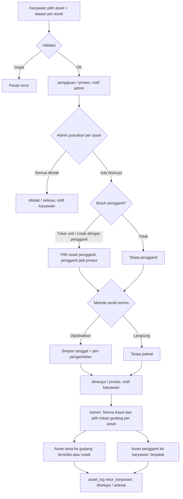
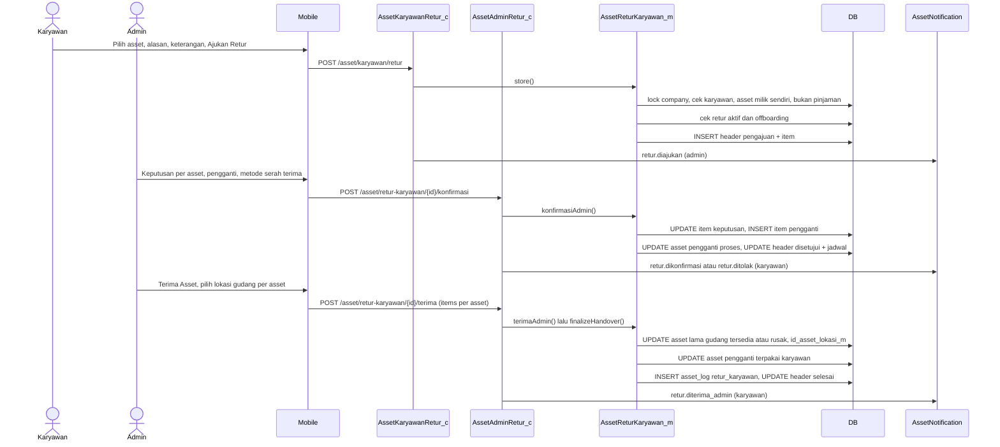
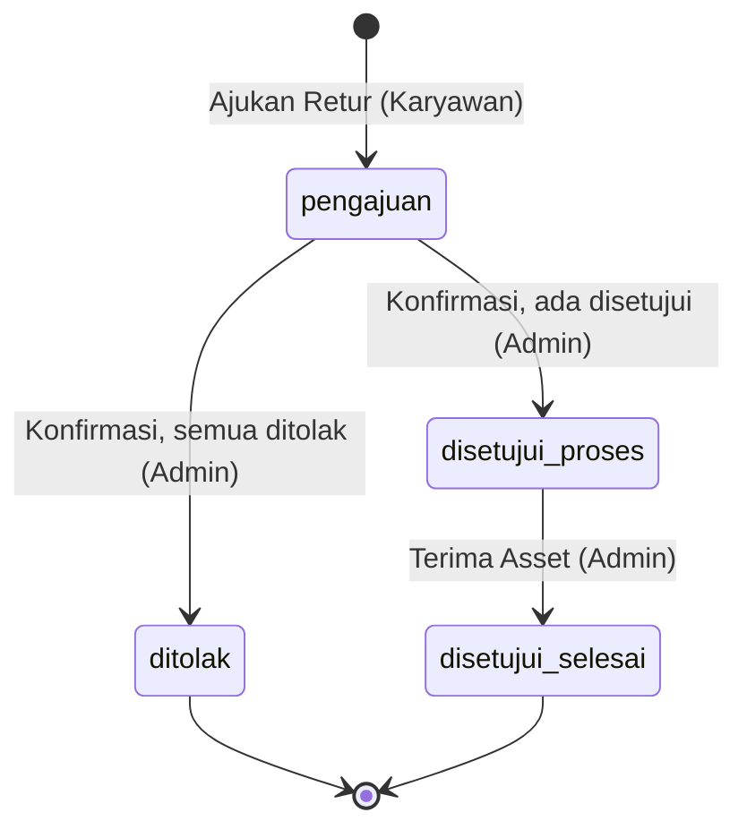
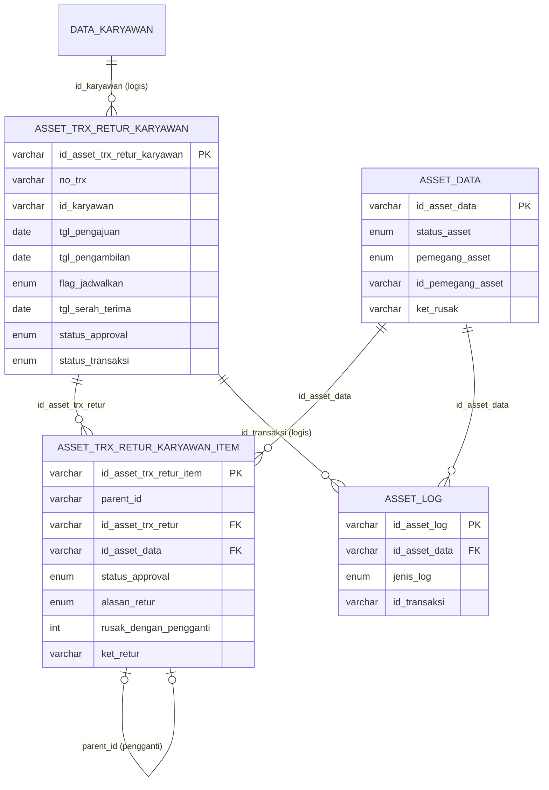

# Dokumentasi Teknis & Manual Book — Retur Asset Karyawan

> Dokumen ini disusun **murni dari source code lokal** (`API/` Lumen dan `MOBILE/` Flutter) per 26 September 2026, dan dibandingkan dengan dokumen lama `API/ALUR RETUR.md` (ALK-KRY04 v3.0, 18 Sep 2026).
> Business requirement dan kode fitur **diturunkan dari kode**. Bagian yang tidak ditemukan ditandai **⚠️ Belum ditemukan**, asumsi ditandai **⚠️ Asumsi**.
> Contoh ID/nama pada payload adalah **data sintetis**.

---

## 1. Informasi Dokumen

| Informasi | Nilai |
|---|---|
| Nama Fitur | Retur Asset Karyawan (UI: **"Retur Asset"**; menu karyawan berlabel **"Pengembalian"**) |
| Kode Fitur | **KRY04** (nomor transaksi `KRY04-YYYYMMNNN`; dokumen lama menyebut kode alur `ALK-KRY04`) |
| Modul | Asset Management |
| Backend | Laravel **Lumen ^10.0**, PHP ^8.1, JWT `tymon/jwt-auth ^2.3`, Query Builder |
| Database | Struktur mengacu `API/diagram-asset.dbml` + migration `2026_09_18_000010`. ⚠️ Asumsi: MySQL/MariaDB |
| Mobile | Flutter (package `professional_flutter_3_35`), `flutter_bloc`, `dio` |
| Web | ⚠️ Belum ditemukan: tidak ada source web di workspace |
| Versi Dokumen | 1.6 |
| Tanggal Dokumentasi | 2026-10-12 |
| Dokumen terkait | `API/ALUR RETUR.md` (lama), Onboarding, Request/Penambahan, Peminjaman, Offboarding, Kerusakan, Upgrade |

---

## 2. Daftar Isi

1. Informasi Dokumen · 3. Quick Overview · 4. Ringkasan Fitur · 5. Tujuan · 6. Aktor · 7. Hak Akses · 8. Terminologi · 9. Business Rules · 10. Business Flow · 11. Flow per Role · 12. Flow Diagram · 13. Sequence Diagram · 14. Status Transaksi · 15. State Transition · 16. Struktur Database · 17. Relasi · 18. Data Dictionary · 19. Index · 20. Backend Architecture · 21. Backend Logic · 22. Dampak asset_data · 23. API · 24. Detail API · 25. Mobile Architecture · 26. Mobile Screen · 27. Mobile → API · 28. API → Mobile · 29. Mapping Mobile→API→DB · 30. Mapping DB→API→Mobile · 31. Validation · 32. Error Handling · 33. Audit Trail · 34. Notification · 35. Security · 36. Manual Book · 37. Kondisi Button · 38. Testing · 39. Temuan Ketidaksesuaian · 40. Edge Case · 41. Risk · 42. Dependency · 43. Source Reference · 44. Developer Notes · 45. Traceability · 46. DB Impact · 47. Checklist · 48. Changelog

---

## 3. Quick Overview

| Item | Informasi |
|---|---|
| Feature | Retur Asset Karyawan (karyawan → gudang) |
| Module | Asset Management |
| Actor | Karyawan (pemegang asset), Admin Asset, System |
| Main Transaction | `asset_trx_retur_karyawan` |
| Detail Transaction | `asset_trx_retur_karyawan_item` (item asal + item **pengganti** via `parent_id`) |
| Alasan retur | `rusak` (tanpa/dengan pengganti), `tidak_digunakan`, `tukar_unit` |
| Asset Master | `asset_data` |
| Log | `asset_log` (`jenis_log = retur_karyawan`) untuk asset lama dan asset pengganti |
| Status | `status_approval`: `pengajuan → disetujui` atau `ditolak`; `status_transaksi`: `proses → selesai` |
| Approval | Admin memutuskan **per asset**, memilih **asset pengganti** bila perlu, dan menentukan metode serah terima (dijadwalkan / langsung) |
| Finalisasi | **Terima Asset** oleh **admin** saja, dengan memilih **lokasi gudang per asset** (v1.4) |
| API | 5 endpoint admin + 4 endpoint karyawan |
| Mobile Screen | Karyawan: Retur Asset (tab Pengajuan/Dikonfirmasi/Diterima), Tambah Retur Asset, Detail Retur Asset. Admin: Retur Asset, Detail Retur Asset + sheet Konfirmasi Retur Asset |

```text
Karyawan: pilih asset yang dipegang + alasan per asset (+ pengganti? + keterangan) → Ajukan Retur
      │  asset TIDAK dikunci di asset_data (dijaga lewat pengecekan retur aktif)     pengajuan / proses
      ▼
Admin: Setujui / Tolak tiap asset (+ alasan)
       Tukar unit / Rusak dengan pengganti → wajib pilih Asset Pengganti (asset pengganti → proses)
       Metode serah terima: Dijadwalkan (tanggal + jam) atau Serahkan Langsung       disetujui / proses
      │  (semua ditolak → ditolak / selesai)
      ▼
Admin: Terima Asset (pilih lokasi gudang per asset)
   asset lama  → tersedia (tidak digunakan / tukar unit) atau rusak (rusak) @gudang pilihan admin + asset_log
   pengganti   → terpakai @karyawan + asset_log                                      disetujui / selesai
```

---

## 4. Ringkasan Fitur

Retur Asset dipakai karyawan untuk **mengembalikan asset yang sedang dipegangnya secara tetap** (hasil Onboarding/Penambahan/penggantian sebelumnya) ke gudang. Asset **pinjaman tidak bisa diretur** — harus lewat Pengembalian Peminjaman.

Setiap asset dalam satu pengajuan memiliki alasan sendiri:
- **Asset Rusak** — wajib keterangan kerusakan dan pilihan **Tanpa Pengganti** atau **Dengan Pengganti**.
- **Asset Tidak Digunakan** — keterangan opsional.
- **Tukar Unit** — wajib alasan; selalu membutuhkan unit pengganti.

Admin meninjau per asset. Untuk *tukar unit* dan *rusak dengan pengganti*, admin memilih asset pengganti dari gudang pada saat menyetujui. Admin juga menentukan apakah serah terima **dijadwalkan** (tanggal + jam) atau **langsung**. Serah terima fisik ditutup dengan **Terima Asset** oleh admin atau karyawan, yang sekaligus memindahkan asset lama ke gudang dan asset pengganti ke karyawan.

---

## 5. Tujuan Fitur

### 5.1 Tujuan Bisnis (diturunkan dari kode)
- Karyawan dapat mengembalikan asset yang rusak, tidak terpakai, atau perlu ditukar secara tercatat.
- Admin mengontrol asset mana yang diterima kembali dan unit pengganti yang diberikan.
- Asset rusak masuk gudang dengan status rusak beserta keterangan kerusakannya.
- Penukaran unit tercatat sebagai satu transaksi (asset lama keluar, pengganti masuk).

### 5.2 Tujuan Sistem
- Menyimpan pengajuan retur per asset dengan alasan dan keterangan.
- Mencatat keputusan admin per asset dan asset pengganti (item anak).
- Mengunci asset pengganti (`proses`) sampai diserahkan.
- Memperbarui `asset_data` dan `asset_log` saat serah terima.
- Mencegah asset yang sedang diretur diproses di Kerusakan/Upgrade.

---

## 6. Aktor

| Aktor | Role | Fungsi |
|---|---|---|
| Karyawan | User login (JWT), pemegang asset | Mengajukan retur dan menyerahkan asset; tidak lagi memfinalisasi (v1.4) |
| Admin Asset | `asset_admin` + karyawan aktif | Menyetujui/menolak per asset, memilih pengganti, menentukan metode serah terima, menyelesaikan serah terima, memilih lokasi gudang per asset |
| System | Backend + FCM | Validasi, lock, penomoran, update asset, log, notifikasi |

> Dokumen lama menyebut aktor "Admin/HR". Di kode, aksi admin dibatasi pada `asset_admin`.

---

## 7. Hak Akses

| Action | Admin Asset | Karyawan | Keterangan |
|---|:---:|:---:|---|
| Melihat semua retur | ✅ | ❌ | `/asset/retur-karyawan` |
| Melihat retur sendiri | – | ✅ | `/asset/karyawan/retur` |
| Mengajukan retur | – | ✅ | Hanya asset yang dipegang sendiri, bukan pinjaman |
| Edit / batalkan pengajuan | ❌ | ❌ | ⚠️ Belum ditemukan |
| Setujui / tolak per asset | ✅ (status pengajuan) | ❌ | |
| Pilih asset pengganti | ✅ | ❌ | Wajib untuk tukar unit & rusak dengan pengganti |
| Tentukan metode serah terima | ✅ | ❌ | Dijadwalkan / langsung |
| Terima Asset (finalisasi) | ✅ | ❌ | Status disetujui & proses; hanya admin (v1.4) |
| Batalkan setelah disetujui | ❌ | ❌ | ⚠️ Belum ditemukan (RISK-002) |

---

## 8. Terminologi

| Istilah | Arti di sistem |
|---|---|
| Item asal | Item retur dengan `parent_id` NULL/`''` (asset milik karyawan) |
| Item pengganti | Item dengan `parent_id` = id item asal, dibuat admin saat menyetujui |
| `rusak_dengan_pengganti` | 0 = tidak relevan, 1 = tanpa pengganti, 2 = dengan pengganti |
| Metode serah terima | `dijadwalkan` (tanggal + jam pengambilan) atau `langsung` (tanpa jadwal) |
| `flag_jadwalkan` | '1' bila dijadwalkan |
| Jadwal pengambilan | `tgl_pengambilan` + `jam_pengambilan` |
| Serah terima | `tgl_serah_terima` + `jam_serah_terima` = waktu **Terima Asset** diklik |
| Retur aktif | Header `status_transaksi = proses` dan `status_approval != ditolak` |

---

## 9. Business Rules

### BR-001 — Retur hanya untuk asset yang dipegang karyawan sendiri
`asset_data.pemegang_asset = karyawan` dan `id_pemegang_asset = id_karyawan` login → "Satu atau beberapa asset bukan milik karyawan atau sudah tidak dapat diretur."

### BR-002 — Asset pinjaman tidak dapat diretur
`status_asset = dipinjam` → "Asset pinjaman tidak dapat diretur. Gunakan pengembalian peminjaman." (dicek saat ajukan, konfirmasi, dan terima).

### BR-003 — Karyawan harus aktif
Saat ajukan → "Karyawan tidak ditemukan atau tidak aktif."

### BR-004 — Minimal satu asset, tanpa duplikat
→ "Minimal satu asset wajib dipilih." / "Asset yang sama tidak boleh dipilih lebih dari sekali."

### BR-005 — Aturan per alasan
| Alasan | `rusak_dengan_pengganti` | `ket_retur` | Pengganti |
|---|---|---|---|
| `rusak` | wajib 1 atau 2 ("Asset rusak wajib memilih tanpa atau dengan pengganti.") | wajib ("Keterangan kerusakan asset wajib diisi.") | wajib bila 2 |
| `tidak_digunakan` | dipaksa 0 | opsional | tidak boleh |
| `tukar_unit` | dipaksa 0 | wajib ("Alasan tukar unit wajib diisi.") | wajib |

### BR-006 — Asset tidak boleh sedang di retur lain, offboarding, pemeliharaan, upgrade, atau kerusakan
`hasActiveReturAsset` → "Satu atau beberapa asset sedang diproses pada retur lain." `hasActiveOffboardingAsset` → "Satu atau beberapa asset sedang diproses pada offboarding." `AssetPemeliharaanKaryawan_m::hasActivePemeliharaanAsset` (PML01, fase ≠ `selesai`; sejak v1.2) → "Satu atau beberapa asset sedang diproses pada pemeliharaan." `AssetUpgradeKaryawan_m::hasActiveUpgradeAsset` → "…pada upgrade." dan `AssetRusakKaryawan_m::hasActiveRusakAsset` → "…pada laporan kerusakan." (terverifikasi di kode 12 Okt 2026). Opsi retur juga menyaring asset yang sedang di Upgrade/Kerusakan.

### BR-007 — Admin memutuskan seluruh item asal
→ "Seluruh asset retur wajib dikonfirmasi." Tolak wajib alasan → "Alasan penolakan asset wajib diisi."; item ditolak tidak boleh punya pengganti.

### BR-008 — Asset masih dipegang karyawan saat konfirmasi
→ "Satu atau beberapa asset sudah tidak dipegang oleh karyawan."

### BR-009 — Asset pengganti
Wajib untuk tukar unit & rusak dengan pengganti; dilarang untuk alasan lain; unik; harus `tersedia` @gudang → "Asset pengganti wajib dipilih untuk retur ini." / "Alasan retur ini tidak memerlukan asset pengganti." / "Asset pengganti yang sama tidak boleh dipilih lebih dari sekali." / "Satu atau beberapa asset pengganti tidak tersedia." Tidak ada syarat kategori sama.

### BR-010 — Metode serah terima wajib bila ada asset disetujui
`dijadwalkan` wajib tanggal + jam, tanggal ≥ tanggal pengajuan → "Metode serah terima retur tidak valid." / "Tanggal dan jam serah terima wajib diisi." / "Tanggal serah terima tidak boleh sebelum tanggal pengajuan."

### BR-011 — Hasil keputusan
≥1 disetujui → `status_approval = disetujui`, `status_transaksi = proses`; semua ditolak → `ditolak` / `selesai`, `ket_tolak = "Seluruh asset retur ditolak."` Asset pengganti → `proses`.

### BR-012 — Finalisasi hanya oleh admin (v1.4)
Hanya untuk `disetujui` + `proses`; asset asal masih dipegang karyawan; pengganti masih `proses` @gudang → "Retur asset belum dikonfirmasi atau sudah selesai." / "Asset pengganti sudah tidak siap diserahterimakan."

### BR-013 — Dampak finalisasi
Asset asal disetujui: `rusak` → `status_asset = rusak` + `ket_rusak = ket_retur`; lainnya → `tersedia`; semua ke `gudang`. Pengganti → `terpakai` @karyawan. `asset_log retur_karyawan` untuk keduanya. Header `selesai`, `tgl/jam_serah_terima = now`.

### BR-013a — Lokasi gudang tujuan per asset (v1.4)
Pada Terima Asset admin wajib memilih **lokasi gudang untuk setiap asset asal yang disetujui**: `items[]` memuat tiap item (`id_asset_trx_retur_item`) tepat satu kali dengan `id_asset_lokasi_m` bertipe `gudang` pada company yang sama → "Lokasi gudang tujuan setiap asset wajib dipilih." / "Lokasi gudang tujuan tidak valid." / "Lokasi gudang tujuan asset tidak sesuai." Lokasi ditulis ke `asset_data.id_asset_lokasi_m` dan `asset_trx_retur_karyawan_item.id_asset_lokasi_m_tujuan`. Asset pengganti yang keluar ke karyawan di-set NULL lokasinya (kolom FK ke asset_lokasi_m; nilai '' ditolak database) (`id_asset_lokasi_m = NULL`). Route karyawan `POST /asset/karyawan/retur/{id}/terima` **dihapus**.

### BR-014 — Retur aktif mengunci asset untuk Kerusakan & Upgrade
`AssetRusakKaryawan_m` dan `AssetUpgradeKaryawan_m` memanggil `hasActiveReturAsset`. Offboarding memeriksanya lewat `assertNoCrossFlow` (query langsung ke tabel retur dengan kondisi yang sama) → "Satu atau beberapa asset sedang diproses pada flow lain."

### BR-015 — Penomoran
ID `id_company + YYYYMM + 3 digit`; `no_trx = KRY04-YYYYMMNNN`.

---

## 10. Business Flow

```text
1. Karyawan: Asset Saya → menu "Pengembalian" (Retur Asset) → (+) Tambah Retur Asset
   → Pilih Asset yang Diretur (hanya asset milik sendiri, bukan pinjaman, tidak sedang diretur)
   → per asset: Alasan Retur Asset → (Rusak: Tanpa/Dengan Pengganti) → Keterangan
   → Catatan Tambahan → Ajukan Retur                 [pengajuan/proses · notif admin]
2. Admin: Asset Karyawan → Retur → tab Pengajuan → Detail
   → per asset: Tolak (+alasan) / Setujui / Ganti Asset (pilih pengganti)
   → Konfirmasi Asset → sheet "Konfirmasi Retur Asset":
        Metode: Dijadwalkan (tanggal + jam) / Serahkan Langsung, Catatan → Submit
                                                     [disetujui/proses atau ditolak/selesai · notif karyawan]
3. Serah terima fisik sesuai jadwal / langsung
4. Admin: Detail → Terima Asset → dialog Lokasi Tujuan Asset (gudang per asset)
                                                     [disetujui/selesai · asset diperbarui · asset_log · notif pihak lain]
```

---

## 11. Flow Berdasarkan Role

### 11.1 Karyawan
1. **Asset Saya** → menu **Pengembalian** → halaman **Retur Asset** (tab Pengajuan, Dikonfirmasi, Diterima).
2. **+** → **Tambah Retur Asset** → **Ajukan Retur**.
3. Setelah disetujui: kartu menampilkan jadwal ("Jadwal Serah Terima Retur Asset") atau info serah terima langsung; banner di Asset Saya.
4. Serahkan asset ke admin dan terima pengganti bila ada; penyelesaian dilakukan oleh admin (v1.4).

### 11.2 Admin Asset
1. **Asset Karyawan** → aksi **Retur** (panel ringkasan "perlu diproses" mencakup pengajuan & yang menunggu serah terima).
2. Tab **Pengajuan** → detail → keputusan per asset → **Konfirmasi Asset** → sheet → **Submit**.
3. Tab **Dikonfirmasi** → detail → **Terima Asset** setelah serah terima fisik, lalu pilih lokasi gudang setiap asset.

### 11.3 Approver
Dijalankan Admin Asset.

### 11.4 System
Validasi kepemilikan & status, lock, penomoran, reservasi pengganti, finalisasi asset + log, notifikasi setelah commit.

---

## 12. Flow Diagram



---

## 13. Sequence Diagram



---

## 14. Status Transaksi

Header memiliki **dua** kolom status: `status_approval` (enum `status_approval_retur`: `pengajuan`, `disetujui`, `ditolak`, `proses`, `serah_terima`) dan `status_transaksi` (enum `status`: `proses`, `selesai`).

| status_approval | status_transaksi | Label | Tab | Arti | Aksi berikutnya |
|---|---|---|---|---|---|
| `pengajuan` | `proses` | Menunggu Konfirmasi | pengajuan | Menunggu admin | Admin: konfirmasi |
| `ditolak` | `selesai` | Ditolak | pengajuan | Semua asset ditolak | – |
| `disetujui` | `proses` | Dikonfirmasi | dikonfirmasi | Menunggu serah terima | Admin: Terima Asset |
| `disetujui` | `selesai` | Selesai (mobile: "Diterima") | diterima | Serah terima selesai | – |
| `proses` / `serah_terima` | – | Diperlakukan seperti `disetujui` | – | ⚠️ **Tidak pernah di-set** oleh kode | – |

Status item (`status_approval` item, enum `approval_item`): NULL (belum ditinjau) → `disetujui` / `ditolak`. Item pengganti langsung `disetujui`.

---

## 15. State Transition



| Status Awal | Action | Status Akhir | Actor |
|---|---|---|---|
| – | Ajukan Retur | pengajuan / proses | Karyawan |
| pengajuan / proses | Konfirmasi, semua ditolak | ditolak / selesai | Admin |
| pengajuan / proses | Konfirmasi, ≥1 disetujui | disetujui / proses | Admin |
| disetujui / proses | Terima Asset | disetujui / selesai | Admin |

Status `asset_data`:
| Asset | Dari | Ke | Trigger |
|---|---|---|---|
| Asset asal | terpakai @karyawan | *(tidak berubah saat pengajuan/konfirmasi)* | – |
| Asset asal (tidak digunakan / tukar unit) | @karyawan | tersedia @gudang | Terima Asset |
| Asset asal (rusak) | @karyawan | rusak @gudang (+ket_rusak) | Terima Asset |
| Asset pengganti | tersedia @gudang | proses | Konfirmasi admin |
| Asset pengganti | proses @gudang | terpakai @karyawan | Terima Asset |

---

## 16. Struktur Database

| Table | Type | Fungsi |
|---|---|---|
| `asset_trx_retur_karyawan` | Transaction Header | Pengajuan retur, keputusan, jadwal, serah terima |
| `asset_trx_retur_karyawan_item` | Transaction Detail | Item asal + item pengganti (`parent_id`) |
| `asset_data` | Master | Status & pemegang asset |
| `asset_kategori_m` | Master | Snapshot kategori; pohon kategori picker pengganti |
| `data_karyawan`, `master_cabang`, `master_departemen` | Master HR | Karyawan aktif, cabang, divisi |
| `asset_admin`, `master_company` | Akses / lock | Admin & mutex |
| `asset_log` | Log | `retur_karyawan` |
| `notif_data`, `users` | Notifikasi | Inbox & FCM |

> ⚠️ Belum ditemukan: migration `CREATE TABLE`. Migration `2026_09_18_000010` menambah index serta kolom item `status_approval` & `ket_tolak`.

---

## 17. Relasi Database



---

## 18. Data Dictionary

### 18.1 asset_trx_retur_karyawan
| Field | Type | Null | Default | Key | Description |
|---|---|:---:|---|---|---|
| id_asset_trx_retur_karyawan | varchar(50) | No | – | PK | `id_company + YYYYMM + 3 digit` |
| no_trx | varchar(50) | No | '' | – | `KRY04-YYYYMMNNN` (tidak unique) |
| keterangan | text | Yes | – | – | Catatan tambahan karyawan |
| ket_tolak | varchar(255) | – | '' | – | "Seluruh asset retur ditolak." |
| id_karyawan, nik_karyawan, nama_karyawan | varchar | – | '' | IDX | Snapshot karyawan |
| tgl_pengajuan | date | No | CURRENT_DATE | – | Tanggal pengajuan |
| tgl_pengambilan / jam_pengambilan | date / time | No | 0000-00-00 / 00:00:00 | – | Jadwal serah terima (bila dijadwalkan) |
| flag_jadwalkan | enum('0','1') | – | – | – | '1' = dijadwalkan |
| tgl_serah_terima / jam_serah_terima | date / time | No | 0000-00-00 / 00:00:00 | – | Waktu Terima Asset diklik |
| keterangan_serah_terima | varchar(255) | – | '' | – | Catatan admin |
| status_approval | enum(pengajuan, disetujui, ditolak, proses, serah_terima) | – | pengajuan | IDX | Status keputusan |
| status_transaksi | enum(proses, selesai) | – | proses | IDX | Progres transaksi |
| user_approval / tgl_approval | – | – | '' / NULL | – | Admin pemutus |
| id_company, tgl_input, user_input, tgl_update, user_update | – | – | – | IDX | Audit; `user_update` = pelaku Terima Asset |

### 18.2 asset_trx_retur_karyawan_item
| Field | Type | Null | Default | Key | Description |
|---|---|:---:|---|---|---|
| id_asset_trx_retur_item | varchar(50) | No | – | PK | `id_company + YYYYMM + 3 digit` |
| parent_id | varchar(50) | Yes | NULL | IDX | NULL = item asal; id item asal = pengganti |
| id_asset_trx_retur | varchar(50) | – | – | FK, IDX | → header |
| id_asset_data | varchar(50) | – | – | FK, IDX | Asset asal / pengganti |
| nama_asset, deskripsi_asset, kategori_asset | varchar(255) | – | '' | – | Snapshot |
| status_approval | enum(disetujui, ditolak) | Yes | NULL | IDX | Keputusan admin |
| ket_tolak | varchar(255) | No | '' | – | Alasan penolakan |
| alasan_retur | enum(tukar_unit, rusak, tidak_digunakan) | No | rusak | – | Alasan per asset (pengganti menyalin alasan item asal) |
| rusak_dengan_pengganti | int(1) | – | 0 | – | 0/1/2 |
| ket_retur | varchar(255) | No | '' | – | Keterangan kerusakan / alasan |
| id_company, tgl_input, user_input | – | – | – | IDX | – |

### 18.3 asset_data & asset_log
- `asset_data`: `pemegang_asset`, `id_pemegang_asset`, `status_asset` (terpakai/dipinjam/tersedia/rusak/proses), `ket_rusak`, `kondisi_awal`, `tgl_update`, `user_update`.
- `asset_log` (`jenis_log = retur_karyawan`, `nama_tabel_transaksi = asset_trx_retur_karyawan`):

| Asset | kondisi_awal → akhir | posisi | pemegang |
|---|---|---|---|
| Asal | kondisi_awal → `rusak` / `normal` | karyawan → gudang | kosong |
| Pengganti | kondisi_awal → `normal` | gudang → karyawan | id & nama karyawan |

---

## 19. Database Index

| Index | Table | Columns | Tujuan |
|---|---|---|---|
| `atrk_admin_list_idx` | header retur | (id_company, status_approval, status_transaksi, tgl_input, id_asset_trx_retur_karyawan) | List admin |
| `atrk_employee_list_idx` | header retur | (id_company, id_karyawan, status_approval, status_transaksi, tgl_input, id_asset_trx_retur_karyawan) | List karyawan |
| `atrki_return_status_idx` | item retur | (id_asset_trx_retur, id_company, status_approval, parent_id, id_asset_data) | Item per header, cek status & pengganti |

> Nama index `atrk_admin_list_idx`/`atrk_employee_list_idx` juga dipakai tabel `asset_trx_request_karyawan` (berbeda tabel, jadi valid di MySQL, namun rawan membingungkan).

---

## 20. Backend Architecture

```text
RouteAsset.php (prefix /asset, jwt.api + jwt.ctx)
   ↓
AssetAdminRetur_c / AssetKaryawanRetur_c (validateRequest + accessError)
   ↓
AssetReturKaryawan_m ← Asset_m (lock, sequence, getLockedAssets, findActiveKaryawan, findAssetAdmin)
   ↓                 ← AssetAdmin_m::getOnboardingOptions (opsi pengganti)
   ↓                 ← AssetOffboardingKaryawan_m::hasActiveOffboardingAsset
DB::transaction (retry 3) → ApiResponse + AssetNotification
```

| Layer | File/Class | Function |
|---|---|---|
| Controller | `AssetAdminRetur_c` | getReturOptions, getReturKaryawan, getDetailReturKaryawan, konfirmasiReturKaryawan, terimaReturKaryawan |
| Controller | `AssetKaryawanRetur_c` | getReturOptions, getReturSaya, storeReturSaya, getDetailReturSaya (terimaReturSaya dihapus v1.4) |
| Model | `AssetReturKaryawan_m` | getOptions, getAdminOptions, getRetur(Page), getReturAdmin(Page), getDetail(Admin), store, konfirmasiAdmin, terimaAdmin, finalizeHandover, resolveItemLocations (Asset_m), hasActiveReturAsset, getPendingForEmployee, getPendingForAdmin, countPendingForAdmin |
| Support | `AssetNotification` | Event `retur.*` |

---

## 21. Backend Business Logic

### 21.1 Ajukan — `store`
Lock → karyawan aktif → `normalizeItems` (aturan alasan §9 BR-005) → asset milik karyawan (FOR UPDATE) → bukan pinjaman → tidak di retur aktif → tidak di offboarding → ID + `KRY04-…` → INSERT header (`pengajuan`/`proses`, jadwal nol, `flag_jadwalkan '0'`) → INSERT item (`parent_id` NULL, `status_approval` NULL, snapshot) → notif `retur.diajukan`. **`asset_data` tidak diubah.**

### 21.2 Konfirmasi — `konfirmasiAdmin`
Lock → admin → header `pengajuan`/`proses` FOR UPDATE → item asal FOR UPDATE → semua diputuskan → asset asal masih dipegang karyawan & bukan pinjaman → validasi keputusan & pengganti per item → pengganti `tersedia` @gudang (`getLockedAssets`) → bila ada disetujui: metode serah terima wajib, jadwal bila dijadwalkan (≥ tgl pengajuan) → UPDATE item (`status_approval`, `ket_tolak`) → INSERT item pengganti (`parent_id`, `disetujui`) → UPDATE pengganti `proses` → UPDATE header (status, jadwal, `flag_jadwalkan`, `keterangan_serah_terima`, `user/tgl_approval`) → notif `retur.dikonfirmasi`/`retur.ditolak`. Response +`jumlah_disetujui`, `jumlah_ditolak`, `jumlah_pengganti`.

### 21.3 Terima — `terimaAdmin` → `finalizeHandover`
Cek admin. Lalu: lock → header `disetujui`/`proses` → item asal disetujui (min 1) → `resolveItemLocations` (lokasi gudang per item asal, v1.4) → asset asal masih dipegang karyawan, bukan pinjaman → pengganti masih `proses` @gudang → per item asal: UPDATE asset (rusak/tersedia @gudang, `id_asset_lokasi_m` pilihan admin, `ket_rusak`) + UPDATE item `id_asset_lokasi_m_tujuan` + log; bila ada pengganti: UPDATE pengganti `terpakai` @karyawan, `id_asset_lokasi_m = NULL` + log → INSERT log → header `selesai`, `tgl/jam_serah_terima = now` → notif `retur.diterima_admin` (ke karyawan).

### 21.4 Query baca
- **Opsi karyawan**: asset @karyawan miliknya, bukan `dipinjam`, tidak di retur aktif + daftar alasan.
- **Opsi admin**: `AssetAdmin_m::getOnboardingOptions` → kategori & asset `tersedia` @gudang (untuk pengganti).
- **List**: tab `pengajuan` (pengajuan + ditolak), `dikonfirmasi` (disetujui/proses/serah_terima + proses), `diterima` (… + selesai); `jumlah_asset` hanya item asal.
- **Detail**: item asal dengan `asset_pengganti` bersarang, `alasan_label`, jadwal (tanggal nol dikosongkan).

---

## 22. Dampak terhadap asset_data

| Field | Sebelum | Sesudah | Trigger |
|---|---|---|---|
| (asset asal) semua field | terpakai @karyawan | tidak berubah | Ajukan, Konfirmasi |
| status_asset (asal, tidak digunakan / tukar unit) | terpakai | tersedia | Terima Asset |
| status_asset (asal, rusak) | terpakai | rusak | Terima Asset |
| ket_rusak (asal) | – | `ket_retur` (rusak) / '' | Terima Asset |
| pemegang_asset / id_pemegang_asset (asal) | karyawan / id | gudang / '' | Terima Asset |
| id_asset_lokasi_m (asal) | – / lokasi lama | lokasi gudang pilihan admin (v1.4) | Terima Asset |
| id_asset_lokasi_m (pengganti) | lokasi gudang | NULL (dipegang karyawan) | Terima Asset |
| status_asset (pengganti) | tersedia | proses | Konfirmasi |
| status_asset / pemegang (pengganti) | proses @gudang | terpakai @karyawan | Terima Asset |
| tgl_update / user_update | – | now / pelaku | Setiap update |

---

## 23. API Documentation

| ID | Method | Endpoint | Function | Auth |
|---|---|---|---|---|
| API-001 | GET | `/asset/retur-karyawan/options` | Opsi asset pengganti | Admin |
| API-002 | GET | `/asset/retur-karyawan` | List retur | Admin |
| API-003 | GET | `/asset/retur-karyawan/{id}` | Detail retur | Admin |
| API-004 | POST | `/asset/retur-karyawan/{id}/konfirmasi` | Keputusan per asset + pengganti + metode | Admin |
| API-005 | POST | `/asset/retur-karyawan/{id}/terima` | Finalisasi serah terima + lokasi gudang per asset (`items[]`) | Admin |
| API-006 | GET | `/asset/karyawan/retur/options` | Asset milik saya + alasan | JWT |
| API-007 | GET | `/asset/karyawan/retur` | List retur saya | JWT |
| API-008 | POST | `/asset/karyawan/retur` | Ajukan retur | JWT |
| API-009 | GET | `/asset/karyawan/retur/{id}` | Detail retur saya | JWT, pemilik |
| API-010 | POST | `/asset/karyawan/retur/{id}/terima` | **DIHAPUS (v1.4)**: retur hanya difinalisasi admin | – |

Terkait: `GET /asset/karyawan/onboarding` (`retur[]` = retur disetujui menunggu diterima) dan `GET /asset/summary` (`retur_perlu_proses`, `retur_pending`).
Edit/batal retur: ⚠️ Belum ditemukan.

---

## 24. Detail Setiap API

Header umum: `Authorization: Bearer <token>`, `Content-Type: application/json`, `Accept`, `locale`, `versi-app`. Format `{ code, message, data }`.

### API-001 — Opsi Pengganti (Admin)
```http
GET /asset/retur-karyawan/options
```
`data`: `{ "kategori_asset": [...], "assets": [{id_asset_data, kode_asset, nama_asset, id_asset_kategori_m, kategori_asset, merek, deskripsi, kondisi_awal}] }` — asset `tersedia` @gudang (sama dengan opsi onboarding).

### API-002 / API-007 — List Retur
```http
GET /asset/retur-karyawan?tab=pengajuan&limit=20&offset=0     (admin)
GET /asset/karyawan/retur?tab=dikonfirmasi                    (karyawan)
```
`tab`: `pengajuan` | `dikonfirmasi` | `diterima` ("Filter retur asset tidak valid."); `limit` 1–50.
```json
{
  "code": "SUCCESS",
  "message": "Data retur asset berhasil ditemukan.",
  "data": {
    "filters": [
      {"value": "pengajuan", "label": "Pengajuan"},
      {"value": "dikonfirmasi", "label": "Dikonfirmasi"},
      {"value": "diterima", "label": "Diterima"}
    ],
    "records": [
      {
        "id": "CMP001202609011",
        "no_trx": "KRY04-202609011",
        "tgl_pengajuan": "2026-09-26",
        "tgl_pengambilan": "2026-09-29",
        "jam_pengambilan": "10:00:00",
        "flag_jadwalkan": "1",
        "tgl_serah_terima": "",
        "jam_serah_terima": "",
        "status_approval": "disetujui",
        "status_transaksi": "proses",
        "status_label": "Dikonfirmasi",
        "tab": "dikonfirmasi",
        "ket_tolak": "",
        "jumlah_asset": 2,
        "karyawan": {"id_karyawan": "KRY0004", "nik": "EMP-004", "nama_karyawan": "Rina Contoh"}
      }
    ],
    "pagination": {"limit": 20, "offset": 0, "next_offset": 1, "has_more": false}
  }
}
```

### API-003 / API-009 — Detail Retur
```http
GET /asset/retur-karyawan/{id}
GET /asset/karyawan/retur/{id}
```
```json
{
  "id": "CMP001202609011",
  "no_trx": "KRY04-202609011",
  "tgl_pengajuan": "2026-09-26",
  "keterangan": "Laptop sering mati mendadak",
  "ket_tolak": "",
  "tgl_pengambilan": "2026-09-29",
  "jam_pengambilan": "10:00:00",
  "flag_jadwalkan": "1",
  "tgl_serah_terima": "",
  "jam_serah_terima": "",
  "keterangan_serah_terima": "Bawa charger",
  "status_approval": "disetujui",
  "status_transaksi": "proses",
  "status_label": "Dikonfirmasi",
  "tab": "dikonfirmasi",
  "jumlah_asset": 1,
  "karyawan": {"id_karyawan": "KRY0004", "nik": "EMP-004", "nama_karyawan": "Rina Contoh", "cabang": "Kantor Pusat", "divisi": "HR"},
  "items": [
    {
      "id_item": "CMP001202609031",
      "parent_id": "",
      "id_asset_data": "CMP00120260100012",
      "kode_asset": "LPT-0012",
      "nama_asset": "Laptop 14 inch",
      "kategori_asset": "Laptop",
      "merek": "MerekX",
      "deskripsi": "Charger",
      "status_item": "disetujui",
      "ket_tolak": "",
      "alasan_retur": "rusak",
      "alasan_label": "Asset Rusak",
      "rusak_dengan_pengganti": 2,
      "ket_retur": "Mati mendadak saat dipakai",
      "asset_pengganti": {
        "id_item": "CMP001202609032",
        "parent_id": "CMP001202609031",
        "id_asset_data": "CMP00120260100015",
        "kode_asset": "LPT-0015",
        "nama_asset": "Laptop 14 inch",
        "status_item": "disetujui"
      }
    }
  ]
}
```
404: "Retur asset tidak ditemukan."

### API-004 — Konfirmasi Retur (Admin)
```http
POST /asset/retur-karyawan/{id}/konfirmasi
```
```json
{
  "items": [
    {"id_item": "CMP001202609031", "status_item": "disetujui", "ket_tolak": "", "id_asset_pengganti": "CMP00120260100015"}
  ],
  "metode_serah_terima": "dijadwalkan",
  "tgl_pengambilan": "2026-09-29",
  "jam_pengambilan": "10:00",
  "keterangan_serah_terima": "Bawa charger"
}
```
| Field | Rule | Message |
|---|---|---|
| items | required\|array\|min:1 | Keputusan asset retur wajib diisi. |
| items.*.id_item | required\|max:50\|distinct | Asset retur yang sama tidak boleh dikirim lebih dari sekali. |
| items.*.status_item | required\|in:disetujui,ditolak | Keputusan setiap asset wajib dipilih. / Keputusan asset harus disetujui atau ditolak. |
| items.*.ket_tolak | nullable\|max:255\|required_if ditolak | Alasan penolakan asset wajib diisi. |
| items.*.id_asset_pengganti | nullable\|max:50\|distinct | Asset pengganti yang sama tidak boleh dipilih lebih dari sekali. |
| metode_serah_terima | nullable\|in:dijadwalkan,langsung (wajib di model bila ada disetujui) | Metode serah terima retur tidak valid. |
| tgl_pengambilan | nullable\|date_format:Y-m-d\|required_if dijadwalkan | Tanggal serah terima wajib diisi. / Format … |
| jam_pengambilan | nullable\|date_format:H:i\|required_if dijadwalkan | Jam serah terima wajib diisi. / Format … |
| keterangan_serah_terima | nullable\|max:255 | – |

Database impact:
```text
UPDATE asset_trx_retur_karyawan_item (status_approval, ket_tolak)
INSERT asset_trx_retur_karyawan_item (pengganti, parent_id)
UPDATE asset_data (pengganti → proses)
UPDATE asset_trx_retur_karyawan (status, jadwal, flag_jadwalkan, approval)
INSERT notif_data
```
```json
{ "code": "UPDATED", "message": "Retur asset berhasil dikonfirmasi.",
  "data": { "id": "CMP001202609011", "no_trx": "KRY04-202609011", "status_approval": "disetujui",
            "status_transaksi": "proses", "status_label": "Dikonfirmasi", "tab": "dikonfirmasi",
            "jumlah_disetujui": 1, "jumlah_ditolak": 0, "jumlah_pengganti": 1 } }
```
Semua ditolak: "Retur asset berhasil ditolak.", `ditolak`/`selesai`.
422: "Retur asset tidak ditemukan.", "Retur asset sudah tidak menunggu konfirmasi.", "Seluruh asset retur wajib dikonfirmasi.", "Satu atau beberapa asset sudah tidak dipegang oleh karyawan.", "Asset pinjaman tidak dapat diretur…", "Asset yang ditolak tidak boleh memiliki asset pengganti.", "Asset pengganti wajib dipilih untuk retur ini.", "Alasan retur ini tidak memerlukan asset pengganti.", "Satu atau beberapa asset pengganti tidak tersedia.", "Tanggal dan jam serah terima wajib diisi.", "Tanggal serah terima tidak boleh sebelum tanggal pengajuan." 500: "Terjadi kesalahan saat mengonfirmasi retur asset."

### API-005 — Terima Asset (finalisasi); API-010 dihapus (v1.4)
```http
POST /asset/retur-karyawan/{id}/terima          (admin)
```
Body (v1.4): lokasi gudang dipilih **per asset asal yang disetujui**.
```json
{
  "items": [
    {"id_asset_trx_retur_item": "CMP001202609012", "id_asset_lokasi_m": "CMP001202610001"}
  ]
}
```
| Field | Rule | Message |
|---|---|---|
| items | required\|array\|min:1 | Lokasi gudang tujuan setiap asset wajib dipilih. |
| items.*.id_asset_trx_retur_item | required\|string\|max:50\|distinct | – |
| items.*.id_asset_lokasi_m | required\|string\|max:50 | Lokasi gudang tujuan wajib dipilih. |

Pesan umum validasi: "Data penerimaan retur belum lengkap." Database impact:
```text
UPDATE asset_data (asal → tersedia/rusak @gudang + id_asset_lokasi_m; pengganti → terpakai @karyawan, id_asset_lokasi_m = NULL)
UPDATE asset_trx_retur_karyawan_item (id_asset_lokasi_m_tujuan)
INSERT asset_log (retur_karyawan)
UPDATE asset_trx_retur_karyawan (status_transaksi selesai, tgl/jam_serah_terima)
INSERT notif_data
```
```json
{ "code": "UPDATED", "message": "Retur asset berhasil diterima.",
  "data": { "id": "CMP001202609011", "no_trx": "KRY04-202609011", "status_approval": "disetujui",
            "status_transaksi": "selesai", "status_label": "Selesai", "tab": "diterima",
            "jumlah_diterima": 1, "jumlah_pengganti": 1 } }
```
422: "Retur asset tidak ditemukan.", "Retur asset belum dikonfirmasi atau sudah selesai.", "Tidak ada asset retur yang dapat diterima.", "Satu atau beberapa asset retur tidak ditemukan.", "Satu atau beberapa asset sudah tidak dipegang oleh karyawan.", "Asset pengganti sudah tidak siap diserahterimakan.", "Lokasi gudang tujuan setiap asset wajib dipilih.", "Lokasi gudang tujuan tidak valid.", "Lokasi gudang tujuan asset tidak sesuai.", "Pengguna tidak terdaftar sebagai admin asset." (admin). 500: "Terjadi kesalahan saat menerima retur asset."

Detail admin (API-003) mulai v1.4 memuat `lokasi_gudang[]` (gudang milik company), `karyawan.id_cabang`, dan `items[].id_asset_lokasi_m_tujuan` serta `nama_lokasi_tujuan` (kosong sampai diterima). Route `POST /asset/karyawan/retur/{id}/terima` (API-010) sudah tidak ada; memanggilnya menghasilkan 404.

### API-006 — Opsi Retur (Karyawan)
```http
GET /asset/karyawan/retur/options
```
```json
{
  "code": "SUCCESS",
  "message": "Opsi retur asset berhasil ditemukan.",
  "data": {
    "alasan_retur": [
      {"value": "rusak", "label": "Asset Rusak"},
      {"value": "tidak_digunakan", "label": "Asset Tidak Digunakan"},
      {"value": "tukar_unit", "label": "Tukar Unit"}
    ],
    "assets": [
      {"id_asset_data": "CMP00120260100012", "kode_asset": "LPT-0012", "nama_asset": "Laptop 14 inch",
       "kategori_asset": "Laptop", "merek": "MerekX", "deskripsi": "Charger", "status_asset": "terpakai"}
    ]
  }
}
```

### API-008 — Ajukan Retur
```http
POST /asset/karyawan/retur
```
```json
{
  "keterangan": "Laptop sering mati mendadak",
  "items": [
    {"id_asset_data": "CMP00120260100012", "alasan_retur": "rusak", "rusak_dengan_pengganti": 2, "ket_retur": "Mati mendadak saat dipakai"},
    {"id_asset_data": "CMP00120260100013", "alasan_retur": "tidak_digunakan", "rusak_dengan_pengganti": 0, "ket_retur": ""}
  ]
}
```
| Field | Rule | Message |
|---|---|---|
| keterangan | nullable\|string | – |
| items | required\|array\|min:1 | Minimal satu asset wajib dipilih. |
| items.*.id_asset_data | required\|max:50\|distinct | Asset retur wajib dipilih. / Asset yang sama tidak boleh dipilih lebih dari sekali. |
| items.*.alasan_retur | required\|in:rusak,tidak_digunakan,tukar_unit | Alasan retur setiap asset wajib dipilih. / Alasan retur asset tidak valid. |
| items.*.rusak_dengan_pengganti | nullable\|integer\|in:0,1,2 | Pilihan pengganti asset rusak tidak valid. |
| items.*.ket_retur | nullable\|max:255 | Keterangan retur maksimal 255 karakter. |

Ditambah aturan model §9 BR-005.

Database impact: `INSERT header`, `INSERT item`, `INSERT notif_data` (tanpa update `asset_data`).
```json
{ "code": "CREATED", "message": "Pengajuan retur asset berhasil dikirim.",
  "data": { "id": "CMP001202609011", "no_trx": "KRY04-202609011", "status_approval": "pengajuan",
            "status_transaksi": "proses", "status_label": "Menunggu Konfirmasi", "tab": "pengajuan" } }
```
422: "Karyawan tidak ditemukan atau tidak aktif.", "Satu atau beberapa asset bukan milik karyawan atau sudah tidak dapat diretur.", "Asset pinjaman tidak dapat diretur. Gunakan pengembalian peminjaman.", "Satu atau beberapa asset sedang diproses pada retur lain.", "Satu atau beberapa asset sedang diproses pada offboarding.", "Satu atau beberapa asset sedang diproses pada pemeliharaan.", "Asset rusak wajib memilih tanpa atau dengan pengganti.", "Keterangan kerusakan asset wajib diisi.", "Alasan tukar unit wajib diisi." 500: "Terjadi kesalahan saat menyimpan retur asset."

---

## 25. Mobile Architecture

```text
Page → Bloc (AssetReturBloc / AssetReturAdminBloc) → Api (AssetReturApi / AssetReturAdminApi) → ApiClient → Backend
```

| Layer | File | Function |
|---|---|---|
| Api | `Repository/Service/assetReturApi.dart` | getRetur, getOptions, store, getDetail |
| Api | `Repository/Service/assetReturAdminApi.dart` | getRetur, getOptions, getDetail, konfirmasi, terima (request per asset) |
| Model | `Repository/Model/Asset/mAssetRetur.dart` | AssetReturOption, AssetReturAsset, AssetReturOptions, AssetReturAdminOptions, AssetReturCategory, AssetReturItem, AssetReturKaryawan, AssetReturRecord, AssetReturPage, AssetReturRequest(Item), AssetReturAdminDecision, AssetReturAdminConfirmationRequest, AssetReturReceiveItem, AssetReturReceiveRequest |
| Bloc | `Bloc/Asset/AssetReturBloc.dart`, `AssetReturAdminBloc.dart` | List, options, detail, submit, konfirmasi, terima (admin saja) |
| UI karyawan | `UI/Modul/Asset/AssetSaya/Retur/*` | HalamanAssetRetur, HalamanTambahAssetRetur, HalamanDetailAssetRetur, AssetReturPicker |
| UI admin | `UI/Modul/Asset/AssetAdmin/AssetAdminKaryawan/Retur/*` | HalamanAssetAdminRetur, HalamanAssetAdminDetailRetur, AssetReturAdminConfirmationSheet |

| Route | Page | Event awal |
|---|---|---|
| `/asset_retur` | Retur Asset (karyawan) | LoadAssetReturList |
| `/asset_tambah_retur` | Tambah Retur Asset | LoadAssetReturOptions |
| `/asset_detail_retur` | Detail Retur Asset | LoadAssetReturDetail(id) |
| `/asset_admin_retur` | Retur Asset (admin) | LoadAssetReturAdminList |
| `/asset_admin_detail_retur` | Detail Retur Asset (admin) | LoadAssetReturAdminDetail(id) + LoadAssetReturAdminOptions |

---

## 26. Mobile Screen

### 26.1 Retur Asset (Karyawan & Admin) — list
Tab **Pengajuan** (termasuk yang ditolak), **Dikonfirmasi**, **Diterima**. Kartu: nomor, Tanggal Pengajuan, status (Menunggu Konfirmasi / Ditolak / Dikonfirmasi / Diterima), karyawan (admin), "{jumlah} Asset", Alasan Penolakan, info "Jadwal Serah Terima Retur Asset — Serah terima asset dijadwalkan pada {tanggal}, jam {jam}." atau "Retur Asset Dikonfirmasi Admin/HR — Segera lakukan serah terima asset dan cek kondisi serta kelengkapan unit."

### 26.2 Tambah Retur Asset (Karyawan)
| Field UI | Widget | Required | Source |
|---|---|:---:|---|
| Pilih Asset yang Diretur → Tambah Retur Asset | Picker (cari nama/kode/merek) | Ya, min 1 | `options.assets` |
| Per asset: Alasan Retur Asset | Pilihan | Ya | `options.alasan_retur` |
| Per asset (Rusak): Pengganti Asset Rusak | Tanpa Pengganti / Dengan Pengganti | Ya bila rusak | 1 / 2 |
| Per asset: Keterangan Kerusakan / Keterangan Retur | Text | Wajib bila rusak/tukar unit | Input |
| Catatan Tambahan | Text | Tidak | → `keterangan` |
| Info | "Setelah pengajuan disetujui, Admin/HR akan menginformasikan jadwal serah terima asset." | – | – |
| Tombol | **Ajukan Retur** | – | – |

### 26.3 Detail Retur Asset (Karyawan)
Nomor, Tanggal Pengajuan, Status, Catatan Tambahan, Alasan Penolakan, Jadwal Serah Terima; Data Karyawan; **Asset Retur**: per item alasan, pengganti (Tanpa/Dengan), keterangan, keputusan **Disetujui Admin**/**Ditolak Admin** (+alasan), **Asset Pengganti** bila ada. Karyawan tidak lagi memiliki tombol **Terima Asset** (v1.4): hanya banner info jadwal / serah langsung; penyelesaian dilakukan admin.

**Alur status**: `AssetAlurStepper.retur` (Pengajuan → Konfirmasi → Serah Terima → Selesai; disembunyikan bila ditolak) dan satu kartu timeline per aset (`AssetReturTimelineCards`): Pengajuan (tanggal, alasan retur, keterangan) · Konfirmasi (unit pengganti; chip **Ditolak** per aset) · Serah Terima (jadwal) · Selesai (lokasi gudang tujuan aset itu). Aset yang ditolak berhenti di Konfirmasi sementara aset lain lanjut. File: `Shared/Widgets/AssetAlurWidgets.dart`, `Shared/Widgets/AssetReturTimeline.dart`.

### 26.4 Detail Retur Asset (Admin)
Sama dengan 26.3. Status `pengajuan`: per item **Tolak** (+Alasan Penolakan) dan **Setujui** / **Ganti Asset** (untuk item yang butuh pengganti → pilih asset dari gudang); tombol **Konfirmasi Asset** → sheet **Konfirmasi Retur Asset**: **Metode Serah Terima** (Dijadwalkan / Serahkan Langsung), Jadwal & Jam (mulai hari ini), Catatan Tambahan → **Submit**. Status disetujui & proses: tombol **Terima Asset** → dialog **Lokasi Tujuan Asset** (v1.4): tiap asset asal yang disetujui punya dropdown gudang sendiri (default gudang di cabang karyawan; tombol aktif setelah semua terpilih). Bila belum ada lokasi gudang muncul "Belum ada lokasi gudang.". Setelah selesai, kartu asset menampilkan "Lokasi Tujuan Asset: {gudang}".

Stepper dan kartu timeline sama seperti §26.3; kartu timeline disembunyikan saat form keputusan admin terbuka (status pengajuan).

### 26.5 Asset Saya
Banner retur yang sudah disetujui dan menunggu diterima (informasi; penyelesaian oleh admin).

---

## 27. Mobile → API

| UI Field | Mobile Variable | JSON Field | Type | Required |
|---|---|---|---|:---:|
| Asset dipilih | `AssetReturRequestItem.idAssetData` | `items[].id_asset_data` | string | Ya |
| Alasan Retur Asset | `alasanRetur` | `items[].alasan_retur` | string | Ya |
| Tanpa / Dengan Pengganti | `rusakDenganPengganti` | `items[].rusak_dengan_pengganti` | int 0/1/2 | Bila rusak |
| Keterangan | `ketRetur` | `items[].ket_retur` | string | Bila rusak/tukar unit |
| Catatan Tambahan | `keterangan` | `keterangan` | string | Tidak |
| Setujui / Tolak / Ganti Asset | `AssetReturAdminDecision.statusItem` | `items[].status_item` | string | Ya |
| Alasan Penolakan | `ketTolak` | `items[].ket_tolak` | string | Bila ditolak |
| Asset pengganti | `idAssetPengganti` | `items[].id_asset_pengganti` | string | Bila tukar unit / rusak dengan pengganti |
| Metode Serah Terima | `metodeSerahTerima` | `metode_serah_terima` | `dijadwalkan`/`langsung` | Bila ada disetujui |
| Jadwal / Jam | `tanggalPengambilan`, `jamPengambilan` | `tgl_pengambilan`, `jam_pengambilan` | Y-m-d, H:i | Bila dijadwalkan |
| Catatan (sheet) | `keteranganSerahTerima` | `keterangan_serah_terima` | string | Tidak |

---

## 28. API → Mobile

| API JSON | Mobile Model | UI |
|---|---|---|
| `records[]` | AssetReturPage / AssetReturRecord | Kartu list |
| `status_approval`, `status_transaksi`, `status_label`, `tab` | AssetReturRecord | Badge, tombol Terima (admin) |
| `tgl_pengambilan`, `jam_pengambilan`, `flag_jadwalkan` | idem | Info jadwal / serah langsung |
| `lokasi_gudang[]`, `karyawan.id_cabang`, `items[].nama_lokasi_tujuan` | AssetReturRecord.lokasiGudang, AssetReturKaryawan.idCabang, AssetReturItem.namaLokasiTujuan | Dialog Lokasi Tujuan Asset; lokasi tujuan di kartu |
| `keterangan`, `ket_tolak` | idem | Catatan Tambahan, Alasan Penolakan |
| `karyawan.*` | AssetReturKaryawan | Data Karyawan |
| `items[]` | AssetReturItem (alasan, rusak_dengan_pengganti, ket_retur, status_item, ket_tolak, asset_pengganti) | Kartu asset retur & pengganti |
| `alasan_retur` (options) | AssetReturOption | Pilihan alasan |
| `assets` (options karyawan / admin) | AssetReturAsset / AssetReturAdminOptions | Picker asset retur / pengganti |

---

## 29. Mapping Mobile → API → Database

| UI | JSON | Backend | Table | Column |
|---|---|---|---|---|
| Asset dipilih | `items[].id_asset_data` | `normalizeItems` → `$assets` | item | id_asset_data (+snapshot) |
| Alasan | `items[].alasan_retur` | `$item['alasan_retur']` | item | alasan_retur |
| Tanpa/Dengan Pengganti | `items[].rusak_dengan_pengganti` | dipaksa 0 bila bukan rusak | item | rusak_dengan_pengganti |
| Keterangan | `items[].ket_retur` | trim | item / asset_data (saat terima, rusak) | ket_retur / ket_rusak |
| Catatan Tambahan | `keterangan` | trim | header | keterangan |
| Setujui/Tolak | `items[].status_item` | `$statusItem` | item | status_approval |
| Alasan Penolakan | `items[].ket_tolak` | `$ketTolak` | item | ket_tolak |
| Asset pengganti | `items[].id_asset_pengganti` | `$replacementId` | item (baru, `parent_id`) / asset_data | id_asset_data / status_asset = proses |
| Metode | `metode_serah_terima` | `$metode` | header | flag_jadwalkan |
| Jadwal | `tgl_pengambilan`, `jam_pengambilan` | Carbon | header | tgl_pengambilan, jam_pengambilan |
| Catatan sheet | `keterangan_serah_terima` | trim | header | keterangan_serah_terima |
| Terima Asset + Lokasi Tujuan Asset | `items[].id_asset_lokasi_m` | `resolveItemLocations` + `finalizeHandover` | header / item / asset_data / asset_log | selesai, tgl/jam_serah_terima / id_asset_lokasi_m_tujuan / status, pemegang, id_asset_lokasi_m / retur_karyawan |

---

## 30. Mapping Database → API → Mobile

| Table | Column | API JSON | Mobile | UI |
|---|---|---|---|---|
| header | status_approval + status_transaksi | `status_label`, `tab` | AssetReturRecord | Badge, tab |
| header | tgl_pengambilan/jam (0000 → '') | `tgl_pengambilan`, `jam_pengambilan` | idem | Info jadwal |
| header | tgl_serah_terima/jam | `tgl_serah_terima`, `jam_serah_terima` | idem | Waktu diterima |
| item (asal) | COUNT parent kosong | `jumlah_asset` | jumlahAsset | "{jumlah} Asset" |
| item (asal) | alasan_retur | `alasan_retur`, `alasan_label` | AssetReturItem | Alasan Retur Asset |
| item (asal) | status_approval, ket_tolak | `status_item`, `ket_tolak` | idem | Disetujui/Ditolak Admin |
| item (pengganti) | parent_id | `items[].asset_pengganti` | idem | Asset Pengganti |
| asset_data | kode_asset, merek | `kode_asset`, `merek` | idem | Kartu asset |

---

## 31. Validation

### 31.1 Mobile
| Lokasi | Aturan | Pesan |
|---|---|---|
| Form | Min 1 asset | "Tambahkan minimal satu asset untuk diretur." |
| Form | Alasan per asset wajib | "Alasan retur setiap asset wajib dipilih." |
| Form | Rusak: pilih tanpa/dengan pengganti | "Pilih tanpa pengganti atau dengan pengganti." |
| Form | Keterangan wajib untuk rusak / tukar unit | "Keterangan kerusakan wajib diisi." / "Alasan tukar unit wajib diisi." |
| Form | Picker hanya asset milik sendiri yang dapat diretur | "Tidak ada asset milik Anda yang dapat diretur." |
| Detail admin | Semua diputuskan; tolak wajib alasan; pengganti wajib bila perlu | "Pilih keputusan untuk seluruh asset." / "Alasan penolakan wajib diisi." / "Asset pengganti wajib dipilih." |
| Sheet admin | Tanggal & jam wajib bila Dijadwalkan (mulai hari ini) | "Tanggal/Jam serah terima wajib dipilih." |
| Terima (admin) | Dialog Lokasi Tujuan Asset: setiap asset wajib punya gudang | "Pilih lokasi gudang tujuan untuk seluruh asset." / "Belum ada lokasi gudang." |

### 31.2 Backend — lihat §9 & §24.
### 31.3 Database — ENUM `status_approval_retur`, `status`, `approval_item`, `retur_aset`; tanggal NOT NULL default `0000-00-00`.

### 31.4 Ringkasan per Field
| Field | Mobile | Backend | Database |
|---|---|---|---|
| id_asset_data | Dari picker | milik karyawan, bukan pinjaman, tidak aktif | item |
| alasan_retur | Wajib | in 3 nilai | enum |
| rusak_dengan_pengganti | Wajib bila rusak | 1/2 bila rusak, 0 lainnya | int |
| ket_retur | Wajib rusak/tukar | wajib rusak/tukar, ≤255 | varchar(255) |
| id_asset_pengganti | Wajib bila perlu | wajib/dilarang sesuai alasan, tersedia @gudang, unik | item pengganti |
| jadwal | Wajib bila dijadwalkan, ≥ hari ini | wajib bila dijadwalkan, ≥ tgl pengajuan | date/time |

---

## 32. Error Handling

| Error | HTTP | Backend | Mobile |
|---|---:|---|---|
| Field tidak valid | 422 | VALIDATION_ERROR | Error field / snackbar |
| Aturan bisnis | 422 | BUSINESS_RULE_VIOLATION | Snackbar |
| Detail tidak ditemukan | 404 | NOT_FOUND | Halaman error |
| Token / akses | 401 / 403 | UNAUTHORIZED / FORBIDDEN | Refresh token / pesan |
| Exception | 500 | SYSTEM_ERROR + log | Snackbar |
| Timeout | – | – | "Tidak dapat terhubung ke server. Periksa koneksi Anda." |
| Terima dua kali (admin) | 422 | Lock + cek status: yang kedua "Retur asset belum dikonfirmasi atau sudah selesai." | Snackbar |

---

## 33. Audit Trail

| Data | Disimpan? | Lokasi |
|---|:---:|---|
| Pengaju & waktu | ✅ | `user_input`, `tgl_input`, `tgl_pengajuan` |
| Admin pemutus | ✅ | `user_approval`, `tgl_approval` |
| Keputusan & alasan per asset | ✅ | item `status_approval`, `ket_tolak` |
| Asset pengganti | ✅ | item anak (`parent_id`, `user_input` = admin) |
| Pelaku & waktu serah terima | ✅ | `user_update`, `tgl/jam_serah_terima` |
| Siapa yang menekan Terima | ✅ | Selalu admin (v1.4); `user_update` |
| Perubahan asset | ✅ | `asset_log retur_karyawan` (asal & pengganti) |
| Histori status | ❌ | ⚠️ Belum ditemukan |

---

## 34. Notification

| Event | Trigger | Penerima | Judul | Pesan | Rute |
|---|---|---|---|---|---|
| `retur.diajukan` | Ajukan retur | Semua admin | Pengajuan Retur Asset | {nama} mengajukan retur asset {no_trx}. | `asset_admin_detail_retur` |
| `retur.dikonfirmasi` | Konfirmasi (≥1 disetujui) | Karyawan | Retur Asset Dikonfirmasi | Retur asset {no_trx} telah dikonfirmasi admin. | `asset_detail_retur` |
| `retur.ditolak` | Konfirmasi (semua ditolak) | Karyawan | Retur Asset Ditolak | Retur asset {no_trx} ditolak admin. | `asset_detail_retur` |
| `retur.diterima_admin` | Admin Terima | Karyawan | Retur Asset Diterima | Asset retur {no_trx} telah diterima admin. | `asset_detail_retur` |
| `retur.diterima_karyawan` | Karyawan Terima (tidak dipakai sejak v1.4: route dihapus) | Semua admin | Retur Asset Diterima Karyawan | {nama} telah menerima asset retur {no_trx}. | `asset_admin_detail_retur` |

---

## 35. Security

| Aspek | Implementasi |
|---|---|
| Autentikasi | Bearer JWT; context dari token |
| Isolasi company | Semua query `id_company = ctx.id_company` |
| Otorisasi admin | `accessError` + `findAssetAdmin` |
| Kepemilikan | Karyawan hanya melihat/mengajukan/menerima retur miliknya; asset harus dipegang sendiri |
| Integritas | Lock company + FOR UPDATE; kepemilikan asset dicek ulang di konfirmasi & terima |
| Catatan | Validasi request sebelum cek admin (konfirmasi) |

---

## 36. Manual Book User/Admin

> Label dari `assets/id/asset.json`. ⚠️ Asumsi: halaman admin **Asset Karyawan** dari **Asset Management**. Screenshot menyusul.

### A. Karyawan — Mengajukan Retur
1. **Asset Saya** → menu **Pengembalian** → halaman **Retur Asset** → tekan **+**.
2. **Pilih Asset yang Diretur** → **Tambah Retur Asset** → pilih asset → **Pilih**.
3. Untuk setiap asset pilih **Alasan Retur Asset**:
   - **Asset Rusak** → pilih **Tanpa Pengganti** / **Dengan Pengganti** dan isi **Keterangan Kerusakan**.
   - **Asset Tidak Digunakan** → keterangan opsional.
   - **Tukar Unit** → isi alasan.
4. Isi **Catatan Tambahan** bila perlu → **Ajukan Retur**.

### B. Admin — Meninjau Retur
1. **Asset Karyawan** → aksi **Retur** → tab **Pengajuan** → pilih transaksi.
2. Per asset: **Tolak** (isi **Alasan Penolakan**), **Setujui**, atau **Ganti Asset** (pilih asset pengganti dari gudang) untuk tukar unit / rusak dengan pengganti.
3. **Konfirmasi Asset** → pilih **Metode Serah Terima**: **Dijadwalkan** (isi Jadwal & Jam) atau **Serahkan Langsung** → **Catatan Tambahan** → **Submit**.

### C. Serah Terima
1. Karyawan menyerahkan asset (dan menerima unit pengganti bila ada) sesuai jadwal atau langsung.
2. Admin membuka detail → **Terima Asset**.
3. Pada dialog **Lokasi Tujuan Asset**, pilih gudang untuk **setiap asset** (default: gudang di cabang karyawan), lalu tekan **Terima Asset**.
4. Asset lama masuk gudang yang dipilih (rusak atau tersedia), asset pengganti tercatat milik karyawan, status **Diterima**.

---

## 37. Kondisi Button

| Button | Role | Halaman | Condition | Action |
|---|---|---|---|---|
| + | Karyawan | Retur Asset | Selalu | Form retur |
| Ajukan Retur | Karyawan | Form | Tidak submitting | POST retur |
| Tolak / Setujui / Ganti Asset | Admin | Detail | `status_approval = pengajuan` | Keputusan per item (Ganti Asset untuk item yang butuh pengganti) |
| Konfirmasi Asset | Admin | Detail | `status_approval = pengajuan` | Sheet → POST konfirmasi |
| Terima Asset | Admin | Detail | `disetujui` & `proses` | Dialog Lokasi Tujuan Asset → POST terima (`items[]`) |
| Edit / Batalkan retur | – | – | ⚠️ Belum ditemukan | – |

---

## 38. Testing Scenario

| TC | Scenario | Expected |
|---|---|---|
| TC-01 | Ajukan retur tidak digunakan | 201; `pengajuan`/`proses`; asset tetap @karyawan; notif admin |
| TC-02 | Ajukan retur rusak dengan pengganti | Item `rusak_dengan_pengganti = 2` |
| TC-03 | Ajukan tukar unit tanpa keterangan | 422 "Alasan tukar unit wajib diisi." |
| TC-04 | Rusak tanpa pilihan pengganti (API) | 422 |
| TC-05 | Asset milik orang lain (API) | 422 "…bukan milik karyawan…" |
| TC-06 | Asset pinjaman (API) | 422 "Asset pinjaman tidak dapat diretur…" |
| TC-07 | Asset sedang diretur lain | 422 |
| TC-08 | Asset sedang offboarding | 422 |
| TC-09 | Admin setujui tidak digunakan, langsung | `disetujui`/`proses`, `flag_jadwalkan 0` |
| TC-10 | Admin setujui tukar unit tanpa pengganti | 422 "Asset pengganti wajib dipilih…" |
| TC-11 | Admin beri pengganti untuk tidak digunakan | 422 "Alasan retur ini tidak memerlukan asset pengganti." |
| TC-12 | Pengganti tidak tersedia | 422 |
| TC-13 | Dijadwalkan tanpa tanggal | 422 |
| TC-14 | Jadwal sebelum tanggal pengajuan (API) | 422 |
| TC-15 | Semua ditolak | `ditolak`/`selesai`; notif karyawan |
| TC-16 | Karyawan memanggil route terima lama (`POST /asset/karyawan/retur/{id}/terima`) | 404; retur tetap `proses` (v1.4) |
| TC-17 | Admin Terima dengan lokasi gudang per asset | Asset asal → tersedia/rusak @gudang; `id_asset_lokasi_m` & item `id_asset_lokasi_m_tujuan` sesuai pilihan; pengganti → terpakai @karyawan (lokasi NULL); 2 log; `selesai`; notif karyawan |
| TC-18 | Terima dua kali | Kedua 422 |
| TC-19 | Terima sebelum disetujui | 422 "Retur asset belum dikonfirmasi atau sudah selesai." |
| TC-20 | Asset asal pindah tangan sebelum Terima | 422 "…sudah tidak dipegang oleh karyawan." |
| TC-21 | Asset diretur lalu dilaporkan Kerusakan/Upgrade | Ditolak modul tersebut (retur aktif) |
| TC-22 | Asset diretur lalu masuk Offboarding | Ditolak Offboarding: "Satu atau beberapa asset sedang diproses pada flow lain." |
| TC-22a | Ajukan retur untuk asset yang sedang dalam Pemeliharaan (PML01) | 422 "…sedang diproses pada pemeliharaan." |
| TC-22b | Ajukan retur untuk asset yang sedang dalam Upgrade / Laporan Kerusakan aktif | 422 "…sedang diproses pada upgrade." / "…pada laporan kerusakan." |
| TC-23 | Tanpa token / non-admin | 401 / 403 |
| TC-24 | Karyawan buka retur orang lain | 404 |
| TC-25 | Terima tanpa pilihan lokasi / lokasi tidak ada / lokasi bertipe ruangan | 422 "Lokasi gudang tujuan setiap asset wajib dipilih." atau "Lokasi gudang tujuan tidak valid."; asset tidak berubah |
| TC-26 | Mobile admin: dialog Lokasi Tujuan Asset | Default gudang cabang karyawan; tombol aktif setelah semua asset terpilih; payload `items[]`; kartu menampilkan lokasi setelah selesai |

---

## 39. Temuan Ketidaksesuaian

| ID | Component | Finding | Impact | Recommendation |
|---|---|---|---|---|
| INC-01 | Dok lama ↔ Source | `ALUR RETUR.md` memakai status `dikonfirmasi`; kode & DBML memakai `disetujui` | Dok lama menyesatkan | Perbarui/arsipkan dok lama |
| INC-02 | DB ↔ Backend | Nilai enum `proses` & `serah_terima` pada `status_approval` tidak pernah di-set | Dead state | Hapus atau pakai |
| INC-03 | Mobile | Menu karyawan untuk Retur berlabel **"Pengembalian"** (`menu.retur`), sama dengan istilah Pengembalian Peminjaman | Pengguna bingung | Ganti label "Retur" |
| INC-04 | Backend | Retur yang **ditolak** tampil di tab **Pengajuan** (tidak ada tab Ditolak/Selesai) | Riwayat tercampur | Tab terpisah |
| INC-05 | Dok lama ↔ Source | Dok lama: asset pengganti via `ALK-KRY03`; kode: pengganti dipilih langsung saat konfirmasi retur | Beda alur | Selaraskan dok |
| INC-06 | Backend | Pengganti tidak wajib sekategori dengan asset asal | Tukar unit bisa lintas kategori | Validasi kategori bila diperlukan |
| INC-07 | Mobile | Field keterangan tanpa `maxLength`, backend 255 | 422 setelah submit | Batasi 255 |
| INC-08 | Backend | Validasi request sebelum cek admin | 422 vs 403 | Pindahkan cek |
| INC-09 | DB | Nama index sama dengan tabel request (`atrk_*`) | Membingungkan | Prefix unik |

---

## 40. Edge Case

| Edge Case | Current Behavior | Impact | Recommendation |
|---|---|---|---|
| Retur disetujui tapi tidak pernah diterima | `disetujui`/`proses` selamanya; pengganti tetap `proses` | Pengganti terkunci | Batal/kedaluwarsa |
| Karyawan ingin membatalkan pengajuan | Tidak ada aksi | Admin harus menolak | Endpoint batal |
| Asset asal masuk offboarding saat retur berjalan | Ditolak Offboarding (`assertNoCrossFlow`) | Aman | – |
| Admin menekan Terima dua kali / dua admin bersamaan | Lock; satu berhasil, lainnya 422 | Aman | – |
| Pengganti dipakai transaksi lain sebelum Terima | Pengganti `proses` → tidak bisa dipilih modul lain | Aman | – |
| Asset asal sedang dalam Kerusakan/Upgrade | Ditolak saat ajukan: "…pada laporan kerusakan." / "…pada upgrade." | Aman | – |
| Tukar unit berkali-kali | Diizinkan per transaksi | – | – |

---

## 41. Potential Bug / Technical Risk

### RISK-001 — Dicabut (koreksi v1.1)
Versi 1.0 menyebut Offboarding tidak memeriksa retur aktif. **Ini keliru.** `AssetOffboardingKaryawan_m::assertNoCrossFlow` mengecek tabel retur langsung (`status_transaksi = proses` dan `status_approval != ditolak`, sama dengan `hasActiveReturAsset`), sehingga asset yang sedang diretur tidak dapat di-offboarding. Catatan kecil: logika duplikat — bila definisi "retur aktif" berubah, kedua tempat harus diperbarui bersama.

### RISK-002 — Tidak ada batal/kedaluwarsa setelah disetujui (SEDANG)
Asset pengganti tetap `proses` bila serah terima tidak pernah terjadi.

### RISK-003 — Retur mengecek Kerusakan/Upgrade aktif (SELESAI)
`store` kini mengecek retur, offboarding, pemeliharaan, upgrade, dan laporan kerusakan aktif, sehingga pengecekan dua arah dengan Kerusakan/Upgrade. Risiko ditutup (terverifikasi 12 Okt 2026).

### RISK-004 — Asset asal tidak dikunci selama retur (RENDAH)
`asset_data` asal tidak diubah; perlindungan hanya dari modul yang mengecek `hasActiveReturAsset`.

### RISK-005 — Tanggal nol `0000-00-00` (SEDANG)
⚠️ Asumsi: bermasalah pada MySQL strict mode.

### RISK-006 — Kapasitas penomoran (RENDAH)
3 digit/bulan/company untuk header & item (termasuk item pengganti).

### RISK-007 — Notifikasi di luar transaksi (RENDAH)

---

## 42. Dependency

```text
Asset milik karyawan (hasil Onboarding / Penambahan / Retur sebelumnya)
      ↓
Retur (pengajuan → disetujui → selesai) ──► Notifikasi
      ↓ Terima Asset
Asset lama → gudang (tersedia / rusak)  ·  Asset pengganti (dari gudang) → karyawan
      ↓
asset_log retur_karyawan

Terkait:
  - Kerusakan & Upgrade: menolak asset yang sedang diretur (hasActiveReturAsset)
  - Offboarding: saling mengecek (retur → hasActiveOffboardingAsset, offboarding → assertNoCrossFlow)
  - Pemeliharaan PML01: saling mengecek (retur → hasActivePemeliharaanAsset, pemeliharaan → hasActiveReturAsset)
  - Peminjaman: asset dipinjam tidak dapat diretur
  - Request/Penambahan: asset yang kembali ke gudang lewat retur bisa ditambahkan lagi (RISK-002 dokumen Request diperbaiki 2026-09-29)
  - Asset Saya & Summary Admin: getPendingForEmployee / getPendingForAdmin
```

---

## 43. Source Code Reference

| File | Layer | Function |
|---|---|---|
| `API/routes/modules/asset/RouteAsset.php` | Route | 9 endpoint retur (route karyawan terima dihapus v1.4) |
| `API/app/Http/Controllers/Asset/Admin/AssetAdminRetur_c.php` | Controller | Admin retur |
| `API/app/Http/Controllers/Asset/Karyawan/AssetKaryawanRetur_c.php` | Controller | Karyawan retur |
| `API/app/Models/Asset/AssetReturKaryawan_m.php` | Model | Seluruh logika |
| `API/app/Models/Asset/Asset_m.php`, `AssetAdmin_m.php`, `AssetOffboardingKaryawan_m.php` | Model | Helper, opsi pengganti, cek offboarding |
| `API/app/Models/Asset/AssetRusakKaryawan_m.php`, `AssetUpgradeKaryawan_m.php` | Model | Memakai `hasActiveReturAsset` |
| `API/app/Support/Asset/AssetNotification.php` | Support | Event `retur.*` |
| `API/diagram-asset.dbml`; migration `2026_09_18_000010` | DB | Struktur & index |
| `API/ALUR RETUR.md` | Dok lama | ALK-KRY04 v3.0 |
| `MOBILE/lib/Repository/Service/assetReturApi.dart`, `assetReturAdminApi.dart` | Api | – |
| `MOBILE/lib/Repository/Model/Asset/mAssetRetur.dart` | Model | – |
| `MOBILE/lib/Bloc/Asset/AssetReturBloc.dart`, `AssetReturAdminBloc.dart` | Bloc | – |
| `MOBILE/lib/UI/Modul/Asset/AssetSaya/Retur/*`, `AssetAdmin/AssetAdminKaryawan/Retur/*` | UI | – |

---

## 44. Developer Notes

- **Dua kolom status**: gunakan kombinasi `status_approval` + `status_transaksi`; `returStatusMetadata` memetakan ke label/tab.
- **Item pengganti** adalah baris item dengan `parent_id`; `jumlah_asset` & keputusan hanya menghitung item asal. Detail mengembalikan pengganti di `items[].asset_pengganti`.
- **Asset asal tidak dikunci** di `asset_data`; penguncian logis lewat `hasActiveReturAsset` (dipakai Kerusakan & Upgrade).
- **Finalisasi bersama** (`finalizeHandover`) dipakai admin dan karyawan; notifikasi berbeda menurut pelaku.
- **Alasan rusak** selalu membuat asset asal `rusak` saat diterima (tanpa/dengan pengganti).
- **Tanggal nol** dikembalikan ke API sebagai string kosong (`nullableDateValue`/`nullableTimeValue`).
- **Dokumen lama** `ALUR RETUR.md` masih menggunakan istilah `dikonfirmasi` dan referensi `ALK-KRY03` untuk pengganti — sudah tidak sesuai kode.

---

## 45. End-to-End Traceability

```text
Karyawan memilih "Tukar Unit" + alasan untuk laptop
  → AssetReturRequestItem(alasanRetur = tukar_unit, ketRetur)
  → JSON items[].alasan_retur / ket_retur
  → normalizeItems() (ket wajib, rusak_dengan_pengganti = 0)
  → asset_trx_retur_karyawan_item.alasan_retur = tukar_unit
Admin: Ganti Asset → pilih laptop pengganti
  → AssetReturAdminDecision(idAssetPengganti)
  → JSON items[].id_asset_pengganti
  → konfirmasiAdmin(): itemRequiresReplacement = true → INSERT item (parent_id) → asset_data pengganti = proses
Admin: Terima Asset (pilih gudang per asset)
  → finalizeHandover(): asset lama → tersedia @gudang pilihan admin, pengganti → terpakai @karyawan (lokasi dikosongkan)
  → asset_log retur_karyawan (2 baris)
  → Detail: items[].asset_pengganti → UI "Asset Pengganti"
```

---

## 46. Ringkasan Database Impact

| Event | INSERT | UPDATE | DELETE |
|---|---|---|---|
| Ajukan retur | header, item, notif | – | – |
| Konfirmasi (ada disetujui) | item pengganti, notif | item (keputusan), header (disetujui, jadwal), asset_data pengganti → proses | – |
| Konfirmasi (semua ditolak) | notif | item, header (ditolak/selesai) | – |
| Terima Asset | asset_log, notif | asset_data asal → tersedia/rusak @gudang + lokasi, pengganti → terpakai @karyawan (lokasi NULL), item lokasi tujuan, header → selesai | – |

---

## 47. Checklist Implementasi

### Database
- [x] Header & item (+ pengganti via `parent_id`)
- [x] Kolom keputusan item (`status_approval`, `ket_tolak`)
- [x] Index list
- [x] Log retur
- [ ] Bersihkan enum `proses`/`serah_terima`
- [ ] Migration CREATE TABLE baseline

### Backend
- [x] Ajukan dengan aturan per alasan
- [x] Konfirmasi per asset + pengganti + metode serah terima
- [x] Finalisasi hanya oleh admin dengan lokasi gudang per asset (v1.4)
- [x] Kunci terhadap Kerusakan/Upgrade
- [x] Cek retur aktif di Offboarding (sudah ada, `assertNoCrossFlow`)
- [ ] Batal/edit retur
- [ ] Cek Kerusakan/Upgrade aktif saat ajukan

### Mobile
- [x] List, form, detail (karyawan & admin)
- [x] Keputusan per asset, Ganti Asset, sheet konfirmasi
- [x] Terima Asset
- [ ] Label menu "Retur" (bukan "Pengembalian")
- [ ] Tab Ditolak/Selesai terpisah
- [ ] `maxLength` keterangan

### Documentation
- [x] Business Flow, DB, API, Mobile, Mapping, Manual Book, Testing
- [ ] Perbarui `API/ALUR RETUR.md`
- [ ] Screenshot

---

## 48. Changelog

| Version | Date | Changes |
|---|---|---|
| 1.6 | 2026-10-12 | Mobile: stepper alur status (`AssetAlurStepper.retur`) dan kartu timeline vertikal per aset (`AssetReturTimelineCards`) di detail retur karyawan dan admin (§26.3-26.4). Teks langkah di grup JSON `alur`. Tidak ada perubahan API. |
| 1.5 | 2026-10-12 | RISK-003 ditutup: retur kini menolak asset yang sedang di Upgrade atau Laporan Kerusakan aktif (BR-006, TC-22b). Jumlah endpoint dikoreksi menjadi 5 admin + 4 karyawan (route karyawan `terima` sudah dihapus sejak v1.4). Sinkronisasi dengan kode 12 Okt 2026: path file mobile mengikuti struktur folder baru (`UI/Modul/Asset/<Fitur>/` berhuruf kapital, model di `Repository/Model/Asset/`). |
| 1.4 | 2026-10-05 | Retur hanya difinalisasi **admin**: route karyawan `POST /asset/karyawan/retur/{id}/terima` dihapus (TC-16 diubah). Admin memilih **lokasi gudang per asset** saat Terima (`items[]` baru, kolom `asset_trx_retur_karyawan_item.id_asset_lokasi_m_tujuan`, `asset_data.id_asset_lokasi_m`); asset pengganti dikosongkan lokasinya. BR-013a, TC-25/26, mobile dialog Lokasi Tujuan Asset. Nama controller disesuaikan (`AssetAdminRetur_c`, `AssetKaryawanRetur_c`) |
| 1.3 | 2026-09-29 | Dependency: RISK-002 dokumen Request diperbaiki — asset hasil retur kini bisa ditambahkan lagi lewat Penambahan |
| 1.2 | 2026-09-28 | BR-006: retur kini menolak asset yang sedang dalam Pemeliharaan Terjadwal (PML01). RISK-003, error 422, TC-22a, dependency disesuaikan |
| 1.1 | 2026-09-28 | Koreksi: RISK-001 dicabut — Offboarding ternyata sudah mengecek retur aktif (`assertNoCrossFlow`). TC-22, edge case, dependency, dan checklist disesuaikan |
| 1.0 | 2026-09-26 | Initial documentation — disusun dari source lokal API & MOBILE; dibandingkan dengan `API/ALUR RETUR.md` v3.0 |
