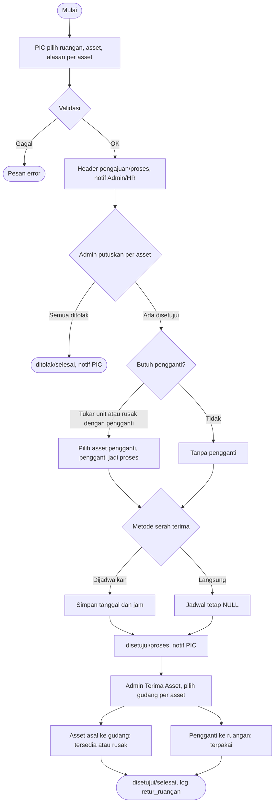
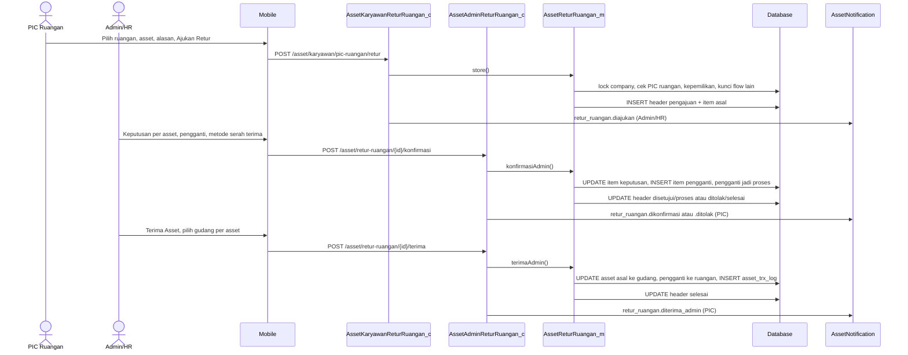
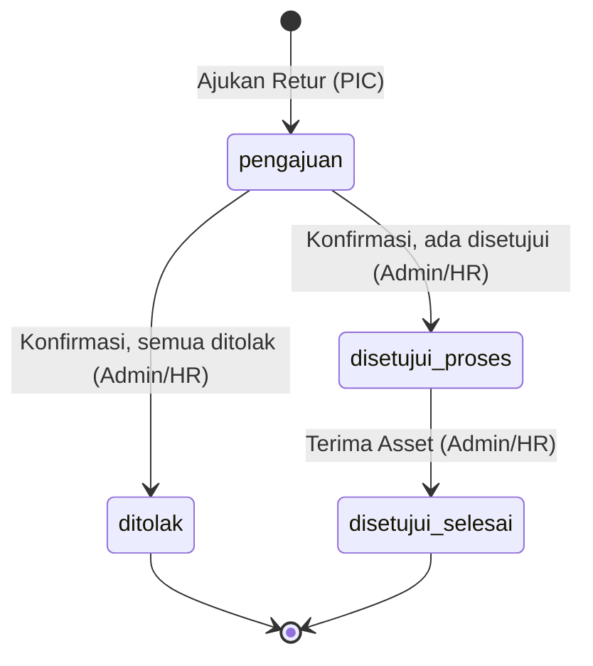
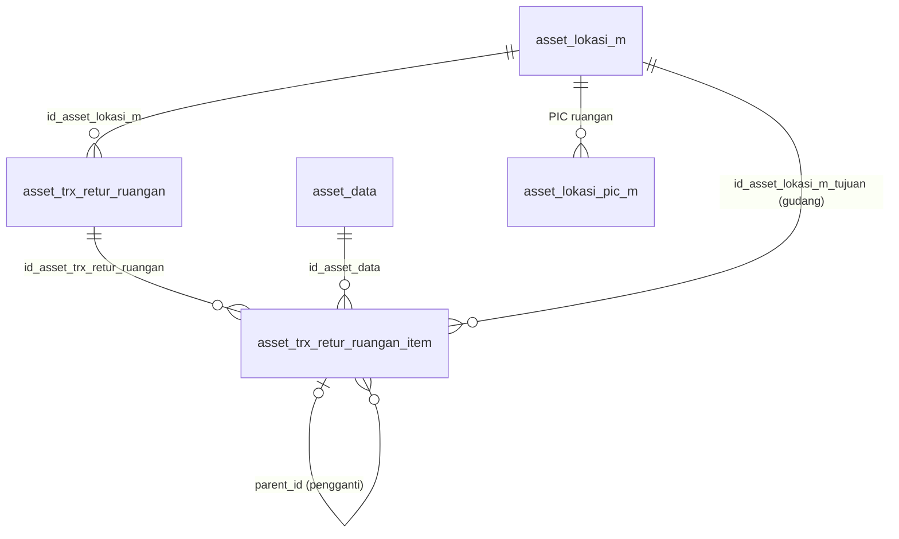

# Dokumentasi Teknis & Manual Book — Retur Asset Ruangan (ALK-RGN06)

> Dokumen ini disusun **dari source code lokal** (`API/` Lumen dan `MOBILE/` Flutter) per 15 Oktober 2026. **Tidak ada dokumen bisnis sumber** untuk fitur ini: persyaratan berasal dari permintaan pengguna agar alurnya **sama dengan Retur Asset Karyawan (KRY04)**, sehingga dokumen ini membandingkan RGN06 dengan KRY04, bukan dengan dokumen bisnis.
> Cakupan implementasi: **PIC Ruangan** mengajukan retur asset milik ruangannya; **Admin/HR** memutuskan per asset (+ asset pengganti), lalu menerima asset dengan memilih gudang tujuan per asset. Bagian yang tidak ditemukan ditandai **⚠️ Belum ditemukan**, asumsi ditandai **⚠️ Asumsi**.
> Contoh ID/nama pada payload adalah **data sintetis**.

---

## 1. Informasi Dokumen

| Informasi | Nilai |
|---|---|
| Nama Fitur | Retur Asset Ruangan (UI Admin: item **"Retur"** di dashboard Ruangan; UI PIC: tombol **"Retur Asset"** dan banner di halaman **"PIC Ruangan"**) |
| Kode Fitur | **ALK-RGN06** (nomor transaksi `RGN06-YYYYMMNNN`) |
| Modul | Asset Management — Ruangan |
| Backend | Laravel **Lumen ^10.0**, PHP ^8.1, JWT, Query Builder |
| Database | `API/diagram-asset.dbml` (tanda `[NEW ALK-RGN06]`) + SQL manual `Claude outputs/sql-alk-rgn06-retur-ruangan.sql` dan `Claude outputs/sql-alk-rgn06-no-trx-unik-per-company.sql` |
| Mobile | Flutter (`professional_flutter_3_35`), `flutter_bloc`, `dio` |
| Web | ⚠️ Belum ditemukan: tidak ada source web di workspace |
| Test otomatis | API `tests/Asset/AssetReturRuanganTest.php` (16 test, 269 assertion) · Mobile `test/asset/asset_retur_ruangan_test.dart` (25 test) |
| Versi dokumen | 1.0 — 15 Oktober 2026 |
| Dokumen terkait | Retur Asset Karyawan (KRY04), Onboarding Ruangan (ALK-RGN01), Penambahan Asset Ruangan (ALK-RGN04), Master Lokasi & PIC Ruangan |

## 2. Daftar Isi

Lihat panel navigasi di samping.

## 3. Quick Overview

**PIC Ruangan** mengajukan retur satu atau beberapa asset yang dipegang ruangannya, masing-masing dengan alasan (**rusak**, **tidak digunakan**, atau **tukar unit**). **Admin/HR** memutuskan **per asset** (setujui atau tolak), memilih **asset pengganti** dari gudang bila alasannya tukar unit atau rusak dengan pengganti, lalu menentukan metode serah terima (**dijadwalkan** atau **langsung**). Setelah serah terima fisik, Admin/HR menekan **Terima Asset** dan memilih **gudang tujuan untuk setiap asset**. Asset lama masuk gudang (`tersedia`, atau `rusak` bila alasannya rusak) dan asset pengganti menjadi `terpakai` di ruangan. **PIC tidak memiliki aksi terima** dan tidak ada aksi edit/batal pengajuan.

| Aspek | Ringkasan |
|---|---|
| Aktor | PIC Ruangan (mengajukan), Admin/HR (memutuskan dan menerima), Sistem |
| Transaksi utama | `asset_trx_retur_ruangan` (header) + `asset_trx_retur_ruangan_item` (item asal dan item pengganti lewat `parent_id`) |
| Alasan retur | `rusak` (tanpa/dengan pengganti), `tidak_digunakan`, `tukar_unit` |
| Status header | `status_approval`: `pengajuan` → `disetujui` atau `ditolak`; `status_transaksi`: `proses` → `selesai` |
| Tab daftar | Pengajuan (termasuk yang ditolak) · Dikonfirmasi · Diterima |
| Status asset | Asal: `terpakai`/ruangan → `tersedia` atau `rusak`/gudang. Pengganti: `tersedia` → `proses` → `terpakai`/ruangan |
| Log | `asset_trx_log` dengan `jenis_log = retur_ruangan` (bukan `asset_log`) |
| Endpoint | 9: 5 admin + 4 PIC |
| Notifikasi | 4 event (`retur_ruangan.*`) |

```text
PIC Ruangan: pilih ruangan + asset + alasan per asset → Ajukan Retur   [pengajuan / proses · notif Admin/HR]
   asset TIDAK dikunci di asset_data (dijaga lewat pengecekan retur aktif)
Admin/HR: Setujui / Tolak tiap asset (+ pengganti) + metode serah terima
   [disetujui / proses · notif PIC]      semua ditolak → [ditolak / selesai · notif PIC]
Admin/HR: Terima Asset (pilih gudang per asset)
   [disetujui / selesai · asset diperbarui · asset_trx_log · notif PIC]
```

## 4. Ringkasan Fitur

| Fitur | Aktor | Keterangan |
|---|---|---|
| Ajukan retur | PIC Ruangan | Pilih ruangan miliknya, asset ruangan itu, alasan per asset, catatan tambahan. Status `pengajuan`/`proses`. |
| Keputusan per asset | Admin/HR | Setujui atau tolak (alasan wajib). Asset yang butuh pengganti wajib diberi pengganti. |
| Asset pengganti | Admin/HR | Dipilih dari asset `tersedia` di gudang; langsung `proses` saat dikonfirmasi. |
| Metode serah terima | Admin/HR | **Dijadwalkan** (tanggal + jam) atau **Langsung** (tanpa jadwal). |
| Terima Asset | Admin/HR | Memilih gudang untuk setiap asset asal yang disetujui; finalisasi asset dan log. |
| Pantau retur | PIC Ruangan | Daftar 3 tab, detail hanya-baca, banner di halaman PIC Ruangan. |
| Ringkasan admin | Admin/HR | Panel "Retur Asset Ruangan Perlu Diproses" dan tile "Retur" di dashboard Ruangan. |

## 5. Tujuan Fitur

- Mengembalikan asset milik ruangan ke gudang secara terdokumentasi, dengan alasan per asset dan keputusan Admin/HR per asset.
- Menjamin asset pengganti (tukar unit atau rusak dengan pengganti) berpindah ke ruangan dalam satu transaksi serah terima.
- Mencatat gudang tujuan setiap asset yang kembali, kondisi akhir (tersedia atau rusak), pelaku, dan waktu.
- Memakai ulang alur dan layar KRY04 supaya perilaku dan tampilannya seragam.

## 6. Aktor

| Aktor | Peran |
|---|---|
| PIC Ruangan | Karyawan di `asset_lokasi_pic_m` untuk ruangan tersebut. Mengajukan retur, memantau status. **Tidak** menerima asset. |
| Admin/HR | Terdaftar di `asset_admin`. Memutuskan per asset, memilih pengganti, menetapkan metode serah terima, menerima asset dan memilih gudang. |
| Sistem | Memeriksa kepemilikan dan kunci lintas flow, mereservasi asset pengganti (`proses`), memperbarui `asset_data`, menulis log, mengirim notifikasi setelah transaksi sukses. |

## 7. Hak Akses

| Aksi | Admin/HR | PIC Ruangan | Keterangan |
|---|---|---|---|
| Lihat opsi pengganti, daftar, dan detail (admin) | ✔ | ✘ | `accessError` memeriksa `asset_admin`; selain admin mendapat `403 FORBIDDEN`. |
| Konfirmasi dan Terima Asset | ✔ | ✘ | Model juga memeriksa `findAssetAdmin`: "Pengguna tidak terdaftar sebagai admin asset." |
| Lihat opsi retur satu ruangan | ✘ | ✔ | Hanya PIC ruangan aktif tersebut; selain itu `403 FORBIDDEN`. |
| Ajukan retur | ✘ | ✔ | Hanya untuk ruangan yang PIC-nya pengaju. |
| Lihat daftar/detail | ✘ | ✔ | Dibatasi ke ruangan yang **saat ini** dipegang PIC (join `asset_lokasi_pic_m`). PIC lain mendapat `404 NOT_FOUND`. |
| Terima / edit / batal | ✘ | ✘ | ⚠️ Belum ditemukan untuk PIC: tidak ada route terima, edit, maupun batal. |

## 8. Terminologi

| Istilah | Arti |
|---|---|
| Ruangan | `asset_lokasi_m` bertipe `ruangan`, `status_aktif='1'`, punya PIC di `asset_lokasi_pic_m`. |
| Asset asal / item asal | Asset ruangan yang diretur; `parent_id` NULL. |
| Asset pengganti / item pengganti | Asset gudang yang dipilih Admin/HR; baris item dengan `parent_id` = id item asal. |
| `rusak_dengan_pengganti` | Hanya untuk alasan rusak: `1` tanpa pengganti, `2` dengan pengganti; selain itu `0`. |
| Dijadwalkan / Langsung | Metode serah terima. Dijadwalkan: `flag_jadwalkan='1'` + tanggal dan jam. Langsung: `flag_jadwalkan='0'`, jadwal NULL. |
| Terima Asset | Finalisasi oleh Admin/HR setelah serah terima fisik; status transaksi `selesai`. |
| Dikonfirmasi / Diterima | Label tab: `disetujui`+`proses` / `disetujui`+`selesai`. |

## 9. Business Rules

| No | Aturan | Implementasi |
|---|---|---|
| BR-01 | Retur hanya untuk ruangan aktif yang PIC-nya pengaju | `findRuanganPic`: tipe `ruangan`, `status_aktif='1'`, `asset_lokasi_pic_m.id_karyawan` = pengaju. Pesan: "Ruangan tidak ditemukan, tidak aktif, atau Anda bukan PIC ruangan ini." |
| BR-02 | Pengaju harus karyawan aktif | `findActiveKaryawan` → "Karyawan tidak ditemukan atau tidak aktif." |
| BR-03 | Hanya asset milik ruangan itu dan berstatus `terpakai` | `pemegang_asset='ruangan'` dan `id_asset_lokasi_m` = ruangan; bila tidak → "Satu atau beberapa asset bukan milik ruangan atau sudah tidak dapat diretur."; status ≠ `terpakai` → "Satu atau beberapa asset tidak berstatus terpakai dan tidak dapat diretur." |
| BR-04 | Minimal satu asset, tanpa duplikat | "Minimal satu asset wajib dipilih." / "Asset yang sama tidak boleh dipilih lebih dari sekali." |
| BR-05 | Aturan per alasan | Lihat tabel di bawah. |
| BR-06 | Asset tidak boleh sedang di flow lain | Retur ruangan aktif lain, onboarding ruangan `proses`, penambahan ruangan (RGN04) `proses`. ⚠️ Kerusakan/pemeliharaan ruangan belum ada model/API sehingga **belum dicek**. |
| BR-07 | Pengajuan tidak mengunci `asset_data` | Asset tetap `terpakai` sampai Terima Asset; penjagaan lewat `hasActiveReturRuanganAsset` dan penyaringan opsi. |
| BR-08 | Admin memutuskan seluruh item asal | "Seluruh asset retur wajib dikonfirmasi." Tolak wajib alasan; item ditolak tidak boleh memiliki pengganti. |
| BR-09 | Asset masih dipegang ruangan saat konfirmasi dan terima | "Satu atau beberapa asset sudah tidak dipegang oleh ruangan." |
| BR-10 | Asset pengganti | Wajib untuk tukar unit dan rusak dengan pengganti, dilarang untuk alasan lain, unik, harus `tersedia` @gudang (`getLockedAssets`, `FOR UPDATE`). Tidak ada syarat kategori sama. |
| BR-11 | Metode serah terima wajib bila ada asset disetujui | `dijadwalkan` wajib tanggal + jam, tanggal ≥ tanggal pengajuan. |
| BR-12 | Hasil keputusan | ≥ 1 disetujui → `disetujui`/`proses`; semua ditolak → `ditolak`/`selesai` dengan `ket_tolak` "Seluruh asset retur ditolak." |
| BR-13 | Terima Asset hanya oleh Admin/HR dan wajib memilih gudang per asset | Hanya untuk `disetujui`+`proses`; tiap item asal yang disetujui dipetakan tepat satu kali ke lokasi bertipe `gudang` pada company yang sama. |
| BR-14 | Dampak finalisasi | Asal → gudang (`tersedia` atau `rusak`+`ket_rusak`); pengganti → `terpakai` @ruangan; log `retur_ruangan`; header `selesai`. Item yang ditolak **tetap di ruangan**. |
| BR-15 | Penomoran dan keunikan | ID `id_company`+`YYYYMM`+3 digit; `no_trx` `RGN06-YYYYMMNNN`, unik **per company** (`uq_retur_rgn_company_no_trx`). |
| BR-16 | PIC tidak menerima, mengubah, atau membatalkan | Tidak ada route untuk itu. |

Aturan per alasan (BR-05):

| Alasan | `rusak_dengan_pengganti` | `ket_retur` | Pengganti |
|---|---|---|---|
| `rusak` | wajib 1 atau 2 ("Asset rusak wajib memilih tanpa atau dengan pengganti.") | wajib ("Keterangan kerusakan asset wajib diisi.") | wajib bila 2 |
| `tidak_digunakan` | dipaksa 0 | opsional | tidak boleh |
| `tukar_unit` | dipaksa 0 | wajib ("Alasan tukar unit wajib diisi.") | wajib |

## 10. Business Flow

```text
1. PIC Ruangan: PIC Ruangan → Retur Asset → (+) Ajukan Retur Asset Ruangan
   → pilih Ruangan → Tambah Retur Asset (hanya asset ruangan itu yang bebas dari flow lain)
   → per asset: Alasan Retur Asset → (Rusak: Tanpa/Dengan Pengganti) → Keterangan
   → Catatan Tambahan → Ajukan Retur            [pengajuan/proses · notif Admin/HR]
2. Admin/HR: Ruangan → Retur → tab Pengajuan → Detail
   → per asset: Tolak (+alasan) / Setujui / Ganti Asset (pilih pengganti)
   → Konfirmasi Asset → sheet: Dijadwalkan (tanggal + jam) / Serahkan Langsung, Catatan → Submit
                                                [disetujui/proses atau ditolak/selesai · notif PIC]
3. Serah terima fisik sesuai jadwal atau langsung
4. Admin/HR: Detail → Terima Asset → dialog Lokasi Tujuan Asset (gudang per asset)
                                                [disetujui/selesai · asset diperbarui · log · notif PIC]
```

## 11. Flow Berdasarkan Role

| Role | Langkah |
|---|---|
| PIC Ruangan | Ajukan → (tunggu keputusan) → lihat status di banner dan detail → serahkan asset sesuai jadwal atau langsung → selesai saat Admin/HR menekan Terima Asset. |
| Admin/HR | Tab Pengajuan → keputusan per asset → Konfirmasi Asset → (tab Dikonfirmasi) setelah serah terima fisik → Terima Asset + gudang per asset. |
| Sistem | Memeriksa kepemilikan dan kunci lintas flow, mereservasi pengganti, memperbarui asset dan log, mengirim notifikasi. |

## 12. Flow Diagram



## 13. Sequence Diagram



## 14. Status Transaksi

Header memiliki **dua** kolom status: `status_approval` (enum `status_approval_retur`: `pengajuan`, `disetujui`, `ditolak`, `proses`, `serah_terima`) dan `status_transaksi` (enum `status`: `proses`, `selesai`).

| status_approval | status_transaksi | Label | Tab | Arti | Aksi berikutnya |
|---|---|---|---|---|---|
| `pengajuan` | `proses` | Menunggu Konfirmasi | pengajuan | Menunggu Admin/HR | Admin/HR: konfirmasi |
| `ditolak` | `selesai` | Ditolak | pengajuan | Semua asset ditolak | – |
| `disetujui` | `proses` | Dikonfirmasi | dikonfirmasi | Menunggu serah terima dan Terima Asset | Admin/HR: Terima Asset |
| `disetujui` | `selesai` | Selesai (mobile: "Diterima") | diterima | Serah terima selesai | – |
| `proses` / `serah_terima` | – | Diperlakukan seperti `disetujui` | – | ⚠️ Nilai enum ada, tetapi **tidak pernah di-set** oleh kode | – |

Status item (`status_approval` item, enum `approval_item`): NULL (belum ditinjau) → `disetujui` / `ditolak`. Item pengganti langsung `disetujui`.

## 15. State Transition



| Status awal | Aksi | Status akhir | Aktor |
|---|---|---|---|
| – | Ajukan Retur | pengajuan / proses | PIC Ruangan |
| pengajuan / proses | Konfirmasi, semua ditolak | ditolak / selesai | Admin/HR |
| pengajuan / proses | Konfirmasi, ≥ 1 disetujui | disetujui / proses | Admin/HR |
| disetujui / proses | Terima Asset | disetujui / selesai | Admin/HR |

## 16. Struktur Database

| Tabel | Fungsi |
|---|---|
| `asset_trx_retur_ruangan` | Header transaksi: snapshot ruangan dan PIC, jadwal serah terima, status. |
| `asset_trx_retur_ruangan_item` | Satu baris per asset asal; baris pengganti memakai `parent_id` = id item asal. |
| `asset_trx_log` | Diperluas: nilai enum `jenis_log` ditambah `retur_ruangan`. |

SQL manual: `sql-alk-rgn06-retur-ruangan.sql` (guard, 2 tabel, `ALTER` enum `jenis_log`, verifikasi, rollback) dan `sql-alk-rgn06-no-trx-unik-per-company.sql` (mengganti unique global `uq_retur_rgn_no_trx` menjadi per company). Skrip pertama **sudah dijalankan pengguna**; skrip kedua **perlu dijalankan/dikonfirmasi** (status eksekusi belum dikonfirmasi pengguna).

## 17. Relasi Database



PIC pada header disimpan sebagai `id_karyawan_pic` (snapshot `nama_pic`, `nik_pic`). Hak akses lihat/daftar dihitung dari master `asset_lokasi_pic_m` **saat ini**, bukan dari snapshot. `parent_id` pada item **tidak** memakai foreign key (hanya kolom referensi).

## 18. Data Dictionary

**`asset_trx_retur_ruangan`**

| Kolom | Tipe | Keterangan |
|---|---|---|
| `id_asset_trx_retur_ruangan` | varchar(50) PK | `id_company` + `YYYYMM` + 3 digit urut |
| `no_trx` | varchar(50) | `RGN06-YYYYMMNNN`; unik bersama `id_company` |
| `id_asset_lokasi_m` | varchar(50) FK, NULL | Ruangan (FK ke `asset_lokasi_m`) |
| `nama_asset_ruangan`, `nama_cabang`, `nama_departemen` | varchar(255) | Snapshot saat transaksi |
| `id_karyawan_pic`, `nama_pic`, `nik_pic` | varchar | PIC pengaju; dasar notifikasi |
| `keterangan` | text | Catatan tambahan PIC |
| `ket_tolak` | varchar(255) | "Seluruh asset retur ditolak." bila semua ditolak |
| `id_karyawan`, `nik_karyawan`, `nama_karyawan` | varchar | Pembuat transaksi (PIC Ruangan) |
| `tgl_pengajuan` | date | Tanggal hari ini |
| `tgl_pengambilan`, `jam_pengambilan` | date / time, **NULL** | Jadwal serah terima bila `flag_jadwalkan='1'` |
| `flag_jadwalkan` | enum(`0`,`1`) | `1` dijadwalkan, `0` serah langsung (default `0`) |
| `tgl_serah_terima`, `jam_serah_terima` | date / time, **NULL** | Diisi saat Terima Asset |
| `keterangan_serah_terima` | varchar(255) | Catatan Admin/HR (dipotong 255) |
| `status_approval` | enum(`pengajuan`,`disetujui`,`ditolak`,`proses`,`serah_terima`) | Default `pengajuan` |
| `status_transaksi` | enum(`proses`,`selesai`) | Default `proses` |
| `user_approval`, `tgl_approval` | varchar / timestamp NULL | Admin/HR pemutus dan waktunya |
| `id_company`, `tgl_input`, `user_input`, `tgl_update`, `user_update` | | Audit standar |

**`asset_trx_retur_ruangan_item`**

| Kolom | Tipe | Keterangan |
|---|---|---|
| `id_asset_trx_retur_ruangan_item` | varchar(50) PK | `id_company` + `YYYYMM` + 3 digit urut |
| `parent_id` | varchar(50), NULL | NULL = item asal; id item asal = item pengganti |
| `id_asset_trx_retur_ruangan` | varchar(50) FK | Header |
| `id_asset_data` | varchar(50) FK | Asset |
| `nama_asset`, `deskripsi_asset`, `kategori_asset` | varchar(255) | Snapshot |
| `status_approval` | enum(`disetujui`,`ditolak`), NULL | NULL sebelum direview |
| `ket_tolak` | varchar(255) | Wajib bagi item ditolak |
| `alasan_retur` | enum(`tukar_unit`,`rusak`,`tidak_digunakan`) | Default `rusak` |
| `rusak_dengan_pengganti` | int(1) | 0 / 1 tanpa pengganti / 2 dengan pengganti |
| `ket_retur` | varchar(255) | Keterangan kerusakan / alasan tukar unit / tidak digunakan |
| `id_asset_lokasi_m_tujuan` | varchar(50) FK, NULL | Gudang tujuan item asal; NULL sebelum diterima |
| `id_company`, `tgl_input`, `user_input` | | Audit |

## 19. Database Index

Nama index di SQL manual (DBML mendefinisikan kolom yang sama dengan nama otomatis, kecuali unique yang diberi nama).

| Tabel | Index | Kegunaan |
|---|---|---|
| `asset_trx_retur_ruangan` | unik `uq_retur_rgn_company_no_trx (id_company, no_trx)` | Nomor transaksi unik per company |
| | `atrr_admin_list_idx (id_company, status_approval, status_transaksi, tgl_input, id_asset_trx_retur_ruangan)` | Daftar admin per tab |
| | `atrr_pic_list_idx (id_company, id_karyawan_pic, status_approval, status_transaksi)` | Daftar PIC |
| | `atrr_lokasi_idx (id_company, id_asset_lokasi_m, status_approval, status_transaksi)` | Pencarian per ruangan |
| `asset_trx_retur_ruangan_item` | `atrri_status_idx (id_asset_trx_retur_ruangan, id_company, status_approval, parent_id, id_asset_data)` | Item per header dan pengganti |
| | `atrri_asset_idx (id_asset_data)` | Pengecekan retur aktif per asset |
| | `atrri_lokasi_tujuan_idx (id_asset_lokasi_m_tujuan)` | FK gudang tujuan |

Foreign key: `fk_atrr_retur_id_asset_lokasi_m`, `fk_atrri_retur_header`, `fk_atrri_retur_asset_data`, `fk_atrri_retur_lokasi_tujuan`.

## 20. Backend Architecture

| Lapisan | File |
|---|---|
| Route | `API/routes/modules/asset/RouteAsset.php` (grup `retur-ruangan` dan `karyawan/pic-ruangan/retur*`) |
| Controller Admin | `app/Http/Controllers/Asset/Admin/AssetAdminReturRuangan_c.php` |
| Controller PIC | `app/Http/Controllers/Asset/Karyawan/AssetKaryawanReturRuangan_c.php` |
| Model | `app/Models/Asset/AssetReturRuangan_m.php` (mewarisi `Asset_m`; opsi admin memakai ulang `AssetReturKaryawan_m::getAdminOptions`) |
| Notifikasi | `app/Support/Asset/AssetNotification.php` (event `retur_ruangan.*`) |
| Pendukung | `AssetAdmin_m` (summary `ruangan_retur_*`), `AssetLokasiPic_m::getAssetRuanganSaya` (key `retur_ruangan` di beranda PIC), helper `Asset_m` (`getLockedAssets`, `resolveItemLocations`, `warehouseLocations`) |

Controller memvalidasi input, memanggil model dalam `DB::transaction` (model), lalu mengirim notifikasi **setelah** transaksi sukses. Pengecualian `InvalidArgumentException` menjadi `BUSINESS_RULE_VIOLATION`; `Throwable` lain menjadi `SYSTEM_ERROR` dan dicatat di log.

## 21. Backend Business Logic

- **`getOptionsPic`**: memastikan karyawan PIC ruangan aktif tersebut (null → 403). Mengembalikan `ruangan`, daftar `assets` (milik ruangan, `terpakai`, belum terkunci retur/onboarding/penambahan ruangan, urut nama lalu kode), dan `alasan`.
- **`store`**: kunci company; validasi karyawan aktif, PIC ruangan, `normalizeItems` (BR-04, BR-05); asset dikunci `FOR UPDATE`; cek milik ruangan, kunci flow lain, status `terpakai`; buat header `pengajuan`/`proses` (jadwal NULL, `flag_jadwalkan='0'`) dan item asal. `asset_data` **tidak** diubah.
- **`konfirmasiAdmin`**: kunci company; cek admin; header harus `pengajuan`/`proses`; seluruh item asal wajib diputuskan; asset asal masih dipegang ruangan; validasi pengganti dan jadwal; update status item; sisipkan item pengganti (`parent_id`, `status_approval='disetujui'`) dan set aset pengganti `proses`; update header (`disetujui`/`proses` atau `ditolak`/`selesai`).
- **`terimaAdmin`**: kunci company; cek admin; header harus `disetujui`/`proses`; `resolveItemLocations` memetakan gudang per item asal yang disetujui; cek asal masih dipegang ruangan dan pengganti masih `proses` @gudang; update asset, `id_asset_lokasi_m_tujuan`, sisipkan `asset_trx_log`, header `selesai` dengan `tgl/jam_serah_terima` = sekarang.
- **Daftar dan detail**: `getPageAdmin`, `getPagePic` (filter PIC lewat `wherePicRuangan`), `getDetail`, `getDetailAdmin` (menambah `lokasi_gudang`).
- **Ringkasan**: `countPendingForAdmin`, `getPendingForAdmin` (maks. 3, terlama di atas), `getPerluTindakanPic` (maks. 50, `proses` dan bukan `ditolak`).

## 22. Dampak terhadap asset_data

| Tahap | Asset | `status_asset` | `pemegang_asset` | Catatan |
|---|---|---|---|---|
| Pengajuan | asal | tetap `terpakai` | `ruangan` | Tidak dikunci; dijaga lewat pengecekan retur aktif |
| Konfirmasi (disetujui) | asal | tetap `terpakai` | `ruangan` | Belum berubah |
| Konfirmasi | pengganti | `tersedia` → `proses` | `gudang` | Direservasi |
| Konfirmasi (ditolak) | asal | tidak berubah | `ruangan` | Tetap di ruangan |
| Terima Asset | asal, alasan tidak digunakan / tukar unit / rusak | → `tersedia` | `gudang` | `id_pemegang_asset=''`, `id_asset_lokasi_m` = gudang pilihan admin, `ket_rusak=''` |
| Terima Asset | asal, alasan rusak | → `rusak` | `gudang` | `ket_rusak` = `ket_retur`; lokasi = gudang pilihan |
| Terima Asset | pengganti | `proses` → `terpakai` | `ruangan` | `id_pemegang_asset` = `id_asset_lokasi_m` = id ruangan |
| Semua ditolak | – | tidak berubah | – | Tidak ada asset yang berpindah |

## 23. API Documentation

Base `asset/`. Semua memakai JWT dan envelope `ApiResponse`.

| ID | Method | Path | Peran | Fungsi |
|---|---|---|---|---|
| API-01 | GET | `retur-ruangan/options` | Admin | Opsi asset pengganti (asset `tersedia` @gudang) dan kategori |
| API-02 | GET | `retur-ruangan?tab&limit&offset` | Admin | Daftar (`pengajuan`/`dikonfirmasi`/`diterima`) |
| API-03 | GET | `retur-ruangan/{id}` | Admin | Detail + `lokasi_gudang[]` |
| API-04 | POST | `retur-ruangan/{id}/konfirmasi` | Admin | Keputusan per asset, pengganti, metode serah terima |
| API-05 | POST | `retur-ruangan/{id}/terima` | Admin | Terima Asset + gudang per asset |
| API-06 | GET | `karyawan/pic-ruangan/retur/options?id_asset_lokasi_m` | PIC | Asset dan alasan untuk satu ruangan |
| API-07 | GET | `karyawan/pic-ruangan/retur?tab&limit&offset` | PIC | Daftar milik PIC |
| API-08 | POST | `karyawan/pic-ruangan/retur` | PIC | Ajukan retur |
| API-09 | GET | `karyawan/pic-ruangan/retur/{id}` | PIC | Detail (tanpa `lokasi_gudang`) |

Tambahan pada endpoint lain: `GET karyawan/pic-ruangan` (beranda PIC) memuat key `retur_ruangan` dan `ruangan[]` (dipakai form untuk memilih ruangan); `GET summary` (admin) memuat `ruangan_retur_perlu_proses` dan `ruangan_retur_pending`.

## 24. Detail Setiap API

Header umum: `Authorization: Bearer <token>`, `Content-Type: application/json`. Format `{ code, message, data }`.

**API-08 · POST `asset/karyawan/pic-ruangan/retur`** (PIC)

```json
{
  "id_asset_lokasi_m": "RGN-1",
  "keterangan": "Renovasi ruangan",
  "items": [
    { "id_asset_data": "AST-1", "alasan_retur": "rusak", "rusak_dengan_pengganti": 2, "ket_retur": "Layar pecah" },
    { "id_asset_data": "AST-2", "alasan_retur": "tidak_digunakan", "rusak_dengan_pengganti": 0, "ket_retur": "" },
    { "id_asset_data": "AST-3", "alasan_retur": "tukar_unit", "rusak_dengan_pengganti": 0, "ket_retur": "Perlu spek lebih tinggi" }
  ]
}
```

Respons `CREATED` ("Pengajuan retur asset ruangan berhasil dikirim."):

```json
{ "code": "CREATED", "message": "Pengajuan retur asset ruangan berhasil dikirim.",
  "data": { "id": "COMP202610001", "no_trx": "RGN06-202610001", "status_approval": "pengajuan",
            "status_transaksi": "proses", "status_label": "Menunggu Konfirmasi", "tab": "pengajuan" } }
```

| Field | Aturan | Pesan |
|---|---|---|
| `id_asset_lokasi_m` | required, string, max 50 | Ruangan wajib dipilih. |
| `keterangan` | nullable string | – |
| `items` | required, array, min 1 | Minimal satu asset wajib dipilih. |
| `items.*.id_asset_data` | required, max 50, distinct | Asset retur wajib dipilih. / Asset yang sama tidak boleh dipilih lebih dari sekali. |
| `items.*.alasan_retur` | required, in `rusak,tidak_digunakan,tukar_unit` | Alasan retur setiap asset wajib dipilih. / Alasan retur asset tidak valid. |
| `items.*.rusak_dengan_pengganti` | nullable integer in 0,1,2 | Pilihan pengganti asset rusak tidak valid. |
| `items.*.ket_retur` | nullable, max 255 | Keterangan retur maksimal 255 karakter. |

Pesan umum validasi: "Data retur asset ruangan belum lengkap." Aturan model tambahan: §9 (BR-01 sampai BR-06). Database impact: `INSERT` header, `INSERT` item, `INSERT notif_data`; tanpa `UPDATE asset_data`.

**API-06 · GET `asset/karyawan/pic-ruangan/retur/options?id_asset_lokasi_m=RGN-1`** (PIC)

```json
{ "code": "SUCCESS", "message": "Opsi retur asset ruangan berhasil ditemukan.",
  "data": {
    "ruangan": { "id_asset_lokasi_m": "RGN-1", "nama_ruangan": "Ruang Finance Lt.2", "cabang": "Pusat", "divisi": "Finance" },
    "assets": [
      { "id_asset_data": "AST-1", "kode_asset": "KOM-0001", "nama_asset": "Komputer R1",
        "kategori_asset": "Komputer", "merek": "MerekX", "deskripsi": "" } ],
    "alasan": [
      { "value": "rusak", "label": "Asset Rusak" },
      { "value": "tidak_digunakan", "label": "Asset Tidak Digunakan" },
      { "value": "tukar_unit", "label": "Tukar Unit" } ] } }
```

`id_asset_lokasi_m` kosong → 422 ("Ruangan wajib dipilih."). Bukan PIC ruangan, ruangan nonaktif, atau lokasi bertipe gudang → 403 `FORBIDDEN` ("Ruangan tidak ditemukan, tidak aktif, atau Anda bukan PIC ruangan ini."). Key alasan di respons adalah `alasan` (bukan `alasan_retur` seperti retur karyawan).

**API-02 / API-07 · Daftar**

```http
GET /asset/retur-ruangan?tab=pengajuan&limit=20&offset=0                 (admin)
GET /asset/karyawan/pic-ruangan/retur?tab=dikonfirmasi                   (PIC)
```

`tab`: `pengajuan` | `dikonfirmasi` | `diterima` ("Filter retur asset ruangan tidak valid."); `limit` 1–50 ("Limit maksimal adalah 50 data."). Pesan umum: "Parameter daftar retur asset ruangan tidak valid."

```json
{ "code": "SUCCESS", "message": "Data retur asset ruangan berhasil ditemukan.",
  "data": {
    "filters": [ {"value":"pengajuan","label":"Pengajuan"}, {"value":"dikonfirmasi","label":"Dikonfirmasi"}, {"value":"diterima","label":"Diterima"} ],
    "records": [ {
      "id": "COMP202610001", "no_trx": "RGN06-202610001", "tgl_pengajuan": "2026-10-15",
      "tgl_pengambilan": "2026-10-20", "jam_pengambilan": "09:00:00", "flag_jadwalkan": "1",
      "tgl_serah_terima": "", "jam_serah_terima": "",
      "status_approval": "disetujui", "status_transaksi": "proses", "status_label": "Dikonfirmasi",
      "tab": "dikonfirmasi", "ket_tolak": "", "jumlah_asset": 3,
      "ruangan": { "id_asset_lokasi_m": "RGN-1", "nama_ruangan": "Ruang Finance Lt.2", "cabang": "Pusat", "divisi": "Finance" },
      "pic": { "id_karyawan": "PIC-1", "nik": "111", "nama": "Pic Satu" } } ],
    "pagination": { "limit": 20, "offset": 0, "next_offset": 1, "has_more": false } } }
```

Tanggal/jam yang NULL ditampilkan sebagai string kosong `""`.

**API-03 / API-09 · Detail**

```json
{
  "id": "COMP202610001", "no_trx": "RGN06-202610001", "tgl_pengajuan": "2026-10-15",
  "keterangan": "Renovasi ruangan", "ket_tolak": "",
  "tgl_pengambilan": "", "jam_pengambilan": "", "flag_jadwalkan": "0",
  "tgl_serah_terima": "", "jam_serah_terima": "", "keterangan_serah_terima": "",
  "status_approval": "disetujui", "status_transaksi": "proses", "status_label": "Dikonfirmasi",
  "tab": "dikonfirmasi", "jumlah_asset": 1,
  "ruangan": { "id_asset_lokasi_m": "RGN-1", "nama_ruangan": "Ruang Finance Lt.2", "cabang": "Pusat", "divisi": "Finance" },
  "pic": { "id_karyawan": "PIC-1", "nik": "111", "nama": "Pic Satu" },
  "items": [ {
    "id_item": "COMP202610011", "parent_id": "", "id_asset_data": "AST-1", "kode_asset": "KOM-0001",
    "nama_asset": "Komputer R1", "kategori_asset": "Komputer", "merek": "MerekX", "deskripsi": "",
    "status_item": "disetujui", "ket_tolak": "",
    "alasan_retur": "rusak", "alasan_label": "Asset Rusak", "rusak_dengan_pengganti": 2, "ket_retur": "Layar pecah",
    "id_asset_lokasi_m_tujuan": "", "nama_lokasi_tujuan": "",
    "asset_pengganti": { "id_item": "COMP202610012", "parent_id": "COMP202610011", "id_asset_data": "AST-9",
                         "kode_asset": "KOM-0009", "nama_asset": "Komputer Gudang", "status_item": "disetujui" } } ]
}
```

Item pengganti tidak muncul di `items[]` utama, melainkan di `asset_pengganti` (objek item dengan field yang sama; `null` bila tidak ada). Khusus admin (API-03) ditambah `lokasi_gudang[]` (`id_asset_lokasi_m`, `nama_lokasi`, `id_cabang`). 404 `NOT_FOUND`: "Retur asset ruangan tidak ditemukan."

**API-04 · POST `asset/retur-ruangan/{id}/konfirmasi`** (Admin)

```json
{
  "items": [
    { "id_item": "COMP202610011", "status_item": "disetujui", "ket_tolak": "", "id_asset_pengganti": "AST-9" },
    { "id_item": "COMP202610013", "status_item": "ditolak", "ket_tolak": "Masih dipakai" }
  ],
  "metode_serah_terima": "dijadwalkan",
  "tgl_pengambilan": "2026-10-20",
  "jam_pengambilan": "09:00",
  "keterangan_serah_terima": "Bawa kabel daya"
}
```

| Field | Aturan | Pesan |
|---|---|---|
| `items` | required, array, min 1 | Keputusan asset retur wajib diisi. |
| `items.*.id_item` | required, max 50, distinct | Asset retur yang sama tidak boleh dikirim lebih dari sekali. |
| `items.*.status_item` | required, in `disetujui,ditolak` | Keputusan setiap asset wajib dipilih. / Keputusan asset harus disetujui atau ditolak. |
| `items.*.ket_tolak` | nullable, max 255, wajib bila ditolak | Alasan penolakan asset wajib diisi. |
| `items.*.id_asset_pengganti` | nullable, max 50, distinct | Asset pengganti yang sama tidak boleh dipilih lebih dari sekali. |
| `metode_serah_terima` | nullable, in `dijadwalkan,langsung` (wajib di model bila ada yang disetujui) | Metode serah terima retur tidak valid. |
| `tgl_pengambilan` | `Y-m-d`, wajib bila dijadwalkan | Tanggal serah terima wajib diisi. / Format tanggal serah terima harus YYYY-MM-DD. |
| `jam_pengambilan` | `H:i`, wajib bila dijadwalkan | Jam serah terima wajib diisi. / Format jam serah terima harus HH:MM. |
| `keterangan_serah_terima` | nullable, max 255 | – |

Pesan umum: "Data konfirmasi retur asset ruangan belum lengkap." Database impact: `UPDATE` item (`status_approval`, `ket_tolak`), `INSERT` item pengganti (`parent_id`), `UPDATE asset_data` pengganti → `proses`, `UPDATE` header, `INSERT notif_data`.

```json
{ "code": "UPDATED", "message": "Retur asset ruangan berhasil dikonfirmasi.",
  "data": { "id": "COMP202610001", "no_trx": "RGN06-202610001", "status_approval": "disetujui",
            "status_transaksi": "proses", "status_label": "Dikonfirmasi", "tab": "dikonfirmasi",
            "jumlah_disetujui": 1, "jumlah_ditolak": 1, "jumlah_pengganti": 1 } }
```

Semua ditolak: pesan "Retur asset ruangan berhasil ditolak.", `status_approval` `ditolak`, `status_transaksi` `selesai`, event notifikasi `retur_ruangan.ditolak`.

**API-05 · POST `asset/retur-ruangan/{id}/terima`** (Admin)

```json
{ "items": [
    { "id_asset_trx_retur_item": "COMP202610011", "id_asset_lokasi_m": "GDG-1" },
    { "id_asset_trx_retur_item": "COMP202610014", "id_asset_lokasi_m": "GDG-2" } ] }
```

| Field | Aturan | Pesan |
|---|---|---|
| `items` | required, array, min 1 | Lokasi gudang tujuan setiap asset wajib dipilih. |
| `items.*.id_asset_trx_retur_item` | required, max 50, distinct | – |
| `items.*.id_asset_lokasi_m` | required, max 50 | Lokasi gudang tujuan wajib dipilih. |

Pesan umum: "Data penerimaan retur belum lengkap." Item yang dikirim harus **tepat sama** dengan item asal yang disetujui. Database impact: `UPDATE asset_data` (asal dan pengganti), `UPDATE` item (`id_asset_lokasi_m_tujuan`), `INSERT asset_trx_log`, `UPDATE` header, `INSERT notif_data`.

```json
{ "code": "UPDATED", "message": "Retur asset ruangan berhasil diterima.",
  "data": { "id": "COMP202610001", "no_trx": "RGN06-202610001", "status_approval": "disetujui",
            "status_transaksi": "selesai", "status_label": "Selesai", "tab": "diterima",
            "jumlah_diterima": 2, "jumlah_pengganti": 1 } }
```

**API-01 · GET `asset/retur-ruangan/options`** (Admin): mengembalikan data yang sama dengan opsi admin retur karyawan (`kategori_asset[]` dan `assets[]` asset `tersedia` @gudang) karena memanggil `AssetReturKaryawan_m::getAdminOptions`. Pesan: "Opsi retur asset ruangan berhasil ditemukan."

**Ringkasan admin dan beranda PIC (bukan endpoint baru)**: `GET summary` → `ruangan_retur_perlu_proses` (jumlah) dan `ruangan_retur_pending[]` (`id`, `no_trx`, `nama_asset`, `nama_ruangan`, `nama_karyawan`, `status_approval`); `GET karyawan/pic-ruangan` → `retur_ruangan[]` (bentuk sama dengan `records[]`).

## 25. Mobile Architecture

Halaman retur karyawan **dipakai ulang lewat parameter `untukRuangan`**, supaya kode tidak digandakan.

| Komponen | Cara pakai ulang |
|---|---|
| `AssetReturApi(base: AssetReturApi.picRuanganBase)` | Basis `asset/karyawan/pic-ruangan/retur`; metode baru `getOptionsRuangan(id)` dan `getRuanganPic()` (membaca `ruangan[]` dari beranda PIC) |
| `AssetReturAdminApi(base: AssetReturAdminApi.ruanganBase)` | Basis `asset/retur-ruangan` |
| `AssetReturBloc` | Event baru `LoadAssetReturRuangan`; `LoadAssetReturOptions(idAssetLokasi)` memuat opsi satu ruangan; state `ruangan`, `ruanganLoaded` |
| `HalamanAssetRetur(untukRuangan:)` | Daftar 3 tab dan kartu menampilkan nama ruangan |
| `HalamanTambahAssetRetur(untukRuangan:)` | Form dengan pemilih ruangan (PIC satu ruangan: dipilih otomatis) |
| `HalamanDetailAssetRetur(untukRuangan:)` | Detail PIC hanya-baca + kartu `AssetReturRuanganCard` |
| `HalamanAssetAdminRetur(untukRuangan:)`, `HalamanAssetAdminDetailRetur(untukRuangan:)` | Daftar dan detail Admin/HR; sheet konfirmasi dan dialog gudang dipakai bersama |
| `AssetReturRuanganCard` | Kartu "Data Ruangan" (ruangan, PIC, cabang, divisi), pengganti kartu data karyawan |

File: model `Repository/Model/Asset/mAssetRetur.dart` (`AssetReturRuangan`, `AssetReturRecord.ruangan/pic/untukRuangan`), `mAssetSummary.dart` (`ruanganReturPerluProses`, `ruanganReturPending`), `mAssetPicRuangan.dart` (`returRuangan`); API `Repository/Service/assetReturApi.dart`, `assetReturAdminApi.dart`; bloc `Bloc/Asset/AssetReturBloc.dart`; UI `UI/Modul/Asset/AssetSaya/Retur/*`, `UI/Modul/Asset/AssetAdmin/AssetAdminKaryawan/Retur/*`, `UI/Modul/Asset/Shared/Widgets/AssetReturRuanganCard.dart`, `UI/Modul/Asset/PicRuangan/HalamanAssetPicRuangan.dart`, `UI/Modul/Asset/AssetAdmin/AssetAdminRuangan/HalamanAssetAdminRuangan.dart`.

## 26. Mobile Screen

| Layar | Rute | Pengguna |
|---|---|---|
| PIC Ruangan: tombol **Retur Asset** + banner retur | `/asset_pic_ruangan` | PIC |
| Daftar retur (3 tab); dari notifikasi dengan id langsung ke detail | `/asset_pic_ruangan_retur` | PIC |
| Form Ajukan Retur Asset Ruangan | `/asset_pic_ruangan_tambah_retur` | PIC |
| Detail retur (hanya-baca) | `/asset_pic_ruangan_detail_retur` | PIC |
| Dashboard Ruangan → tile **Retur** dan panel "Retur Asset Ruangan Perlu Diproses" | halaman Asset Admin Ruangan | Admin/HR |
| Daftar retur ruangan (3 tab) | `/asset_admin_retur_ruangan` | Admin/HR |
| Detail retur + keputusan + Terima Asset | `/asset_admin_detail_retur_ruangan` | Admin/HR |

**Form PIC.** Dropdown **Ruangan** (dari `ruangan[]` beranda PIC; satu ruangan dipilih otomatis; bila kosong tampil pemberitahuan "Tidak ada ruangan yang dapat diretur."), lalu **Pilih Asset yang Diretur** → picker. Mengganti ruangan membuang asset terpilih dan memuat asset ruangan baru. Per asset: **Alasan Retur Asset**, pilihan **Tanpa/Dengan Pengganti** (bila rusak), **Keterangan**. Lalu **Catatan Tambahan** dan tombol **Ajukan Retur**.

**Detail.** Kartu info (nomor, tanggal, status, catatan, alasan penolakan, jadwal), `AssetAlurStepper.retur`, kartu timeline per aset, kartu **Data Ruangan**, daftar asset retur (alasan, keputusan, pengganti, gudang tujuan). Admin pada status `pengajuan` melihat tombol keputusan per asset; pada `disetujui`/`proses` melihat **Terima Asset**. PIC hanya melihat pemberitahuan serah terima (jadwal atau langsung).

**Beranda PIC.** Tombol **Retur Asset** dan banner untuk retur berjalan ("Menunggu konfirmasi Admin/HR" atau jumlah asset menunggu serah terima + jadwal). **Dashboard Admin Ruangan.** Panel ringkasan memakai `ruangan_retur_*`.

## 27. Mobile → API

| Aksi di layar | Pemanggilan |
|---|---|
| Buka form retur (PIC) | `getRuanganPic()` → `GET karyawan/pic-ruangan`; pilih ruangan → `getOptionsRuangan(id)` → API-06 |
| Ajukan Retur | `store` → API-08 |
| Buka daftar / pindah tab (PIC) | `getRetur(tab)` → API-07 |
| Buka detail (PIC) | `getDetail` → API-09 |
| Buka daftar / pindah tab (Admin) | `getRetur(tab)` → API-02 |
| Buka detail (Admin) | `getDetail` → API-03 dan `getOptions` → API-01 |
| Konfirmasi Asset (sheet → Submit) | `konfirmasi` → API-04 |
| Terima Asset (dialog gudang) | `terima` → API-05 |
| Beranda PIC / Dashboard Admin | `getHome` (`retur_ruangan`) / `getSummary` (`ruangan_retur_*`) |

## 28. API → Mobile

Model: `mAssetRetur.dart` (`AssetReturRuangan` dengan `id_asset_lokasi_m`/`nama_ruangan`/`id_cabang`/`cabang`/`divisi`; `AssetReturRecord.ruangan`, `.pic`, `.untukRuangan` = ruangan tidak kosong; `AssetReturOptions.ruangan`; `AssetReturRequest.idAssetLokasi` hanya dikirim bila retur ruangan), `mAssetPicRuangan.dart` (`returRuangan`, toleran bila key `retur_ruangan` tidak ada), `mAssetSummary.dart` (`ruanganReturPerluProses`, `ruanganReturPending`, toleran bila key tidak ada). Daftar ruangan PIC (`AssetReturRuangan.listFrom`) membuang entri tanpa id. Opsi alasan dibaca dari key `alasan_retur`, `reasons`, atau `alasan`.

## 29. Mapping Mobile → API → Database

| UI | JSON | Tabel | Kolom |
|---|---|---|---|
| Ruangan | `id_asset_lokasi_m` | header | `id_asset_lokasi_m` + snapshot `nama_asset_ruangan`, `nama_cabang`, `nama_departemen`, `id_karyawan_pic`, `nama_pic`, `nik_pic` |
| Asset dipilih | `items[].id_asset_data` | item | `id_asset_data` + snapshot nama/deskripsi/kategori |
| Alasan Retur Asset | `items[].alasan_retur` | item | `alasan_retur` |
| Tanpa/Dengan Pengganti | `items[].rusak_dengan_pengganti` | item | `rusak_dengan_pengganti` (dipaksa 0 bila bukan rusak) |
| Keterangan | `items[].ket_retur` | item / `asset_data` | `ket_retur` / `ket_rusak` (saat Terima, alasan rusak) |
| Catatan Tambahan | `keterangan` | header | `keterangan` |
| Setujui / Tolak | `items[].status_item` | item | `status_approval` |
| Alasan Penolakan | `items[].ket_tolak` | item | `ket_tolak` |
| Asset pengganti | `items[].id_asset_pengganti` | item (baru, `parent_id`) / `asset_data` | `id_asset_data`; `status_asset='proses'` |
| Metode Serah Terima | `metode_serah_terima` | header | `flag_jadwalkan` |
| Jadwal / Jam | `tgl_pengambilan`, `jam_pengambilan` | header | `tgl_pengambilan`, `jam_pengambilan` (NULL bila langsung) |
| Catatan (sheet) | `keterangan_serah_terima` | header | `keterangan_serah_terima` |
| Terima Asset + Lokasi Tujuan | `items[].id_asset_lokasi_m` | header / item / `asset_data` / `asset_trx_log` | `status_transaksi`, `tgl/jam_serah_terima` / `id_asset_lokasi_m_tujuan` / status, pemegang, lokasi / `jenis_log='retur_ruangan'` |

## 30. Mapping Database → API → Mobile

| Kolom | API | Tampilan |
|---|---|---|
| `status_approval` + `status_transaksi` | `status_label`, `tab` | Badge, tab, tombol Terima (Admin) |
| `tgl_pengambilan`, `jam_pengambilan`, `flag_jadwalkan` | idem (NULL → `""`) | "Jadwal Serah Terima Retur Asset" atau info serah langsung |
| `tgl_serah_terima`, `jam_serah_terima` | idem | Waktu diterima |
| `nama_asset_ruangan`, `nama_cabang`, `nama_departemen` | `ruangan.nama_ruangan/cabang/divisi` | Kartu Data Ruangan, judul kartu daftar |
| `nama_pic`, `nik_pic` | `pic.nama/nik` | "PIC Ruangan: …" |
| item asal (COUNT `parent_id` kosong) | `jumlah_asset` | "{jumlah} Asset" |
| item `alasan_retur`, `rusak_dengan_pengganti`, `ket_retur` | `alasan_label` dst. | Kartu asset retur |
| item `status_approval`, `ket_tolak` | `status_item`, `ket_tolak` | Disetujui/Ditolak Admin |
| item pengganti (`parent_id`) | `items[].asset_pengganti` | Asset Pengganti |
| item `id_asset_lokasi_m_tujuan` + `asset_lokasi_m.nama_lokasi` | `id_asset_lokasi_m_tujuan`, `nama_lokasi_tujuan` | "Lokasi Tujuan Asset" |
| `asset_lokasi_m` bertipe gudang | `lokasi_gudang[]` (admin) | Dropdown gudang saat Terima Asset |

## 31. Validation

**Mobile**

| Lokasi | Aturan | Pesan |
|---|---|---|
| Form | Ruangan wajib dipilih | "Ruangan wajib dipilih" / "Pilih ruangan terlebih dahulu." |
| Form | Minimal satu asset | "Tambahkan minimal satu asset untuk diretur." |
| Form | Alasan per asset wajib | "Alasan retur setiap asset wajib dipilih." |
| Form | Rusak: pilih tanpa/dengan pengganti | "Pilih tanpa pengganti atau dengan pengganti." |
| Form | Keterangan wajib bila rusak atau tukar unit | "Keterangan kerusakan wajib diisi." / "Alasan tukar unit wajib diisi." |
| Form | Ruangan belum punya asset yang dapat diretur | "Ruangan ini belum memiliki asset yang dapat diretur." |
| Detail admin | Semua diputuskan; tolak wajib alasan; pengganti wajib bila perlu | "Pilih keputusan untuk seluruh asset." / "Alasan penolakan wajib diisi." / "Asset pengganti wajib dipilih." |
| Sheet admin | Tanggal dan jam wajib bila Dijadwalkan | "Tanggal/Jam serah terima wajib dipilih." |
| Terima (admin) | Setiap asset wajib punya gudang | "Pilih lokasi gudang tujuan untuk seluruh asset." / "Belum ada lokasi gudang." |

**Backend**: lihat §9 dan §24. **Database**: enum `status_approval_retur`, `status`, `approval_item`, `retur_aset`, `kondisi_on_off`; `tgl_pengambilan`, `jam_pengambilan`, `tgl_serah_terima`, `jam_serah_terima`, `id_asset_lokasi_m_tujuan`, `parent_id` boleh NULL.

| Field | Mobile | Backend | Database |
|---|---|---|---|
| `id_asset_lokasi_m` | Dropdown PIC | PIC ruangan aktif | FK `asset_lokasi_m` |
| `id_asset_data` | Dari picker | milik ruangan, `terpakai`, bebas flow lain | FK `asset_data` |
| `alasan_retur` | Wajib | in 3 nilai | enum |
| `rusak_dengan_pengganti` | Wajib bila rusak | 1/2 bila rusak, 0 lainnya | int(1) |
| `ket_retur` | Wajib rusak/tukar unit | wajib rusak/tukar unit, ≤ 255 | varchar(255) |
| `id_asset_pengganti` | Wajib bila perlu | wajib/dilarang sesuai alasan, `tersedia` @gudang, unik | item pengganti |
| jadwal | Wajib bila dijadwalkan | wajib bila dijadwalkan, ≥ `tgl_pengajuan` | date/time NULL |
| gudang per asset | Wajib semua | tepat satu per item, bertipe gudang, satu company | FK `asset_lokasi_m` |

## 32. Error Handling

| Kondisi | HTTP | Kode | Pesan |
|---|---:|---|---|
| Field tidak valid | 422 | `VALIDATION_ERROR` | Pesan per field + pesan umum §24 |
| Tanpa token | 401 | `UNAUTHORIZED` | – |
| Bukan admin (endpoint admin) | 403 | `FORBIDDEN` | Pengguna tidak memiliki akses admin asset. |
| Opsi: bukan PIC / ruangan nonaktif / lokasi gudang | 403 | `FORBIDDEN` | Ruangan tidak ditemukan, tidak aktif, atau Anda bukan PIC ruangan ini. |
| Ajukan: bukan PIC ruangan | 422 | `BUSINESS_RULE_VIOLATION` | Ruangan tidak ditemukan, tidak aktif, atau Anda bukan PIC ruangan ini. |
| Ajukan: asset bukan milik ruangan | 422 | `BUSINESS_RULE_VIOLATION` | Satu atau beberapa asset bukan milik ruangan atau sudah tidak dapat diretur. |
| Ajukan: asset di flow lain | 422 | `BUSINESS_RULE_VIOLATION` | …sedang diproses pada retur lain. / …pada onboarding ruangan. / …pada penambahan asset ruangan. |
| Ajukan: asset tidak `terpakai` | 422 | `BUSINESS_RULE_VIOLATION` | Satu atau beberapa asset tidak berstatus terpakai dan tidak dapat diretur. |
| Detail bukan milik PIC / tidak ada | 404 | `NOT_FOUND` | Retur asset ruangan tidak ditemukan. |
| Konfirmasi: sudah diputuskan | 422 | `BUSINESS_RULE_VIOLATION` | Retur asset sudah tidak menunggu konfirmasi. |
| Konfirmasi: tidak lengkap | 422 | `BUSINESS_RULE_VIOLATION` | Seluruh asset retur wajib dikonfirmasi. |
| Konfirmasi/Terima: asset pindah tangan | 422 | `BUSINESS_RULE_VIOLATION` | Satu atau beberapa asset sudah tidak dipegang oleh ruangan. |
| Konfirmasi: pengganti | 422 | `BUSINESS_RULE_VIOLATION` | Asset pengganti wajib dipilih untuk retur ini. / Alasan retur ini tidak memerlukan asset pengganti. / Asset yang ditolak tidak boleh memiliki asset pengganti. / Satu atau beberapa asset pengganti tidak tersedia. |
| Konfirmasi: jadwal | 422 | `BUSINESS_RULE_VIOLATION` | Metode serah terima retur tidak valid. / Tanggal dan jam serah terima wajib diisi. / Format jadwal serah terima tidak valid. / Tanggal serah terima tidak boleh sebelum tanggal pengajuan. |
| Terima: belum dikonfirmasi / sudah selesai | 422 | `BUSINESS_RULE_VIOLATION` | Retur asset belum dikonfirmasi atau sudah selesai. |
| Terima: gudang | 422 | `BUSINESS_RULE_VIOLATION` | Lokasi gudang tujuan setiap asset wajib dipilih. / Lokasi gudang tujuan tidak valid. / Lokasi gudang tujuan asset tidak sesuai. |
| Terima: pengganti tidak siap | 422 | `BUSINESS_RULE_VIOLATION` | Asset pengganti sudah tidak siap diserahterimakan. |
| Kesalahan sistem | 500 | `SYSTEM_ERROR` | Terjadi kesalahan saat menyimpan / mengonfirmasi / menerima retur asset ruangan. (detail di log) |
| Timeout (mobile) | – | – | "Tidak dapat terhubung ke server. Periksa koneksi Anda." |

## 33. Audit Trail

| Data | Disimpan? | Lokasi |
|---|:---:|---|
| Pengaju dan waktu | ✅ | `user_input`, `tgl_input`, `tgl_pengajuan`, snapshot PIC |
| Admin/HR pemutus | ✅ | `user_approval`, `tgl_approval` |
| Keputusan dan alasan per asset | ✅ | item `status_approval`, `ket_tolak` |
| Asset pengganti | ✅ | item anak (`parent_id`, `user_input` = Admin/HR) |
| Pelaku dan waktu Terima Asset | ✅ | `user_update`, `tgl_serah_terima`, `jam_serah_terima` |
| Gudang tujuan per asset | ✅ | item `id_asset_lokasi_m_tujuan` |
| Perubahan asset | ✅ | `asset_trx_log` `jenis_log='retur_ruangan'` (asal dan pengganti; `id_transaksi` = id header, `nama_tabel_transaksi='asset_trx_retur_ruangan'`) |
| Histori status | ❌ | ⚠️ Belum ditemukan |

## 34. Notification

| Event | Trigger | Penerima | Rute di aplikasi |
|---|---|---|---|
| `retur_ruangan.diajukan` | Ajukan retur | Semua Admin/HR | `asset_admin_detail_retur_ruangan` |
| `retur_ruangan.dikonfirmasi` | Konfirmasi, ≥ 1 disetujui | PIC pengaju | `asset_pic_ruangan_retur` |
| `retur_ruangan.ditolak` | Konfirmasi, semua ditolak | PIC pengaju | `asset_pic_ruangan_retur` |
| `retur_ruangan.diterima_admin` | Terima Asset | PIC pengaju | `asset_pic_ruangan_retur` |

Judul/isi dua bahasa: mis. "Pengajuan Retur Asset Ruangan — {pic} mengajukan retur asset untuk {ruangan} ({no_trx})." Penerima PIC diambil dari snapshot `id_karyawan_pic` pada header (lihat RISK-005). Notifikasi dibuat setelah transaksi database sukses; kegagalan kirim tidak membatalkan transaksi. Rute `/asset_pic_ruangan_retur` dari notifikasi membawa id sehingga langsung membuka detail; ketiga rute terdaftar di `assetNotifRoutes`.

## 35. Security

- JWT wajib; `ctx` memuat `id_company` dan `id_karyawan`. Seluruh query dibatasi `id_company`.
- Aksi admin memeriksa keanggotaan `asset_admin` di controller (`accessError`) dan di model (`findAssetAdmin`). ⚠️ Pada `konfirmasi` dan `terima`, validasi input dijalankan **sebelum** pemeriksaan admin, sehingga non-admin dengan payload tidak valid menerima 422 alih-alih 403 (pola yang sama dengan KRY04).
- PIC hanya melihat dan mengajukan untuk ruangan yang dipegangnya; detail milik ruangan lain menghasilkan 404, bukan 403.
- Company dikunci per transaksi dan asset dikunci `FOR UPDATE` untuk mencegah nomor ganda dan keputusan ganda; kepemilikan asset dicek ulang saat konfirmasi dan terima.
- Gudang tujuan divalidasi bertipe `gudang` dan satu company; tidak ada query mentah dari input pengguna.
- Foto/berkas: tidak dipakai di alur ini.

## 36. Manual Book User/Admin

> Label dari `assets/id/asset.json` (grup `menu_asset.pic_ruangan`) dan teks retur karyawan yang dipakai bersama. ⚠️ Screenshot menyusul.

**A. PIC Ruangan: mengajukan retur**
1. Buka **Asset → PIC Ruangan**, ketuk **Retur Asset** (daftar retur), lalu **+** (**Ajukan Retur Asset Ruangan**).
2. Pilih **Ruangan** (bila hanya satu, sudah terpilih otomatis).
3. Ketuk **Tambah Retur Asset**, pilih asset ruangan, ketuk **Pilih**. Asset yang sedang diproses di retur lain, onboarding, atau penambahan ruangan tidak tampil.
4. Untuk setiap asset pilih **Alasan Retur Asset**:
   - **Asset Rusak**: pilih **Tanpa Pengganti** atau **Dengan Pengganti**, isi **Keterangan Kerusakan**.
   - **Asset Tidak Digunakan**: keterangan opsional.
   - **Tukar Unit**: isi alasan.
5. Isi **Catatan Tambahan** bila perlu, ketuk **Ajukan Retur**.

**B. PIC Ruangan: memantau**
1. Status tampil sebagai banner di halaman **PIC Ruangan** ("Menunggu konfirmasi Admin/HR", lalu jumlah asset dan jadwal serah terima) dan di daftar retur (tab **Pengajuan**, **Dikonfirmasi**, **Diterima**).
2. Setelah dikonfirmasi, serahkan asset kepada Admin/HR sesuai jadwal atau langsung, dan terima unit pengganti bila ada. **PIC tidak menekan tombol terima**; Admin/HR yang menyelesaikan.
3. Bila ditolak, alasan penolakan terlihat di detail.

**C. Admin/HR: meninjau retur**
1. Buka **Asset → Ruangan → Retur**, tab **Pengajuan**, pilih transaksi.
2. Per asset: **Tolak** (isi **Alasan Penolakan**), **Setujui**, atau **Ganti Asset** (pilih pengganti dari gudang) untuk tukar unit dan rusak dengan pengganti.
3. Ketuk **Konfirmasi Asset**, pilih **Metode Serah Terima**: **Dijadwalkan** (tanggal + jam) atau **Serahkan Langsung**, isi catatan, **Submit**.

**D. Admin/HR: menerima asset**
1. Setelah serah terima fisik, buka transaksi di tab **Dikonfirmasi**, ketuk **Terima Asset**.
2. Pada dialog **Lokasi Tujuan Asset**, pilih gudang untuk **setiap asset**, lalu ketuk **Terima Asset**.
3. Asset lama masuk gudang yang dipilih (tersedia atau rusak), asset pengganti tercatat milik ruangan, status menjadi **Diterima**.

## 37. Kondisi Button

| Tombol | Peran | Halaman | Tampil bila | Aktif bila |
|---|---|---|---|---|
| Retur Asset | PIC | PIC Ruangan | PIC memegang ruangan **atau** ada retur berjalan | selalu |
| + (Ajukan Retur Asset Ruangan) | PIC | Daftar retur | selalu | selalu |
| Ajukan Retur | PIC | Form | di form | tidak sedang mengirim; isian kosong menampilkan error |
| Tambah Retur Asset (picker) | PIC | Form | di form | form aktif dan ada asset pada ruangan terpilih |
| Tolak / Setujui / Ganti Asset | Admin/HR | Detail | `status_approval = pengajuan` | tidak sedang mengirim |
| Konfirmasi Asset | Admin/HR | Detail | `status_approval = pengajuan` | tidak sedang mengirim; sheet menolak data tidak lengkap |
| Terima Asset | Admin/HR | Detail | `disetujui` dan `proses` | dialog aktif setelah semua asset punya gudang |
| Terima / Edit / Batal | PIC | – | ⚠️ Belum ditemukan | – |

## 38. Testing Scenario

Hasil terakhir (dijalankan 15 Oktober 2026): API `AssetReturRuanganTest` 16 test (269 assertion) lolos; seluruh `tests/Asset` 224 test (2697 assertion) lolos; `tests/Routing` 4 test gagal (assertion jumlah route 506, sedangkan hasil nyata 537). Mobile `asset_retur_ruangan_test.dart` 25 test lolos; `flutter test test/asset` +338 -5 (5 kegagalan, semuanya di `asset_onboarding_widget_test` dan `asset_peminjaman_test`, bukan berkas retur ruangan). Belum diuji di server, emulator, atau MariaDB nyata.

| ID | Skenario | Hasil yang diharapkan | Otomatis |
|---|---|---|---|
| TC-01 | Opsi PIC | Hanya asset ruangan itu, `terpakai`, tidak terkunci; bukan PIC / ruangan nonaktif / gudang → null | ✔ API |
| TC-02 | Ajukan dengan tiga alasan | `RGN06-` + snapshot ruangan/PIC; jadwal NULL; flag pengganti dipaksa 0 selain rusak; asset tetap `terpakai` | ✔ API |
| TC-03 | Validasi alasan | Rusak tanpa pilihan pengganti, rusak tanpa keterangan, tukar unit tanpa alasan, alasan tidak dikenal, daftar kosong, dan asset ganda ditolak; tidak digunakan tanpa keterangan diterima | ✔ API |
| TC-04 | Bukan PIC ruangan / asset ruangan lain / gudang | 422, tidak ada baris tersimpan | ✔ API |
| TC-05 | Asset terkunci flow lain | Retur lain, onboarding, penambahan ruangan, status ≠ `terpakai` ditolak; opsi menyaring asset terkunci; retur ditolak seluruhnya melepas kunci | ✔ API |
| TC-06 | Semua asset ditolak | `ditolak`/`selesai`; asset tidak berubah | ✔ API |
| TC-07 | Pengganti wajib/dilarang | Tukar unit dan rusak-dengan-pengganti wajib pengganti; selain itu dilarang | ✔ API |
| TC-08 | Konfirmasi dengan pengganti + jadwal | Pengganti `proses`; jadwal tersimpan; item pengganti `parent_id` | ✔ API |
| TC-09 | Serah langsung | Jadwal tetap NULL; `flag_jadwalkan='0'` | ✔ API |
| TC-10 | Terima Asset | Gudang per asset, `tersedia`/`rusak`+`ket_rusak`, pengganti `terpakai` @ruangan, ditolak tetap di ruangan, 5 baris `asset_trx_log` pada skenario uji, tidak bisa diterima dua kali | ✔ API |
| TC-11 | Asset pindah tangan sebelum Terima | 422; header tetap `proses`; tanpa log | ✔ API |
| TC-12 | Konfirmasi oleh non-admin | Ditolak "Pengguna tidak terdaftar sebagai admin asset."; header tetap `pengajuan` | ✔ API |
| TC-13 | Daftar/detail PIC | Hanya ruangan yang dipegang PIC; paginasi; PIC lain 404 | ✔ API |
| TC-14 | Beranda PIC dan summary admin | `retur_ruangan`, `ruangan_retur_*` terisi dan kosong setelah selesai | ✔ API |
| TC-15 | Endpoint dan notifikasi | 403/422/201/404 sesuai peran; notif admin lalu PIC; terima ganda 422 | ✔ API |
| TC-16 | Semua ditolak mengirim event penolakan | Notifikasi `retur_ruangan.ditolak` | ✔ API |
| TC-17 | Model mobile | Parsing ruangan/PIC, fase, opsi, daftar ruangan, request, beranda, summary, basis API | ✔ Mobile |
| TC-18 | Bloc | Memuat ruangan PIC lalu opsi ruangan; opsi tanpa ruangan memakai endpoint karyawan | ✔ Mobile |
| TC-19 | Layar PIC | Daftar, tombol +, form butuh ruangan dulu, satu ruangan otomatis, tanpa ruangan, detail hanya-baca, beranda dengan/tanpa `retur_ruangan` | ✔ Mobile |
| TC-20 | Layar Admin | Daftar, keputusan per asset, tolak wajib alasan, Terima Asset memilih gudang, detail karyawan tidak berubah, dashboard Ruangan dengan/tanpa `ruangan_retur` | ✔ Mobile |
| TC-21 | Push notifikasi end-to-end | Notifikasi tiba dan membuka rute yang benar | ✘ manual |
| TC-22 | Alur penuh di server/emulator dengan MariaDB nyata | Pengajuan sampai Terima Asset | ✘ manual |
| TC-23 | Skema: unique per company | Dua company dapat memakai `no_trx` sama | ✘ manual (SQL perlu dijalankan) |

## 39. Temuan Ketidaksesuaian

⚠️ **Tidak ada dokumen bisnis sumber** untuk RGN06; persyaratan = "alur sama dengan KRY04". Tabel berikut membandingkan implementasi RGN06 dengan KRY04.

| ID | KRY04 (acuan) | RGN06 (implementasi) | Dampak |
|---|---|---|---|
| INC-01 | Pemilik asset karyawan | Pemilik asset ruangan; pengaju PIC Ruangan; asset harus `pemegang_asset='ruangan'` di ruangan itu | Wajib memilih ruangan di form |
| INC-02 | Pengaju hanya melihat miliknya (`id_karyawan`) | Daftar/detail PIC mengikuti PIC ruangan **saat ini** (join `asset_lokasi_pic_m`); notifikasi mengikuti snapshot pengaju | RISK-005 |
| INC-03 | Tanggal/jam jadwal dan serah terima `0000-00-00` | NULL; API mengembalikan `""` | Aman untuk strict mode |
| INC-04 | `id_asset_lokasi_m_tujuan` kosong sampai diterima (lihat dokumen KRY04) | NULL sebelum diterima (kolom FK) | Tampil `""` di API |
| INC-05 | Opsi: `alasan_retur` + `assets` | Opsi PIC: `ruangan` + `assets` + `alasan` (key `alasan`) | Mobile membaca ketiga key |
| INC-06 | Cek asset pinjaman, offboarding, pemeliharaan, upgrade, kerusakan | Cek retur ruangan lain, onboarding ruangan, penambahan ruangan; kerusakan/pemeliharaan ruangan belum ada | RISK-006 |
| INC-07 | `asset_data.id_asset_lokasi_m` pengganti diset NULL | Pengganti: lokasi = id ruangan | Konsisten dengan RGN01/RGN04 |
| INC-08 | Gudang default per cabang karyawan (`karyawan.id_cabang`) | `ruangan.id_cabang` tidak dikirim API sehingga tidak ada default | RISK-003 |
| INC-09 | Mobile: PIC/karyawan memiliki halaman sendiri | Halaman dipakai ulang lewat `untukRuangan`; PIC tanpa aksi terima | Perilaku seragam |
| INC-10 | Dokumen KRY04 menyebut log di `asset_log` | Kode KRY04 dan RGN06 sama-sama menulis `asset_trx_log` | ⚠️ Dokumen KRY04 perlu diselaraskan |

## 40. Edge Case

| Kasus | Perilaku |
|---|---|
| Satu PIC memegang beberapa ruangan | Form memilih ruangan; mengganti ruangan membuang asset terpilih dan memuat ulang opsi. |
| PIC dengan satu ruangan | Dipilih otomatis; bila opsi gagal dimuat tidak ada retry (RISK-001). |
| Ganti ruangan cepat berturut-turut | Respons opsi bisa tiba tidak berurutan; API menolak asset yang tidak cocok (RISK-002). |
| Asset yang sama diajukan dua kali | Ditolak "sedang diproses pada retur lain" selama retur belum `ditolak` atau selesai. |
| Retur ditolak seluruhnya | Asset bebas lagi dan dapat diajukan ulang. |
| Sebagian asset ditolak | Yang ditolak tetap di ruangan; hanya yang disetujui diterima dan diberi gudang. |
| Asset pengganti dipakai flow lain sebelum Terima | Pengganti `proses`; Terima gagal "Asset pengganti sudah tidak siap diserahterimakan." bila status berubah. |
| Asset pindah tangan sebelum Terima | 422; transaksi tetap `proses`; tidak ada log. |
| Admin Terima dua kali / dua admin bersamaan | Header dikunci; yang kedua "Retur asset belum dikonfirmasi atau sudah selesai." |
| Alasan rusak lalu diterima | Asset asal `rusak` + `ket_rusak` dari keterangan retur; berbeda dari alasan lain (`tersedia`, `ket_rusak` kosong). |
| Rusak "tanpa pengganti" | Tidak ada pengganti; asset ruangan berkurang. |
| PIC ruangan diganti saat transaksi berjalan | Daftar/detail pindah ke PIC baru; notifikasi tetap ke PIC pengaju (RISK-005). |
| Ruangan dinonaktifkan setelah pengajuan | Konfirmasi dan Terima tidak memeriksa status ruangan; ⚠️ Asumsi perilaku dibiarkan. |
| Daftar kosong | Teks "Belum ada data retur asset." |
| Ruangan tanpa asset yang dapat diretur | Form menampilkan "Ruangan ini belum memiliki asset yang dapat diretur." |

## 41. Potential Bug / Technical Risk

| ID | Tingkat | Risiko | Saran | Status |
|---|---|---|---|---|
| RISK-001 | RENDAH | Form PIC dengan satu ruangan buntu bila `GET options` gagal: tidak ada tombol coba lagi (`HalamanTambahAssetRetur.dart` ±122–129, 403–416). | Tambahkan retry untuk opsi ruangan terpilih. | Terbuka / dibiarkan |
| RISK-002 | RENDAH | Balapan respons saat ganti ruangan cepat (`LoadAssetReturOptions` konkuren di `AssetReturBloc`). API menolak asset yang tidak cocok, tidak ada risiko data. | Gunakan `restartable()` atau abaikan respons lama. | Terbuka / dibiarkan |
| RISK-003 | RENDAH | Payload `ruangan` tidak memuat `id_cabang`, sehingga gudang default per cabang tidak pernah terpilih pada Terima Asset (beda dari KRY04). | Sertakan `id_cabang` pada `ruanganPayload` atau gunakan join cabang. | Terbuka / dibiarkan |
| RISK-004 | RENDAH | Riwayat log asset belum mengenali `jenis_log = retur_ruangan` (`AssetAdmin_m::LOG_TRANSAKSI_TABLES`, `HalamanAssetAdminData._logJenisLabel`). Pola sama dengan onboarding/request ruangan. | Daftarkan tabel dan label jenis log. | Terbuka / dibiarkan |
| RISK-005 | RENDAH | Notifikasi hanya ke PIC pengaju (snapshot `id_karyawan_pic`), sedangkan akses daftar/detail memakai PIC ruangan saat ini. | Kirim ke PIC ruangan saat ini atau semua PIC. | Terbuka / dibiarkan |
| RISK-006 | RENDAH | Tidak ada jalur batal/edit setelah diajukan atau disetujui (sama dengan KRY04). Pengganti hanya divalidasi `tersedia` @gudang tanpa cek kunci flow lain (sama dengan KRY04). | Tambahkan aksi batal dan cek kunci pengganti bila diperlukan. | Terbuka / dibiarkan |
| RISK-007 | RENDAH | RGN04 masih memakai unique global `uq_req_rgn_no_trx` (risiko serupa, di luar cakupan RGN06). | Selaraskan menjadi per company. | Terbuka / di luar cakupan |
| RISK-008 | RENDAH | Retur ruangan tidak memeriksa kunci dari flow karyawan lain dan sebaliknya hanya lewat `hasActiveReturRuanganAsset`; kerusakan/pemeliharaan ruangan belum ada model/API sehingga belum dicek. | Tambahkan pengecekan saat modul tersebut dibuat. | Terbuka / dibiarkan |
| RISK-009 | SEDANG | ⚠️ Skrip `sql-alk-rgn06-no-trx-unik-per-company.sql` **belum dikonfirmasi dijalankan**. Selama unique global `uq_retur_rgn_no_trx` masih ada, dua company dengan urutan sama pada bulan yang sama gagal menyimpan. | Jalankan skrip dan verifikasi `SHOW INDEX`. | Perlu dikonfirmasi |
| RISK-010 | SEDANG | Belum diuji di server, emulator, atau MariaDB nyata, termasuk push notifikasi dan rute notifikasi. | Uji alur penuh PIC → Admin/HR. | Terbuka |

## 42. Dependency

- **Data master**: `asset_lokasi_m` (tipe `ruangan` dan `gudang`, `status_aktif`), `asset_lokasi_pic_m`, `master_cabang`, `master_departemen`, `data_karyawan`, `asset_admin`, `asset_kategori_m`.
- **Modul lain**: `asset_data`, `asset_trx_log`, notifikasi (`notif_data`, FCM); pengecekan kunci terhadap Onboarding Ruangan (RGN01) dan Penambahan Asset Ruangan (RGN04); opsi pengganti dari `AssetReturKaryawan_m::getAdminOptions` (KRY04).
- **Berbagi komponen mobile**: halaman retur karyawan (`untukRuangan`), `AssetReturAdminConfirmationSheet`, dialog Lokasi Tujuan Asset, `AssetAlurStepper.retur`, `AssetReturTimelineCards`.
- **SQL manual**: urutan setelah `sql-pml04-disposal.sql` (enum `jenis_log` mengasumsikan sampai `disposal_gudang`).

## 43. Source Code Reference

| Area | File |
|---|---|
| Model API | `API/app/Models/Asset/AssetReturRuangan_m.php` |
| Controller | `API/app/Http/Controllers/Asset/Admin/AssetAdminReturRuangan_c.php`, `.../Karyawan/AssetKaryawanReturRuangan_c.php` |
| Route | `API/routes/modules/asset/RouteAsset.php` |
| Notifikasi | `API/app/Support/Asset/AssetNotification.php` |
| Ringkasan | `API/app/Models/Asset/AssetAdmin_m.php`, `AssetLokasiPic_m.php` |
| Skema | `API/diagram-asset.dbml`, `Claude outputs/sql-alk-rgn06-retur-ruangan.sql`, `Claude outputs/sql-alk-rgn06-no-trx-unik-per-company.sql` |
| Test API | `API/tests/Asset/AssetReturRuanganTest.php` |
| Mobile model | `MOBILE/lib/Repository/Model/Asset/mAssetRetur.dart`, `mAssetSummary.dart`, `mAssetPicRuangan.dart` |
| Mobile API | `MOBILE/lib/Repository/Service/assetReturApi.dart`, `assetReturAdminApi.dart` |
| Mobile bloc | `MOBILE/lib/Bloc/Asset/AssetReturBloc.dart` (admin: `AssetReturAdminBloc.dart`) |
| Mobile UI | `MOBILE/lib/UI/Modul/Asset/AssetSaya/Retur/*`, `.../AssetAdmin/AssetAdminKaryawan/Retur/*`, `.../Shared/Widgets/AssetReturRuanganCard.dart`, `.../PicRuangan/HalamanAssetPicRuangan.dart`, `.../AssetAdmin/AssetAdminRuangan/HalamanAssetAdminRuangan.dart` |
| Navigasi | `MOBILE/lib/Bloc/NavigatorBloc.dart`, `MOBILE/lib/Setting/router.dart` (rute retur ruangan + `assetNotifRoutes`) |
| Teks | `MOBILE/assets/id/asset.json`, `assets/en/asset.json` (grup `menu_asset.pic_ruangan`, key `retur_*` dan `adm_retur_*`) |
| Test mobile | `MOBILE/test/asset/asset_retur_ruangan_test.dart` |

## 44. Developer Notes

- Alur dan kontrak sengaja dibuat sama dengan KRY04 supaya halaman mobile dapat dipakai ulang; perbedaan utama ada di §39.
- Tanggal/jam NULL (bukan `0000-00-00`); `nullableDateValue`/`nullableTimeValue` mengubah NULL dan nilai nol menjadi `""` untuk mobile.
- `id_asset_lokasi_m_tujuan` dan `parent_id` NULL pada item asal; kode memeriksa `parent_id` NULL **atau** `''` untuk keamanan.
- `asset_data` tidak dikunci saat pengajuan; konsistensi dijaga lewat `hasActiveReturRuanganAsset` dan penyaringan opsi. Flow lain yang ingin menghormati retur ruangan harus memanggil helper tersebut.
- Log memakai `asset_trx_log` (`jenis_log='retur_ruangan'`). Dokumen KRY04 menulis `asset_log`; kode KRY04 menulis `asset_trx_log`.
- Mengubah enum `jenis_log` harus mempertahankan seluruh nilai lama (lihat blok 3 SQL).
- `tests/Routing` memuat angka jumlah route yang ditulis keras (506); hasil nyata 537 sehingga 4 test gagal. Penyebab selisih tidak diselidiki di sini.
- Pemformatan: hanya `dart format` pada file Dart yang diubah.

## 45. End-to-End Traceability

| Kebutuhan | Aturan | API | Mobile | Test |
|---|---|---|---|---|
| PIC mengajukan retur asset ruangan | BR-01 sampai BR-07 | API-06, API-08 | Form Ajukan Retur | TC-01 sampai TC-05, TC-19 |
| Admin memutuskan per asset | BR-08, BR-12 | API-04 | Detail Admin + sheet konfirmasi | TC-06, TC-12, TC-20 |
| Asset pengganti | BR-10 | API-01, API-04 | Ganti Asset | TC-07, TC-08 |
| Metode serah terima | BR-11 | API-04 | Sheet konfirmasi | TC-08, TC-09 |
| Terima Asset + gudang per asset | BR-09, BR-13, BR-14 | API-05 | Dialog Lokasi Tujuan Asset | TC-10, TC-11, TC-20 |
| PIC memantau | BR-16 | API-07, API-09 | Daftar, detail, banner | TC-13, TC-14, TC-19 |
| Notifikasi | – | semua | Rute notifikasi | TC-15, TC-16, TC-21 |
| Keunikan nomor transaksi per company | BR-15 | API-08 | – | TC-02, TC-23 |

## 46. Ringkasan Database Impact

| Tabel | Operasi |
|---|---|
| `asset_trx_retur_ruangan` | INSERT (ajukan), UPDATE (konfirmasi: jadwal, status, approval; terima: `tgl/jam_serah_terima`, `status_transaksi`) |
| `asset_trx_retur_ruangan_item` | INSERT (item asal, item pengganti), UPDATE (`status_approval`, `ket_tolak`, `id_asset_lokasi_m_tujuan`) |
| `asset_data` | UPDATE saat konfirmasi (pengganti → `proses`) dan Terima Asset (asal → gudang, pengganti → ruangan) |
| `asset_trx_log` | INSERT saat Terima Asset; enum `jenis_log` + `retur_ruangan` |
| `notif_data` | INSERT per notifikasi |

## 47. Checklist Implementasi

- [x] DBML diperbarui (`[NEW ALK-RGN06]`)
- [x] SQL manual dibuat (`sql-alk-rgn06-retur-ruangan.sql`) dan sudah dijalankan pengguna
- [ ] SQL `sql-alk-rgn06-no-trx-unik-per-company.sql` dijalankan dan diverifikasi (**perlu dikonfirmasi**)
- [x] Model, controller, route, notifikasi API
- [x] Ringkasan admin dan beranda PIC (`ruangan_retur_*`, `retur_ruangan`)
- [x] Test API (16) lolos dan seluruh `tests/Asset` (224) lolos
- [x] Model, API client, bloc, halaman, route, teks mobile
- [x] Test mobile retur ruangan (25) lolos
- [ ] Uji di server/emulator dan MariaDB nyata, termasuk push notifikasi
- [ ] Jalur batal/edit pengajuan (belum ada)
- [ ] Pengenalan `retur_ruangan` pada riwayat log asset (belum ada)

## 48. Changelog

| Versi | Tanggal | Perubahan |
|---|---|---|
| 1.0 | 15 Oktober 2026 | Dokumen awal ALK-RGN06: skema 2 tabel, API admin (5) dan PIC (4), mobile (pemakaian ulang halaman KRY04), notifikasi, ringkasan admin dan beranda PIC, test. |
