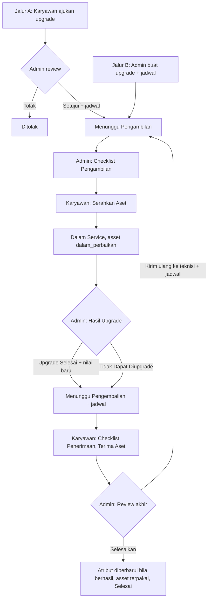
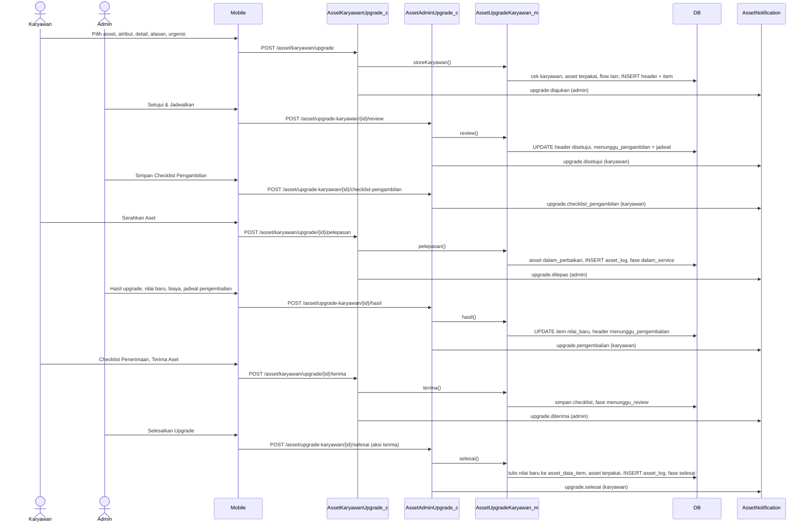
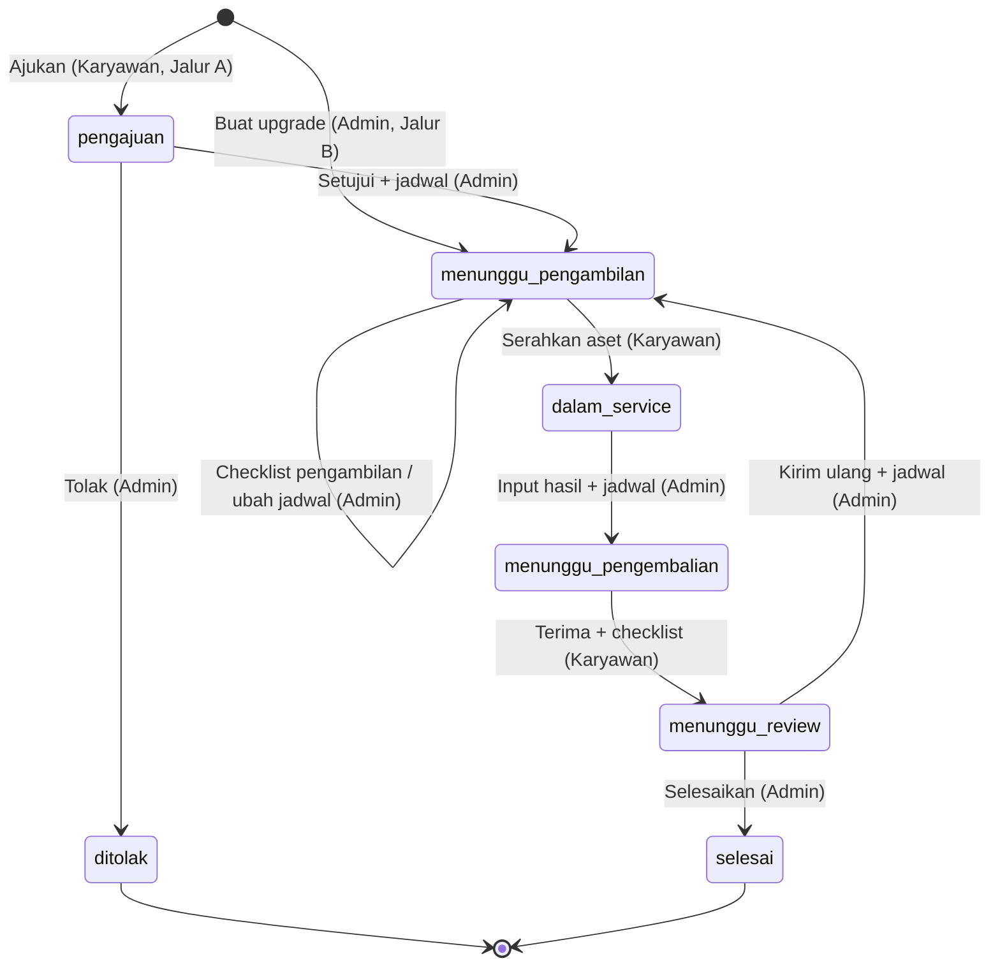
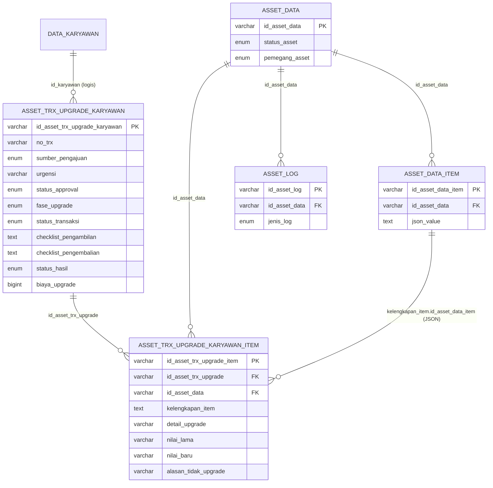

# Dokumentasi Teknis & Manual Book — Upgrade Asset Karyawan

> Dokumen ini disusun **murni dari source code lokal** (`API/` Lumen dan `MOBILE/` Flutter) per 28 September 2026.
> Business requirement dan kode fitur **diturunkan dari kode**. Bagian yang tidak ditemukan ditandai **⚠️ Belum ditemukan**, asumsi ditandai **⚠️ Asumsi**.
> Contoh ID/nama pada payload adalah **data sintetis**.

---

## 1. Informasi Dokumen

| Informasi | Nilai |
|---|---|
| Nama Fitur | Upgrade Asset Karyawan — tipe **Upgrade Komponen** (UI: **"Upgrade Asset"**; menu **"Upgrade"**) |
| Kode Fitur | **KRY03** (nomor transaksi `KRY03-2-YYYYMMNNN`; docblock model: `ALK-KRY03 tipe Upgrade Komponen`) |
| Modul | Asset Management |
| Backend | Laravel **Lumen ^10.0**, PHP ^8.1, JWT, Query Builder |
| Database | `API/diagram-asset.dbml` + migration `2026_09_26_000001_add_workflow_fields_to_asset_upgrade_karyawan.php`. ⚠️ Asumsi: MySQL/MariaDB |
| Mobile | Flutter (`professional_flutter_3_35`), `flutter_bloc`, `dio` |
| Web | ⚠️ Belum ditemukan: tidak ada source web di workspace |
| Test otomatis | `API/tests/Asset/AssetUpgradeKaryawanTest.php` (5 test) |
| Versi Dokumen | 1.2 |
| Tanggal Dokumentasi | 2026-10-12 |
| Dokumen terkait | Onboarding (KRY01), Offboarding (KRY02), Retur (KRY04), Peminjaman (KRY05), Kerusakan (KRY06), Request/Penambahan |

---

## 2. Daftar Isi

1. Informasi Dokumen · 3. Quick Overview · 4. Ringkasan Fitur · 5. Tujuan · 6. Aktor · 7. Hak Akses · 8. Terminologi · 9. Business Rules · 10. Business Flow · 11. Flow per Role · 12. Flow Diagram · 13. Sequence Diagram · 14. Status Transaksi · 15. State Transition · 16. Struktur Database · 17. Relasi · 18. Data Dictionary · 19. Index · 20. Backend Architecture · 21. Backend Logic · 22. Dampak asset_data · 23. API · 24. Detail API · 25. Mobile Architecture · 26. Mobile Screen · 27. Mobile → API · 28. API → Mobile · 29. Mapping Mobile→API→DB · 30. Mapping DB→API→Mobile · 31. Validation · 32. Error Handling · 33. Audit Trail · 34. Notification · 35. Security · 36. Manual Book · 37. Kondisi Button · 38. Testing · 39. Temuan Ketidaksesuaian · 40. Edge Case · 41. Risk · 42. Dependency · 43. Source Reference · 44. Developer Notes · 45. Traceability · 46. DB Impact · 47. Checklist · 48. Changelog

---

## 3. Quick Overview

| Item | Informasi |
|---|---|
| Feature | Upgrade spesifikasi komponen **satu asset** milik karyawan (mis. RAM 8 GB → 16 GB). Asset diambil sementara, diupgrade di luar sistem, lalu dikembalikan ke **karyawan yang sama** |
| Module | Asset Management |
| Jalur | **A — Karyawan mengajukan** (perlu persetujuan admin) · **B — Admin menginisiasi** (langsung disetujui + jadwal) |
| Actor | Karyawan, Admin Asset, System |
| Main Transaction | `asset_trx_upgrade_karyawan` |
| Detail Transaction | `asset_trx_upgrade_karyawan_item` — satu baris per **atribut spesifikasi** (field `komponen` di `asset_data_item`) |
| Asset Master | `asset_data` (status `dalam_perbaikan` selama service) + `asset_data_item` (nilai atribut diperbarui saat selesai) |
| Log | `asset_log` `jenis_log = upgrade_karyawan` |
| Status | `status_approval` (proses/disetujui/ditolak) + `fase_upgrade` (`pengajuan → menunggu_pengambilan → dalam_service → menunggu_pengembalian → menunggu_review → selesai`) |
| Hasil | `selesai` (nilai baru ditulis ke atribut) atau `tidak_dapat_diupgrade` (atribut tidak berubah) + biaya |
| Siklus ulang | Admin dapat **Kirim Ulang ke Teknisi** saat review akhir |
| API | 9 endpoint admin + 6 endpoint karyawan |
| Mobile Screen | Upgrade Asset (list), Ajukan / Buat Upgrade Asset (form), Detail Upgrade Asset — dipakai bersama admin & karyawan |

```text
Jalur A: Karyawan pilih asset + atribut + detail upgrade + alasan + urgensi → Ajukan Upgrade
         Admin: Tolak (+alasan) ─────────────────────────────────── ditolak / selesai
                Setujui & Jadwalkan (jadwal pengambilan) ─┐
Jalur B: Admin pilih karyawan + asset + atribut + catatan + jadwal → Buat Upgrade ─┤
                                                          menunggu_pengambilan ◄────┘
Admin: Checklist Pengambilan (kondisi tiap komponen)
Karyawan: Serahkan Aset ─────────────────── dalam_service · asset = dalam_perbaikan (pemegang tetap karyawan)
Admin: Hasil Upgrade (Selesai / Tidak Dapat Diupgrade, nilai baru, biaya, keterangan) + jadwal pengembalian
                                                          menunggu_pengembalian
Karyawan: Checklist Penerimaan → Terima Aset ─────────────── menunggu_review
Admin: Selesaikan Upgrade → atribut diperbarui (bila berhasil), asset = terpakai ── selesai
       atau Kirim Ulang ke Teknisi + jadwal ─────────────── kembali ke menunggu_pengambilan
```

---

## 4. Ringkasan Fitur

Upgrade Asset dipakai untuk meningkatkan spesifikasi komponen asset yang dipegang karyawan tanpa mengganti unitnya. Yang diupgrade adalah **atribut spesifikasi** (misalnya "RAM", "Storage") yang tersimpan sebagai field `komponen` di `asset_data_item` (unit utama maupun kelengkapan).

Ada dua jalur masuk: karyawan mengajukan (dengan alasan dan urgensi) lalu admin menyetujui atau menolak, atau admin langsung membuat upgrade untuk karyawan tertentu. Setelah itu asset diperiksa admin (checklist pengambilan), diserahkan karyawan, dikerjakan teknisi di luar sistem, hasilnya dicatat admin, lalu asset dikembalikan dan diperiksa karyawan (checklist penerimaan). Review akhir admin menentukan apakah upgrade diterima atau asset dikirim ulang ke teknisi.

Selama proses, **pemegang asset tetap karyawan**; hanya `status_asset` yang berubah menjadi `dalam_perbaikan`.

---

## 5. Tujuan Fitur

### 5.1 Tujuan Bisnis (diturunkan dari kode)
- Karyawan dapat meminta peningkatan spesifikasi asset kerja.
- Admin dapat menjadwalkan upgrade secara proaktif.
- Kondisi asset tercatat sebelum dan sesudah upgrade (dua checklist).
- Biaya dan hasil upgrade terdokumentasi.
- Data spesifikasi asset otomatis terbarui setelah upgrade berhasil.

### 5.2 Tujuan Sistem
- Menyimpan atribut target beserta nilai lama/baru per item.
- Menandai asset `dalam_perbaikan` selama service dan mengembalikannya ke `terpakai`.
- Menulis nilai baru ke `asset_data_item.json_value`.
- Mencegah asset diproses di upgrade lain, kerusakan, retur, atau offboarding saat upgrade dibuat.

---

## 6. Aktor

| Aktor | Role | Fungsi |
|---|---|---|
| Karyawan | User login aktif, pemegang asset | Mengajukan (Jalur A), menyerahkan asset, menerima & checklist asset hasil upgrade |
| Admin Asset | `asset_admin` + karyawan aktif | Review, membuat upgrade (Jalur B), jadwal, checklist pengambilan, hasil, review akhir |
| Teknisi | Di luar sistem | ⚠️ Belum ditemukan: tidak ada entitas/aktor teknisi di kode |
| System | Backend + FCM | Validasi, lock, penomoran, update asset & atribut, log, notifikasi |

---

## 7. Hak Akses

| Action | Admin Asset | Karyawan | Keterangan |
|---|:---:|:---:|---|
| Melihat semua upgrade | ✅ | ❌ | `/asset/upgrade-karyawan` |
| Melihat upgrade sendiri | – | ✅ | Tanpa cek karyawan aktif |
| Mengajukan upgrade (Jalur A) | – | ✅ | Karyawan aktif, asset miliknya `terpakai` |
| Membuat upgrade untuk karyawan (Jalur B) | ✅ | ❌ | Langsung disetujui |
| Setujui / tolak pengajuan | ✅ | ❌ | `status_approval = proses` |
| Ubah jadwal | ✅ | ❌ | `menunggu_pengambilan` / `menunggu_pengembalian` |
| Checklist pengambilan | ✅ | ❌ | `menunggu_pengambilan`, belum ada checklist |
| Serahkan aset | ❌ | ✅ | `menunggu_pengambilan` + checklist sudah ada |
| Input hasil upgrade | ✅ | ❌ | `dalam_service` |
| Terima aset + checklist penerimaan | ❌ | ✅ | `menunggu_pengembalian` |
| Selesaikan / kirim ulang | ✅ | ❌ | `menunggu_review` |
| Batalkan upgrade | ❌ | ❌ | ⚠️ Belum ditemukan (RISK-003) |

---

## 8. Terminologi

| Istilah | Arti di sistem |
|---|---|
| Atribut | Satu field `komponen` (bukan tipe `file`) di `asset_data_item.json_value` dengan `flag_spesifikasi` 1/2; ID = `id_asset_data_item|id_komponen` |
| Detail upgrade | Target spesifikasi yang diminta (mis. "8 GB menjadi 16 GB") |
| Nilai lama / baru | `nilai_lama` = nilai atribut saat pengajuan; `nilai_baru` = hasil yang diisi admin |
| Jalur A / B | `sumber_pengajuan = karyawan` / `admin` |
| Urgensi | `normal`, `secepatnya`, `mendesak` (Jalur A) |
| Checklist pengambilan | Kondisi tiap komponen asset diperiksa **admin** sebelum diambil |
| Checklist penerimaan (pengembalian) | Kondisi tiap komponen diperiksa **karyawan** saat menerima kembali |
| Pelepasan | Karyawan menyerahkan asset untuk diupgrade |
| Kirim ulang | Admin mengembalikan proses ke tahap pengambilan setelah review akhir |

---

## 9. Business Rules

### BR-001 — Asset yang boleh diupgrade
Dipegang karyawan (`pemegang_asset = karyawan`, `id_pemegang_asset` = karyawan transaksi), `status_asset = terpakai`, dan memiliki minimal satu atribut spesifikasi → "Asset bukan milik karyawan atau tidak ditemukan." / "Hanya asset berstatus terpakai yang dapat diupgrade." Karyawan harus aktif → "Karyawan tidak ditemukan atau tidak aktif."

### BR-002 — Asset tidak sedang di flow lain
Saat opsi dan simpan: upgrade aktif, laporan kerusakan aktif, retur aktif, offboarding aktif, pemeliharaan terjadwal (PML01) aktif → "Asset sedang diproses pada upgrade lain." / "…laporan kerusakan." / "…retur." / "…offboarding." / "…pemeliharaan."

### BR-003 — Item atribut
Minimal 1; atribut harus milik asset; tanpa duplikat; detail upgrade wajib (≤255) → "Minimal satu komponen wajib dipilih." / "Komponen upgrade tidak ditemukan pada asset." / "Komponen yang sama tidak boleh dipilih lebih dari sekali." / "Detail upgrade setiap komponen wajib diisi." Snapshot atribut disimpan di `kelengkapan_item` (JSON) dan `nilai_lama`.

### BR-004 — Jalur A (karyawan)
Alasan wajib (≤1000), urgensi wajib (normal/secepatnya/mendesak). Status awal `proses` / `pengajuan`.

### BR-005 — Jalur B (admin)
Karyawan dipilih dari opsi (aktif & memegang asset yang dapat diupgrade), catatan opsional (≤1000), **jadwal pengambilan wajib** dengan tanggal ≥ hari ini. Status awal `disetujui` / `menunggu_pengambilan`, approval diisi admin pembuat. Notifikasi `upgrade.disetujui` ke karyawan.

### BR-006 — Review (Jalur A)
Hanya saat `status_approval = proses` → "Pengajuan upgrade sudah direview."
- **Tolak**: alasan wajib → `ditolak`, `status_transaksi = selesai`, `fase = selesai`.
- **Setujui**: asset masih `terpakai` di karyawan; jadwal pengambilan wajib (≥ tanggal pengajuan) → `disetujui`, `menunggu_pengambilan`.

### BR-007 — Jadwal
Format `Y-m-d` + `H:i`; tanggal ≥ tanggal pengajuan (Jalur B: ≥ hari ini) → "Tanggal dan jam serah terima wajib diisi." / "Format jadwal serah terima tidak valid." / "Tanggal serah terima tidak boleh sebelum tanggal pengajuan." Ubah jadwal hanya pada `menunggu_pengambilan` (jadwal pengambilan) atau `menunggu_pengembalian` (jadwal pengembalian) → "Jadwal hanya dapat diubah sebelum serah terima dilakukan." Kolom `keterangan_pengembalian` dipakai untuk catatan kedua jadwal.

### BR-008 — Checklist pengambilan (admin)
Hanya `menunggu_pengambilan` dan belum ada checklist → "Checklist pengambilan tidak dapat diisi saat ini." Asset masih dipegang karyawan (`terpakai` atau `dalam_perbaikan`). Semua komponen asset (`komponenAssets`) wajib dicek; rusak wajib keterangan → "Seluruh item aset wajib dicek."

### BR-009 — Serahkan aset (karyawan)
Hanya setelah checklist pengambilan → "Aset belum siap diserahkan untuk upgrade." Asset → `status_asset = dalam_perbaikan` (**pemegang tetap karyawan**), log `upgrade_karyawan` posisi karyawan → gudang. Fase → `dalam_service`.

### BR-010 — Hasil upgrade (admin)
Hanya `dalam_service` → "Aset belum berada dalam proses upgrade."
- `status_hasil`: `selesai` / `tidak_dapat_diupgrade`; keterangan hasil wajib (≤1000); biaya ≥ 0.
- `selesai`: nilai baru setiap atribut wajib → "Nilai baru setiap atribut wajib diisi."
- `tidak_dapat_diupgrade`: `nilai_baru` dikosongkan, `alasan_tidak_upgrade` = keterangan (≤255).
- Jadwal pengembalian wajib. Fase → `menunggu_pengembalian`; checklist penerimaan & `tgl_diterima` direset.

### BR-011 — Terima aset (karyawan)
Hanya `menunggu_pengembalian` → "Aset belum dijadwalkan untuk dikembalikan." Asset harus `dalam_perbaikan` di karyawan. Checklist semua komponen. Fase → `menunggu_review`, `tgl_diterima = now`. Asset **belum** berubah status.

### BR-012 — Review akhir (admin)
Hanya `menunggu_review` → "Checklist pengembalian belum dikirim karyawan."
- **Selesaikan** (`aksi = terima`): bila hasil `selesai` → nilai baru ditulis ke `asset_data_item.json_value`; asset → `terpakai`; log gudang → karyawan; fase `selesai`, `status_transaksi = selesai`. Dapat dilakukan walau checklist penerimaan berisi item rusak.
- **Kirim Ulang ke Teknisi** (`aksi = kirim_ulang`): jadwal pengambilan baru wajib; fase → `menunggu_pengambilan`; checklist pengambilan dihapus (harus diisi ulang); asset tetap `dalam_perbaikan`.

### BR-013 — Penomoran
Header & item `id_company + YYYYMM + 3 digit`; `no_trx = KRY03-2-YYYYMMNNN`; log 5 digit.

---

## 10. Business Flow

```text
Jalur A
1. Karyawan: Asset Saya → Upgrade → (+) Ajukan Upgrade Asset
   → Pilih Asset → pilih atribut + Detail Upgrade → Alasan → Urgensi → Ajukan Upgrade   [Menunggu Persetujuan · notif admin]
2. Admin: Detail → Tolak (+Alasan Penolakan)                                             [Ditolak · notif karyawan]
          atau Setujui & Jadwalkan (Jadwal Pengambilan)                                  [Menunggu Pengambilan · notif karyawan]
Jalur B
1. Admin: Upgrade → (+) Buat Upgrade Asset → Pilih Karyawan → Pilih Asset → atribut + Detail Upgrade
   → Catatan → Jadwal Pengambilan → Buat Upgrade                                         [Menunggu Pengambilan · notif karyawan]
Lanjutan (kedua jalur)
3. Admin: Checklist Pengambilan → Simpan Checklist Pengambilan                           [notif karyawan]
4. Karyawan: Serahkan Aset                                                               [Dalam Service · notif admin]
5. Admin: Hasil Upgrade (Upgrade Selesai / Tidak Dapat Diupgrade, Nilai Baru, Keterangan, Biaya)
   → Simpan Hasil & Jadwalkan (Jadwal Pengembalian)                                      [Menunggu Pengembalian · notif karyawan]
6. Karyawan: Checklist Penerimaan → Terima Aset                                          [Menunggu Review · notif admin]
7. Admin: Selesaikan Upgrade                                                             [Selesai · notif karyawan]
          atau Kirim Ulang ke Teknisi (+ jadwal) → kembali ke langkah 3                  [notif karyawan]
```

---

## 11. Flow Berdasarkan Role

### 11.1 Karyawan
1. **Asset Saya** → menu **Upgrade** → **Upgrade Asset** → **Ajukan Upgrade**.
2. Banner Asset Saya: **Serahkan Aset untuk Upgrade** ("{asset} siap diambil untuk diupgrade. Konfirmasi setelah diserahkan.") dan **Terima Aset Hasil Upgrade** ("{asset} selesai diupgrade. Cek kondisinya lalu terima.").
3. Detail → **Serahkan Aset** / **Checklist Penerimaan** + **Terima Aset**.

### 11.2 Admin Asset
1. **Asset Karyawan** → aksi **Upgrade** atau panel **Upgrade Perlu Diproses** ("{jumlah} upgrade menunggu tindakan Admin/HR."): review pengajuan, checklist pengambilan, input hasil, review akhir.
2. **Buat Upgrade** untuk Jalur B.
3. Detail → **Setujui & Jadwalkan** / **Tolak**, **Simpan Checklist Pengambilan**, **Simpan Hasil & Jadwalkan**, **Selesaikan Upgrade** / **Kirim Ulang ke Teknisi**, **Ubah Jadwal**.

### 11.3 System
Deteksi atribut, cek flow lain, update status asset, tulis nilai atribut, log, notifikasi.

---

## 12. Flow Diagram



---

## 13. Sequence Diagram



---

## 14. Status Transaksi

Tiga kolom: `status_approval` (enum `proses/disetujui/ditolak`), `fase_upgrade` (enum, migration), `status_transaksi` (enum `proses/selesai`).

| status_approval | fase_upgrade | Label API | Tab | Aksi berikutnya |
|---|---|---|---|---|
| proses | pengajuan | Menunggu Persetujuan | pengajuan | Admin: setujui / tolak |
| ditolak | selesai | Ditolak | selesai | – |
| disetujui | menunggu_pengambilan | Menunggu Pengambilan | proses | Admin: checklist pengambilan → Karyawan: serahkan; Admin: ubah jadwal |
| disetujui | dalam_service | Dalam Service | proses | Admin: input hasil |
| disetujui | menunggu_pengembalian | Menunggu Pengembalian | proses | Karyawan: terima; Admin: ubah jadwal |
| disetujui | menunggu_review | Menunggu Review | proses | Admin: selesaikan / kirim ulang |
| disetujui | selesai | Selesai | selesai | – |

Detail API mengembalikan objek `aksi`: `review`, `ubah_jadwal`, `checklist_pengambilan`, `pelepasan`, `hasil`, `terima`, `selesai`.

---

## 15. State Transition



Status `asset_data`:
| Fase | status_asset | pemegang |
|---|---|---|
| pengajuan / menunggu_pengambilan (pertama) | terpakai | karyawan |
| dalam_service → menunggu_review | dalam_perbaikan | karyawan (tidak berubah) |
| menunggu_pengambilan (setelah kirim ulang) | dalam_perbaikan | karyawan |
| selesai | terpakai | karyawan |

---

## 16. Struktur Database

| Table | Type | Fungsi |
|---|---|---|
| `asset_trx_upgrade_karyawan` | Transaction Header | Pengajuan, jadwal, fase, checklist (JSON), hasil, biaya |
| `asset_trx_upgrade_karyawan_item` | Transaction Detail | Atribut target, detail, nilai lama/baru |
| `asset_data` | Master | Status asset |
| `asset_data_item` | Master komponen | Nilai atribut (`json_value.komponen[].value`) — **diperbarui** saat selesai |
| `asset_kategori_m` | Master | Snapshot kategori |
| `asset_log` | Log | `upgrade_karyawan` (enum ditambah oleh migration) |
| `data_karyawan`, `master_cabang`, `master_departemen` | Master HR | |
| `asset_admin`, `master_company` | Akses / lock | |
| `notif_data`, `users` | Notifikasi | |

> ⚠️ Belum ditemukan: migration `CREATE TABLE` untuk kedua tabel; migration `2026_09_26_000001` hanya menambah kolom workflow, index, dan tipe log.

---

## 17. Relasi Database



---

## 18. Data Dictionary

### 18.1 asset_trx_upgrade_karyawan
| Field | Type | Default | Description |
|---|---|---|---|
| id_asset_trx_upgrade_karyawan | varchar(50) PK | – | `id_company + YYYYMM + 3 digit` |
| no_trx | varchar(50) | '' | `KRY03-2-YYYYMMNNN` (DBML: unique) |
| sumber_pengajuan | enum(karyawan, admin) | karyawan | Jalur A / B (migration) |
| id_asset_kategori_m, nama_kategori | varchar | '' | Snapshot kategori |
| detail_upgrade | varchar(255) | '' | Ringkasan "label: detail; …" (dipotong 255) |
| alasan | text | – | Jalur A |
| urgensi | varchar(50) | – | Jalur A: normal/secepatnya/mendesak; Jalur B: '' |
| catatan | text | – | Jalur B |
| id_karyawan, nik_karyawan, nama_karyawan | varchar | '' | Snapshot karyawan |
| tgl_pengajuan | date | – | |
| tgl_pengambilan / jam_pengambilan | date / time | 0000-00-00 / 00:00:00 | Jadwal pengambilan |
| tgl_pengembalian / jam_pengembalian | date / time | 0000-00-00 / 00:00:00 | Jadwal pengembalian |
| keterangan_pengembalian | varchar(255) | '' | Catatan jadwal (dipakai untuk kedua jadwal) |
| checklist_pengambilan | text (JSON) | NULL | `[{id_item, nama_item, jenis, kondisi, ket_rusak}]` oleh admin |
| checklist_pengembalian | text (JSON) | NULL | Format sama, oleh karyawan |
| tgl_pelepasan / user_pelepasan | timestamp / varchar | NULL / '' | Serahkan aset (terakhir) |
| status_hasil | enum(selesai, tidak_dapat_diupgrade) | NULL | Hasil upgrade |
| keterangan_hasil | text | NULL | Wajib saat input hasil |
| biaya_upgrade | bigint | 0 | Rupiah |
| tgl_diterima | timestamp | NULL | Karyawan menerima kembali |
| status_transaksi | enum(proses, selesai) | proses | |
| status_approval | enum(proses, disetujui, ditolak) | – | |
| fase_upgrade | enum(pengajuan, menunggu_pengambilan, dalam_service, menunggu_pengembalian, menunggu_review, selesai) | pengajuan | (migration) |
| ket_tolak, user_approval, tgl_approval | – | – | Keputusan admin |
| id_company, tgl_input, user_input, tgl_update, user_update | – | – | Audit |

### 18.2 asset_trx_upgrade_karyawan_item
| Field | Type | Default | Description |
|---|---|---|---|
| id_asset_trx_upgrade_item | varchar(50) PK | – | `id_company + YYYYMM + 3 digit` |
| id_asset_trx_upgrade | varchar(50) | – | → header |
| id_asset_data | varchar(50) | – | Asset (sama untuk semua item) |
| kelengkapan_item | text (JSON) | '' | Snapshot atribut `{id_atribut, id_asset_data_item, id_komponen, nama_item, jenis, label, satuan, nilai}` |
| nama_asset, deskripsi_asset, kategori_asset | varchar(255) | '' | Snapshot |
| detail_upgrade | varchar(255) | '' | Target spesifikasi |
| nilai_lama | varchar(255) | '' | Nilai atribut saat pengajuan (migration) |
| nilai_baru | varchar(255) | '' | Nilai hasil upgrade (migration) |
| alasan_tidak_upgrade | varchar(255) | '' | Keterangan bila tidak dapat diupgrade |
| id_company, tgl_input, user_input | – | – | |

### 18.3 asset_log (`jenis_log = upgrade_karyawan`)
| Kejadian | posisi | pemegang di log | kondisi |
|---|---|---|---|
| Serahkan aset | karyawan → gudang | `pemegang_asset = gudang`, id/nama pemegang = karyawan | kondisi_awal → kondisi_awal |
| Selesaikan | gudang → karyawan | karyawan | kondisi_awal → kondisi_awal |

---

## 19. Database Index

| Index | Table | Columns | Tujuan |
|---|---|---|---|
| `atuk_admin_list_idx` | header | (id_company, status_approval, fase_upgrade, tgl_input, id_asset_trx_upgrade_karyawan) | List admin |
| `atuk_employee_list_idx` | header | (id_company, id_karyawan, status_approval, fase_upgrade, tgl_input, id_asset_trx_upgrade_karyawan) | List karyawan |
| `atuki_upgrade_idx` | item | (id_asset_trx_upgrade, id_company, id_asset_data) | Item per header, cek asset aktif |

---

## 20. Backend Architecture

```text
RouteAsset.php (prefix /asset, jwt.api + jwt.ctx)
   ↓
AssetAdminUpgrade_c (validateRequest → mutateAssetTrx 'id_upgrade' / storeUpgradeKaryawan)
AssetKaryawanUpgrade_c (validateRequest → storeUpgradeSaya / mutateTrxSaya 'id_upgrade')
   ↓
AssetUpgradeKaryawan_m ← Asset_m (lockCompany, nextSequence, komponenAssets, parseJadwalValue,
   ↓                               insertAssetLog, findActiveKaryawan, findAssetAdmin)
   ↓   ↔ AssetRusakKaryawan_m / AssetReturKaryawan_m / AssetOffboardingKaryawan_m (cek flow lain)
DB::transaction (retry 3) → ApiResponse + AssetNotification
```

| Layer | File/Class | Function |
|---|---|---|
| Controller | `AssetAdminUpgrade_c` | getUpgradeOptions, getUpgradeKaryawan, getDetailUpgradeKaryawan, storeUpgradeKaryawan, reviewUpgradeKaryawan, updateJadwalUpgradeKaryawan, checklistPengambilanUpgrade, hasilUpgradeKaryawan, selesaiUpgradeKaryawan |
| Controller | `AssetKaryawanUpgrade_c` | getUpgradeOptionsSaya, getUpgradeSaya, storeUpgradeSaya, getDetailUpgradeSaya, pelepasanUpgradeSaya, terimaUpgradeSaya |
| Model | `AssetUpgradeKaryawan_m` | getOptions, getAdminOptions, getPage, getDetail, storeKaryawan, storeAdmin, review, updateJadwal, checklistPengambilan, pelepasan, hasil, terima, selesai, getPendingForEmployee, getPendingForAdmin, countPendingForAdmin, hasActiveUpgradeAsset + helper |
| Support | `AssetNotification` | `upgrade.*` |

---

## 21. Backend Business Logic

### 21.1 Ajukan (Jalur A) — `storeKaryawan`
Lock → karyawan aktif → urgensi & alasan → `insertTransaction` (asset milik karyawan FOR UPDATE, `terpakai`, `assetBlockMessage`, `atributAssets`, `normalizeItems`, INSERT header `proses/pengajuan` + item dengan `nilai_lama`) → `upgrade.diajukan`.

### 21.2 Buat (Jalur B) — `storeAdmin`
Lock → admin → karyawan aktif → jadwal (≥ hari ini) → `insertTransaction` dengan `disetujui/menunggu_pengambilan`, jadwal, approval admin → `upgrade.disetujui`.

### 21.3 Review — `review`
Admin → header `proses` → tolak (alasan wajib → ditolak/selesai) atau setujui (asset `terpakai` di karyawan, jadwal wajib → disetujui/menunggu_pengambilan) → `upgrade.ditolak` / `upgrade.disetujui`.

### 21.4 Ubah jadwal — `updateJadwal`
Fase `menunggu_pengambilan` → kolom pengambilan; `menunggu_pengembalian` → kolom pengembalian → `upgrade.dijadwalkan`.

### 21.5 Checklist pengambilan — `checklistPengambilan`
Admin → fase `menunggu_pengambilan`, checklist kosong → asset dipegang (`terpakai`/`dalam_perbaikan`) → `normalizeKondisiChecklist` (semua komponen) → simpan JSON → `upgrade.checklist_pengambilan`.

### 21.6 Serahkan — `pelepasan`
Karyawan aktif, miliknya → checklist sudah ada → asset `dalam_perbaikan` + log (karyawan → gudang) → fase `dalam_service`, `tgl/user_pelepasan` → `upgrade.dilepas`.

### 21.7 Hasil — `hasil`
Admin → fase `dalam_service` → validasi status/keterangan/biaya/jadwal → UPDATE item (`nilai_baru` atau `alasan_tidak_upgrade`) → header `menunggu_pengembalian` + hasil + jadwal pengembalian, reset checklist penerimaan → `upgrade.pengembalian`.

### 21.8 Terima — `terima`
Karyawan aktif, miliknya → fase `menunggu_pengembalian` → asset `dalam_perbaikan` di karyawan → `normalizeKondisiChecklist` → header `menunggu_review`, `tgl_diterima` → `upgrade.diterima`.

### 21.9 Review akhir — `selesai`
Admin → fase `menunggu_review` →
- `kirim_ulang`: jadwal wajib → fase `menunggu_pengambilan`, checklist pengambilan = NULL → `upgrade.kirim_ulang`.
- `terima`: asset `dalam_perbaikan` di karyawan → bila `status_hasil = selesai`: `applyAtribut` (update `komponen[].value` di `asset_data_item.json_value` untuk setiap `id_komponen`) → asset `terpakai` + log (gudang → karyawan) → fase & transaksi `selesai` → `upgrade.selesai`.

### 21.10 Query baca
- **Opsi karyawan**: asset `terpakai` miliknya, tidak diblokir flow lain, punya atribut (`atribut[]`), + daftar urgensi.
- **Opsi admin**: karyawan aktif yang memegang asset yang dapat diupgrade beserta `assets[]`.
- **List**: tab `pengajuan` (approval proses), `proses` (disetujui & fase ≠ selesai), `selesai` (`status_transaksi = selesai`, termasuk ditolak).
- **Detail**: header, jadwal, hasil, biaya, karyawan, asset, `items` (nilai lama/baru), `komponen` (untuk checklist), kedua checklist, `checklist_pengembalian_rusak`, `aksi`.
- **Pending**: karyawan (checklist pengambilan sudah ada → `pelepasan`; `menunggu_pengembalian` → `terima`); admin (approval proses, checklist pengambilan belum ada, `dalam_service`, `menunggu_review`).

---

## 22. Dampak terhadap asset_data

| Field | Sebelum | Sesudah | Trigger |
|---|---|---|---|
| status_asset | terpakai | dalam_perbaikan | Serahkan aset |
| status_asset | dalam_perbaikan | terpakai | Selesaikan |
| pemegang_asset / id_pemegang_asset | karyawan | **tidak berubah** | Seluruh proses |
| `asset_data_item.json_value.komponen[].value` | nilai lama | nilai baru | Selesaikan (hasil `selesai`) |
| tgl_update / user_update | – | now / pelaku | Setiap update |

---

## 23. API Documentation

| ID | Method | Endpoint | Function | Auth |
|---|---|---|---|---|
| API-001 | GET | `/asset/upgrade-karyawan/options` | Karyawan & asset yang dapat diupgrade | Admin |
| API-002 | GET | `/asset/upgrade-karyawan` | List | Admin |
| API-003 | POST | `/asset/upgrade-karyawan` | Buat upgrade (Jalur B) | Admin |
| API-004 | GET | `/asset/upgrade-karyawan/{id}` | Detail | Admin |
| API-005 | POST | `/asset/upgrade-karyawan/{id}/review` | Setujui / tolak | Admin |
| API-006 | PUT | `/asset/upgrade-karyawan/{id}/jadwal` | Ubah jadwal | Admin |
| API-007 | POST | `/asset/upgrade-karyawan/{id}/checklist-pengambilan` | Checklist pengambilan | Admin |
| API-008 | POST | `/asset/upgrade-karyawan/{id}/hasil` | Input hasil + jadwal pengembalian | Admin |
| API-009 | POST | `/asset/upgrade-karyawan/{id}/selesai` | Selesaikan / kirim ulang | Admin |
| API-010 | GET | `/asset/karyawan/upgrade/options` | Asset & atribut + urgensi | JWT |
| API-011 | GET | `/asset/karyawan/upgrade` | List milik saya | JWT |
| API-012 | POST | `/asset/karyawan/upgrade` | Ajukan (Jalur A) | JWT |
| API-013 | GET | `/asset/karyawan/upgrade/{id}` | Detail milik saya | JWT, pemilik |
| API-014 | POST | `/asset/karyawan/upgrade/{id}/pelepasan` | Serahkan aset | JWT, pemilik |
| API-015 | POST | `/asset/karyawan/upgrade/{id}/terima` | Terima + checklist penerimaan | JWT, pemilik |

Terkait: `GET /asset/karyawan/onboarding` (Asset Saya, key `upgrade`) dan `GET /asset/summary` (`upgrade_perlu_proses`, `upgrade_pending`).

---

## 24. Detail Setiap API

Header umum: `Authorization: Bearer <token>`, `Content-Type: application/json`, `Accept`, `locale`, `versi-app`. Format `{ code, message, data }`.

### API-010 — Opsi (Karyawan)
```json
{
  "code": "SUCCESS",
  "message": "Opsi upgrade asset berhasil ditemukan.",
  "data": {
    "assets": [
      {
        "id_asset_data": "CMP00120260100012",
        "kode_asset": "LPT-0012",
        "nama_asset": "Laptop 14 inch",
        "kategori_asset": "Laptop",
        "merek": "MerekX",
        "id_pemegang_asset": "KRY0010",
        "atribut": [
          {"id_atribut": "CMP001ITEM0101|ram", "id_asset_data_item": "CMP001ITEM0101", "id_komponen": "ram",
           "nama_item": "Laptop 14 inch", "jenis": "aset_utama", "label": "RAM", "satuan": "GB", "nilai": "8"}
        ]
      }
    ],
    "urgensi": [
      {"value": "normal", "label": "Normal"},
      {"value": "secepatnya", "label": "Secepatnya"},
      {"value": "mendesak", "label": "Mendesak"}
    ]
  }
}
```
API-001 (admin) mengembalikan `{ "karyawan": [ {id_karyawan, nik, nama_karyawan, assets: [...]} ] }`.

### API-012 — Ajukan (Jalur A)
```http
POST /asset/karyawan/upgrade
```
```json
{
  "id_asset_data": "CMP00120260100012",
  "alasan": "Aplikasi desain sering lambat",
  "urgensi": "secepatnya",
  "items": [
    {"id_atribut": "CMP001ITEM0101|ram", "detail_upgrade": "8 GB menjadi 16 GB"}
  ]
}
```
| Field | Rule | Message |
|---|---|---|
| id_asset_data | required\|string\|max:50 | – |
| alasan | required\|string\|max:1000 | Alasan upgrade wajib diisi. |
| urgensi | required\|in:normal,secepatnya,mendesak | Urgensi wajib dipilih. |
| items | required\|array\|min:1 | Minimal satu komponen wajib dipilih. |
| items.*.id_atribut | required\|string\|max:120\|distinct | – |
| items.*.detail_upgrade | required\|string\|max:255 | Detail upgrade setiap komponen wajib diisi. |

Pesan umum: "Data pengajuan upgrade belum lengkap."
```json
{ "code": "CREATED", "message": "Pengajuan upgrade asset berhasil dikirim.",
  "data": { "id": "CMP001202609006", "no_trx": "KRY03-2-202609006", "status_approval": "proses",
            "fase_upgrade": "pengajuan", "status_label": "Menunggu Persetujuan", "tab": "pengajuan" } }
```
422: "Karyawan tidak ditemukan atau tidak aktif.", "Asset bukan milik karyawan atau tidak ditemukan.", "Hanya asset berstatus terpakai yang dapat diupgrade.", "Asset sedang diproses pada upgrade lain." / "…laporan kerusakan." / "…retur." / "…offboarding." / "…pemeliharaan.", "Komponen upgrade tidak ditemukan pada asset.", "Komponen yang sama tidak boleh dipilih lebih dari sekali." 500: "Terjadi kesalahan saat menyimpan pengajuan upgrade."

### API-003 — Buat (Jalur B)
```http
POST /asset/upgrade-karyawan
```
```json
{
  "id_karyawan": "KRY0010",
  "id_asset_data": "CMP00120260100012",
  "catatan": "Program peremajaan laptop tim desain",
  "items": [{"id_atribut": "CMP001ITEM0101|ram", "detail_upgrade": "8 GB menjadi 16 GB"}],
  "tgl_jadwal": "2026-09-30",
  "jam_jadwal": "10:00",
  "keterangan_jadwal": "Bawa ke ruang IT"
}
```
Rules: `id_karyawan` required max 150, `id_asset_data` required, `catatan` nullable max 1000, items seperti API-012, jadwal `tgl_jadwal` (Y-m-d) / `jam_jadwal` (H:i) / `keterangan_jadwal` (≤255). Pesan umum: "Data upgrade asset belum lengkap." Response `CREATED` "Upgrade asset berhasil dibuat." (`disetujui` / `menunggu_pengambilan`). 500: "Terjadi kesalahan saat membuat upgrade asset."

### API-002 / API-011 — List
`tab`: `pengajuan` | `proses` | `selesai`; `limit` 1–50. Record: `id, no_trx, sumber_pengajuan, tgl_pengajuan, urgensi, status_approval, fase_upgrade, status_label, tab, tgl/jam_pengambilan, tgl/jam_pengembalian, jumlah_item, asset{nama_asset, kategori_asset}, karyawan{id_karyawan, nik, nama_karyawan}` + `filters`, `pagination`.

### API-004 / API-013 — Detail
```json
{
  "id": "CMP001202609006",
  "no_trx": "KRY03-2-202609006",
  "sumber_pengajuan": "karyawan",
  "tgl_pengajuan": "2026-09-28",
  "alasan": "Aplikasi desain sering lambat",
  "urgensi": "secepatnya",
  "catatan": "",
  "ket_tolak": "",
  "status_approval": "disetujui",
  "fase_upgrade": "menunggu_review",
  "status_label": "Menunggu Review",
  "tab": "proses",
  "tgl_pengambilan": "2026-09-30",
  "jam_pengambilan": "10:00:00",
  "tgl_pengembalian": "2026-10-03",
  "jam_pengembalian": "15:00:00",
  "keterangan_jadwal": "",
  "tgl_pelepasan": "2026-09-30 10:12:00",
  "tgl_diterima": "2026-10-03 15:20:00",
  "status_hasil": "selesai",
  "keterangan_hasil": "RAM ditambah 1 keping 8 GB",
  "biaya_upgrade": 650000,
  "karyawan": {"id_karyawan": "KRY0010", "nik": "EMP-010", "nama_karyawan": "Dimas Contoh", "cabang": "Kantor Pusat", "divisi": "Kreatif"},
  "asset": {"id_asset_data": "CMP00120260100012", "kode_asset": "LPT-0012", "nama_asset": "Laptop 14 inch", "kategori_asset": "Laptop", "merek": "MerekX", "status_asset": "dalam_perbaikan"},
  "items": [
    {"id_item": "CMP001202609014", "nama_item": "Laptop 14 inch", "label": "RAM", "satuan": "GB",
     "detail_upgrade": "8 GB menjadi 16 GB", "nilai_lama": "8", "nilai_baru": "16", "alasan_tidak_upgrade": ""}
  ],
  "komponen": [{"id_item": "CMP001ITEM0101", "nama_item": "Laptop 14 inch", "jenis": "aset_utama", "detail": "RAM: 8 GB"}],
  "checklist_pengambilan": [{"id_item": "CMP001ITEM0101", "nama_item": "Laptop 14 inch", "jenis": "aset_utama", "kondisi": "normal", "ket_rusak": ""}],
  "checklist_pengembalian": [{"id_item": "CMP001ITEM0101", "nama_item": "Laptop 14 inch", "jenis": "aset_utama", "kondisi": "normal", "ket_rusak": ""}],
  "checklist_pengembalian_rusak": false,
  "aksi": {"review": false, "ubah_jadwal": false, "checklist_pengambilan": false, "pelepasan": false, "hasil": false, "terima": false, "selesai": true}
}
```
404: "Upgrade asset tidak ditemukan."

### API-005 — Review
```json
{ "keputusan": "disetujui", "ket_tolak": "", "tgl_jadwal": "2026-09-30", "jam_jadwal": "10:00", "keterangan_jadwal": "" }
```
Rules: `keputusan` required in:disetujui,ditolak; `ket_tolak` required_if ditolak (≤255, "Alasan penolakan wajib diisi."). "Review upgrade asset berhasil disimpan." 422: "Pengajuan upgrade sudah direview.", "Status asset sudah berubah atau tidak lagi dipegang karyawan.", "Tanggal dan jam serah terima wajib diisi."

### API-006 — Ubah Jadwal
```json
{ "tgl_jadwal": "2026-10-01", "jam_jadwal": "09:00", "keterangan_jadwal": "" }
```
"Jadwal upgrade berhasil diperbarui." 422: "Jadwal hanya dapat diubah sebelum serah terima dilakukan."

### API-007 — Checklist Pengambilan (Admin) & API-015 — Terima (Karyawan)
```json
{
  "items": [
    {"id_item": "CMP001ITEM0101", "kondisi": "normal", "ket_rusak": ""},
    {"id_item": "CMP001ITEM0102", "kondisi": "rusak", "ket_rusak": "Kabel charger longgar"}
  ]
}
```
Rules: items required min 1; `id_item` distinct; `kondisi` in normal,rusak; `ket_rusak` required_if rusak (≤255). Semua komponen asset wajib ada → "Seluruh item aset wajib dicek."
- API-007: "Checklist pengambilan berhasil disimpan." 422: "Checklist pengambilan tidak dapat diisi saat ini."
- API-015: "Checklist pengembalian belum lengkap." (validasi) · 422: "Aset belum dijadwalkan untuk dikembalikan.", "Status asset sudah berubah atau tidak lagi dipegang karyawan."

### API-014 — Serahkan Aset (Karyawan)
Tanpa body. "Aset berhasil diserahkan untuk upgrade." 422: "Aset belum siap diserahkan untuk upgrade.", "Karyawan tidak ditemukan atau tidak aktif."

### API-008 — Hasil Upgrade (Admin)
```json
{
  "status_hasil": "selesai",
  "keterangan_hasil": "RAM ditambah 1 keping 8 GB",
  "biaya_upgrade": 650000,
  "items": [{"id_item": "CMP001202609014", "nilai_baru": "16"}],
  "tgl_jadwal": "2026-10-03",
  "jam_jadwal": "15:00",
  "keterangan_jadwal": ""
}
```
| Field | Rule |
|---|---|
| status_hasil | required\|in:selesai,tidak_dapat_diupgrade |
| keterangan_hasil | required\|string\|max:1000 |
| biaya_upgrade | nullable\|integer\|min:0 |
| items | nullable\|array; `items.*.id_item` required distinct; `items.*.nilai_baru` nullable ≤255 |
| tgl/jam/keterangan_jadwal | jadwal pengembalian |

"Hasil upgrade berhasil disimpan." 422: "Aset belum berada dalam proses upgrade.", "Nilai baru setiap atribut wajib diisi.", "Tanggal dan jam serah terima wajib diisi."

### API-009 — Review Akhir (Admin)
```json
{ "aksi": "terima" }
```
```json
{ "aksi": "kirim_ulang", "tgl_jadwal": "2026-10-05", "jam_jadwal": "10:00", "keterangan_jadwal": "Layar berkedip setelah upgrade" }
```
`aksi` required in:terima,kirim_ulang. "Review akhir upgrade berhasil disimpan." 422: "Checklist pengembalian belum dikirim karyawan.", "Status asset sudah berubah atau tidak lagi dipegang karyawan.", "Tanggal dan jam serah terima wajib diisi."

---

## 25. Mobile Architecture

```text
Page (admin: bool) → AssetUpgradeBloc → AssetUpgradeApi(admin) → ApiClient → Backend
```
Satu set layar dipakai admin dan karyawan; `AssetUpgradeApi(admin: true)` memakai base `asset/upgrade-karyawan`, selain itu `asset/karyawan/upgrade`.

| Layer | File | Function |
|---|---|---|
| Api | `Repository/Service/assetUpgradeApi.dart` | getList, getOptions, getDetail, store, review, updateJadwal, checklistPengambilan, hasil, selesai, pelepasan, terima (memakai `AssetKerusakanJadwal` untuk jadwal) |
| Model | `Repository/Model/Asset/mAssetUpgrade.dart` | AssetUpgradeFase, AssetUpgradeAtribut, AssetUpgradeAsset, AssetUpgradeKaryawanOption, AssetUpgradeItem, AssetUpgradeAksi, AssetUpgradeRecord, AssetUpgradePage, AssetUpgradeOptions |
| Bloc | `Bloc/Asset/AssetUpgradeBloc.dart` | LoadAssetUpgradeList, LoadMoreAssetUpgradeList, LoadAssetUpgradeOptions, LoadAssetUpgradeDetail, SubmitAssetUpgradeAction |
| UI | `UI/Modul/Asset/Upgrade/*` | HalamanAssetUpgrade, HalamanTambahAssetUpgrade, HalamanDetailAssetUpgrade, AssetUpgradeWidgets |

| Route | Page |
|---|---|
| `/asset_upgrade` · `/asset_admin_upgrade` | List (karyawan / admin) |
| `/asset_tambah_upgrade` · `/asset_admin_tambah_upgrade` | Ajukan / Buat Upgrade Asset |
| `/asset_detail_upgrade` · `/asset_admin_detail_upgrade` | Detail |

---

## 26. Mobile Screen

### 26.1 Upgrade Asset — list
Tab Pengajuan / Proses / Selesai; kartu dengan status (Menunggu Persetujuan, Menunggu Pengambilan, Dalam Service, Menunggu Pengembalian, Menunggu Review, Selesai, Ditolak), label "Diinisiasi Admin/HR" untuk Jalur B. Kosong: "Belum ada data upgrade asset."

### 26.2 Ajukan Upgrade Asset (karyawan) / Buat Upgrade Asset (admin)
| Field UI | Karyawan | Admin | Catatan |
|---|:---:|:---:|---|
| Pilih Karyawan ("Ketuk untuk memilih karyawan") | – | ✅ | Dari opsi admin |
| Pilih Asset ("Ketuk untuk memilih asset") | ✅ | ✅ | "Tidak ada aset yang dapat diupgrade." |
| Komponen yang Diupgrade | ✅ | ✅ | "Pilih spesifikasi yang ingin diupgrade, lalu tulis target spesifikasinya."; tiap atribut "Saat ini: {nilai}" + **Detail Upgrade** ("Contoh: 8 GB menjadi 16 GB") |
| Alasan | ✅ | – | "Alasan pengajuan wajib diisi." |
| Urgensi (Normal / Secepatnya / Mendesak) | ✅ | – | |
| Catatan Tambahan | – | ✅ | |
| Jadwal Pengambilan | – | ✅ | Sheet tanggal & jam |
| Tombol | **Ajukan Upgrade** | **Buat Upgrade** | |

### 26.3 Detail Upgrade Asset
Stepper **Pengajuan → Pengambilan → Service → Pengembalian → Selesai**; info asset, karyawan, Jadwal Pengambilan / Jadwal Pengembalian ("{tanggal}, jam {jam}"), **Komponen yang Diupgrade** (Sebelum / Sesudah), **Hasil Upgrade** (Upgrade Selesai / Tidak Dapat Diupgrade, Keterangan Hasil, Biaya Upgrade (Rp)), checklist.

| Kondisi (`aksi`) | Role | Tampilan / Tombol |
|---|---|---|
| review | Admin | **Setujui & Jadwalkan** / **Tolak** (+Alasan Penolakan) |
| checklist_pengambilan | Admin | **Checklist Pengambilan** ("Periksa kondisi aset sebelum dibawa untuk diupgrade.") → **Simpan Checklist Pengambilan** |
| checklist_pengambilan | Karyawan | Info "Admin/HR akan memeriksa kondisi aset saat pengambilan." |
| pelepasan | Karyawan | Info "Admin/HR sudah memeriksa kondisi aset. Konfirmasi setelah aset diserahkan." → **Serahkan Aset** (dialog "Pastikan aset sudah diserahkan kepada Admin/HR.") |
| hasil | Admin | Form hasil (status, Nilai Baru per atribut bila selesai, Keterangan Hasil, Biaya) → **Simpan Hasil & Jadwalkan** |
| hasil | Karyawan | Info "Aset sedang dalam proses upgrade oleh teknisi." |
| terima | Karyawan | **Checklist Penerimaan** ("Periksa kondisi aset hasil upgrade sebelum menerima.") → **Terima Aset** (dialog "Pastikan aset hasil upgrade sudah Anda terima dan periksa.") |
| selesai | Admin | Info "Seluruh item diterima karyawan dalam kondisi normal." / "Karyawan melaporkan ada item bermasalah setelah upgrade." → **Selesaikan Upgrade** (dialog "Atribut aset diperbarui dan aset kembali aktif untuk karyawan.") / **Kirim Ulang ke Teknisi** (+jadwal) |
| ubah_jadwal | Admin | **Ubah Jadwal** |

### 26.4 Entry point
Asset Saya: menu **Upgrade** + banner **Serahkan Aset untuk Upgrade** / **Terima Aset Hasil Upgrade**. Asset Karyawan: aksi **Upgrade** + panel **Upgrade Perlu Diproses** ("Lihat semua ({jumlah})").

---

## 27. Mobile → API

| UI Field | JSON Field | Type | Required |
|---|---|---|:---:|
| Pilih Karyawan (admin) | `id_karyawan` | string | Jalur B |
| Pilih Asset | `id_asset_data` | string | Ya |
| Atribut dicentang | `items[].id_atribut` | `id_asset_data_item|id_komponen` | Min 1 |
| Detail Upgrade | `items[].detail_upgrade` | string ≤255 | Ya |
| Alasan | `alasan` | string ≤1000 | Jalur A |
| Urgensi | `urgensi` | normal/secepatnya/mendesak | Jalur A |
| Catatan Tambahan | `catatan` | string ≤1000 | Tidak |
| Jadwal | `tgl_jadwal`, `jam_jadwal`, `keterangan_jadwal` | Y-m-d, H:i, string | Jalur B, setujui, hasil, kirim ulang, ubah jadwal |
| Setujui / Tolak | `keputusan`, `ket_tolak` | string | Review |
| Checklist | `items[].id_item`, `kondisi`, `ket_rusak` | – | Semua komponen |
| Hasil | `status_hasil`, `keterangan_hasil`, `biaya_upgrade`, `items[].id_item`, `items[].nilai_baru` | – | Input hasil |
| Selesaikan / Kirim Ulang | `aksi` | terima/kirim_ulang | Review akhir |

---

## 28. API → Mobile

| API JSON | Mobile Model | UI |
|---|---|---|
| `records[]` | AssetUpgradePage / AssetUpgradeRecord | Kartu list |
| `fase_upgrade`, `status_label` | AssetUpgradeRecord / AssetUpgradeFase | Badge, stepper |
| `sumber_pengajuan` | AssetUpgradeRecord | "Diinisiasi Admin/HR" |
| `items[]` (nilai lama/baru) | AssetUpgradeItem | Sebelum / Sesudah |
| `komponen`, `checklist_*` | AssetUpgradeRecord | Form & hasil checklist |
| `status_hasil`, `keterangan_hasil`, `biaya_upgrade` | AssetUpgradeRecord | Hasil Upgrade |
| `aksi` | AssetUpgradeAksi | Tombol |
| `assets[].atribut` / `karyawan[].assets` | AssetUpgradeAsset / Atribut / KaryawanOption | Form |

---

## 29. Mapping Mobile → API → Database

| UI | JSON | Backend | Table | Column |
|---|---|---|---|---|
| Asset | `id_asset_data` | `insertTransaction` | item | id_asset_data + snapshot |
| Atribut | `items[].id_atribut` | `normalizeItems` | item | kelengkapan_item (JSON), nilai_lama |
| Detail Upgrade | `items[].detail_upgrade` | trim ≤255 | item / header | detail_upgrade / ringkasan |
| Alasan / Urgensi | `alasan`, `urgensi` | `storeKaryawan` | header | alasan, urgensi |
| Catatan | `catatan` | `storeAdmin` | header | catatan |
| Jadwal | `tgl_jadwal`, `jam_jadwal`, `keterangan_jadwal` | `parseJadwalValue` | header | tgl/jam_pengambilan atau tgl/jam_pengembalian, keterangan_pengembalian |
| Checklist pengambilan | `items[]` | `normalizeKondisiChecklist` | header | checklist_pengambilan |
| Serahkan Aset | – | `pelepasan()` | asset_data / asset_log / header | status_asset / log / tgl_pelepasan |
| Hasil | `status_hasil`, `keterangan_hasil`, `biaya_upgrade`, `items[].nilai_baru` | `hasil()` | header / item | status_hasil, keterangan_hasil, biaya_upgrade / nilai_baru, alasan_tidak_upgrade |
| Checklist penerimaan | `items[]` | `terima()` | header | checklist_pengembalian, tgl_diterima |
| Selesaikan | `aksi = terima` | `selesai()` + `applyAtribut` | asset_data_item / asset_data / asset_log / header | json_value / status_asset / log / fase |

---

## 30. Mapping Database → API → Mobile

| Table | Column | API JSON | UI |
|---|---|---|---|
| header | status_approval + fase_upgrade | `status_label`, `tab`, `aksi` | Badge, tab, tombol |
| header | jadwal (nol → '') | `tgl/jam_pengambilan`, `tgl/jam_pengembalian` | Jadwal |
| header | checklist_* (JSON) | `checklist_pengambilan`, `checklist_pengembalian`, `checklist_pengembalian_rusak` | Checklist |
| item | kelengkapan_item | `items[].nama_item`, `label`, `satuan` | Nama atribut |
| item | nilai_lama / nilai_baru | idem | Sebelum / Sesudah |
| asset_data_item | json_value | `komponen[]` | Daftar komponen checklist |

---

## 31. Validation

### 31.1 Mobile
| Lokasi | Aturan | Pesan |
|---|---|---|
| Form | Asset wajib; min 1 komponen | "Pilih minimal satu komponen." |
| Form | Detail upgrade per komponen | "Detail upgrade wajib diisi." |
| Form karyawan | Alasan wajib | "Alasan pengajuan wajib diisi." |
| Form admin | Karyawan wajib; jadwal | – |
| Hasil | Nilai baru bila selesai; keterangan wajib | "Nilai baru wajib diisi." / "Keterangan hasil wajib diisi." |
| Checklist | Semua komponen; rusak wajib keterangan | – |

### 31.2 Backend — §9 & §24.
### 31.3 Database — enum `sumber_pengajuan`, `fase_upgrade`, `status_hasil`, `status_approval`, `status`; `jenis_log` + `upgrade_karyawan`.

---

## 32. Error Handling

| Error | HTTP | Backend | Mobile |
|---|---:|---|---|
| Field tidak valid | 422 | VALIDATION_ERROR | Pesan field |
| Aturan bisnis | 422 | BUSINESS_RULE_VIOLATION | Snackbar |
| Tidak ditemukan | 404 | NOT_FOUND ("Upgrade asset tidak ditemukan.") | "Detail upgrade asset tidak dapat dimuat." |
| Token / bukan admin | 401 / 403 | UNAUTHORIZED / FORBIDDEN | Pesan |
| Exception | 500 | SYSTEM_ERROR ("Terjadi kesalahan saat memproses transaksi asset.") + log | Snackbar |

---

## 33. Audit Trail

| Data | Disimpan? | Lokasi |
|---|:---:|---|
| Pengaju / pembuat | ✅ | `user_input`, `sumber_pengajuan` |
| Keputusan | ✅ | `user_approval`, `tgl_approval`, `ket_tolak` |
| Kondisi sebelum & sesudah | ✅ | `checklist_pengambilan`, `checklist_pengembalian` (hanya versi terakhir) |
| Nilai atribut lama/baru | ✅ | item `nilai_lama`, `nilai_baru` |
| Hasil & biaya | ✅ | `status_hasil`, `keterangan_hasil`, `biaya_upgrade` (tertimpa bila kirim ulang) |
| Perpindahan asset | ✅ | `asset_log upgrade_karyawan` |
| Riwayat kirim ulang | ❌ | ⚠️ Belum ditemukan (checklist & hasil sebelumnya tertimpa) |
| Perubahan `asset_data_item` | ⚠️ | Hanya `tgl_update/user_update` pada baris item |

---

## 34. Notification

| Event | Trigger | Penerima | Judul | Pesan | Rute |
|---|---|---|---|---|---|
| `upgrade.diajukan` | Ajukan (Jalur A) | Admin | Pengajuan Upgrade Asset | {nama} mengajukan upgrade asset {no_trx}. | `asset_admin_detail_upgrade` |
| `upgrade.ditolak` | Tolak | Karyawan | Upgrade Asset Ditolak | Pengajuan upgrade {no_trx} ditolak admin. | `asset_detail_upgrade` |
| `upgrade.disetujui` | Setujui / Buat (Jalur B) | Karyawan | Jadwal Pengambilan Upgrade | Upgrade {no_trx} disetujui. Cek jadwal pengambilan asset. | `asset_detail_upgrade` |
| `upgrade.dijadwalkan` | Ubah jadwal | Karyawan | Jadwal Upgrade Diperbarui | Jadwal upgrade {no_trx} telah diperbarui. | `asset_detail_upgrade` |
| `upgrade.checklist_pengambilan` | Checklist pengambilan | Karyawan | Konfirmasi Penyerahan Asset | Admin telah memeriksa asset {no_trx}. Silakan konfirmasi penyerahan. | `asset_detail_upgrade` |
| `upgrade.dilepas` | Serahkan aset | Admin | Asset Diserahkan untuk Upgrade | {nama} telah menyerahkan asset {no_trx} untuk diupgrade. | `asset_admin_detail_upgrade` |
| `upgrade.pengembalian` | Input hasil | Karyawan | Jadwal Pengembalian Asset | Hasil upgrade {no_trx} sudah tersedia. Cek jadwal pengembalian. | `asset_detail_upgrade` |
| `upgrade.diterima` | Terima aset | Admin | Asset Upgrade Diterima | {nama} telah menerima asset upgrade {no_trx}. | `asset_admin_detail_upgrade` |
| `upgrade.selesai` | Selesaikan | Karyawan | Upgrade Asset Selesai | Upgrade asset {no_trx} telah selesai. | `asset_detail_upgrade` |
| `upgrade.kirim_ulang` | Kirim ulang | Karyawan | Upgrade Dikirim Ulang | Asset {no_trx} perlu dikirim ulang ke teknisi. Cek jadwal pengambilan. | `asset_detail_upgrade` |

---

## 35. Security

| Aspek | Implementasi |
|---|---|
| Autentikasi | Bearer JWT |
| Isolasi company | `id_company` dari token |
| Otorisasi admin | `accessError` + `actorAdmin` |
| Kepemilikan | Karyawan: filter `id_karyawan` (list, detail, serahkan, terima); asset harus dipegang karyawan transaksi |
| Karyawan aktif | Dicek saat ajukan, buat (Jalur B), serahkan, terima; tidak di opsi/list/detail |
| Integritas | Lock company, FOR UPDATE header/item/asset/asset_data_item |

---

## 36. Manual Book User/Admin

> Label dari `assets/id/asset.json` (`menu_asset.upgrade`). Screenshot menyusul.

### A. Karyawan — Mengajukan Upgrade
1. **Asset Saya** → **Upgrade** → **Ajukan Upgrade**.
2. **Pilih Asset**, centang spesifikasi pada **Komponen yang Diupgrade**, isi **Detail Upgrade** (contoh: "8 GB menjadi 16 GB").
3. Isi **Alasan**, pilih **Urgensi** → **Ajukan Upgrade**.

### B. Admin — Membuat Upgrade Langsung
**Upgrade** → **Buat Upgrade** → **Pilih Karyawan** → **Pilih Asset** → komponen + detail → **Catatan Tambahan** → **Jadwal Pengambilan** → **Buat Upgrade**.

### C. Admin — Menyetujui
Detail → **Setujui & Jadwalkan** (isi jadwal pengambilan) atau **Tolak** (isi alasan).

### D. Pengambilan
1. Admin: saat bertemu karyawan, isi **Checklist Pengambilan** → **Simpan Checklist Pengambilan**.
2. Karyawan: serahkan aset → **Serahkan Aset**.

### E. Hasil Upgrade (Admin)
Detail → pilih **Upgrade Selesai** (isi **Nilai Baru** tiap atribut) atau **Tidak Dapat Diupgrade** → **Keterangan Hasil** → **Biaya Upgrade (Rp)** → jadwal pengembalian → **Simpan Hasil & Jadwalkan**.

### F. Pengembalian (Karyawan)
Terima aset → isi **Checklist Penerimaan** → **Terima Aset**.

### G. Review Akhir (Admin)
- **Selesaikan Upgrade**: spesifikasi asset diperbarui (bila berhasil) dan aset kembali aktif.
- **Kirim Ulang ke Teknisi**: isi jadwal pengambilan baru; ulangi langkah D.

---

## 37. Kondisi Button

| Button | Role | Condition (`aksi`) | Action |
|---|---|---|---|
| Ajukan Upgrade | Karyawan | Form valid | POST karyawan/upgrade |
| Buat Upgrade | Admin | Form valid | POST upgrade-karyawan |
| Setujui & Jadwalkan / Tolak | Admin | `review` | POST review |
| Ubah Jadwal | Admin | `ubah_jadwal` | PUT jadwal |
| Simpan Checklist Pengambilan | Admin | `checklist_pengambilan` | POST checklist-pengambilan |
| Serahkan Aset | Karyawan | `pelepasan` | POST pelepasan |
| Simpan Hasil & Jadwalkan | Admin | `hasil` | POST hasil |
| Terima Aset | Karyawan | `terima` | POST terima |
| Selesaikan Upgrade / Kirim Ulang ke Teknisi | Admin | `selesai` | POST selesai |
| Batalkan | – | ⚠️ Belum ditemukan | – |

---

## 38. Testing Scenario

Test otomatis (`AssetUpgradeKaryawanTest`): `test_options_list_spec_attributes_of_held_assets`, `test_employee_request_is_stored_and_can_be_rejected`, `test_full_upgrade_updates_attribute_and_returns_asset`, `test_send_back_loop_and_failed_upgrade_keep_attribute`, `test_employee_route_submits_request_and_notifies_admin`.

| TC | Scenario | Expected |
|---|---|---|
| TC-01 | Karyawan ajukan upgrade valid | 201; Menunggu Persetujuan; notif admin |
| TC-02 | Tanpa alasan / urgensi salah | 422 |
| TC-03 | Atribut bukan milik asset / duplikat | 422 |
| TC-04 | Asset sedang upgrade/kerusakan/retur/offboarding/pemeliharaan | 422 |
| TC-05 | Admin tolak tanpa alasan | 422 |
| TC-06 | Admin tolak | Ditolak (tab selesai); asset tidak berubah |
| TC-07 | Admin setujui tanpa jadwal | 422 |
| TC-08 | Jalur B dengan jadwal kemarin | 422 |
| TC-09 | Serahkan sebelum checklist pengambilan | 422 |
| TC-10 | Checklist pengambilan tidak lengkap | 422 |
| TC-11 | Serahkan aset | asset `dalam_perbaikan` (pemegang tetap karyawan); log; Dalam Service |
| TC-12 | Hasil selesai tanpa nilai baru | 422 |
| TC-13 | Hasil tidak dapat diupgrade | `alasan_tidak_upgrade` terisi; Menunggu Pengembalian |
| TC-14 | Karyawan terima + checklist | Menunggu Review |
| TC-15 | Selesaikan (hasil selesai) | `asset_data_item` bernilai baru; asset `terpakai`; log; Selesai |
| TC-16 | Selesaikan (tidak dapat diupgrade) | Atribut tidak berubah; asset `terpakai` |
| TC-17 | Kirim ulang | Menunggu Pengambilan; checklist pengambilan kosong; asset tetap `dalam_perbaikan` |
| TC-18 | Ubah jadwal saat dalam_service | 422 |
| TC-19 | Asset dalam upgrade diajukan Retur / di-Offboarding | Keduanya ditolak "…sedang diproses pada upgrade." |
| TC-20 | Asset dalam upgrade dilaporkan rusak | Ditolak Kerusakan |
| TC-21 | Tanpa token / bukan admin | 401 / 403 |

---

## 39. Temuan Ketidaksesuaian

| ID | Component | Finding | Impact | Recommendation |
|---|---|---|---|---|
| INC-01 | DBML ↔ Migration/Code | DBML header memakai index milik tabel peminjaman (`jenis_status`, `status`, `id_asset_trx_peminjaman_karyawan`); item DBML punya `review_admin`, `review_karyawan`, `konfirmasi_admin` yang tidak dipakai, tanpa `nilai_lama/nilai_baru`; kolom workflow tidak ada; format `no_trx` "KRY-03-2-" vs kode "KRY03-2-" | Skema tidak akurat | Perbarui DBML |
| INC-02 | Backend | List admin upgrade memakai `validateRusakListRequest` → pesan error "Filter laporan kerusakan tidak valid." / "Parameter daftar laporan kerusakan tidak valid." | Pesan salah konteks | Buat validasi list upgrade sendiri |
| INC-03 | Backend | Log serah terima mencatat `posisi_akhir = gudang` / `pemegang_asset = gudang`, padahal `asset_data.pemegang_asset` tetap karyawan | Log dan master berbeda | Samakan (catat posisi fisik secara eksplisit) |
| INC-04 | Backend | Satu kolom `keterangan_pengembalian` dipakai untuk catatan jadwal pengambilan dan pengembalian (API: `keterangan_jadwal`) | Catatan tertimpa | Pisahkan kolom |
| INC-05 | Backend | Admin dapat **Selesaikan** walau checklist penerimaan berisi item rusak | Kondisi rusak tidak ditindaklanjuti | Minta konfirmasi / wajib kirim ulang |
| INC-06 | Backend | Setelah kirim ulang, checklist, hasil, dan biaya sebelumnya tertimpa | Histori hilang | Simpan riwayat per siklus |
| INC-07 | Mobile | Model jadwal upgrade memakai `AssetKerusakanJadwal` (modul Kerusakan) | Coupling antar modul | Model bersama / sendiri |
| INC-08 | Backend | Validasi request sebelum cek admin | 422 bukan 403 | Pindahkan cek |
| INC-09 | Backend | Tab `selesai` mencampur Ditolak dan Selesai | Riwayat tercampur | Pisahkan filter |

---

## 40. Edge Case

| Edge Case | Current Behavior | Impact | Recommendation |
|---|---|---|---|
| Asset `dalam_perbaikan` (di teknisi) diretur | Ditolak "…pada upgrade." | Aman | – |
| Asset dalam upgrade di-offboarding | Ditolak (v1.1) | Aman | – |
| Karyawan nonaktif sebelum serahkan/terima | `activeKaryawan` gagal | Transaksi macet | Aksi admin pengganti |
| Upgrade disetujui tapi tidak pernah diambil | Menunggu Pengambilan selamanya | Asset terkunci dari flow lain | Batal / kedaluwarsa |
| Kirim ulang | Asset tetap `dalam_perbaikan` walau fisik di karyawan sampai diambil lagi | Status tidak sesuai fisik | Kembalikan ke `terpakai` saat kirim ulang |
| Atribut dihapus dari `asset_data_item` sebelum selesai | `applyAtribut` melewati baris yang tidak ada | Nilai baru tidak tersimpan tanpa error | Validasi saat selesai |
| Nilai baru dikirim untuk `id_item` yang tidak ada | Diabaikan | – | Validasi id item |

---

## 41. Potential Bug / Technical Risk

### RISK-001 — Retur dan Offboarding mengecek upgrade aktif (SELESAI)
**Lokasi:** `hasActiveUpgradeAsset` dipanggil `AssetRusakKaryawan_m`, `AssetPemeliharaanKaryawan_m`, dan — sejak v1.1 — `AssetOffboardingKaryawan_m::assertNoCrossFlow` ("Satu atau beberapa asset sedang diproses pada upgrade."). `AssetReturKaryawan_m::store` kini juga memanggilnya ("Satu atau beberapa asset sedang diproses pada upgrade.").
**Masalah:** Sebelumnya asset `dalam_perbaikan` (di teknisi, pemegang tetap karyawan) masih dapat diretur; kini ditolak saat ajukan retur.
**Recommendation:** Tidak ada; risiko ditutup (terverifikasi 12 Okt 2026).

### RISK-002 — Status asset tidak mencerminkan posisi fisik (SEDANG)
Pemegang tetap karyawan selama service, dan status tetap `dalam_perbaikan` setelah kirim ulang hingga selesai.

### RISK-003 — Tidak ada pembatalan / kedaluwarsa (SEDANG)
Setelah disetujui, upgrade tidak dapat dibatalkan; asset terus terkunci dari flow lain.

### RISK-004 — Pembaruan atribut tanpa jejak terpisah (SEDANG)
`applyAtribut` menimpa `json_value`; riwayat hanya ada di item transaksi (nilai lama/baru), bukan di log asset.

### RISK-005 — Tanggal nol `0000-00-00` (SEDANG)
⚠️ Asumsi: bermasalah pada MySQL strict mode.

### RISK-006 — Notifikasi di luar transaksi (RENDAH)
Dikirim setelah commit; kegagalan tidak membatalkan transaksi.

### RISK-007 — Kapasitas penomoran (RENDAH)
3 digit/bulan untuk header & item (satu item per atribut).

---

## 42. Dependency

```text
Asset terpakai milik karyawan + atribut spesifikasi di asset_data_item
      ↓
Upgrade (Jalur A / B → pengambilan → service → pengembalian → review ↺ kirim ulang → selesai) ──► Notifikasi
      ↓
asset_data (dalam_perbaikan ↔ terpakai), asset_data_item (nilai baru), asset_log upgrade_karyawan

Aturan silang:
  - Upgrade mengecek: upgrade lain, Kerusakan, Retur, Offboarding, Pemeliharaan PML01
  - Dicek oleh: Kerusakan, Offboarding, Pemeliharaan PML01, Retur (hasActiveUpgradeAsset)
  - Summary admin: upgrade_perlu_proses / upgrade_pending; Asset Saya: upgrade[]
```

---

## 43. Source Code Reference

| File | Layer | Function |
|---|---|---|
| `API/routes/modules/asset/RouteAsset.php` (baris 51–59, 94–99) | Route | 15 endpoint |
| `API/app/Http/Controllers/Asset/Admin/AssetAdminUpgrade_c.php` | Controller | Admin upgrade, `UPGRADE_*_RULES` |
| `API/app/Http/Controllers/Asset/Karyawan/AssetKaryawanUpgrade_c.php` | Controller | Karyawan upgrade |
| `API/app/Models/Asset/AssetUpgradeKaryawan_m.php` | Model | Seluruh logika |
| `API/app/Models/Asset/Asset_m.php` | Model | Helper bersama |
| `API/app/Models/Asset/AssetRusakKaryawan_m.php`, `AssetOffboardingKaryawan_m.php`, `AssetPemeliharaanKaryawan_m.php` | Model | Pemakai `hasActiveUpgradeAsset` |
| `API/app/Models/Asset/AssetKaryawan_m.php`, `AssetAdmin_m.php` | Model | Pending karyawan & summary |
| `API/app/Support/Asset/AssetNotification.php` | Support | `upgrade.*` |
| `API/database/migrations/2026_09_26_000001_add_workflow_fields_to_asset_upgrade_karyawan.php` | Migration | Kolom workflow, index, log |
| `API/tests/Asset/AssetUpgradeKaryawanTest.php` | Test | 5 test |
| `MOBILE/lib/Repository/Service/assetUpgradeApi.dart` | Api | – |
| `MOBILE/lib/Repository/Model/Asset/mAssetUpgrade.dart` | Model | – |
| `MOBILE/lib/Bloc/Asset/AssetUpgradeBloc.dart` | Bloc | – |
| `MOBILE/lib/UI/Modul/Asset/Upgrade/*` | UI | – |

---

## 44. Developer Notes

- **Satu upgrade = satu asset**; item = atribut (`id_atribut = id_asset_data_item|id_komponen`).
- **Atribut** diambil dari `json_value.komponen[]` dengan `flag_spesifikasi` 1/2, kecuali field bertipe `file`.
- **`applyAtribut`** mengelompokkan item per `id_asset_data_item` dan menulis `value` untuk setiap `id_komponen` yang punya nilai baru.
- **Satu set layar mobile** untuk admin & karyawan (`admin: bool`); tombol ditentukan objek `aksi`.
- **Nomor transaksi** memakai sufiks tipe `-2` (tipe Upgrade Komponen); tipe KRY03 lainnya ⚠️ Belum ditemukan di kode.

---

## 45. End-to-End Traceability

```text
Karyawan: Laptop → atribut RAM (Saat ini: 8) → "8 GB menjadi 16 GB" → Ajukan Upgrade
  → POST /asset/karyawan/upgrade → storeKaryawan() → header KRY03-2-… (proses/pengajuan) + item nilai_lama "8"
Admin: Setujui & Jadwalkan 30 Sep 10:00 → review() → disetujui/menunggu_pengambilan
Admin: Checklist Pengambilan → checklist_pengambilan JSON
Karyawan: Serahkan Aset → pelepasan() → asset dalam_perbaikan + log → dalam_service
Admin: Upgrade Selesai, Nilai Baru "16", biaya 650.000, jadwal 3 Okt → hasil() → item nilai_baru "16" → menunggu_pengembalian
Karyawan: Checklist Penerimaan normal → Terima Aset → terima() → menunggu_review
Admin: Selesaikan Upgrade → selesai() → asset_data_item RAM value "16", asset terpakai + log → selesai
  → Mobile: Sebelum 8 / Sesudah 16, badge "Selesai"
```

---

## 46. Ringkasan Database Impact

| Event | INSERT | UPDATE | DELETE |
|---|---|---|---|
| Ajukan / Buat | header, item, notif | – | – |
| Review | notif | header | – |
| Ubah jadwal | notif | header | – |
| Checklist pengambilan | notif | header | – |
| Serahkan | asset_log, notif | asset_data, header | – |
| Hasil | notif | item, header | – |
| Terima | notif | header | – |
| Selesaikan | asset_log, notif | asset_data_item (bila berhasil), asset_data, header | – |
| Kirim ulang | notif | header | – |

---

## 47. Checklist Implementasi

### Database
- [x] Kolom workflow, index, enum log (migration)
- [ ] Selaraskan DBML (index, kolom item, format no_trx)

### Backend
- [x] Jalur A & B, review, jadwal, dua checklist, hasil, review akhir, kirim ulang
- [x] Update atribut `asset_data_item`
- [x] Test otomatis (5)
- [x] Cek upgrade aktif di Offboarding (v1.1)
- [ ] Cek upgrade aktif di Retur
- [ ] Pembatalan / kedaluwarsa
- [ ] Riwayat per siklus kirim ulang
- [ ] Validasi list upgrade dengan pesan yang benar

### Mobile
- [x] List, form (karyawan/admin), detail + semua aksi
- [x] Banner Asset Saya & panel admin
- [ ] Model jadwal sendiri (lepas dari Kerusakan)

### Documentation
- [x] Business Flow, DB, API, Mobile, Mapping, Manual Book, Testing
- [ ] Screenshot

---

## 48. Changelog

| Version | Date | Changes |
|---|---|---|
| 1.2 | 2026-10-12 | RISK-001 ditutup: Retur kini menolak asset dalam upgrade aktif (TC-19, edge case). Sinkronisasi dengan kode 12 Okt 2026: path file mobile mengikuti struktur folder baru (`UI/Modul/Asset/<Fitur>/` berhuruf kapital, model di `Repository/Model/Asset/`). |
| 1.1 | 2026-09-28 | Offboarding kini menolak asset dalam upgrade aktif (RISK-001 sebagian selesai). BR-002 & error 422 menambah blokir Pemeliharaan (PML01). Helper checklist `normalizeChecklist` dipindah ke `Asset_m::normalizeKondisiChecklist` (dipakai bersama PML01, perilaku sama). TC-04, TC-19, edge case, dependency, checklist disesuaikan |
| 1.0 | 2026-09-28 | Initial documentation — disusun dari source lokal API & MOBILE |
