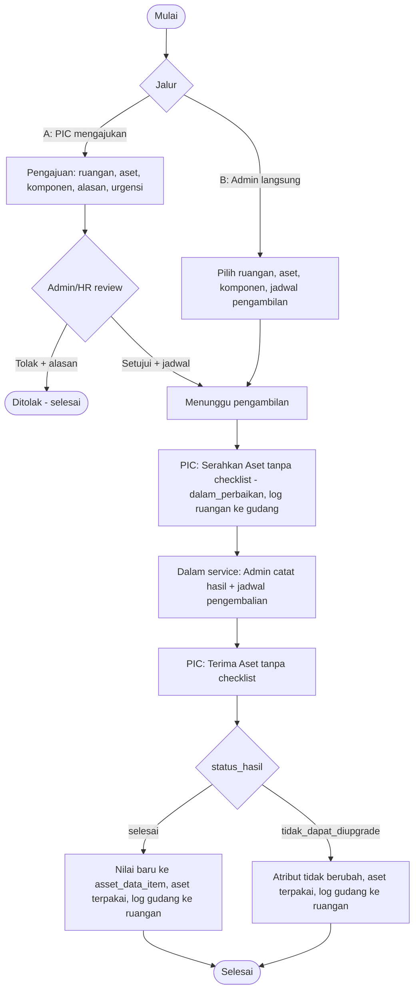
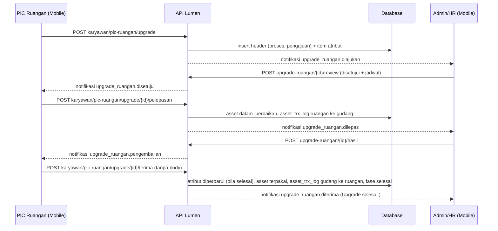
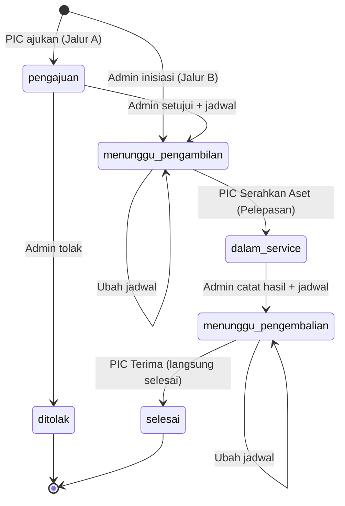
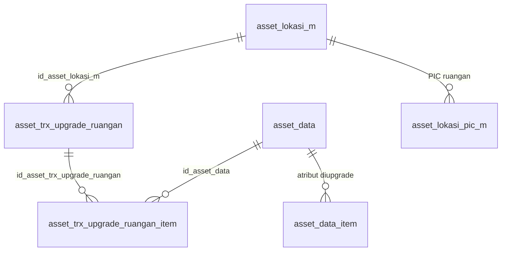

# Dokumentasi Teknis & Manual Book — Upgrade Komponen Aset Ruangan (ALK-RGN07)

> Dokumen ini disusun **dari source code lokal** (`API/` Lumen dan `MOBILE/` Flutter) per 30 Oktober 2026 (v1.2). Alurnya meniru **Upgrade Asset Karyawan (KRY03)**; pembeda utamanya, pemegang aset adalah **ruangan** dan aktor "karyawan" diganti **PIC Ruangan**.
> Cakupan implementasi: PIC Ruangan mengajukan (Jalur A) atau Admin/HR menginisiasi langsung (Jalur B) upgrade spesifikasi **satu aset milik ruangan**; aset diambil sementara, diupgrade di luar sistem, lalu dikembalikan ke **ruangan yang sama**. Sejak v1.2 alur **tanpa checklist kondisi dan tanpa review akhir admin**: PIC menekan Terima dan upgrade langsung selesai. Bagian yang tidak ditemukan ditandai **⚠️ Belum ditemukan**, asumsi ditandai **⚠️ Asumsi**.
> Contoh ID/nama pada payload adalah **data sintetis**.

---

## 1. Informasi Dokumen

| Informasi | Nilai |
|---|---|
| Nama Fitur | Upgrade Komponen Aset Ruangan (UI PIC: tombol **"Upgrade Komponen"** di halaman **"PIC Ruangan"**; UI Admin: item **"Upgrade"** di dashboard Ruangan; judul layar **"Upgrade Komponen Ruangan"**) |
| Kode Fitur | **ALK-RGN07** (nomor transaksi `RGN07-YYYYMMNNN`; RGN06 adalah Retur Ruangan, bukan fitur ini) |
| Modul | Asset Management — Ruangan |
| Backend | Laravel **Lumen ^10.0**, PHP ^8.1, JWT, Query Builder |
| Database | `API/diagram-asset.dbml` (tanda `[NEW ALK-RGN Upgrade]`) + SQL manual `Claude outputs/sql-alk-rgn-upgrade-ruangan.sql` |
| Mobile | Flutter (`professional_flutter_3_35`), `flutter_bloc`, `dio` |
| Web | ⚠️ Belum ditemukan: tidak ada source web di workspace |
| Test otomatis | API `tests/Asset/AssetUpgradeRuanganTest.php` (15 test) · Mobile `test/asset/asset_upgrade_ruangan_test.dart` (15 test) |
| Versi dokumen | 1.2 — 30 Oktober 2026 |
| Dokumen terkait | Upgrade Asset Karyawan (KRY03), Retur Ruangan (ALK-RGN06), Onboarding Ruangan (ALK-RGN01), Penambahan Ruangan (ALK-RGN04), Master Lokasi & PIC Ruangan |

## 2. Daftar Isi

Lihat panel navigasi di samping.

## 3. Quick Overview

Spesifikasi komponen **satu aset ruangan** (mis. RAM 16 GB → 32 GB) ditingkatkan lewat dua jalur dalam **satu tabel** (`asset_trx_upgrade_ruangan`), dibedakan kolom `sumber_pengajuan`. Pada **Jalur A** PIC Ruangan mengajukan (komponen yang diupgrade, alasan, urgensi) lalu Admin/HR menyetujui dengan jadwal pengambilan atau menolak; pada **Jalur B** Admin/HR langsung membuat transaksi beserta jadwal pengambilan. Pada jadwal, PIC **menyerahkan aset** (Pelepasan, tanpa checklist; aset menjadi `dalam_perbaikan`, pemegang tetap ruangan), Admin/HR mencatat **hasil upgrade** dan jadwal pengembalian, lalu PIC **menerima kembali** aset dengan satu ketukan **Terima** (tanpa checklist). Penerimaan itu **langsung menyelesaikan upgrade**: bila hasilnya `selesai`, nilai baru ditulis ke atribut, aset kembali `terpakai` di ruangan yang sama. Tidak ada lagi checklist pengambilan/pengembalian, review akhir admin, maupun Kirim Ulang (dihapus v1.2).

| Aspek | Ringkasan |
|---|---|
| Aktor | PIC Ruangan, Admin/HR (Admin Asset), Sistem |
| Jalur | A = `sumber_pengajuan='karyawan'` (PIC mengajukan) · B = `sumber_pengajuan='admin'` (Admin langsung) |
| Fase | `pengajuan` → `menunggu_pengambilan` → `dalam_service` → `menunggu_pengembalian` → `selesai`. Fase `menunggu_review` **tidak lagi dihasilkan** sejak v1.2 (hanya ada pada data lama) |
| Status approval | `status_approval`: `proses` → `disetujui` atau `ditolak` |
| Hasil | `status_hasil`: `selesai` (nilai baru ditulis ke atribut saat PIC menerima) atau `tidak_dapat_diupgrade` (atribut tidak berubah) + biaya |
| Status asset | `terpakai` → `dalam_perbaikan` (saat PIC menyerahkan) → `terpakai` (saat PIC menerima); pemegang tetap `ruangan` |
| Log aset | `asset_trx_log` dengan `jenis_log='upgrade_ruangan'`: ruangan → gudang saat pelepasan, gudang → ruangan saat diterima; `kondisi_akhir` selalu sama dengan `kondisi_awal` |
| Endpoint | 7 admin + 6 PIC = **13** (v1.1: 15; dua rute dihapus) |
| Notifikasi | 7 event (`upgrade_ruangan.*`), penerima PIC = **semua PIC aktif ruangan**; PIC menerima 2 notifikasi pada alur normal (v1.1: 4) |

## 4. Ringkasan Fitur

| Fitur | Aktor | Keterangan |
|---|---|---|
| Ajukan upgrade | PIC Ruangan | Pilih ruangan miliknya, aset `terpakai`, komponen (atribut spesifikasi) + detail upgrade, alasan, urgensi. Status `proses`, belum ada jadwal. |
| Review pengajuan | Admin/HR | Setujui dengan jadwal pengambilan, atau tolak dengan alasan (transaksi langsung selesai). |
| Inisiasi langsung | Admin/HR | Pilih ruangan, aset, komponen, catatan, jadwal pengambilan. PIC otomatis dari master PIC ruangan. |
| Ubah jadwal | Admin/HR | Selama fase `menunggu_pengambilan` atau `menunggu_pengembalian`. |
| Serahkan aset (pelepasan) | PIC Ruangan | Tersedia sejak transaksi disetujui (tanpa checklist). Aset menjadi `dalam_perbaikan`, log ruangan → gudang. |
| Hasil upgrade | Admin/HR | `selesai` atau `tidak_dapat_diupgrade`, nilai baru, biaya, keterangan, jadwal pengembalian. |
| Terima aset kembali | PIC Ruangan | Satu ketukan **Terima Aset** (tanpa checklist/body). Langsung menyelesaikan upgrade: atribut diperbarui (bila hasil `selesai`), aset `terpakai`, log gudang → ruangan. |
| Checklist pengambilan / pengembalian | (dihapus) | **Dihapus v1.2**; tidak ada lagi pencatatan kondisi komponen. |
| Review akhir (Selesaikan / Kirim Ulang) | (dihapus) | **Dihapus v1.2**; Terima oleh PIC langsung menyelesaikan upgrade. |

## 5. Tujuan Fitur

- Meningkatkan spesifikasi aset ruangan tanpa mengubah kepemilikannya: aset tetap tercatat milik ruangan.
- Memberi PIC Ruangan jalur resmi untuk meminta upgrade dengan alasan dan urgensi, dan memberi Admin/HR keputusan terdokumentasi.
- Mencatat serah terima fisik dua arah (pelepasan oleh PIC dan penerimaan kembali oleh PIC) beserta waktu dan pelakunya. Kondisi fisik komponen **tidak** dicatat sejak v1.2.
- Memperbarui nilai atribut aset (`asset_data_item`) hanya bila upgrade benar-benar berhasil.
- Mencegah aset yang sama dipakai bersamaan di retur, onboarding, penambahan ruangan, atau upgrade lain.

## 6. Aktor

| Aktor | Peran |
|---|---|
| PIC Ruangan | Karyawan di `asset_lokasi_pic_m` untuk ruangan tersebut. Mengajukan (Jalur A), menyerahkan aset, menerima aset kembali (penerimaan langsung menyelesaikan upgrade). Satu ruangan boleh punya banyak PIC; semua PIC aktif berhak bertindak dan dinotifikasi. |
| Admin/HR | Terdaftar di `asset_admin`. Menginisiasi (Jalur B), mereview pengajuan, menetapkan/mengubah jadwal, mencatat hasil upgrade dan jadwal pengembalian. Tidak ada lagi checklist maupun review akhir. |
| Sistem | Menurunkan status dari fase, mengunci aset lintas modul, memperbarui `asset_data`/`asset_data_item`, mencatat `asset_trx_log`, mengirim notifikasi. |

## 7. Hak Akses

| Aksi | Admin/HR | PIC Ruangan | Keterangan |
|---|---|---|---|
| Lihat opsi/daftar/detail (admin) | ✔ | ✘ | Controller admin memeriksa `asset_admin`; selain admin mendapat `FORBIDDEN`. |
| Inisiasi, review, jadwal, hasil | ✔ | ✘ | Model memeriksa `findAssetAdmin`; pesan `Pengguna tidak terdaftar sebagai admin asset.` |
| Ajukan upgrade | ✘ | ✔ | Hanya untuk ruangan yang PIC-nya pengaju. |
| Lihat opsi/daftar/detail milik ruangan | ✘ | ✔ | Dibatasi lewat `wherePic`: PIC **saat ini** di `asset_lokasi_pic_m`, bukan snapshot `id_karyawan_pic`. PIC ruangan lain mendapat `NOT_FOUND` pada detail. |
| Serahkan aset, terima aset kembali | ✘ | ✔ | Hanya PIC aktif ruangan transaksi tersebut (`lockHeader` memakai `wherePic`); PIC lain mendapat `BUSINESS_RULE_VIOLATION` (Upgrade asset tidak ditemukan). Terima langsung menyelesaikan upgrade. |

## 8. Terminologi

| Istilah | Arti |
|---|---|
| Jalur A / Jalur B | Pengajuan PIC (`sumber_pengajuan='karyawan'`) / inisiasi Admin (`'admin'`). |
| Fase | Kolom `fase_upgrade` (enum, disimpan): posisi alur lihat §14. |
| Atribut / komponen | Field spesifikasi pada `asset_data_item` (flag_spesifikasi 1 = unit utama, 2 = kelengkapan) yang bisa dipilih sebagai target upgrade. `id_atribut` berbentuk `id_asset_data_item|id_komponen`. |
| Item upgrade | Satu baris `asset_trx_upgrade_ruangan_item` per atribut yang diupgrade (`nilai_lama`, `nilai_baru`). |
| Komponen | Daftar unit utama + kelengkapan aset (`komponen[]` pada detail). Sejak v1.2 tidak dipakai layar upgrade ruangan (tidak ada checklist); berbeda dari item upgrade. |
| Pelepasan | PIC menyerahkan aset untuk diupgrade (`POST .../pelepasan`), tanpa checklist. |
| Terima | PIC menerima aset hasil upgrade (`POST .../terima`, tanpa body); langsung menyelesaikan transaksi. |
| Teknisi | Pihak di luar sistem yang mengerjakan upgrade; sistem hanya mencatat hasilnya. |
| Kirim Ulang / Review akhir | Fitur lama (v1.0-v1.1) yang **dihapus v1.2**; fase `menunggu_review` hanya tersisa pada data lama. |
| `SEMUA_PIC_RUANGAN` | Jenis penerima notifikasi: semua PIC aktif ruangan transaksi. |

## 9. Business Rules

| No | Aturan | Implementasi |
|---|---|---|
| BR-01 | Hanya ruangan aktif ber-PIC | `ruanganAktif()`: `tipe='ruangan'`, `status_aktif='1'`, ada baris `asset_lokasi_pic_m` dengan karyawan aktif (`STATUS_KARYAWAN_AKTIF`). Pesan: Ruangan tidak ditemukan, tidak aktif, atau belum memiliki PIC. |
| BR-02 | PIC pengaju harus PIC ruangan tersebut | `storePic` memanggil `findRuangan` dengan id karyawan; pesan: Ruangan tidak ditemukan, tidak aktif, atau Anda bukan PIC ruangan ini. |
| BR-03 | Aset harus milik ruangan itu dan berstatus `terpakai` | `insertTransaction`: `pemegang_asset='ruangan'`, `id_asset_lokasi_m` = ruangan; pesan Asset bukan milik ruangan atau tidak ditemukan. / Hanya asset berstatus terpakai yang dapat diupgrade. |
| BR-04 | Satu transaksi = satu aset, minimal satu komponen | `AssetUpgradeKaryawan_m::normalizeItems`: atribut harus ada pada aset, tidak ganda, `detail_upgrade` tidak kosong. |
| BR-05 | Pengajuan PIC wajib beralasan dan berurgensi | `urgensi` ∈ `normal`, `secepatnya`, `mendesak`; alasan tidak kosong. |
| BR-06 | Aset terkunci lintas modul | `assetBlockMessage`: ditolak bila aset ada di upgrade ruangan lain, retur ruangan, onboarding ruangan, atau penambahan ruangan yang masih berjalan. |
| BR-07 | Jalur B hanya oleh Admin/HR dan wajib berjadwal | `storeAdmin`: PIC diambil dari master ruangan; langsung `disetujui` + `menunggu_pengambilan`. Jadwal pengambilan wajib (Tanggal dan jam serah terima wajib diisi.). |
| BR-08 | Review hanya sekali | `review` menolak bila `status_approval` bukan `proses` (Pengajuan upgrade sudah direview.). Tolak wajib alasan. Setujui wajib jadwal dan aset masih `terpakai`. |
| BR-09 | Jadwal tidak boleh sebelum tanggal pengajuan | `parseJadwalValue`: Tanggal serah terima tidak boleh sebelum tanggal pengajuan. |
| BR-10 | Jadwal hanya diubah di dua fase | `updateJadwal`: fase `menunggu_pengambilan` (mengubah jadwal pengambilan) atau `menunggu_pengembalian` (jadwal pengembalian); selain itu Jadwal hanya dapat diubah sebelum serah terima dilakukan. |
| BR-11 | (Dihapus v1.2) Checklist pengambilan | Method `checklistPengambilan`, rute `POST upgrade-ruangan/{id}/checklist-pengambilan`, dan notifikasi `checklist_pengambilan` sudah tidak ada. Nomor BR dipertahankan agar rujukan lama tetap terbaca. |
| BR-12 | Pelepasan oleh PIC aktif ruangan, tanpa checklist | `pelepasan`: fase `menunggu_pengambilan`; aset `terpakai` (atau `dalam_perbaikan`, ditoleransi oleh `lockHeldAsset`) dan masih dipegang ruangan transaksi; `lockHeader` memakai `wherePic`, sehingga hanya PIC aktif ruangan yang sah. Tidak ada syarat checklist (v1.1: wajib checklist pengambilan lebih dulu). |
| BR-13 | Hasil upgrade | `hasil`: fase `dalam_service`; `status_hasil` ∈ `selesai`, `tidak_dapat_diupgrade`; keterangan wajib; biaya ≥ 0; bila `selesai`, nilai baru setiap atribut wajib; jadwal pengembalian wajib. |
| BR-14 | PIC menerima kembali tanpa checklist | `terima(id)` tanpa body: fase `menunggu_pengembalian`; aset berstatus `dalam_perbaikan` dan masih dipegang ruangan; hanya PIC aktif ruangan (`wherePic`). |
| BR-15 | Terima langsung menyelesaikan upgrade (review akhir dihapus) | `terima` dalam satu transaksi: bila `status_hasil='selesai'` jalankan `applyAtribut` (nilai baru → `asset_data_item.json_value`); aset → `terpakai`; log gudang → ruangan; `fase_upgrade='selesai'`, `status_transaksi='selesai'`, `tgl_diterima` diisi. Aksi admin Selesaikan dan Kirim Ulang tidak ada lagi; fase `menunggu_review` tidak dihasilkan lagi. |
| BR-16 | Pemegang aset tidak pernah berubah | Selama proses `pemegang_asset='ruangan'` dan `id_asset_lokasi_m` tetap; hanya `status_asset` yang berubah. |
| BR-17 | Hak akses PIC mengikuti PIC ruangan saat ini | `wherePic` menguji `asset_lokasi_pic_m` pada saat permintaan, bukan snapshot di header. |
| BR-18 | Setiap tindakan mencatat pelaku dan waktu | `user_input`, `user_update`, `user_approval`, `tgl_approval`, `user_pelepasan`, `tgl_pelepasan`, `tgl_diterima`, `asset_trx_log`. |
| BR-19 | Kondisi fisik tidak dicatat (baru v1.2) | `logAsset`: `kondisi_akhir` selalu sama dengan `kondisi_awal` aset (nilai `normal` bila kosong). Kerusakan pasca-upgrade tidak terdeteksi sistem (RISK-012). |

## 10. Business Flow

1. **Jalur A.** PIC memilih ruangan, aset, komponen yang diupgrade (+ detail upgrade tiap komponen), alasan, dan urgensi, lalu mengirim. Admin/HR dinotifikasi (`upgrade_ruangan.diajukan`).
2. Admin/HR mereview pengajuan.
    - **Tolak:** isi alasan, status `ditolak`, fase `selesai`, transaksi `selesai`; semua PIC ruangan dinotifikasi (`ditolak`).
    - **Setujui:** tetapkan jadwal pengambilan, fase `menunggu_pengambilan`; semua PIC dinotifikasi (`disetujui`).
3. **Jalur B.** Admin/HR memilih ruangan, aset, komponen, catatan, dan jadwal pengambilan; transaksi langsung `disetujui` dan semua PIC dinotifikasi (`disetujui`). Langkah 1-2 dilewati.
4. Jadwal dapat diubah Admin/HR selama fase `menunggu_pengambilan` (`dijadwalkan`). Tidak ada pemeriksaan/checklist oleh admin; PIC bisa langsung menyerahkan aset.
5. PIC menekan **Serahkan Aset** (Pelepasan, tanpa checklist) pada jadwal. Aset menjadi `dalam_perbaikan`, log ruangan → gudang, fase `dalam_service`. Admin dinotifikasi (`dilepas`).
6. Teknisi mengerjakan upgrade di luar sistem. Admin/HR mencatat **hasil** (`selesai` atau `tidak_dapat_diupgrade`, nilai baru per atribut, biaya, keterangan) dan jadwal pengembalian. Fase `menunggu_pengembalian`; semua PIC dinotifikasi (`pengembalian`). Jadwal pengembalian masih dapat diubah (`dijadwalkan`).
7. PIC menekan **Terima Aset** (tanpa checklist dan tanpa body) yang **langsung menyelesaikan upgrade** dalam satu transaksi:
    - bila `status_hasil='selesai'`, nilai baru ditulis ke `asset_data_item.json_value`;
    - aset kembali `terpakai`, log gudang → ruangan, `tgl_diterima` diisi;
    - `fase_upgrade='selesai'` dan `status_transaksi='selesai'`; Admin dinotifikasi (`diterima`, berakhiran "Upgrade selesai.").
8. Selesai. Tidak ada review akhir admin, Selesaikan, ataupun Kirim Ulang (dihapus v1.2).

## 11. Flow Berdasarkan Role

| Role | Langkah |
|---|---|
| PIC Ruangan | Ajukan → (tunggu keputusan) → terima notifikasi jadwal → **Serahkan Aset** → (tunggu hasil) → **Terima Aset** → selesai. |
| Admin/HR | Tab Pengajuan → setujui/tolak (atau tombol **+** untuk Jalur B) → (ubah jadwal bila perlu) → saat aset dalam service: catat hasil + jadwal pengembalian. Tidak ada langkah setelah itu. |
| Sistem | Mengunci aset lintas modul, menurunkan status dari fase, memperbarui atribut saat Terima, mencatat log, mengirim notifikasi. |

## 12. Flow Diagram



Fase `menunggu_review` dan jalur Kirim Ulang pada diagram v1.1 sudah dihapus.

## 13. Sequence Diagram



## 14. Status Transaksi

Dua kolom enum disimpan di header: `status_approval` dan `fase_upgrade` (serta `status_transaksi` untuk tab Selesai). Label dan tab daftar diturunkan oleh `upgradeStatusMetadata`.

| `status_approval` | `fase_upgrade` | Label | Tab |
|---|---|---|---|
| `proses` | `pengajuan` | Menunggu Persetujuan | `pengajuan` |
| `disetujui` | `menunggu_pengambilan` | Menunggu Pengambilan | `proses` |
| `disetujui` | `dalam_service` | Dalam Service | `proses` |
| `disetujui` | `menunggu_pengembalian` | Menunggu Pengembalian | `proses` |
| `disetujui` | `menunggu_review` | Menunggu Review | `proses` (**hanya data lama**; tidak dihasilkan sejak v1.2, lihat RISK-011) |
| `disetujui` | `selesai` | Selesai | `selesai` |
| `ditolak` | `selesai` | Ditolak | `selesai` |

Filter daftar di API: tab `pengajuan` = `status_approval='proses'`; `proses` = `disetujui` dan fase bukan `selesai`; `selesai` = `status_transaksi='selesai'`. Tanpa parameter `tab`, semua transaksi dikembalikan. Status aset: lihat §22. Konstanta dan label `menunggu_review` dipertahankan di kode dan enum agar data lama tetap terbaca, tetapi tidak ada aksi yang bisa memprosesnya; data lama diselesaikan dengan SQL migrasi `sql-upgrade-hapus-checklist-review-lama.sql` (belum dijalankan).

## 15. State Transition



Transisi `menunggu_pengembalian → menunggu_review`, `menunggu_review → selesai`, dan `menunggu_review → menunggu_pengambilan` (Kirim Ulang) dari v1.1 sudah dihapus.

## 16. Struktur Database

| Tabel | Fungsi |
|---|---|
| `asset_trx_upgrade_ruangan` | Header transaksi (kedua jalur): ruangan, PIC, jadwal, hasil, status (kolom checklist tetap ada tetapi tidak dipakai sejak v1.2). |
| `asset_trx_upgrade_ruangan_item` | Satu baris per atribut yang diupgrade (`nilai_lama`, `nilai_baru`). |
| `asset_trx_log` | Enum `jenis_log` ditambah nilai `upgrade_ruangan` (nilai lama dipertahankan). |

Enum yang dipakai bersama dokumen lain di DBML: `sumber_pengajuan`, `status_approval`, `status`, `fase_upgrade`, `status_hasil_upgrade`.

**Skema tidak berubah pada v1.2.** File SQL asal `sql-alk-rgn-upgrade-ruangan.sql` tidak diubah (sudah dijalankan); kolom `checklist_pengambilan` dan `checklist_pengembalian` serta nilai enum `menunggu_review` tetap ada. Satu-satunya skrip tambahan adalah SQL migrasi data lama `sql-upgrade-hapus-checklist-review-lama.sql` (belum dijalankan, lihat RISK-011).

## 17. Relasi Database



Foreign key di SQL: `fk_atur_upgrade_id_asset_lokasi_m`, `fk_aturi_upgrade_header`, `fk_aturi_upgrade_asset_data`. PIC pada header disimpan sebagai snapshot (`id_karyawan_pic`, `nama_pic`, `nik_pic`); hak akses dan penerima notifikasi dibaca dari `asset_lokasi_pic_m` saat itu juga.

## 18. Data Dictionary

**`asset_trx_upgrade_ruangan`**

| Kolom | Tipe | Keterangan |
|---|---|---|
| `id_asset_trx_upgrade_ruangan` | varchar(50) PK | `id_company` + `YYYYMM` + 3 digit urut |
| `no_trx` | varchar(50) | `RGN07-YYYYMMNNN`; unik per company |
| `sumber_pengajuan` | enum(`karyawan`,`admin`) | Jalur A / Jalur B |
| `id_asset_lokasi_m` + snapshot `nama_asset_ruangan`, `nama_cabang`, `nama_departemen` | varchar | Ruangan; FK ke `asset_lokasi_m` |
| `id_karyawan_pic`, `nama_pic`, `nik_pic` | varchar | Snapshot PIC saat transaksi dibuat; dasar tampilan, bukan hak akses |
| `id_asset_kategori_m`, `nama_kategori` | varchar | Jenis aset |
| `detail_upgrade` | varchar(255) | Ringkasan "label: detail" semua komponen (dipotong 255) |
| `alasan`, `urgensi` | text, varchar(50) | Jalur A (`normal`/`secepatnya`/`mendesak`); kosong pada Jalur B |
| `catatan` | text | Jalur B (opsional) |
| `id_karyawan`, `nik_karyawan`, `nama_karyawan` | varchar | Pembuat transaksi (PIC pada Jalur A, Admin pada Jalur B) |
| `tgl_pengajuan` | date | Tanggal hari ini saat dibuat |
| `tgl_pengambilan`, `jam_pengambilan` | date, time NULL | Jadwal pengambilan |
| `tgl_pengembalian`, `jam_pengembalian` | date, time NULL | Jadwal pengembalian |
| `keterangan_pengembalian` | varchar(255) | Keterangan jadwal terakhir (pengambilan atau pengembalian) |
| `checklist_pengambilan` | text NULL | **Tidak dipakai sejak v1.2** (kolom tetap ada, tidak ditulis dan tidak dibaca API). Data lama berisi JSON kondisi komponen saat diambil |
| `checklist_pengembalian` | text NULL | **Tidak dipakai sejak v1.2** (kolom tetap ada). Data lama berisi JSON kondisi komponen saat diterima kembali |
| `tgl_pelepasan`, `user_pelepasan` | timestamp NULL, varchar | PIC menyerahkan aset |
| `status_hasil` | enum(`selesai`,`tidak_dapat_diupgrade`) NULL | Hasil upgrade |
| `keterangan_hasil`, `biaya_upgrade` | text, bigint | Keterangan dan biaya (default 0) |
| `tgl_diterima` | timestamp NULL | PIC menerima kembali; sejak v1.2 terisi bersamaan dengan fase `selesai` (reset `NULL` saat hasil dicatat) |
| `status_transaksi` | enum(`proses`,`selesai`) | `selesai` saat ditolak atau saat PIC menerima |
| `fase_upgrade` | enum 6 nilai | Default `pengajuan`. Nilai `menunggu_review` tetap ada di enum tetapi tidak dihasilkan lagi sejak v1.2 |
| `status_approval` | enum(`proses`,`disetujui`,`ditolak`) | Default `proses` |
| `ket_tolak`, `user_approval`, `tgl_approval` | varchar, varchar, timestamp NULL | Keputusan review |
| `id_company`, `tgl_input`, `user_input`, `tgl_update`, `user_update` | | Audit standar |

**`asset_trx_upgrade_ruangan_item`**: `id_asset_trx_upgrade_ruangan_item` (PK), `id_asset_trx_upgrade_ruangan`, `id_asset_data`, `kelengkapan_item` (JSON atribut: `id_atribut`, `id_asset_data_item`, `id_komponen`, `nama_item`, `jenis`, `label`, `satuan`, `nilai`), snapshot `nama_asset`, `deskripsi_asset`, `kategori_asset`, `detail_upgrade`, `nilai_lama`, `nilai_baru`, `alasan_tidak_upgrade`, `id_company`, `tgl_input`, `user_input`.

## 19. Database Index

| Tabel | Index | Kegunaan |
|---|---|---|
| `asset_trx_upgrade_ruangan` | unik `uq_upgrade_rgn_company_no_trx (id_company, no_trx)` | Nomor transaksi unik per company |
| | `atur_admin_list_idx (id_company, status_approval, fase_upgrade, tgl_input, id)` | Daftar admin per tab |
| | `atur_pic_list_idx (id_company, id_karyawan_pic, status_approval, fase_upgrade)` | Daftar PIC |
| | `atur_lokasi_idx (id_company, id_asset_lokasi_m, status_approval, fase_upgrade)` | Pencarian per ruangan |
| `asset_trx_upgrade_ruangan_item` | `aturi_upgrade_idx (id_asset_trx_upgrade_ruangan, id_company, id_asset_data)` | Item per transaksi |
| | `aturi_asset_idx (id_asset_data, id_company)` | Pencarian per aset (kunci lintas modul) |

## 20. Backend Architecture

| Lapisan | File |
|---|---|
| Route | `API/routes/modules/asset/RouteAsset.php` (grup `upgrade-ruangan` dan `pic-ruangan` → `upgrade`) |
| Controller Admin | `app/Http/Controllers/Asset/Admin/AssetAdminUpgradeRuangan_c.php` |
| Controller PIC | `app/Http/Controllers/Asset/Karyawan/AssetKaryawanUpgradeRuangan_c.php` |
| Model | `app/Models/Asset/AssetUpgradeRuangan_m.php` (admin + PIC; mewarisi `Asset_m`) |
| Notifikasi | `app/Support/Asset/AssetNotification.php` (event `upgrade_ruangan.*`, penerima `SEMUA_PIC_RUANGAN`) |
| Basis controller | `app/Http/Controllers/Asset/Asset_c.php` (`UPGRADE_JADWAL_RULES`, `UPGRADE_MESSAGES`, `mutateAssetTrx`, `mutateTrxSaya`; `UPGRADE_CHECKLIST_RULES` tidak lagi dipakai modul ini) |

Controller memvalidasi input, model menjalankan `DB::transaction` (dengan `lockCompany` dan `lockForUpdate`), lalu notifikasi dikirim **setelah** transaksi sukses. Aksi admin lewat `mutateAssetTrx` (respons sukses `UPDATED`), aksi PIC lewat `mutateTrxSaya`. Logika pendukung dipakai ulang dari KRY03 (`AssetUpgradeKaryawan_m`) dan `Asset_m` (`komponenAssets`, `parseJadwalValue`, `insertAssetLog`; `normalizeKondisiChecklist` tidak lagi dipanggil modul ini).

**Perubahan pada modul lain**

| Modul | Perubahan |
|---|---|
| `AssetReturRuangan_m` | Tiga method query kunci (`activeReturRuanganQuery`, `activeOnboardingRuanganQuery`, `activeRequestRuanganQuery`) dijadikan `public` agar dipakai upgrade ruangan. `store` retur kini menolak aset yang sedang diupgrade (Satu atau beberapa asset sedang diproses pada upgrade ruangan.) dan `lockedAssetIds` ikut menyaring aset upgrade dari opsi retur. Pemblokiran retur ↔ upgrade berlaku dua arah. |
| `AssetUpgradeKaryawan_m` | Empat helper dijadikan `public` tanpa perubahan logika: `atributAssets`, `normalizeItems`, `jadwalPayload`, `upgradeStatusMetadata`. |
| `AssetAdmin_m` | `getSummary` menambah `ruangan_upgrade_perlu_proses` (jumlah) dan `ruangan_upgrade_pending` (daftar terlama). |
| `AssetLokasiPic_m` | `getAssetRuanganSaya` (beranda PIC) menambah key `upgrade_ruangan` (aksi `pelepasan` atau `terima`). |
| `AssetNotification` | 7 event `upgrade_ruangan.*` (v1.2; v1.0-v1.1: 10) dan jenis penerima `SEMUA_PIC_RUANGAN` (`picRuanganRecipients`). |
| `RouteAsset.php` | Grup `upgrade-ruangan` (admin) dan `upgrade` di dalam `pic-ruangan` (PIC). |
| Skema | Dua tabel baru dan nilai enum `upgrade_ruangan` pada `asset_trx_log.jenis_log` (SQL manual). |

## 21. Backend Business Logic

- **`storePic`** (Jalur A): kunci company; validasi karyawan aktif, ruangan milik PIC (BR-02), urgensi, alasan; `insertTransaction` membuat header `proses`/`pengajuan` tanpa jadwal.
- **`storeAdmin`** (Jalur B): validasi admin dan ruangan (PIC = PIC pertama ruangan menurut urutan master), parse jadwal; header `disetujui`/`menunggu_pengambilan` dengan jadwal pengambilan, `user_approval` dan `tgl_approval` terisi.
- **`insertTransaction`**: kunci aset `FOR UPDATE`; aset harus milik ruangan dan `terpakai`; cek kunci lintas modul; normalisasi item; nomor `RGN07-` + `YYYYMM` + 3 digit; simpan header dan item (`nilai_lama` dari atribut saat itu).
- **`review`**: header harus `proses`. Tolak: alasan wajib, `status_approval='ditolak'`, `fase_upgrade='selesai'`, `status_transaksi='selesai'`. Setujui: aset masih `terpakai`, jadwal valid, fase `menunggu_pengambilan`.
- **`updateJadwal`**: fase `menunggu_pengambilan` atau `menunggu_pengembalian`; menulis tanggal/jam pengambilan atau pengembalian sesuai fase.
- **`pelepasan`** (PIC): `lockHeader` dengan filter PIC aktif ruangan; fase `menunggu_pengambilan` (tanpa syarat checklist); aset `terpakai` atau `dalam_perbaikan` dan masih dipegang ruangan; aset → `dalam_perbaikan`; log ruangan → gudang; `tgl_pelepasan`, `user_pelepasan`; fase `dalam_service`.
- **`hasil`**: fase `dalam_service`; validasi status/keterangan/biaya/jadwal; tiap item mendapat `nilai_baru` (hanya bila `selesai`) atau `alasan_tidak_upgrade` (bila tidak dapat diupgrade); fase `menunggu_pengembalian`; `tgl_diterima` direset `NULL`.
- **`terima`** (PIC, tanpa body): `lockHeader` dengan filter PIC aktif ruangan; fase `menunggu_pengembalian`; aset `dalam_perbaikan` dan dipegang ruangan. Dalam satu transaksi: bila `status_hasil='selesai'` jalankan `applyAtribut` (menulis `nilai_baru` ke `json_value.komponen[].value` pada `asset_data_item`); aset → `terpakai`; log gudang → ruangan; `fase_upgrade='selesai'`, `status_transaksi='selesai'`, `tgl_diterima` diisi.
- **Pending** (`getPendingForAdmin`, `countPendingForAdmin`): `status_approval='proses'` **atau** fase `dalam_service`. `getPendingForPic`: fase `menunggu_pengambilan` (aksi `pelepasan`) atau `menunggu_pengembalian` (aksi `terima`).
- **Dihapus v1.2**: `checklistPengambilan`, `selesai` (review akhir: `terima`/`kirim_ulang`), `terima` versi lama yang menyimpan checklist dan masuk `menunggu_review`.

## 22. Dampak terhadap asset_data

| Tahap | `status_asset` | `pemegang_asset` | Catatan |
|---|---|---|---|
| Pengajuan / review / jadwal | `terpakai` | `ruangan` | Tidak berubah; aset terkunci secara logis lewat pemeriksaan lintas modul, bukan lewat status. |
| PIC menyerahkan (`pelepasan`) | `terpakai` → `dalam_perbaikan` | `ruangan` | `id_asset_lokasi_m` tetap; log `upgrade_ruangan` ruangan → gudang. |
| Hasil dicatat | tetap `dalam_perbaikan` | `ruangan` | Menunggu PIC menerima. |
| PIC menerima (`terima`, langsung selesai) | `dalam_perbaikan` → `terpakai` | `ruangan` | Log gudang → ruangan; `asset_data_item` diperbarui bila hasil `selesai`. |
| Ditolak | `terpakai` | `ruangan` | Tidak ada perubahan; aset boleh diajukan lagi. |

Kolom log: `id_pemegang`/`nama_pemegang` terisi id dan nama ruangan pada sisi ruangan, **kosong** pada sisi gudang (mengikuti retur ruangan, RISK-005). `kondisi_awal` dan `kondisi_akhir` log **selalu sama**, memakai `kondisi_awal` aset (`normal` bila kosong), karena kondisi fisik tidak lagi dicatat sejak v1.2 (RISK-012).

Pada data lama yang berhenti di fase `menunggu_review`, aset tetap `dalam_perbaikan` dan terkunci sampai SQL migrasi dijalankan (RISK-011).

## 23. API Documentation

Base `asset/`. Semua memakai JWT dan envelope `ApiResponse`.

| ID | Method | Path | Peran | Fungsi |
|---|---|---|---|---|
| API-01 | GET | `upgrade-ruangan/options` | Admin | Ruangan aktif ber-PIC beserta aset yang dapat diupgrade |
| API-02 | GET | `upgrade-ruangan?tab&limit&offset` | Admin | Daftar (`pengajuan`/`proses`/`selesai`) |
| API-03 | GET | `upgrade-ruangan/{id}` | Admin | Detail + flag `aksi` |
| API-04 | POST | `upgrade-ruangan` | Admin | Jalur B: buat upgrade + jadwal pengambilan |
| API-05 | POST | `upgrade-ruangan/{id}/review` | Admin | Jalur A: setujui + jadwal / tolak + alasan |
| API-06 | PUT | `upgrade-ruangan/{id}/jadwal` | Admin | Ubah jadwal pengambilan/pengembalian |
| API-07 | POST | `upgrade-ruangan/{id}/checklist-pengambilan` | (dihapus v1.2) | Rute tidak ada lagi; nomor dipertahankan. Memanggilnya kini 404 (diuji) |
| API-08 | POST | `upgrade-ruangan/{id}/hasil` | Admin | Hasil upgrade + jadwal pengembalian |
| API-09 | POST | `upgrade-ruangan/{id}/selesai` | (dihapus v1.2) | Rute tidak ada lagi; nomor dipertahankan. Memanggilnya kini 404 (diuji) |
| API-10 | GET | `karyawan/pic-ruangan/upgrade/options` | PIC | Ruangan miliknya + aset + urgensi |
| API-11 | GET | `karyawan/pic-ruangan/upgrade?tab` | PIC | Daftar upgrade ruangan milik PIC |
| API-12 | POST | `karyawan/pic-ruangan/upgrade` | PIC | Ajukan upgrade (Jalur A) |
| API-13 | GET | `karyawan/pic-ruangan/upgrade/{id}` | PIC | Detail |
| API-14 | POST | `karyawan/pic-ruangan/upgrade/{id}/pelepasan` | PIC | Serahkan aset (tanpa checklist, tanpa body) |
| API-15 | POST | `karyawan/pic-ruangan/upgrade/{id}/terima` | PIC | Terima aset kembali, tanpa body; langsung menyelesaikan upgrade |

Tambahan: `GET karyawan/pic-ruangan` (beranda PIC) kini menyertakan key `upgrade_ruangan`; `GET summary` (admin) kini menyertakan `ruangan_upgrade_perlu_proses` dan `ruangan_upgrade_pending`. Jumlah endpoint dihitung dari `RouteAsset.php`: grup `upgrade-ruangan` 7 route (API-01 sampai API-06 dan API-08) + 6 route PIC (API-10 sampai API-15) = **13** (v1.1: 15; dua rute admin dihapus). Test `test_routes_are_registered_for_admin_and_pic_groups` memastikan rute yang dihapus menjawab 404. Total route aplikasi pada v1.1 (552, lihat RISK-008) belum dihitung ulang.

## 24. Detail Setiap API

**API-12 · POST `asset/karyawan/pic-ruangan/upgrade`** (Jalur A)

```json
{ "id_asset_lokasi_m": "RGN-1", "id_asset_data": "LAP-1",
  "alasan": "Build lambat", "urgensi": "secepatnya",
  "items": [{ "id_atribut": "LAP-1-UNIT|K1", "detail_upgrade": "16 GB ke 32 GB" }] }
```
Respons `CREATED`: `{ "id": "COMP202610001", "no_trx": "RGN07-202610001", "status_approval": "proses", "fase_upgrade": "pengajuan", "status_label": "Menunggu Persetujuan", "tab": "pengajuan" }`. `urgensi` ∈ `normal|secepatnya|mendesak`; `id_atribut` diambil dari `assets[].atribut[]` pada API-10.

**API-04 · POST `asset/upgrade-ruangan`** (Jalur B)

```json
{ "id_asset_lokasi_m": "RGN-1", "id_asset_data": "LAP-1", "catatan": "Bawa kunci ruangan",
  "items": [{ "id_atribut": "LAP-1-UNIT|K1", "detail_upgrade": "16 GB ke 32 GB" }],
  "tgl_jadwal": "2026-10-20", "jam_jadwal": "09:00", "keterangan_jadwal": "Ruang IT" }
```
Respons `CREATED`: `status_approval: "disetujui"`, `fase_upgrade: "menunggu_pengambilan"`, `tab: "proses"`. Controller menandai jadwal `nullable`, tetapi model menolak bila kosong (Tanggal dan jam serah terima wajib diisi.). Notifikasi yang dikirim: `upgrade_ruangan.disetujui` (ke semua PIC ruangan).

**API-05 · POST `.../{id}/review`**: setujui `{ "keputusan": "disetujui", "tgl_jadwal": "2026-10-20", "jam_jadwal": "09:00", "keterangan_jadwal": "" }`; tolak `{ "keputusan": "ditolak", "ket_tolak": "Belum prioritas" }`. Respons `UPDATED` dengan status/fase terbaru; event `upgrade_ruangan.disetujui` atau `upgrade_ruangan.ditolak`.

**API-06 · PUT `.../{id}/jadwal`**: `{ "tgl_jadwal", "jam_jadwal", "keterangan_jadwal" }`. Mengubah jadwal pengambilan atau pengembalian sesuai fase; event `upgrade_ruangan.dijadwalkan`.

**API-07 dan API-09 (dihapus v1.2)**: `POST .../{id}/checklist-pengambilan` dan `POST .../{id}/selesai` (`{ "aksi": "terima" | "kirim_ulang" }`) tidak lagi terdaftar; keduanya menjawab 404.

**API-08 · POST `.../{id}/hasil`**

```json
{ "status_hasil": "selesai", "keterangan_hasil": "Dikerjakan vendor", "biaya_upgrade": 850000,
  "items": [{ "id_item": "COMP202610001", "nilai_baru": "32" }],
  "tgl_jadwal": "2026-10-22", "jam_jadwal": "10:00", "keterangan_jadwal": "Ambil di resepsionis" }
```
`id_item` adalah id **baris item upgrade** (`items[].id_item` pada detail); satu-satunya jenis `id_item` pada modul ini sejak checklist dihapus. `status_hasil` ∈ `selesai|tidak_dapat_diupgrade`; bila `selesai`, `nilai_baru` setiap item wajib. Event `upgrade_ruangan.pengembalian`.

**API-14 · POST `.../upgrade/{id}/pelepasan`**: tanpa body. Hanya PIC aktif ruangan; tidak ada syarat checklist. Event `upgrade_ruangan.dilepas`.

**API-15 · POST `.../upgrade/{id}/terima`**: **tanpa body**. Langsung menyelesaikan upgrade (atribut diperbarui bila hasil `selesai`, aset `terpakai`, log gudang → ruangan, `fase_upgrade='selesai'`). Respons `UPDATED`: `status_label` "Selesai", `fase_upgrade` `selesai`. Event `upgrade_ruangan.diterima` ke admin. Body lama `{ "items": [...] }` (checklist) kini diabaikan.

**API-10 / API-01 · Opsi**: `ruangan[]` berisi `id_asset_lokasi_m`, `nama_ruangan`, `cabang`, `divisi`, `pic{id_karyawan,nik,nama}`, `assets[]` (`id_asset_data`, `kode_asset`, `nama_asset`, `kategori_asset`, `merek`, `id_asset_lokasi_m`, `atribut[]`). Hanya ruangan yang punya aset `terpakai`, bebas kunci lintas modul, dan beratribut spesifikasi yang muncul. API-10 menambah `urgensi[]` (`value`, `label`).

**API-02 / API-11 · Daftar**: `filters[]`, `records[]` (`id`, `no_trx`, `sumber_pengajuan`, `tgl_pengajuan`, `urgensi`, `status_approval`, `fase_upgrade`, `status_label`, `tab`, jadwal, `jumlah_item`, `asset`, `ruangan`, `pic`), `pagination` (`limit` default 20 maks 50, `offset`, `next_offset`, `has_more`).

**API-03 / API-13 · Detail**: `id`, `no_trx`, `sumber_pengajuan`, `tgl_pengajuan`, `alasan`, `urgensi`, `catatan`, `ket_tolak`, `status_approval`, `fase_upgrade`, `status_label`, `tab`, jadwal (`tgl_pengambilan`, `jam_pengambilan`, `tgl_pengembalian`, `jam_pengembalian`), `keterangan_jadwal`, `tgl_pelepasan`, `tgl_diterima`, `status_hasil`, `keterangan_hasil`, `biaya_upgrade`, `ruangan`, `pic`, `asset`, `items[]` (`id_item`, `nama_item`, `label`, `satuan`, `detail_upgrade`, `nilai_lama`, `nilai_baru`, `alasan_tidak_upgrade`), `komponen[]` (masih dikirim, tidak dipakai layar ruangan), dan `aksi{review, ubah_jadwal, pelepasan, hasil, terima}`. Field `checklist_pengambilan`, `checklist_pengembalian`, `checklist_pengembalian_rusak`, serta flag `aksi.checklist_pengambilan` dan `aksi.selesai` **dihapus v1.2** (diuji tidak ada). Flag `aksi` **tidak mengenal peran** (RISK-002): detail PIC pun memuat flag yang hanya berlaku untuk admin. Flag mengikuti fase: `review` saat `status_approval='proses'`; `ubah_jadwal` saat `menunggu_pengambilan`/`menunggu_pengembalian`; `pelepasan` saat `menunggu_pengambilan`; `hasil` saat `dalam_service`; `terima` saat `menunggu_pengembalian`. Pada transaksi selesai tidak ada flag `true`.

## 25. Mobile Architecture

Flutter + `flutter_bloc` + `dio`. Modul Upgrade Karyawan (KRY03) **dipakai ulang lewat flag** agar tidak menggandakan kode.

| Komponen | Cara pakai ulang |
|---|---|
| `AssetUpgradeApi(admin:, ruangan:)` | `ruangan: true` mengganti basis menjadi `asset/upgrade-ruangan` (admin) atau `asset/karyawan/pic-ruangan/upgrade` (PIC); metode baru `storeRuangan` (karyawan memakai `store`). Metode checklist/selesai sudah dihapus; `terima(id)` kini tanpa body dan `pelepasan(id)` tanpa body |
| `HalamanAssetUpgrade(untukRuangan:)` | Daftar dengan tab; kartu menampilkan nama ruangan (`showRuangan`) |
| `HalamanTambahAssetUpgrade(untukRuangan:)` | Form: pilih ruangan → aset → komponen; PIC mengisi alasan + urgensi, admin mengisi catatan + jadwal |
| `HalamanDetailAssetUpgrade(untukRuangan:)` | Detail, stepper, form hasil (admin), aksi per peran. Form checklist, tombol checklist pengambilan, Selesaikan, dan Kirim Ulang sudah dihapus |
| `AssetUpgradeBloc` | Bloc yang sama; dibuat dengan `AssetUpgradeApi(admin: ..., ruangan: true)` di `router.dart` |
| Model | `mAssetUpgrade.dart`: `AssetUpgradeRuanganOption`, `AssetUpgradePic`, `AssetUpgradeRuanganPending`; `AssetUpgradeRecord` memuat `ruangan` dan `pic`; `AssetUpgradeAksi` hanya `review`, `ubahJadwal`, `pelepasan`, `hasil`, `terima` |

Widget `AssetKondisiChecklist` (di `AssetFormWidgets.dart`) **dipertahankan** karena dipakai modul lain; hanya pemakaiannya di Upgrade yang dihapus. Kunci lokalisasi lama yang tak terpakai (mis. `checklist_pengambilan`, `checklist_pengembalian`, `menunggu_checklist_admin`, `review_normal_info`, `review_rusak_info`, `button_simpan_checklist`, `button_selesaikan`, `button_kirim_ulang`, `konfirmasi_selesai`) masih ada di `asset.json` sebagai sisa (juga teks `pelepasan_info` yang masih menyebut pemeriksaan admin).

Perubahan di file bersama: `HalamanAssetPicRuangan.dart` (entri + banner), `HalamanAssetAdminRuangan.dart` (item **Upgrade** + seksi perlu diproses), `mAssetPicRuangan.dart` (`upgradeRuangan`), `mAssetSummary.dart` (`ruanganUpgradePerluProses`, `ruanganUpgradePending`), `NavigatorBloc.dart`, `router.dart`.

## 26. Mobile Screen

| Layar | Rute | Pengguna |
|---|---|---|
| Dashboard Ruangan → item **Upgrade** + seksi "Upgrade Komponen Ruangan Perlu Diproses" | tab Ruangan pada `HalamanHomeAssetAdmin` (`HalamanAssetAdminRuangan`, bukan rute tersendiri) | Admin/HR |
| Daftar upgrade (tab Pengajuan/Proses/Selesai) | `/asset_admin_upgrade_ruangan` | Admin/HR |
| Form Buat Upgrade (Jalur B) | `/asset_admin_tambah_upgrade_ruangan` | Admin/HR |
| Detail upgrade | `/asset_admin_detail_upgrade_ruangan` | Admin/HR |
| PIC Ruangan + tombol **Upgrade Komponen** + banner serah/terima | `/asset_pic_ruangan` (halaman yang sudah ada) | PIC |
| Daftar upgrade (dari notifikasi dengan id langsung ke detail) | `/asset_pic_ruangan_upgrade` | PIC |
| Form Ajukan Upgrade | `/asset_pic_ruangan_tambah_upgrade` | PIC |
| Detail upgrade | `/asset_pic_ruangan_detail_upgrade` | PIC |

Rute notifikasi (`assetNotifRoutes`): `asset_pic_ruangan_upgrade` (PIC, membawa id transaksi) dan `asset_admin_detail_upgrade_ruangan` (Admin). Detail menampilkan header nomor transaksi, stepper fase (label tidak berubah: Pengajuan, Pengambilan, Service, Pengembalian, Selesai), kartu jadwal aktif, komponen yang diupgrade (nilai lama/baru), form hasil (admin), ringkasan hasil, dan kartu pengajuan (ruangan, PIC, alasan, urgensi, catatan). Tidak ada lagi form checklist maupun ringkasan checklist. Tombol bawah mengikuti peran dan flag `aksi`: PIC **Serahkan Aset** (`aksi.pelepasan`) atau **Terima Aset** (`aksi.terima`), masing-masing dengan dialog konfirmasi; Admin **Tolak / Setujui & Jadwalkan** (`aksi.review`) atau **Simpan Hasil & Jadwalkan** (`aksi.hasil`).

## 27. Mobile → API

| Aksi di layar | Pemanggilan |
|---|---|
| Buka daftar / pindah tab | `getList(tab)` → API-02 (admin) / API-11 (PIC) |
| Buka form | `getOptions()` → API-01 / API-10; kirim → `storeRuangan` → API-04 / API-12 |
| Buka detail | `getDetail` → API-03 / API-13 |
| Tolak / Setujui & Jadwalkan | `review` → API-05 |
| Ubah Jadwal | `updateJadwal` → API-06 |
| Simpan Hasil & Jadwalkan | `hasil` → API-08 |
| Serahkan Aset | `pelepasan(id)` → API-14 (tanpa body) |
| Terima Aset | `terima(id)` → API-15 (tanpa body; langsung menyelesaikan) |
| Beranda PIC / dashboard Admin | `GET karyawan/pic-ruangan` (`upgrade_ruangan`) / `GET summary` (`ruangan_upgrade_*`) |

## 28. API → Mobile

Model: `mAssetUpgrade.dart` (`AssetUpgradeRecord` dengan `ruangan`, `pic`, `aksi`; `AssetUpgradeRuanganOption` untuk opsi; `AssetUpgradeRuanganPending` untuk banner beranda PIC), `mAssetPicRuangan.dart` (`upgradeRuangan` dari key `upgrade_ruangan`), `mAssetSummary.dart` (`ruanganUpgradePerluProses`, `ruanganUpgradePending` dari `ruangan_upgrade_*`). Respons PIC memakai kunci `nama` (bukan `nama_karyawan`) sehingga dibaca `AssetUpgradePic`. Mobile **menyaring tombol per peran** karena `aksi` dari server tidak mengenal peran: admin hanya melihat review/hasil (+ubah jadwal), PIC hanya pelepasan/terima. Model `AssetUpgradeAksi` tidak lagi memiliki `checklistPengambilan` dan `selesai`.

## 29. Mapping Mobile → API → Database

| Mobile | API | Tabel yang ditulis |
|---|---|---|
| Kirim Pengajuan (PIC) | API-12 | `asset_trx_upgrade_ruangan`, `..._item` |
| Buat Upgrade (Admin) | API-04 | `asset_trx_upgrade_ruangan`, `..._item` |
| Tolak / Setujui & Jadwalkan | API-05 | header (`status_approval`, `fase_upgrade`, jadwal, `user_approval`) |
| Ubah Jadwal | API-06 | header (jadwal, `keterangan_pengembalian`) |
| Serahkan Aset | API-14 | header (`tgl_pelepasan`, `user_pelepasan`, fase), `asset_data` (`status_asset`), `asset_trx_log` |
| Simpan Hasil & Jadwalkan | API-08 | header (hasil, biaya, jadwal pengembalian), `..._item` (`nilai_baru`) |
| Terima Aset | API-15 | header (`tgl_diterima`, fase `selesai`, `status_transaksi`), `asset_data` (`terpakai`), `asset_data_item` (bila hasil `selesai`), `asset_trx_log` |

## 30. Mapping Database → API → Mobile

| Kolom | API | Tampilan |
|---|---|---|
| `sumber_pengajuan` | `sumber_pengajuan` | Baris "Informasi" (sumber admin) pada kartu pengajuan |
| `alasan`, `urgensi`, `catatan` | `alasan`, `urgensi`, `catatan` | Kartu pengajuan |
| `ket_tolak` | `ket_tolak` | Kotak merah "Ditolak" |
| `status_approval` + `fase_upgrade` | `status_label`, `tab`, `fase_upgrade` | Badge status, stepper, tab daftar |
| jadwal | `tgl_*`/`jam_*` | Kartu jadwal aktif |
| `nilai_lama`, `nilai_baru`, `detail_upgrade` | `items[]` | Kartu komponen |
| `id_karyawan_pic`/`nama_pic` | `pic` | Baris "PIC Ruangan" |

## 31. Validation

| Field | Aturan | Pesan |
|---|---|---|
| `id_asset_lokasi_m` | wajib, ≤ 50 | Ruangan wajib dipilih. |
| `id_asset_data` | wajib, ≤ 50 | (validasi bawaan) |
| `alasan` (Jalur A) | wajib, ≤ 1000 | Alasan upgrade wajib diisi. |
| `urgensi` (Jalur A) | wajib, ∈ 3 nilai | Urgensi wajib dipilih. / Urgensi upgrade tidak valid. |
| `catatan` (Jalur B) | opsional, ≤ 1000 | |
| `items` | wajib, ≥ 1 | Minimal satu komponen wajib dipilih/diisi. |
| `items.*.id_atribut` | wajib, ≤ 120, tidak ganda | Komponen upgrade tidak ditemukan pada asset. / Komponen yang sama tidak boleh dipilih lebih dari sekali. |
| `items.*.detail_upgrade` | wajib, ≤ 255 | Detail upgrade setiap komponen wajib diisi. |
| `tgl_jadwal` / `jam_jadwal` | `Y-m-d` / `H:i` | Format tanggal jadwal harus YYYY-MM-DD. / Format jam jadwal harus HH:MM. (wajib terisi di model) |
| `keterangan_jadwal` | opsional, ≤ 255 | |
| `keputusan` | `disetujui` atau `ditolak` | |
| `ket_tolak` | wajib bila ditolak, ≤ 255 | Alasan penolakan wajib diisi. |
| `status_hasil` | `selesai` atau `tidak_dapat_diupgrade` | Status hasil upgrade tidak valid. |
| `keterangan_hasil` | wajib, ≤ 1000 | Keterangan hasil upgrade wajib diisi. |
| `biaya_upgrade` | integer ≥ 0 | Biaya upgrade tidak boleh negatif. |
| `items.*.nilai_baru` | ≤ 255; wajib bila hasil `selesai` | Nilai baru setiap atribut wajib diisi. |
| `tab` | `pengajuan`/`proses`/`selesai` | Filter upgrade asset ruangan tidak valid. |
| `limit` | 1-50 | Limit maksimal adalah 50 data. |

Mobile: tombol Setujui memerlukan jadwal lewat sheet jadwal; form hasil memvalidasi nilai baru dan keterangan sebelum menampilkan sheet jadwal pengembalian; dialog Tolak memerlukan alasan. Pelepasan dan Terima tidak punya input (hanya dialog konfirmasi), sehingga tidak ada validasi body. Validasi `aksi` (`terima`/`kirim_ulang`) dan checklist (`kondisi`, `ket_rusak`) dihapus v1.2. Catatan sisa: `upgradeMessages()` pada controller admin masih memuat pesan `items.*.kondisi.in` dan `items.*.ket_rusak.required_if` yang tidak lagi dipakai.

## 32. Error Handling

| Kondisi | Kode | Pesan |
|---|---|---|
| Input tidak valid | `VALIDATION_ERROR` (422) | Data pengajuan upgrade belum lengkap. dan sejenisnya, dengan rincian per field |
| Bukan admin (endpoint admin) | `FORBIDDEN` (403) | Pengguna tidak memiliki akses admin asset. |
| Tanpa token | `UNAUTHORIZED` (401) | |
| Detail tidak ditemukan / PIC ruangan lain | `NOT_FOUND` (404) | Upgrade asset ruangan tidak ditemukan. |
| Aksi PIC pada transaksi ruangan lain | `BUSINESS_RULE_VIOLATION` (422) | Upgrade asset tidak ditemukan. |
| Aset terkunci | `BUSINESS_RULE_VIOLATION` | Asset sedang diproses pada upgrade lain. / pada retur. / pada onboarding ruangan. / pada penambahan asset ruangan. |
| Fase salah | `BUSINESS_RULE_VIOLATION` | Aset belum siap diserahkan untuk upgrade. / Aset belum berada dalam proses upgrade. / Aset belum dijadwalkan untuk dikembalikan. / Pengajuan upgrade sudah direview. / Jadwal hanya dapat diubah sebelum serah terima dilakukan. |
| Status aset berubah | `BUSINESS_RULE_VIOLATION` | Status asset sudah berubah atau tidak lagi dipegang ruangan. |
| Ruangan tidak sah | `BUSINESS_RULE_VIOLATION` | Ruangan tidak ditemukan, tidak aktif, atau belum memiliki PIC. / ... atau Anda bukan PIC ruangan ini. |
| Rute dihapus | `NOT_FOUND` (404 dari router) | `POST .../checklist-pengambilan` dan `POST .../selesai` tidak lagi terdaftar. |
| Kesalahan sistem | `SYSTEM_ERROR` (500) | Terjadi kesalahan saat membuat upgrade asset ruangan. / ... saat menyimpan pengajuan upgrade. / ... saat memproses transaksi asset. (detail di log) |

Respons sukses: `CREATED` (201) untuk pembuatan, `UPDATED` (200) untuk aksi, `SUCCESS` untuk pembacaan.

## 33. Audit Trail

- Header: `user_input`/`tgl_input`, `user_update`/`tgl_update` pada setiap perubahan; `user_approval` + `tgl_approval` (review atau Jalur B); `user_pelepasan` + `tgl_pelepasan`; `tgl_diterima`.
- Item: `user_input`/`tgl_input` per baris; nilai lama/baru tersimpan permanen di item.
- Kondisi komponen **tidak lagi dicatat** (checklist dihapus v1.2). Kolom `checklist_pengambilan`/`checklist_pengembalian` pada data lama tetap tersimpan apa adanya tetapi tidak dibaca API.
- `asset_trx_log` jenis `upgrade_ruangan`: `ruangan → gudang` saat pelepasan dan `gudang → ruangan` saat PIC menerima (upgrade selesai); `kondisi_akhir` selalu sama dengan `kondisi_awal`, `nama_tabel_transaksi='asset_trx_upgrade_ruangan'`.

## 34. Notification

| Event | Penerima | Isi |
|---|---|---|
| `upgrade_ruangan.diajukan` | Admin/HR | PIC mengajukan upgrade untuk ruangan |
| `upgrade_ruangan.ditolak` | Semua PIC ruangan | Pengajuan ditolak admin |
| `upgrade_ruangan.disetujui` | Semua PIC ruangan | Disetujui / dibuat admin; cek jadwal pengambilan |
| `upgrade_ruangan.dijadwalkan` | Semua PIC ruangan | Jadwal diperbarui |
| `upgrade_ruangan.dilepas` | Admin/HR | PIC menyerahkan aset untuk diupgrade |
| `upgrade_ruangan.pengembalian` | Semua PIC ruangan | Hasil siap; cek jadwal pengembalian |
| `upgrade_ruangan.diterima` | Admin/HR | PIC menerima aset hasil upgrade; pesan berakhiran "Upgrade selesai." (v1.1: menunggu review akhir) |

Event `checklist_pengambilan`, `selesai`, dan `kirim_ulang` **dihapus v1.2** (daftar di atas = 7 event, sesuai `AssetNotification.php`). Pada alur normal PIC kini menerima 2 notifikasi per upgrade (`disetujui` dan `pengembalian`; v1.1: 4), ditambah `dijadwalkan` bila jadwal diubah dan `ditolak` bila ditolak.

Penerima PIC dihitung dari `asset_lokasi_pic_m` **saat notifikasi dikirim** (karyawan aktif, tanpa duplikat), bukan dari snapshot PIC di header. Placeholder `{pic}` pada pesan admin berasal dari snapshot `nama_pic`, sehingga pada ruangan ber-PIC banyak bisa menampilkan nama PIC pembuat transaksi, bukan PIC yang benar-benar bertindak. Rute tujuan: `asset_pic_ruangan_upgrade` (PIC, membawa id) dan `asset_admin_detail_upgrade_ruangan` (Admin). Notifikasi dibuat setelah transaksi database sukses; kegagalan kirim tidak membatalkan transaksi.

## 35. Security

- JWT wajib; `ctx` memuat `id_company` dan `id_karyawan`. Seluruh query dibatasi `id_company` (diuji: company lain tidak dapat melihat atau mengubah).
- Endpoint admin memeriksa `asset_admin`; sisi PIC dibatasi `wherePic` (PIC ruangan saat ini), termasuk pada pelepasan dan terima lewat `lockHeader`: hanya PIC aktif ruangan yang sah dapat menyerahkan atau menerima aset. Karena Terima kini langsung menyelesaikan upgrade tanpa pemeriksaan admin, hak akses PIC ini satu-satunya kontrol atas penyelesaian (lihat RISK-012).
- Aset dikunci `FOR UPDATE`, company dikunci per transaksi untuk mencegah nomor ganda; pemeriksaan fase di dalam transaksi mencegah submit ganda.
- Input divalidasi di controller dan model; tidak ada query mentah dari input pengguna.
- Foto/berkas: tidak dipakai di alur ini.

## 36. Manual Book User/Admin

**PIC Ruangan: mengajukan upgrade**

1. Buka **Asset → PIC Ruangan**, ketuk **Upgrade Komponen**, lalu ikon **+**.
2. Pilih **Ruangan** (otomatis bila hanya satu), pilih **Aset**, pilih komponen yang diupgrade dan isi detail upgrade tiap komponen.
3. Isi **Alasan** dan **Urgensi**, ketuk **Ajukan Upgrade**.
4. Pantau status di daftar (tab Pengajuan/Proses/Selesai). Bila ditolak, alasan terlihat di detail.

**PIC Ruangan: menyerahkan aset**

1. Setelah Admin/HR menyetujui dan menetapkan jadwal, banner di beranda PIC Ruangan meminta aset diserahkan. Tidak ada pemeriksaan/checklist oleh admin.
2. Pada jadwal, serahkan aset kepada petugas lalu ketuk **Serahkan Aset** dan konfirmasi.

**PIC Ruangan: menerima aset hasil upgrade**

1. Setelah hasil dicatat, banner meminta aset diterima. Periksa fisik aset secara mandiri (aplikasi tidak lagi mencatat kondisi komponen).
2. Ketuk **Terima Aset** lalu konfirmasi. Upgrade langsung selesai: atribut aset diperbarui (bila hasil Selesai) dan aset kembali aktif di ruangan. Tindakan ini tidak dapat dibatalkan dari aplikasi.

**Admin/HR: memproses pengajuan**

1. Buka **Asset → Ruangan → Upgrade**, tab **Pengajuan**, pilih transaksi.
2. Tinjau ruangan, PIC, alasan, urgensi, komponen. Pilih **Tolak** (isi alasan) atau **Setujui & Jadwalkan** (pilih tanggal dan jam pengambilan).

**Admin/HR: inisiasi langsung (Jalur B)**

1. Di daftar Upgrade, ketuk **+** (**Buat Upgrade**).
2. Pilih ruangan (PIC tampil otomatis), aset, komponen, isi catatan, tetapkan jadwal pengambilan, simpan.

**Admin/HR: jadwal dan hasil**

1. Tab **Proses**, buka transaksi. Selama menunggu pengambilan atau pengembalian, **Ubah Jadwal** tersedia.
2. Setelah PIC menyerahkan aset (status Dalam Service), pilih status hasil (Selesai atau Tidak Dapat Diupgrade), isi nilai baru tiap komponen (bila selesai), biaya, keterangan, ketuk **Simpan Hasil & Jadwalkan** dan tetapkan jadwal pengembalian.
3. Selesai bagi admin. Penyelesaian dilakukan PIC saat menekan **Terima Aset**; tidak ada tombol Selesaikan atau Kirim Ulang lagi.

## 37. Kondisi Button

| Tombol | Tampil bila (`aksi` + peran) | Aktif bila |
|---|---|---|
| Ikon **+** (Ajukan Upgrade / Buat Upgrade) | di daftar, semua peran | selalu |
| Tolak, Setujui & Jadwalkan | Admin dan `aksi.review` | tidak sedang bekerja; Tolak butuh alasan, Setujui butuh jadwal |
| Ubah Jadwal | Admin dan `aksi.ubah_jadwal` | tidak sedang bekerja |
| Serahkan Aset | PIC dan `aksi.pelepasan` | setelah dikonfirmasi |
| Simpan Hasil & Jadwalkan | Admin dan `aksi.hasil` | form hasil valid + jadwal pengembalian dipilih |
| Terima Aset | PIC dan `aksi.terima` | setelah dikonfirmasi (tanpa form) |
| Simpan Checklist Pengambilan, Selesaikan Upgrade, Kirim Ulang ke Teknisi | (dihapus v1.2) | tidak ada lagi |

Karena `aksi` dari server tidak mengenal peran, tombol di mobile ditentukan oleh **peran dan flag sekaligus** (`_admin` dan `aksi.*`); PIC tidak pernah melihat tombol admin dan sebaliknya (diuji di mobile). Admin pada fase `menunggu_pengambilan` hanya melihat **Ubah Jadwal** (tidak ada tombol checklist).

## 38. Testing Scenario

Dijalankan ulang saat v1.2 disusun (30 Oktober 2026): `vendor/bin/phpunit tests/Asset/AssetUpgradeRuanganTest.php` **15 test, 186 assertion lolos**; seluruh `vendor/bin/phpunit tests/Asset` **499 test, 5111 assertion lolos**; mobile `flutter test --no-pub test/asset/asset_upgrade_ruangan_test.dart` **15 test lolos** (Flutter 3.35.6). Jumlah v1.1 (16 test API dan 16 test mobile) turun karena skenario checklist, Selesaikan, dan Kirim Ulang dihapus.

| ID | Skenario | Hasil yang diharapkan | Otomatis |
|---|---|---|---|
| TC-01 | Opsi PIC/admin | Hanya ruangan aktif ber-PIC, aset `terpakai` beratribut, bebas kunci | ✔ API |
| TC-02 | Pengajuan PIC | Snapshot ruangan/PIC, `RGN07-`, validasi, tolak lalu ajukan ulang | ✔ API |
| TC-03 | Alur penuh Jalur A tanpa checklist | Pelepasan langsung tersedia; Terima tanpa body langsung `selesai`; atribut diperbarui, pemegang tetap ruangan, 2 baris log, `tgl_diterima` terisi; detail tanpa field/flag checklist dan `selesai`; PIC lain ditolak | ✔ API |
| TC-04 | Jalur B dengan hasil `tidak_dapat_diupgrade` | Atribut tidak berubah, aset `terpakai`, fase `selesai` setelah Terima | ✔ API |
| TC-05 | Jalur B | Wajib admin, ruangan aktif ber-PIC, jadwal; ubah jadwal | ✔ API |
| TC-06 | Kunci upgrade ↔ retur | Saling menolak untuk aset yang sama | ✔ API |
| TC-07 | Kunci onboarding / penambahan | Upgrade ditolak selama transaksi lain berjalan | ✔ API |
| TC-08 | Endpoint PIC | Akses ruangan, 404 PIC lain, notifikasi ke admin | ✔ API |
| TC-09 | Endpoint admin | 403 non-admin, alur penuh, PIC menerima 2 notifikasi (disetujui, pengembalian), notifikasi `diterima` ke admin berisi "Upgrade selesai" | ✔ API |
| TC-10 | Isolasi company | Company lain tidak dapat menyentuh transaksi | ✔ API |
| TC-11 | Fase salah / submit ganda | Ditolak dengan pesan fase; Terima ganda ditolak; status aset berubah ditolak; 2 log saja | ✔ API |
| TC-12 | Rute lama dihapus | `POST .../checklist-pengambilan` dan `POST .../selesai` menjawab 404; field `checklist_*` dan flag `aksi.checklist_pengambilan`/`selesai` tidak ada | ✔ API |
| TC-13 | Validasi hasil | Nilai baru wajib, status hasil, keterangan, biaya tidak negatif; fase tetap `dalam_service` saat gagal | ✔ API |
| TC-14 | Penerima notifikasi | Semua PIC aktif ruangan (bukan snapshot, bukan karyawan nonaktif) | ✔ API |
| TC-15 | Pesan filter tab | Pesan khusus upgrade ruangan | ✔ API |
| TC-16 | Registrasi route | Grup admin dan PIC terdaftar | ✔ API |
| TC-17 | Teks id/en | Kunci `upgrade_*` ada di kedua bahasa | ✔ Mobile |
| TC-18 | Parsing opsi dan detail | Ruangan, PIC, `aksi` terbaca | ✔ Mobile |
| TC-19 | Beranda PIC dan summary admin | `upgrade_ruangan` dan `ruangan_upgrade_*` terbaca | ✔ Mobile |
| TC-20 | Rute notifikasi | PIC dan admin menuju rute yang benar | ✔ Mobile |
| TC-21 | Endpoint dan payload API client | Basis ruangan dan payload sesuai kontrak | ✔ Mobile |
| TC-22 | Form PIC | Butuh komponen, alasan, lalu kirim | ✔ Mobile |
| TC-23 | Aksi detail per peran | 7 skenario tombol sesuai peran dan fase (PIC hanya Serahkan Aset / Terima Aset tanpa form checklist; admin tanpa tombol checklist) | ✔ Mobile |
| TC-24 | Beranda PIC | Entri upgrade dan banner serah/terima | ✔ Mobile |
| TC-25 | Halaman admin ruangan | Daftar pending upgrade dan navigasi | ✔ Mobile |
| TC-26 | Push notifikasi end-to-end | Notif tiba dan membuka rute yang benar | ✘ manual |
| TC-27 | Alur penuh di server/emulator | Jalur A dan B sampai selesai (Terima langsung selesai) | ✘ manual |
| TC-28 | SQL migrasi data lama | `sql-upgrade-hapus-checklist-review-lama.sql` menyelesaikan transaksi `menunggu_review` (karyawan dan ruangan) di salinan/staging | ✘ manual (belum dijalankan) |

## 39. Temuan Ketidaksesuaian

Dokumen bisnis RGN07 **tidak tersedia** saat dokumen ini disusun (⚠️ Belum ditemukan). Perbandingan dilakukan terhadap KRY03 dan keputusan sesi.

| ID | Pembanding | Implementasi | Dampak |
|---|---|---|---|
| INC-01 | Penamaan sebelumnya "RGN-UPG" | Kode fitur **RGN07**; `no_trx` `RGN07-YYYYMMNNN`. Komentar DBML/SQL hanya menyebut "ALK-RGN Upgrade" tanpa angka | RGN06 = Retur Ruangan; jangan tertukar |
| INC-02 | Header komentar SQL: "BELUM DIJALANKAN" | SQL sudah dijalankan oleh pengguna dan diuji via model | Komentar header SQL sudah diperbarui (16 Okt 2026) |
| INC-03 | KRY03 membatasi akses ke `id_karyawan` pemilik | Upgrade ruangan membatasi ke PIC ruangan **saat ini** (`asset_lokasi_pic_m`) | PIC baru langsung berhak; PIC yang dicopot kehilangan akses |
| INC-04 | KRY03 menyimpan jadwal kosong sebagai `0000-00-00` | Upgrade ruangan memakai `NULL` (konvensi tabel ruangan); `jadwalPayload` dipakai bersama dan menangani keduanya | Jadwal kosong tampil sebagai string kosong |
| INC-05 | KRY03: log membawa pemegang karyawan di kedua sisi | Log ruangan: sisi gudang tanpa pemegang | Konsisten dengan retur ruangan (RISK-005) |
| INC-06 | Detail 404 vs aksi 422 untuk PIC ruangan lain | Detail → `NOT_FOUND`; pelepasan/terima → `BUSINESS_RULE_VIOLATION` (Upgrade asset tidak ditemukan.) | Klien perlu menangani keduanya |
| INC-07 | Pesan validasi controller vs model | Controller: Minimal satu komponen wajib diisi.; model: Minimal satu komponen wajib dipilih. | Kosmetik |
| INC-08 | Riwayat log aset | Log `upgrade_ruangan` menampilkan `no_trx` pada `asset/data/{id}/log` setelah `asset_trx_upgrade_ruangan` ditambahkan ke `LOG_TRANSAKSI_TABLES` (RISK-010, diperbaiki) | Nomor transaksi tampil di riwayat |
| INC-09 | Skema DB v1.0-v1.1 (kolom `checklist_*`, enum `menunggu_review`) | Kode v1.2 tidak memakai kolom checklist dan tidak menghasilkan `menunggu_review`; skema sengaja tidak diubah | Kolom/enum yatim sampai ada keputusan pembersihan skema; data lama perlu SQL migrasi (RISK-011) |
| INC-10 | Teks lokalisasi mobile | `pelepasan_info` masih berbunyi "Admin/HR sudah memeriksa kondisi aset" padahal checklist admin dihapus; kunci `checklist_*`, `button_selesaikan`, `button_kirim_ulang` dkk. tidak terpakai | Kosmetik; bersihkan pada rilis berikutnya |

## 40. Edge Case

| Kasus | Perilaku |
|---|---|
| Aset yang sama diajukan dua kali | Ditolak: Asset sedang diproses pada upgrade lain. Setelah transaksi ditolak atau selesai, boleh diajukan lagi. |
| Aset sedang retur/onboarding/penambahan ruangan | Ditolak; aset juga hilang dari opsi upgrade. Sebaliknya retur menolak aset yang sedang diupgrade. |
| Aset tanpa atribut spesifikasi | Tidak muncul di opsi. |
| Aset berstatus bukan `terpakai` (mis. `rusak`) | Tidak muncul di opsi; pembuatan ditolak. |
| Ruangan nonaktif / tanpa PIC | Tidak muncul di opsi; pembuatan ditolak. |
| Dua admin mereview bersamaan | Header dikunci `FOR UPDATE`; yang kedua mendapat "sudah direview". |
| Hasil `tidak_dapat_diupgrade` | Atribut tidak berubah; aset tetap kembali `terpakai` saat PIC menekan Terima (langsung selesai). |
| Data lama di fase `menunggu_review` | Tidak ada aksi yang bisa memprosesnya dan aset tetap `dalam_perbaikan` (terkunci) sampai SQL migrasi dijalankan (RISK-011). |
| PIC ruangan berganti saat transaksi berjalan | PIC baru berhak dan dinotifikasi; snapshot `nama_pic` tidak berubah. |
| Ruangan kehilangan semua PIC | Pelepasan/terima tidak dapat dilakukan (`lockHeader` memakai `wherePic`); tidak ada pembatalan atau penyelesaian oleh admin (RISK-001). |
| Aset rusak saat diterima kembali | Tidak terdeteksi: kondisi tidak dicatat, `kondisi_akhir` log = `kondisi_awal` (RISK-012). PIC tetap bisa menekan Terima. |
| Daftar kosong | Teks "belum ada" dari grup teks `upgrade`. |

## 41. Potential Bug / Technical Risk

| ID | Tingkat | Risiko | Saran | Status |
|---|---|---|---|---|
| RISK-001 | SEDANG | Ruangan kehilangan semua PIC saat aset `dalam_perbaikan`: pelepasan dan terima mustahil (`lockHeader` memakai `wherePic`) dan tidak ada endpoint batal. Admin juga tidak bisa menyelesaikan atas nama PIC (review akhir dihapus), sehingga aset tertahan. Konsisten dengan retur ruangan. | Tambah aksi batal oleh Admin atau izinkan Admin menyerahkan/menerima atas nama ruangan. | Terbuka |
| RISK-002 | RENDAH | `aksi` pada detail tidak mengenal peran; UI wajib menyaring sendiri. Server tetap menolak aksi di luar peran. | Pertimbangkan flag per peran bila ada klien lain. | Diterima (mobile sudah menyaring dan diuji) |
| RISK-003 | SEDANG | (v1.1) Checklist pengembalian berkondisi `rusak` hanya flag dan tidak memblokir `selesai`. | Checklist dan review akhir dihapus v1.2, sehingga risiko ini tidak berlaku; pengganti: RISK-012. | Ditutup (v1.2) |
| RISK-004 | RENDAH | (v1.1) Setelah `kirim_ulang`, pelepasan kedua menulis log ruangan → gudang ganda. | Kirim Ulang dihapus v1.2; satu siklus selalu menulis tepat 2 log (diuji). | Ditutup (v1.2) |
| RISK-005 | RENDAH | Log sisi gudang menyimpan `id_pemegang`/`nama_pemegang` kosong (mengikuti retur ruangan). | Samakan konvensi lintas modul bila perlu. | Diterima |
| RISK-006 | RENDAH | Ruangan ber-PIC banyak: snapshot PIC Jalur B = PIC pertama; `{pic}` pada notifikasi admin memakai snapshot. | Catat pelaku sebenarnya pada pesan. | Diterima |
| RISK-007 | SEDANG | Test API memakai SQLite; enum, FK, dan tipe kolom MariaDB diverifikasi manual oleh pengguna, bukan oleh test. | Uji end-to-end pada database sebenarnya. | Terbuka |
| RISK-008 | RENDAH | Fixture jumlah route basi: `RouteContractTest` (`ROUTE_COUNT`) dan test `routes:list` menulis 506, aktual 552. Kegagalan lama, tidak terkait modul ini (angka dari v1.1, belum diverifikasi ulang pada v1.2). | Perbarui fixture. | Terbuka (di luar scope) |
| RISK-009 | SEDANG | Belum diuji end-to-end di aplikasi (server/emulator), termasuk push notifikasi dan rute notifikasi. | Uji alur penuh dua jalur (TC-26, TC-27). | Terbuka |
| RISK-010 | RENDAH | `LOG_TRANSAKSI_TABLES` pada `AssetAdmin_m` tidak memuat tabel ruangan, sehingga `no_trx` kosong pada riwayat log aset untuk log `upgrade_ruangan`. | Diperbaiki 16 Okt 2026: `asset_trx_upgrade_ruangan` ditambahkan ke daftar dan dicakup test alur penuh. Tabel ruangan lain (retur, request, onboarding) belum terdaftar; di luar scope. | Diperbaiki |
| RISK-011 | SEDANG | **Data lama terkunci.** Transaksi (karyawan dan ruangan) yang sudah berada di fase `menunggu_review` saat v1.2 dirilis tidak punya aksi lagi, dan aset tetap `dalam_perbaikan`. SQL migrasi `Claude outputs/sql-upgrade-hapus-checklist-review-lama.sql` menyelesaikannya (atribut diterapkan, aset `terpakai`, log, fase `selesai`) tetapi **belum dijalankan** dan sintaksnya belum diuji di DB. | Cek guard 0.a pada skrip, jalankan di salinan/staging, lalu produksi **sebelum atau bersamaan** dengan rilis API v1.2. | Terbuka (ketergantungan rilis) |
| RISK-012 | SEDANG | **Kondisi komponen tidak tercatat.** Tanpa checklist, kerusakan saat pengambilan atau setelah upgrade tidak terdokumentasi dan `kondisi_akhir` log selalu sama dengan `kondisi_awal`. Terima oleh PIC langsung menyelesaikan upgrade tanpa pemeriksaan admin. | Konfirmasi dengan bisnis; bila perlu, laporan kerusakan lewat alur Kerusakan yang ada atau catatan teks opsional pada Terima. | Perlu konfirmasi |

## 42. Dependency

- **Data master**: `asset_lokasi_m` (tipe `ruangan`, `status_aktif`), `asset_lokasi_pic_m`, `asset_kategori_m`, `data_karyawan`, `asset_admin`, `asset_data`, `asset_data_item`.
- **Modul lain**: Upgrade Karyawan KRY03 (helper bersama), Retur Ruangan RGN06, Onboarding Ruangan RGN01, Penambahan Ruangan RGN04 (saling mengunci aset), `asset_trx_log`, notifikasi (`notif_data`, FCM).
- **Urutan SQL**: PML04 (disposal) → RGN06 (retur ruangan) → upgrade ruangan, karena enum `jenis_log` dibangun berurutan dan diakhiri `retur_ruangan` sebelum `upgrade_ruangan` ditambahkan.
- **SQL migrasi data lama** (ketergantungan rilis v1.2): `Claude outputs/sql-upgrade-hapus-checklist-review-lama.sql`, belum dijalankan; mencakup upgrade karyawan dan ruangan. Skema tidak berubah sehingga tidak ada SQL DDL baru.
- **Berbagi komponen mobile**: `HalamanAssetUpgrade`, `HalamanTambahAssetUpgrade`, `HalamanDetailAssetUpgrade`, `AssetUpgradeBloc`, `AssetUpgradeApi`, `showAssetPickerSheet`.

## 43. Source Code Reference

| Area | File |
|---|---|
| Model API | `API/app/Models/Asset/AssetUpgradeRuangan_m.php` |
| Controller | `API/app/Http/Controllers/Asset/Admin/AssetAdminUpgradeRuangan_c.php`, `API/app/Http/Controllers/Asset/Karyawan/AssetKaryawanUpgradeRuangan_c.php` |
| Route | `API/routes/modules/asset/RouteAsset.php` |
| Notifikasi | `API/app/Support/Asset/AssetNotification.php` |
| Modul terkait | `API/app/Models/Asset/AssetReturRuangan_m.php`, `API/app/Models/Asset/AssetUpgradeKaryawan_m.php`, `API/app/Models/Asset/AssetAdmin_m.php`, `API/app/Models/Asset/AssetLokasiPic_m.php` |
| Skema | `API/diagram-asset.dbml`, `Claude outputs/sql-alk-rgn-upgrade-ruangan.sql` (tidak berubah sejak v1.0) |
| SQL migrasi data lama | `Claude outputs/sql-upgrade-hapus-checklist-review-lama.sql` (belum dijalankan) |
| Test API | `API/tests/Asset/AssetUpgradeRuanganTest.php` |
| Mobile UI | `MOBILE/lib/UI/Modul/Asset/Upgrade/HalamanAssetUpgrade.dart`, `HalamanTambahAssetUpgrade.dart`, `HalamanDetailAssetUpgrade.dart`, `AssetUpgradeWidgets.dart` |
| Mobile halaman ruangan | `MOBILE/lib/UI/Modul/Asset/PicRuangan/HalamanAssetPicRuangan.dart`, `MOBILE/lib/UI/Modul/Asset/AssetAdmin/AssetAdminRuangan/HalamanAssetAdminRuangan.dart` |
| Mobile API / bloc | `MOBILE/lib/Repository/Service/assetUpgradeApi.dart`, `MOBILE/lib/Bloc/Asset/AssetUpgradeBloc.dart` |
| Mobile model | `MOBILE/lib/Repository/Model/Asset/mAssetUpgrade.dart`, `mAssetPicRuangan.dart`, `mAssetSummary.dart` |
| Navigasi | `MOBILE/lib/Bloc/NavigatorBloc.dart`, `MOBILE/lib/Setting/router.dart` |
| Teks | `MOBILE/assets/id/asset.json`, `MOBILE/assets/en/asset.json` (grup `menu_asset.pic_ruangan`, kunci `upgrade_*`; kunci grup `upgrade` lama yang tak terpakai masih ada) |
| Test mobile | `MOBILE/test/asset/asset_upgrade_ruangan_test.dart` |

## 44. Developer Notes

- Skema mengikuti KRY03 ditambah konvensi tabel ruangan: jadwal `NULL` (bukan `0000-00-00`), snapshot ruangan dan PIC di header, `no_trx` unik per company.
- Dua kolom status disimpan (`status_approval`, `fase_upgrade`); bila menambah fase, ubah enum di DBML/SQL, `upgradeStatusMetadata` (dipakai bersama KRY03), dan stepper mobile.
- Sejak v1.2 hanya ada satu jenis `id_item`: id **baris item upgrade** (`items[]`) pada hasil. Id komponen aset pada checklist sudah tidak dipakai.
- Pembaruan atribut hanya terjadi saat PIC menekan **Terima** (`terima`) dan hanya bila `status_hasil='selesai'`; komponen dicocokkan lewat `id_asset_data_item` + `id_komponen` dalam `kelengkapan_item`.
- Mobile memakai satu bloc dan satu set halaman untuk dua modul; selalu teruskan `untukRuangan`/`ruangan: true` pada rute baru agar basis URL benar.

**Catatan verifikasi**

Dijalankan ulang saat v1.2 disusun (30 Oktober 2026):

- `vendor/bin/phpunit tests/Asset/AssetUpgradeRuanganTest.php`: 15 test, 186 assertion, lolos.
- `vendor/bin/phpunit tests/Asset`: 499 test, 5111 assertion, lolos.
- Jumlah route diambil dari `routes/modules/asset/RouteAsset.php`: grup `upgrade-ruangan` 7 route + grup PIC `upgrade` 6 route = 13. `php artisan routes:list` dan total route aplikasi **tidak dijalankan ulang** pada v1.2.
- Mobile `flutter test --no-pub test/asset/asset_upgrade_ruangan_test.dart`: 15 test lolos (Flutter 3.35.6).

Tidak dijalankan ulang di sini: suite mobile `test/asset` penuh dan suite API penuh di luar `tests/Asset` (kegagalan lama pada v1.1 terkait fixture jumlah route dan `JwtAuthTest`, tidak terkait modul ini).

Tidak dapat diverifikasi dari kode: (1) SQL skema asal telah dijalankan di database dan struktur enum/FK MariaDB benar (pernyataan pengguna; komentar header SQL sudah berbunyi "SUDAH DIJALANKAN"); (2) alur nyata di server/emulator dan push notifikasi; (3) dokumen bisnis RGN07 (tidak ada); (4) SQL migrasi data lama belum dijalankan dan sintaksnya belum diuji di DB.

## 45. End-to-End Traceability

| Kebutuhan bisnis | Aturan | API | Mobile | Test |
|---|---|---|---|---|
| PIC mengajukan upgrade | BR-02, BR-03, BR-04, BR-05 | API-12 | Form Ajukan Upgrade | TC-02, TC-08, TC-22 |
| Admin inisiasi langsung | BR-07 | API-04 | Form Buat Upgrade | TC-05 |
| Admin setujui/tolak | BR-08, BR-09 | API-05 | Dialog Tolak, sheet jadwal | TC-02, TC-09 |
| Aset tidak bentrok antarmodul | BR-06 | API-04, API-12 | Opsi aset | TC-06, TC-07 |
| Serah aset oleh PIC (tanpa checklist) | BR-10, BR-12 | API-14 | Detail PIC | TC-03, TC-12, TC-23 |
| Hasil upgrade | BR-13 | API-08 | Form hasil | TC-13 |
| PIC menerima kembali sekaligus menyelesaikan | BR-14, BR-15, BR-16 | API-15 | Detail PIC | TC-03, TC-04, TC-11 |
| Hak akses PIC ruangan | BR-17 | API-10..15 | Rute PIC | TC-08, TC-14 |
| Jejak audit | BR-18, BR-19 | semua | Detail transaksi | TC-03, TC-11 |
| Data lama `menunggu_review` | (RISK-011) | tidak ada | tidak ada | TC-28 (manual) |

### 45.4 Walkthrough Lengkap dengan Contoh Data

Bagian ini mengikuti **satu upgrade (Jalur A) dari pengajuan PIC sampai atribut diperbarui**: PIC Ruangan mengajukan upgrade RAM, Admin/HR menyetujui, PIC menyerahkan aset, Admin mencatat hasil upgrade, lalu PIC menerima aset kembali dan **upgrade langsung selesai** (alur v1.2, tanpa checklist dan tanpa review akhir). Variasi (tolak, Jalur B, hasil `tidak_dapat_diupgrade`, ubah jadwal) dijelaskan sesudahnya. Setiap langkah menjelaskan apa yang dilakukan di mobile, apa yang dikirim, apa yang diproses API, apa yang tersimpan di database, dan apa yang diterima mobile. Data bersifat **sintetis**, tetapi nama kolom, urutan proses, dan pesan diambil dari kode (`AssetUpgradeRuangan_m`, `AssetKaryawanUpgradeRuangan_c`, `AssetAdminUpgradeRuangan_c`, `AssetNotification`). Penomoran langkah v1.2 lebih pendek dari v1.1 (langkah checklist pengambilan, checklist penerimaan, dan Selesaikan Upgrade dihapus).

| Langkah | Pelaku | Aksi | Endpoint |
|:---:|---|---|---|
| 0 | PIC Ruangan | Memuat ruangan, aset, dan atribut yang bisa diupgrade | API-10 `GET /asset/karyawan/pic-ruangan/upgrade/options` |
| 1 | PIC Ruangan | **Ajukan Upgrade** | API-12 `POST /asset/karyawan/pic-ruangan/upgrade` |
| 2 | Admin/HR | **Setujui** + jadwal pengambilan | API-05 `POST /asset/upgrade-ruangan/{id}/review` |
| 3 | PIC Ruangan | **Serahkan Aset** (tanpa checklist) | API-14 `POST /asset/karyawan/pic-ruangan/upgrade/{id}/pelepasan` |
| 4 | Admin/HR | **Hasil Upgrade** + jadwal pengembalian | API-08 `POST /asset/upgrade-ruangan/{id}/hasil` |
| 5 | PIC Ruangan | **Terima Aset** (tanpa checklist, langsung selesai) | API-15 `POST /asset/karyawan/pic-ruangan/upgrade/{id}/terima` |

#### Data awal

Company `CMP001`. Pengajuan 22 Oktober 2026, periode ID `202610`. Belum ada upgrade, log, atau notifikasi pada periode ini.

**`data_karyawan`**

| id_karyawan | nik | nama_lengkap | Peran |
|---|---|---|---|
| KRY0030 | EMP-030 | Dewi PIC | PIC Ruang Meeting Lt.2 |
| KRY0099 | ADM-001 | Siti Admin | Admin Asset (aktor) |
| KRY0100 | ADM-002 | Rudi Admin | Admin Asset lain (ikut menerima notifikasi) |

**`asset_lokasi_m`**: `LOK0007` "Ruang Meeting Lt.2" (`tipe = ruangan`, `status_aktif = 1`, cabang "Jakarta", departemen "Operasional"); `asset_lokasi_pic_m` menunjuk `KRY0030`.

**`asset_data`**: `AST0601` "PC Meeting Dell" (kategori "Komputer"), `status_asset = terpakai`, `pemegang_asset = ruangan`, `id_pemegang_asset = LOK0007`, `id_asset_lokasi_m = LOK0007`, `kondisi_awal = normal`.

**`asset_data_item`** milik AST0601 (hanya `flag_spesifikasi` 1 atau 2 yang bisa dipilih)

| id_asset_data_item | nama_item | flag_spesifikasi | komponen (`json_value.komponen[]`) |
|---|---|:---:|---|
| CMP001ITEM0201 | PC Meeting Dell | 1 (unit utama) | `{"id":"ram","label":"RAM","satuan":"GB","value":"8"}` |
| CMP001ITEM0202 | Monitor 24 inch | 2 (kelengkapan) | `{"id":"panel","label":"Panel","satuan":"","value":"IPS"}` |

Setiap field `komponen` (kecuali bertipe `file`) menjadi satu **atribut** dengan `id_atribut = id_asset_data_item|id_komponen`, misalnya `CMP001ITEM0201|ram`.

Penomoran: header dan item `id_company + YYYYMM + 3 digit`, `no_trx = RGN07-YYYYMMNNN`; `asset_trx_log` dan notifikasi 5 digit. Selama proses, **`pemegang_asset` tetap `ruangan`**; hanya `status_asset` yang berubah (`dalam_perbaikan`), sehingga aset tetap tercatat milik ruangan. Penerima notifikasi sisi ruangan adalah **semua PIC aktif ruangan** (pada skenario hanya Dewi).

---

#### Langkah 0 — PIC membuka form

**Mobile:** halaman **PIC Ruangan** → **Upgrade** → **+** → form **Ajukan Upgrade Asset Ruangan** → API opsi.

**Dikirim**

```http
GET /asset/karyawan/pic-ruangan/upgrade/options
Authorization: Bearer <access_token_dewi>
```

**Diproses API** (`AssetUpgradeRuangan_m::getOptions`): ruangan aktif **milik PIC login**, beserta aset `terpakai` milik ruangan itu yang tidak terkunci flow lain (retur, onboarding, penambahan, upgrade aktif) dan **punya atribut spesifikasi**; ditambah daftar urgensi. **Database:** hanya `SELECT`.

**Diterima mobile** (ringkas)
```json
{ "code": "SUCCESS", "message": "Opsi upgrade asset ruangan berhasil ditemukan.",
  "data": {
    "ruangan": [ { "id_asset_lokasi_m": "LOK0007", "nama_ruangan": "Ruang Meeting Lt.2",
      "cabang": "Jakarta", "divisi": "Operasional",
      "pic": { "id_karyawan": "KRY0030", "nik": "EMP-030", "nama": "Dewi PIC" },
      "assets": [ { "id_asset_data": "AST0601", "kode_asset": "PC-0601", "nama_asset": "PC Meeting Dell",
        "kategori_asset": "Komputer", "merek": "Dell", "id_asset_lokasi_m": "LOK0007",
        "atribut": [
          { "id_atribut": "CMP001ITEM0201|ram", "id_asset_data_item": "CMP001ITEM0201", "id_komponen": "ram",
            "nama_item": "PC Meeting Dell", "jenis": "aset_utama", "label": "RAM", "satuan": "GB", "nilai": "8" },
          { "id_atribut": "CMP001ITEM0202|panel", "id_asset_data_item": "CMP001ITEM0202", "id_komponen": "panel",
            "nama_item": "Monitor 24 inch", "jenis": "kelengkapan", "label": "Panel", "satuan": "", "nilai": "IPS" } ] } ] } ],
    "urgensi": [ { "value": "normal", "label": "Normal" }, { "value": "secepatnya", "label": "Secepatnya" },
                 { "value": "mendesak", "label": "Mendesak" } ] } }
```
Hanya ruangan yang punya aset layak yang muncul. Pesan dan label urgensi mengikuti header `locale` (Indonesia atau Inggris). Bila satu ruangan punya lebih dari satu PIC, daftar opsi memakai PIC pertama; pada pengajuan PIC, ruangan yang tampil hanya yang dipegang PIC login.

#### Langkah 1 — PIC mengajukan upgrade

**Mobile:** Dewi memilih ruangan dan PC Meeting, mencentang atribut **RAM**, mengisi detail "8 GB menjadi 16 GB", alasan, dan urgensi **Secepatnya**, lalu **Ajukan Upgrade**.

**Dikirim**

```http
POST /asset/karyawan/pic-ruangan/upgrade
```
```json
{ "id_asset_lokasi_m": "LOK0007", "id_asset_data": "AST0601",
  "alasan": "Aplikasi presentasi sering lambat", "urgensi": "secepatnya",
  "items": [ { "id_atribut": "CMP001ITEM0201|ram", "detail_upgrade": "8 GB menjadi 16 GB" } ] }
```

**Diproses API** (`storeUpgradeRuangan` → `storePic` → `insertTransaction`, satu `DB::transaction(…, 3)`)

1. Validasi controller: `id_asset_lokasi_m` ("Ruangan wajib dipilih."), `id_asset_data`, `alasan` ("Alasan upgrade wajib diisi.", maksimal 1000), `urgensi` ∈ normal/secepatnya/mendesak ("Urgensi wajib dipilih."), `items` minimal satu ("Minimal satu komponen wajib dipilih."), `id_atribut` tidak kembar, `detail_upgrade` wajib ("Detail upgrade setiap komponen wajib diisi.", maksimal 255).
2. `lockCompany`; `activeKaryawan` ("Karyawan tidak ditemukan atau tidak aktif."); `findRuangan` dengan filter PIC (ruangan harus aktif dan milik Dewi); urgensi dan alasan diperiksa lagi di model ("Urgensi upgrade tidak valid." / "Alasan upgrade wajib diisi.").
3. Aset diambil `FOR UPDATE` dengan syarat `pemegang_asset = ruangan` dan lokasi = ruangan ini ("Asset bukan milik ruangan atau tidak ditemukan."); status harus `terpakai` ("Hanya asset berstatus terpakai yang dapat diupgrade.").
4. `assetBlockMessage`: tidak boleh ada upgrade lain ("Asset sedang diproses pada upgrade lain."), retur ("…pada retur."), onboarding ruangan ("…pada onboarding ruangan.") atau penambahan ruangan ("…pada penambahan asset ruangan.") yang aktif.
5. `normalizeItems`: atribut harus ada pada aset ("Komponen upgrade tidak ditemukan pada asset."), tidak boleh kembar ("Komponen yang sama tidak boleh dipilih lebih dari sekali."), detail wajib.
6. Nomor: `CMP001202610001`, `RGN07-202610001`. INSERT header (`sumber_pengajuan = karyawan`, `status_approval = proses`, `fase_upgrade = pengajuan`, jadwal belum terisi) dan satu item per atribut (snapshot JSON dan `nilai_lama`).
7. **`asset_data` tidak berubah.** Controller mengirim `upgrade_ruangan.diajukan` ke semua admin asset.

**Hasil database**

`asset_trx_upgrade_ruangan`

| Kolom | Nilai |
|---|---|
| id_asset_trx_upgrade_ruangan / no_trx | CMP001202610001 / RGN07-202610001 |
| sumber_pengajuan | **karyawan** |
| id_asset_lokasi_m / nama_asset_ruangan | LOK0007 / Ruang Meeting Lt.2 |
| nama_cabang / nama_departemen | Jakarta / Operasional |
| id_karyawan_pic / nama_pic / nik_pic | KRY0030 / Dewi PIC / EMP-030 |
| nama_kategori | Komputer |
| detail_upgrade | RAM: 8 GB menjadi 16 GB |
| alasan / urgensi / catatan | Aplikasi presentasi sering lambat / secepatnya / `''` |
| id_karyawan / nik_karyawan / nama_karyawan | KRY0030 / EMP-030 / Dewi PIC (pengaju) |
| tgl_pengajuan | 2026-10-22 |
| status_approval / fase_upgrade / status_transaksi | **proses** / **pengajuan** / proses |
| ket_tolak / user_approval / tgl_approval | `''` / `''` / NULL |
| tgl_input / user_input | 2026-10-22 09:00:00 / EMP-030 - Dewi PIC |

`asset_trx_upgrade_ruangan_item`

| Kolom | Nilai |
|---|---|
| id_asset_trx_upgrade_ruangan_item | CMP001202610001 |
| id_asset_trx_upgrade_ruangan / id_asset_data | CMP001202610001 / AST0601 |
| kelengkapan_item | `{"id_atribut":"CMP001ITEM0201\|ram","id_asset_data_item":"CMP001ITEM0201","id_komponen":"ram","nama_item":"PC Meeting Dell","jenis":"aset_utama","label":"RAM","satuan":"GB","nilai":"8"}` |
| detail_upgrade | 8 GB menjadi 16 GB |
| nilai_lama / nilai_baru / alasan_tidak_upgrade | 8 / `''` / `''` |

`notif_data` (2 baris, satu per admin asset)

| id_notif | id_karyawan | id_ref | rute | ket_notif_id |
|---|---|---|---|---|
| CMP00120261000001 | KRY0099 | CMP001202610001 | asset_admin_detail_upgrade_ruangan | Dewi PIC mengajukan upgrade asset untuk Ruang Meeting Lt.2 (RGN07-202610001). |
| CMP00120261000002 | KRY0100 | CMP001202610001 | asset_admin_detail_upgrade_ruangan | Dewi PIC mengajukan upgrade asset untuk Ruang Meeting Lt.2 (RGN07-202610001). |

**Diterima mobile** (HTTP 201)
```json
{ "code": "CREATED", "message": "Pengajuan upgrade asset ruangan berhasil dikirim.",
  "data": { "id": "CMP001202610001", "no_trx": "RGN07-202610001", "status_approval": "proses",
            "fase_upgrade": "pengajuan", "status_label": "Menunggu Persetujuan", "tab": "pengajuan" } }
```

#### Langkah 2 — Admin menyetujui dan menjadwalkan pengambilan

**Mobile:** notifikasi membuka detail admin (tombol review aktif). Siti memilih **Setujui**, mengisi 23 Okt 2026 pukul 10:00 dan catatan.

**Dikirim**

```http
POST /asset/upgrade-ruangan/CMP001202610001/review
```
```json
{ "keputusan": "disetujui", "ket_tolak": "", "tgl_jadwal": "2026-10-23", "jam_jadwal": "10:00",
  "keterangan_jadwal": "Bawa ke ruang IT" }
```

**Diproses API** (`reviewUpgradeRuangan` → `review`)

1. Validasi: `keputusan` ∈ disetujui/ditolak; `ket_tolak` wajib bila ditolak.
2. `lockCompany`; aktor harus admin asset ("Pengguna tidak terdaftar sebagai admin asset."); `lockHeader` ("Upgrade asset tidak ditemukan.").
3. Header harus `status_approval = proses` ("Pengajuan upgrade sudah direview.").
4. Setuju: aset masih `terpakai` dan dipegang ruangan ini (`lockHeldAsset`: "Status asset sudah berubah atau tidak lagi dipegang ruangan."); jadwal wajib `Y-m-d` + `H:i` dan tidak sebelum `tgl_pengajuan` ("Tanggal serah terima tidak boleh sebelum tanggal pengajuan.").
5. UPDATE header; controller mengirim `upgrade_ruangan.disetujui` ke semua PIC ruangan.

**Hasil database**

| Tabel | Perubahan |
|---|---|
| header | status_approval `proses → disetujui`; fase_upgrade `pengajuan → menunggu_pengambilan`; tgl_pengambilan 2026-10-23; jam_pengambilan 10:00:00; keterangan_pengembalian = Bawa ke ruang IT (kolom catatan untuk **kedua** jadwal); user_approval = ADM-001 - Siti Admin; tgl_approval = 2026-10-22 10:00:00; tgl_update/user_update sama |
| asset_data AST0601 | **Tidak berubah** |
| notif_data | + `CMP00120261000003`: KRY0030, rute `asset_pic_ruangan_upgrade`, judul "Jadwal Pengambilan Upgrade", "Upgrade RGN07-202610001 untuk Ruang Meeting Lt.2 disetujui. Cek jadwal pengambilan asset." |

**Diterima mobile** (HTTP 200): `status_approval = disetujui`, `fase_upgrade = menunggu_pengambilan`, `status_label = "Menunggu Pengambilan"`, `tab = "proses"`, message "Review upgrade asset ruangan berhasil disimpan.". Selama fase ini Admin dapat **Ubah Jadwal** (`PUT …/jadwal`): hanya kolom jadwal pengambilan yang berubah, dengan notifikasi `upgrade_ruangan.dijadwalkan` ("Jadwal Upgrade Diperbarui").

#### Langkah 3 — PIC menyerahkan aset

**Mobile:** setelah disetujui, PIC langsung melihat tombol. Pada jadwal, banner di halaman PIC Ruangan → **Serahkan Aset** → konfirmasi. Tidak ada pemeriksaan/checklist oleh admin.

**Dikirim**

```http
POST /asset/karyawan/pic-ruangan/upgrade/CMP001202610001/pelepasan
```

Tanpa body.

**Diproses API** (`pelepasan`)

1. Karyawan aktif; header dicari dengan syarat PIC login adalah PIC aktif ruangan itu (`lockHeader` + `wherePic`; selain itu "Upgrade asset tidak ditemukan.").
2. Fase harus `menunggu_pengambilan` ("Aset belum siap diserahkan untuk upgrade."). Tidak ada syarat checklist.
3. `lockHeldAsset` (status `terpakai` atau `dalam_perbaikan`, masih dipegang ruangan).
4. UPDATE `asset_data` → `dalam_perbaikan`; INSERT `asset_trx_log` (ruangan → gudang, `kondisi_akhir` = `kondisi_awal`); UPDATE header.
5. Controller mengirim `upgrade_ruangan.dilepas` ke semua admin.

**Hasil database**

| Tabel | Perubahan |
|---|---|
| asset_data AST0601 | status_asset `terpakai → dalam_perbaikan`; **pemegang_asset tetap `ruangan`**, id_pemegang_asset dan id_asset_lokasi_m tetap LOK0007; tgl_update/user_update = EMP-030 - Dewi PIC |
| asset_trx_log | + `CMP00120261000001` (urutan log terpisah dari notifikasi): AST0601, `jenis_log = upgrade_ruangan`, id_transaksi CMP001202610001, `nama_tabel_transaksi = asset_trx_upgrade_ruangan`, kondisi normal → normal, **ruangan → gudang**, id_pemegang `''`, nama_pemegang `''` |
| header | fase_upgrade `menunggu_pengambilan → dalam_service`; tgl_pelepasan 2026-10-23 10:05:00; user_pelepasan = EMP-030 - Dewi PIC |
| notif_data | + 2 baris untuk KRY0099 dan KRY0100 (`CMP00120261000004`, `CMP00120261000005`; rute `asset_admin_detail_upgrade_ruangan`): judul "Asset Diserahkan untuk Upgrade", "Dewi PIC telah menyerahkan asset RGN07-202610001 dari Ruang Meeting Lt.2 untuk diupgrade." |

**Diterima mobile** (HTTP 200): message "Aset berhasil diserahkan untuk upgrade.", `fase_upgrade = dalam_service`.

#### Langkah 4 — Admin mencatat hasil upgrade

**Mobile:** setelah upgrade dikerjakan teknisi, Siti membuka **Hasil Upgrade**, memilih status **Selesai**, mengisi nilai baru, biaya, keterangan, dan jadwal pengembalian 26 Okt 2026 pukul 09:00.

**Dikirim**

```http
POST /asset/upgrade-ruangan/CMP001202610001/hasil
```

```json
{ "status_hasil": "selesai", "keterangan_hasil": "RAM diganti 16 GB", "biaya_upgrade": 450000,
  "tgl_jadwal": "2026-10-26", "jam_jadwal": "09:00", "keterangan_jadwal": "Ambil di ruang IT",
  "items": [ { "id_item": "CMP001202610001", "nilai_baru": "16" } ] }
```

(`id_item` adalah id **item upgrade**; satu-satunya jenis `id_item` sejak checklist dihapus.)

**Diproses API** (`hasilUpgradeRuangan` → `hasil`)

1. Validasi: `status_hasil` ∈ selesai/tidak_dapat_diupgrade, `keterangan_hasil` wajib (maksimal 1000), `biaya_upgrade` bilangan bulat ≥ 0.
2. Fase harus `dalam_service` ("Aset belum berada dalam proses upgrade."); status hasil, keterangan, dan biaya diperiksa ulang di model ("Status hasil upgrade tidak valid." / "Keterangan hasil upgrade wajib diisi." / "Biaya upgrade tidak boleh negatif."); jadwal pengembalian wajib dan tidak sebelum `tgl_pengajuan`.
3. Bila `selesai`, setiap item wajib punya `nilai_baru` ("Nilai baru setiap atribut wajib diisi."); bila `tidak_dapat_diupgrade`, `nilai_baru` dikosongkan dan `alasan_tidak_upgrade` diisi keterangan.
4. UPDATE item dan header (`tgl_diterima` direset `NULL`); **belum ada perubahan data komponen aset**. Controller mengirim `upgrade_ruangan.pengembalian` ke semua PIC ruangan.

**Hasil database**

| Tabel | Perubahan |
|---|---|
| item | nilai_baru `'' → 16`; alasan_tidak_upgrade tetap `''` |
| header | fase_upgrade `dalam_service → menunggu_pengembalian`; status_hasil = selesai; keterangan_hasil = RAM diganti 16 GB; biaya_upgrade = 450000; tgl_pengembalian 2026-10-26; jam_pengembalian 09:00:00; keterangan_pengembalian = Ambil di ruang IT; tgl_diterima NULL |
| asset_data AST0601 | Tidak berubah (`dalam_perbaikan`) |
| notif_data | + `CMP00120261000006` untuk KRY0030: judul "Jadwal Pengembalian Asset", "Hasil upgrade RGN07-202610001 sudah tersedia. Cek jadwal pengembalian." |

**Diterima mobile** (HTTP 200): message "Hasil upgrade berhasil disimpan.", `fase_upgrade = menunggu_pengembalian`.

#### Langkah 5 — PIC menerima aset kembali (langsung selesai)

**Mobile:** pada 26 Okt Dewi memeriksa PC di ruangan secara mandiri, lalu **Terima Aset** → konfirmasi. Tidak ada form checklist.

**Dikirim**

```http
POST /asset/karyawan/pic-ruangan/upgrade/CMP001202610001/terima
```

Tanpa body (body apa pun diabaikan).

**Diproses API** (`terimaUpgradeRuangan` → `terima`, satu `DB::transaction(…, 3)`)

1. PIC aktif dan PIC aktif ruangan itu (`lockHeader` + `wherePic`); fase harus `menunggu_pengembalian` ("Aset belum dijadwalkan untuk dikembalikan."); aset harus masih `dalam_perbaikan` dan dipegang ruangan ("Status asset sudah berubah atau tidak lagi dipegang ruangan.").
2. `status_hasil = selesai` → `applyAtribut`: nilai `komponen[].value` pada `asset_data_item.json_value` diganti dengan `nilai_baru`.
3. UPDATE `asset_data` → `terpakai`; INSERT `asset_trx_log` (gudang → ruangan); UPDATE header → `selesai`.
4. Controller mengirim `upgrade_ruangan.diterima` ke semua admin (pesan berakhiran "Upgrade selesai.").

**Hasil database**

| Tabel | Perubahan |
|---|---|
| asset_data_item CMP001ITEM0201 | `json_value.komponen[0].value`: `"8"` → **`"16"`**; tgl_update/user_update = EMP-030 - Dewi PIC (pelaku adalah PIC) |
| asset_data AST0601 | status_asset `dalam_perbaikan → terpakai`; pemegang_asset dan lokasi tetap ruangan LOK0007 |
| asset_trx_log | + `CMP00120261000002`: AST0601, `upgrade_ruangan`, normal → normal, **gudang → ruangan**, id_pemegang LOK0007, nama_pemegang Ruang Meeting Lt.2 |
| header | fase_upgrade `menunggu_pengembalian → selesai`; status_transaksi `proses → selesai`; tgl_diterima = 2026-10-26 09:20:00; status_approval tetap `disetujui`; tgl_update/user_update = PIC |
| notif_data | + 2 baris untuk KRY0099 dan KRY0100 (`CMP00120261000007`, `CMP00120261000008`; rute `asset_admin_detail_upgrade_ruangan`): judul "Asset Upgrade Diterima PIC", "Dewi PIC telah menerima asset upgrade RGN07-202610001 untuk Ruang Meeting Lt.2. Upgrade selesai." |

**Diterima mobile** (HTTP 200): message "Aset hasil upgrade berhasil diterima.", `status_label = "Selesai"`, `fase_upgrade = selesai`, tab **selesai**. Tidak ada tindakan lanjutan dari admin.

#### Kondisi akhir

| Objek | Keadaan |
|---|---|
| Header `CMP001202610001` | `disetujui`, `fase_upgrade = selesai`, `status_transaksi = selesai`, `status_hasil = selesai`, biaya 450000, `tgl_diterima` terisi |
| Komponen RAM AST0601 | 16 GB (`asset_data_item.json_value`) |
| AST0601 | `terpakai`, pemegang `ruangan` (tidak pernah berpindah pemilik), lokasi `LOK0007` |
| `asset_trx_log` | 2 baris `upgrade_ruangan`: ruangan → gudang (langkah 3) dan gudang → ruangan (langkah 5), kondisi normal → normal |
| Notifikasi | PIC (Dewi) menerima 2 (disetujui, pengembalian); setiap admin menerima 3 (diajukan, dilepas, diterima) |

#### Variasi

- **Penolakan.** Pada langkah 2 Admin memilih `ditolak` dengan `ket_tolak`: header `status_approval = ditolak`, `status_transaksi = selesai`, `fase_upgrade = selesai`, `ket_tolak` terisi, `user_approval`/`tgl_approval` terisi. Tidak ada perubahan `asset_data`. Notifikasi `upgrade_ruangan.ditolak` ("Pengajuan upgrade RGN07-… untuk Ruang … ditolak admin.") ke semua PIC ruangan. Tanpa alasan: "Alasan penolakan wajib diisi.".
- **Jalur B (Admin langsung).** Admin memanggil `POST /asset/upgrade-ruangan` dengan `id_asset_lokasi_m`, `id_asset_data`, `catatan`, `items[]` (`id_atribut`, `detail_upgrade`), `tgl_jadwal`, `jam_jadwal`. `storeAdmin` memakai PIC dari master ruangan, membuat header langsung `status_approval = disetujui` dan `fase_upgrade = menunggu_pengambilan` dengan jadwal pengambilan, `sumber_pengajuan = admin`, `alasan`/`urgensi` kosong, dan `user_approval` diisi admin. Notifikasi `upgrade_ruangan.disetujui`. Langkah 3 dan seterusnya sama. Respons `CREATED`, "Upgrade asset ruangan berhasil dibuat.".
- **Hasil `tidak_dapat_diupgrade`.** Pada langkah 4 Admin memilih status **Tidak Dapat Diupgrade** (tanpa nilai baru) dan mengisi keterangan, misalnya "Slot RAM penuh". Database: item `nilai_baru = ''` dan `alasan_tidak_upgrade` = keterangan hasil (maksimal 255 karakter); header `status_hasil = tidak_dapat_diupgrade`, fase `menunggu_pengembalian`; `asset_data` tetap `dalam_perbaikan`. Pada langkah 5 PIC tetap menekan Terima: `applyAtribut` **dilewati** sehingga `asset_data_item` tidak berubah (RAM tetap 8 GB), aset kembali `terpakai`, log gudang → ruangan tetap ditulis, header `selesai` dengan `tgl_diterima` terisi, dan notifikasi `diterima` ke admin. Hasil ini diuji (`test_admin_created_failed_upgrade_keeps_attribute`).
- **Ubah jadwal.** `PUT …/jadwal` hanya pada fase `menunggu_pengambilan` (mengubah jadwal pengambilan) atau `menunggu_pengembalian` (mengubah jadwal pengembalian); fase lain ditolak dengan "Jadwal hanya dapat diubah sebelum serah terima dilakukan.". Notifikasi `upgrade_ruangan.dijadwalkan` ke semua PIC ruangan.

#### Kasus gagal

Pesan mengikuti header `locale` (Indonesia atau Inggris); tabel memuat versi Indonesia. Semua kesalahan aturan bisnis dilempar sebagai `InvalidArgumentException` di dalam transaksi, sehingga seluruh perubahan di-rollback dan controller membalas `BUSINESS_RULE_VIOLATION`.

| Situasi | Langkah | Pesan |
|---|---|---|
| Pengguna bukan admin asset | 2, 4 | Pengguna tidak terdaftar sebagai admin asset. |
| ID salah atau PIC bukan PIC aktif ruangan itu | 2–5 | Upgrade asset tidak ditemukan. |
| Aset bukan milik ruangan | 1 | Asset bukan milik ruangan atau tidak ditemukan. |
| Aset tidak `terpakai` | 1 | Hanya asset berstatus terpakai yang dapat diupgrade. |
| Aset sedang di upgrade, retur, onboarding, atau penambahan ruangan | 1 | Asset sedang diproses pada upgrade lain. / …pada retur. / …pada onboarding ruangan. / …pada penambahan asset ruangan. |
| Komponen tidak ada, kembar, atau detail kosong | 1 | Komponen upgrade tidak ditemukan pada asset. / Komponen yang sama tidak boleh dipilih lebih dari sekali. / Detail upgrade setiap komponen wajib diisi. |
| Alasan kosong / urgensi salah | 1 | Alasan upgrade wajib diisi. / Urgensi upgrade tidak valid. |
| Review ulang | 2 | Pengajuan upgrade sudah direview. |
| Status aset berubah sejak pengajuan | 2, 3, 5 | Status asset sudah berubah atau tidak lagi dipegang ruangan. |
| Tanggal sebelum tanggal pengajuan | 2, 4 | Tanggal serah terima tidak boleh sebelum tanggal pengajuan. |
| PIC menyerahkan sebelum disetujui atau dua kali | 3 | Aset belum siap diserahkan untuk upgrade. |
| Hasil sebelum aset diserahkan, atau dua kali | 4 | Aset belum berada dalam proses upgrade. |
| Hasil tidak valid | 4 | Status hasil upgrade tidak valid. / Keterangan hasil upgrade wajib diisi. / Biaya upgrade tidak boleh negatif. / Nilai baru setiap atribut wajib diisi. |
| PIC menerima sebelum dijadwalkan, atau dua kali | 5 | Aset belum dijadwalkan untuk dikembalikan. |
| Ubah jadwal di fase salah | Variasi | Jadwal hanya dapat diubah sebelum serah terima dilakukan. |
| Memanggil rute lama `checklist-pengambilan` / `selesai` | - | 404 (rute tidak ada lagi). |

#### Ringkasan siapa mengerjakan apa

| Pihak | Tugas dalam alur ini |
|---|---|
| **Mobile PIC** | Memuat opsi, mengajukan upgrade, menyerahkan aset, menerima aset (yang sekaligus menyelesaikan upgrade) |
| **Mobile Admin/HR** | Mereview pengajuan, mengatur jadwal, mencatat hasil |
| **API** | Validasi, pembatasan ruangan milik PIC aktif, pengecekan flow lain, penguncian aset, penomoran, pengaturan fase, penulisan nilai komponen baru saat Terima, `asset_trx_log`, notifikasi bilingual ke semua PIC ruangan |
| **Database** | Menyimpan header per jalur, item per komponen (nilai lama dan baru), status aset, komponen aset, log, dan notifikasi (kolom checklist tidak dipakai) |

## 46. Ringkasan Database Impact

| Tabel | Operasi |
|---|---|
| `asset_trx_upgrade_ruangan` | INSERT (ajukan/inisiasi), UPDATE (review, jadwal, pelepasan, hasil, terima/selesai). Kolom `checklist_pengambilan`/`checklist_pengembalian` tidak ditulis sejak v1.2 |
| `asset_trx_upgrade_ruangan_item` | INSERT (saat dibuat), UPDATE `nilai_baru`/`alasan_tidak_upgrade` (hasil) |
| `asset_data` | UPDATE `status_asset` (`dalam_perbaikan` saat pelepasan, `terpakai` saat PIC menerima) |
| `asset_data_item` | UPDATE `json_value` komponen (saat Terima, hanya bila hasil `selesai`) |
| `asset_trx_log` | INSERT tepat 2 baris per siklus (`upgrade_ruangan`; `kondisi_akhir` = `kondisi_awal`) |
| `notif_data` | INSERT per notifikasi |
| `asset_trx_log.jenis_log` | Enum ditambah `upgrade_ruangan` (SQL manual v1.0) |
| Skema pada v1.2 | Tidak berubah. SQL migrasi data lama (`sql-upgrade-hapus-checklist-review-lama.sql`) hanya mengubah data transaksi `menunggu_review`; belum dijalankan |

## 47. Checklist Implementasi

- [x] DBML diperbarui (`[NEW ALK-RGN Upgrade]`)
- [x] SQL manual dibuat (`sql-alk-rgn-upgrade-ruangan.sql`)
- [x] SQL manual dijalankan pengguna dan diuji via model (pernyataan pengguna; urutan PML04 → RGN06 → upgrade ruangan)
- [x] Komentar header SQL diperbarui ("SUDAH DIJALANKAN", diverifikasi di file)
- [x] Model, controller, route, notifikasi API (13 endpoint, 7 event; v1.2)
- [x] Checklist pengambilan/pengembalian dan review akhir (Selesaikan/Kirim Ulang) dihapus dari API dan mobile (v1.2)
- [x] Perubahan modul lain: retur ruangan, helper KRY03, summary admin, beranda PIC
- [x] Test API (15, 186 assertion) dan seluruh `tests/Asset` (499) lolos
- [x] Model, API client, halaman, route, teks mobile
- [x] Test mobile (15) lolos
- [ ] Jalankan SQL migrasi data lama `sql-upgrade-hapus-checklist-review-lama.sql` (guard 0.a, salinan/staging dulu) sebelum atau bersamaan dengan rilis v1.2 (RISK-011)
- [ ] Bersihkan kunci lokalisasi mobile dan pesan validasi controller yang tak terpakai (sisa v1.2, INC-10)
- [ ] Uji end-to-end di server/emulator, termasuk push notifikasi
- [ ] Keputusan RISK-012 (kondisi komponen tidak tercatat)
- [ ] Aksi batal oleh Admin (belum ada, RISK-001)
- [ ] Perbarui fixture jumlah route (RISK-008, di luar scope)

## 48. Changelog

| Versi | Tanggal | Perubahan |
|---|---|---|
| 1.0 | 16 Oktober 2026 | Dokumen awal ALK-RGN07: upgrade komponen aset ruangan, dua jalur, 15 endpoint, 10 event notifikasi, pemblokiran lintas modul, modul mobile dipakai ulang, 16 test API dan 16 test mobile. |
| 1.1 | 22 Okt 2026 | Menambah §45.4 walkthrough lengkap Jalur A (mobile → payload → proses API → hasil database), variasi (tolak, Jalur B, tidak dapat diupgrade, kirim ulang, ubah jadwal), dan tabel kasus gagal. |
| 1.2 | 30 Okt 2026 | Menyesuaikan dokumen dengan kode terbaru. Checklist pengambilan (admin) dan checklist pengembalian (PIC) dihapus; rute `POST upgrade-ruangan/{id}/checklist-pengambilan` (API-07) dan `POST upgrade-ruangan/{id}/selesai` (API-09) dihapus (nomor API tidak digeser; endpoint total 15 → 13). Alur baru: PIC Pelepasan tanpa checklist, PIC Terima tanpa checklist/body langsung menyelesaikan upgrade (atribut diterapkan bila hasil `selesai`, aset `terpakai`, fase `selesai`, `tgl_diterima`); fase `menunggu_review`, aksi admin Selesaikan dan Kirim Ulang tidak dihasilkan lagi. `aksi` detail menjadi review, ubah_jadwal, pelepasan, hasil, terima; field `checklist_*` dihapus; pending admin = approval proses atau fase `dalam_service`. Notifikasi 10 → 7 event (PIC menerima 2 notifikasi per upgrade, sebelumnya 4). Skema DB tidak berubah (kolom checklist tidak dipakai). Mobile: form checklist, tombol checklist, Selesaikan, dan Kirim Ulang dihapus; `terima(id)` tanpa body. Walkthrough §45.4 ditulis ulang tanpa checklist (variasi Kirim Ulang diganti hasil `tidak_dapat_diupgrade`). Risiko: RISK-003 dan RISK-004 ditutup, RISK-011 (data lama `menunggu_review`, SQL migrasi belum dijalankan) dan RISK-012 (kondisi tidak tercatat) ditambah. Test: 15 test API (186 assertion; `tests/Asset` 499 test) dan 15 test mobile. |
