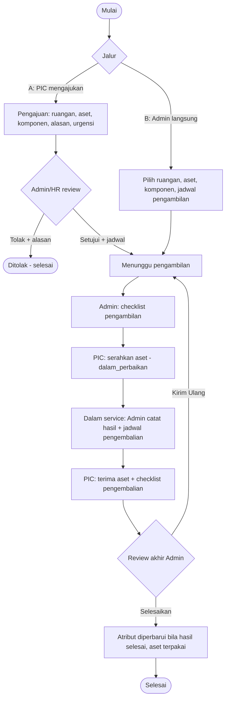
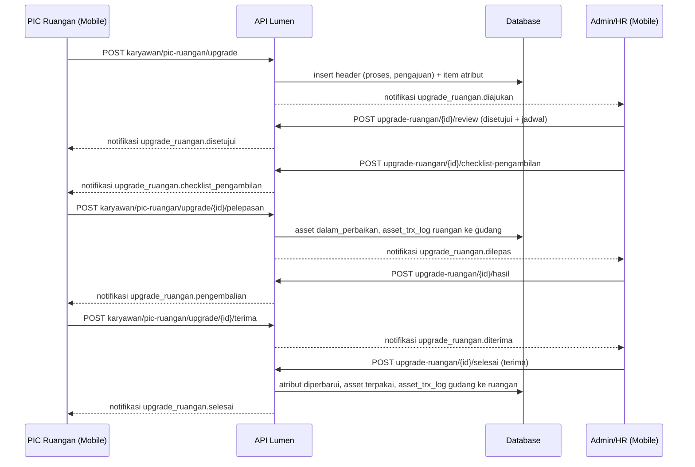
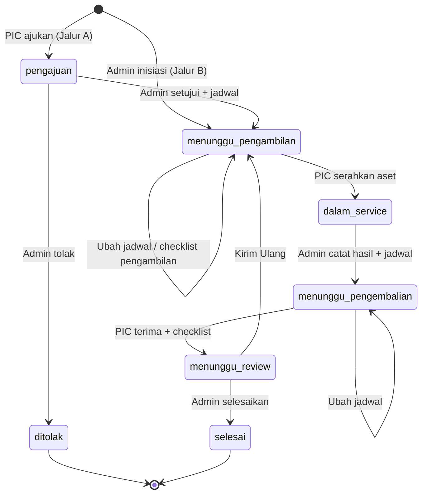
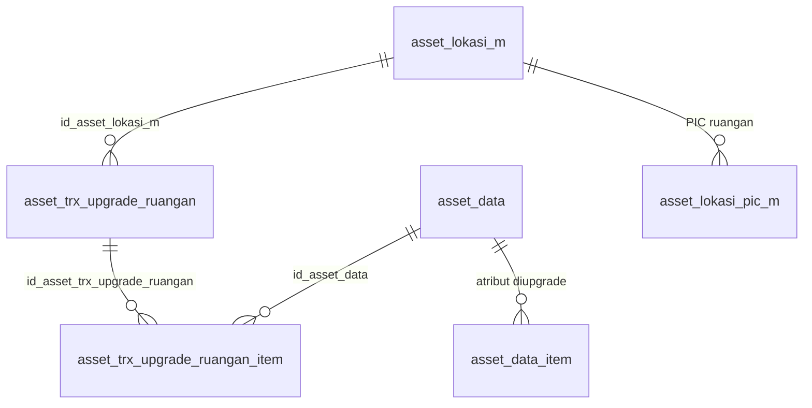

# Dokumentasi Teknis & Manual Book — Upgrade Komponen Aset Ruangan (ALK-RGN07)

> Dokumen ini disusun **dari source code lokal** (`API/` Lumen dan `MOBILE/` Flutter) per 16 Oktober 2026. Alurnya meniru **Upgrade Asset Karyawan (KRY03)**; pembeda utamanya, pemegang aset adalah **ruangan** dan aktor "karyawan" diganti **PIC Ruangan**.
> Cakupan implementasi: PIC Ruangan mengajukan (Jalur A) atau Admin/HR menginisiasi langsung (Jalur B) upgrade spesifikasi **satu aset milik ruangan**; aset diambil sementara, diupgrade di luar sistem, lalu dikembalikan ke **ruangan yang sama**. Bagian yang tidak ditemukan ditandai **⚠️ Belum ditemukan**, asumsi ditandai **⚠️ Asumsi**.
> Contoh ID/nama pada payload adalah **data sintetis**.

---

## 1. Informasi Dokumen

| Informasi | Nilai |
|---|---|
| Nama Fitur | Upgrade Komponen Aset Ruangan (UI PIC: tombol **"Upgrade Komponen"** di halaman **"PIC Ruangan"**; UI Admin: item **"Upgrade"** di dashboard Ruangan; judul layar **"Upgrade Komponen Ruangan"**) |
| Kode Fitur | **ALK-RGN07** (nomor transaksi `RGN07-YYYYMMNNN`; RGN06 adalah Retur Ruangan, bukan fitur ini) |
| Modul | Asset Management — Ruangan |
| Backend | Laravel **Lumen ^10.0**, PHP ^8.1, JWT, Query Builder |
| Database | `API/diagram-asset.dbml` (tanda `[NEW ALK-RGN Upgrade]`) + SQL manual `Claude outputs/sql-alk-rgn-upgrade-ruangan.sql` |
| Mobile | Flutter (`professional_flutter_3_35`), `flutter_bloc`, `dio` |
| Web | ⚠️ Belum ditemukan: tidak ada source web di workspace |
| Test otomatis | API `tests/Asset/AssetUpgradeRuanganTest.php` (16 test) · Mobile `test/asset/asset_upgrade_ruangan_test.dart` (16 test) |
| Versi dokumen | 1.0 — 16 Oktober 2026 |
| Dokumen terkait | Upgrade Asset Karyawan (KRY03), Retur Ruangan (ALK-RGN06), Onboarding Ruangan (ALK-RGN01), Penambahan Ruangan (ALK-RGN04), Master Lokasi & PIC Ruangan |

## 2. Daftar Isi

Lihat panel navigasi di samping.

## 3. Quick Overview

Spesifikasi komponen **satu aset ruangan** (mis. RAM 16 GB → 32 GB) ditingkatkan lewat dua jalur dalam **satu tabel** (`asset_trx_upgrade_ruangan`), dibedakan kolom `sumber_pengajuan`. Pada **Jalur A** PIC Ruangan mengajukan (komponen yang diupgrade, alasan, urgensi) lalu Admin/HR menyetujui dengan jadwal pengambilan atau menolak; pada **Jalur B** Admin/HR langsung membuat transaksi beserta jadwal pengambilan. Admin/HR mengisi **checklist pengambilan**, PIC **menyerahkan aset** (aset menjadi `dalam_perbaikan`, pemegang tetap ruangan), Admin/HR mencatat **hasil upgrade** dan jadwal pengembalian, PIC **menerima kembali** sambil mengisi checklist pengembalian, lalu Admin/HR melakukan **review akhir**: selesai (atribut diperbarui, aset kembali `terpakai`) atau kirim ulang ke teknisi.

| Aspek | Ringkasan |
|---|---|
| Aktor | PIC Ruangan, Admin/HR (Admin Asset), Sistem |
| Jalur | A = `sumber_pengajuan='karyawan'` (PIC mengajukan) · B = `sumber_pengajuan='admin'` (Admin langsung) |
| Fase | `pengajuan` → `menunggu_pengambilan` → `dalam_service` → `menunggu_pengembalian` → `menunggu_review` → `selesai`; `kirim_ulang` kembali ke `menunggu_pengambilan` |
| Status approval | `status_approval`: `proses` → `disetujui` atau `ditolak` |
| Hasil | `status_hasil`: `selesai` (nilai baru ditulis ke atribut) atau `tidak_dapat_diupgrade` (atribut tidak berubah) + biaya |
| Status asset | `terpakai` → `dalam_perbaikan` (saat PIC menyerahkan) → `terpakai` (saat selesai); pemegang tetap `ruangan` |
| Log aset | `asset_trx_log` dengan `jenis_log='upgrade_ruangan'`: ruangan → gudang saat pelepasan, gudang → ruangan saat selesai |
| Endpoint | 9 admin + 6 PIC = **15** |
| Notifikasi | 10 event (`upgrade_ruangan.*`), penerima PIC = **semua PIC aktif ruangan** |

## 4. Ringkasan Fitur

| Fitur | Aktor | Keterangan |
|---|---|---|
| Ajukan upgrade | PIC Ruangan | Pilih ruangan miliknya, aset `terpakai`, komponen (atribut spesifikasi) + detail upgrade, alasan, urgensi. Status `proses`, belum ada jadwal. |
| Review pengajuan | Admin/HR | Setujui dengan jadwal pengambilan, atau tolak dengan alasan (transaksi langsung selesai). |
| Inisiasi langsung | Admin/HR | Pilih ruangan, aset, komponen, catatan, jadwal pengambilan. PIC otomatis dari master PIC ruangan. |
| Ubah jadwal | Admin/HR | Selama fase `menunggu_pengambilan` atau `menunggu_pengembalian`. |
| Checklist pengambilan | Admin/HR | Kondisi normal/rusak setiap komponen aset sebelum diambil. |
| Serahkan aset (pelepasan) | PIC Ruangan | Setelah checklist pengambilan. Aset menjadi `dalam_perbaikan`, log ruangan → gudang. |
| Hasil upgrade | Admin/HR | `selesai` atau `tidak_dapat_diupgrade`, nilai baru, biaya, keterangan, jadwal pengembalian. |
| Terima aset kembali | PIC Ruangan | Checklist kondisi setiap komponen; masuk review akhir. |
| Review akhir | Admin/HR | Terima (atribut diperbarui, aset `terpakai`, log gudang → ruangan) atau Kirim Ulang ke Teknisi. |

## 5. Tujuan Fitur

- Meningkatkan spesifikasi aset ruangan tanpa mengubah kepemilikannya: aset tetap tercatat milik ruangan.
- Memberi PIC Ruangan jalur resmi untuk meminta upgrade dengan alasan dan urgensi, dan memberi Admin/HR keputusan terdokumentasi.
- Mencatat serah terima fisik dua arah (pengambilan dan pengembalian) lengkap dengan kondisi tiap komponen.
- Memperbarui nilai atribut aset (`asset_data_item`) hanya bila upgrade benar-benar berhasil.
- Mencegah aset yang sama dipakai bersamaan di retur, onboarding, penambahan ruangan, atau upgrade lain.

## 6. Aktor

| Aktor | Peran |
|---|---|
| PIC Ruangan | Karyawan di `asset_lokasi_pic_m` untuk ruangan tersebut. Mengajukan (Jalur A), menyerahkan aset, menerima aset kembali. Satu ruangan boleh punya banyak PIC; semua PIC aktif berhak bertindak dan dinotifikasi. |
| Admin/HR | Terdaftar di `asset_admin`. Menginisiasi (Jalur B), mereview pengajuan, menetapkan/mengubah jadwal, mengisi checklist pengambilan dan hasil upgrade, review akhir. |
| Sistem | Menurunkan status dari fase, mengunci aset lintas modul, memperbarui `asset_data`/`asset_data_item`, mencatat `asset_trx_log`, mengirim notifikasi. |

## 7. Hak Akses

| Aksi | Admin/HR | PIC Ruangan | Keterangan |
|---|---|---|---|
| Lihat opsi/daftar/detail (admin) | ✔ | ✘ | Controller admin memeriksa `asset_admin`; selain admin mendapat `FORBIDDEN`. |
| Inisiasi, review, jadwal, checklist pengambilan, hasil, review akhir | ✔ | ✘ | Model memeriksa `findAssetAdmin`; pesan `Pengguna tidak terdaftar sebagai admin asset.` |
| Ajukan upgrade | ✘ | ✔ | Hanya untuk ruangan yang PIC-nya pengaju. |
| Lihat opsi/daftar/detail milik ruangan | ✘ | ✔ | Dibatasi lewat `wherePic`: PIC **saat ini** di `asset_lokasi_pic_m`, bukan snapshot `id_karyawan_pic`. PIC ruangan lain mendapat `NOT_FOUND` pada detail. |
| Serahkan aset, terima aset kembali | ✘ | ✔ | Hanya PIC ruangan transaksi tersebut; PIC lain mendapat `BUSINESS_RULE_VIOLATION` (Upgrade asset tidak ditemukan). |

## 8. Terminologi

| Istilah | Arti |
|---|---|
| Jalur A / Jalur B | Pengajuan PIC (`sumber_pengajuan='karyawan'`) / inisiasi Admin (`'admin'`). |
| Fase | Kolom `fase_upgrade` (enum, disimpan): posisi alur lihat §14. |
| Atribut / komponen | Field spesifikasi pada `asset_data_item` (flag_spesifikasi 1 = unit utama, 2 = kelengkapan) yang bisa dipilih sebagai target upgrade. `id_atribut` berbentuk `id_asset_data_item|id_komponen`. |
| Item upgrade | Satu baris `asset_trx_upgrade_ruangan_item` per atribut yang diupgrade (`nilai_lama`, `nilai_baru`). |
| Komponen (checklist) | Daftar unit utama + kelengkapan aset yang dicek kondisinya (`komponen[]` pada detail); berbeda dari item upgrade. |
| Pelepasan | PIC menyerahkan aset untuk diupgrade (`POST .../pelepasan`). |
| Teknisi | Pihak di luar sistem yang mengerjakan upgrade; sistem hanya mencatat hasilnya. |
| Kirim Ulang | Review akhir yang mengembalikan transaksi ke `menunggu_pengambilan` dengan jadwal baru. |
| `SEMUA_PIC_RUANGAN` | Jenis penerima notifikasi: semua PIC aktif ruangan transaksi. |

## 9. Business Rules

| No | Aturan | Implementasi |
|---|---|---|
| BR-01 | Hanya ruangan aktif ber-PIC | `ruanganAktif()`: `tipe='ruangan'`, `status_aktif='1'`, ada baris `asset_lokasi_pic_m` dengan karyawan aktif (`STATUS_KARYAWAN_AKTIF`). Pesan: Ruangan tidak ditemukan, tidak aktif, atau belum memiliki PIC. |
| BR-02 | PIC pengaju harus PIC ruangan tersebut | `storePic` memanggil `findRuangan` dengan id karyawan; pesan: Ruangan tidak ditemukan, tidak aktif, atau Anda bukan PIC ruangan ini. |
| BR-03 | Aset harus milik ruangan itu dan berstatus `terpakai` | `insertTransaction`: `pemegang_asset='ruangan'`, `id_asset_lokasi_m` = ruangan; pesan Asset bukan milik ruangan atau tidak ditemukan. / Hanya asset berstatus terpakai yang dapat diupgrade. |
| BR-04 | Satu transaksi = satu aset, minimal satu komponen | `AssetUpgradeKaryawan_m::normalizeItems`: atribut harus ada pada aset, tidak ganda, `detail_upgrade` tidak kosong. |
| BR-05 | Pengajuan PIC wajib beralasan dan berurgensi | `urgensi` ∈ `normal`, `secepatnya`, `mendesak`; alasan tidak kosong. |
| BR-06 | Aset terkunci lintas modul | `assetBlockMessage`: ditolak bila aset ada di upgrade ruangan lain, retur ruangan, onboarding ruangan, atau penambahan ruangan yang masih berjalan. |
| BR-07 | Jalur B hanya oleh Admin/HR dan wajib berjadwal | `storeAdmin`: PIC diambil dari master ruangan; langsung `disetujui` + `menunggu_pengambilan`. Jadwal pengambilan wajib (Tanggal dan jam serah terima wajib diisi.). |
| BR-08 | Review hanya sekali | `review` menolak bila `status_approval` bukan `proses` (Pengajuan upgrade sudah direview.). Tolak wajib alasan. Setujui wajib jadwal dan aset masih `terpakai`. |
| BR-09 | Jadwal tidak boleh sebelum tanggal pengajuan | `parseJadwalValue`: Tanggal serah terima tidak boleh sebelum tanggal pengajuan. |
| BR-10 | Jadwal hanya diubah di dua fase | `updateJadwal`: fase `menunggu_pengambilan` (mengubah jadwal pengambilan) atau `menunggu_pengembalian` (jadwal pengembalian); selain itu Jadwal hanya dapat diubah sebelum serah terima dilakukan. |
| BR-11 | Checklist pengambilan sekali per putaran | `checklistPengambilan`: fase `menunggu_pengambilan` dan checklist masih `NULL`; wajib mencakup seluruh komponen aset, kondisi `normal`/`rusak`, rusak wajib keterangan. |
| BR-12 | Pelepasan hanya setelah checklist pengambilan | `pelepasan`: fase `menunggu_pengambilan` dan `checklist_pengambilan` terisi; aset berstatus `terpakai` (atau `dalam_perbaikan` setelah kirim ulang). |
| BR-13 | Hasil upgrade | `hasil`: fase `dalam_service`; `status_hasil` ∈ `selesai`, `tidak_dapat_diupgrade`; keterangan wajib; biaya ≥ 0; bila `selesai`, nilai baru setiap atribut wajib; jadwal pengembalian wajib. |
| BR-14 | PIC menerima kembali dengan checklist lengkap | `terima`: fase `menunggu_pengembalian`; seluruh komponen dicek; aset berstatus `dalam_perbaikan`. |
| BR-15 | Review akhir | `selesai`: fase `menunggu_review`. `terima` memperbarui atribut **hanya bila** `status_hasil='selesai'` dan mengembalikan aset ke `terpakai`; `kirim_ulang` mereset `checklist_pengambilan` dan kembali ke `menunggu_pengambilan`. |
| BR-16 | Pemegang aset tidak pernah berubah | Selama proses `pemegang_asset='ruangan'` dan `id_asset_lokasi_m` tetap; hanya `status_asset` yang berubah. |
| BR-17 | Hak akses PIC mengikuti PIC ruangan saat ini | `wherePic` menguji `asset_lokasi_pic_m` pada saat permintaan, bukan snapshot di header. |
| BR-18 | Setiap tindakan mencatat pelaku dan waktu | `user_input`, `user_update`, `user_approval`, `tgl_approval`, `user_pelepasan`, `tgl_pelepasan`, `tgl_diterima`, `asset_trx_log`. |

## 10. Business Flow

1. **Jalur A.** PIC memilih ruangan, aset, komponen yang diupgrade (+ detail upgrade tiap komponen), alasan, dan urgensi, lalu mengirim. Admin/HR dinotifikasi (`upgrade_ruangan.diajukan`).
2. Admin/HR mereview pengajuan.
    - **Tolak:** isi alasan, status `ditolak`, fase `selesai`, transaksi `selesai`; semua PIC ruangan dinotifikasi (`ditolak`).
    - **Setujui:** tetapkan jadwal pengambilan, fase `menunggu_pengambilan`; semua PIC dinotifikasi (`disetujui`).
3. **Jalur B.** Admin/HR memilih ruangan, aset, komponen, catatan, dan jadwal pengambilan; transaksi langsung `disetujui` dan semua PIC dinotifikasi (`disetujui`). Langkah 1-2 dilewati.
4. Admin/HR mengisi **checklist pengambilan** (kondisi tiap komponen). PIC dinotifikasi (`checklist_pengambilan`). Jadwal dapat diubah Admin/HR selama fase ini (`dijadwalkan`).
5. PIC **menyerahkan aset** pada jadwal. Aset menjadi `dalam_perbaikan`, log ruangan → gudang, fase `dalam_service`. Admin dinotifikasi (`dilepas`).
6. Teknisi mengerjakan upgrade di luar sistem. Admin/HR mencatat **hasil** (`selesai` atau `tidak_dapat_diupgrade`, nilai baru per atribut, biaya, keterangan) dan jadwal pengembalian. Fase `menunggu_pengembalian`; semua PIC dinotifikasi (`pengembalian`).
7. PIC **menerima aset kembali** dan mengisi checklist kondisi tiap komponen. Fase `menunggu_review`; Admin dinotifikasi (`diterima`).
8. Admin/HR melakukan **review akhir**:
    - **Selesaikan:** atribut diperbarui (bila hasil `selesai`), aset `terpakai`, log gudang → ruangan, fase `selesai`; PIC dinotifikasi (`selesai`).
    - **Kirim Ulang ke Teknisi:** jadwal pengambilan baru, `checklist_pengambilan` direset, fase kembali `menunggu_pengambilan`; PIC dinotifikasi (`kirim_ulang`). Kembali ke langkah 4.

## 11. Flow Berdasarkan Role

| Role | Langkah |
|---|---|
| PIC Ruangan | Ajukan → (tunggu keputusan) → terima notifikasi jadwal → serahkan aset setelah checklist admin → (tunggu hasil) → terima aset dan isi checklist → selesai. |
| Admin/HR | Tab Pengajuan → setujui/tolak (atau tombol **+** untuk Jalur B) → checklist pengambilan → (ubah jadwal bila perlu) → catat hasil + jadwal pengembalian → review akhir (selesaikan atau kirim ulang). |
| Sistem | Mengunci aset lintas modul, menurunkan status dari fase, memperbarui atribut, mencatat log, mengirim notifikasi. |

## 12. Flow Diagram



## 13. Sequence Diagram



## 14. Status Transaksi

Dua kolom enum disimpan di header: `status_approval` dan `fase_upgrade` (serta `status_transaksi` untuk tab Selesai). Label dan tab daftar diturunkan oleh `upgradeStatusMetadata`.

| `status_approval` | `fase_upgrade` | Label | Tab |
|---|---|---|---|
| `proses` | `pengajuan` | Menunggu Persetujuan | `pengajuan` |
| `disetujui` | `menunggu_pengambilan` | Menunggu Pengambilan | `proses` |
| `disetujui` | `dalam_service` | Dalam Service | `proses` |
| `disetujui` | `menunggu_pengembalian` | Menunggu Pengembalian | `proses` |
| `disetujui` | `menunggu_review` | Menunggu Review | `proses` |
| `disetujui` | `selesai` | Selesai | `selesai` |
| `ditolak` | `selesai` | Ditolak | `selesai` |

Filter daftar di API: tab `pengajuan` = `status_approval='proses'`; `proses` = `disetujui` dan fase bukan `selesai`; `selesai` = `status_transaksi='selesai'`. Tanpa parameter `tab`, semua transaksi dikembalikan. Status aset: lihat §22.

## 15. State Transition



## 16. Struktur Database

| Tabel | Fungsi |
|---|---|
| `asset_trx_upgrade_ruangan` | Header transaksi (kedua jalur): ruangan, PIC, jadwal, checklist, hasil, status. |
| `asset_trx_upgrade_ruangan_item` | Satu baris per atribut yang diupgrade (`nilai_lama`, `nilai_baru`). |
| `asset_trx_log` | Enum `jenis_log` ditambah nilai `upgrade_ruangan` (nilai lama dipertahankan). |

Enum yang dipakai bersama dokumen lain di DBML: `sumber_pengajuan`, `status_approval`, `status`, `fase_upgrade`, `status_hasil_upgrade`.

## 17. Relasi Database



Foreign key di SQL: `fk_atur_upgrade_id_asset_lokasi_m`, `fk_aturi_upgrade_header`, `fk_aturi_upgrade_asset_data`. PIC pada header disimpan sebagai snapshot (`id_karyawan_pic`, `nama_pic`, `nik_pic`); hak akses dan penerima notifikasi dibaca dari `asset_lokasi_pic_m` saat itu juga.

## 18. Data Dictionary

**`asset_trx_upgrade_ruangan`**

| Kolom | Tipe | Keterangan |
|---|---|---|
| `id_asset_trx_upgrade_ruangan` | varchar(50) PK | `id_company` + `YYYYMM` + 3 digit urut |
| `no_trx` | varchar(50) | `RGN07-YYYYMMNNN`; unik per company |
| `sumber_pengajuan` | enum(`karyawan`,`admin`) | Jalur A / Jalur B |
| `id_asset_lokasi_m` + snapshot `nama_asset_ruangan`, `nama_cabang`, `nama_departemen` | varchar | Ruangan; FK ke `asset_lokasi_m` |
| `id_karyawan_pic`, `nama_pic`, `nik_pic` | varchar | Snapshot PIC saat transaksi dibuat; dasar tampilan, bukan hak akses |
| `id_asset_kategori_m`, `nama_kategori` | varchar | Jenis aset |
| `detail_upgrade` | varchar(255) | Ringkasan "label: detail" semua komponen (dipotong 255) |
| `alasan`, `urgensi` | text, varchar(50) | Jalur A (`normal`/`secepatnya`/`mendesak`); kosong pada Jalur B |
| `catatan` | text | Jalur B (opsional) |
| `id_karyawan`, `nik_karyawan`, `nama_karyawan` | varchar | Pembuat transaksi (PIC pada Jalur A, Admin pada Jalur B) |
| `tgl_pengajuan` | date | Tanggal hari ini saat dibuat |
| `tgl_pengambilan`, `jam_pengambilan` | date, time NULL | Jadwal pengambilan |
| `tgl_pengembalian`, `jam_pengembalian` | date, time NULL | Jadwal pengembalian |
| `keterangan_pengembalian` | varchar(255) | Keterangan jadwal terakhir (pengambilan atau pengembalian) |
| `checklist_pengambilan` | text NULL | JSON kondisi komponen saat diambil; `NULL` = belum dicek |
| `checklist_pengembalian` | text NULL | JSON kondisi komponen saat diterima kembali |
| `tgl_pelepasan`, `user_pelepasan` | timestamp NULL, varchar | PIC menyerahkan aset |
| `status_hasil` | enum(`selesai`,`tidak_dapat_diupgrade`) NULL | Hasil upgrade |
| `keterangan_hasil`, `biaya_upgrade` | text, bigint | Keterangan dan biaya (default 0) |
| `tgl_diterima` | timestamp NULL | PIC menerima kembali |
| `status_transaksi` | enum(`proses`,`selesai`) | `selesai` saat ditolak atau diselesaikan |
| `fase_upgrade` | enum 6 nilai | Default `pengajuan` |
| `status_approval` | enum(`proses`,`disetujui`,`ditolak`) | Default `proses` |
| `ket_tolak`, `user_approval`, `tgl_approval` | varchar, varchar, timestamp NULL | Keputusan review |
| `id_company`, `tgl_input`, `user_input`, `tgl_update`, `user_update` | | Audit standar |

**`asset_trx_upgrade_ruangan_item`**: `id_asset_trx_upgrade_ruangan_item` (PK), `id_asset_trx_upgrade_ruangan`, `id_asset_data`, `kelengkapan_item` (JSON atribut: `id_atribut`, `id_asset_data_item`, `id_komponen`, `nama_item`, `jenis`, `label`, `satuan`, `nilai`), snapshot `nama_asset`, `deskripsi_asset`, `kategori_asset`, `detail_upgrade`, `nilai_lama`, `nilai_baru`, `alasan_tidak_upgrade`, `id_company`, `tgl_input`, `user_input`.

## 19. Database Index

| Tabel | Index | Kegunaan |
|---|---|---|
| `asset_trx_upgrade_ruangan` | unik `uq_upgrade_rgn_company_no_trx (id_company, no_trx)` | Nomor transaksi unik per company |
| | `atur_admin_list_idx (id_company, status_approval, fase_upgrade, tgl_input, id)` | Daftar admin per tab |
| | `atur_pic_list_idx (id_company, id_karyawan_pic, status_approval, fase_upgrade)` | Daftar PIC |
| | `atur_lokasi_idx (id_company, id_asset_lokasi_m, status_approval, fase_upgrade)` | Pencarian per ruangan |
| `asset_trx_upgrade_ruangan_item` | `aturi_upgrade_idx (id_asset_trx_upgrade_ruangan, id_company, id_asset_data)` | Item per transaksi |
| | `aturi_asset_idx (id_asset_data, id_company)` | Pencarian per aset (kunci lintas modul) |

## 20. Backend Architecture

| Lapisan | File |
|---|---|
| Route | `API/routes/modules/asset/RouteAsset.php` (grup `upgrade-ruangan` dan `pic-ruangan` → `upgrade`) |
| Controller Admin | `app/Http/Controllers/Asset/Admin/AssetAdminUpgradeRuangan_c.php` |
| Controller PIC | `app/Http/Controllers/Asset/Karyawan/AssetKaryawanUpgradeRuangan_c.php` |
| Model | `app/Models/Asset/AssetUpgradeRuangan_m.php` (admin + PIC; mewarisi `Asset_m`) |
| Notifikasi | `app/Support/Asset/AssetNotification.php` (event `upgrade_ruangan.*`, penerima `SEMUA_PIC_RUANGAN`) |
| Basis controller | `app/Http/Controllers/Asset/Asset_c.php` (`UPGRADE_JADWAL_RULES`, `UPGRADE_CHECKLIST_RULES`, `UPGRADE_MESSAGES`, `mutateAssetTrx`, `mutateTrxSaya`) |

Controller memvalidasi input, model menjalankan `DB::transaction` (dengan `lockCompany` dan `lockForUpdate`), lalu notifikasi dikirim **setelah** transaksi sukses. Aksi admin lewat `mutateAssetTrx` (respons sukses `UPDATED`), aksi PIC lewat `mutateTrxSaya`. Logika pendukung dipakai ulang dari KRY03 (`AssetUpgradeKaryawan_m`) dan `Asset_m` (`komponenAssets`, `normalizeKondisiChecklist`, `parseJadwalValue`, `insertAssetLog`).

**Perubahan pada modul lain**

| Modul | Perubahan |
|---|---|
| `AssetReturRuangan_m` | Tiga method query kunci (`activeReturRuanganQuery`, `activeOnboardingRuanganQuery`, `activeRequestRuanganQuery`) dijadikan `public` agar dipakai upgrade ruangan. `store` retur kini menolak aset yang sedang diupgrade (Satu atau beberapa asset sedang diproses pada upgrade ruangan.) dan `lockedAssetIds` ikut menyaring aset upgrade dari opsi retur. Pemblokiran retur ↔ upgrade berlaku dua arah. |
| `AssetUpgradeKaryawan_m` | Empat helper dijadikan `public` tanpa perubahan logika: `atributAssets`, `normalizeItems`, `jadwalPayload`, `upgradeStatusMetadata`. |
| `AssetAdmin_m` | `getSummary` menambah `ruangan_upgrade_perlu_proses` (jumlah) dan `ruangan_upgrade_pending` (daftar terlama). |
| `AssetLokasiPic_m` | `getAssetRuanganSaya` (beranda PIC) menambah key `upgrade_ruangan` (aksi `pelepasan` atau `terima`). |
| `AssetNotification` | 10 event baru dan jenis penerima `SEMUA_PIC_RUANGAN` (`picRuanganRecipients`). |
| `RouteAsset.php` | Grup `upgrade-ruangan` (admin) dan `upgrade` di dalam `pic-ruangan` (PIC). |
| Skema | Dua tabel baru dan nilai enum `upgrade_ruangan` pada `asset_trx_log.jenis_log` (SQL manual). |

## 21. Backend Business Logic

- **`storePic`** (Jalur A): kunci company; validasi karyawan aktif, ruangan milik PIC (BR-02), urgensi, alasan; `insertTransaction` membuat header `proses`/`pengajuan` tanpa jadwal.
- **`storeAdmin`** (Jalur B): validasi admin dan ruangan (PIC = PIC pertama ruangan menurut urutan master), parse jadwal; header `disetujui`/`menunggu_pengambilan` dengan jadwal pengambilan, `user_approval` dan `tgl_approval` terisi.
- **`insertTransaction`**: kunci aset `FOR UPDATE`; aset harus milik ruangan dan `terpakai`; cek kunci lintas modul; normalisasi item; nomor `RGN07-` + `YYYYMM` + 3 digit; simpan header dan item (`nilai_lama` dari atribut saat itu).
- **`review`**: header harus `proses`. Tolak: alasan wajib, `status_approval='ditolak'`, `fase_upgrade='selesai'`, `status_transaksi='selesai'`. Setujui: aset masih `terpakai`, jadwal valid, fase `menunggu_pengambilan`.
- **`updateJadwal`**: fase `menunggu_pengambilan` atau `menunggu_pengembalian`; menulis tanggal/jam pengambilan atau pengembalian sesuai fase.
- **`checklistPengambilan`**: fase `menunggu_pengambilan` dan checklist `NULL`; aset `terpakai` atau `dalam_perbaikan`; simpan JSON hasil `normalizeKondisiChecklist`.
- **`pelepasan`** (PIC): fase `menunggu_pengambilan` dan checklist terisi; aset → `dalam_perbaikan`; log ruangan → gudang; `tgl_pelepasan`, `user_pelepasan`; fase `dalam_service`.
- **`hasil`**: fase `dalam_service`; validasi status/keterangan/biaya/jadwal; tiap item mendapat `nilai_baru` (hanya bila `selesai`) atau `alasan_tidak_upgrade` (bila tidak dapat diupgrade); fase `menunggu_pengembalian`; `checklist_pengembalian` dan `tgl_diterima` direset.
- **`terima`** (PIC): fase `menunggu_pengembalian`; aset `dalam_perbaikan`; simpan checklist pengembalian dan `tgl_diterima`; fase `menunggu_review`.
- **`selesai`**: fase `menunggu_review`. `kirim_ulang`: jadwal pengambilan baru, `checklist_pengambilan=NULL`, fase `menunggu_pengambilan`. `terima`: bila `status_hasil='selesai'` jalankan `applyAtribut` (menulis `nilai_baru` ke `json_value.komponen[].value` pada `asset_data_item`), aset → `terpakai`, log gudang → ruangan, fase `selesai`, `status_transaksi='selesai'`.

## 22. Dampak terhadap asset_data

| Tahap | `status_asset` | `pemegang_asset` | Catatan |
|---|---|---|---|
| Pengajuan / review / jadwal / checklist pengambilan | `terpakai` | `ruangan` | Tidak berubah; aset terkunci secara logis lewat pemeriksaan lintas modul, bukan lewat status. |
| PIC menyerahkan (`pelepasan`) | `terpakai` → `dalam_perbaikan` | `ruangan` | `id_asset_lokasi_m` tetap; log `upgrade_ruangan` ruangan → gudang. |
| Hasil dicatat, PIC menerima | tetap `dalam_perbaikan` | `ruangan` | Menunggu review akhir. |
| Selesai (`terima`) | `dalam_perbaikan` → `terpakai` | `ruangan` | Log gudang → ruangan; `asset_data_item` diperbarui bila hasil `selesai`. |
| Kirim Ulang | tetap `dalam_perbaikan` | `ruangan` | Kembali ke fase pengambilan; pelepasan berikutnya mencatat log ruangan → gudang lagi (RISK-004). |
| Ditolak | `terpakai` | `ruangan` | Tidak ada perubahan; aset boleh diajukan lagi. |

Kolom log: `id_pemegang`/`nama_pemegang` terisi id dan nama ruangan pada sisi ruangan, **kosong** pada sisi gudang (mengikuti retur ruangan, RISK-005). `kondisi_awal` dan `kondisi_akhir` log memakai `kondisi_awal` aset (tidak diubah oleh checklist).

## 23. API Documentation

Base `asset/`. Semua memakai JWT dan envelope `ApiResponse`.

| ID | Method | Path | Peran | Fungsi |
|---|---|---|---|---|
| API-01 | GET | `upgrade-ruangan/options` | Admin | Ruangan aktif ber-PIC beserta aset yang dapat diupgrade |
| API-02 | GET | `upgrade-ruangan?tab&limit&offset` | Admin | Daftar (`pengajuan`/`proses`/`selesai`) |
| API-03 | GET | `upgrade-ruangan/{id}` | Admin | Detail + flag `aksi` |
| API-04 | POST | `upgrade-ruangan` | Admin | Jalur B: buat upgrade + jadwal pengambilan |
| API-05 | POST | `upgrade-ruangan/{id}/review` | Admin | Jalur A: setujui + jadwal / tolak + alasan |
| API-06 | PUT | `upgrade-ruangan/{id}/jadwal` | Admin | Ubah jadwal pengambilan/pengembalian |
| API-07 | POST | `upgrade-ruangan/{id}/checklist-pengambilan` | Admin | Checklist kondisi komponen saat diambil |
| API-08 | POST | `upgrade-ruangan/{id}/hasil` | Admin | Hasil upgrade + jadwal pengembalian |
| API-09 | POST | `upgrade-ruangan/{id}/selesai` | Admin | Review akhir: `terima` atau `kirim_ulang` |
| API-10 | GET | `karyawan/pic-ruangan/upgrade/options` | PIC | Ruangan miliknya + aset + urgensi |
| API-11 | GET | `karyawan/pic-ruangan/upgrade?tab` | PIC | Daftar upgrade ruangan milik PIC |
| API-12 | POST | `karyawan/pic-ruangan/upgrade` | PIC | Ajukan upgrade (Jalur A) |
| API-13 | GET | `karyawan/pic-ruangan/upgrade/{id}` | PIC | Detail |
| API-14 | POST | `karyawan/pic-ruangan/upgrade/{id}/pelepasan` | PIC | Serahkan aset |
| API-15 | POST | `karyawan/pic-ruangan/upgrade/{id}/terima` | PIC | Terima aset kembali + checklist |

Tambahan: `GET karyawan/pic-ruangan` (beranda PIC) kini menyertakan key `upgrade_ruangan`; `GET summary` (admin) kini menyertakan `ruangan_upgrade_perlu_proses` dan `ruangan_upgrade_pending`. Route diverifikasi dengan `php artisan routes:list` (15 route modul ini; total 552 route, lihat RISK-008).

## 24. Detail Setiap API

**API-12 · POST `asset/karyawan/pic-ruangan/upgrade`** (Jalur A)

```json
{ "id_asset_lokasi_m": "RGN-1", "id_asset_data": "LAP-1",
  "alasan": "Build lambat", "urgensi": "secepatnya",
  "items": [{ "id_atribut": "LAP-1-UNIT|K1", "detail_upgrade": "16 GB ke 32 GB" }] }
```
Respons `CREATED`: `{ "id": "COMP202610001", "no_trx": "RGN07-202610001", "status_approval": "proses", "fase_upgrade": "pengajuan", "status_label": "Menunggu Persetujuan", "tab": "pengajuan" }`. `urgensi` ∈ `normal|secepatnya|mendesak`; `id_atribut` diambil dari `assets[].atribut[]` pada API-10.

**API-04 · POST `asset/upgrade-ruangan`** (Jalur B)

```json
{ "id_asset_lokasi_m": "RGN-1", "id_asset_data": "LAP-1", "catatan": "Bawa kunci ruangan",
  "items": [{ "id_atribut": "LAP-1-UNIT|K1", "detail_upgrade": "16 GB ke 32 GB" }],
  "tgl_jadwal": "2026-10-20", "jam_jadwal": "09:00", "keterangan_jadwal": "Ruang IT" }
```
Respons `CREATED`: `status_approval: "disetujui"`, `fase_upgrade: "menunggu_pengambilan"`, `tab: "proses"`. Controller menandai jadwal `nullable`, tetapi model menolak bila kosong (Tanggal dan jam serah terima wajib diisi.).

**API-05 · POST `.../{id}/review`**: setujui `{ "keputusan": "disetujui", "tgl_jadwal": "2026-10-20", "jam_jadwal": "09:00", "keterangan_jadwal": "" }`; tolak `{ "keputusan": "ditolak", "ket_tolak": "Belum prioritas" }`. Respons `UPDATED` dengan status/fase terbaru; event `upgrade_ruangan.disetujui` atau `upgrade_ruangan.ditolak`.

**API-06 · PUT `.../{id}/jadwal`**: `{ "tgl_jadwal", "jam_jadwal", "keterangan_jadwal" }`. Mengubah jadwal pengambilan atau pengembalian sesuai fase; event `upgrade_ruangan.dijadwalkan`.

**API-07 · POST `.../{id}/checklist-pengambilan`** dan **API-15 · POST `.../upgrade/{id}/terima`**

```json
{ "items": [
  { "id_item": "LAP-1-UNIT", "kondisi": "normal" },
  { "id_item": "LAP-1-CHG", "kondisi": "rusak", "ket_rusak": "Kabel terkelupas" } ] }
```
`id_item` di sini adalah id **komponen aset** (dari `komponen[]` pada detail), bukan id item upgrade. Seluruh komponen wajib dicek; `kondisi` ∈ `normal|rusak`; `ket_rusak` wajib bila rusak.

**API-08 · POST `.../{id}/hasil`**

```json
{ "status_hasil": "selesai", "keterangan_hasil": "Dikerjakan vendor", "biaya_upgrade": 850000,
  "items": [{ "id_item": "COMP202610001", "nilai_baru": "32" }],
  "tgl_jadwal": "2026-10-22", "jam_jadwal": "10:00", "keterangan_jadwal": "Ambil di resepsionis" }
```
Di sini `id_item` adalah id **baris item upgrade** (`items[].id_item` pada detail). `status_hasil` ∈ `selesai|tidak_dapat_diupgrade`; bila `selesai`, `nilai_baru` setiap item wajib. Event `upgrade_ruangan.pengembalian`.

**API-09 · POST `.../{id}/selesai`**: `{ "aksi": "terima" }` atau `{ "aksi": "kirim_ulang", "tgl_jadwal", "jam_jadwal", "keterangan_jadwal" }`. Event `upgrade_ruangan.selesai` atau `upgrade_ruangan.kirim_ulang`.

**API-14 · POST `.../upgrade/{id}/pelepasan`**: tanpa body. Event `upgrade_ruangan.dilepas`.

**API-10 / API-01 · Opsi**: `ruangan[]` berisi `id_asset_lokasi_m`, `nama_ruangan`, `cabang`, `divisi`, `pic{id_karyawan,nik,nama}`, `assets[]` (`id_asset_data`, `kode_asset`, `nama_asset`, `kategori_asset`, `merek`, `id_asset_lokasi_m`, `atribut[]`). Hanya ruangan yang punya aset `terpakai`, bebas kunci lintas modul, dan beratribut spesifikasi yang muncul. API-10 menambah `urgensi[]` (`value`, `label`).

**API-02 / API-11 · Daftar**: `filters[]`, `records[]` (`id`, `no_trx`, `sumber_pengajuan`, `tgl_pengajuan`, `urgensi`, `status_approval`, `fase_upgrade`, `status_label`, `tab`, jadwal, `jumlah_item`, `asset`, `ruangan`, `pic`), `pagination` (`limit` default 20 maks 50, `offset`, `next_offset`, `has_more`).

**API-03 / API-13 · Detail**: `id`, `no_trx`, `sumber_pengajuan`, `tgl_pengajuan`, `alasan`, `urgensi`, `catatan`, `ket_tolak`, `status_approval`, `fase_upgrade`, `status_label`, `tab`, jadwal (`tgl_pengambilan`, `jam_pengambilan`, `tgl_pengembalian`, `jam_pengembalian`), `keterangan_jadwal`, `tgl_pelepasan`, `tgl_diterima`, `status_hasil`, `keterangan_hasil`, `biaya_upgrade`, `ruangan`, `pic`, `asset`, `items[]` (`id_item`, `nama_item`, `label`, `satuan`, `detail_upgrade`, `nilai_lama`, `nilai_baru`, `alasan_tidak_upgrade`), `komponen[]`, `checklist_pengambilan`, `checklist_pengembalian`, `checklist_pengembalian_rusak`, dan `aksi{review, ubah_jadwal, checklist_pengambilan, pelepasan, hasil, terima, selesai}`. Flag `aksi` **tidak mengenal peran** (RISK-002): detail PIC pun memuat flag yang hanya berlaku untuk admin.

## 25. Mobile Architecture

Flutter + `flutter_bloc` + `dio`. Modul Upgrade Karyawan (KRY03) **dipakai ulang lewat flag** agar tidak menggandakan kode.

| Komponen | Cara pakai ulang |
|---|---|
| `AssetUpgradeApi(admin:, ruangan:)` | `ruangan: true` mengganti basis menjadi `asset/upgrade-ruangan` (admin) atau `asset/karyawan/pic-ruangan/upgrade` (PIC); metode baru `storeRuangan` (karyawan memakai `store`) |
| `HalamanAssetUpgrade(untukRuangan:)` | Daftar dengan tab; kartu menampilkan nama ruangan (`showRuangan`) |
| `HalamanTambahAssetUpgrade(untukRuangan:)` | Form: pilih ruangan → aset → komponen; PIC mengisi alasan + urgensi, admin mengisi catatan + jadwal |
| `HalamanDetailAssetUpgrade(untukRuangan:)` | Detail, stepper, checklist, hasil, aksi per peran |
| `AssetUpgradeBloc` | Bloc yang sama; dibuat dengan `AssetUpgradeApi(admin: ..., ruangan: true)` di `router.dart` |
| Model | `mAssetUpgrade.dart`: `AssetUpgradeRuanganOption`, `AssetUpgradePic`, `AssetUpgradeRuanganPending`; `AssetUpgradeRecord` memuat `ruangan` dan `pic` |

Perubahan di file bersama: `HalamanAssetPicRuangan.dart` (entri + banner), `HalamanAssetAdminRuangan.dart` (item **Upgrade** + seksi perlu diproses), `mAssetPicRuangan.dart` (`upgradeRuangan`), `mAssetSummary.dart` (`ruanganUpgradePerluProses`, `ruanganUpgradePending`), `NavigatorBloc.dart`, `router.dart`.

## 26. Mobile Screen

| Layar | Rute | Pengguna |
|---|---|---|
| Dashboard Ruangan → item **Upgrade** + seksi "Upgrade Komponen Ruangan Perlu Diproses" | tab Ruangan pada `HalamanHomeAssetAdmin` (`HalamanAssetAdminRuangan`, bukan rute tersendiri) | Admin/HR |
| Daftar upgrade (tab Pengajuan/Proses/Selesai) | `/asset_admin_upgrade_ruangan` | Admin/HR |
| Form Buat Upgrade (Jalur B) | `/asset_admin_tambah_upgrade_ruangan` | Admin/HR |
| Detail upgrade | `/asset_admin_detail_upgrade_ruangan` | Admin/HR |
| PIC Ruangan + tombol **Upgrade Komponen** + banner serah/terima | `/asset_pic_ruangan` (halaman yang sudah ada) | PIC |
| Daftar upgrade (dari notifikasi dengan id langsung ke detail) | `/asset_pic_ruangan_upgrade` | PIC |
| Form Ajukan Upgrade | `/asset_pic_ruangan_tambah_upgrade` | PIC |
| Detail upgrade | `/asset_pic_ruangan_detail_upgrade` | PIC |

Rute notifikasi (`assetNotifRoutes`): `asset_pic_ruangan_upgrade` (PIC, membawa id transaksi) dan `asset_admin_detail_upgrade_ruangan` (Admin). Detail menampilkan header nomor transaksi, stepper fase, kartu jadwal aktif, komponen yang diupgrade (nilai lama/baru), form hasil (admin), form checklist, ringkasan checklist, dan kartu pengajuan (ruangan, PIC, alasan, urgensi, catatan).

## 27. Mobile → API

| Aksi di layar | Pemanggilan |
|---|---|
| Buka daftar / pindah tab | `getList(tab)` → API-02 (admin) / API-11 (PIC) |
| Buka form | `getOptions()` → API-01 / API-10; kirim → `storeRuangan` → API-04 / API-12 |
| Buka detail | `getDetail` → API-03 / API-13 |
| Tolak / Setujui & Jadwalkan | `review` → API-05 |
| Ubah Jadwal | `updateJadwal` → API-06 |
| Simpan Checklist Pengambilan | `checklistPengambilan` → API-07 |
| Simpan Hasil & Jadwalkan | `hasil` → API-08 |
| Kirim Ulang ke Teknisi / Selesaikan Upgrade | `selesai(aksi: kirim_ulang / terima)` → API-09 |
| Serahkan Aset | `pelepasan` → API-14 |
| Terima Aset | `terima` → API-15 |
| Beranda PIC / dashboard Admin | `GET karyawan/pic-ruangan` (`upgrade_ruangan`) / `GET summary` (`ruangan_upgrade_*`) |

## 28. API → Mobile

Model: `mAssetUpgrade.dart` (`AssetUpgradeRecord` dengan `ruangan`, `pic`, `aksi`; `AssetUpgradeRuanganOption` untuk opsi; `AssetUpgradeRuanganPending` untuk banner beranda PIC), `mAssetPicRuangan.dart` (`upgradeRuangan` dari key `upgrade_ruangan`), `mAssetSummary.dart` (`ruanganUpgradePerluProses`, `ruanganUpgradePending` dari `ruangan_upgrade_*`). Respons PIC memakai kunci `nama` (bukan `nama_karyawan`) sehingga dibaca `AssetUpgradePic`. Mobile **menyaring tombol per peran** karena `aksi` dari server tidak mengenal peran: admin hanya melihat review/checklist pengambilan/hasil/selesai (+ubah jadwal), PIC hanya pelepasan/terima.

## 29. Mapping Mobile → API → Database

| Mobile | API | Tabel yang ditulis |
|---|---|---|
| Kirim Pengajuan (PIC) | API-12 | `asset_trx_upgrade_ruangan`, `..._item` |
| Buat Upgrade (Admin) | API-04 | `asset_trx_upgrade_ruangan`, `..._item` |
| Tolak / Setujui & Jadwalkan | API-05 | header (`status_approval`, `fase_upgrade`, jadwal, `user_approval`) |
| Ubah Jadwal | API-06 | header (jadwal, `keterangan_pengembalian`) |
| Simpan Checklist Pengambilan | API-07 | header (`checklist_pengambilan`) |
| Serahkan Aset | API-14 | header (`tgl_pelepasan`, fase), `asset_data` (`status_asset`), `asset_trx_log` |
| Simpan Hasil & Jadwalkan | API-08 | header (hasil, biaya, jadwal pengembalian), `..._item` (`nilai_baru`) |
| Terima Aset | API-15 | header (`checklist_pengembalian`, `tgl_diterima`, fase) |
| Selesaikan Upgrade | API-09 (`terima`) | header, `asset_data`, `asset_data_item`, `asset_trx_log` |
| Kirim Ulang ke Teknisi | API-09 (`kirim_ulang`) | header (jadwal pengambilan, `checklist_pengambilan=NULL`, fase) |

## 30. Mapping Database → API → Mobile

| Kolom | API | Tampilan |
|---|---|---|
| `sumber_pengajuan` | `sumber_pengajuan` | Baris "Informasi" (sumber admin) pada kartu pengajuan |
| `alasan`, `urgensi`, `catatan` | `alasan`, `urgensi`, `catatan` | Kartu pengajuan |
| `ket_tolak` | `ket_tolak` | Kotak merah "Ditolak" |
| `status_approval` + `fase_upgrade` | `status_label`, `tab`, `fase_upgrade` | Badge status, stepper, tab daftar |
| jadwal | `tgl_*`/`jam_*` | Kartu jadwal aktif |
| `checklist_*` | `checklist_pengambilan`, `checklist_pengembalian`, `checklist_pengembalian_rusak` | Ringkasan checklist; pesan review merah bila ada komponen rusak |
| `nilai_lama`, `nilai_baru`, `detail_upgrade` | `items[]` | Kartu komponen |
| `id_karyawan_pic`/`nama_pic` | `pic` | Baris "PIC Ruangan" |

## 31. Validation

| Field | Aturan | Pesan |
|---|---|---|
| `id_asset_lokasi_m` | wajib, ≤ 50 | Ruangan wajib dipilih. |
| `id_asset_data` | wajib, ≤ 50 | (validasi bawaan) |
| `alasan` (Jalur A) | wajib, ≤ 1000 | Alasan upgrade wajib diisi. |
| `urgensi` (Jalur A) | wajib, ∈ 3 nilai | Urgensi wajib dipilih. / Urgensi upgrade tidak valid. |
| `catatan` (Jalur B) | opsional, ≤ 1000 | |
| `items` | wajib, ≥ 1 | Minimal satu komponen wajib dipilih/diisi. |
| `items.*.id_atribut` | wajib, ≤ 120, tidak ganda | Komponen upgrade tidak ditemukan pada asset. / Komponen yang sama tidak boleh dipilih lebih dari sekali. |
| `items.*.detail_upgrade` | wajib, ≤ 255 | Detail upgrade setiap komponen wajib diisi. |
| `tgl_jadwal` / `jam_jadwal` | `Y-m-d` / `H:i` | Format tanggal jadwal harus YYYY-MM-DD. / Format jam jadwal harus HH:MM. (wajib terisi di model) |
| `keterangan_jadwal` | opsional, ≤ 255 | |
| `keputusan` | `disetujui` atau `ditolak` | |
| `ket_tolak` | wajib bila ditolak, ≤ 255 | Alasan penolakan wajib diisi. |
| `status_hasil` | `selesai` atau `tidak_dapat_diupgrade` | Status hasil upgrade tidak valid. |
| `keterangan_hasil` | wajib, ≤ 1000 | Keterangan hasil upgrade wajib diisi. |
| `biaya_upgrade` | integer ≥ 0 | Biaya upgrade tidak boleh negatif. |
| `items.*.nilai_baru` | ≤ 255; wajib bila hasil `selesai` | Nilai baru setiap atribut wajib diisi. |
| `aksi` | `terima` atau `kirim_ulang` | |
| checklist `items.*.kondisi` | `normal` atau `rusak` | Kondisi item harus normal atau rusak. |
| checklist `items.*.ket_rusak` | wajib bila rusak | Keterangan kerusakan wajib diisi. |
| `tab` | `pengajuan`/`proses`/`selesai` | Filter upgrade asset ruangan tidak valid. |
| `limit` | 1-50 | Limit maksimal adalah 50 data. |

Mobile: tombol Setujui memerlukan jadwal lewat sheet jadwal; form hasil memvalidasi nilai baru dan keterangan sebelum menampilkan sheet jadwal pengembalian; dialog Tolak memerlukan alasan.

## 32. Error Handling

| Kondisi | Kode | Pesan |
|---|---|---|
| Input tidak valid | `VALIDATION_ERROR` (422) | Data pengajuan upgrade belum lengkap. dan sejenisnya, dengan rincian per field |
| Bukan admin (endpoint admin) | `FORBIDDEN` (403) | Pengguna tidak memiliki akses admin asset. |
| Tanpa token | `UNAUTHORIZED` (401) | |
| Detail tidak ditemukan / PIC ruangan lain | `NOT_FOUND` (404) | Upgrade asset ruangan tidak ditemukan. |
| Aksi PIC pada transaksi ruangan lain | `BUSINESS_RULE_VIOLATION` (422) | Upgrade asset tidak ditemukan. |
| Aset terkunci | `BUSINESS_RULE_VIOLATION` | Asset sedang diproses pada upgrade lain. / pada retur. / pada onboarding ruangan. / pada penambahan asset ruangan. |
| Fase salah | `BUSINESS_RULE_VIOLATION` | Aset belum siap diserahkan untuk upgrade. / Aset belum berada dalam proses upgrade. / Aset belum dijadwalkan untuk dikembalikan. / Checklist pengambilan tidak dapat diisi saat ini. / Checklist pengembalian belum dikirim PIC ruangan. / Pengajuan upgrade sudah direview. |
| Status aset berubah | `BUSINESS_RULE_VIOLATION` | Status asset sudah berubah atau tidak lagi dipegang ruangan. |
| Ruangan tidak sah | `BUSINESS_RULE_VIOLATION` | Ruangan tidak ditemukan, tidak aktif, atau belum memiliki PIC. / ... atau Anda bukan PIC ruangan ini. |
| Checklist tidak lengkap | `BUSINESS_RULE_VIOLATION` | Seluruh item aset wajib dicek. |
| Kesalahan sistem | `SYSTEM_ERROR` (500) | Terjadi kesalahan saat membuat upgrade asset ruangan. / ... saat menyimpan pengajuan upgrade. / ... saat memproses transaksi asset. (detail di log) |

Respons sukses: `CREATED` (201) untuk pembuatan, `UPDATED` (200) untuk aksi, `SUCCESS` untuk pembacaan.

## 33. Audit Trail

- Header: `user_input`/`tgl_input`, `user_update`/`tgl_update` pada setiap perubahan; `user_approval` + `tgl_approval` (review atau Jalur B); `user_pelepasan` + `tgl_pelepasan`; `tgl_diterima`.
- Item: `user_input`/`tgl_input` per baris; nilai lama/baru tersimpan permanen di item.
- Checklist pengambilan dan pengembalian tersimpan sebagai JSON di header (pada Kirim Ulang, checklist pengambilan lama **ditimpa** menjadi `NULL`, bukan diarsipkan).
- `asset_trx_log` jenis `upgrade_ruangan`: `ruangan → gudang` saat pelepasan dan `gudang → ruangan` saat selesai, `nama_tabel_transaksi='asset_trx_upgrade_ruangan'`.

## 34. Notification

| Event | Penerima | Isi |
|---|---|---|
| `upgrade_ruangan.diajukan` | Admin/HR | PIC mengajukan upgrade untuk ruangan |
| `upgrade_ruangan.ditolak` | Semua PIC ruangan | Pengajuan ditolak admin |
| `upgrade_ruangan.disetujui` | Semua PIC ruangan | Disetujui / dibuat admin; cek jadwal pengambilan |
| `upgrade_ruangan.dijadwalkan` | Semua PIC ruangan | Jadwal diperbarui |
| `upgrade_ruangan.checklist_pengambilan` | Semua PIC ruangan | Admin telah memeriksa aset; konfirmasi penyerahan |
| `upgrade_ruangan.dilepas` | Admin/HR | PIC menyerahkan aset untuk diupgrade |
| `upgrade_ruangan.pengembalian` | Semua PIC ruangan | Hasil siap; cek jadwal pengembalian |
| `upgrade_ruangan.diterima` | Admin/HR | PIC menerima aset hasil upgrade |
| `upgrade_ruangan.selesai` | Semua PIC ruangan | Upgrade selesai |
| `upgrade_ruangan.kirim_ulang` | Semua PIC ruangan | Aset perlu dikirim ulang ke teknisi |

Penerima PIC dihitung dari `asset_lokasi_pic_m` **saat notifikasi dikirim** (karyawan aktif, tanpa duplikat), bukan dari snapshot PIC di header. Placeholder `{pic}` pada pesan admin berasal dari snapshot `nama_pic`, sehingga pada ruangan ber-PIC banyak bisa menampilkan nama PIC pembuat transaksi, bukan PIC yang benar-benar bertindak. Rute tujuan: `asset_pic_ruangan_upgrade` (PIC, membawa id) dan `asset_admin_detail_upgrade_ruangan` (Admin). Notifikasi dibuat setelah transaksi database sukses; kegagalan kirim tidak membatalkan transaksi.

## 35. Security

- JWT wajib; `ctx` memuat `id_company` dan `id_karyawan`. Seluruh query dibatasi `id_company` (diuji: company lain tidak dapat melihat atau mengubah).
- Endpoint admin memeriksa `asset_admin`; sisi PIC dibatasi `wherePic` (PIC ruangan saat ini).
- Aset dikunci `FOR UPDATE`, company dikunci per transaksi untuk mencegah nomor ganda; pemeriksaan fase di dalam transaksi mencegah submit ganda.
- Input divalidasi di controller dan model; tidak ada query mentah dari input pengguna.
- Foto/berkas: tidak dipakai di alur ini.

## 36. Manual Book User/Admin

**PIC Ruangan: mengajukan upgrade**

1. Buka **Asset → PIC Ruangan**, ketuk **Upgrade Komponen**, lalu ikon **+**.
2. Pilih **Ruangan** (otomatis bila hanya satu), pilih **Aset**, pilih komponen yang diupgrade dan isi detail upgrade tiap komponen.
3. Isi **Alasan** dan **Urgensi**, ketuk **Ajukan Upgrade**.
4. Pantau status di daftar (tab Pengajuan/Proses/Selesai). Bila ditolak, alasan terlihat di detail.

**PIC Ruangan: menyerahkan aset**

1. Setelah Admin/HR mengisi checklist pengambilan, banner di beranda PIC Ruangan meminta aset diserahkan.
2. Pada jadwal, serahkan aset kepada petugas lalu ketuk **Serahkan Aset** dan konfirmasi.

**PIC Ruangan: menerima aset hasil upgrade**

1. Setelah hasil dicatat, banner meminta aset diterima. Periksa fisik setiap komponen.
2. Pilih **Normal** atau **Rusak** untuk tiap komponen (isi keterangan bila rusak), ketuk **Terima Aset**. Checklist tidak dapat diubah setelah dikirim.

**Admin/HR: memproses pengajuan**

1. Buka **Asset → Ruangan → Upgrade**, tab **Pengajuan**, pilih transaksi.
2. Tinjau ruangan, PIC, alasan, urgensi, komponen. Pilih **Tolak** (isi alasan) atau **Setujui & Jadwalkan** (pilih tanggal dan jam pengambilan).

**Admin/HR: inisiasi langsung (Jalur B)**

1. Di daftar Upgrade, ketuk **+** (**Buat Upgrade**).
2. Pilih ruangan (PIC tampil otomatis), aset, komponen, isi catatan, tetapkan jadwal pengambilan, simpan.

**Admin/HR: pengambilan, hasil, dan review akhir**

1. Tab **Proses**, buka transaksi. Selama menunggu pengambilan atau pengembalian, **Ubah Jadwal** tersedia.
2. Isi **Simpan Checklist Pengambilan**, lalu tunggu PIC menyerahkan aset.
3. Setelah aset dalam service, pilih status hasil (Selesai atau Tidak Dapat Diupgrade), isi nilai baru tiap komponen (bila selesai), biaya, keterangan, ketuk **Simpan Hasil & Jadwalkan** dan tetapkan jadwal pengembalian.
4. Setelah PIC menerima aset: **Selesaikan Upgrade** (atribut diperbarui bila hasil selesai) atau **Kirim Ulang ke Teknisi** (tetapkan jadwal pengambilan baru).

## 37. Kondisi Button

| Tombol | Tampil bila (`aksi` + peran) | Aktif bila |
|---|---|---|
| Ikon **+** (Ajukan Upgrade / Buat Upgrade) | di daftar, semua peran | selalu |
| Tolak, Setujui & Jadwalkan | Admin dan `aksi.review` | tidak sedang bekerja; Tolak butuh alasan, Setujui butuh jadwal |
| Ubah Jadwal | Admin dan `aksi.ubah_jadwal` | tidak sedang bekerja |
| Simpan Checklist Pengambilan | Admin dan `aksi.checklist_pengambilan` | seluruh komponen dicek (rusak wajib keterangan) |
| Serahkan Aset | PIC dan `aksi.pelepasan` | setelah dikonfirmasi |
| Simpan Hasil & Jadwalkan | Admin dan `aksi.hasil` | form hasil valid + jadwal pengembalian dipilih |
| Terima Aset | PIC dan `aksi.terima` | seluruh komponen dicek (rusak wajib keterangan) |
| Kirim Ulang ke Teknisi, Selesaikan Upgrade | Admin dan `aksi.selesai` | tidak sedang bekerja; Kirim Ulang butuh jadwal |

Karena `aksi` dari server tidak mengenal peran, tombol di mobile ditentukan oleh **peran dan flag sekaligus** (`_admin` dan `aksi.*`); PIC tidak pernah melihat tombol admin dan sebaliknya (diuji di mobile).

## 38. Testing Scenario

Hasil terakhir: API `tests/Asset` 240 test lolos (16 di antaranya modul ini, dijalankan ulang saat dokumen disusun); mobile `test/asset/asset_upgrade_ruangan_test.dart` 16 test lolos.

| ID | Skenario | Hasil yang diharapkan | Otomatis |
|---|---|---|---|
| TC-01 | Opsi PIC/admin | Hanya ruangan aktif ber-PIC, aset `terpakai` beratribut, bebas kunci | ✔ API |
| TC-02 | Pengajuan PIC | Snapshot ruangan/PIC, `RGN07-`, validasi, tolak lalu ajukan ulang | ✔ API |
| TC-03 | Alur penuh Jalur A | Atribut diperbarui, pemegang tetap ruangan, 2 baris log | ✔ API |
| TC-04 | Kirim ulang dan tidak dapat diupgrade | Atribut tidak berubah, aset `terpakai` | ✔ API |
| TC-05 | Jalur B | Wajib admin, ruangan aktif ber-PIC, jadwal; ubah jadwal | ✔ API |
| TC-06 | Kunci upgrade ↔ retur | Saling menolak untuk aset yang sama | ✔ API |
| TC-07 | Kunci onboarding / penambahan | Upgrade ditolak selama transaksi lain berjalan | ✔ API |
| TC-08 | Endpoint PIC | Akses ruangan, 404 PIC lain, notifikasi ke admin | ✔ API |
| TC-09 | Endpoint admin | 403 non-admin, alur penuh, notifikasi ke PIC | ✔ API |
| TC-10 | Isolasi company | Company lain tidak dapat menyentuh transaksi | ✔ API |
| TC-11 | Fase salah / submit ganda | Ditolak dengan pesan fase | ✔ API |
| TC-12 | Checklist | Wajib lengkap, kondisi valid, rusak wajib keterangan | ✔ API |
| TC-13 | Validasi hasil; kirim ulang | Validasi hasil; `checklist_pengambilan` direset | ✔ API |
| TC-14 | Penerima notifikasi | Semua PIC aktif ruangan (bukan snapshot, bukan karyawan nonaktif) | ✔ API |
| TC-15 | Pesan filter tab | Pesan khusus upgrade ruangan | ✔ API |
| TC-16 | Registrasi route | Grup admin dan PIC terdaftar | ✔ API |
| TC-17 | Teks id/en | Kunci `upgrade_*` ada di kedua bahasa | ✔ Mobile |
| TC-18 | Parsing opsi dan detail | Ruangan, PIC, `aksi` terbaca | ✔ Mobile |
| TC-19 | Beranda PIC dan summary admin | `upgrade_ruangan` dan `ruangan_upgrade_*` terbaca | ✔ Mobile |
| TC-20 | Rute notifikasi | PIC dan admin menuju rute yang benar | ✔ Mobile |
| TC-21 | Endpoint dan payload API client | Basis ruangan dan payload sesuai kontrak | ✔ Mobile |
| TC-22 | Form PIC | Butuh komponen, alasan, lalu kirim | ✔ Mobile |
| TC-23 | Aksi detail per peran | 8 skenario tombol sesuai peran dan fase | ✔ Mobile |
| TC-24 | Beranda PIC | Entri upgrade dan banner serah/terima | ✔ Mobile |
| TC-25 | Halaman admin ruangan | Daftar pending upgrade dan navigasi | ✔ Mobile |
| TC-26 | Push notifikasi end-to-end | Notif tiba dan membuka rute yang benar | ✘ manual |
| TC-27 | Alur penuh di server/emulator | Jalur A dan B sampai selesai, termasuk Kirim Ulang | ✘ manual |

## 39. Temuan Ketidaksesuaian

Dokumen bisnis RGN07 **tidak tersedia** saat dokumen ini disusun (⚠️ Belum ditemukan). Perbandingan dilakukan terhadap KRY03 dan keputusan sesi.

| ID | Pembanding | Implementasi | Dampak |
|---|---|---|---|
| INC-01 | Penamaan sebelumnya "RGN-UPG" | Kode fitur **RGN07**; `no_trx` `RGN07-YYYYMMNNN`. Komentar DBML/SQL hanya menyebut "ALK-RGN Upgrade" tanpa angka | RGN06 = Retur Ruangan; jangan tertukar |
| INC-02 | Header komentar SQL: "BELUM DIJALANKAN" | SQL sudah dijalankan oleh pengguna dan diuji via model | Komentar header SQL sudah diperbarui (16 Okt 2026) |
| INC-03 | KRY03 membatasi akses ke `id_karyawan` pemilik | Upgrade ruangan membatasi ke PIC ruangan **saat ini** (`asset_lokasi_pic_m`) | PIC baru langsung berhak; PIC yang dicopot kehilangan akses |
| INC-04 | KRY03 menyimpan jadwal kosong sebagai `0000-00-00` | Upgrade ruangan memakai `NULL` (konvensi tabel ruangan); `jadwalPayload` dipakai bersama dan menangani keduanya | Jadwal kosong tampil sebagai string kosong |
| INC-05 | KRY03: log membawa pemegang karyawan di kedua sisi | Log ruangan: sisi gudang tanpa pemegang | Konsisten dengan retur ruangan (RISK-005) |
| INC-06 | Detail 404 vs aksi 422 untuk PIC ruangan lain | Detail → `NOT_FOUND`; pelepasan/terima → `BUSINESS_RULE_VIOLATION` (Upgrade asset tidak ditemukan.) | Klien perlu menangani keduanya |
| INC-07 | Pesan validasi controller vs model | Controller: Minimal satu komponen wajib diisi.; model: Minimal satu komponen wajib dipilih. | Kosmetik |
| INC-08 | Riwayat log aset | Log `upgrade_ruangan` menampilkan `no_trx` pada `asset/data/{id}/log` setelah `asset_trx_upgrade_ruangan` ditambahkan ke `LOG_TRANSAKSI_TABLES` (RISK-010, diperbaiki) | Nomor transaksi tampil di riwayat |

## 40. Edge Case

| Kasus | Perilaku |
|---|---|
| Aset yang sama diajukan dua kali | Ditolak: Asset sedang diproses pada upgrade lain. Setelah transaksi ditolak atau selesai, boleh diajukan lagi. |
| Aset sedang retur/onboarding/penambahan ruangan | Ditolak; aset juga hilang dari opsi upgrade. Sebaliknya retur menolak aset yang sedang diupgrade. |
| Aset tanpa atribut spesifikasi | Tidak muncul di opsi. |
| Aset berstatus bukan `terpakai` (mis. `rusak`) | Tidak muncul di opsi; pembuatan ditolak. |
| Ruangan nonaktif / tanpa PIC | Tidak muncul di opsi; pembuatan ditolak. |
| Dua admin mereview bersamaan | Header dikunci `FOR UPDATE`; yang kedua mendapat "sudah direview". |
| Hasil `tidak_dapat_diupgrade` | Atribut tidak berubah; aset tetap kembali `terpakai` setelah review akhir. |
| Kirim Ulang | Fase kembali `menunggu_pengambilan`, `checklist_pengambilan` direset; hasil lama tetap di header sampai hasil berikutnya. |
| PIC ruangan berganti saat transaksi berjalan | PIC baru berhak dan dinotifikasi; snapshot `nama_pic` tidak berubah. |
| Ruangan kehilangan semua PIC | Pelepasan/terima tidak dapat dilakukan; tidak ada pembatalan (RISK-001). |
| Checklist pengembalian ada komponen `rusak` | Admin melihat pesan peringatan, tetapi Selesaikan tidak diblokir server (RISK-003). |
| Daftar kosong | Teks "belum ada" dari grup teks `upgrade`. |

## 41. Potential Bug / Technical Risk

| ID | Tingkat | Risiko | Saran | Status |
|---|---|---|---|---|
| RISK-001 | SEDANG | Ruangan kehilangan semua PIC saat aset `dalam_perbaikan`: pelepasan dan terima mustahil (`wherePic`) dan tidak ada endpoint batal, sehingga aset tertahan. Konsisten dengan retur ruangan. | Tambah aksi batal oleh Admin atau izinkan Admin menyerahkan/menerima atas nama ruangan. | Terbuka |
| RISK-002 | RENDAH | `aksi` pada detail tidak mengenal peran; UI wajib menyaring sendiri. Server tetap menolak aksi di luar peran. | Pertimbangkan flag per peran bila ada klien lain. | Diterima (mobile sudah menyaring dan diuji) |
| RISK-003 | SEDANG | Checklist pengembalian berkondisi `rusak` hanya flag (`checklist_pengembalian_rusak`): tidak mengubah kondisi aset dan tidak memblokir `selesai` (paritas KRY03). | Konfirmasi dengan bisnis: apakah aset rusak pasca-upgrade harus memicu laporan kerusakan atau blokir selesai. | Perlu konfirmasi |
| RISK-004 | RENDAH | Setelah `kirim_ulang`, pelepasan kedua menulis log ruangan → gudang **ganda** (aset sebenarnya sudah di luar). | Lewati log bila aset sudah `dalam_perbaikan`. | Terbuka |
| RISK-005 | RENDAH | Log sisi gudang menyimpan `id_pemegang`/`nama_pemegang` kosong (mengikuti retur ruangan). | Samakan konvensi lintas modul bila perlu. | Diterima |
| RISK-006 | RENDAH | Ruangan ber-PIC banyak: snapshot PIC Jalur B = PIC pertama; `{pic}` pada notifikasi admin memakai snapshot. | Catat pelaku sebenarnya pada pesan. | Diterima |
| RISK-007 | SEDANG | Test API memakai SQLite; enum, FK, dan tipe kolom MariaDB diverifikasi manual oleh pengguna, bukan oleh test. | Uji end-to-end pada database sebenarnya. | Terbuka |
| RISK-008 | RENDAH | Fixture jumlah route basi: `RouteContractTest` (`ROUTE_COUNT`) dan test `routes:list` menulis 506, aktual 552. Kegagalan lama, tidak terkait modul ini. | Perbarui fixture. | Terbuka (di luar scope) |
| RISK-009 | SEDANG | Belum diuji end-to-end di aplikasi (server/emulator), termasuk push notifikasi dan rute notifikasi. | Uji alur penuh dua jalur (TC-26, TC-27). | Terbuka |
| RISK-010 | RENDAH | `LOG_TRANSAKSI_TABLES` pada `AssetAdmin_m` tidak memuat tabel ruangan, sehingga `no_trx` kosong pada riwayat log aset untuk log `upgrade_ruangan`. | Diperbaiki 16 Okt 2026: `asset_trx_upgrade_ruangan` ditambahkan ke daftar dan dicakup test alur penuh. Tabel ruangan lain (retur, request, onboarding) belum terdaftar; di luar scope. | Diperbaiki |

## 42. Dependency

- **Data master**: `asset_lokasi_m` (tipe `ruangan`, `status_aktif`), `asset_lokasi_pic_m`, `asset_kategori_m`, `data_karyawan`, `asset_admin`, `asset_data`, `asset_data_item`.
- **Modul lain**: Upgrade Karyawan KRY03 (helper bersama), Retur Ruangan RGN06, Onboarding Ruangan RGN01, Penambahan Ruangan RGN04 (saling mengunci aset), `asset_trx_log`, notifikasi (`notif_data`, FCM).
- **Urutan SQL**: PML04 (disposal) → RGN06 (retur ruangan) → upgrade ruangan, karena enum `jenis_log` dibangun berurutan dan diakhiri `retur_ruangan` sebelum `upgrade_ruangan` ditambahkan.
- **Berbagi komponen mobile**: `HalamanAssetUpgrade`, `HalamanTambahAssetUpgrade`, `HalamanDetailAssetUpgrade`, `AssetUpgradeBloc`, `AssetUpgradeApi`, `showAssetPickerSheet`.

## 43. Source Code Reference

| Area | File |
|---|---|
| Model API | `API/app/Models/Asset/AssetUpgradeRuangan_m.php` |
| Controller | `API/app/Http/Controllers/Asset/Admin/AssetAdminUpgradeRuangan_c.php`, `API/app/Http/Controllers/Asset/Karyawan/AssetKaryawanUpgradeRuangan_c.php` |
| Route | `API/routes/modules/asset/RouteAsset.php` |
| Notifikasi | `API/app/Support/Asset/AssetNotification.php` |
| Modul terkait | `API/app/Models/Asset/AssetReturRuangan_m.php`, `API/app/Models/Asset/AssetUpgradeKaryawan_m.php`, `API/app/Models/Asset/AssetAdmin_m.php`, `API/app/Models/Asset/AssetLokasiPic_m.php` |
| Skema | `API/diagram-asset.dbml`, `Claude outputs/sql-alk-rgn-upgrade-ruangan.sql` |
| Test API | `API/tests/Asset/AssetUpgradeRuanganTest.php` |
| Mobile UI | `MOBILE/lib/UI/Modul/Asset/Upgrade/HalamanAssetUpgrade.dart`, `HalamanTambahAssetUpgrade.dart`, `HalamanDetailAssetUpgrade.dart`, `AssetUpgradeWidgets.dart` |
| Mobile halaman ruangan | `MOBILE/lib/UI/Modul/Asset/PicRuangan/HalamanAssetPicRuangan.dart`, `MOBILE/lib/UI/Modul/Asset/AssetAdmin/AssetAdminRuangan/HalamanAssetAdminRuangan.dart` |
| Mobile API / bloc | `MOBILE/lib/Repository/Service/assetUpgradeApi.dart`, `MOBILE/lib/Bloc/Asset/AssetUpgradeBloc.dart` |
| Mobile model | `MOBILE/lib/Repository/Model/Asset/mAssetUpgrade.dart`, `mAssetPicRuangan.dart`, `mAssetSummary.dart` |
| Navigasi | `MOBILE/lib/Bloc/NavigatorBloc.dart`, `MOBILE/lib/Setting/router.dart` |
| Teks | `MOBILE/assets/id/asset.json`, `MOBILE/assets/en/asset.json` (grup `menu_asset.pic_ruangan`, 21 kunci `upgrade_*`) |
| Test mobile | `MOBILE/test/asset/asset_upgrade_ruangan_test.dart` |

## 44. Developer Notes

- Skema mengikuti KRY03 ditambah konvensi tabel ruangan: jadwal `NULL` (bukan `0000-00-00`), snapshot ruangan dan PIC di header, `no_trx` unik per company.
- Dua kolom status disimpan (`status_approval`, `fase_upgrade`); bila menambah fase, ubah enum di DBML/SQL, `upgradeStatusMetadata` (dipakai bersama KRY03), dan stepper mobile.
- Dua jenis `id_item` yang berbeda: pada checklist (pengambilan/pengembalian) = id **komponen aset** dari `komponen[]`; pada hasil = id **baris item upgrade** dari `items[]`.
- Pembaruan atribut hanya terjadi di review akhir `terima` dan hanya bila `status_hasil='selesai'`; komponen dicocokkan lewat `id_asset_data_item` + `id_komponen` dalam `kelengkapan_item`.
- Mobile memakai satu bloc dan satu set halaman untuk dua modul; selalu teruskan `untukRuangan`/`ruangan: true` pada rute baru agar basis URL benar.

**Catatan verifikasi**

Dijalankan ulang saat dokumen ini disusun:
- `tests/Asset`: 240 test, 2895 assertion, lolos (16 test `AssetUpgradeRuanganTest`, 198 assertion).
- `php artisan routes:list`: 15 route modul ini (9 admin + 6 PIC); total 552 route.
- Mobile `test/asset/asset_upgrade_ruangan_test.dart`: 16 test lolos (Flutter 3.35.6 dari `android/local.properties`).

Dilaporkan oleh sesi pengerjaan fitur, **tidak dijalankan ulang** di sini: mobile 35 test terkait lolos; `test/asset` 354 lulus + 5 gagal lama (4 `asset_onboarding_widget_test`, 1 `asset_peminjaman_test`); suite API penuh 5 gagal lama (`JwtAuthTest` 1, fixture jumlah route 506 vs 552 sebanyak 4). Seluruhnya tidak terkait modul ini.

Tidak dapat diverifikasi dari kode: (1) SQL telah dijalankan di database dan struktur enum/FK MariaDB benar, hanya pernyataan pengguna (komentar header SQL masih "BELUM DIJALANKAN"); (2) alur nyata di server/emulator dan push notifikasi; (3) dokumen bisnis RGN07 (tidak ada); (4) klaim bahwa empat helper `AssetUpgradeKaryawan_m` berubah menjadi `public` tanpa perubahan logika (tidak ada riwayat versi di workspace untuk dibandingkan; kondisi saat ini sudah `public`).

## 45. End-to-End Traceability

| Kebutuhan bisnis | Aturan | API | Mobile | Test |
|---|---|---|---|---|
| PIC mengajukan upgrade | BR-02, BR-03, BR-04, BR-05 | API-12 | Form Ajukan Upgrade | TC-02, TC-08, TC-22 |
| Admin inisiasi langsung | BR-07 | API-04 | Form Buat Upgrade | TC-05 |
| Admin setujui/tolak | BR-08, BR-09 | API-05 | Dialog Tolak, sheet jadwal | TC-02, TC-09 |
| Aset tidak bentrok antarmodul | BR-06 | API-04, API-12 | Opsi aset | TC-06, TC-07 |
| Checklist pengambilan dan serah aset | BR-10, BR-11, BR-12 | API-07, API-14 | Detail Admin/PIC | TC-03, TC-12, TC-23 |
| Hasil upgrade | BR-13 | API-08 | Form hasil | TC-13 |
| PIC menerima kembali | BR-14 | API-15 | Detail PIC | TC-03, TC-12 |
| Selesai / Kirim Ulang | BR-15, BR-16 | API-09 | Selesaikan, Kirim Ulang | TC-03, TC-04, TC-13 |
| Hak akses PIC ruangan | BR-17 | API-10..15 | Rute PIC | TC-08, TC-14 |
| Jejak audit | BR-18 | semua | Ringkasan checklist | TC-03, TC-11 |

## 46. Ringkasan Database Impact

| Tabel | Operasi |
|---|---|
| `asset_trx_upgrade_ruangan` | INSERT (ajukan/inisiasi), UPDATE (review, jadwal, checklist, pelepasan, hasil, terima, selesai/kirim ulang) |
| `asset_trx_upgrade_ruangan_item` | INSERT (saat dibuat), UPDATE `nilai_baru`/`alasan_tidak_upgrade` (hasil) |
| `asset_data` | UPDATE `status_asset` (`dalam_perbaikan` saat pelepasan, `terpakai` saat selesai) |
| `asset_data_item` | UPDATE `json_value` komponen (review akhir `terima`, hanya bila hasil `selesai`) |
| `asset_trx_log` | INSERT 2 baris per siklus normal (`upgrade_ruangan`); bertambah per Kirim Ulang |
| `notif_data` | INSERT per notifikasi |
| `asset_trx_log.jenis_log` | Enum ditambah `upgrade_ruangan` (SQL manual) |

## 47. Checklist Implementasi

- [x] DBML diperbarui (`[NEW ALK-RGN Upgrade]`)
- [x] SQL manual dibuat (`sql-alk-rgn-upgrade-ruangan.sql`)
- [x] SQL manual dijalankan pengguna dan diuji via model (pernyataan pengguna; urutan PML04 → RGN06 → upgrade ruangan)
- [ ] Perbarui komentar header SQL ("BELUM DIJALANKAN")
- [x] Model, controller, route, notifikasi API (15 endpoint, 10 event)
- [x] Perubahan modul lain: retur ruangan, helper KRY03, summary admin, beranda PIC
- [x] Test API (16) dan seluruh `tests/Asset` (240) lolos
- [x] Model, API client, halaman, route, teks mobile
- [x] Test mobile (16) lolos
- [ ] Uji end-to-end di server/emulator, termasuk push notifikasi
- [ ] Keputusan RISK-003 (checklist pengembalian rusak)
- [ ] Aksi batal oleh Admin (belum ada, RISK-001)
- [ ] Perbarui fixture jumlah route (RISK-008, di luar scope)

## 48. Changelog

| Versi | Tanggal | Perubahan |
|---|---|---|
| 1.0 | 16 Oktober 2026 | Dokumen awal ALK-RGN07: upgrade komponen aset ruangan, dua jalur, 15 endpoint, 10 event notifikasi, pemblokiran lintas modul, modul mobile dipakai ulang, 16 test API dan 16 test mobile. |
