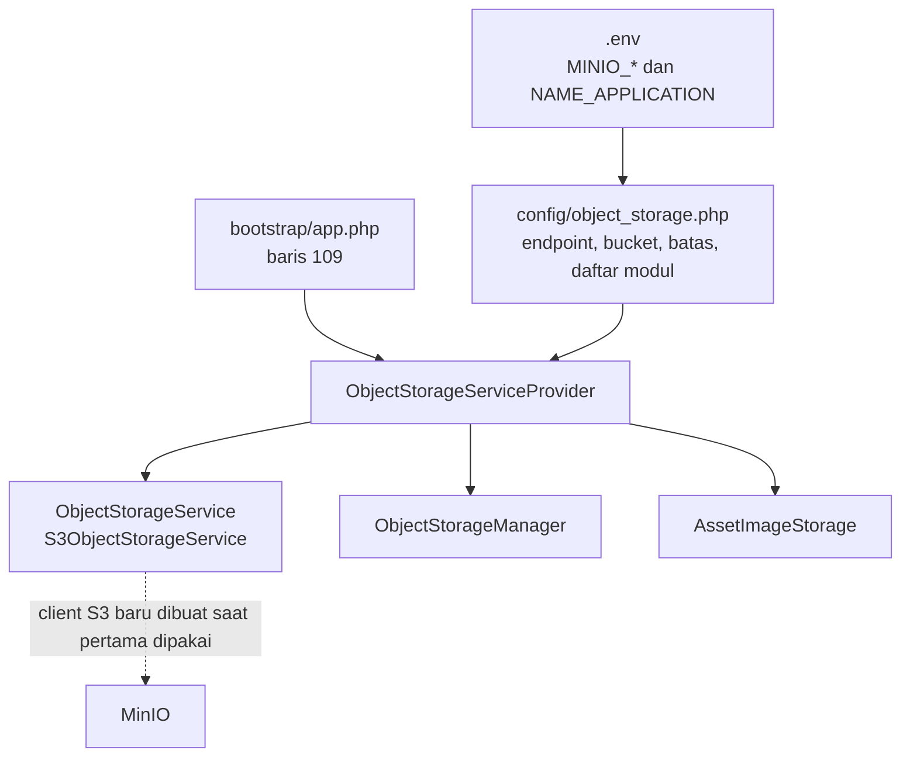
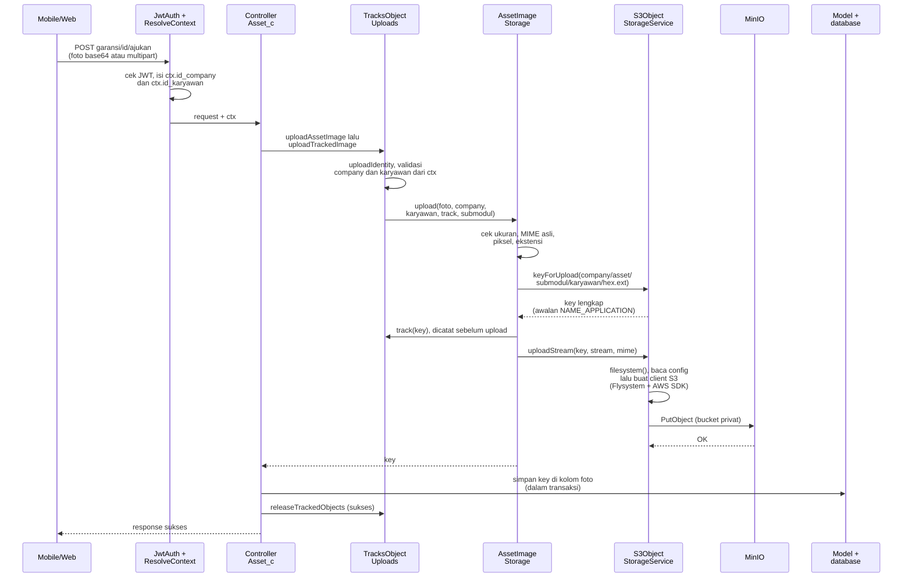
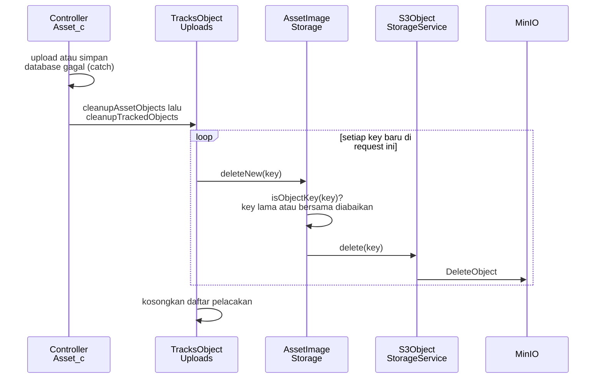
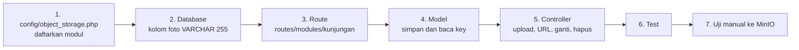

# Dokumentasi Teknis — MinIO Object Storage (API)

> Dokumen ini disusun **dari source code lokal** `API/` (Lumen) per 9 Oktober 2026, dan merangkum `API/docs/asset-object-storage.md` (CASE-20261009-ASSET-MINIO) ke bahasa Indonesia yang lebih mudah dibaca.
> Cakupan implementasi saat ini: **foto/bukti asset** pada modul Asset (garansi, perbaikan, disposal). Bagian yang belum ditemukan ditandai **⚠️ Belum ditemukan**, asumsi ditandai **⚠️ Asumsi**.
> Semua contoh key, ID, dan nilai konfigurasi adalah **data sintetis**. Nilai asli di `.env` tidak ditulis di sini.

---

## 1. Informasi Dokumen

| Informasi | Nilai |
|---|---|
| Nama Fitur | Penyimpanan file/foto ke MinIO (S3-compatible) |
| Modul yang memakai | Asset: Klaim Garansi (PML03), Perbaikan (PML02), Disposal (PML04) |
| Backend | Lumen ^10, PHP ^8.1 |
| Library | `aws/aws-sdk-php ^3`, `league/flysystem ^3`, `league/flysystem-aws-s3-v3 ^3` |
| Konfigurasi | `API/config/object_storage.php` + variabel `.env` |
| Kode utama | `app/Support/Storage/*` (termasuk `ObjectStorageManager` dan `ModuleImageStorage`), `app/Traits/TracksObjectUploads.php`, `app/Support/Asset/AssetImageStorage.php`, `app/Providers/ObjectStorageServiceProvider.php`, `app/Http/Controllers/Asset/Asset_c.php` |
| Test otomatis | `tests/Asset/AssetObjectStorageTest.php` (15 test) dan `tests/Storage/ObjectStorageManagerTest.php` (6 test); memakai fake storage, tidak butuh MinIO/SQL asli |
| Mobile | Tidak ada perubahan. Kontrak API tetap sama |
| Status verifikasi | ⚠️ Koneksi ke MinIO nyata **belum diverifikasi otomatis**; test hanya memakai fake storage dan signing offline |

## 2. Quick Overview

Sebelumnya foto asset disimpan di disk lokal server. Sekarang foto baru diunggah ke **bucket MinIO privat**. Database hanya menyimpan **key object** (path relatif di dalam bucket). Saat detail transaksi dibuka, API membuat **presigned URL** sementara (default 15 menit) dan mengirimkannya di field `*_url` yang sudah ada, sehingga aplikasi mobile tidak perlu diubah.

| Aspek | Ringkasan |
|---|---|
| Bucket | Privat; akses baca hanya lewat presigned URL |
| Format file | JPEG, PNG, WebP (dideteksi dari isi file, bukan nama/ekstensi dari client) |
| Input upload | Base64 (mentah atau `data:image/...;base64,`) atau multipart |
| Batas ukuran | 5 MB per gambar (default) |
| Batas resolusi | 25.000.000 piksel (lebar × tinggi) |
| Masa berlaku URL | 900 detik (default), boleh 1 s.d. 604800 detik |
| Data lama | Tetap terbaca (file lokal lewat URL `WEB` lama; object lama lewat key aslinya) |

## 3. Arsitektur

```
Mobile/Web ──(base64 / multipart)──► Controller Asset (Asset_c)
                                         │  identitas dari JWT (ResolveContext)
                                         ▼
                                  AssetImageStorage
                                  - validasi gambar (ukuran, MIME, piksel)
                                  - susun key unik
                                  - lacak key baru untuk kompensasi
                                         ▼
                              ObjectStorageService (interface)
                                         ▼
                              S3ObjectStorageService ──► MinIO bucket privat
                                                         (Flysystem + AWS SDK)

Baca:  detail response ─► AssetImageStorage::url() ─► presigned GET URL (offline signing)
```

| Komponen | Peran |
|---|---|
| `ObjectStorageService` | Interface: `keyForUpload`, `uploadStream`, `readStream`, `exists`, `delete`, `temporaryUrl` |
| `S3ObjectStorageService` | Implementasi S3/MinIO. Client dibuat **lazy** (hanya saat dipakai pertama kali) |
| `ObjectStorageConfigurationException` | Dilempar bila konfigurasi kosong atau tidak valid |
| `ObjectStorageManager` | **Pintu tunggal untuk fitur mana pun**: `->for('<modul>')` mengembalikan layanan gambar milik modul tersebut (bagian 15) |
| `ModuleImageStorage` | Validasi gambar, susun key, upload, hapus, dan pembuatan URL untuk satu modul. Dipakai semua modul |
| `TracksObjectUploads` (trait) | Melacak object yang baru diunggah dalam satu request dan menghapusnya bila proses gagal |
| `AssetImageStorage` | Modul `asset` di atas `ModuleImageStorage`: submodul garansi/perbaikan/disposal, key historis `asset/object/...`, dan fallback URL file lokal lama |
| `ObjectStorageServiceProvider` | Mendaftarkan tiga singleton (service, manager, asset) ke container; dipanggil dari `bootstrap/app.php` |

Karena client dibuat lazy, konfigurasi MinIO yang kosong **tidak mengganggu** request non-asset maupun pembacaan data asset lama. Hanya **upload baru** yang gagal.

### Alur file yang dijalankan

**A. Saat aplikasi menyala (sekali, tanpa menghubungi MinIO)**



**B. Upload file** (contoh: ajukan klaim garansi dengan foto tanda terima)



**C. Ambil file (presigned URL)** (contoh: buka detail transaksi)

```mermaid
sequenceDiagram
    participant C as Mobile/Web
    participant K as Controller<br/>Asset_c
    participant D as Model<br/>fotoUrl
    participant I as AssetImage<br/>Storage
    participant S as S3Object<br/>StorageService
    participant O as MinIO

    C->>K: GET detail transaksi
    K->>D: ambil data + key foto<br/>dari database
    D->>I: url(key)
    I->>I: isObjectKey(key)?
    alt key object MinIO
        I->>S: temporaryUrl(key, sekarang + TTL)
        S->>S: tanda tangan offline,<br/>tanpa request ke MinIO
        S-->>I: presigned URL
    else path lokal lama
        I->>I: fallback Uploads_c<br/>(file di disk server)
    end
    I-->>D: URL
    D-->>K: data + field *_url
    K-->>C: response detail
    C->>O: GET presigned URL (langsung ke MinIO)
    O-->>C: file gambar
```



**D. Hapus file** (hanya kompensasi saat proses gagal, belum ada endpoint hapus untuk pengguna)



Ringkasan file yang dilewati per langkah:

| Langkah | Urutan file |
|---|---|
| Boot | `.env` → `config/object_storage.php` → `bootstrap/app.php` → `ObjectStorageServiceProvider` |
| Upload | Route → `JwtAuth` → `ResolveContext` → Controller (`Asset_c`) → `TracksObjectUploads` → `AssetImageStorage` / `ModuleImageStorage` → `S3ObjectStorageService` → Flysystem + AWS SDK → MinIO → Model (simpan key) |
| Ambil URL | Controller → Model (`fotoUrl`) → `AssetImageStorage` / `ModuleImageStorage` → `S3ObjectStorageService` (tanda tangan offline) → client mengunduh langsung dari MinIO |
| Hapus | Controller (catch) → `TracksObjectUploads` → `AssetImageStorage` / `ModuleImageStorage` → `S3ObjectStorageService` → MinIO |

Untuk fitur baru, alurnya sama. Yang berbeda hanya Controller dan Model milik fitur itu, serta `ObjectStorageManager::for('<modul>')` yang menggantikan `AssetImageStorage` sebagai pintu masuk.

## 4. Konfigurasi

Semua nilai dibaca dari `.env` lewat `config/object_storage.php`.

| Variabel `.env` | Key config | Default | Fungsi |
|---|---|---|---|
| `NAME_APPLICATION` | `application_name` | kosong | Segmen folder aplikasi di awal key baru |
| `MINIO_ENDPOINT` | `endpoint` | kosong | URL MinIO yang bisa dijangkau API **dan** client |
| `MINIO_ACCESS_KEY` | `access_key` | kosong | Access key akun layanan |
| `MINIO_SECRET_KEY` | `secret_key` | kosong | Secret key akun layanan |
| `MINIO_BUCKET` | `bucket` | kosong | Nama bucket (harus sudah ada dan privat) |
| `MINIO_REGION` | `region` | `us-east-1` | Region untuk signature |
| `MINIO_USE_PATH_STYLE_ENDPOINT` | `path_style` | `true` | Path-style addressing (wajib untuk MinIO) |
| `MINIO_URL_TTL_SECONDS` | `ttl` | `900` | Masa berlaku presigned URL (1–604800) |
| `MINIO_ASSET_MAX_UPLOAD_BYTES` | `max_bytes` | `5242880` | Batas ukuran gambar hasil decode |
| `MINIO_ASSET_MAX_IMAGE_PIXELS` | `max_pixels` | `25000000` | Batas lebar × tinggi |

Syarat konfigurasi:

- `endpoint`, `access_key`, `secret_key`, `bucket`, `region` wajib terisi.
- `endpoint` harus `http`/`https`, punya host, **tanpa** user/password, query, atau fragment.
- Bucket harus **privat**; jangan aktifkan public policy.
- Akun layanan hanya butuh izin baca, tulis, dan hapus pada prefix yang dipakai.
- Hostname di URL bertanda tangan tidak boleh diubah (mis. oleh proxy), karena signature akan tidak cocok.
- Simpan kredensial di server/secret manager, **jangan di-commit**.

**Modul** didaftarkan di `config/object_storage.php` pada kunci `modules`. Menambah fitur baru berarti menambah satu entri di sana, tanpa variabel `.env` baru:

| Kunci per modul | Fungsi |
|---|---|
| `submodules` | Daftar sub-folder yang diizinkan; kosong berarti modul tanpa submodul |
| `max_bytes`, `max_pixels`, `ttl` | Opsional. Menimpa batas umum di atas untuk modul itu saja |
| `class` | Opsional. Kelas khusus bila modul punya aturan sendiri (hanya `asset`) |

⚠️ **Catatan:** `API/.env.example` saat ini **belum memuat** variabel `MINIO_*` dan `NAME_APPLICATION`. Disarankan menambahkannya (dengan nilai placeholder) agar developer baru tahu variabel apa saja yang dibutuhkan.

## 5. Format Key Object

Key baru dibuat sekali, disimpan ke database apa adanya, lalu dipakai tanpa diubah untuk baca/hapus/signing.

```
NAME_APPLICATION/id_company/asset/{garansi|perbaikan|disposal}/id_karyawan/<32 hex acak>.<ext>
```

Contoh sintetis:

- `profesional_v3/COMP01/asset/garansi/EMP02/0123456789abcdef0123456789abcdef.png`
- `profesional_v3/COMP01/asset/perbaikan/EMP02/1123456789abcdef0123456789abcdef.jpg`
- `profesional_v3/COMP01/asset/disposal/EMP02/2123456789abcdef0123456789abcdef.webp`

Aturan:

| Aturan | Detail |
|---|---|
| `NAME_APPLICATION` | Opsional. Bila kosong, segmen ini dihilangkan |
| Segmen aplikasi, company, karyawan | 1–128 karakter ASCII huruf/angka/`_`/`-`, diawali huruf atau angka. Titik, `/`, `\`, spasi, dan karakter kontrol ditolak |
| `id_karyawan` | **Selalu karyawan yang sedang login (pengunggah)**, termasuk admin. Bukan pemilik asset, PIC, atau `users.id_user` |
| Nama file | 16 byte acak (`random_bytes`) dalam 32 karakter hex huruf kecil |
| Ekstensi | `jpg`, `png`, `webp`, ditentukan dari isi file |
| Panjang total | Maksimal **255 karakter** (sesuai kolom database). Bila lebih, upload ditolak sebelum menulis apa pun |

Identitas company dan karyawan diambil dari JWT → `ResolveContext` → `ctx.id_company` dan `ctx.id_karyawan`. Nilai dari request body **tidak** dipakai.

## 6. Alur Upload

Dipakai oleh lima endpoint POST yang sudah ada:

| Endpoint | Field gambar |
|---|---|
| `garansi/{id}/ajukan` dan `karyawan/garansi/{id}/ajukan` | `assets.*.foto_tanda_terima` |
| `perbaikan/{id}/kirim` dan `karyawan/perbaikan/{id}/kirim` | `assets.*.foto_tanda_terima` |
| `disposal/{id}/pelaksanaan` | `file_bukti` |

Langkah di `AssetImageStorage::upload()`:

1. Validasi identitas pengunggah (company dan karyawan).
2. Baca gambar: `UploadedFile` (multipart) atau string base64. Base64 harus ketat; data-URI harus bertipe `image/jpeg|png|webp` dan cocok dengan isi file.
3. Cek ukuran (maks `max_bytes`) dan tolak file kosong.
4. Cek isi sebenarnya dengan `getimagesizefromstring` dan `finfo`; MIME harus JPEG/PNG/WebP, dan lebar × tinggi tidak melebihi `max_pixels`.
5. Susun key baru (bagian 5).
6. **Catat key ke daftar pelacak sebelum upload**, lalu `uploadStream` dengan `visibility: private` dan `ContentType` sesuai MIME.

Bila input kosong, gambar lama yang sudah tersimpan dipertahankan. Client **tidak bisa** mengirim key atau URL yang sudah ada sebagai upload.

## 7. Alur Baca (Presigned URL)

`AssetImageStorage::url($path)` menentukan perlakuan berdasarkan bentuk key:

| Nilai di database | Perlakuan |
|---|---|
| Key object (layout baru, atau layout lama `asset/object/...`, dengan/tanpa prefix aplikasi) | Dibuat presigned GET URL dengan TTL dari config |
| Path lokal lama (mis. `asset/garansi/COMP01/file.png`) | Tetap memakai URL `WEB` lama dan pengecekan file lokal; kosong bila file tidak ada |

Hal yang perlu diketahui:

- URL dibuat **offline** (tanpa menghubungi MinIO dan tanpa HEAD). Bila object dihapus dari luar, URL tetap terbentuk tetapi client menerima 404.
- Presigned URL adalah *bearer capability*: siapa pun yang memegangnya bisa mengunduh sampai kedaluwarsa. **Jangan dipublikasikan atau dicatat di log.**
- Setelah URL kedaluwarsa, client harus memanggil ulang endpoint detail untuk mendapat URL baru. Tidak ada header otorisasi tambahan.
- Key lama tanpa prefix tetap ditandatangani di key aslinya, dan nama aplikasi lama tetap dikenali walau `NAME_APPLICATION` berubah.

## 8. Konsistensi Data dan Kompensasi

MinIO dan database **tidak atomik**. Pengamannya:

1. Cek aktor/company/status dilakukan di transaksi preflight yang di-lock, **sebelum** upload, lalu dicek ulang di transaksi persistensi.
2. Upload **tidak pernah** dijalankan di dalam closure transaksi yang bisa di-retry.
3. Hanya key yang **baru dibuat** yang dilacak (termasuk upload yang error di jaringan padahal mungkin sudah diterima server).
4. Bila salah satu upload atau penyimpanan DB gagal, `cleanupAssetObjects()` menghapus key baru tersebut (best-effort).
5. Setelah commit sukses, pelacakan dilepas sebelum notifikasi dikirim; gagal notifikasi **tidak** menghapus gambar yang sudah tersimpan.
6. File lama atau yang dipakai bersama tidak pernah dihapus (termasuk snapshot `asset_data.foto_dokumen_garansi` yang masih legacy).

Risiko tersisa: proses mati mendadak, commit DB yang tidak pasti, atau gagal kompensasi dapat menyisakan **object yatim** di bucket. Log kompensasi hanya memuat key yang dibuat. Tidak ada purge otomatis maupun worker retry, jadi rekonsiliasi manual (cek referensi di database sebelum menghapus) diperlukan.

## 9. Penanganan Error

| Kondisi | Respons |
|---|---|
| Gambar tidak valid, terlalu besar, atau format salah | `BUSINESS_RULE_VIOLATION` (422) |
| Identitas pengunggah tidak valid/tidak tersedia | `BUSINESS_RULE_VIOLATION` (422), sebelum ada tulis ke storage atau SQL |
| Validasi request biasa | `VALIDATION_ERROR` (422) |
| Konfigurasi MinIO kosong/tidak valid | `SYSTEM_ERROR` (500) dengan pesan konfigurasi yang aman. **Tidak ada fallback menulis ke disk lokal** |
| Operasi MinIO gagal | `SYSTEM_ERROR` (500) pesan umum. URL, signature, dan kredensial SDK tidak dibocorkan ke log (exception dibungkus ulang) |

Timeout client S3: connect 5 detik, total 30 detik.

## 10. Keamanan

- Bucket privat; objek ditulis dengan `visibility: private`.
- Tipe file ditentukan dari isi file, bukan dari nama file atau MIME dari client.
- Segmen key divalidasi ketat (anti path traversal); nilai tidak pernah di-trim atau dinormalisasi.
- Kredensial hanya dari environment; log tidak memuat URL bertanda tangan maupun kredensial.
- Akun layanan MinIO sebaiknya dibatasi ke bucket/prefix terkait dengan hak minimal.

## 11. Panduan Operasional

**Setup awal (menyiapkan server baru)**

1. Pastikan bucket sudah dibuat di MinIO dan berstatus privat.
2. Buat akun layanan khusus dengan izin baca/tulis/hapus pada bucket.
3. Isi variabel `MINIO_*` dan `NAME_APPLICATION` di `.env` server.
4. Pastikan `MINIO_ENDPOINT` dapat dijangkau dari server API **dan** dari perangkat client (DNS dan TLS valid).
5. Bila client mengunduh dari browser dan memerlukan CORS, atur CORS di MinIO. ⚠️ Asumsi: aplikasi mobile tidak memerlukannya.
6. Uji manual: kirim satu foto lewat salah satu endpoint, lalu buka URL pada response detail.

**Mengganti `NAME_APPLICATION`**: aman. Object lama tetap terbaca di key aslinya; hanya upload baru yang memakai nama baru.

**Mengganti endpoint/bucket**: **bukan** migrasi otomatis. Key di database hanya bermakna di bucket yang sama. Memindahkan object atau menulis ulang key harus lewat migrasi terpisah yang disetujui.

**Troubleshooting**

| Gejala | Kemungkinan penyebab |
|---|---|
| 500 "Penyimpanan object belum dikonfigurasi" | Salah satu dari endpoint/access key/secret/bucket/region kosong |
| 500 "Endpoint penyimpanan object tidak valid" | Endpoint tanpa skema `http(s)`, atau memuat user/query/fragment |
| 500 "NAME_APPLICATION ... tidak valid" | Nilai berisi karakter terlarang atau lebih dari 128 karakter |
| 422 soal path melebihi 255 karakter | Kombinasi segmen aplikasi/company/karyawan terlalu panjang |
| URL gambar 403 `SignatureDoesNotMatch` | Hostname/endpoint diubah proxy, atau jam server menyimpang jauh |
| URL gambar 403 `Request has expired` | URL melewati TTL; ambil ulang detail |
| URL gambar 404 | Object dihapus di luar aplikasi, atau key/bucket berbeda dari yang tersimpan |

## 12. Pengujian

`tests/Asset/AssetObjectStorageTest.php` memakai fake storage, validasi gambar, test controller, dan signing S3 offline sehingga tidak butuh `.env`, MinIO, atau SQL.

```bash
cd API
vendor/bin/phpunit tests/Asset/AssetObjectStorageTest.php
```

Test modul generik ada di `tests/Storage/ObjectStorageManagerTest.php`:

```bash
cd API
vendor/bin/phpunit tests/Storage tests/Asset/AssetObjectStorageTest.php
```

Per 9 Oktober 2026, kedua perintah di atas lulus (21 test). Sebelum rilis, perlu diverifikasi manual: koneksi MinIO nyata, kebijakan bucket privat, CORS (bila perlu), serta integrasi end-to-end dengan JWT dan SQL (race pada persistensi). Jangan menjalankan suite integrasi DB yang ada terhadap resource yang belum dikonfirmasi.

## 13. Batasan dan Hal yang Belum Ada

- Yang sudah memakai MinIO baru modul **Asset** (garansi, perbaikan, disposal). `Uploads_c` dan modul lain belum disentuh; fitur baru memakai `ObjectStorageManager` (bagian 15).
- Lapisan generik saat ini hanya untuk **gambar** (JPEG, PNG, WebP). PDF dan dokumen belum didukung; `ObjectStorageService` mentah (`manager->raw()`) bisa dipakai untuk kebutuhan di luar gambar.
- ⚠️ Belum ada pembersihan otomatis object yatim, retry worker, atau migrasi file lokal lama ke MinIO.
- ⚠️ `.env.example` belum memuat variabel MinIO.
- ⚠️ Belum ada verifikasi koneksi MinIO nyata dalam pengujian otomatis.

## 14. Referensi Kode

| File | Isi |
|---|---|
| `API/config/object_storage.php` | Pemetaan variabel `.env` ke config |
| `API/app/Providers/ObjectStorageServiceProvider.php` | Registrasi singleton service (didaftarkan di `bootstrap/app.php`) |
| `API/app/Support/Storage/ObjectStorageService.php` | Interface storage |
| `API/app/Support/Storage/S3ObjectStorageService.php` | Implementasi S3/MinIO, validasi konfigurasi, presigned URL |
| `API/app/Support/Storage/ObjectStorageConfigurationException.php` | Exception konfigurasi |
| `API/app/Support/Storage/ObjectStorageManager.php` | Pintu tunggal: `for('<modul>')` |
| `API/app/Support/Storage/ModuleImageStorage.php` | Validasi gambar, key, upload, hapus, URL untuk satu modul |
| `API/app/Traits/TracksObjectUploads.php` | Pelacakan dan pembersihan object baru di controller |
| `API/app/Support/Asset/AssetImageStorage.php` | Modul asset di atas `ModuleImageStorage` |
| `API/tests/Storage/ObjectStorageManagerTest.php` | Test modul generik dan trait |
| `API/app/Http/Controllers/Asset/Asset_c.php` | `uploadAssetImage`, `assetUploadIdentity`, `cleanupAssetObjects` |
| `API/docs/asset-object-storage.md` | Catatan teknis asli (Inggris) |
| `API/tests/Asset/AssetObjectStorageTest.php` | Test otomatis |

## 15. Memakai di Fitur Baru

Panduan ini membangun satu fitur contoh dari nol sampai bisa **upload, ambil URL, ganti, dan hapus** foto. Fitur fiktifnya bernama **Kunjungan** (laporan kunjungan dengan satu foto bukti), modul storage `kunjungan`. Nama tabel, kolom, dan class di bawah adalah contoh sintetis; ganti dengan milik fitur Anda. Fitur baru **tidak perlu** menyentuh S3, Flysystem, atau kode asset.

### 15.1 Gambaran: apa yang dibuat



Aturan emas yang dipakai di semua langkah:

| Aturan | Artinya |
|---|---|
| **Database menyimpan key, bukan URL** | URL kedaluwarsa (default 15 menit). Key dibentuk sekali saat upload dan tidak pernah diubah |
| **Identitas dari JWT** | Company dan karyawan diambil dari `ctx`, bukan dari input request |
| **Upload dulu, simpan database kemudian** | Upload tidak boleh di dalam `DB::transaction`. Bila database gagal, object baru dihapus |
| **Hapus object lama sesudah commit** | Bila gagal menghapus, hanya menyisakan object yatim, data tetap benar |

### 15.2 Langkah 1: daftarkan modul

`config/object_storage.php`, tambah satu entri di `modules`:

```php
'modules' => [
    'asset' => [ /* sudah ada */ ],
    'kunjungan' => [
        'submodules' => ['bukti'],      // sub-folder yang diizinkan, [] bila tidak perlu
        'max_bytes'  => 3145728,        // opsional: 3 MB, menimpa batas umum (5 MB)
        // 'max_pixels' => 12000000,    // opsional
        // 'ttl' => 600,                // opsional: masa berlaku URL 10 menit
    ],
],
```

Tidak ada variabel `.env` baru. Bucket, kredensial, dan `NAME_APPLICATION` dipakai bersama. Key yang terbentuk:

```
NAME_APPLICATION/id_company/kunjungan/bukti/id_karyawan/<32 hex>.<ext>
```

### 15.3 Langkah 2: database

Kolom penyimpan foto harus muat **255 karakter** (batas panjang key). Isinya key lengkap seperti di atas. Karena skema proyek diubah lewat SQL manual, siapkan SQL dan jalankan sendiri (contoh, sesuaikan dengan tabel Anda):

```sql
CREATE TABLE kunjungan (
    id            VARCHAR(36)  NOT NULL PRIMARY KEY,
    id_company    VARCHAR(50)  NOT NULL,
    id_karyawan   VARCHAR(50)  NOT NULL,
    catatan       VARCHAR(255) NULL,
    foto_bukti    VARCHAR(255) NULL,      -- key object MinIO, BUKAN URL
    created_at    DATETIME     NOT NULL
);
```

### 15.4 Langkah 3: route

Ikuti pola modul lain (`routes/modules/asset/`): satu folder per modul dengan `_config.php` dan file route.

`routes/modules/kunjungan/_config.php`

```php
<?php

return [
    // namespace tidak perlu: controller berada langsung di App\Http\Controllers
    'middleware' => ['jwt.api', 'jwt.ctx'],   // jwt.ctx mengisi ctx.id_company dan ctx.id_karyawan
];
```

`routes/modules/kunjungan/RouteKunjungan.php`

```php
<?php

use Laravel\Lumen\Routing\Router;

/** @var Router $router */

// Awalan URL otomatis /kunjungan (nama folder modul), jadi path di bawah relatif terhadap itu.
$router->post('tambah', 'Kunjungan_c@store');                 // POST   /kunjungan/tambah
$router->get('{id}', 'Kunjungan_c@show');                     // GET    /kunjungan/{id}
$router->post('{id}/foto', 'Kunjungan_c@gantiFoto');          // POST   /kunjungan/{id}/foto
$router->delete('{id}', 'Kunjungan_c@destroy');               // DELETE /kunjungan/{id}
```

Aturan yang dipakai pemuat route proyek (`RouteLoader`): awalan URL diambil dari **nama folder** modul, `namespace` boleh dikosongkan, dan `middleware` digabung dari `routes/modules/_config.php` (`localization`) ditambah milik modul. Modul asset memakai namespace `Asset` karena controller-nya berada di sub-folder; modul absensi tidak punya `_config.php` sendiri. ⚠️ Pastikan route muncul pada daftar route dan test route yang menghitung jumlah route (sudah gagal sebelum perubahan ini karena angka 343) diperbarui bila Anda menjaganya.

### 15.5 Langkah 4: model

`app/Models/Kunjungan_m.php`. Model hanya menyimpan dan membaca **key**, tidak tahu apa pun soal MinIO.

```php
<?php

namespace App\Models;

use Illuminate\Support\Facades\DB;
use Illuminate\Support\Str;

class Kunjungan_m
{
    public static function create(string $company, string $karyawan, ?string $catatan, string $fotoKey): object
    {
        $id = (string) Str::uuid();
        DB::transaction(function () use ($id, $company, $karyawan, $catatan, $fotoKey): void {
            DB::table('kunjungan')->insert([
                'id' => $id, 'id_company' => $company, 'id_karyawan' => $karyawan,
                'catatan' => $catatan, 'foto_bukti' => $fotoKey, 'created_at' => now(),
            ]);
        });
        return self::find($company, $id);
    }

    public static function find(string $company, string $id): ?object
    {
        return DB::table('kunjungan')->where('id_company', $company)->where('id', $id)->first();
    }

    public static function updateFoto(string $company, string $id, string $fotoKey): void
    {
        DB::table('kunjungan')->where('id_company', $company)->where('id', $id)->update(['foto_bukti' => $fotoKey]);
    }

    public static function delete(string $company, string $id): void
    {
        DB::table('kunjungan')->where('id_company', $company)->where('id', $id)->delete();
    }
}
```

### 15.6 Langkah 5: controller (upload, URL, ganti, hapus)

`app/Http/Controllers/Kunjungan_c.php`

```php
<?php

namespace App\Http\Controllers;

use App\Libraries\ApiResponse;
use App\Models\Kunjungan_m;
use App\Support\Storage\ModuleImageStorage;
use App\Support\Storage\ObjectStorageConfigurationException;
use App\Support\Storage\ObjectStorageManager;
use App\Traits\TracksObjectUploads;
use Illuminate\Http\JsonResponse;
use Illuminate\Http\Request;
use Illuminate\Support\Facades\Log;
use InvalidArgumentException;
use Throwable;

class Kunjungan_c extends BaseController
{
    use TracksObjectUploads;

    /** Satu-satunya titik masuk ke storage untuk fitur ini. */
    private function images(): ModuleImageStorage
    {
        return app(ObjectStorageManager::class)->for('kunjungan');
    }

    /** Foto dari multipart (file) atau JSON (base64 / data-URI). */
    private function foto(Request $request)
    {
        return $request->file('foto') ?? $request->input('foto');
    }

    /** Ubah key database menjadi URL sementara untuk response. */
    private function present(object $row): array
    {
        return [
            'id' => $row->id,
            'catatan' => $row->catatan,
            'foto_bukti_url' => $row->foto_bukti ? $this->images()->url($row->foto_bukti) : '',
        ];
    }

    private function failure(Throwable $e, string $log): JsonResponse
    {
        if ($e instanceof InvalidArgumentException) {      // gambar tidak valid, identitas tidak valid
            return ApiResponse::error('BUSINESS_RULE_VIOLATION', $e->getMessage());
        }
        Log::error($log, ['exception' => $e]);
        return ApiResponse::error('SYSTEM_ERROR', $e instanceof ObjectStorageConfigurationException
            ? $e->getMessage() : 'Terjadi kesalahan saat memproses kunjungan.');
    }

    // ---------- UPLOAD: POST kunjungan/tambah ----------
    public function store(Request $request): JsonResponse
    {
        if ($error = $this->validateRequest($request, ['catatan' => 'nullable|string|max:255', 'foto' => 'required'])) {
            return $error;
        }
        $ctx = $request->attributes->get('ctx');
        $images = $this->images();
        try {
            // 1) unggah dulu (di luar transaksi); key baru otomatis dilacak
            $key = $this->uploadTrackedImage($images, $this->foto($request), $request, 'bukti');
            // 2) simpan key ke database
            $row = Kunjungan_m::create((string) $ctx->id_company, (string) $ctx->id_karyawan, $request->input('catatan'), $key);
            // 3) sukses: object baru dipertahankan
            $this->releaseTrackedObjects();
            return ApiResponse::success('CREATED', $this->present($row));
        } catch (Throwable $e) {
            $this->cleanupTrackedObjects($images);        // gagal: hapus object baru yang yatim
            return $this->failure($e, 'Gagal menyimpan kunjungan.');
        }
    }

    // ---------- AMBIL URL: GET kunjungan/{id} ----------
    public function show(Request $request, string $id): JsonResponse
    {
        $ctx = $request->attributes->get('ctx');
        try {
            $row = Kunjungan_m::find((string) $ctx->id_company, $id);
            return $row === null
                ? ApiResponse::error('NOT_FOUND', 'Kunjungan tidak ditemukan.')
                : ApiResponse::success('SUCCESS', $this->present($row));   // URL dibuat di sini, offline
        } catch (Throwable $e) {
            return $this->failure($e, 'Gagal membaca kunjungan.');
        }
    }

    // ---------- GANTI: POST kunjungan/{id}/foto ----------
    public function gantiFoto(Request $request, string $id): JsonResponse
    {
        if ($error = $this->validateRequest($request, ['foto' => 'required'])) {
            return $error;
        }
        $ctx = $request->attributes->get('ctx');
        $images = $this->images();
        try {
            $row = Kunjungan_m::find((string) $ctx->id_company, $id);
            if ($row === null) {
                return ApiResponse::error('NOT_FOUND', 'Kunjungan tidak ditemukan.');
            }
            $key = $this->uploadTrackedImage($images, $this->foto($request), $request, 'bukti');
            Kunjungan_m::updateFoto((string) $ctx->id_company, $id, $key);
            $this->releaseTrackedObjects();
        } catch (Throwable $e) {
            $this->cleanupTrackedObjects($images);
            return $this->failure($e, 'Gagal mengganti foto kunjungan.');
        }
        $this->deleteOld($images, $row->foto_bukti);       // hanya SESUDAH database tersimpan
        return ApiResponse::success('UPDATED', $this->present(Kunjungan_m::find((string) $ctx->id_company, $id)));
    }

    // ---------- HAPUS: DELETE kunjungan/{id} ----------
    public function destroy(Request $request, string $id): JsonResponse
    {
        $ctx = $request->attributes->get('ctx');
        try {
            $row = Kunjungan_m::find((string) $ctx->id_company, $id);
            if ($row === null) {
                return ApiResponse::error('NOT_FOUND', 'Kunjungan tidak ditemukan.');
            }
            Kunjungan_m::delete((string) $ctx->id_company, $id);   // hapus data dulu
        } catch (Throwable $e) {
            return $this->failure($e, 'Gagal menghapus kunjungan.');
        }
        $this->deleteOld($this->images(), $row->foto_bukti);       // lalu hapus object-nya
        return ApiResponse::success('DELETED');
    }

    /** Hapus object lama sesudah commit. Gagal hapus tidak boleh menggagalkan request. */
    private function deleteOld(ModuleImageStorage $images, ?string $key): void
    {
        if ($key === null || $key === '') {
            return;
        }
        try {
            $images->deleteNew($key);      // key milik modul lain atau file lokal otomatis diabaikan
        } catch (Throwable $e) {
            Log::warning('Object kunjungan lama gagal dihapus.', ['key' => $key]);
        }
    }
}
```

Nama method `deleteNew` berlaku untuk **semua** key milik modul itu, baru maupun lama. Key dari modul lain atau path file lokal tidak dikenali sehingga tidak dihapus.

Ringkasan: endpoint → pemanggilan storage:

| Endpoint | Pemanggilan storage | Urutan yang benar |
|---|---|---|
| `POST kunjungan/tambah` | `uploadTrackedImage` → `releaseTrackedObjects` / `cleanupTrackedObjects` | upload → simpan database → release |
| `GET kunjungan/{id}` | `images()->url($key)` | baca database → buat URL |
| `POST kunjungan/{id}/foto` | upload baru, lalu `deleteNew($keyLama)` | upload → ubah database → release → hapus lama |
| `DELETE kunjungan/{id}` | `deleteNew($key)` | hapus database → hapus object |

### 15.7 Langkah 6: test

Test tidak butuh MinIO. Pasang `ObjectStorageManager` dengan storage palsu (pola yang sama dengan `tests/Asset/AssetObjectStorageTest.php`; contoh class palsu `InMemoryObjectStorage` ada di `tests/Storage/ObjectStorageManagerTest.php`).

```php
$fake = new InMemoryObjectStorage('app');                       // salin class palsu ke test Anda
$container = new \Illuminate\Container\Container();
\Illuminate\Container\Container::setInstance($container);
$container->instance(ObjectStorageManager::class, new ObjectStorageManager($fake, ['modules' => [
    'kunjungan' => ['submodules' => ['bukti']],
]]));

$controller = new Kunjungan_c();
$request = new \Illuminate\Http\Request(['foto' => self::PNG, 'catatan' => 'uji']);
$request->attributes->set('ctx', (object) ['id_company' => 'COMP', 'id_karyawan' => 'EMP']);

// Model memakai DB: untuk skenario 2 dan 4 gunakan database test atau mock Kunjungan_m.
// yang perlu dibuktikan:
// 1. store sukses  -> $fake->objects berisi 1 key "app/COMP/kunjungan/bukti/EMP/<hex>.png"
// 2. store gagal di database -> $fake->deleted berisi key tersebut, $fake->objects kosong
// 3. gantiFoto sukses -> key lama ada di $fake->deleted, key baru ada di $fake->objects
// 4. gantiFoto gagal di database -> key baru terhapus, key lama TETAP ada
// 5. foto bukan gambar -> response 422 BUSINESS_RULE_VIOLATION dan $fake->objects kosong
```

Jalankan: `vendor/bin/phpunit tests/Storage tests/Kunjungan`.

### 15.8 Langkah 7: uji manual ke MinIO nyata

Header standar proyek: `api-key`, `id-company`, `id-karyawan`, `locale` (nilai di bawah sintetis).

```bash
# upload (multipart)
curl -X POST "$API/kunjungan/tambah" -H "api-key: ..." -H "id-company: COMP01" -H "id-karyawan: EMP02" \
     -F "catatan=uji" -F "foto=@selfie.png"

# ambil URL lalu unduh fotonya
curl "$API/kunjungan/<id>" -H "api-key: ..." -H "id-company: COMP01" -H "id-karyawan: EMP02"
curl -o hasil.png "<foto_bukti_url dari response>"
```

Periksa di MinIO bahwa object berada di `NAME_APPLICATION/COMP01/kunjungan/bukti/EMP02/<hex>.png`, URL berhasil diunduh, dan setelah `DELETE` object tersebut hilang.

### 15.9 Referensi cepat

| Pemanggilan | Hasil |
|---|---|
| `app(ObjectStorageManager::class)->for('<modul>')` | Layanan gambar milik modul (`ModuleImageStorage`) |
| `$this->uploadTrackedImage($images, $foto, $request, '<submodul>')` | Validasi, upload, melacak key; mengembalikan key untuk database |
| `$this->releaseTrackedObjects()` | Sukses: lepas pelacakan, object dipertahankan |
| `$this->cleanupTrackedObjects($images)` | Gagal: hapus object yang baru diunggah di request ini |
| `$images->url($key)` | Presigned URL; string kosong untuk path non-object |
| `$images->deleteNew($key)` | Hapus object milik modul ini |
| `app(ObjectStorageManager::class)->raw()` | `ObjectStorageService` mentah (di luar gambar) |

Pemetaan exception ke response:

| Exception | Penyebab | Response |
|---|---|---|
| `InvalidArgumentException` | Gambar tidak valid atau terlalu besar, submodul salah, identitas JWT tidak valid, path terlalu panjang | `BUSINESS_RULE_VIOLATION` (422) |
| `ObjectStorageConfigurationException` | Konfigurasi MinIO kosong atau `NAME_APPLICATION` tidak valid | `SYSTEM_ERROR` (500), pesan konfigurasi aman |
| `RuntimeException` | Operasi MinIO gagal (jaringan, izin) | `SYSTEM_ERROR` (500), pesan umum |
| `InvalidArgumentException` "belum didaftarkan" | Modul belum ada di `config/object_storage.php` | Kesalahan pemrograman, periksa Langkah 1 |

### 15.10 Kesalahan yang sering terjadi

| Kesalahan | Akibat | Cara benar |
|---|---|---|
| Menyimpan URL di database | Foto tidak terbuka setelah 15 menit | Simpan key, buat URL saat membaca |
| Upload di dalam `DB::transaction` | Transaksi di-retry, object terunggah berkali-kali | Upload sebelum transaksi |
| Lupa `releaseTrackedObjects()` setelah sukses | Pelacakan tersisa dan ikut terhapus pada `cleanup` berikutnya di instance yang sama | Panggil setelah database tersimpan |
| Lupa `cleanupTrackedObjects()` di `catch` | Object yatim di bucket | Selalu panggil di `catch` |
| Menghapus object lama sebelum database tersimpan | Data menunjuk ke object yang sudah hilang bila database gagal | Hapus object lama **sesudah** commit |
| Memakai `id_company` dari request | Pengunggah bisa menulis ke folder company lain | Pakai `ctx` (trait sudah melakukannya) |
| Kolom foto `VARCHAR(100)` | Key terpotong atau gagal simpan | `VARCHAR(255)` |
| Lupa mendaftarkan modul di config | `InvalidArgumentException` "belum didaftarkan" | Langkah 1 |

### 15.11 Daftar file untuk fitur baru

| File | Status | Isi |
|---|---|---|
| `config/object_storage.php` | **Wajib, diubah** | Satu entri di `modules` (Langkah 1) |
| `routes/modules/<fitur>/...` | **Wajib, baru** | Route dan `_config.php` (Langkah 3) |
| Model fitur | **Wajib, baru** | Simpan dan baca **key** (Langkah 4) |
| Controller fitur | **Wajib, baru** | `use TracksObjectUploads`, upload, URL, ganti, hapus (Langkah 5) |
| SQL kolom foto | **Wajib** | `VARCHAR(255)`, dijalankan manual (Langkah 2) |
| `tests/<Fitur>/...Test.php` | Dianjurkan, baru | Upload, pembersihan, ganti, hapus (Langkah 6) |
| Dokumentasi fitur | Dianjurkan | Nama modul, submodul, kolom penyimpan key |

Yang **tidak perlu** dibuat atau diubah:

| File | Alasan |
|---|---|
| `.env` | Bucket, kredensial, dan `NAME_APPLICATION` dipakai bersama |
| `ObjectStorageServiceProvider.php` | Manager sudah terdaftar dan membaca `modules` dari config |
| `S3ObjectStorageService.php`, `ObjectStorageService.php` | Lapisan inti sudah generik |
| `ModuleImageStorage.php`, `ObjectStorageManager.php`, `TracksObjectUploads.php` | Dipakai apa adanya |
| `composer.json` | Library S3 dan Flysystem sudah terpasang |
| Aplikasi mobile | Cukup membaca field `*_url`; URL yang kedaluwarsa dimuat ulang lewat endpoint detail |

**Kasus khusus** (jarang): modul yang punya file lama di disk lokal atau key historis berformat sendiri butuh satu kelas turunan `ModuleImageStorage` seperti `app/Support/Asset/AssetImageStorage.php`, didaftarkan pada entri modul lewat kunci `class`. Modul baru tanpa data lama tidak membutuhkannya. Lapisan generik saat ini hanya untuk **gambar** (JPEG, PNG, WebP); untuk jenis file lain pakai `raw()`.

### 15.12 Urutan kerja yang disarankan

1. Daftarkan modul di `config/object_storage.php`.
2. Siapkan dan jalankan SQL kolom foto (`VARCHAR(255)`).
3. Buat model, lalu controller dan route.
4. Tulis test (upload, gagal, ganti, hapus) dan jalankan.
5. Uji manual satu foto ke MinIO nyata dan cek object terbentuk, terbuka lewat URL, dan hilang setelah dihapus.
